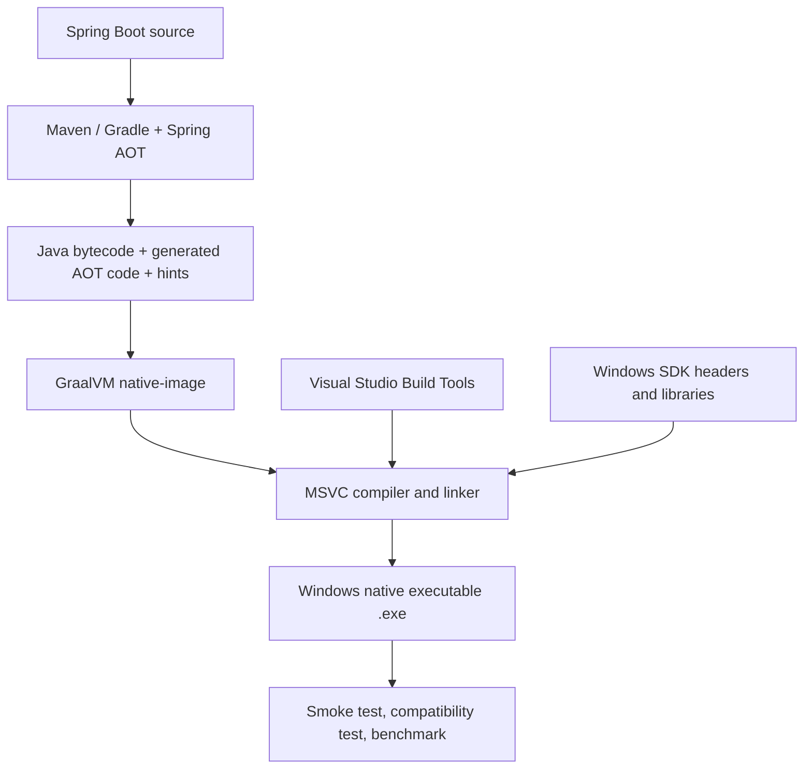
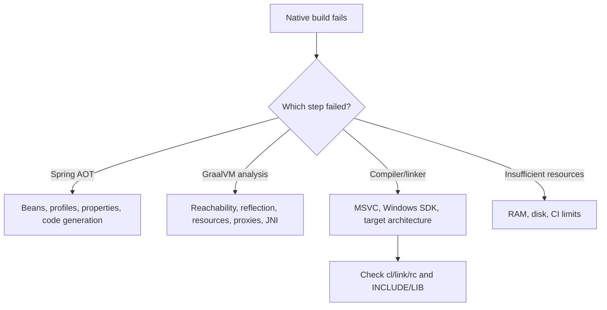

# MSVC, Visual Studio Build Tools, and Windows SDK on Windows

## 1. Why Does GraalVM Native Image Need C/C++ Tools on Windows?

In the **SPRING_BOOT_NATIVE_IMAGE** module, we use **Spring AOT** and **GraalVM Native Image** to turn a Spring Boot application into a native executable, then verify compatibility, startup time, memory usage, and container runnability. When building directly on Windows, in addition to the JDK and Maven/Gradle, the workflow requires an appropriate native compiler and linker toolchain.

Spring AOT generates Java code and metadata to support ahead-of-time analysis. GraalVM Native Image analyzes the program, emits machine code, and then requires a compiler/linker and system libraries to produce the final executable. On Windows with the MSVC toolchain, the typical components are:

- **MSVC (Microsoft Visual C++ toolset)**: the `cl.exe` compiler, `link.exe` linker, and supporting C/C++ tools and libraries.
- **Visual Studio Build Tools**: an installer providing C/C++ build workloads and components without requiring the full Visual Studio IDE.
- **Windows SDK**: headers, import libraries, and Windows tools required to link against operating system APIs. For example, the Windows SDK provides libraries such as `kernel32.lib` and tools targeting Windows.
- **Developer Command Prompt / Developer PowerShell**: shells initialized with the environment variables required for the compiler/linker to locate executables, headers, and libraries.

The exact component set and supported versions depend on the **GraalVM Native Image version**, **CPU architecture**, and build tools. Check the Windows prerequisites documentation for the GraalVM version you are using before installing.



**Important:** errors in the Spring AOT stage, reachability analysis errors, and MSVC linking errors are three distinct problem categories. Installing more of the Windows SDK can resolve missing header/library errors at link time; it will not automatically fix reflection metadata errors or `BeanCreationException` during AOT.

## 2. Role of Each Component

| Component | Primary Function | Signs When Missing or Misconfigured |
|---|---|---|
| GraalVM JDK with Native Image | Provides `java`, `javac`, `native-image` | `native-image` not found, incompatible version |
| Maven/Gradle and plugins | Invokes Spring AOT, prepares classpath, orchestrates native build | `native:compile` or `nativeCompile` task missing/fails |
| MSVC compiler `cl.exe` | Handles native compilation steps requiring the MSVC toolchain | `cl` not recognized or compiler detection error |
| MSVC linker `link.exe` | Links machine code into a Windows executable | `LNK...` errors, linker or library not found |
| Windows SDK | Windows API headers, libraries, resource tools | `LNK1104` or missing Windows SDK headers/libs |
| Developer shell | Sets `PATH`, `INCLUDE`, `LIB`, etc. | Tools exist on disk but are not found during the build |

A name like `link.exe` can collide with another executable on `PATH`. Verify the path of the **Microsoft linker**, not just the command name.

### Is Visual Studio IDE Required?

No. Installing **Visual Studio Build Tools** with compatible C++ components is normally sufficient for command-line pipelines. If Visual Studio IDE and the required C++ workload are already installed, that toolchain can also be used. What matters are the installed components and initialized paths, not the IDE GUI.

### Are Windows SDK and .NET SDK the Same Thing?

No. The Windows SDK provides headers and libraries for native Windows development. The .NET SDK serves .NET application development; installing the .NET SDK does not substitute for the Windows SDK/MSVC required by GraalVM Native Image.

## 3. Preparing a Windows x64 Environment

A common hands-on environment is 64-bit Windows, a GraalVM JDK with `native-image`, Maven/Gradle, and a Visual Studio Build Tools version compatible with Native Image requirements.

### Step 1 — Select Visual Studio Build Tools Components

In the Visual Studio Installer, choose the **Desktop development with C++** workload or an equivalent component set. Confirm the presence of:

1. **MSVC C++ x64/x86 build tools** of a version supported by GraalVM (including compiler and linker).
2. A compatible **Windows SDK** (for example, a supported Windows 10 SDK or Windows 11 SDK release).
3. Auxiliary native build components required by the toolchain and release documentation.

Workload names, MSVC toolset names, SDKs, and layout depend on the Visual Studio Installer version. Do not assume the newest version is always compatible with every older GraalVM release; prioritize **GraalVM's version support matrix**.

### Step 2 — Open the Developer Command Prompt for the Right Architecture

From the Start Menu, open a shell such as **x64 Native Tools Command Prompt for VS** or a Developer Command Prompt configured to target x64. In environments using `cmd.exe`, you can initialize it using `vcvars64.bat` from the matching Visual Studio installation:

```bat
REM Run in Command Prompt; adjust the path to match your actual installation.
call "C:\Program Files\Microsoft Visual Studio\2022\BuildTools\VC\Auxiliary\Build\vcvars64.bat"
```

This is an **illustrative path**, not guaranteed to match every machine. Visual Studio version, edition, install directory, and architecture may vary. Using the developer shell shortcut created by the Installer is more convenient.

After initialization, `PATH`, `INCLUDE`, `LIB`, and potentially `LIBPATH` are configured so MSVC can locate the compiler, headers, and libraries. Opening a standard PowerShell terminal from an IDE without running developer shell initialization can cause discrepancies, even when all tools are installed on the machine.

### Step 3 — Verify the Compiler and SDK

Inside **Developer Command Prompt**:

```bat
where cl
where link
where rc
cl
link
echo %VSCMD_ARG_TGT_ARCH%
echo %WindowsSdkDir%
```

Running `cl` and `link` with no arguments may return a non-zero exit code or warn about missing inputs; the goal at this step is to confirm the executables are found and print version info. `rc.exe` is the Windows Resource Compiler, a tool typically supplied by the SDK. If `where link` returns multiple paths, confirm the search precedence includes **MSVC `link.exe`**.

A healthy result shows an MSVC path like `...\VC\Tools\MSVC\...\bin\Hostx64\x64\cl.exe`, along with the matching `link.exe`. If `where cl` finds nothing, inspect the workload, MSVC components, and developer shell environment before changing Spring Boot code.

**Do not mistake `x64` for a Java compiler flag.** Here it is the architecture of the native executable and toolchain. For an x64 build, keep the GraalVM JDK, MSVC target, and native dependency libraries consistently at x64.

### Step 4 — Verify GraalVM JDK

```bat
java -version
javac -version
where java
native-image --version
where native-image
```

Verify the actual output reports GraalVM and the expected JDK version. Machines with multiple JDKs may resolve `java` to a different HotSpot JDK on `PATH`. Point `JAVA_HOME` to the matching GraalVM JDK and put `%JAVA_HOME%\bin` ahead of other JDKs in `PATH`.

Do not infer solely from `java -version` that Native Image is installed or on PATH; verify `native-image --version` separately. How Native Image is distributed depends on the vendor and GraalVM release; if the component is absent, follow the installation instructions for the exact JDK release in use.

## 4. Practicing Spring Boot Builds with Maven

Assume the Spring Boot project has compatible Spring Boot and GraalVM Native Build Tools plugins configured, a Maven Wrapper, and a `native` profile.

In **x64 Native Tools Command Prompt** at the project directory:

```bat
mvnw.cmd -Pnative native:compile
```

This command runs the build task chain per the Maven configuration. Spring AOT prepares code and hints; Native Image uses those results to compile a Windows executable. On Windows, the final artifact typically has an `.exe` extension in the plugin's output directory (commonly under `target\`, depending on configuration).

Separate stage verification:

```bat
mvnw.cmd spring-boot:process-aot
```

The command above actively runs only **Spring AOT** per the Maven plugin configuration. Its success does not prove the MSVC linker was invoked or that a native executable exists. When `native:compile` fails, inspect the first task/goal reporting an error to distinguish AOT, javac, GraalVM analysis, or MSVC/linker failures.

### Running the Artifact

For example, when the artifact is named `app.exe`:

```bat
target\app.exe
```

In another terminal, if the application exposes an Actuator health endpoint on port 8080:

```bat
curl.exe -fsS http://localhost:8080/actuator/health
```

Filenames, paths, ports, and endpoints are illustrative only. Verify you are running the newly built artifact rather than accidentally invoking an older executable.

## 5. Practicing Builds with Gradle

With Gradle Wrapper, the Spring Boot plugin, and GraalVM Native Build Tools:

```bat
gradlew.bat nativeCompile
```

To verify AOT only:

```bat
gradlew.bat processAot
```

Typically Gradle's native output is placed under `build\native\nativeCompile\`. The exact directory depends on plugin configuration. A successful `processAot` task does not guarantee `nativeCompile` will succeed; MSVC, Windows SDK, and build memory are only fully exercised when the pipeline passes through the native step.

If an IDE invokes Gradle via a daemon that already existed before `JAVA_HOME` or `PATH` changed, the daemon may continue using the old environment. Stop the Gradle daemon for the active workspace appropriately and restart the build from a properly initialized developer shell. Do not disrupt Gradle daemons for other workspaces unnecessarily.

## 6. Common Windows Errors and How to Identify Root Causes

| Symptom | Common Cause | How to Check and Handle |
|---|---|---|
| `'cl' is not recognized` / MSVC not detected | Missing MSVC or uninitialized terminal | Check workload; open x64 Developer Prompt; run `where cl` |
| `link.exe` not found or wrong linker used | `PATH` missing MSVC or wrong path order | Run `where link`, verify `Hostx64\x64` location |
| `LNK1104: cannot open file 'kernel32.lib'` | Missing/wrong `LIB` or Windows SDK library path | Check `%WindowsSdkDir%`, `LIB`, x64 architecture |
| Windows headers not found | Missing SDK or `INCLUDE` not set | Confirm SDK in Installer and use developer shell |
| `LNK1112: module machine type conflicts with target machine type` | Mixing x86/x64 targets or mismatched native library architecture | Ensure GraalVM, MSVC target, and dependencies match |
| `native-image` not recognized | GraalVM lacks Native Image or wrong `PATH` | Check `where java`, `JAVA_HOME`, `native-image --version` |
| `OutOfMemoryError` or build killed by OS | Insufficient RAM/heap or build resource limits | Measure build RAM, check logs, increase resources appropriately |
| AOT reports `BeanCreationException` | Bean/property/profile invalid at AOT time | Fix Spring configuration, check build-time environment |
| Executable runs, yet misses resources/reflection | Insufficient hints/metadata or path issue | Check Spring AOT Runtime Hints, test native under load |

Error messages are initial clues only: for example, `LNK1104` can also appear because of a missing custom library, not necessarily the Windows SDK. Read **the exact filename the linker cannot find** before choosing a fix.

### Layer-by-Layer Error Analysis



This layered breakdown prevents reinstalling all of Visual Studio when the real cause is a Spring bean failing to initialize during AOT or a library using unsupported dynamic class loading.

## 7. Windows CI: Environments Must Be Consistently Reproducible

When moving builds from developer machines to CI, explicitly document:

1. Windows runner version and target architecture.
2. GraalVM JDK, Native Image, Maven/Gradle, and Spring Boot versions.
3. Visual Studio Build Tools, MSVC toolset, and Windows SDK versions.
4. How the developer shell and required environment variables are initialized.
5. RAM, disk capacity, cache, and build time limits.

An example invoking the developer environment and Maven build within the same **`cmd.exe`**:

```bat
@echo off
call "C:\Program Files\Microsoft Visual Studio\2022\BuildTools\VC\Auxiliary\Build\vcvars64.bat"
if errorlevel 1 exit /b 1
call mvnw.cmd -Pnative native:compile
if errorlevel 1 exit /b 1
```

This is a sample snippet for an environment with matching tool paths and versions. If CI uses PowerShell, a `.bat` script executed in a child `cmd.exe` process will not automatically propagate initialized environment variables back to the parent PowerShell; run initialization and the build inside the same `cmd.exe` session, or use Visual Studio's proper Developer PowerShell module/method.

**Cache note:** Maven/Gradle caches speed up dependency downloads, but they do not replace MSVC/SDK and do not guarantee lower peak RAM during the native-image phase. Native artifacts compiled for Windows normally cannot run inside Linux containers; when the production target is Linux, use a toolchain/build environment that produces a **Linux executable**, commonly a Linux runner or a suitable buildpack/container build.

## 8. Windows Executables and Linux Containers Are Different Targets

An `app.exe` natively compiled on Windows uses the Windows executable format and ABI. You cannot copy an `.exe` file into a minimal Linux image and expect it to run directly like a native ELF executable. This affects pipeline choices right from the start:

| Deployment Target | Appropriate Build Environment | Artifact to Produce |
|---|---|---|
| Run native on Windows x64 | GraalVM Windows x64 + MSVC + Windows SDK | Windows `.exe` |
| Run native in a Linux x64 container | GraalVM/Linux-native toolchain, or compatible buildpacks | Linux ELF executable and required libraries |
| Run on Linux ARM64 | Toolchain/container supporting Linux ARM64 | ELF for ARM64 architecture |

Producing an executable for a different OS or architecture is not merely changing a file extension; it requires a matching toolchain and native dependencies. If the product runs on Linux Docker/Kubernetes, build the Linux artifact via the corresponding pipeline, even if developer laptops run Windows.

For Windows containers, you must also cross-check the Windows base image platform, architecture, runtime libraries, and host compatibility requirements; this is a different configuration from Linux containers.

## 9. Post-Install Verification Workflow

To validate the environment before benchmarking startup and memory benefits of Spring Boot native:

- **Toolchain:** `java -version` and `native-image --version` match the right GraalVM; `where cl`, `where link`, `where rc` resolve to the MSVC/SDK toolchain.
- **AOT:** `process-aot` or `processAot` completes and generated outputs are created.
- **Native build:** `native:compile` or `nativeCompile` succeeds, producing a **fresh** `.exe` executable on Windows.
- **Smoke test:** the native application starts up and the health endpoint returns the expected response.
- **Compatibility:** paths using reflection, resources, dynamic proxies, and JNI (if any) are tested on the executable.
- **Performance:** measure build peak RAM separately from runtime RSS/working set; compare JAR vs. native under equivalent workload and configuration.
- **Deployment:** the artifact matches the target OS/architecture of the runtime environment and includes required libraries, configuration, and mounted files.

On Windows, **Working Set** is the memory metric commonly shown in Task Manager/Process Explorer; do not assume it maps 1-to-1 to RSS/PSS on Linux. When reporting cross-platform benchmarks, state the measurement tool and metric definition clearly.

## 10. Self-Check Questions

1. Why are installing GraalVM and Maven insufficient to compile a Spring Boot Native Image on Windows in an MSVC-based environment?
2. What are the distinct roles of `cl.exe`, `link.exe`, the Windows SDK, and the developer shell?
3. Why does `where link` returning a path not automatically prove the MSVC linker is being used?
4. When encountering `LNK1104` for `kernel32.lib`, what information do you check first?
5. Why does a successful `processAot` run not prove the system has working MSVC and SDK installations?
6. Why can't a Windows `.exe` executable be used directly as the runnable binary inside a Linux container?
7. If a native build fails on CI yet succeeds on a developer machine, which environment components should you compare?

**Remember:** Spring AOT handles preparing the application context and metadata; GraalVM Native Image generates native machine code; and **MSVC and the Windows SDK** provide the compilation and linking tools required on Windows. Standardizing versions, architecture, and the developer shell is a prerequisite for reproducible builds before evaluating native compatibility and performance.
