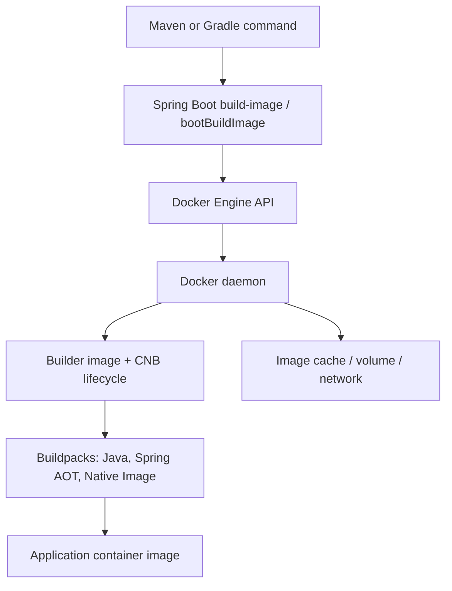
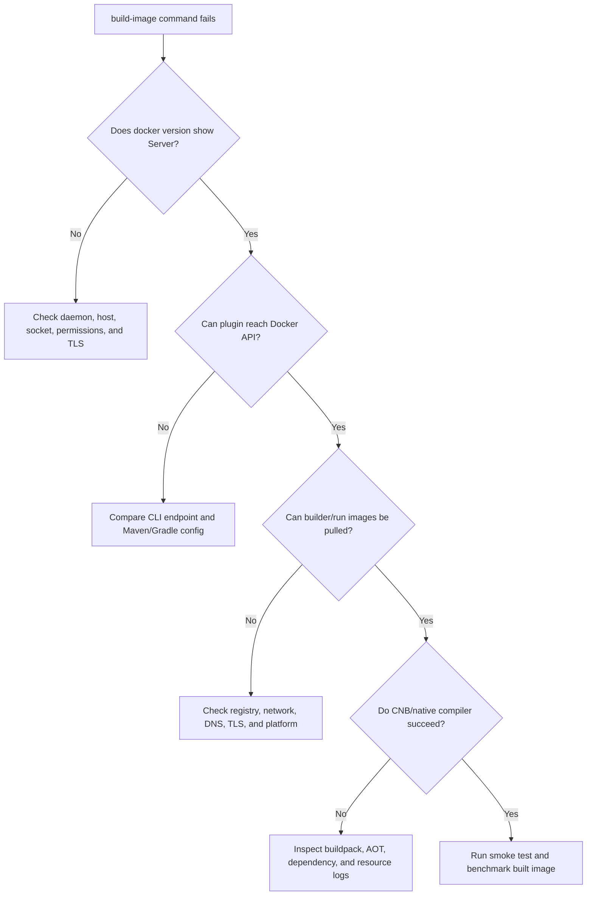

# Docker Access Permissions When Building with Cloud Native Buildpacks

## 1. The Practical Problem: Why Does Building a Spring Boot Native Image Need Docker?

In the **Spring Boot Native Image** module, we use **Spring AOT** and **GraalVM Native Image** to compile a Spring Boot application into a native program, then evaluate startup time and memory usage. There are two common build paths:

- **Direct native compilation:** using GraalVM Native Build Tools with Maven/Gradle; the machine running the command usually needs GraalVM and a compatible native toolchain.
- **Building a container image with Cloud Native Buildpacks (CNB):** using `spring-boot:build-image` or `bootBuildImage`; a *builder image* provides the build environment and produces an *application image*. In the standard Spring Boot workflow using Docker, the build tool must be able to **connect to the Docker daemon**.

For example, when running:

```bash
# Maven project configured with Spring Boot plugin and native support
./mvnw -Pnative spring-boot:build-image

# Gradle project configured with Spring Boot plugin and native support
./gradlew bootBuildImage
```

You might see a message like:

```text
Cannot connect to the Docker daemon at unix:///var/run/docker.sock.
Is the docker daemon running?
```

This message **does not mean Java code, Spring AOT, or GraalVM is broken**. The build tool has not yet connected to the container management service. Check the Docker environment before investigating reflection hints, resources, or application code.

> Lesson scope: learn about access permissions and how to diagnose Docker connectivity when building **container images with Cloud Native Buildpacks**. This is a prerequisite for testing compatibility, packaging, and operating Spring Boot native builds. Illustrative commands and settings must be adjusted to match your Spring Boot version, Docker setup, and actual environment policies.

## 2. Components Involved in the Build Process

### 2.1. Docker Client, Docker Daemon, and Docker Engine API

Three frequently confused concepts:

| Component | Role | Prerequisite |
|---|---|---|
| Docker CLI (`docker`) | Command-line program sending requests to Docker Engine | Having the CLI alone is not enough to run a build |
| Docker daemon (`dockerd`) | Service managing images, containers, networks, and volumes | Must be running and accepting connections from the build process |
| Docker Engine API | Interface through which the CLI and tools like Maven/Gradle plugins communicate with the daemon | Endpoint address, protocol, access permissions, and certificates (if using TLS) must be valid |

In a typical CNB workflow, Maven/Gradle **does not merely check whether the Docker CLI is installed**. The Spring Boot plugin interacts with Docker Engine to pull required images, launch the build lifecycle, and produce the finished image.



For native builds, a suitable builder can supply GraalVM and the required tools **inside the build environment**. This reduces the need to install the entire native toolchain directly on developer machines; however, Docker Engine must be running and the builder must support the corresponding native configuration.

### 2.2. Do Cloud Native Buildpacks Require Docker in Every Case?

**No.** The Cloud Native Buildpacks specification supports multiple integrations and execution platforms. However, for the two common Spring Boot tasks `spring-boot:build-image` and `bootBuildImage` in standard Docker usage, **there must be a compatible Docker daemon/endpoint accessible to the plugin**. This lesson focuses on that case; CI environments using other build services or platforms require separate configuration docs.

### 2.3. Permissions the Build Process Actually Needs

Buildpacks require more than listing images. Depending on the plugin and configuration, Docker Engine must permit operations such as:

- Connecting and exchanging daemon version/configuration details.
- Pulling the builder image and run image from a registry, or using locally cached images.
- Creating and running containers for the build lifecycle; using caches/volumes and networks when needed.
- Creating, tagging, saving, and inspecting the resulting application image.
- If image publishing is configured, authenticating and pushing the image to a registry.

Traditional Docker Engine setups generally grant very broad API privileges to anyone who can access the socket. Therefore, socket access should not be viewed narrowly as "just permission to build one application."

## 3. Checking Docker Before Running Maven or Gradle

Initial checks should be run **in the same environment and under the same account** that will execute the build command. Succeeding in a personal terminal does not prove a CI job, IDE, dev container, or service account can also access Docker.

### 3.1. Quick Layer-by-Layer Checks

```bash
# Check if the machine has the Docker CLI
docker --version

# Check both client and server to see if the Docker daemon responds
docker version

# Inspect daemon info; failure here indicates a connection/permission issue
docker info

# Test calling the container listing API
docker ps

# Show the context currently selected by the Docker CLI
docker context show
```

**How to read the output:**

| Output | Meaning | Next Step |
|---|---|---|
| `docker --version` works, yet `docker version` shows only Client and errors on Server | CLI is installed; Docker daemon is unreachable | Check daemon, endpoint, and permissions |
| `docker info` returns Server details | Current account can call the Docker Engine API | Verify the Maven/Gradle plugin uses the right endpoint and build mode |
| `docker ps` reports `permission denied` on socket | Endpoint may exist, account lacks permissions | Check ownership/group or rootless configuration |
| Docker CLI works fine, yet build-image errors out | Plugin may use a different endpoint/config; or failure happens during pull/container creation | Read the exact error message and inspect plugin config |

`docker version` is more informative than `docker --version`: the former tests communication with the server, while the latter only reads the installed CLI version.

### 3.2. Checking Whether Docker Engine Is Running

On Linux systems using systemd and Docker Engine as a service:

```bash
systemctl status docker

# If administrative privileges are allowed and the daemon is stopped:
sudo systemctl start docker

# Verify after the service has started:
docker info
```

Not every Linux system uses `systemd` or the same Docker Engine service name. With **Docker Desktop on Windows/macOS**, check the Docker Desktop app and engine status in the UI, then run `docker version`. **Linux** container mode is typically the appropriate choice when building a Spring Boot Linux Native Image.

## 4. Docker Socket: Connection Endpoints and Permissions

### 4.1. Default Endpoints and Common Variants

The Docker API can be accessed over a local socket or a remote host connection:

| Environment | Example Address | Notes |
|---|---|---|
| Standard Linux Docker Engine | `unix:///var/run/docker.sock` | Socket file permissions determine who can connect |
| Linux rootless Docker | `unix:///run/user/<UID>/docker.sock` | Socket belongs to the account running the rootless daemon; actual path may derive from `XDG_RUNTIME_DIR` |
| Windows Docker Engine / Docker Desktop | `npipe:////./pipe/docker_engine` | Named pipe; access depends on Windows/Docker Desktop settings |
| Docker Desktop on macOS | Unix socket per current Desktop/context config | May differ from `/var/run/docker.sock`; inspect the active endpoint |
| Remote Docker Engine with TLS | `tcp://docker.example.internal:2376` | Must verify network, TLS, certificates, and server-side access |

The values above are **typical examples**, not constants for every version. Docker contexts, Docker Desktop, rootless mode, and environment variables can cause the endpoint to differ from defaults.

On Linux, inspect the socket and user groups:

```bash
ls -l /var/run/docker.sock
id
id -nG

# Inspect the endpoint of the context currently selected by the CLI
docker context show
docker context inspect "$(docker context show)"
```

Sample output might look like:

```text
srw-rw---- 1 root docker ... /var/run/docker.sock
```

The `rw` permission for the `docker` group means users in that group can normally open the socket. `root` can also access it depending on configuration. Read the actual group name and permissions on your machine rather than assuming all environments match.

### 4.2. Distinguishing Docker Context from the Plugin's Environment

The Docker CLI can be configured via a **context**. Maven/Gradle plugins often have their own way of resolving the Docker host, through environment variables or the plugin's `docker` configuration. Therefore, after switching Docker contexts, verify **which endpoint the plugin actually uses**.

Inspect the relevant environment variables:

```bash
# Linux/macOS terminal
printf 'DOCKER_HOST=%s\n' "${DOCKER_HOST:-<unset>}"
printf 'DOCKER_TLS_VERIFY=%s\n' "${DOCKER_TLS_VERIFY:-<unset>}"
printf 'DOCKER_CERT_PATH=%s\n' "${DOCKER_CERT_PATH:-<unset>}"
```

In PowerShell:

```powershell
$env:DOCKER_HOST
$env:DOCKER_TLS_VERIFY
$env:DOCKER_CERT_PATH
docker context show
docker info
```

**Do not copy a `DOCKER_HOST` value from another machine** without verifying it is reachable from where Maven/Gradle runs. For example, a `docker` hostname in a CI job often exists only on that job's internal network and will not resolve on a personal laptop.

## 5. Docker Permissions on Linux

### 5.1. Why Does `sudo docker ps` Work While `docker ps` Fails?

In common Docker Engine installations, `/var/run/docker.sock` is owned by `root` and a dedicated group (usually named `docker`). Users outside that group may see:

```text
permission denied while trying to connect to the Docker daemon socket
```

`sudo docker ps` succeeding is a **diagnostic clue** that the daemon is likely running and the current user lacks permissions. However, you should not solve this permanently by running all Maven/Gradle builds as `root` by default.

On systems you administer and where granting permissions is permitted, an administrator can add the account to the appropriate group:

```bash
sudo usermod -aG docker "$USER"
```

After changing group membership, you typically need to log out and back in or open a new session for permissions to take effect, then verify with `id -nG` and `docker ps`. **Membership in the `docker` group can be equivalent to high-level administrative privilege on the host**, because anyone controlling Docker Engine can ask the daemon to launch containers with broad host access. Grant it only when permitted by your organization's security policy.

Do not open full socket permissions with `chmod 666 /var/run/docker.sock` as a "quick fix": that grants Docker daemon control to any unauthenticated local account regardless of intended use.

### 5.2. Rootless Docker

**Rootless mode** allows the daemon and containers to run under a non-root account, with specific limitations and rules. This setup can be suitable for development environments or dedicated runners.

```bash
# Illustrative for Linux with rootless Docker installed
systemctl --user status docker

# Rootless socket typically resides in the user's runtime directory
printf '%s\n' "${XDG_RUNTIME_DIR:-<unset>}"

# Set only after confirming the rootless daemon listens on this socket
export DOCKER_HOST="unix://${XDG_RUNTIME_DIR}/docker.sock"
docker info
```

If using a Docker context for rootless, the plugin environment must align with that context/endpoint. Rootless Docker has distinct rules for cgroups, networking, storage, and resource limits; test the actual buildpacks workflow rather than assuming success from `docker ps`.

## 6. Docker Desktop on Windows and macOS

With Docker Desktop, verify the following points:

1. Docker Desktop is started and the engine is running, not merely having the Docker CLI on `PATH`.
2. The user/process running the command has permission to access Docker Desktop per machine settings.
3. The active context and endpoint point to the intended daemon.
4. When targeting a **Linux** native container image, the daemon supports Linux containers and the matching build architecture.

Verification commands for PowerShell or macOS Terminal:

```bash
docker version
docker info
docker context ls

# Should show the target daemon OS type, e.g., 'linux'
docker info --format '{{.OSType}}'

# Check daemon architecture, e.g., x86_64/aarch64
docker info --format '{{.Architecture}}'
```

**Important point:** a Spring Boot Native Image built with a Linux builder image produces a Linux program; running Docker Desktop on Windows/macOS does not make the executable inside the image a Windows `.exe` or macOS Mach-O. Compatibility depends on the builder/container environment and CPU architecture provided by Docker Engine.

If Docker Desktop is switched to Windows containers while the builder/run image requires Linux, the build will fail when pulling, running the builder, or checking platform. Confirm the daemon's mode before investigating the application.

## 7. Configuring Spring Boot `build-image` and GraalVM Native Image

### 7.1. Maven

For projects using the Spring Boot Maven plugin, GraalVM Native Build Tools, and a compatible `native` profile configured, the container image build command is typically:

```bash
./mvnw -Pnative spring-boot:build-image
```

To visualize buildpack configuration for native, the Maven plugin section can declare environment variables for the builder:

```xml
<plugin>
    <groupId>org.springframework.boot</groupId>
    <artifactId>spring-boot-maven-plugin</artifactId>
    <configuration>
        <image>
            <env>
                <BP_NATIVE_IMAGE>true</BP_NATIVE_IMAGE>
            </env>
        </image>
    </configuration>
</plugin>
```

`BP_NATIVE_IMAGE=true` is a setting used by Java buildpacks that support native—such as matching builders in the Paketo ecosystem—to request a native image. How the `native` profile and plugin auto-configure this variable can vary by your project's version set; duplicating it twice is not always necessary. The prerequisite is that **the builder supports native** and the pipeline runs the necessary Spring AOT tasks.

### 7.2. Gradle

With the Spring Boot Gradle plugin:

```bash
./gradlew bootBuildImage
```

In projects with GraalVM Native Build Tools configured, plugin integration may automatically add native configuration. If explicit buildpack configuration is needed, for example in Groovy DSL:

```groovy
tasks.named('bootBuildImage') {
    environment = ['BP_NATIVE_IMAGE': 'true']
}
```

If `bootBuildImage` already sets other buildpack variables, **merge** `BP_NATIVE_IMAGE` into the existing map instead of accidentally overwriting all environment variables. Build commands and auto-configuration behavior depend on the plugin and Spring Boot version in use.

### 7.3. Where Is the Docker Host Configured?

Common to both Maven and Gradle is that the plugin needs a Docker daemon address **reachable by the build process**. Typical configuration sources include:

- Docker configuration inside the Spring Boot build plugin itself.
- Environment variables like `DOCKER_HOST` (if supported by the plugin version and not overridden elsewhere).
- The environment's default endpoint when no custom configuration is present.

For Maven, the Docker configuration block can explicitly specify the host in environments that need it:

```xml
<plugin>
    <groupId>org.springframework.boot</groupId>
    <artifactId>spring-boot-maven-plugin</artifactId>
    <configuration>
        <docker>
            <host>unix:///var/run/docker.sock</host>
        </docker>
    </configuration>
</plugin>
```

This is only an **example for a Linux daemon using the default socket**. Do not apply it verbatim on Windows/macOS, rootless Docker, or CI with a separate Docker Engine. The Gradle plugin also has a corresponding Docker configuration block; check the exact option names and types against your Spring Boot version.

### 7.4. Docker Is Running, Yet Native Still Won't Build?

Docker access only solves the **daemon connection and usage step**. A successful native build also requires:

- A builder image supporting Java, GraalVM Native Image, and a toolchain compatible with your project.
- Maven/Gradle/buildpack dependencies and sources downloadable from the network or a valid cache.
- Enough CPU, RAM, and disk space for AOT analysis/compilation, which is usually heavier than building a regular JAR.
- Spring AOT, reflection, resource, proxy, and native library configuration matching the application.
- A target image architecture matching the production runtime platform.

If failure occurs **after Docker pulls images and the builder starts running**, inspect the lifecycle/buildpack or native compiler logs. At that point, the fault likely lies in build resources, application configuration, or compatibility—no longer Docker socket permissions.

## 8. Remote Docker Daemons and CI/CD Environments

### 8.1. Two Common CI Models

| Model | How the Job Reaches Docker | Things to Watch |
|---|---|---|
| Runner using host Docker Engine | Job is permitted to connect to the host's Docker socket | Socket permissions, runner isolation, security policy, and resource sharing |
| Dedicated/remote Docker daemon for the job | Job connects over a network API endpoint, usually with TLS | DNS, networking, ports, certificates, and daemon privilege scope |

If a CI job runs **inside a container**, it does not automatically see the host's socket. Having Docker Engine on the host is not enough; the runner must be configured to provide the job with an appropriate endpoint. Similarly, if the Docker daemon runs in a sidecar/separate service, `localhost` inside the job usually refers to the **job container itself**, not that service daemon.

### 8.2. Remote Connection Over TLS

In organizational environments configured with a secured remote Docker daemon, environment variables may look like:

```bash
# Example; endpoint and certificates provided by the CI system
export DOCKER_HOST=tcp://docker.example.internal:2376
export DOCKER_TLS_VERIFY=1
export DOCKER_CERT_PATH=/secure/docker-client-certs

docker version
docker info
```

A TCP endpoint without TLS protection or access restrictions can allow remote control of the daemon. In CI, use authenticated connections, organization-compliant certificate management, and properly isolated runners/daemons. **Never print certificate contents or credentials into build logs**.

If the CLI connects successfully yet the Maven/Gradle plugin still fails, check whether the plugin picks up the corresponding environment variables or has a different host/TLS setting hardcoded in build configuration.

### 8.3. Distinguishing Three Types of Authentication

| Type | Question to Answer | Example Symptoms |
|---|---|---|
| Docker daemon permission | Is the job allowed to call the Docker Engine API? | `permission denied`, unable to connect to socket |
| Container registry permission | Is it allowed to pull builder/run images or push application images? | Registry returns `401 Unauthorized` or `denied` |
| Dependency source access | Can the builder fetch Maven artifacts, Gradle dependencies, and JDK/buildpack deps? | HTTP 401/403, proxy errors, timeouts downloading dependencies |

A user who can run `docker ps` **does not necessarily** have permission to pull a builder image from a private registry. Conversely, being logged into Docker Hub does not grant access to the Docker socket.

### 8.4. Caching and Resource Limits in CI

Buildpacks can use caches to reduce dependency download times and repeat build duration. However, on ephemeral runners, caches may be wiped on every run; on shared runners, caches and images can consume significant disk space.

For native builds, monitor:

- Memory allocated to the **Docker daemon/VM and builder container**, not just RAM for the Maven/Gradle terminal.
- Disk space where Docker stores layers, images, and volumes.
- CPU and time budget allocated to the native compiler.
- Network reachability to registries, Maven/Gradle repositories, and buildpack dependency sources.

If the builder is terminated with `Killed`, out-of-memory errors, or exit code `137`, inspect OOM/memory limits and daemon/container logs before assuming a Java reflection bug.

## 9. Quick Diagnostic Table

| Symptom | Cause to Check | Targeted Resolution |
|---|---|---|
| `docker: command not found` | Docker CLI missing from `PATH` | Install or configure the right tool; verify daemon separately |
| `Cannot connect to the Docker daemon` | Daemon stopped, wrong socket/host, or network unreachable | Run `docker version`, `docker info`, check Desktop/service/endpoint |
| `permission denied ... docker.sock` | User or job lacks socket permissions | Check owner/group, rootless endpoint, runner permissions |
| `No such file or directory` for Docker socket | Configured socket path does not exist in the command environment | Inspect Docker context, `DOCKER_HOST`, actual socket location |
| CLI works, yet `build-image` reports Docker not found | Plugin uses different host/context config than CLI | Check plugin's Docker options and actual error logs |
| `x509: certificate signed by unknown authority` | Incorrect CA or TLS trust configuration | Check CA, client cert, cert path, and secure endpoint |
| `server gave HTTP response to HTTPS client` | Mismatched HTTP/TLS settings for Docker API | Align protocol, TLS settings, and daemon port |
| `401 Unauthorized` or `denied` on pull/push | Missing registry credentials; distinct from daemon permissions | Check builder/run image source and registry authentication |
| Error pulling builder image | Network, proxy, DNS, registry, or image version | Inspect pull logs, mirrors, and registry permissions |
| `no matching manifest for linux/arm64` | Image lacks a variant for that platform | Choose a builder/run image supporting that architecture or a different build environment |
| Builder `Killed`/OOM | Insufficient RAM for native compiler/container | Check Docker/runner limits and increase resources appropriately |
| Build completes, yet app fails at runtime | Reflection/resources, native libraries, OS/CPU, or runtime config | Test executable and container on the exact target platform |

**Diagnostic rule:** always start at the layer where the first failure occurs; do not automatically blame every `spring-boot:build-image` error on the same root cause.



## 10. Practice Exercise: Verifying Docker Permissions and Building a Native Image Container

**Context:** a Spring Boot service with an HTTP endpoint is configured for Spring AOT/GraalVM Native Image with the Spring Boot Maven or Gradle plugin. The machine/runner has Docker Engine with valid permissions. The goal is to confirm `build-image` reaches the daemon and produces a runnable native build.

### Step 1 — Record the Build Environment

```bash
docker version
docker info --format '{{.OSType}}/{{.Architecture}}'
docker context show
```

On Linux, also record socket permissions or the rootless endpoint. On machines using Docker Desktop, record the context, Linux containers mode, and memory allocated to Docker.

### Step 2 — Confirm Permissions for the Exact Build Account

Run `docker ps` as **the same user and in the same environment** that will run Maven/Gradle. If builds run from a runner service/container, repeat the check inside that exact job or an equivalent environment. On failure, record the verbatim message, endpoint used, and missing permission type.

### Step 3 — Build with Maven or Gradle

```bash
# Choose one depending on the project, with native plugin/profile configured
./mvnw -Pnative spring-boot:build-image

# Or
./gradlew bootBuildImage
```

Watch logs to trace each phase: daemon access → pull builder/run images → detect/prepare buildpacks → Spring AOT/GraalVM Native Image → export application image. If the builder does not produce native as expected, check `BP_NATIVE_IMAGE` configuration and the plugin version's AOT integration mechanism.

### Step 4 — Inspect the Application Image

```bash
docker image ls

# Replace with the actual name:tag printed by the plugin after building
APP_IMAGE="image-name:tag"
docker image inspect "$APP_IMAGE"
```

The goal is to prove the image was created in the intended daemon. To verify it is **actually a native build**, cross-check builder logs, buildpack config, and inspect application contents/run behavior; the mere existence of an image does not prove it is a native image.

### Step 5 — Run a Smoke Test in an Appropriate Environment

```bash
# Set the actual image name:tag in the smoke test terminal
APP_IMAGE="image-name:tag"
docker run --rm -p 8080:8080 "$APP_IMAGE"

# In another terminal, e.g., when Actuator readiness is configured
curl -fsS http://localhost:8080/actuator/health/readiness
```

If the app uses another port or does not enable the readiness endpoint, substitute an actual endpoint path. When the container runs on a different node than the build machine, verify compatible OS/CPU and system libraries.

### Step 6 — Record Results

| Check | Expected Result | Actual Notes |
|---|---|---|
| `docker version` | Shows both Client and Server info | _(record)_ |
| `docker info` | Returns daemon info | _(record)_ |
| `docker ps` as exact build user | Succeeds | _(record)_ |
| Plugin's Docker endpoint | Matches inspected daemon | _(record)_ |
| Pull builder and run images | Succeeds | _(record)_ |
| Spring AOT and native build | Succeeds | _(record)_ |
| Application image | Has matching name/tag and platform | _(record)_ |
| Container smoke/readiness | App accepts requests | _(record)_ |
| Startup and RSS vs. JVM | Measured under equivalent conditions | _(record)_ |

Only after Docker connectivity and the build succeed should you measure startup time, RAM usage, and test compatibility for reflection/resources, databases, TLS, or JNI libraries. **Docker access is a prerequisite of the build pipeline**, not proof that the native app performs better or is production-ready.

## 11. Misconceptions to Avoid

**"Installing `docker` is enough to run `bootBuildImage`."** Incorrect. The CLI may be installed while the Docker daemon is stopped or the build account lacks access permissions.

**"Running `sudo` for Maven/Gradle is the standard way to fix Docker errors."** That can mask permission issues and leave root-owned build files. First determine the approved Docker authorization model for your environment.

**"If Docker CLI connects, the plugin is guaranteed to connect."** Not always true. Contexts, environment variables, or plugin settings can point to different endpoints.

**"Having Docker daemon access means having registry access."** Incorrect. Daemon access, registry authentication, and dependency download permissions belong to separate authorization systems.

**"Cloud Native Buildpacks always require GraalVM installed on the host."** Incorrect for native-supporting builder image workflows: the toolchain can be supplied inside the builder. It still requires sufficient CPU/RAM, network access, and a compatible Docker Engine.

**"Building an image successfully means the output was compiled natively."** Incorrect. Buildpacks can also produce JVM-based images; verify buildpack configuration, logs, and actual artifacts.

**"Having a native build in a container means it runs on every OS or CPU."** Incorrect. The native executable still depends on a matching OS, CPU architecture, and system libraries.

## 12. Conclusion

In the **Spring Boot Native Image workflow using Cloud Native Buildpacks**, Maven/Gradle needs access to the Docker Engine API so the builder can produce container images. Verify three layers in order: **is the daemon running**, **does the build process connect to the right endpoint with proper permissions**, and **can the builder pull images, allocate resources, and execute Spring AOT/GraalVM Native Image**.

Distinguishing Docker socket permissions from registry permissions, recognizing differences between CLI contexts and plugin settings, and checking Docker Desktop/rootless/CI setups catch environment errors early. Once the native image is built and tested on the right platform, the team has a solid baseline to evaluate startup, RSS, packaging, and operational gains.

### Official Documentation

- [Spring Boot — Container Images: Cloud Native Buildpacks](https://docs.spring.io/spring-boot/reference/packaging/container-images/cloud-native-buildpacks.html)
- [Spring Boot — GraalVM Native Images](https://docs.spring.io/spring-boot/reference/packaging/native-image/)
- [Docker — Protect the Docker daemon socket](https://docs.docker.com/engine/security/protect-access/)
- [Docker — Rootless mode](https://docs.docker.com/engine/security/rootless/)
- [Docker — Docker contexts](https://docs.docker.com/engine/manage-resources/contexts/)
- [Cloud Native Buildpacks — Documentation](https://buildpacks.io/docs/)
