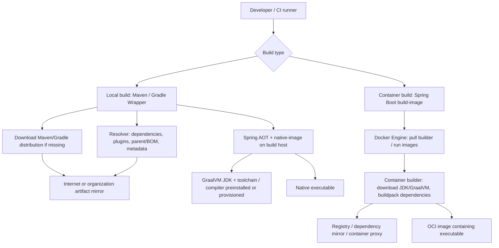

# Impact of Network Proxies, Dependency Repositories, and Build Tool Downloads

> **Chapter: Build Environment** — The **SPRING_BOOT_NATIVE_IMAGE** module aims to compile Spring Boot applications into **GraalVM Native Images** via Spring AOT, build with Maven/Gradle, test compatibility, package containers, and compare startup time and memory against the JVM build. Before measuring native performance, you must ensure the build environment can download the right tools, plugins, dependencies, and images without being disrupted by proxies or inconsistent caches.

## 1. Learning Objectives

After this lesson, you will be able to:

1. Point out **where each network request** originates during a Spring Boot Native Image build: Wrapper, Maven/Gradle, GraalVM tools, Docker, and Buildpacks.
2. Distinguish configuration for **HTTP/HTTPS proxies**, **non-proxy hosts**, **dependency repositories**, **plugin repositories**, **Docker registries**, and **CA certificates**.
3. Configure baseline Maven `settings.xml`, Gradle `gradle.properties`/`settings.gradle`, and proxy variables passed to Cloud Native Buildpacks.
4. Diagnose timeouts, DNS errors, proxy authentication, TLS failures, missing dependencies, and missing `native-image` layer by layer.
5. Design reliable CI/CD builds with caches, internal repositories, offline verification methods, and enough configuration metadata to reproduce results.

## 2. A Single Native Build Can Hit Multiple Download Endpoints

Running `./mvnw -Pnative native:compile`, `./gradlew nativeCompile`, or `spring-boot:build-image` does not necessarily connect to just one server. Depending on configuration and caches, a build can make multiple independent network calls.



> **Diagnostic principle:** identify **the actual process making the HTTP request** and **the network environment where that process runs**. A proxy configured for a developer's shell may not apply to the Maven Wrapper, Java process, Docker daemon, or Buildpacks container.

### 2.1. Map of Network Dependency Points

| Stage | Component to Fetch | Common Source | Related Configuration |
|---|---|---|---|
| Maven Wrapper startup | Maven distribution; sometimes Wrapper JAR | URL in `.mvn/wrapper/maven-wrapper.properties` | Wrapper, mirror URL, Wrapper environment variables |
| Gradle Wrapper startup | Gradle distribution | `distributionUrl` in `gradle/wrapper/gradle-wrapper.properties` | Wrapper, JVM proxy, `GRADLE_USER_HOME` cache |
| Maven resolution | Parent POM, BOM, JARs, Maven plugins, plugin deps, metadata | Maven Central, internal repos, plugin repositories | `settings.xml`, `mirrors`, `servers`, `profiles`, `proxies` |
| Gradle resolution | Plugin markers/implementations, JARs, metadata, version catalogs | Gradle Plugin Portal, Maven repositories | `pluginManagement`, `dependencyResolutionManagement`, `gradle.properties` |
| Native tool lookup | GraalVM JDK, `native-image`, C compiler/native libs, optional toolchain provisioning | Local install, JDK manager, CI-downloaded distribution source | `JAVA_HOME`, `GRAALVM_HOME`, Gradle Java toolchains, CI image |
| Buildpacks | Builder/run images and packages used by buildpacks, possibly including GraalVM | Container registry, buildpack dependency URLs | Docker daemon proxy + buildpack environment proxy |
| Image export/push | OCI image, layers, manifest | Public/private registry | Registry credentials, Docker daemon network and TLS |

**Do not confuse Maven Central with Gradle Plugin Portal or a Docker registry**: reaching one source only proves connectivity to that source. Nor should you assume `native-image` automatically downloads the entire toolchain: for local native builds, many plugin versions require GraalVM to be preinstalled; only certain configurations/toolchain resolvers can auto-provision a JDK or extra components.

## 3. How Do Network Proxies Affect Builds?

A proxy is an intermediary server for requests going to HTTP/HTTPS endpoints. In corporate networks, proxies may block direct egress, require authentication, filter domains, perform TLS inspection, or allow access only to internal mirror repositories.

| Symptom | Possible Cause | First Thing to Verify |
|---|---|---|
| `Connection timed out` / `Read timed out` | Cannot reach proxy/endpoint, slow proxy, firewall, or timeout too short | Right host/port? Reachable from **the machine/process issuing the request**? |
| `UnknownHostException` | Host/container DNS cannot resolve proxy or repository name | Check domain name, container/runner DNS, `NO_PROXY` |
| HTTP `407 Proxy Authentication Required` | Proxy requires auth or credentials were not passed to the right process | Proxy authentication, account, supported auth scheme |
| HTTP `401` / `403` from repository | Invalid repository permissions/credentials, or a proxy policy | Distinguish a response from the proxy vs. the artifact repository |
| `PKIX path building failed` / `SSLHandshakeException` | Java truststore lacks the server/TLS-inspection proxy CA or chain is wrong | Check certificates and CA of the **JDK/Java runtime doing the download** |
| `Could not find artifact` / `Could not resolve plugin` | Repo lacks artifact/version, missing plugin repo, routing issue, cached metadata | Check coordinates, actual repo, plugin marker, cache, and logs |
| HTTP `429` / `502` / `503` | Rate limit or overloaded upstream/intermediary | Check controlled retries, cache, repository manager |
| Buildpack reports failure to download JDK/GraalVM | Builder container cannot reach download source | Check proxy **inside the builder container**, distinct from Maven's proxy |

### 3.1. `HTTP_PROXY`, `HTTPS_PROXY`, and `NO_PROXY` Are Not Universal

Example environment variables for tools that support reading them:

```bash
# Linux/macOS example; replace host/port with your real environment
export HTTP_PROXY=http://proxy.corp.example:8080
export HTTPS_PROXY=http://proxy.corp.example:8080
export NO_PROXY=localhost,127.0.0.1,.corp.example
```

An `http://` address inside `HTTPS_PROXY` **can be valid**: many HTTP proxies create a `CONNECT` tunnel to reach HTTPS URLs. Always use the scheme required by your proxy; do not change `http` to `https` merely because the variable name is `HTTPS_PROXY`.

`NO_PROXY` is usually comma-separated, whereas Java/Maven/Gradle `http.nonProxyHosts` uses its own syntax (typically pipe-separated with `|`). Do not copy values verbatim across tools without checking syntax. Moreover, setting `HTTP_PROXY` in the shell does not guarantee the JVM downloading Maven dependencies will use it: Maven and Gradle have their own proxy configuration mechanisms.

## 4. Maven: Distinguishing Wrapper, Dependencies, Plugins, and Mirrors

### 4.1. Maven Wrapper Runs **Before** Most Maven Logic

`./mvnw` may need to download the Maven distribution per `.mvn/wrapper/maven-wrapper.properties` before Maven's `settings.xml` is processed. If an error occurs while the Wrapper downloads the distribution, editing `<repositories>` in `pom.xml` will not fix it.

Check:

```bash
# Inside a Maven project with Wrapper
./mvnw --version

# Once the wrapper works:
./mvnw help:effective-settings
```

If the network blocks public distribution URLs, operations teams can point `distributionUrl` to an internally mirrored Maven distribution and verify checksums per [Apache Maven Wrapper](https://maven.apache.org/tools/wrapper/). Never commit usernames/passwords in URLs. With supporting Maven Wrapper versions, `MVNW_REPOURL` and Wrapper authentication variables can route through a repository manager; verify against the Wrapper version in use.

### 4.2. Maven `settings.xml`: Proxies and Repository Mirrors

Place user/CI-specific configuration in `~/.m2/settings.xml` or pass an explicit file with `./mvnw -s /path/to/settings.xml ...`. Example without secrets:

```xml
<settings xmlns="http://maven.apache.org/SETTINGS/1.2.0">
  <proxies>
    <proxy>
      <id>corporate-proxy</id>
      <active>true</active>
      <protocol>http</protocol>
      <host>proxy.corp.example</host>
      <port>8080</port>
      <nonProxyHosts>localhost|127.0.0.1|*.corp.example</nonProxyHosts>
    </proxy>
  </proxies>

  <mirrors>
    <mirror>
      <id>company-artifacts</id>
      <mirrorOf>external:*</mirrorOf>
      <url>https://repo.corp.example/repository/maven-public/</url>
    </mirror>
  </mirrors>
</settings>
```

Explanation:

- `<proxies>` configures how Maven connects when the network requires a proxy; `nonProxyHosts` lets Maven reach internal repositories directly when policy allows.
- `<mirrors>` rewrites matching repository URLs to the repository manager URL; for instance, `external:*` matches external repos per Maven's rules. The repository manager must actually **proxy/host both required artifacts and plugins**.
- `<servers>` configures **repository** authentication matching the `id` of the accessed server/mirror; do not treat it as network authentication for arbitrary proxies. Credentials should not be placed in `pom.xml` or committed files.
- `<repositories>` and `<pluginRepositories>` are two separate declaration groups; downloading dependencies successfully does not guarantee `spring-boot-maven-plugin` and `native-maven-plugin` will resolve.

A download request can travel from Maven to an internal mirror **without going through the proxy** when `nonProxyHosts` matches. If the internal repository is the only permitted source, consider standardizing a central mirror and locking out external repos rather than scattering many public URLs in POMs.

### 4.3. Maven Offline Mode and Cache

Maven caches most dependencies/plugins in `~/.m2/repository` (or a custom `localRepository` path). Once fully populated, test:

```bash
./mvnw -o -Pnative native:compile
```

`-o` simply tells Maven to use resources already in cache; if a parent POM, plugin, native metadata, or dependency was not yet downloaded, the build **will fail**—there is no magic offline download mechanism. A native build also requires **GraalVM/Native Image, compiler, and native libraries** to be already prepared. Running a container build with `spring-boot:build-image` may still require registry or buildpack downloads even when Maven is set to offline mode.

If stale metadata is suspected, inspect the actual repository and failing artifact scope before using `-U` or wiping caches. Deleting all of `~/.m2/repository` often forces CI to re-download many components and masks underlying DNS/proxy failures.

## 5. Gradle: Wrapper, Plugin Repositories, and Dependency Repositories Are Three Distinct Points

### 5.1. Gradle Wrapper

`./gradlew` downloads the Gradle distribution per `gradle/wrapper/gradle-wrapper.properties` if it is not yet in the Wrapper cache. A network may block `services.gradle.org` even while Maven Central/Plugin Portal remain reachable.

Example configuration using an organization mirror:

```properties
# gradle/wrapper/gradle-wrapper.properties — illustrative
distributionUrl=https\://repo.corp.example/gradle-distributions/gradle-9.0.0-bin.zip
distributionSha256Sum=<sha256-verified-by-trusted-provider>
```

`distributionSha256Sum` is a **real 64-hex-character SHA-256 hash** obtained from a trusted source; never leave the placeholder in a runnable file. Version `9.0.0` is only an example; pick based on the compatibility matrix of Gradle, the Spring Boot plugin, and the active JDK. Do not disable checksum verification or use untrusted mirrors just to work around Wrapper download errors.

### 5.2. Proxy for the JVM Running Gradle

Per [Networking with Gradle](https://docs.gradle.org/current/userguide/networking.html), place Java system properties in **`~/.gradle/gradle.properties`** so machine-specific network settings/credentials are not committed:

```properties
systemProp.http.proxyHost=proxy.corp.example
systemProp.http.proxyPort=8080
systemProp.https.proxyHost=proxy.corp.example
systemProp.https.proxyPort=8080
systemProp.http.nonProxyHosts=localhost|127.0.0.1|*.corp.example
```

For Java `https`, Gradle also uses **`http.nonProxyHosts`** for the non-proxied host list. If the proxy requires authentication, use your CI/user-home secret injection mechanism to supply account credentials rather than committing passwords into repository `gradle.properties`.

### 5.3. Plugin Portal and Dependency Repositories

In Gradle, plugins in the `plugins { ... }` block are normally resolved from `pluginManagement.repositories` in `settings.gradle`, while application dependencies come from `dependencyResolutionManagement.repositories` or project `repositories`. Groovy DSL example when an organization has two properly configured mirror repositories:

```groovy
// settings.gradle
pluginManagement {
    repositories {
        maven {
            url = uri("https://repo.corp.example/repository/gradle-plugins/")
        }
    }
}

dependencyResolutionManagement {
    repositoriesMode = RepositoriesMode.FAIL_ON_PROJECT_REPOS
    repositories {
        maven {
            url = uri("https://repo.corp.example/repository/maven-public/")
        }
    }
}
```

For this configuration to work, the `gradle-plugins` repo must serve both the **plugin marker artifact** and the corresponding plugin implementation (such as `org.graalvm.buildtools.native`); many plugins also depend on artifacts from Maven repositories. If an organization mirrors Maven Central only while blocking Plugin Portal, having `implementation("...")` succeed will not make the `org.graalvm.buildtools.native` plugin resolve.

`RepositoriesMode.FAIL_ON_PROJECT_REPOS` locks repositories at the settings level so builds only contact approved repositories; if legacy projects/plugins still declare subproject repositories, Gradle will raise a clear error and configuration must be unified.

### 5.4. Gradle Cache and Offline Mode

`GRADLE_USER_HOME` typically stores dependency, plugin, metadata, and Wrapper distribution caches. Offline mode:

```bash
./gradlew --offline nativeCompile
```

Works only when all required dependencies, plugins, and toolchains are already cached. If the Wrapper distribution has not been downloaded yet, the Wrapper still has to fetch the distribution before Gradle can even process `--offline`. Furthermore, Gradle's cache stores metadata tied to specific repositories, so **switching URLs from public to mirror can trigger fresh network requests** even when identical JARs are already cached.

`--refresh-dependencies` asks Gradle to revalidate metadata/artifacts; it can increase network traffic and is not a cure for proxy failures. See [Dependency Caching — Gradle](https://docs.gradle.org/current/userguide/dependency_caching.html).

## 6. GraalVM and Native Build Tools: Check Where Tools Are Fetched

For native builds running **directly on the machine**, Maven/Gradle typically needs:

- A JDK/GraalVM matching the Spring Boot version and project Java level;
- A callable `native-image` executable;
- OS-appropriate C compiler, linker, and development libraries;
- Resolved GraalVM Native Build Tools plugin and associated dependencies/metadata.

Check with commands (executed in the real build environment):

```bash
java -version
native-image --version
./mvnw --version
# Or:
./gradlew --version
```

An easily missed detail: the JDK running the **Gradle daemon** can differ from the JDK selected by **Gradle toolchains** to compile Java or run `native-image`. Per [Native Build Tools Gradle plugin](https://graalvm.github.io/native-build-tools/latest/gradle-plugin), the plugin follows launcher selection rules using toolchain config/`GRAALVM_HOME`/`JAVA_HOME`; fallback and auto-provisioning behavior can depend on plugin version. Therefore, do not inspect `java -version` alone and assume all native tasks use the right GraalVM.

For CI:

1. If the runner comes with **GraalVM preinstalled**, check both JDK version and `native-image`, and document how compiler/linker are provided.
2. If a CI action/toolchain resolver **downloads GraalVM automatically**, that is an additional download source; proxies and allowlists must include the actual distribution endpoint.
3. If the Maven/Gradle plugin resolved fine yet reports `Cannot find native-image executable`, investigate **toolchain/path**, rather than starting by adding Maven Central.
4. If failure happens inside `native-image` during analysis or AOT, separate **metadata/compatibility** issues from networking. A build with every library downloaded can still fail native compilation due to reflection or class initialization.

**Do not fix network errors by arbitrarily mixing JDK/GraalVM versions.** Choose the version set from the exact Spring Boot release's system requirements page and test on the target OS/CPU.

## 7. Containers: Docker Daemon and Buildpacks Use Different Networks

For `./mvnw -Pnative spring-boot:build-image` or Gradle `bootBuildImage`, the workflow differs from local builds:

1. Maven/Gradle outside the container must still resolve the wrapper, plugins, and project dependencies.
2. The Spring Boot plugin talks to **Docker Engine** to pull builder/run images from a registry (if uncached).
3. The **builder container** runs Cloud Native Buildpacks; buildpacks may download GraalVM, Native Image, and other components from the Internet or configured repositories.
4. The output becomes an OCI image; pushing to a registry is a subsequent network connection.

This introduces at least **two distinct proxy scopes**:

| Scope | Who Needs Network? | Configuration |
|---|---|---|
| Docker daemon | Pull builder/run images, registry access | Docker Engine proxy or Docker Desktop settings; registry certificate trust |
| Buildpacks builder container | Download JDK/GraalVM and buildpack artifacts | `HTTP_PROXY`, `HTTPS_PROXY`, `NO_PROXY` env vars passed to builder; matching CA/trust |

Per [Spring Boot Maven plugin — Packaging OCI Images](https://docs.spring.io/spring-boot/maven-plugin/build-image.html), proxy settings can be passed to the **builder** via `image.env`:

```xml
<!-- Configuration snippet in pom.xml; host is illustrative only -->
<plugin>
  <groupId>org.springframework.boot</groupId>
  <artifactId>spring-boot-maven-plugin</artifactId>
  <configuration>
    <image>
      <env>
        <HTTP_PROXY>http://proxy.corp.example:8080</HTTP_PROXY>
        <HTTPS_PROXY>http://proxy.corp.example:8080</HTTPS_PROXY>
        <NO_PROXY>localhost,127.0.0.1,.corp.example</NO_PROXY>
      </env>
    </image>
  </configuration>
</plugin>
```

Equivalent with [Spring Boot Gradle plugin — Packaging OCI Images](https://docs.spring.io/spring-boot/gradle-plugin/packaging-oci-image.html) in a Groovy DSL project:

```groovy
tasks.named("bootBuildImage") {
    environment["HTTP_PROXY"] = "http://proxy.corp.example:8080"
    environment["HTTPS_PROXY"] = "http://proxy.corp.example:8080"
    environment["NO_PROXY"] = "localhost,127.0.0.1,.corp.example"
}
```

The example sets **proxies without embedded credentials**. If authentication is required, use your CI's secure secret injection and supported Buildpacks mechanisms; avoid storing tokens/passwords in POMs, Gradle scripts, Dockerfiles, image environment variables, or public logs.

**Docker note:** proxy settings for the Docker daemon differ from proxy settings Spring Boot passes into the builder. Docker Desktop has its own proxy settings UI; `daemon.json` proxy config on Linux Docker Engine does not always apply to Docker Desktop. Also, `docker build --build-arg HTTP_PROXY=...` is syntax for a **Dockerfile build**, and does not automatically configure every network path in Spring Boot `build-image`. See [Docker — Daemon Proxy Configuration](https://docs.docker.com/engine/daemon/proxy/) and [Paketo — Building Behind a Firewall](https://paketo.io/docs/howto/configuration/).

### 7.1. Why Can Maven Download Dependencies While Buildpacks Still Fail?

Suppose Maven uses the `repo.corp.example` mirror so `./mvnw package` succeeds. Yet when running `spring-boot:build-image`, logs show the builder fails to download the JDK or Native Image. Possible causes include:

- The Docker daemon cannot pull the builder/run image from the container registry;
- The image is present, yet **the builder container was not passed proxy variables**;
- The builder received proxy variables, yet internal domains need to be in `NO_PROXY` or container DNS differs from host DNS;
- TLS inspection proxy requires an extra CA **inside the builder**, even though Java on the host already trusts the certificate;
- The buildpack's dependency distribution endpoint is not allowlisted, or the buildpack cache is missing;
- Builder CPU/RAM limits or missing compilers are mistaken for download timeouts.

Check **the first error line showing a URL/host or download step**, then determine whether it originated from Maven/Gradle, the Docker daemon, or the CNB builder. A single successful `curl` on the host is not enough to prove connectivity inside the builder container.

### 7.2. CA Certificates and TLS Inspection

An organization may run an HTTPS-inspecting proxy that issues certificates via a private CA. In that case, install the valid CA into the **truststore of the Java app/build tool or builder container that needs it**. `PKIX path building failed` is fundamentally different from connection drops, wrong hosts, or wrong accounts.

For Paketo, there are CA Certificates Buildpack mechanisms and service bindings per [Paketo CA Certificates](https://paketo.io/docs/howto/configuration/). For Maven/Gradle running on Java, inspect the truststore of the exact JDK executing the tool. Never use `-k`, `insecure`, or disable TLS verification as a "quick fix" for production pipelines.

## 8. Designing Stable Builds in CI/CD or Restricted Networks

A **repository manager** (such as an internal Maven/Gradle repo) and a **container registry mirror** solve different artifact classes. Maintain an inventory of actual download paths:

| Build Material | Where Can It Be Cached/Mirrored? | Risk If Missed |
|---|---|---|
| Maven/Gradle Wrapper distribution | Internal binary repo; runner cache | Build dies before Maven/Gradle starts |
| Maven parent/BOM/dependencies and plugins | Maven repository manager, `~/.m2` | Cannot resolve Spring Boot plugin or Native Build Tools |
| Gradle plugin markers and project deps | Plugin portal mirror + Maven repo, `GRADLE_USER_HOME` | `nativeCompile` task missing because plugin failed to load |
| GraalVM JDK + compiler | CI runner image, checksum-verified artifact archive, toolchain cache | Missing `native-image` or wrong Java version |
| Buildpacks builder/run images | Registry mirror, Docker daemon cache | Image pull fails before compile phase |
| GraalVM/JDK bundles inside builder | Buildpack dependency mirror or supported buildpack cache | Image pulled, yet builder still cannot run |

### 8.1. Principles for Reproducibility

- **Pin versions** of Spring Boot, Maven/Gradle Wrapper, Native Build Tools, Java/GraalVM, plugins, dependencies, and builder/run images. Do not rely casually on `latest`, `+` versions, or SNAPSHOT artifacts when benchmarking.
- **Verify download sources** with checksums/verification, trusted certificates, and clear repository ownership. Pay special attention to verifying Wrapper distributions and GraalVM binaries.
- **Warm caches intentionally** on runners sharing the same versions, repository URLs, and OS/architecture; avoid assuming one machine's cache transfers intact to another.
- **Separate download time from native compile time**: cold builds can be slow due to Internet/proxy traffic, while warm builds have caches populated. When comparing native against JAR, record both timings and cache state.
- **Manage credentials separately**: Maven `settings.xml`/`servers` with secret injection, CI Gradle credentials, Docker registry credentials, and Buildpacks bindings; never store them inside artifacts or repositories.
- **Capture failure evidence**: first error, target URL host (secrets redacted), download step type, versions, proxy chain, certificate thumbprint/truststore, cache hit/miss, and runner OS.

### 8.2. Offline and Air-Gapped Networks

"Maven offline" or "Gradle `--offline`" **only controls how the build tool resolves dependencies from cache**; it does not guarantee the entire native pipeline makes zero network calls. An air-gapped environment must pre-stage every material along the specific build flow: wrapper distribution, plugins/dependencies, GraalVM, C compiler, metadata, builder/run images, buildpack dependencies, and private registries.

When using local native compile, you can bake GraalVM/toolchain into a standard runner image so jobs need no runtime downloads. When using Buildpacks, prepare builder/run images and a dependency provisioning strategy compatible with the chosen buildpack's offline mode. Do not assume `docker pull` on the builder image once is enough, because buildpacks may need to fetch additional JDK/runtime layers externally.

## 9. Ordered Diagnostic Runbook

When a build fails, **do not wipe caches immediately** and do not randomly tweak multiple proxies/repositories at once. Proceed step by step:

1. **Identify the failing phase:** Wrapper download, plugin/dependency resolution, toolchain/`native-image` discovery, Spring AOT/native compilation, Docker pull, builder download, or registry push.
2. **Read the URL/host and HTTP status** from the first error; distinguish `proxy.corp.example`, `repo.corp.example`, Plugin Portal, Docker registry, and buildpack dependency servers.
3. **Identify the requesting environment:** local machine, CI runner, Gradle daemon, Docker daemon, or builder container. Record DNS/proxy/CA routing in that environment.
4. **Check authorization:** HTTP 407 signals proxy authentication; HTTP 401/403 from a repository usually indicates an access token/permission or endpoint policy. Inspect logs after redacting secrets.
5. **Check TLS:** if PKIX errors appear, identify the CA chain and truststore of the exact JDK/container, without disabling verification.
6. **Check metadata and repos:** does the dependency exist in the internal repo, does Maven have matching `pluginRepositories`/mirrors, does Gradle have both plugin markers and application dependency repos?
7. **Check tools:** `java -version`, `native-image --version`, wrapper version, JDK toolchain, compiler, OS/CPU. If failure occurs after downloads complete, investigate Native Image metadata/AOT instead of networking.
8. **Retry in a controlled manner:** rerun the exact failing task after fixing a single root cause; log cache status and output for comparison.

A few probe commands when **an authorized network source is available**:

```bash
# Can Maven Wrapper fetch its distribution?
./mvnw --version

# Maven effective settings (do not publish output with unredacted secrets)
./mvnw help:effective-settings

# Gradle Wrapper and ability to resolve from existing cache
./gradlew --version
./gradlew --offline help

# Is the native toolchain available on the exact runner?
java -version
native-image --version

# Is the Docker daemon reachable? (does not test builder container networking)
docker info
```

These commands are **probes only** and do not guarantee the entire native build is ready. In particular, `./gradlew --offline help` can succeed even if dependencies for `nativeCompile` or Buildpacks are not cached.

### Quick Decision Table

| First Error | Fix at the Right Layer | What Not to Do Immediately |
|---|---|---|
| Wrapper cannot download distribution ZIP | Wrapper URL, downloader proxy, mirror/checksum | Edit reflection hints |
| Maven cannot find `native-maven-plugin` | Maven mirror, plugin repository, access permissions, and cache | Arbitrarily swap GraalVM runtime |
| Gradle cannot find `org.graalvm.buildtools.native` | `pluginManagement.repositories`, plugin marker, proxy/JVM trust | Edit only application `repositories` |
| `native-image` not found | `JAVA_HOME`/`GRAALVM_HOME`, toolchain detection, CI setup | Wipe all Maven/Gradle caches |
| `PKIX path building failed` | CA chain/truststore of the failing process | Disable TLS verification |
| Docker cannot pull builder/run image | Docker daemon proxy, registry auth, registry certificate | Edit only Maven `settings.xml` |
| Builder pulls, yet cannot download GraalVM | Buildpack env proxy, DNS/NO_PROXY, CA/container cache | Edit only Docker CLI proxy |
| Native Image analysis fails after downloads finish | Spring AOT, reflection/resource hints, dependency compatibility | Blindly increase proxy timeouts |

## 10. Scenario Exercises

**Scenario A — Jenkins runner on a corporate network.** `./mvnw package` builds a JAR, yet `./mvnw -Pnative native:compile` reports `native-image: command not found`. Explain why this error belongs to **toolchain discovery/installation** and will not be fixed by changing Maven mirrors. Cross-check GraalVM version, `JAVA_HOME`, and plugins.

**Scenario B — Maven `build-image` has no network access.** `./mvnw -Pnative spring-boot:build-image` finishes downloading the parent POM and plugins; Docker pulls the builder successfully; logs inside the builder report a JDK download error. Identify which proxy settings must apply **inside the builder container** and how to check certificates or DNS there.

**Scenario C — Gradle Plugin Portal is blocked.** A project uses `org.graalvm.buildtools.native` and an internal Maven Central mirror. The build reports plugin not found while `spring-boot-starter-web` downloads fine. Point out the missing configuration in `pluginManagement` and the requirement that the mirror repository must host plugin markers/implementations.

**Scenario D — CI alternates between fast and slow.** One runner has a warm cache; another re-downloads the Wrapper, JARs, builder, and GraalVM. Separate durations for **network download**, **Spring AOT**, **native-image compilation**, and **Docker image assembly** before concluding Native Image builds are abnormally slow.

Record findings in the practice table:

| Environment | Build Command | Failing Phase / Download URL | Actual Proxy/Repo Used | Cache Hit/Miss | Resolution / Evidence |
|---|---|---|---|---|---|
| Local JVM build | … | … | … | … | … |
| Local native build | … | … | … | … | … |
| CI native build | … | … | … | … | … |
| Buildpacks native image | … | … | … | … | … |

## 11. Self-Check Questions

1. Why can `./gradlew` fail before Gradle ever reads `settings.gradle`?
2. In Maven, how do `<proxies>`, `<mirrors>`, and `<servers>` differ?
3. Why does Gradle require configuring plugin repositories separately from application dependency repositories?
4. Within the same pipeline, how does HTTP 407 differ from HTTP 401 from an artifact repository?
5. Why does a successful `docker pull` not prove Buildpacks can download GraalVM?
6. Does Maven/Gradle offline mode guarantee `spring-boot:build-image` works when disconnected from the network?
7. When benchmarking JAR/JVM vs. native, why must dependency download time be separated from compilation time?

## Summary

The stability of a Spring Boot Native Image build depends on the **download sources and network environment of each stage**, not only on Java code or the `-Pnative` flag. Maven/Gradle Wrappers, plugin and dependency repositories, GraalVM/toolchains, the Docker daemon, and the Buildpacks builder can each use different proxies, caches, certificates, and credentials. When an error occurs, identify the exact **process + URL + failing phase**, fix the proper layer, pin versions, and re-verify. Only once the pipeline produces a stable native binary/image do you have a valid baseline to measure and compare startup, memory, or operational behavior against a JVM JAR.

## References

- [Apache Maven — Settings Reference](https://maven.apache.org/settings.html): `proxies`, `mirrors`, `servers`, repositories, and pluginRepositories.
- [Apache Maven Wrapper](https://maven.apache.org/tools/wrapper/): downloading Maven distributions via Wrapper, mirrors, and checksums.
- [Gradle — Networking](https://docs.gradle.org/current/userguide/networking.html): Java system properties for HTTP/HTTPS proxies.
- [Gradle — Gradle Wrapper](https://docs.gradle.org/current/userguide/gradle_wrapper.html): `distributionUrl`, distribution checksums, caching.
- [Gradle — Declaring Repositories](https://docs.gradle.org/current/userguide/declaring_repositories_adv.html): plugin and dependency resolution.
- [Gradle — Dependency Caching](https://docs.gradle.org/current/userguide/dependency_caching.html): metadata/artifact caching, offline mode.
- [GraalVM Native Build Tools — Gradle Plugin](https://graalvm.github.io/native-build-tools/latest/gradle-plugin): `native-image` and JDK/toolchain detection.
- [GraalVM Native Build Tools — Maven Plugin](https://graalvm.github.io/native-build-tools/latest/maven-plugin): integrating GraalVM into Maven.
- [Spring Boot Maven Plugin — Packaging OCI Images](https://docs.spring.io/spring-boot/maven-plugin/build-image.html): image builds and builder proxy configuration.
- [Spring Boot Gradle Plugin — Packaging OCI Images](https://docs.spring.io/spring-boot/gradle-plugin/packaging-oci-image.html): `bootBuildImage` and Buildpacks `environment`.
- [Docker — Daemon Proxy Configuration](https://docs.docker.com/engine/daemon/proxy/): proxy configuration for the Docker daemon.
- [Docker — Proxy Configuration for Docker CLI](https://docs.docker.com/engine/cli/proxy/): distinguishing proxies across build containers, Dockerfiles, and runtime containers.
- [Paketo Buildpacks — Configuration](https://paketo.io/docs/howto/configuration/): proxies, CA certificates, and buildpack environment variables.
