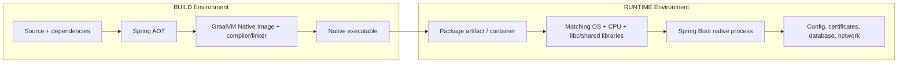
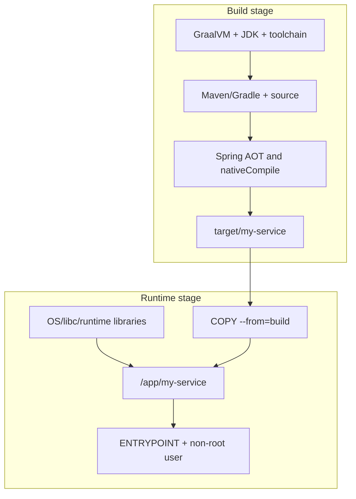
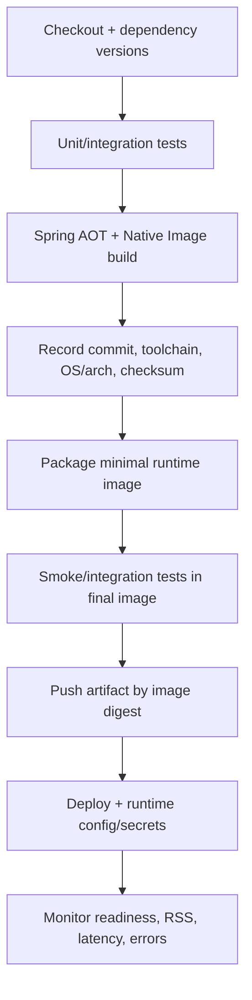

# Separating the Build Environment from the Executable Runtime Environment

When building a **Spring Boot Native Image** with **Spring AOT** and **GraalVM**, the build machine typically requires a JDK, the Native Image toolchain, Maven or Gradle, a system compiler/linker, and substantial CPU/RAM. Once compiled, however, the native application can run **without installing a JDK/JRE, Maven, Gradle, or GraalVM on the deployment machine**. That is why the **build** environment and **runtime** environment must be clearly separated.

However, **not needing a JVM does not mean the binary is independent of everything**. The native file may still require the right operating system, CPU architecture, dynamic loader, libc, shared libraries, CA certificates, configuration, and resource permissions. If built on an environment incompatible with the deployment target, the application may build successfully yet fail to start.

## 1. Goals and the Two-Environment Model

After this lesson, you will be able to:

1. Classify tools needed **when creating a native executable** versus components needed **when running the executable**.
2. Explain how Spring AOT, GraalVM Native Image, Maven/Gradle, and the compiler/linker participate in the build stage.
3. Identify constraints around OS, CPU architecture, glibc/musl, dynamic libraries, and runtime resources.
4. Write a **multi-stage** Dockerfile that includes only essential components in the runtime image.
5. Inspect binaries, diagnose deployment errors, and design appropriate build/test workflows.
6. Evaluate startup, memory, and image size benefits without confusing build costs with operational costs.



In a standard JVM application, Maven/Gradle packages a JAR and the runtime environment must supply a compatible JVM. With Native Image, GraalVM analyzes and compiles the program into machine code **before deployment**. Most tools used to *generate* machine code do not need to be carried into a container solely to *execute* that machine code.

## 2. How Does the Build Environment Differ from the Runtime Environment?

| Component | When Building Spring Boot Native Image | When Running Native Image | Reason |
| --- | --- | --- | --- |
| Source code, test code | Present | Usually absent | Source is not needed to execute the compiled binary |
| Maven/Gradle, plugins, wrapper | Present | Absent | Orchestrates Spring AOT, compilation, tests, packaging |
| JDK/GraalVM Native Image | Present | No JVM/JDK needed for a typical native executable | Native Image already generated machine code ahead of runtime |
| C compiler, linker, headers, dev libraries | May be needed | Usually absent | Used for compilation and linking, not request handling |
| High RAM/CPU for native compilation | Usually needed | Sized for business workload | Build requirements are not the service's memory quota |
| Native executable | Output | Present | Must match the target platform |
| Dynamic loader, libc, and shared libraries | Present in build env | May be needed | Depends on how the binary is linked |
| CA certificates, DNS, timezone, locale | May be needed | Feature-dependent | TLS, networking, and localization still run at runtime |
| Properties, profiles, secrets | Some values affect AOT analysis | Operational values at runtime | Must identify which values determine the bean graph |
| Logs, metrics, health checks | Used for CI diagnostics | Needed for runtime observability | Keeping a shell/compiler in the runtime image is unnecessary |

**Example:** a Spring Boot API using PostgreSQL can be built on a Linux CI runner with GraalVM and Maven. At runtime, the container carries only the executable, compatible Linux libraries, configuration loading for PostgreSQL connectivity, and network access. There is no need to install a Java compiler, Maven, or GraalVM inside that container.

An easy mistake is assuming **native executables are fully statically linked by default**: they contain no JVM, yet can still depend on certain OS libraries. Inspect the artifact itself before choosing a minimal base image.

## 3. What Belongs Strictly to the Build Environment

### 3.1. Toolchain and Compilation Tools

In an AOT-capable Spring Boot project, the build environment usually must verify compatibility among:

- **Spring Boot/Spring Framework** versions supporting AOT and native builds.
- **JDK and GraalVM Native Image** matching the project's Java version.
- **Spring Boot Maven/Gradle plugin** and **GraalVM Native Build Tools**.
- Compiler, linker, headers, and system packages required by Native Image builds on that platform.
- Memory, CPU, disk space, network access to fetch dependencies, and repository reachability.
- Operating system and CPU architecture on which the target executable will run.

For a Maven project with a configured `native` profile and matching plugins:

```bash
./mvnw -Pnative native:compile
```

For a Gradle project with the GraalVM Native Build Tools plugin applied:

```bash
./gradlew nativeCompile
```

These are examples for a project with an **already configured toolchain**. The commands themselves do not guarantee that the Maven Wrapper, plugins, JDK/GraalVM, or native build dependencies are properly installed.

Typically, a Maven binary is produced under `target/` and a Gradle binary under `build/native/nativeCompile/`; the filename depends on the project's artifact and configuration. On Windows, the executable may carry a `.exe` suffix.

### 3.2. What Does Spring AOT Prepare?

In the build chain, Spring AOT analyzes configuration and the bean graph, generating container initialization code along with runtime hints when needed. GraalVM Native Image then uses that code, dependencies, and metadata to perform reachability analysis, compile, and link the executable.

```text
Source + dependencies
   -> compile Java bytecode
   -> Spring AOT: generated sources / hints
   -> GraalVM Native Image: reachability analysis
   -> native compiler + linker
   -> executable for target platform
```

Configuration that decides **the bean set**, such as `@Profile`, `@ConditionalOnProperty`, or components on the classpath, can be evaluated at build time. If a bean is registered only when a condition holds during AOT, changing a property at runtime alone does not guarantee Spring will rebuild the graph and register a new bean.

Conversely, values read **for runtime operations** such as endpoints, timeouts, credentials, or feature data can be supplied at runtime if the application is designed to read them at runtime. Distinguish:

1. **Build-time configuration:** determines application/bean graph structure, compiler tools, and resources to package.
2. **Runtime configuration:** parameters the compiled binary reads while running, within the boundaries supported by Spring AOT and the application.

Do not bake production secrets into AOT code just to satisfy a build condition. When bean creation depends on data available only in production, revisit the configuration boundary or produce an artifact suited to that environment.

### 3.3. Build Reproducibility

Two executables from the same source can differ if the toolchain, system libraries, profiles, or flags change. For every release, record:

| Group | Information to Record |
| --- | --- |
| Source | Commit SHA/tag, dependency lock or dependency versions |
| Spring | Spring Boot, Spring Framework, build plugins |
| Toolchain | Java/GraalVM/Native Image versions, build flags |
| Platform | OS/base image, CPU architecture, libc |
| AOT | Profiles and properties affecting the bean graph |
| Artifact | Executable name, SHA-256 checksum, image digest |
| Verification | Tests, smoke tests, and verified environment |

This information is vital when CI builds in a different environment from deployment or when reproducing a release months later.

## 4. What Runtime Actually Needs

### 4.1. Compatible OS and CPU Architecture

An executable is built for a specific OS and architecture. For example:

- A **Linux x86-64** binary does not run directly on **Linux ARM64** without an appropriate emulation layer.
- A **Windows `.exe`** file does not run directly inside a Linux container.
- A binary built for **macOS ARM64** does not run on Linux ARM64, even though both share the ARM64 architecture.
- If compiler flags target a newer CPU instruction set, the binary may fail on older CPUs lacking those instructions.

Therefore, explicitly specify the target platform, such as `linux/amd64` or `linux/arm64`. For multi-architecture deployments, build and test a **separate native artifact for each platform**. Applying a multi-architecture manifest label to an image does not magically transform the machine code inside the executable.

`docker buildx` can orchestrate multiple build environments and target platforms, but you should not assume Native Image can cross-compile freely across arbitrary OSes/architectures. The reliable approach is building on a toolchain targeting the destination and testing on that platform.

### 4.2. Dynamic Linking vs. Static Linking

**Native Image does not automatically mean a fully static binary**. A Linux executable can be:

- **Dynamically linked:** depends on a dynamic loader and shared libraries such as `libc.so.6`, `libz.so`, `libstdc++.so`, depending on the build.
- **Fully or partially statically linked:** some or many libraries are embedded into the executable, though build feasibility and runtime needs still depend on libc, toolchain, and application features.

A dynamically linked binary can still run well in a small runtime image, provided the image includes the right loader and shared libraries. Using a bare image containing only the binary without its loader causes the OS to refuse execution even though the executable file exists.

On a compatible Linux machine, inspect the artifact with:

```bash
# File type, architecture, and executable format
file ./my-service

# Resolved shared libraries; run only on trusted binaries
ldd ./my-service

# Dynamic section and NEEDED libraries
readelf -d ./my-service

# ELF interpreter / dynamic loader path (if any)
readelf -l ./my-service
```

*Illustrative* example, not mandatory output for every application:

```text
$ ldd ./my-service
    linux-vdso.so.1 (...)
    libz.so.1 => /lib64/libz.so.1 (...)
    libc.so.6 => /lib64/libc.so.6 (...)
    /lib64/ld-linux-x86-64.so.2 (...)
```

Tools like `file`, `ldd`, and `readelf` may be absent from minimal runtime images; inspect the binary in the builder, a compatible Linux runner, or a debug image. Verify the exact library list against your actual artifact.

### 4.3. glibc, musl, and ABI Compatibility

If built on a Linux distribution with a newer **glibc** and run on a distribution with an older glibc, the executable may fail with:

```text
./my-service: /lib64/libc.so.6: version 'GLIBC_2.xx' not found
```

If the builder creates a glibc-dependent binary, merely swapping the runtime image to **Alpine (musl)** can also fail because the loader and ABI differ. Approaches to handle this:

1. Use builder and runtime images from the same OS/libc family, or carefully verify compatibility.
2. If the runtime is an older OS, build against a libc baseline compatible with that target.
3. If targeting musl or static linking, select supporting tools/flags and test separately; do not merely change the `FROM` line.
4. When multiple targets are needed, build and test artifacts per OS/architecture.

**Do not** copy an isolated `libc.so.6` file from the builder into an incompatible runtime image as a "patch." The dynamic loader, libc, and base libraries must match coherently.

### 4.4. System Resources and Data External to the Binary

Beyond shared libraries, a Spring Boot Native Image may need:

| Runtime Dependency | Use Case | What to Check |
| --- | --- | --- |
| CA certificates/truststore | HTTPS calls, TLS connections | Truststore path/configuration and actual certificates |
| DNS, network, proxy | REST clients, databases, brokers | Hostname resolution, firewalls, proxy variables |
| Timezone/locale | Scheduling, reporting, localized data | Timezone data source and how the app handles time |
| File system and `/tmp` | Uploads, temp files, caches, logs | Write permissions, UID/GID, mounted volumes |
| Runtime properties | Database URLs, timeouts, feature data | When properties are read and whether they affect the bean graph |
| Secrets | Passwords, API tokens, private keys | Supplied securely at runtime, never baked into images |
| Packaged resources | Templates, JSON, static files | Whether resources are embedded in the native binary or copied properly |
| OS native libraries | JNI or native dependencies | Dynamic linkage and matching library versions |

Spring AOT can generate metadata supporting Native Image, yet reflection or resources accessed dynamically in custom code may still require **runtime hints**. Having a file under `src/main/resources` does not guarantee all resource reads succeed in the native executable.

## 5. Separating Builder from Runtime with Multi-Stage Docker

A **multi-stage Dockerfile** uses one stage to compile with the full toolchain, then the final stage copies only the executable and required dependencies. Source code, Maven caches, compilers, and the JDK do not enter the final image.



### 5.1. Sample Dockerfile for Maven

The example below **illustrates environment separation** for a project using JDK 21, Maven Wrapper, and a native profile; it assumes the artifact is named `my-service`. Verify base image tags, available tools, system libraries, and artifact name before using in a real project.

```dockerfile
# syntax=docker/dockerfile:1
# Build stage: includes GraalVM and the Native Image toolchain.
FROM ghcr.io/graalvm/native-image-community:21 AS build
WORKDIR /workspace
COPY . .
RUN chmod +x ./mvnw \
    && ./mvnw -Pnative -DskipTests native:compile

# Runtime stage: slim OS from the same Linux family as the builder.
FROM oraclelinux:9-slim AS runtime

# Install only genuinely needed libraries; verify with ldd/readelf.
RUN microdnf install -y ca-certificates libstdc++ zlib \
    && microdnf clean all

WORKDIR /app
COPY --from=build --chmod=0755 \
    /workspace/target/my-service /app/my-service

USER 10001:10001
EXPOSE 8080
ENTRYPOINT ["/app/my-service"]
```

Meaning of each part:

- **`build`** provides GraalVM, source code, and tools to run Spring AOT + native compilation.
- **`runtime`** contains the Linux base and packages required to execute the binary. Packages installed in the example are illustrative; the real list must be verified against your binary and deployment environment.
- **`COPY --from=build`** transfers only the compiled binary; no JDK, Maven, compiler, source, or cache enters the final image.
- **`USER 10001:10001`** runs as a non-root UID/GID. The application must have write permissions for any required temp directories, caches, or mounted volumes.
- **`ENTRYPOINT`** executes the binary directly, not via `java -jar`.

The example uses `-DskipTests` to focus on the build stage; it does **not** replace running unit/integration tests in a real pipeline. For releases, pin base images by **digest** to avoid uncontrolled toolchain drift.

Use a proper `.dockerignore` to keep `.git/`, `target/`, `build/`, large files, and secrets out of the Docker build context. If the context contains sensitive data, limit `COPY` instructions to exact build inputs rather than copying broadly.

### 5.2. Building, Running, and Testing the Final Image

On a Docker host supporting the target platform:

```bash
docker build -t spring-native:demo .
docker run --rm -p 8080:8080 spring-native:demo
```

When Spring Boot Actuator/readiness is enabled and configured:

```bash
curl -fsS http://localhost:8080/actuator/health/readiness
```

If that endpoint is unavailable, use your project's health endpoint or an appropriate test API. Ensure `server.port` aligns with the port mapping.

Example passing typical runtime configuration (assuming the application supports `REPORT_TIMEOUT_MS`):

```bash
docker run --rm -p 8080:8080 \
  -e SERVER_PORT=8080 \
  -e REPORT_TIMEOUT_MS=3000 \
  spring-native:demo
```

`REPORT_TIMEOUT_MS` here is an **illustrative application-defined variable**, not a default Spring Boot property. For credentials and secrets, use your deployment environment's secret injection mechanism; avoid storing secrets in build commands, Dockerfiles, or image layers.

### 5.3. Gradle Alternative

The pattern stays identical; only the build command and artifact path change:

```dockerfile
# In the Gradle build stage, when the project has the matching plugin configured:
COPY . .
RUN chmod +x ./gradlew && ./gradlew nativeCompile

# Runtime stage copies from:
# /workspace/build/native/nativeCompile/my-service
```

The final filename depends on Gradle configuration. Neither Gradle nor build caches need to be copied into the runtime stage.

### 5.4. Buildpacks as an Alternative Option

Spring Boot can produce OCI images via **Cloud Native Buildpacks**, with native compilation when supported by the project and builder:

```bash
./mvnw -Pnative spring-boot:build-image \
  -Dspring-boot.build-image.imageName=example/spring-native:demo
```

Buildpacks typically supply a paired **builder image / run image** designed to work together, reducing manual maintenance of Dockerfiles and runtime layers. Even so, verify that the resulting image is truly **native**, confirm builder/run image versions, OS/architecture, required libraries, and smoke-test results.

A multi-stage Dockerfile fits well when you want granular control over the base image and copied files. Buildpacks fit well when you want to rely on build lifecycles, runtime bases, and image updates managed by the buildpack ecosystem. Both achieve the goal of **separating the toolchain from the runtime environment**.

## 6. Verifying the Right Artifact and Platform Before Deployment

| What to Confirm | How to Verify |
| --- | --- |
| Which OS/architecture was the binary built for? | `file`, CI runner details, image manifest |
| Does the binary use dynamic linking? | `ldd`/`readelf` on a compatible Linux system |
| Does the final image have the loader and shared libraries? | Cross-check `NEEDED` entries and test inside final image |
| Do libc/ABI match? | Base image family, libc version, and smoke test on target |
| Which profile/properties did Spring AOT use? | Record build metadata, audit bean-creation decisions |
| Do reflection/resources work? | Integration tests **against the native executable** |
| Are TLS, networking, timezone, and file permissions healthy? | Exercise real functional paths inside the runtime image |
| Does the final image carry a JDK/compiler? | Inspect Dockerfile stages and filesystem/image contents |
| Does the tested artifact match the deployed artifact? | SHA-256 checksum and image digest |

For multiple architectures, you can publish an image manifest containing both `linux/amd64` and `linux/arm64`, but the manifest is valid only when **each variant contains a binary compiled and tested for that architecture**. You cannot take an amd64 binary, label it arm64, and make it compatible.

## 7. Common Errors When Moving the Executable to a Runtime Environment

### 7.1. `exec format error`

```text
exec /app/my-service: exec format error
```

**Likely cause:** binary built for the wrong architecture or wrong OS/file format. For example, a macOS binary copied into a Linux container, or an amd64 image running on ARM64 without suitable emulation.

**Resolution:** inspect the executable with `file`, check the node platform and image manifest, and rebuild on a toolchain matching the target OS/architecture. Running a native build on macOS does not produce a Linux ELF simply by copying the artifact into a Docker container afterward.

### 7.2. File Exists, Yet Reports `No such file or directory`

```text
/app/my-service: No such file or directory
```

Beyond a wrong path, the cause may be a **missing ELF interpreter/dynamic loader** in the target image. The OS cannot load the executable even though `/app/my-service` exists.

**Resolution:** check the path and file permissions, run `readelf -l` to identify the interpreter, and verify that interpreter exists in the runtime image. Do not assume this is a `COPY` failure.

### 7.3. Missing glibc Symbol or Shared Library

```text
./my-service: /lib64/libc.so.6: version 'GLIBC_2.xx' not found
error while loading shared libraries: libXYZ.so: cannot open shared object file
```

**Likely cause:** the binary depends on a newer ABI/libc than the runtime provides, or the runtime lacks a dynamic library.

**Resolution:** pick a compatible runtime base, build against the libc baseline you need to support, or install the matching runtime package version. Do not patch by arbitrarily copying a system library from the builder into a different base family.

### 7.4. `Permission denied`

```text
exec /app/my-service: permission denied
```

**Likely cause:** missing execute bit, insufficient directory permissions, filesystem mounted with `noexec`, or restricted user privileges.

**Resolution:** inspect executable and parent directory permissions, mount options, UID/GID, and container policies. With Docker BuildKit, `COPY --chmod=0755` works as shown in the example. If the app starts yet cannot write temp files, check writable directory permissions under the non-root user.

### 7.5. Runtime Missing Certificates, Resources, or Metadata

```text
SSLHandshakeException: PKIX path building failed
Resource not found: templates/report.html
```

**Likely cause:** missing CA/truststore or TLS config, unpackaged/uncopied resource, or dynamic reflection/resource lookups for which Native Image lacks metadata.

**Resolution:** distinguish embedded resources inside the binary from externally mounted files, verify certificate/trust settings, and supply runtime hints if needed; rerun integration tests **inside the final runtime image**.

### 7.6. Native Build Hits OOM While Runtime Has Plenty of RAM

If the compiler runs out of memory in CI, the issue is **build-stage RAM**. Do not use the native compiler's RAM requirement as the memory sizing baseline for the production service. Runtime RSS, CPU, and latency must be measured under realistic workloads.

## 8. Structuring the CI/CD Pipeline to Keep Boundaries Clean



### Key Boundaries in CI

- A CI build for `linux/amd64` should use a compiler and toolchain matching `linux/amd64`; if `linux/arm64` is needed, use a dedicated runner/build setup.
- Put only **the binary and runtime dependencies** into the final image; `.m2`, `.gradle`, source code, and compilers serve only the builder.
- Never embed database passwords, API tokens, or private keys into AOT metadata, Dockerfiles, build arguments, or image layers.
- For Spring AOT conditions affecting the bean graph, record the exact build configuration. Certain runtime profile changes **do not** retroactively alter the precomputed bean set.
- Rerun functional tests against the **native executable** and **final image**, especially for reflection, JSON binding, resources, TLS, and external integrations.
- Use checksums/digests to tie the tested artifact to the actually deployed artifact; avoid accidentally rebuilding with a newer toolchain during promotion.

## 9. Measuring the Benefits of Environment Separation

The goal is not merely producing a small image. When evaluating a Spring Boot Native Image build, measure within the right boundaries:

| Metric | Where Collected | Meaning |
| --- | --- | --- |
| Build time, compiler CPU/RAM | CI/build | Cost of producing the native artifact |
| Builder image size | Build infrastructure | Relevant only to builder distribution/cache cost |
| Runtime image size | Release artifact | Storage and image pull cost in operations |
| Startup to readiness | Container runtime | Speed until process is ready to serve |
| RSS/working set | Container runtime | Resident memory when idle and under load |
| Latency p95/p99, throughput | Container runtime | Workload responsiveness |
| Compatibility and operability | Final image | Test pass rate, logs, metrics, health, debuggability |

Do not compare a builder image's size against a JAR runtime image to claim Native Image is more efficient, and do not use build-time compiler RAM to claim native runtime is memory-heavy. When comparing JVM against native, use **the exact same commit, business configuration, workload, and runtime resources**, and report build costs separately.

## 10. Practice Exercise: Proving the Separation

Suppose a project has an HTTP endpoint and Maven configured with GraalVM Native Build Tools. Proceed as follows:

1. Record the Spring Boot/JDK/GraalVM toolchain, OS, and build architecture.
2. Compile the executable with `./mvnw -Pnative native:compile` or an equivalent builder stage.
3. Run `file`, `ldd`, and `readelf` in a compatible Linux environment to inspect binary format, loader, and libraries.
4. Build the final image with a multi-stage Dockerfile, copying only the executable and supplying verified runtime packages.
5. Run `docker run --rm -p 8080:8080 spring-native:demo`. Call the health endpoint and at least one real business flow.
6. Verify TLS, resources, file permissions, external connections, and running as a non-root user.
7. Confirm the container starts **without Java, Maven, Gradle, or GraalVM installed**.
8. If targeting another CPU platform, rebuild on a matching toolchain and test on that platform; never copy one binary and guess portability.

After the exercise, answer: **"Why does the build machine need GraalVM, a compiler, and lots of RAM, while the running container needs no JDK yet can still fail due to libc?"** A sound answer must distinguish **the tools that produce the executable** from **the system conditions the OS requires to run the executable**.

## 11. Key Takeaways

- **The build environment** holds source code, Java/GraalVM toolchains, Spring AOT, Maven/Gradle, and compiler/linker to create the native executable.
- **The runtime environment** needs a platform-matching executable and the libraries/resources the binary actually depends on; it usually **needs no JVM/JDK**.
- **Native does not mean static**. Inspect libc, shared libraries, ELF interpreter, and CPU architecture before selecting a runtime image.
- **Multi-stage Dockerfiles or buildpacks** separate the toolchain from the operational image, eliminating unnecessary components.
- Configuration affecting the bean graph **when Spring AOT runs** must be managed consistently between build and deployment; secrets and operational settings should be injected at runtime when supported by the design.
- Smoke tests and integration tests **against the final image** are what verify compatibility; startup, RSS, and throughput must be measured independently of native compilation cost.

Cleanly separating the two environments makes Spring Boot Native Images easier to deploy, reduces build-tool dependencies in production, and prevents errors caused by confusing **where the executable is built** with **where the executable runs**.
