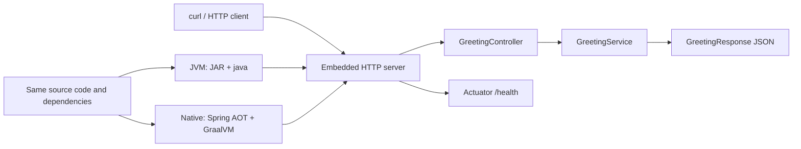
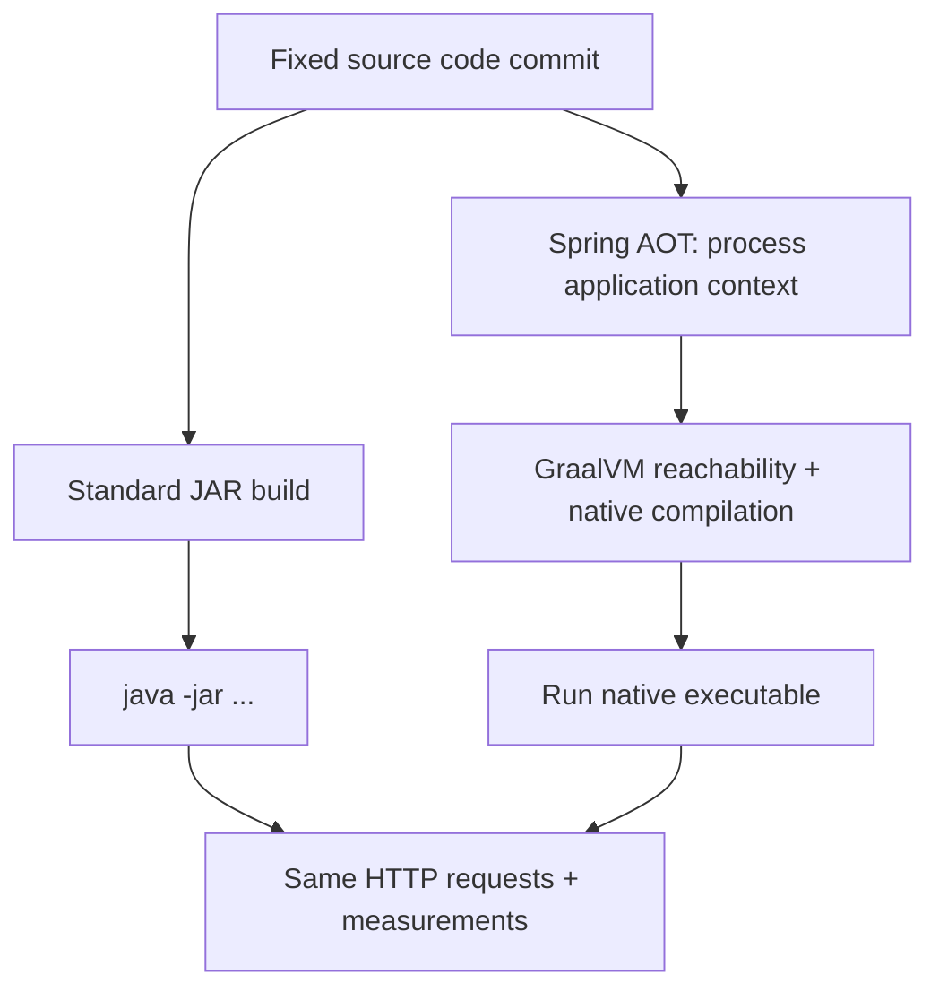

# Choosing a Small Spring Boot Application as a JVM and Native Baseline

To learn how to compile **Spring Boot** into a **GraalVM Native Image** using **Spring AOT**, the first step is not optimizing a large system. We need to choose a small, controllable application that behaves identically in both execution modes: **Spring Boot on the JVM** and **Spring Boot as a native executable**. That application will serve as our **baseline** — a reference point to measure startup time, memory usage, artifact size, and verify compatibility.

This lesson guides you in choosing an application small enough to be easily reproducible yet still "real" enough: featuring dependency injection, HTTP endpoints, JSON serialization, and a health check. From a single codebase, we build both the JVM and native versions, then establish a fair measurement process. The actual measured values are filled in by the learner after running them; the lesson does not assume beforehand that native is guaranteed to be better across every metric.

## 1. Objectives of the Baseline

A good baseline must answer verifiable questions:

1. **Behavior:** Do both builds return the exact same correct data for the same requests?
2. **Startup:** How long does it take from process creation until the endpoint is ready to accept requests?
3. **Memory:** Once the application is ready and in an equivalent state, how much **RSS** (resident set size) does each process consume?
4. **Artifact:** What are the sizes of the JAR and the native executable? If packaged as a container, how does the image size change?
5. **Build complexity:** What tools does each build require, how long does it take to build, and are there any AOT/reflection/resource errors?
6. **Reproducibility:** Can someone else use the same commit, JDK version, configuration, and measurement script to obtain comparable results?

You should not call a sample a baseline just because it "works". If one variant uses a different database, cache, and logging setup than the other, differences in time or memory no longer reflect only the JVM/native packaging mode.

### Distinguishing Comparison Scopes

| What to Know | Appropriate Perspective | What Not to Infer |
| --- | --- | --- |
| **Startup time** | Time from process start until the HTTP health endpoint succeeds | Do not equate with the time Spring prints in `Started ... in ... seconds` |
| **Idle RSS** | Actual resident memory of the process when ready, after a fixed stabilization period | Do not equate with Java heap usage or `-Xmx` |
| **Binary/JAR size** | Inspectable file size on disk | Does not equal total container image size |
| **Build duration** | Time to produce the artifact according to the toolchain | Do not use to conclude whether runtime startup is fast or slow |
| **Response correctness** | HTTP status, content-type, and JSON are all valid | A passing health check does not prove all business branches are compatible |
| **Throughput/latency** | Requires a dedicated load test, warm-up, and steady-state measurement | Do not infer from startup or RSS results |

In the first application step, prioritize **correctness, startup time, idle RSS, and artifact size**. Throughput/latency tests can be added later once JIT warm-up, load, GC, and environment variables are controlled.

## 2. Criteria for Choosing the Test Application

The chosen application should meet the following conditions:

- **Minimal external dependencies:** Does not require PostgreSQL, Redis, Kafka, cloud credentials, or network connectivity to start.
- **Has a real Spring execution path:** At least one controller, one Spring-managed bean, and JSON response handling. A plain Java `public static void main` program does not reflect Spring Boot overhead.
- **Deterministic results:** Same input produces the same output, easy to verify automatically with `curl` or tests.
- **Minimal configuration:** A fixed HTTP port and a few clear properties; no separate profiles needed for JVM or native.
- **Native-friendly libraries:** Prefer popular Spring starters that already have AOT integration, avoiding unpredictable runtime class/plugin loading.
- **Has a readiness indicator:** A deterministic health endpoint or business endpoint, using the same criteria for both builds.
- **Independently buildable:** Source code, dependency versions, and build configuration are pinned in a single commit.

Comparing some options:

| Candidate Application | Complexity | Signals Learned | Suitable as First Baseline? |
| --- | --- | --- | --- |
| Plain Java `main` printing "Hello" | Very low | Only shows the bare minimum of Java/native | **Not representative enough of Spring Boot** |
| Spring Boot CLI without HTTP | Low | Context and bean initialization | Usable, but lacks HTTP readiness/JSON |
| **Small Spring Boot REST API returning JSON + health** | **Low** | **AOT, web server, bean wiring, JSON, HTTP readiness** | **Recommended** |
| CRUD API + database | Medium | Database, serialization, pool, network | Good for extended lessons, easily introduces initial noise |
| Microservice with Kafka/Redis/Security | High | Real-world ecosystem | Not suitable for the first measurement |

**Choice for this lesson:** an application named `native-baseline`, featuring a greeting endpoint returning JSON and a health endpoint from Spring Boot Actuator. It is enough to observe the Spring context and embedded web server while avoiding fluctuations from external system connections.

## 3. Baseline Application Design

### Fixed Functionality

| Endpoint | Request | Expected Result |
| --- | --- | --- |
| `GET /api/greeting` | No query parameter | HTTP 200 and JSON `{"message":"Hello, friend!"}` |
| `GET /api/greeting?name=Lan` | `name=Lan` | HTTP 200 and JSON `{"message":"Hello, Lan!"}` |
| `GET /actuator/health` | No query parameter needed | HTTP 200 and status `UP` when the application is healthy |

This is an intentionally small workload. HTTP overhead, context initialization, bean registration, and JSON serialization still occur, while the business logic takes virtually no time. Therefore, startup and idle memory results reflect the **Spring Boot Web baseline** fairly directly; these results **are not representative** of a system with a database, Security, ORM, template engine, or large data volumes.

### Components



In this model, `GreetingController` depends on `GreetingService` via constructor injection. Spring AOT can analyze bean and controller relationships. The response is a simple Java record to verify serialization; no custom reflection or class loading by name is needed in the first baseline.

### Suggested Project Structure

```text
native-baseline/
├── pom.xml                           # Or build.gradle[.kts]
├── mvnw / mvnw.cmd                   # If using Maven Wrapper
├── src/
│   ├── main/
│   │   ├── java/com/example/baseline/
│   │   │   ├── NativeBaselineApplication.java
│   │   │   ├── GreetingController.java
│   │   │   ├── GreetingService.java
│   │   │   └── GreetingResponse.java
│   │   └── resources/
│   │       └── application.properties
│   └── test/java/com/example/baseline/
│       └── ...                      # Functional tests
└── README.md                        # Record versions and measurements
```

The structure above illustrates the project contents created by the learner. This lesson only provides instructions and examples; it does not automatically create those project files in the knowledge repository.

## 4. Initializing a Simple Spring Boot Project

You can create the project using **Spring Initializr** or use an existing empty Spring Boot project. You should choose a stable Spring Boot version with AOT/native support, use **Java 17 or Java 21 as required by the chosen version**, and lock the same JDK/GraalVM version for measurements.

Initialization choices:

| Setting | Suggestion | Reason |
| --- | --- | --- |
| Project | Maven **or** Gradle | A single tool to keep results reproducible |
| Language | Java | Matches examples; easy to use with Spring AOT |
| Group | `com.example` | Sample namespace |
| Artifact | `native-baseline` | Easy to identify in build outputs |
| Packaging | JAR | Suitable for JVM execution and as Native Image input |
| Dependencies | Spring Web MVC, Spring Boot Actuator | REST JSON + readiness endpoint |
| Native support | GraalVM Native Build Tools / GraalVM Native Support | Provides plugins/tasks to build the executable |

The actual starter names may vary depending on the Spring Boot version; select the **Spring Web MVC** option corresponding to the initialized version. If the project generator offers **GraalVM Native Support**, enable it so Initializr configures native build integration. Add the appropriate test starter if you need testing with JUnit.

**Do not pick a Spring Boot version from memory and let the build automatically pull "latest".** Use an explicitly declared version in `pom.xml` or the Gradle build file, lock dependencies, and record the JDK/GraalVM version. You can still choose a newer version, but both artifacts must be built from **the same commit**.

## 5. Illustrative Source Code

Place all four classes under the `com.example.baseline` package.

**`NativeBaselineApplication.java`**

```java
package com.example.baseline;

import org.springframework.boot.SpringApplication;
import org.springframework.boot.autoconfigure.SpringBootApplication;

@SpringBootApplication
public class NativeBaselineApplication {
    public static void main(String[] args) {
        SpringApplication.run(NativeBaselineApplication.class, args);
    }
}
```

**`GreetingService.java`**

```java
package com.example.baseline;

import org.springframework.stereotype.Service;

@Service
public class GreetingService {

    public String messageFor(String name) {
        return "Hello, " + name + "!";
    }
}
```

**`GreetingResponse.java`**

```java
package com.example.baseline;

public record GreetingResponse(String message) {
}
```

**`GreetingController.java`**

```java
package com.example.baseline;

import org.springframework.web.bind.annotation.GetMapping;
import org.springframework.web.bind.annotation.RequestMapping;
import org.springframework.web.bind.annotation.RequestParam;
import org.springframework.web.bind.annotation.RestController;

@RestController
@RequestMapping("/api")
public class GreetingController {

    private final GreetingService greetingService;

    public GreetingController(GreetingService greetingService) {
        this.greetingService = greetingService;
    }

    @GetMapping("/greeting")
    public GreetingResponse greeting(
            @RequestParam(defaultValue = "friend") String name) {
        return new GreetingResponse(greetingService.messageFor(name));
    }
}
```

**`src/main/resources/application.properties`**

```properties
spring.application.name=native-baseline
server.port=8080
spring.main.lazy-initialization=false
management.endpoints.web.exposure.include=health
```

The configuration `spring.main.lazy-initialization=false` explicitly states the default initialization behavior so singletons are not accidentally deferred—making startup measurements appear faster while shifting that cost to the first request.

In this example, Spring is responsible for creating `GreetingService` and `GreetingController`; Jackson converts `GreetingResponse` into JSON. These are Spring mechanisms generally supported by AOT. However, you must still **actually verify the native build**, rather than inferring compatibility solely from running successfully on the JVM.

### Verifying Behavior Before Measuring

On JVM or native, call:

```bash
curl --fail --silent --show-error \
  "http://127.0.0.1:8080/api/greeting?name=Lan"

curl --fail --silent --show-error \
  "http://127.0.0.1:8080/actuator/health"
```

Expected business response:

```json
{"message":"Hello, Lan!"}
```

The health endpoint typically returns a JSON object with status `UP`, such as `{"status":"UP"}`. Do not rely on JSON key ordering or whitespace; when writing tests, validate the JSON structure/values. Also check HTTP 200 and the appropriate `Content-Type`.

## 6. Building JVM and Native Variants from the Same Source

The Spring Boot JVM build keeps the application as bytecode/JAR. The native build uses **Spring AOT** to prepare the statically analyzable Spring configuration and **GraalVM Native Image** to produce the executable.



### If Using Maven

With a project configured with the Spring Boot plugin and Native Build Tools:

```bash
# Test the application and build an executable JAR for the JVM.
./mvnw clean verify

# Run the JVM version (adjust JAR name to actual artifact/version).
java -jar target/native-baseline-0.0.1-SNAPSHOT.jar

# After stopping the JVM version, build the native executable.
./mvnw -Pnative native:compile

# Run the native executable (name/path determined by Maven config).
./target/native-baseline
```

The commands above illustrate a common Maven workflow. `-Pnative` and the `native:compile` goal require the appropriate plugin/profile; if Initializr did not generate the configuration, add Native Build Tools according to the guide for your Spring Boot version. On Windows, use `mvnw.cmd` and the executable may have a `.exe` extension.

### If Using Gradle

With a project applying the Spring Boot and Native Build Tools plugins:

```bash
# Run tests and build the executable JAR.
./gradlew clean test bootJar

# Run the JAR; file name depends on artifact/version.
java -jar build/libs/native-baseline-0.0.1-SNAPSHOT.jar

# After stopping the JVM, build native.
./gradlew nativeCompile

# Run the native executable; file name depends on configuration.
./build/native/nativeCompile/native-baseline
```

On Windows, use `gradlew.bat`. **Choose Maven or Gradle for a baseline**; you do not need to build both to compare JVM and native. For whichever option you choose, the test JAR and executable must be built from the same source content, same dependency graph, and compatible configuration.

Native compilation usually requires a heavier toolchain and larger build resources than a JVM JAR. You need a compatible GraalVM/Native Image installation and OS compiler/linker. That is **build cost**, and should be recorded separately from runtime startup.

## 7. Defining "Application Ready" Consistently

Do not compare times by manually reading two `Started NativeBaselineApplication in ... seconds` lines. This line measures only part of Spring's startup process and may not accurately reflect process creation, socket binding, and HTTP request handling.

Adopt a shared definition:

> **Startup-to-ready = timestamp when the health endpoint first returns HTTP 200 − timestamp when the process starts launching.**

For a demo application with no external dependencies, `GET /actuator/health` is a simple and repeatable indicator. In real systems with a dedicated readiness probe, you must agree on which endpoint reflects "ready" for the measurement goal.

### Startup Measurement Script on Linux

The following example uses Bash, GNU `date`, `curl`, and `ps`. Save it temporarily as a script when practicing, such as `measure-startup.sh`, and run **one variant at a time**. This is a measurement guide example; the lesson does not execute the script on your behalf.

```bash
#!/usr/bin/env bash
set -euo pipefail

# Usage: ./measure-startup.sh java -jar target/native-baseline-0.0.1-SNAPSHOT.jar
#        ./measure-startup.sh ./target/native-baseline

if [ "$#" -eq 0 ]; then
  echo "Usage: $0 <command> [args...]" >&2
  exit 2
fi

health_url="http://127.0.0.1:8080/actuator/health"
log_file="$(mktemp)"

# Do not measure if the port is already used by an old process.
if curl -fsS --max-time 1 "$health_url" >/dev/null 2>&1; then
  echo "Port 8080 already responds: stop the prior application first." >&2
  rm -f "$log_file"
  exit 1
fi

cleanup() {
  kill "$pid" 2>/dev/null || true
  wait "$pid" 2>/dev/null || true
  rm -f "$log_file"
}

start_ms="$(date +%s%3N)"
"$@" >"$log_file" 2>&1 &
pid=$!
trap cleanup EXIT

for (( attempt = 0; attempt < 600; attempt++ )); do
  if curl -fsS --max-time 1 "$health_url" >/dev/null 2>&1; then
    ready_ms="$(date +%s%3N)"
    echo "startup_to_ready_ms=$((ready_ms - start_ms))"

    # Wait the same duration after readiness, then capture idle RSS.
    sleep 10
    rss_kib="$(ps -o rss= -p "$pid" | tr -d '[:space:]')"
    echo "idle_rss_kib=$rss_kib"
    exit 0
  fi

  if ! kill -0 "$pid" 2>/dev/null; then
    echo "Application stopped before health became ready." >&2
    cat "$log_file" >&2
    exit 1
  fi

  sleep 0.05
done

echo "Timeout waiting for /actuator/health." >&2
cat "$log_file" >&2
exit 1
```

In this script, the `sleep 0.05` polling loop yields an effective resolution of roughly tens of milliseconds plus `curl` and scheduler overhead. For very fast-starting applications, polling error can be significant; for more accurate figures, measure with specialized tools or adjust the polling interval and record the resolution. The `ps -o rss=` command reports **RSS in KiB on Linux**, which is only **a single sample taken 10 seconds after readiness**, not peak RSS.

Before each measurement, ensure port 8080 is free with no lingering processes. The script terminates the process it launched after collecting one sample. Do not run both variants simultaneously on the same port.

### Repeated Runs

Follow the same procedure, for example **15 runs for JVM and 15 runs for native**, alternating order or applying a documented fixed-order rule. Each run must spawn a **fresh process**, rather than re-calling the endpoint on an already-running process. Pick a few warm-up trials outside the statistical sample if you want to reduce the impact of page cache and first-time class/file loading; apply the same rule consistently to both modes.

When aggregating metrics:

- **Median (p50):** represents a typical run and is less skewed by outliers than the mean.
- **p95:** shows tail-end latency variability when enough samples exist; with only 15 runs, p95 is quite sensitive, so also record min/max and increase sample size if strong conclusions are needed.
- **Idle RSS:** report the median or distribution of samples after the same stabilization period.
- **Reproducibility:** save timestamps, per-run results, and machine specs instead of keeping only a screenshot of the best run.

If using Windows, use equivalent tooling to measure HTTP readiness time and process working set, and clearly state the metric type. **Do not directly compare Windows Working Set with Linux RSS** as if they were the same measurement.

## 8. Controlling Variables for a Fair Comparison

Keep the following factors as identical as possible:

| Factor | How to Control |
| --- | --- |
| Source code | Same Git commit, no native-only code added |
| Spring Boot/dependencies | Same versions and dependency lock/BOM |
| JDK | Record full vendor and version; to reduce differences, you can use the JDK from the same GraalVM distribution for the JVM run |
| OS, CPU, RAM | Measure on the same host, same architecture; avoid switching machines between measurements |
| Configuration | Same profiles, port, logging, actuator exposure, environment, and relevant properties |
| System temperature/background load | Do not run builds, IDE indexing, or other benchmarks simultaneously |
| Process state | Each measurement is a fresh process; stop cleanly before the next run |
| Readiness milestone | Same health URL and same HTTP success condition |
| RSS sampling time | Same wait duration after ready, same idle load level |
| Container | If comparing in containers, keep CPU/memory limits, base platform, and measurement method consistent |

**Do not enable lazy initialization or disable actuator for only one build.** Likewise, do not compare a native app running locally against a JVM app running in a memory-limited container, as the environment becomes an independent variable.

### Differences Between JVM Heap and OS Memory

`-Xmx256m` limits the maximum Java heap (in JVM semantics), not the total memory of the process. RSS also includes many other regions such as native memory, thread stacks, runtime data, code cache, and shared libraries. Native Image also has its own heap and runtime; its memory management differs from the JVM's.

If you only measure **idle RSS**, do not interpret the result as "native uses X% less heap". Use the exact metric name. If benchmarking under load is needed, also measure state after an equivalent number of requests, CPU, GC, and latency to avoid optimizing one metric by shifting the cost to another.

### Differences Between Startup Time and Processing Speed

Native Image can start fast thanks to AOT and not needing JIT compilation like a typical JVM process. Conversely, the JVM has a JIT compiler that optimizes hot code after warm-up. Therefore, **a startup advantage does not mean native's throughput or latency under load is always better**.

For an application returning a static string, load tests may mostly measure HTTP/framework overhead. Conclusions about business performance should only be drawn after adding a representative workload and clear test conditions.

## 9. Result Table Template to Fill After Experimentation

Use a table containing your measured values rather than a number taken from a blog post or another machine:

| Metric | JVM JAR | Native Executable | Notes |
| --- | --- | --- | --- |
| Startup-to-ready median (ms) | _Fill after measuring_ | _Fill after measuring_ | Same endpoint, at least 15 runs |
| Startup-to-ready p95 (ms) | _Fill after measuring_ | _Fill after measuring_ | Include min/max if sample count is small |
| Idle RSS median (MiB) | _Fill after measuring_ | _Fill after measuring_ | Measured 10 seconds after readiness |
| Artifact size (MiB) | _Fill after measuring_ | _Fill after measuring_ | JAR and executable pack content/dependencies differently |
| Build duration (s or min) | _Fill after measuring_ | _Fill after measuring_ | Same clean build type or note cache state |
| HTTP correctness | _Pass/Fail_ | _Pass/Fail_ | /api/greeting, /actuator/health |
| Tooling and configuration | _Version/flags_ | _Version/flags_ | JDK, GraalVM, OS, Spring Boot |

Percentage differences can be calculated when both values are valid and in the same unit:

```text
Startup reduction (%) = (startup_JVM - startup_native) / startup_JVM * 100

RSS reduction (%) = (RSS_JVM - RSS_native) / RSS_JVM * 100
```

A negative value means native **did not reduce** that metric in the conducted measurement. Report both absolute and percentage values; percentages alone do not show how many milliseconds or MiB actually separate the two processes.

### Example Metadata to Save Alongside Results

```yaml
experiment: spring-boot-native-baseline
gitCommit: "<commit SHA>"
application: "native-baseline"
springBootVersion: "<actual version>"
javaVersion: "<java -version>"
graalVmVersion: "<native-image --version>"
buildTool: "<Maven or Gradle + version>"
operatingSystem: "<OS + version>"
cpu: "<CPU/cores>"
memory: "<RAM and cgroup/container limits if any>"
port: 8080
readyEndpoint: "/actuator/health"
runsPerVariant: 15
idleRssAfterReadySeconds: 10
jvmFlags: "<actual flags>"
nativeFlags: "<actual flags>"
```

This is an **experiment notes template**, not a required Spring Boot configuration file, and it does not replace `application.properties`.

## 10. Pitfalls That Distort the Baseline

**Using an overly large system for the first exercise.** When startup time depends on database migrations, DNS, network retries, and cloud SDKs, it is hard to tell what Native Image changed. Start with a small REST API, then add dependencies incrementally.

**Testing only `/actuator/health`.** Health UP can appear even if business JSON serialization or reflection branches have never been executed. Call `/api/greeting` on **both builds** as well, verifying HTTP status and JSON.

**Using two artifacts from different commits.** Adding a dependency or changing configuration before building native means the results no longer compare one application across two runtimes. Record the commit and rebuild both variants whenever source changes.

**Using Spring logs as the sole startup metric.** Spring logs are useful for debugging, but do not necessarily match the moment a client receives HTTP 200. Standardize start-to-ready externally from the process.

**Confusing heap with RSS, or RSS with peak RSS.** One RSS sample after 10 seconds does not reveal peak usage during startup; an `-Xmx` limit is not actual RAM consumed.

**Letting build activity interfere with measurements.** Running native compilation concurrently with a JVM measurement can cause CPU/RAM contention and artificially inflate startup times. Separate building from measuring.

**Adding reflection or dynamic plugins before establishing a baseline.** These mechanisms may require dedicated runtime hints and metadata. Establish a working application in both modes first, then add features one by one to see which change triggers a native error.

## 11. Expanding Layer by Layer in Complexity

Once the first baseline is stable, you can expand in a controlled manner:

1. **Level 1 — REST JSON + Actuator:** this lesson, focusing on startup and idle RSS.
2. **Level 2 — @ConfigurationProperties and validation:** observe binding and runtime configuration, inspect code generation and metadata.
3. **Level 3 — Persistence:** add a database along with dataset, network, and pool configuration; separate DB wait time from Spring initialization time.
4. **Level 4 — Dynamic reflection/resources:** add concrete cases to practice `RuntimeHintsRegistrar`, resource hints, and verify native compatibility.
5. **Level 5 — Container:** build JVM/native images, record image size, CPU/memory limits, health/readiness, and measurement method inside the same container runtime.

Each level adds a small enough group of factors to explain the resulting changes. Keep the first baseline intact for comparison rather than modifying it after adding extended features.

## 12. Hands-on Exercise and Completion Criteria

**Requirement:** from the `native-baseline` project above, build two artifacts from the same commit: a JVM-runnable JAR and a native executable via Spring AOT/GraalVM.

Proceed step by step:

1. Create a Spring Boot project with Spring Web MVC, Actuator, and native build tools configuration compatible with your chosen version.
2. Implement the four classes and `application.properties` shown in the lesson; run on the JVM and verify greeting JSON and health.
3. Build the native executable, run it on the same port after stopping the JVM version, then call the exact same two endpoints to compare results.
4. Measure at least 15 independent startups for each build; record **startup-to-ready** and **idle RSS** using the same method.
5. Record artifact sizes, machine specs, JDK/GraalVM, dependency versions, commit, and runtime flags.
6. Fill in the result table, state one observation backed by measurements, and one limitation of the test.

To self-check your understanding, explain:

- Why is a plain Java `main` application insufficient as a baseline for Spring Boot?
- Why must both REST JSON and actuator health be tested?
- Why is a small or fast-starting native executable insufficient to conclude it handles more requests per second than the JVM?
- Why must you record the RSS sampling timestamp and keep configuration identical between both builds?
- If a database is added after this lesson, which exogenous variables must be measured or controlled?

**Completion criteria:** select a small Spring Boot Web application with **identical behavior and identical build source** across JVM/native; describe appropriate metrics; collect repeatable startup and memory data; interpret results without confusing build-time with runtime, heap with RSS, or startup with throughput.
