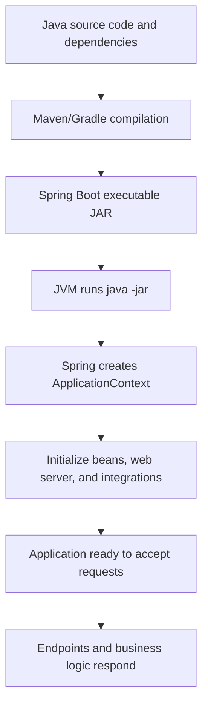

# Running and Verifying Behavior on the JVM Before Enabling AOT

## 1. Why Verify the JVM Build First?

When building the first application in the **SPRING_BOOT_NATIVE_IMAGE** module, the ultimate goal is to compile a Spring Boot application with Spring AOT and GraalVM Native Image, then compare startup time, memory, compatibility, and container operation. To make a reliable comparison, you first need a **functionally working JVM baseline**.

If an endpoint already fails on the JVM build, moving to native may only make the bug harder to diagnose. Conversely, once you know exactly which requests the JVM build handles, what data structures it returns, and what configuration it starts with, you can distinguish ordinary business logic bugs from issues related to Spring AOT, reachability metadata, reflection, or unpackaged resources.

This lesson focuses on three outcomes before enabling AOT:

1. The Spring Boot application can be built, started, and stopped cleanly on the JVM.
2. Key behaviors are verified through requests and tests with reproducible results.
3. A baseline record captures the versions, configuration, and metrics needed for later comparison with native.

**Terminology note:** running `java -jar` executes the JVM build. Tasks such as `processAot`, `nativeCompile`, `native:compile`, or the Maven `native` profile belong to a later stage and are not needed to verify this baseline.

## 2. Understanding the Execution Path on the JVM

A typical Spring Boot application goes through the following steps:



The JVM can load classes at runtime, execute reflection, and perform other dynamic mechanisms according to the classpath and access permissions. This differs from Native Image, where code and metadata must be sufficiently determined at build time. However, a successful JVM run **does not guarantee** native compatibility: it only provides a reference point for behavior and configuration.

For a fair experiment, keep business logic and APIs identical between JVM and native builds, changing only configuration or code genuinely required for native; every such change must be clearly recorded.

## 3. Choosing a Small Sample Application with Observable Behavior

A simple REST application is ideal for the first hands-on exercise because it requires no external database or third-party network connections. The example uses Spring Web and a Java record (the Java version must match the project's Spring Boot version).

`DemoApplication.java`:

```java
package com.example.demo;

import org.springframework.boot.SpringApplication;
import org.springframework.boot.autoconfigure.SpringBootApplication;

@SpringBootApplication
public class DemoApplication {
    public static void main(String[] args) {
        SpringApplication.run(DemoApplication.class, args);
    }
}
```

`GreetingController.java`:

```java
package com.example.demo;

import org.springframework.http.HttpStatus;
import org.springframework.web.bind.annotation.GetMapping;
import org.springframework.web.bind.annotation.RequestParam;
import org.springframework.web.bind.annotation.RestController;
import org.springframework.web.server.ResponseStatusException;

@RestController
public class GreetingController {

    public record Greeting(String message) {}

    @GetMapping("/api/greeting")
    public Greeting greet(
            @RequestParam(defaultValue = "World") String name) {
        String normalized = name.trim();
        if (normalized.isEmpty()) {
            throw new ResponseStatusException(
                    HttpStatus.BAD_REQUEST, "Name must not be blank");
        }
        return new Greeting("Hello, " + normalized + "!");
    }
}
```

With the Spring Boot web starter and an appropriate JSON converter, the `GET /api/greeting` endpoint returns JSON. When `name` is empty or whitespace-only, it should return HTTP 400, while a valid name returns HTTP 200.

This example intentionally verifies both the **success path** and the **error path**. When moving to native, missing serializer metadata or configuration bugs may manifest in those paths; seeing the server start alone is not enough to prove compatibility.

## 4. Checking Prerequisites Before Running

You need a JDK compatible with the Spring Boot version in use and the project's Maven or Gradle wrapper. Run commands from the directory containing `pom.xml` or `build.gradle`/`build.gradle.kts`.

```bash
java -version
javac -version
```

If using the Maven wrapper:

```bash
./mvnw -version
```

If using the Gradle wrapper:

```bash
./gradlew --version
```

On Windows PowerShell/cmd, use `mvnw.cmd` and `gradlew.bat` respectively. Record the **Java version actually used by the build tool**, since the shell's `java` command may differ from the JDK configured for Maven/Gradle.

Check profiles, web port, environment, and dependencies before starting. If the application requires a database, cache, or credentials, include them explicitly in the test conditions. For a sample application with no external integrations, you can start with minimal configuration, such as `server.port=8080` if that port is free.

## 5. Building and Running on the JVM with Maven

In a Maven project with the Spring Boot Maven Plugin, package the JAR using:

```bash
./mvnw clean package
```

The `clean` goal removes previous project build artifacts, and `package` compiles, runs configured tests, and produces the artifact. When testing in a project with build outputs you want to keep, you can omit `clean` and run `./mvnw package`. Do not pass `-DskipTests` for the baseline step if you need to prove all tests run.

For the executable JAR created by the Spring Boot plugin's repackaging, run:

```bash
java -jar target/demo-0.0.1-SNAPSHOT.jar
```

The JAR name is **illustrative only**: replace it with the actual artifact name. If Maven does not produce an executable JAR, check the Spring Boot Maven Plugin configuration and packaging; do not assume every JAR produced by `mvn package` can be run with `java -jar`.

During development you can use:

```bash
./mvnw spring-boot:run
```

This is convenient for quick tests, but to measure an equivalent baseline when comparing against a native executable, prefer running the **packaged artifact**, recording the exact command and flags.

## 6. Building and Running on the JVM with Gradle

With the Spring Boot Gradle Plugin, use:

```bash
./gradlew clean bootJar
```

The `bootJar` task creates an executable Spring Boot JAR according to the project configuration. The command above does not guarantee that all tests ran; before accepting the baseline, run separately:

```bash
./gradlew test
```

Then run the artifact in `build/libs/`:

```bash
java -jar build/libs/demo-0.0.1-SNAPSHOT.jar
```

Or use the convenience task:

```bash
./gradlew bootRun
```

As with Maven, the file name depends on the version and archive configuration. If the build script creates both a plain JAR and a `bootJar`, select the Spring Boot executable JAR.

Do not activate `processAot` or `nativeCompile` tasks at this stage. The baseline must describe the **standard JVM behavior** of the current application.

## 7. Verifying That the Application Starts and Is Ready

Observe the startup logs to confirm that `ApplicationContext` initializes successfully, the web server binds the expected port, and the application is ready to handle requests. The `Started ... in ... seconds` log line is useful for reference, but should not be treated as the sole readiness measure because its meaning and logging timestamp may differ from the actual state observed by a monitoring system.

From another terminal, call the HTTP endpoint:

```bash
curl -i "http://localhost:8080/api/greeting"
```

The expected result has status `HTTP/1.1 200` and a JSON body equivalent to:

```json
{"message":"Hello, World!"}
```

Call with a name containing an encoded space in the query:

```bash
curl -i "http://localhost:8080/api/greeting?name=Spring%20Boot"
```

Expected body:

```json
{"message":"Hello, Spring Boot!"}
```

Business error case:

```bash
curl -i "http://localhost:8080/api/greeting?name=%20%20"
```

Expect status **400 Bad Request**. The error body structure may vary by Spring Boot version, exception handling configuration, or Problem Details; the exercise should verify the status code first and only compare the body if the response format has been standardized.

The `curl -i` command displays headers and body. For automated verification, use assertions rather than visual inspection.

## 8. Writing Integration Tests to Verify the Contract

A manual smoke test is a starting point. For repeatable comparison with native, key outcomes should be encoded as tests. With Spring Boot Test and MockMvc (when the project uses Spring MVC), for example:

```java
package com.example.demo;

import static org.springframework.test.web.servlet.request.MockMvcRequestBuilders.get;
import static org.springframework.test.web.servlet.result.MockMvcResultMatchers.*;

import org.junit.jupiter.api.Test;
import org.springframework.beans.factory.annotation.Autowired;
import org.springframework.boot.test.autoconfigure.web.servlet.AutoConfigureMockMvc;
import org.springframework.boot.test.context.SpringBootTest;
import org.springframework.test.web.servlet.MockMvc;

@SpringBootTest
@AutoConfigureMockMvc
class GreetingControllerTest {

    @Autowired
    MockMvc mvc;

    @Test
    void defaultGreeting() throws Exception {
        mvc.perform(get("/api/greeting"))
                .andExpect(status().isOk())
                .andExpect(jsonPath("$.message").value("Hello, World!"));
    }

    @Test
    void trimsInput() throws Exception {
        mvc.perform(get("/api/greeting").param("name", " Spring Boot "))
                .andExpect(status().isOk())
                .andExpect(jsonPath("$.message").value("Hello, Spring Boot!"));
    }

    @Test
    void rejectsBlankName() throws Exception {
        mvc.perform(get("/api/greeting").param("name", "   "))
                .andExpect(status().isBadRequest());
    }
}
```

This is an example for a setup with **Spring Boot Test, Spring MVC, and JUnit 5**. Annotations and test setup may differ depending on Spring Boot version or dependency structure. If using WebFlux, `WebTestClient` is needed instead of MockMvc.

MockMvc verifies the MVC pipeline in the test JVM but **does not start a real HTTP server**. When preparing for native comparison, add black-box tests that send HTTP requests to the launched process, because the native build may exhibit packaging or AOT issues that do not appear in JVM tests.

## 9. Capturing a Reproducible Baseline

Create a record table in your experiment report and keep the configuration unchanged when moving to native.

| Field to Record | Example / Recorded Value |
|---|---|
| Code revision | Specific Git commit under test |
| Spring Boot and JDK | Actual versions printed from build/runtime |
| Build tool | Maven/Gradle with version and build command |
| Execution mode | `java -jar ...`, without AOT/native enabled |
| Profile/config | `spring.profiles.active`, server port, and relevant flags |
| Environment | OS, CPU architecture, CPU/RAM limits, container or host |
| API contract | Requests, status codes, JSON, and error cases |
| Readiness | Timestamp when the application actually accepts requests |
| Memory | RSS metric along with measurement method and timing |
| Test results | Pass/fail counts and error logs if any |

Do not record secrets, tokens, or passwords in the table. For dependencies such as databases, record connection configuration at a descriptive level and service versions without copying credentials.

Example functional results table:

| Action | Expected | JVM Result |
|---|---|---|
| GET `/api/greeting` | HTTP 200; `Hello, World!` | Fill PASS/FAIL after running |
| GET with `name=Spring%20Boot` | HTTP 200; exact name | Fill PASS/FAIL |
| GET with `name=%20%20` | HTTP 400 | Fill PASS/FAIL |
| Stop application | Process terminates gracefully | Fill PASS/FAIL |

The "Fill PASS/FAIL" cells are intentionally left unmarked: the lesson does not assume the reader has already executed the commands.

## 10. Measuring JVM Startup and Memory Properly

Spring Boot Native Image is often of interest for its potential to improve startup and memory usage. Before building native, establish **measurement definitions** to avoid comparing under different criteria.

### Startup Time

There are at least two concepts:

- **Process startup:** time from when the OS starts the process until a defined milestone.
- **Readiness:** time from process start until the application can serve requests or health readiness reaches a state allowing traffic.

Spring Boot's `Started ... in ... seconds` is an in-app figure that may not include total OS process creation time or how a client observes readiness. When comparing JVM and native, choose an external measurement such as launching the process and polling `/actuator/health/readiness` if Actuator/readiness probes are enabled, or polling an application endpoint.

Do not assume an Actuator endpoint exists if the project has not added Spring Boot Actuator and the corresponding configuration; the `/api/greeting` endpoint suffices as a simple probe for this example.

To avoid skew, run multiple trials after confirming a stable environment and report the median or distribution, rather than publishing a single startup run.

### Memory

On Linux, you can check a JVM process's RSS using `ps`, `top`, or container monitoring tools. For example, once the PID is known:

```bash
ps -o pid,rss,vsz,etime,cmd -p <PID>
```

`ps`'s `rss` is typically displayed in KiB on Linux. Replace `<PID>` with the actual PID. Distinguish between **RSS** (physical memory held by the process), **JVM heap**, and **total container memory**; these numbers are not identical. Record flags such as `-Xms`, `-Xmx`, and `-XX:MaxRAMPercentage` as they can affect results.

Measure right after startup, while idle after stabilization, and under equivalent load. Native does not automatically use less memory in every workload; verify with actual figures.

## 11. Checking Factors That Commonly Change Between JVM and Native

When an app has dynamic behavior, the baseline should exercise points where Native Image requires metadata:

| Functional Group | Verify on JVM Build | What to Cross-Check When Moving to Native |
|---|---|---|
| JSON serialization/deserialization | Requests/bodies with common and rare DTOs | Reflection/serialization hints and data types |
| Bean wiring/proxy | Controllers/services, transactional methods | AOT bean graph and proxy interfaces/classes |
| Resources | Reading templates, JSON/schemas, classpath files | Whether resources are packaged into the image |
| Validation | Valid and invalid inputs | Constraint metadata and error behavior |
| Database/JPA | Connections, queries, entity mapping | Native support of driver, ORM, and metadata |
| SSL/TLS | Connecting to test endpoints | Certificates, truststore, and runtime config |
| Scheduling/messaging | Conditional jobs, listeners, and handlers | Whether runtime paths are retained and tested |

There is no need to add every feature to the sample application. For real applications, list the paths the service actually uses, then confirm them on the JVM before planning for native.

An important principle: **a passing JVM build only proves the current contract works on the JVM**. Do not conclude it "will run natively" until you run the native binary in the corresponding environment.

## 12. Common Baseline Errors

| Symptom | Possible Cause | Resolution |
|---|---|---|
| `java: command not found` | JDK not installed or PATH misconfigured | Install/configure the appropriate JDK and check `java -version` |
| `no main manifest attribute` | JAR was not repackaged into an executable | Check Spring Boot Maven/Gradle plugin and artifact |
| `UnsupportedClassVersionError` | Runtime JVM is older than compilation target | Align build and runtime Java versions |
| `Port 8080 was already in use` | Port is occupied | Stop the old process or pick another port and update test URLs |
| 404 when calling endpoint | Wrong mapping, context path, package scanning, or port | Check annotations and actual URL |
| HTTP 500 | Business bug, serialization, or dependency error | Read the stack trace and fix the root cause on the JVM first |
| Tests pass but `java -jar` fails | Different profile, dependencies, environment, or packaging | Run tests directly against the packaged artifact |
| Same functionality but large memory variance | Different heap flags, container limits, measurement timing | Standardize configuration and repeat measurements |

When encountering an error, save the failing request, relevant stack trace, and reproduction steps. Do not rush to add GraalVM reflection hints to fix an error occurring on the JVM: hints serve the AOT/native phase, whereas JVM errors must be understood through their stack trace and current behavior.

## 13. Practice Workflow and Completion Criteria

The exercise is considered complete when you have the following evidence:

1. **JVM build:** Maven `package` or Gradle `bootJar` produces a valid executable JAR.
2. **Run artifact:** `java -jar` starts with the recorded JDK/profile with no startup exceptions.
3. **Smoke test:** at least two successful requests and one invalid input are verified with expected status/body.
4. **Automated tests:** core tests pass; run additional HTTP black-box tests if needed to ensure the artifact is genuinely serving.
5. **Baseline:** a table recording commit, Java/Spring Boot versions, OS, configuration, startup/readiness, and RSS with measurement methodology.
6. **Shutdown:** stop the process and confirm it no longer holds the port or test resources.

Only after this milestone should you enable Spring AOT, add runtime hints as needed, build with Maven/Gradle Native Build Tools, test in a container, and **re-run the same set of requests/tests** to compare both modes.

## 14. Conclusion

Running and verifying Spring Boot on the JVM is a necessary opening step before enabling AOT. A baseline is not just a message that the server started, but a **re-runnable functional contract**, environment versions, deployment configuration, and startup/memory measurement methodology. When the native build differs, the baseline helps determine whether the cause is a pre-existing business issue, a configuration change, missing metadata, or a real Native Image behavioral difference. This provides an evidence-based foundation for evaluating performance gains and compatibility.
