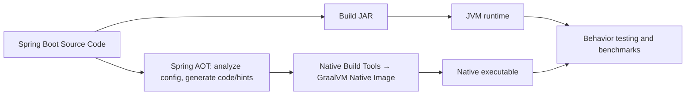

# Enabling Spring AOT and Native Build Tools Integration

## 1. Lesson Objectives

In the **First Application** chapter of the **SPRING_BOOT_NATIVE_IMAGE** module, we configure a simple Spring Boot application to have two build paths: a **JVM-runnable JAR** and a **GraalVM Native Image**. On the native path, Spring AOT prepares the application initialization code along with the necessary runtime hints; **GraalVM Native Build Tools** wires the AOT processing step into Maven or Gradle and invokes the `native-image` compiler to produce the executable.

After this lesson, you will be able to:

- Verify that a developer machine or CI runner has the required JDK, GraalVM Native Image, and native compilation toolchain.
- Enable Spring AOT and Native Build Tools in **either** a Maven **or** a Gradle project.
- Build the same Spring Boot application as both a JAR and a native executable.
- Inspect the artifacts generated by Spring AOT and recognize when reflection/resource hints need to be declared.
- Run smoke tests and compare JVM/native outputs before measuring startup time, memory, or container packaging.

> The examples use **Spring Boot 3.5.0, Java 21** as a practical reference point, without claiming these are the latest versions. If your project uses another version, select **Spring Boot, GraalVM, Native Build Tools, and Java** according to that version's compatibility matrix; do not upgrade individual components independently. The Maven and Gradle examples are **two alternatives**—you do not need both in the same project.

## 2. Why Adding a GraalVM Library Alone Is Not Enough

In JVM mode, Spring Boot can perform classpath scanning, inspect annotations, resolve bean definitions, and generate proxies when the application starts. Native Image analyzes the application ahead of time, so operations relying on reflection, JDK dynamic proxy creation, reading classpath resources, or serialization must be included in the build-time analysis.

Spring AOT handles the framework side: pre-processing Spring configuration determinable at build time, generating initialization code, and contributing **`RuntimeHints`**. Native Build Tools integrates this process into the build pipeline. GraalVM Native Image takes the code, bytecode, dependencies, resources, and metadata to perform reachability analysis and compile an executable for the target OS/CPU architecture.



Note the distinctions:

| Component | Role | Required for Native Build? |
| --- | --- | --- |
| Spring Boot plugin | Manages Spring Boot build tasks and AOT processing | Yes, in the illustrated workflow |
| Spring AOT | Generates context/initialization code and runtime hints from Spring config | Yes for Spring Boot native apps via standard integration |
| GraalVM Native Build Tools | Integrates `native-image` into the Maven/Gradle lifecycle | Yes in this guide |
| GraalVM Native Image | Compiles the application into an executable for the target platform | Yes, or provided by a builder image when building in a container |
| Custom `RuntimeHintsRegistrar` | Declares dynamic accesses the framework cannot infer automatically | Only when the app/library actually requires it |

**Spring AOT is not an arbitrary runtime library.** Tasks such as `process-aot`, `processAot`, and `nativeCompile` belong to the build phase. Do not treat a `spring.aot.enabled=true` line in `application.properties` as a substitute for plugin configuration and the native build workflow.

## 3. Preparing the Environment

### 3.1. Main Requirements

For this example, the build machine needs:

1. **A Java 21–based JDK/GraalVM** compatible with Spring Boot 3.5.0; verify with `java -version`.
2. The `native-image` tool from the corresponding GraalVM distribution, callable from the terminal.
3. **Native toolchain**: C/C++ compiler, linker, and required headers/libraries for the build OS.
4. The project's Maven Wrapper (`mvnw`/`mvnw.cmd`) or Gradle Wrapper (`gradlew`/`gradlew.bat`); an installed Maven/Gradle can be used if no wrapper is present.
5. Sufficient CPU, RAM, and disk space for native analysis/compilation, which typically consumes more resources than a JAR build.

Basic verification commands on Linux/macOS:

```bash
java -version
javac -version
native-image --version
./mvnw -version           # If using Maven Wrapper
./gradlew --version       # If using Gradle Wrapper
```

On Windows PowerShell, use `.\mvnw.cmd -version`, `.\gradlew.bat --version`, and `native-image --version`. Native Image on Windows also requires the native toolchain supported by that GraalVM release, typically Microsoft Visual C++ Build Tools and an appropriate linker environment. On Linux, prepare the compiler along with `glibc` and corresponding development packages according to your distribution and GraalVM's guide. Specific installation steps vary by OS and version; after installing, **re-verify the output of `native-image --version`**.

If `java` points to a different JDK than `native-image`, the build may use the wrong toolchain. Ensure `JAVA_HOME`, `PATH`, Maven/Gradle Java toolchain, and GraalVM are consistent. With Gradle, configuring the Java toolchain specifies the target language version to compile, but you must still verify that the native task selects the right GraalVM.

### 3.2. Initializing a Minimal Application

Use a Spring Boot project with the `spring-boot-starter-web` dependency. The same Java example below works for both Maven and Gradle:

```text
hello-native/
  src/
    main/
      java/com/example/hellonative/HelloNativeApplication.java
  pom.xml                 # If choosing Maven
  build.gradle            # If choosing Gradle
  settings.gradle         # If choosing Gradle
```

```java
package com.example.hellonative;

import java.util.Map;
import org.springframework.boot.SpringApplication;
import org.springframework.boot.autoconfigure.SpringBootApplication;
import org.springframework.web.bind.annotation.GetMapping;
import org.springframework.web.bind.annotation.RestController;

@SpringBootApplication
@RestController
public class HelloNativeApplication {

    public static void main(String[] args) {
        SpringApplication.run(HelloNativeApplication.class, args);
    }

    @GetMapping("/hello")
    public Map<String, String> hello() {
        return Map.of("message", "Hello Native");
    }
}
```

The `GET /hello` endpoint must return JSON with `{"message":"Hello Native"}` in both execution modes. The first project should intentionally stay simple: avoid databases, secrets, network integrations, or dynamic plugins until you have a working native build baseline.

## 4. Option A: Integrating with Maven

### 4.1. Configuring `pom.xml`

The following example uses Spring Boot Starter Parent to manage dependency versions and familiar Maven settings. The `org.graalvm.buildtools:native-maven-plugin` plugin provides native compilation goals; `spring-boot-maven-plugin` provides Spring AOT processing and Spring Boot packaging.

```xml
<?xml version="1.0" encoding="UTF-8"?>
<project xmlns="http://maven.apache.org/POM/4.0.0"
         xmlns:xsi="http://www.w3.org/2001/XMLSchema-instance"
         xsi:schemaLocation="http://maven.apache.org/POM/4.0.0
             https://maven.apache.org/xsd/maven-4.0.0.xsd">
    <modelVersion>4.0.0</modelVersion>

    <parent>
        <groupId>org.springframework.boot</groupId>
        <artifactId>spring-boot-starter-parent</artifactId>
        <version>3.5.0</version>
        <relativePath/>
    </parent>

    <groupId>com.example</groupId>
    <artifactId>hello-native</artifactId>
    <version>0.0.1-SNAPSHOT</version>
    <name>hello-native</name>

    <properties>
        <java.version>21</java.version>
    </properties>

    <dependencies>
        <dependency>
            <groupId>org.springframework.boot</groupId>
            <artifactId>spring-boot-starter-web</artifactId>
        </dependency>
        <dependency>
            <groupId>org.springframework.boot</groupId>
            <artifactId>spring-boot-starter-test</artifactId>
            <scope>test</scope>
        </dependency>
    </dependencies>

    <build>
        <plugins>
            <plugin>
                <groupId>org.springframework.boot</groupId>
                <artifactId>spring-boot-maven-plugin</artifactId>
            </plugin>
            <plugin>
                <groupId>org.graalvm.buildtools</groupId>
                <artifactId>native-maven-plugin</artifactId>
            </plugin>
        </plugins>
    </build>
</project>
```

Here Spring Boot's **Starter Parent** provides out-of-the-box support for the `native` profile and manages plugin versions within the scope of the chosen Spring Boot version. **If the project does not inherit from `spring-boot-starter-parent`**, you must manually declare the `native-maven-plugin` version and the corresponding executions/profiles, including the `spring-boot:process-aot` goal; copying the snippet above verbatim while swapping out the parent for another one may cause `-Pnative` not to work as expected.

To verify the effective Maven configuration in a project with multiple parents or plugin management, run `./mvnw help:effective-pom` (or `mvnw.cmd` on Windows) and inspect the `native` profile and resolved plugin versions.

### 4.2. Building the JAR and Running the Baseline

```bash
./mvnw clean package
java -jar target/hello-native-0.0.1-SNAPSHOT.jar
```

In another terminal:

```bash
curl -fsS http://localhost:8080/hello
# Expected: {"message":"Hello Native"}
```

If port 8080 is busy, you can run with `--server.port=8081` and update the test URL accordingly. Stop the application before running the native build on the same port.

### 4.3. Building the Native Image

```bash
./mvnw -Pnative native:compile
```

This is the standard usage with the Spring Boot Starter Parent configuration: the `native` profile enables the required AOT processing before Native Build Tools compiles the executable. You can invoke the AOT processing goal separately to inspect its output:

```bash
./mvnw -Pnative spring-boot:process-aot
```

Native compilation duration depends on dependency size, CPU/RAM, caches, and GraalVM version. When successful, the executable usually resides under `target/`, named after the artifact; in this example it may be `target/hello-native` (on Windows it may be `target/hello-native.exe`). Confirm the actual file name in the build log/directory.

```bash
./target/hello-native
curl -fsS http://localhost:8080/hello
```

Do not run the JAR and the executable simultaneously on the same port. With a native executable, the application **does not need a separate JVM installed on the target machine**, though it still requires runtime libraries and an OS environment compatible with how the binary is linked.

## 5. Option B: Integrating with Gradle

If the project uses Gradle instead of `pom.xml`, use the Groovy DSL configuration below. The `org.springframework.boot` plugin provides `bootJar` and `processAot`; the `org.graalvm.buildtools.native` plugin provides `nativeCompile`, `nativeRun`, and related tasks. Applying both plugins wires AOT processing into the native build.

```groovy
// settings.gradle
rootProject.name = 'hello-native'
```

```groovy
// build.gradle
plugins {
    id 'java'
    id 'org.springframework.boot' version '3.5.0'
    id 'io.spring.dependency-management' version '1.1.7'
    id 'org.graalvm.buildtools.native' version '0.10.6'
}

group = 'com.example'
version = '0.0.1-SNAPSHOT'

java {
    toolchain {
        languageVersion = JavaLanguageVersion.of(21)
    }
}

repositories {
    mavenCentral()
}

dependencies {
    implementation 'org.springframework.boot:spring-boot-starter-web'
    testImplementation 'org.springframework.boot:spring-boot-starter-test'
}

tasks.named('test') {
    useJUnitPlatform()
}

graalvmNative {
    binaries {
        main {
            imageName = 'hello-native'
        }
    }
}
```

The plugin versions in the example are reference points for reading the configuration and must be checked against your project's Gradle Wrapper, GraalVM, and Spring Boot versions. Avoid editing both `pom.xml` and `build.gradle` if your project uses only one build system.

### 5.1. Building and Running with Gradle

```bash
# Build JAR/JVM for the baseline:
./gradlew clean bootJar
java -jar build/libs/hello-native-0.0.1-SNAPSHOT.jar

# Generate Spring AOT code separately for inspection:
./gradlew processAot

# Build native (includes required task dependencies such as AOT processing):
./gradlew nativeCompile

# Run the native executable via the plugin task:
./gradlew nativeRun
```

Gradle Native Build Tools typically outputs the executable under `build/native/nativeCompile/`. With `imageName = 'hello-native'`, on Linux/macOS you can expect `build/native/nativeCompile/hello-native`. On Windows the name has a `.exe` extension. Check the logs and actual path as they can change depending on plugin version.

Example smoke test once the application is running:

```bash
curl -fsS http://localhost:8080/hello
# Expected: {"message":"Hello Native"}
```

On Windows, use `.\gradlew.bat processAot`, `.\gradlew.bat nativeCompile`, and `.\gradlew.bat nativeRun`. You do not need to run `processAot` manually before every `nativeCompile`: task dependencies are configured by the plugins when compatible plugins work properly.

## 6. What Does Spring AOT Actually Generate?

In the standard Spring Boot native integration workflow, Spring AOT processes `ApplicationContext` at build time and produces outputs for runtime. Common categories:

| Output Group | Meaning |
| --- | --- |
| **Generated source** | Java code supporting bean creation and context initialization analyzed by Spring |
| **Generated class** | Compiled output of generated sources or proxies prepared ahead of time |
| **Runtime hints/metadata** | Reflection, proxy, resource, serialization, and JNI access metadata required by the native compiler |
| **AOT resources** | Auxiliary resources needed at runtime or during native-image analysis |

Locations such as `target/spring-aot/`, `target/generated-sources/`, or `build/generated/aotSources/`, `build/generated/aotResources/` depend on plugin versions; do not treat an illustrative path as a fixed contract. Check the logs of `spring-boot:process-aot` or `processAot` to find the output directories. Generated code is a build artifact: **do not edit it manually** because it will be regenerated.

An important point is **configuration evaluation timing**. Spring AOT can resolve many conditions affecting the bean graph at build time: `@Profile`, `@ConditionalOnProperty`, or configurations that register/omit beans can yield different results if the build and runtime environments are inconsistent. Ordinary properties can still be read at runtime, but you cannot assume every configuration change will reconstruct an AOT-processed bean structure.

For example, if a bean is registered only when the `production` profile is active, verify that the build profile and conditions reflect the desired production variant. Then test **the executable itself** in the deployment environment to catch discrepancies. That is why a native smoke test matters more than just seeing "BUILD SUCCESS".

## 7. When Must Reflection, Proxy, and Resource Hints Be Added?

A simple REST application using `@SpringBootApplication`, `@RestController`, and static mappings is generally supported out of the box by Spring Boot/Framework. **You do not need to write a `RuntimeHintsRegistrar` immediately upon creating a project.** Only add hints when there is a runtime case that Spring or a library does not recognize automatically.

For example, if the application reads `src/main/resources/rules/pricing.json` and uses reflection to invoke a constructor on a dynamically selected type, you can add a registrar:

```java
package com.example.hellonative;

import org.springframework.aot.hint.MemberCategory;
import org.springframework.aot.hint.RuntimeHints;
import org.springframework.aot.hint.RuntimeHintsRegistrar;
import org.springframework.context.annotation.Configuration;
import org.springframework.context.annotation.ImportRuntimeHints;

@Configuration(proxyBeanMethods = false)
@ImportRuntimeHints(ExtraNativeHints.class)
class NativeHintsConfiguration {
}

final class ExtraNativeHints implements RuntimeHintsRegistrar {

    @Override
    public void registerHints(RuntimeHints hints, ClassLoader classLoader) {
        hints.resources().registerPattern("rules/pricing.json");
        hints.reflection().registerType(
            PricingRule.class,
            MemberCategory.INVOKE_DECLARED_CONSTRUCTORS
        );
    }
}
```

This snippet assumes the project contains a `PricingRule` class and `rules/pricing.json` resource. It is not code to be added to the `/hello` app from earlier. Depending on your actual use case, you can register specific constructors/methods to keep metadata narrower.

If your code creates a JDK dynamic proxy on an interface such as `RatePort` that the analyzer has not detected, the registrar can also declare:

```java
hints.proxies().registerJdkProxy(RatePort.class);
```

**Distinguishing hint types**:

- **Reflection** supports dynamically accessed constructors, methods, or fields; it does not automatically include JSON files in the executable.
- **Resource** includes required classpath resources/resource bundles in the image; it does not turn external filesystem files outside the container into embedded resources.
- **JDK proxy** declares the interface set for `java.lang.reflect.Proxy`; it does not replace subclass proxy generation required by Spring AOT or other libraries.
- **Serialization/JNI** have dedicated metadata mechanisms; do not indiscriminately register every type if the application does not use them.

If a dependency generates arbitrary class bytecode **after** the native image is built, adding reflection/proxy hints alone may not suffice. Consult that dependency's native support documentation, change the code generation approach, or move class generation to build time. Re-run the exact failing branch in the native executable to confirm the fix.

## 8. Integration Testing Before Measuring Performance

### 8.1. Functional Baseline

Using the same commit and business configuration:

1. Run the JAR and call `GET /hello`; record HTTP status, JSON body, and error logs.
2. Stop the JVM process and run the native executable on **the same port/configuration**.
3. Call the same requests with the same input data; verify HTTP status and equivalent JSON.
4. If you add DB, cache, serialization, proxies, or resources, test each flow that actually exercises those components.
5. Run integration/native tests supported by your project's plugins before releasing.

Tests on the JVM catch general Java/Spring bugs. However, **a successful native build does not mean every runtime path is compatible**. Missing reflection metadata or resource errors may only appear when hitting a rarely used endpoint, parsing a particular payload, or reading a resource by a dynamic name.

### 8.2. Native Tests with Native Build Tools

With Gradle Native Build Tools and the corresponding test configuration:

```bash
./gradlew test
./gradlew nativeTest
```

With Maven, how native tests are integrated depends on the profiles/plugins configured in `pom.xml`. Ensure the appropriate goals are enabled, then verify with `./mvnw -PnativeTest test` **if** the project already defines a `nativeTest` profile. Do not assume this profile exists in every parent POM.

Native tests typically take longer to build than JVM unit tests; it is reasonable to run fast unit tests on every commit and reserve native smoke/integration tests for designated CI milestones. However, changes that introduce more reflection, serialization, or dynamic resources should undergo native testing before release.

### 8.3. Minimal Verification Table

| Check | Expected Result |
| --- | --- |
| `java -version`, `native-image --version` | Valid Java/GraalVM, tools are runnable |
| Maven/Gradle JAR build | JAR packaged successfully |
| `process-aot` / `processAot` | Generates AOT output, no bean initialization errors |
| `native:compile` / `nativeCompile` | Produces native executable for target OS/CPU |
| Run `/hello` on JVM | 200 OK and correct JSON |
| Run `/hello` on native | 200 OK and equivalent JSON |
| Restart native executable | No startup or configuration errors |
| Read resources/JSON, reflection/proxies if any | Behavior matches JVM build |

## 9. Common Errors When Enabling Integration

| Symptom | Cause to Check | Resolution |
| --- | --- | --- |
| `native-image: command not found` or missing GraalVM toolchain | Incorrect `PATH` / `JAVA_HOME`, GraalVM not properly installed | Install a distribution with Native Image, re-verify version and toolchain |
| `-Pnative` ignored or goal does not run Spring AOT | Project does not use Spring Boot parent, missing plugin/profile | Check `effective-pom`, declare AOT processing execution and Native Build Tools |
| Gradle lacks `nativeCompile` | `org.graalvm.buildtools.native` not applied, incompatible plugin | Add the appropriate plugin, verify Gradle/plugin versions |
| C compiler, linker, or headers not found | Missing OS native toolchain | Install C/C++/linker tools required by that GraalVM release |
| Build killed by OOM or excessive CPU duration | Native analysis needs high resources, CI runner is constrained | Increase runner resources, reduce concurrent builds, inspect config and logs |
| AOT fails during context creation | Spring/bean conditions unsuitable for build time | Check `@Conditional`, profiles, bean definitions; avoid runtime dependencies during AOT initialization |
| Native runs but throws reflection error | Dynamically accessed class/constructor/method not declared | Add runtime hint of the right type/scope and re-run the failing flow |
| Native cannot read classpath file | Resource not declared or wrong path | Check file in resources, add a specific resource hint |
| JDK proxy or subclass proxy fails | Proxy interface not declared or library generates bytecode dynamically | Identify proxy type, use AOT/proxy hints or a native-compatible library |
| Executable runs on build machine but fails in deployment image | Different OS/architecture, native libraries, libc, or certificates | Use a build environment matching target, test inside target container |

For complex failures, retain compilation logs and dependency versions before adding metadata. Opening reflection for an entire package without identifying the root cause often bloats the binary analysis without solving class initialization errors or runtime bytecode generation.

## 10. First Steps Toward Container Packaging and Operations

Once the executable runs properly on the build machine, verify whether the container runtime has the matching OS/CPU architecture and libraries. Two common approaches:

- **Buildpacks** via the Spring Boot Maven/Gradle plugin and a builder capable of producing a Native Image; check builder configuration and `BP_NATIVE_IMAGE=true` in the buildpack. This is convenient when you want the builder to manage the toolchain.
- **Multi-stage Dockerfile**: the build stage installs GraalVM and the native toolchain; the runtime stage copies the executable along with required libraries/certificates. An ultra-minimal base image does not automatically guarantee a dynamically linked binary has all libraries needed to run.

Example native buildpack configuration with Maven, if the project already has Docker/Buildpacks set up:

```xml
<!-- Place inside spring-boot-maven-plugin: <configuration> ... </configuration> -->
<image>
    <name>hello-native:local</name>
    <env>
        <BP_NATIVE_IMAGE>true</BP_NATIVE_IMAGE>
    </env>
</image>
```

After configuring `spring-boot-maven-plugin` as above, you can run:

```bash
./mvnw spring-boot:build-image
docker run --rm -p 8080:8080 hello-native:local
```

Buildpacks require a Docker daemon or compatible container backend, a builder supporting native images, and may take time to build the image; this is a **separate build path** from `native:compile` running directly on the host. Inspect buildpack logs to confirm a native executable was actually created before labeling the image as native.

With Gradle, the `bootBuildImage` task serves as the equivalent integration point; configure the builder environment to include `BP_NATIVE_IMAGE=true` when requesting a native build. Avoid assuming that running default `bootBuildImage` always produces a native image across every plugin version and project.

In production environments, check health/readiness, network ports, environment variables, timezone, CA certificates, process permissions, logging, graceful shutdown, and debugging capability on the target. A native executable does not depend on a JVM at runtime, yet it is **not** an artifact that runs across every OS/architecture.

## 11. Evaluating Benefits Once Both Builds Work Properly

After confirming compatibility, compare **the same commit, same endpoints, same request load, and same CPU/memory limits**:

| Metric | Suggested Measurement | Question to Answer |
| --- | --- | --- |
| Build duration | CI job elapsed time; separate cold/warm cache | How much pipeline cost does native add? |
| Peak build RAM | Runner/cgroup metrics during native compilation | Does the current runner have enough memory? |
| Startup to readiness | Measure externally from process start until endpoint ready | How much startup time does native actually save? |
| Idle and loaded RSS | `ps`/container metrics under identical load | Does native reduce footprint while serving the same work? |
| p95/p99 and throughput | Load test after warm-up at a fixed RPS | Are startup gains traded off against steady-state performance? |
| Errors and business behavior | Smoke/integration/native tests | Do both builds satisfy the same functionality and SLOs? |

Do not equate a successful native build with performance superiority: a JVM with JIT can heavily optimize long-running workloads, whereas native typically shines in cold starts and certain small-footprint workloads. The goal is to **measure the actual benefits for your Spring Boot application**, not to declare an absolute winner for every case.

## 12. Hands-on Exercise and Completion Criteria

**Assignment:** Create `HelloNativeApplication` with a `/hello` endpoint, choose **Maven or Gradle**, configure Spring AOT and Native Build Tools, compile into both a JAR and a native executable, and compare the results.

**Steps:**

1. Verify `java`, `native-image`, Maven/Gradle Wrapper, and the native toolchain.
2. Build the minimal REST application, run the JAR, and save the `GET /hello` result.
3. Add plugin configuration, run the Spring AOT task separately, and observe generated code/metadata.
4. Run the native build, confirming the executable is built for the right platform.
5. Start the executable, call `/hello`, and compare body/status with the JVM build.
6. Optional: add a `rules/pricing.json` resource or a controlled reflection case, then practice declaring a `RuntimeHintsRegistrar`.
7. Record build time, startup-to-readiness, and RSS under identical conditions to begin evaluation.

**Artifacts to submit or keep for reference:** build configuration file, application source, executed commands, native build log, executable path, HTTP outputs of both builds, metrics table, and descriptions of errors/resolutions (if any).

**Self-check:**

- Why can having `native-maven-plugin` without running `process-aot` cause issues in a Maven project that does not use Spring Boot Starter Parent?
- Why can `nativeCompile` produce a binary yet an endpoint using dynamic reflection still fail?
- Once `/hello` works properly on both builds, what next step proves whether native genuinely saves RAM and startup time for your workload?

## 13. Summary

Spring Boot Native Image integration consists of three links: **Spring Boot plugin** recognizes application configuration, **Spring AOT** prepares initialization code and runtime hints, and **GraalVM Native Build Tools** coordinates the Native Image compiler to create the executable. With **Maven**, the Spring Boot Starter Parent template enables the `native` profile and `native:compile` goal; with **Gradle**, combine the Spring Boot plugin and `org.graalvm.buildtools.native` to run `processAot` and `nativeCompile`.

The integration step is complete when both the **JAR/JVM** and the **native executable** start up, return equivalent business results, and are tested in the appropriate environment. From that foundation, you can reliably proceed to handling reflection/resources, deep compatibility testing, container packaging, and evaluating startup/memory benefits.
