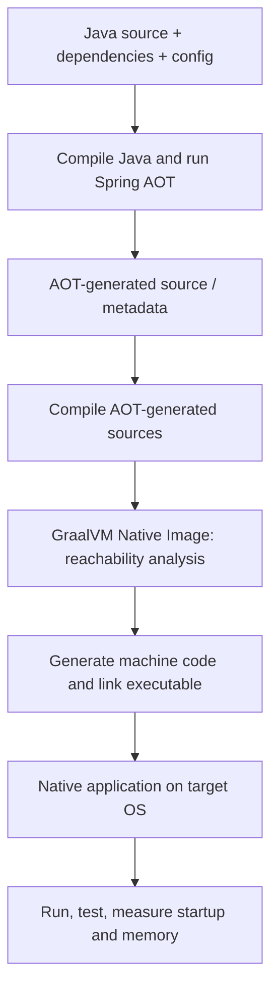

# Building the Native Executable for the First Time and Identifying Phases in the Logs

## Lesson Objectives

In the **Spring Boot Native Image** module, we use **Spring AOT** to prepare application configuration at build time, then use **GraalVM Native Image** to compile it into a native executable. This lesson walks you from a small Spring Boot application to a **runnable native executable**, while reading the logs to see what the tools are doing, why the build takes time, and which phase to inspect when errors occur.

After completing this lesson, you will be able to:

- Prepare the Java, GraalVM, and native compilation environment.
- Build using **Maven** or **Gradle** and verify the executable path.
- Distinguish **Spring AOT**, **native compilation**, and **application startup** logs.
- Identify Native Image phases such as *Initializing*, *Performing analysis*, *Compiling methods*, and *Creating image*.
- Read reports on duration, RAM, reachable class/method counts, and common error indicators.
- Run the native build, verify functionality, and measure startup/memory before comparing with the JVM.

> **Version note:** log syntax, number of phases, output directory names, and task names may vary across versions of Spring Boot, GraalVM Native Build Tools, and GraalVM. Log snippets in this lesson are **annotated illustrative examples**, not measurements from a specific machine. Always rely on the actual logs on your machine.

## 1. Understanding the Full Path of a Native Build

When running an application in the traditional way, Maven/Gradle compiles Java and packages a JAR; the JVM loads classes, processes the required configuration, and executes the application at startup.

With Native Image, the build requires additional stages:



**Spring AOT** prepares bean definitions, context initialization code, and runtime hints when sufficient information is available at build time. **GraalVM Native Image** performs *closed-world analysis*, determines what code must be included in the executable, and compiles it into machine code.

Concepts to distinguish:

| Term | Meaning | Where to See It |
|---|---|---|
| **AOT processing** | Analyzes Spring config, generates Java code and metadata to bootstrap the app | `process-aot` / `processAot` task, generated directory |
| **Reachability analysis** | Determines which classes, methods, fields, and components may be needed at native runtime | GraalVM analysis phase logs |
| **Native compilation** | Compiles reachable code into machine code, bundles runtime, and links into an executable | `native-image` / `nativeCompile` logs |
| **Native executable** | OS/CPU-specific executable file that runs directly without a JVM to launch the app | Maven/Gradle output directory |
| **Native runtime** | Execution of the compiled app, including Spring startup, I/O, DB connections, and business logic | Application logs when launching the executable |

**A successful build does not prove the application runs correctly.** Native Image compilation can succeed while still missing resources, reflection metadata, configuration, or runtime permissions. Therefore, you must actually run it and verify functionality.

## 2. Preparing the Environment for the First Build

### 2.1. Prerequisites

First, ensure:

1. The project uses a **Spring Boot version with Spring AOT/Native Image support** and a compatible Java version (for example, Spring Boot 3.x uses Java 17 or higher).
2. The build machine has a **GraalVM JDK and the `native-image` tool** compatible with the Java version in use, or you choose the container buildpacks route.
3. The OS has a **native C/C++ toolchain** and system libraries required by Native Image. Windows typically uses a compatible C++ build toolset; Linux typically needs GCC/Clang, linker, and libc; macOS needs command-line developer tools.
4. Sufficient disk space, CPU, and RAM. Native compilation typically consumes more resources and time than a JAR build.
5. Maven Wrapper (`mvnw`) or Gradle Wrapper (`gradlew`) works; the Spring Boot plugin and **GraalVM Native Build Tools** are properly declared.

Quick check in the terminal:

```bash
java -version
native-image --version

# Run the command matching your project's build tool
./mvnw --version
# or:
./gradlew --version
```

On Windows, use `mvnw.cmd` / `gradlew.bat` (or `.\mvnw.cmd` / `.\gradlew.bat` in PowerShell) and check that the terminal has access to the compiler/linker. If `native-image` is not recognized, inspect `JAVA_HOME`, `PATH`, and whether the Native Image component is installed for that specific GraalVM distribution.

**Do not assume** `java -version` uses the same JDK as Maven/Gradle: also inspect the output of `./mvnw --version` or Gradle's Java toolchain configuration. A classic mistake is having the shell point to GraalVM while the build tool picks another JDK.

### 2.2. Choosing Your Build Path

| Build Approach | Key Requirements | Outcome |
|---|---|---|
| Native Image directly on host | GraalVM, `native-image`, OS-appropriate compiler/linker | Native executable for build host OS/CPU |
| Native Image via container buildpacks | Docker/container runtime, Spring Boot build image plugin/compatible buildpack | Container image containing the native app |
| Run JAR on JVM | Compatible JDK/JRE | JAR executed by JVM, used as baseline comparison |

For a first learning pass, **building the native file directly** gives the clearest view of each phase's logs. If you are on Windows while production runs on Linux, you must build a **Linux native** executable inside an appropriate Linux build environment; a Windows `.exe` cannot simply be renamed to run on Linux.

## 3. Minimal Spring Boot App for Testing

Assume the project was created with Spring Initializr or a native-compatible Spring Boot template with the **Spring Web** dependency. Create a simple endpoint:

```java
package com.example.nativehello;

import org.springframework.boot.SpringApplication;
import org.springframework.boot.autoconfigure.SpringBootApplication;
import org.springframework.web.bind.annotation.GetMapping;
import org.springframework.web.bind.annotation.RestController;

@SpringBootApplication
public class NativeHelloApplication {

    public static void main(String[] args) {
        SpringApplication.run(NativeHelloApplication.class, args);
    }
}

@RestController
class HelloController {

    @GetMapping("/hello")
    String hello() {
        return "Hello Native Image";
    }
}
```

`HelloController` can reside in the same `NativeHelloApplication.java` file as in the example (only `NativeHelloApplication` is `public`), or in its own file in the same package. For Spring Boot 3.x, use Java 17+ and the `spring-boot-starter-web` dependency.

Before trying native, run the application on the JVM:

```bash
# Maven
./mvnw spring-boot:run

# Or Gradle
./gradlew bootRun
```

In another terminal, test:

```bash
curl -i http://localhost:8080/hello
```

Expected result is HTTP **200** with body `Hello Native Image`. Stop the JVM app before running the native build to avoid a port 8080 conflict. If the app configures a different `server.port` or HTTPS, adjust the test URL accordingly.

## 4. Building the Native File with Maven

### 4.1. Maven Configuration to Check

In a Spring Boot project using `spring-boot-starter-parent` and compatible native config, `pom.xml` usually includes the Spring Boot Maven plugin and GraalVM Native Build Tools. Example **illustrative configuration snippet**:

```xml
<build>
    <plugins>
        <plugin>
            <groupId>org.springframework.boot</groupId>
            <artifactId>spring-boot-maven-plugin</artifactId>
        </plugin>
    </plugins>
</build>

<profiles>
    <profile>
        <id>native</id>
        <build>
            <plugins>
                <plugin>
                    <groupId>org.graalvm.buildtools</groupId>
                    <artifactId>native-maven-plugin</artifactId>
                </plugin>
            </plugins>
        </build>
    </profile>
</profiles>
```

The snippet above must be placed into **the corresponding sections of `pom.xml`**, not pasted as duplicate `<build>` or `<profiles>` blocks in an existing file. Plugin version management depends on the parent/BOM and actual configuration. If the project does not use the Spring Boot parent, configure versions and appropriate executions explicitly.

### 4.2. Running the Build

From the project root directory:

```bash
./mvnw -Pnative native:compile
```

With standard Spring Boot Native Build Tools configuration, Maven executes the required steps to process Spring AOT, compile the generated code, and invoke GraalVM Native Image. You can run the AOT task separately to inspect it:

```bash
./mvnw spring-boot:process-aot
```

**The two commands do not produce the same output:** `spring-boot:process-aot` only generates the AOT artifacts; `native:compile` builds the native executable. If AOT processing succeeds without running native compilation, you **do not yet have a native binary**.

The executable typically appears under `target/`, for example:

```text
target/
├── classes/
├── spring-aot/
└── nativehello          # Linux/macOS, actual name depends on artifact/config
```

On Windows it is usually `nativehello.exe`. The file name can be customized via plugin/build configuration; check the final log lines or list the output directory.

### 4.3. Verifying Maven Output

On Linux/macOS:

```bash
ls -lh target/
file target/nativehello
./target/nativehello
```

On PowerShell:

```powershell
Get-ChildItem -Path target -File
.\target\nativehello.exe
```

Replace `nativehello` with the actual native file name. The `file` command is usually not available by default on Windows; use appropriate commands to list and execute the binary.

## 5. Building the Native File with Gradle

### 5.1. Plugin Configuration

A Gradle project requires the Spring Boot Gradle plugin and **`org.graalvm.buildtools.native`**. Illustrative Groovy DSL example:

```groovy
plugins {
    id 'java'
    id 'org.springframework.boot' version 'VERSION_SPRING_BOOT'
    id 'io.spring.dependency-management' version 'VERSION_DEPENDENCY_MANAGEMENT'
    id 'org.graalvm.buildtools.native' version 'VERSION_NATIVE_BUILD_TOOLS'
}

dependencies {
    implementation 'org.springframework.boot:spring-boot-starter-web'
    testImplementation 'org.springframework.boot:spring-boot-starter-test'
}
```

The `VERSION_...` strings are **placeholders**, not literal runnable versions. Use the actual plugin versions managed by your project and compatible with your Spring Boot/GraalVM setup; if the project was generated from a native-enabled template, prefer keeping that configuration.

### 5.2. Running the Build

```bash
# Inspect Spring AOT output separately (optional)
./gradlew processAot

# Compile into a native executable
./gradlew nativeCompile
```

`processAot` generates AOT artifacts, while `nativeCompile` runs the Native Image steps according to the task graph and configured plugins. When successful, the native binary is typically in:

```text
build/native/nativeCompile/
└── nativehello          # file name varies with project name
```

On Windows, it will have a `.exe` extension when building a Windows executable. Verify the path by reading the `nativeCompile` task logs or listing the directory:

```bash
ls -lh build/native/nativeCompile/
./build/native/nativeCompile/nativehello
```

**Maven and Gradle produce the same kind of native executable artifact**, though goal/task names, wrapper logs, and output paths differ. Do not conclude that a build succeeded merely because the `processAot` task finished.

## 6. Reading Logs: Identifying the Exact Active Layer

### 6.1. Three Main Log Layers

A successful native build session typically contains three groups of messages:

| Log Group | Common Indicators | Purpose |
|---|---|---|
| **Build tool** | Maven's `[INFO] --- ...`, Gradle's `> Task :...` | Handles dependencies, Java compilation, AOT tasks, invoking native compiler |
| **Spring AOT** | `process-aot` / `processAot`, generated classes/resources | Prepares context/bean definitions and metadata |
| **GraalVM Native Image** | `GraalVM Native Image`, `Performing analysis`, `Compiling methods`, `Creating image` | Analyzes reachable code, compiles, and creates the native executable |

**Illustrative** log example along the Maven branch (unrelated segments omitted):

```text
[INFO] --- spring-boot:...:process-aot (...) @ nativehello ---
[INFO] ... processing application AOT ...
[INFO] --- compiler:...:compile (...) @ nativehello ---
[INFO] --- native:...:compile (...) @ nativehello ---

================================================================================
GraalVM Native Image: Generating 'nativehello' ...
================================================================================
[1/8] Initializing...
[2/8] Performing analysis...
[3/8] Building universe...
[4/8] Parsing methods...
[5/8] Inlining methods...
[6/8] Compiling methods...
[7/8] Laying out methods...
[8/8] Creating image...
Finished generating 'nativehello' ...

[INFO] BUILD SUCCESS
```

This is a **conceptual template**: the order of some goals/tasks and exact formatting depend on configuration. Some GraalVM versions group phases, name phases, and format statistics differently. What you need to look for is **which tool is running**, **which phase is currently active**, **which phase errored**, and **where the output file was written**.

### 6.2. Common Native Image Phases

| Phase Printed in Logs | What Is Happening | What to Watch |
|---|---|---|
| **Initializing** | Prepares build environment, compiler, image config, classpath, and required tools | Java/GraalVM version, OS, architecture, memory options |
| **Performing analysis** | Reachability analysis: discovers code/types to retain in the image | Reachable types/methods/fields counts; metadata and class initialization errors |
| **Building universe** | Builds internal representation of objects/code to include in the image | Duration and memory; depends on application scale |
| **Parsing methods** | Converts used method bytecode into an internal representation for optimization/compilation | Parsing errors or unusual bytecode issues |
| **Inlining methods** | Performs optimizations including inlining | CPU/RAM consumption of compiler optimizations |
| **Compiling methods** | Compiles methods into machine code | Phase that can consume heavy CPU and take significant time |
| **Laying out methods** | Arranges machine code and image components | Code size, memory, and build progress |
| **Creating image** | Generates/links final native binary and writes artifact | Output path, executable size, linking result |

**Do not hardcode parsers against `[1/8]` numbers or sequence names**: this is a common format in certain versions, not a stable API guarantee. When upgrading GraalVM, phase labels may change or steps may be merged/split.

### 6.3. Reading Reachability Statistics

During analysis, GraalVM often prints statistics on the discovered code elements. **Mock example showing format only**:

```text
[2/8] Performing analysis...
  12,345 types, 18,901 fields, and 75,432 methods found reachable
  4,567 types, 2,345 fields, and 9,876 methods registered for reflection
  ... native libraries / JNI / resources ...
```

Meaning:

- **Reachable types/methods:** code that Native Image determined might be needed. A large count does not automatically mean the build is wrong.
- **Registered for reflection:** metadata declared or inferred to support dynamic access; "fewer is better" is not true if the app genuinely needs reflection.
- **Resources / JNI / proxy:** indicates the scope of runtime features that must be supported.

Numbers depend on dependencies, configuration, framework version, and application style. There is no universal "standard threshold" for reachable methods across all Spring Boot apps.

### 6.4. Reading Resource and Timing Reports

GraalVM can print metrics such as total duration, peak memory, sizes of image sections, time spent in analysis/compilation, and GC progress during the build. If a build is slow, read these before optimizing.

Illustrative example:

```text
Finished generating 'nativehello' in 1m 42s.
Peak RSS: ... GiB
Image size: ... MiB
```

Those values are intentionally marked `...` because they are not benchmark data. If logs omit certain metrics, you can enable reporting flags suitable for your Native Image version or use OS/CI monitoring to supplement them.

Distinguish:

- **RAM during build:** used by the compiler process while producing the native executable; can be high.
- **RAM when running native:** used by the built application process; measured independently at runtime.
- **Executable size:** does not equal container image size, nor does it directly imply runtime RSS.
- **Total build duration:** may include dependency downloads, tests, Java compilation, AOT processing, and Native Image. Native Image's own duration is only part of this total.

## 7. Confirming the Native Binary Was Built Properly

### 7.1. Verification Order

Do not stop at `BUILD SUCCESS` or `BUILD SUCCESSFUL`. Complete all steps:

1. **Inspect artifact:** native binary exists, is non-zero in size, and is at the path reported in the logs.
2. **Run executable:** on the exact OS/architecture it was compiled for.
3. **Check startup:** wait for the message indicating the app started successfully and the endpoint is ready.
4. **Call API:** `GET /hello` returns HTTP 200 with `Hello Native Image`.
5. **Stop program:** confirm no abnormal errors occur during shutdown.
6. **Verify real features:** for apps with databases, serialization, validation, security, file resources, etc., run the corresponding tests against the native build.

On Linux/macOS, run for example:

```bash
./target/nativehello
# Or with Gradle:
./build/native/nativeCompile/nativehello
```

In a second terminal:

```bash
curl -i http://localhost:8080/hello
```

For Windows PowerShell, run the `.exe` generated in `target` or `build/native/nativeCompile`. If you want to verify the HTTP status explicitly, you can run:

```powershell
$response = Invoke-WebRequest -Uri 'http://localhost:8080/hello' -UseBasicParsing
$response.StatusCode
$response.Content
```

### 7.2. Comparing with the JVM Execution Path

Reading native logs is the first step; to evaluate benefits in this module, hold source, dependencies, and config constant and measure:

| Metric | JVM | Native |
|---|---|---|
| Startup to readiness | Measure from process launch until endpoint ready | Measure with the same method |
| Idle RSS | Record value after app stabilizes | Record value at an equivalent state |
| Loaded RSS | Measure at same load and duration | Measure at same load and duration |
| p95/p99 latency and throughput | Run warm-up and appropriate load test | Run equivalent load test |
| Build duration and build resources | Measure JVM pipeline separately | Measure both AOT and native compilation |
| Correctness | Integration tests | Same tests against the native executable |

Do not use a single run to conclude what percentage faster or more memory-efficient Native Image is. Repeat multiple times, distinguish cold vs. warm runs, and record JDK, GraalVM, OS, CPU, RAM, heap/GC settings, and Spring Boot version.

## 8. Debug Errors in the Phase Where They Occur

| Log Symptom | Commonly Related Stage | Initial Troubleshooting |
|---|---|---|
| `native-image` command not found | Environment setup | Verify GraalVM, `JAVA_HOME`, `PATH`, and Native Image installation |
| Missing `plugin`/`task` error | Maven/Gradle configuration | Check Native Build Tools config, profiles/tasks, and plugin versions |
| `process-aot` / `processAot` fails on bean or configuration | Spring AOT | Read root cause in stack trace; check `@Configuration`, conditional beans, profiles, and code executed during AOT |
| `Error: Classes that should be initialized at run time got initialized during image building` (or equivalent) | Native analysis/class initialization | Locate the class/trigger initializing early and configure build-time/runtime initialization as actually needed |
| Reflection, proxy, JNI, or dynamic class loading errors | Analysis or native runtime | Check library Native Image support and required Runtime Hints/metadata |
| `OutOfMemoryError`, image builder killed | Native analysis/compilation | Check RAM allocated to builder, container/CI limits, and build config; narrow scope if needed |
| `C compiler` / `linker` / `libc` error | Native compilation/linking | Install or fix a native toolchain compatible with target OS/CPU |
| `BUILD SUCCESS` but executable not found | Output inspection | Read plugin output path, artifact type, and actual file name |
| Running native reports missing resource or method | Runtime | Add appropriate resource/reflection hints, rebuild, and re-test |
| Native runs but port 8080 is already taken | Application runtime | Stop the JVM instance or select another port |

### 8.1. Example: AOT Errors Differ from Native Compilation Errors

If Spring AOT reports an error while creating bean definitions, inspect Spring configuration **first**; jumping straight to native compiler flags generally will not solve bean errors.

If AOT code was generated yet Native Image fails while analyzing a class, check the **first `Error:` line with a specific cause** and related stack traces; Maven/Gradle's final message may merely be a generic "process exited with non-zero code".

If compilation finishes yet an endpoint fails at runtime, focus on **reflection, serialization, resources, connections, and actual data**. Successful native compilation does not mean every runtime path has been analyzed or tested.

### 8.2. Example: Resource Accessed Only by Dynamic Name

Suppose the application has code:

```java
var input = getClass().getResourceAsStream("/templates/welcome.txt");
```

For resources not automatically detected during the build, register an appropriate hint:

```java
import org.springframework.aot.hint.RuntimeHints;
import org.springframework.aot.hint.RuntimeHintsRegistrar;
import org.springframework.context.annotation.Configuration;
import org.springframework.context.annotation.ImportRuntimeHints;

final class TemplateHints implements RuntimeHintsRegistrar {
    @Override
    public void registerHints(RuntimeHints hints, ClassLoader classLoader) {
        hints.resources().registerPattern("templates/welcome.txt");
    }
}

@Configuration(proxyBeanMethods = false)
@ImportRuntimeHints(TemplateHints.class)
class NativeHintsConfiguration {}
```

The example assumes `templates/welcome.txt` exists in `src/main/resources`. If the resource is already registered by Spring or a supporting library, do not declare it twice. For reflection, proxies, or serialization, use the corresponding `RuntimeHints` API and register only what is genuinely needed.

### 8.3. Narrowing the Scope When a Build Is Too Heavy

- **Break down time:** is it slow downloading dependencies, during AOT processing, or in `Compiling methods`? Each has different causes.
- **Inspect the process:** is the native compiler CPU-bound? Are RAM/swap exhausted? Does CI enforce resource limits?
- **Trim unnecessary parts:** audit unused dependencies, unused auto-configurations, and extra tasks triggered during the build.
- **Keep a control build:** confirm the JVM build/tests still pass; do not treat every GraalVM error as a Spring Boot bug.
- **Record versions:** the same error can be resolved differently across GraalVM/Spring Boot versions.

Avoid randomly tweaking class initialization settings or disabling checks just to "force" a build through: if done incorrectly, bugs may only surface when the native executable runs under load.

## 9. Container Packaging After the Native Binary Runs Successfully

After building the executable directly and verifying the API, you can try Spring Boot's **Cloud Native Buildpacks** to create a native container image. This is a **different** build path: the buildpack manages the compilation/packaging environment inside a container; the resulting executable targets the image's OS/CPU, typically Linux.

Maven example with the appropriate native profile:

```bash
./mvnw -Pnative spring-boot:build-image
```

Gradle example when `bootBuildImage` is configured for buildpacks with native image enabled:

```bash
BP_NATIVE_IMAGE=true ./gradlew bootBuildImage
```

On Windows PowerShell, you can set `$env:BP_NATIVE_IMAGE = 'true'` and then run `.\gradlew.bat bootBuildImage`. The command requires a working container runtime (usually Docker), a buildpack supporting the target architecture, and adequate resources. **Do not assume** every project enables native for buildpacks simply because the Native Build Tools plugin is present; check configuration and logs to confirm the native compiler actually ran.

When reading container build logs, separate **lifecycle/buildpack logs** (detecting builder, downloading dependencies, creating layers) from the **GraalVM Native Image logs** nested inside. Finally, inspect the created image, run the container, and test the endpoint; a `Successfully built image` log alone does not prove the native app inside works properly.

## 10. Checklist for the First Build

Before marking the practice session complete, ask yourself:

1. **Environment:** do `java -version` and `native-image --version` reflect a compatible environment? Are compiler/linker ready?
2. **Build tool:** did Maven `-Pnative native:compile` or Gradle `nativeCompile` finish completely?
3. **Spring AOT:** can you point to the location of generated Java sources/metadata?
4. **Native Image:** do the logs show reachability analysis and the executable creation stage? Which phase took the longest?
5. **Artifact:** does the executable exist and run on the matching OS/CPU?
6. **Functionality:** does `/hello` return HTTP 200 with expected content on the native build?
7. **Measurement:** do you have startup, RSS, binary size, build duration, and environment details to compare with the JVM?

### Practice Exercises

**Exercise 1 – Reading logs:** build the sample app and note the three log sections belonging to Maven/Gradle, Spring AOT, and GraalVM. Find when Native Image starts and finishes; distinguish total Maven/Gradle time from the native compiler's own duration.

**Exercise 2 – Identifying phases:** in your real logs, find `Performing analysis`, `Compiling methods`, and image creation. Record each phase's duration if printed by the tool; explain why analysis/compilation typically needs more resources than running the application once.

**Exercise 3 – Comparison:** run the JAR and the native executable with the same endpoint; measure time until `/hello` responds, idle RSS, artifact size, and total build time. Write a conclusion based on actual measurements, stating the number of iterations.

**Exercise 4 – Intentional troubleshooting:** place a custom resource into `src/main/resources` and access it from an endpoint. Build and run native to check whether the resource was packaged; if missing and needed, add a Runtime Hint, rebuild, and document the exact error message resolved.

**Key takeaway:** to confirm a successful Native Image build, you must recognize **Spring AOT → GraalVM analysis → native compilation → executable**, and then **run the native binary and verify functionality**. Logs tell you where the build is, while benchmarks on a realistic app reveal startup gains, memory behavior, and trade-offs relative to the JVM.
