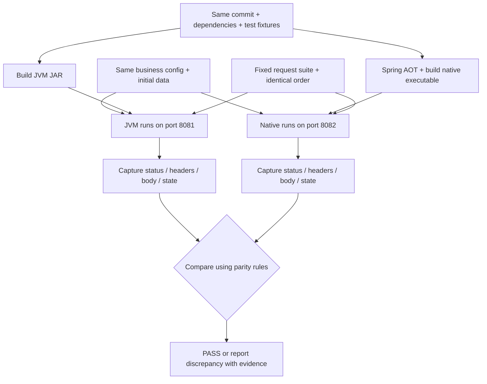
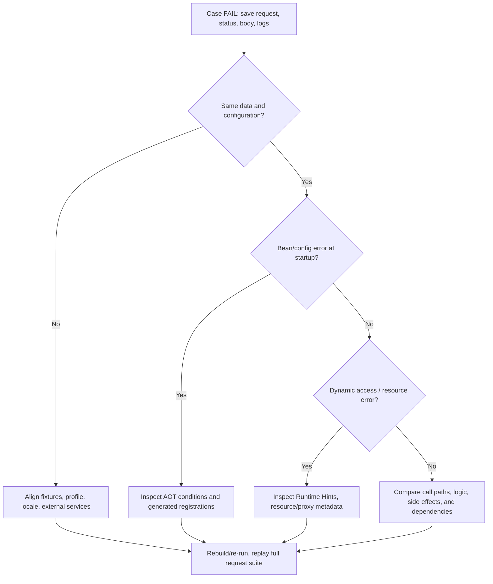

# Comparing Functionality with the JVM Build Using the Same Request Suite

After compiling a Spring Boot application into a **GraalVM Native Image** with Spring AOT, a native executable starting up successfully is not enough to conclude the application is compatible. A route may return the right data on the JVM yet fail when running natively due to missing reflection metadata, an unpackaged resource, a bean excluded during AOT processing, or a runtime configuration that differs from build time.

In the **First Application** chapter of the `SPRING_BOOT_NATIVE_IMAGE` module, we will design **a single request suite** to send to both the JVM and native builds, capture the results, and define how to determine functional parity. This lesson focuses on **behavioral correctness**, before separately measuring startup time and memory benefits or packaging containers.

## 1. What Does "Same Request Suite" Mean?

Do not merely send one `GET /health` request and see HTTP 200. Keep all inputs that affect responses consistent:

- **Same source code and dependency versions:** the JVM JAR and native binary are built from the same commit with the same business logic; record profiles/properties used during the Spring AOT step.
- **Same initial data:** identical database, seed data, cache, and application state before each run; avoid having two processes write to a shared table simultaneously and skew the other run.
- **Same runtime business configuration:** timezone, locale, feature flags, service URLs, rules, config keys, and reference data; only essential technical settings such as `server.port` are allowed to differ.
- **Same HTTP sequence:** HTTP method, path, query parameters, business-relevant headers, body, request order, and error scenarios are all identical.
- **Same evaluation criteria:** compare status codes, stable headers, JSON/text content, post-operation state, and business errors using the exact same rules.



Key distinction: **functional parity** does not require byte-for-byte identical bodies in every case. JSON may differ in key order; `Date` headers, request IDs, and timestamps can vary. Compare **meaningful values** while controlling or normalizing unstable parts. Conversely, never ignore differences in HTTP status codes, monetary amounts, error codes, date formats, or side effects just to make a comparison pass.

## 2. Preparing an Observable REST Application

The example uses Spring Boot 3.x on Java 17+, with `spring-boot-starter-web` and `spring-boot-starter-validation`. The native project requires the corresponding Spring Boot Maven/Gradle plugin and GraalVM Native Build Tools configuration; this example focuses on the logic shared across both builds.

Minimal structure:

```text
src/main/
├── java/com/example/parity/
│   ├── NativeParityApplication.java
│   └── ParityController.java
└── resources/
    └── banner.txt
```

### 2.1. Entry Point

```java
package com.example.parity;

import org.springframework.boot.SpringApplication;
import org.springframework.boot.autoconfigure.SpringBootApplication;

@SpringBootApplication
public class NativeParityApplication {
    public static void main(String[] args) {
        SpringApplication.run(NativeParityApplication.class, args);
    }
}
```

### 2.2. Order Creation and Retrieval API

To keep the exercise self-contained, the example stores data in process memory; real applications typically use an isolated database per test run. Each process starts at ID `1`, so **both processes must be started cleanly** before running the request suite.

```java
package com.example.parity;

import java.io.IOException;
import java.net.URI;
import java.nio.charset.StandardCharsets;
import java.util.Map;
import java.util.concurrent.ConcurrentHashMap;
import java.util.concurrent.atomic.AtomicLong;

import jakarta.validation.Valid;
import jakarta.validation.constraints.Min;
import jakarta.validation.constraints.NotBlank;

import org.springframework.beans.factory.annotation.Value;
import org.springframework.core.io.ClassPathResource;
import org.springframework.http.MediaType;
import org.springframework.http.ResponseEntity;
import org.springframework.web.bind.annotation.*;

@RestController
@RequestMapping("/api")
class ParityController {
    private final AtomicLong nextId = new AtomicLong();
    private final Map<Long, OrderResponse> orders = new ConcurrentHashMap<>();
    private final String appLabel;

    ParityController(@Value("${app.label:parity}") String appLabel) {
        this.appLabel = appLabel;
    }

    @PostMapping("/orders")
    ResponseEntity<OrderResponse> create(
            @Valid @RequestBody CreateOrderRequest request) {
        long id = nextId.incrementAndGet();
        OrderResponse result = new OrderResponse(id, request.sku(), request.quantity());
        orders.put(id, result);

        return ResponseEntity.created(URI.create("/api/orders/" + id)).body(result);
    }

    @GetMapping("/orders/{id}")
    ResponseEntity<OrderResponse> find(@PathVariable long id) {
        OrderResponse result = orders.get(id);
        return result == null
                ? ResponseEntity.notFound().build()
                : ResponseEntity.ok(result);
    }

    @GetMapping("/label")
    Map<String, String> label() {
        return Map.of("label", appLabel);
    }

    @GetMapping(value = "/banner", produces = MediaType.TEXT_PLAIN_VALUE)
    String banner() throws IOException {
        try (var input = new ClassPathResource("banner.txt").getInputStream()) {
            return new String(input.readAllBytes(), StandardCharsets.UTF_8)
                    .stripTrailing();
        }
    }
}

record CreateOrderRequest(@NotBlank String sku, @Min(1) int quantity) {}

record OrderResponse(long id, String sku, int quantity) {}
```

Contents of `src/main/resources/banner.txt` (saved as UTF-8):

```text
Welcome to Cà Phê Việt
```

Five behavior groups to verify from the example:

| Behavior | Sensitive Area When Moving to Native | What to Verify |
| --- | --- | --- |
| POST JSON with Unicode | Jackson binding and related reflection/serialization metadata | JSON is deserialized, validated, and serialized properly. |
| GET newly created order | Beans, stateful storage logic, and route mapping | ID, quantity, SKU, and status match the JVM build. |
| POST invalid data | Jakarta Bean Validation, request conversion, and error handling | HTTP 400, no unintended order created. |
| Read `banner.txt` | Resource must be included in the native image | Identical UTF-8 content, no missing classpath resource error. |
| Read `app.label` | Configuration injected at runtime | Same property produces same output; changing property for another run remains valid if it does not alter the bean graph. |

**Limitation of the example:** in-memory storage is not persistent across restarts and does not prove JPA/JDBC compatibility. For applications with a database, add checks for transactions, queries, schema, drivers, migrations, connection pools, and real side effects.

## 3. Building the JVM JAR and Native Executable from the Same Source

The example above uses Maven with the Maven Wrapper (artifact name depends on project configuration):

```bash
# Build the standard JVM version to serve as the baseline.
./mvnw -DskipTests package

# Build the native executable with the configured native profile/toolchain.
./mvnw -Pnative native:compile
```

If the project uses Gradle and has the GraalVM Native Build Tools plugin applied:

```bash
./gradlew bootJar
./gradlew nativeCompile
```

Build commands can only succeed if the Java/GraalVM toolchain and plugins are properly installed. Common paths are `target/` (Maven) or `build/libs/` and `build/native/nativeCompile/` (Gradle); **verify the actual built file name** rather than blindly copying example names.

Record traceability details:

| Information | Purpose |
| --- | --- |
| Git commit and Spring Boot version | Ensure both deployments share the exact same logic/framework. |
| Java, GraalVM, and native build plugin versions | Helps explain compiler/toolchain-level differences. |
| Build commands and AOT profiles/properties | Certain bean creation conditions are resolved during Spring AOT. |
| Dependencies, resources, and external config | Library/resource discrepancies can cause native-only failures. |
| OS/CPU/architecture and container base image | Native binaries depend on the target platform. |

Never put real secrets into logs or test artifacts. When comparing, use dummy values or the same securely managed secret source in the runtime environment.

## 4. Running Both Builds Side by Side in a Controlled Environment

Run each line below in a **separate terminal**. The JAR and native executable names are placeholders to replace with your actual artifacts:

```bash
# Terminal 1 — JVM:
java -jar target/native-parity-0.0.1-SNAPSHOT.jar --server.port=8081 --app.label=parity

# Terminal 2 — native executable (Linux/macOS, same target platform):
./target/native-parity --server.port=8082 --app.label=parity
```

On Windows, use the corresponding paths and executable names, such as `mvnw.cmd` or a `.exe` binary built for Windows. If using Gradle, point to the outputs of `bootJar` and `nativeCompile`.

Both processes share `app.label=parity`, identical initial data, and identical routes; ports `8081`/`8082` differ to avoid conflicts. Before testing, check logs to ensure both applications started cleanly with no bean creation or missing resource errors. If using a readiness endpoint, begin sending requests only once both builds are ready.

**Do not run both builds simultaneously against a shared database** if the test suite writes data or generates database sequences. One run can mutate state observed by the other. Create two identical databases/snapshots, or run sequentially with an explicit data reset step.

## 5. Defining a Reproducible Request Matrix

With the sample app, execute these cases in the exact order below **against a fresh process of each build**:

| ID | Request | Expected | Purpose |
| --- | --- | --- | --- |
| R01 | `POST /api/orders` with `{"sku":"CÀ-PHÊ","quantity":2}` | `201`, body `{"id":1,"sku":"CÀ-PHÊ","quantity":2}`, header `Location: /api/orders/1` | Unicode JSON, valid validation, state mutation. |
| R02 | `GET /api/orders/1` | `200`, same JSON as R01 | Read data after a write operation. |
| R03 | `POST /api/orders` with `{"sku":"CÀ-PHÊ","quantity":0}` | `400`, no new order created | Verify `@Min(1)` and absence of side effects on validation failure. |
| R04 | `GET /api/orders/999` | `404` | Resource not found. |
| R05 | `POST /api/orders` with body `{bad-json` | `400` | JSON parser and malformed request error. |
| R06 | `GET /api/label` | `200`, `{"label":"parity"}` | Property injection at startup. |
| R07 | `GET /api/banner` | `200`, string `Welcome to Cà Phê Việt` | Classpath resource, UTF-8. |

In R03/R05, Spring Boot's default error body may vary by version/config and contain dynamic fields. This exercise compares **status and error semantics**; if your project defines a custom error contract (e.g., `{"code":"INVALID_ORDER", ...}`), compare `code` and all stable contract fields as well.

Two runs against two fresh processes without interfering requests will assign ID `1` to R01. If you sent manual test requests beforehand, restart both processes to avoid ID drift.

## 6. Automating Identical Requests and Comparing Outputs

You can use `curl` and `jq` (and `diff`) on Bash/Linux/macOS or a shell environment with equivalent tools. The script below is an **example to run on the learner's machine**, not pre-executed in the lesson.

Save the example as `compare-parity.sh` in your practice project:

```bash
#!/usr/bin/env bash
set -euo pipefail

# Run once both processes have just started cleanly and are listening.
# Requires curl, jq, diff, and Bash.
OUT="parity-results"
mkdir -p "$OUT/jvm" "$OUT/native"

capture() {
  local implementation="$1"
  local port="$2"
  local case_id="$3"
  local method="$4"
  local route="$5"
  local payload="${6-}"
  local prefix="$OUT/$implementation/$case_id"

  local -a options=(
    --silent --show-error
    --output "$prefix.body"
    --dump-header "$prefix.headers"
    --write-out "%{http_code}"
  )
  if [[ "$method" == "POST" ]]; then
    options+=(--request POST --header "Content-Type: application/json")
    options+=(--data "$payload")
  fi
  curl "${options[@]}" "http://127.0.0.1:$port$route" > "$prefix.status"
}

run_suite() {
  local implementation="$1"
  local port="$2"

  capture "$implementation" "$port" R01 POST /api/orders '{"sku":"CÀ-PHÊ","quantity":2}'
  capture "$implementation" "$port" R02 GET /api/orders/1
  capture "$implementation" "$port" R03 POST /api/orders '{"sku":"CÀ-PHÊ","quantity":0}'
  capture "$implementation" "$port" R04 GET /api/orders/999
  capture "$implementation" "$port" R05 POST /api/orders '{bad-json'
  capture "$implementation" "$port" R06 GET /api/label
  capture "$implementation" "$port" R07 GET /api/banner
}

run_suite jvm 8081
run_suite native 8082

assert_case() {
  local case_id="$1"
  local expected="$2"
  local actual_jvm
  local actual_native

  actual_jvm="$(cat "$OUT/jvm/$case_id.status")"
  actual_native="$(cat "$OUT/native/$case_id.status")"
  [[ "$actual_jvm" == "$expected" ]] || {
    echo "FAIL $case_id: JVM=$actual_jvm, expected=$expected"
    exit 1
  }
  [[ "$actual_native" == "$expected" ]] || {
    echo "FAIL $case_id: native=$actual_native, expected=$expected"
    exit 1
  }

  # Compare bodies only for cases with a stable contract body.
  case "$case_id" in
    R01|R02|R06)
      jq -eS . "$OUT/jvm/$case_id.body" > "$OUT/jvm/$case_id.canonical.json"
      jq -eS . "$OUT/native/$case_id.body" > "$OUT/native/$case_id.canonical.json"
      diff -u "$OUT/jvm/$case_id.canonical.json" "$OUT/native/$case_id.canonical.json"
      ;;
    R07)
      diff -u "$OUT/jvm/$case_id.body" "$OUT/native/$case_id.body"
      ;;
  esac

  echo "PASS $case_id (HTTP $expected)"
}

assert_case R01 201
assert_case R02 200
assert_case R03 400
assert_case R04 404
assert_case R05 400
assert_case R06 200
assert_case R07 200

# Independently verify business values to avoid both builds failing the same way.
jq -e '.id == 1 and .sku == "CÀ-PHÊ" and .quantity == 2' "$OUT/jvm/R01.body" > /dev/null
jq -e '.label == "parity"' "$OUT/native/R06.body" > /dev/null

echo "Functional parity: all seven sample cases passed."
```

The script saves response bodies, status codes, and headers per case:

```text
parity-results/
├── jvm/
│   ├── R01.status
│   ├── R01.headers
│   ├── R01.body
│   └── ...
└── native/
    ├── R01.status
    ├── R01.headers
    ├── R01.body
    └── ...
```

For R01/R02/R06, `jq -S` normalizes **JSON key ordering**, avoiding false diffs caused purely by serialization order. For R07, text is diffed directly. For error requests, the script enforces that both return the right HTTP code; if your app defines standardized error codes or error response fields, add assertions for those fields.

**Mandatory additions for real CI usage:** verify `Content-Type` (e.g., `application/json`, `text/plain`), R01's `Location` header, standardized error contract bodies, and database state after each case. The example above keeps the script short to highlight the comparison technique and does not replace a full integration test suite.

### 6.1. Why Not Diff Raw HTTP Responses Verbatim?

A response may include:

- `Date`, `Server`, `Connection`, `Transfer-Encoding`, or varying header ordering;
- random IDs, runtime-generated timestamps, tokens, or trace IDs;
- JSON objects with differing key order (key order is non-semantic in the JSON data model);
- default error payloads containing dynamic fields or framework-dependent messages.

When such fields are outside the business contract, normalize or exclude them from comparison **according to a pre-agreed allowlist**. If IDs or timestamps are business data, assert appropriate invariants: for example, IDs are valid and consistent between POST and GET, timestamps match timezone/precision expectations, and audit events are recorded the exact expected number of times. Never ignore real bugs merely because they are "hard to stabilize."

### 6.2. Responses with Array Ordering or Decimal Numbers

`jq -S` sorts only object keys; **it does not sort arrays**. For APIs returning lists, if the contract specifies sorting by price/time, preserve and verify that exact order. If the contract treats order as insignificant, pick a unique key and sort the array before comparing.

For currency or measurements, do not arbitrarily round values. For example, `12.30` and `12.3` may be numerically equal in JSON yet not equivalent if the API mandates display formatting. If an error tolerance is needed (e.g., sensor measurements), define an explicit business threshold; never apply tolerances to quantities, taxes, or exact monetary amounts.

## 7. Verifying Side Effects, Not Just Responses

An API could return the same HTTP 201 yet write corrupt data to the database or publish an event twice on native. For stateful systems, verify **postconditions** after each request.

| Scenario | Response Check | Side-Effect Check |
| --- | --- | --- |
| Order created successfully | 201, exact id/sku/quantity | Exactly one record or event exists; values match the response. |
| Validation error | 400 and matching error code | No order created, no order-created event emitted. |
| Query missing ID | 404 | No data modified or deleted. |
| Retry request per idempotency rules | Status and response per contract | No unintended duplicate created. |
| Transaction fails mid-way | Correct error code/response | Rollback or final state follows business rules. |

In the sample program, R02 serves as a minimal check that the order from R01 was stored in memory. An extended test could add an endpoint returning the list/count of orders to confirm R03 did not mutate data. In production systems, **verify the database/event/queue directly or through designed query APIs**; do not add insecure admin endpoints solely for testing.

Under concurrent execution, IDs or event ordering may differ due to scheduling. Design assertions around business invariants (expected record count, no duplicates, intact data) rather than requiring identical IDs/ordering across two processes unless ordering is a functional requirement.

## 8. Which Discrepancies Point to Spring AOT or GraalVM Issues?

| Comparison Symptom | Likely Cause to Investigate | How to Isolate |
| --- | --- | --- |
| JVM works, native fails deserializing JSON | Reflection metadata, Jackson customization, or special DTO types | Check stack trace, mapping path, Runtime Hints, and deserialized type. |
| Bean/service exists on JVM but missing in native | `@Profile`, `@ConditionalOnProperty`, or condition evaluated during AOT | Compare `processAot` config, generated bean registrations, and runtime config. |
| JVM reads template, native reports not found | Resource not included or wrong classpath path | Check `ClassPathResource`/`getResourceAsStream` usage and native resource hints. |
| Native fails creating proxy or invoking dynamically | JDK proxy, reflection, framework-generated class | Check Runtime Hints, AOP config, proxy interfaces, and actual error. |
| Same request but different timezone/date | `TZ`, locale, clock, serialization, or initialization | Record timezone/locale of both processes; supply a fixed clock in tests if needed. |
| Native calls wrong external endpoint | Different config, DNS/TLS/truststore, or certificate resources | Compare properties and container networking/TLS before blaming business logic. |
| Same body but different status or headers | Exception handlers, HTTP converters, content negotiation | Compare `Accept`, `Content-Type`, MVC config, and stack trace. |
| Native behaves differently when toggling a feature post-build | Condition or code resolved only at AOT/build time | Check whether the feature alters the bean graph or merely swaps a value inside an always-present bean. |

Follow a structured troubleshooting workflow:



When a native-only bug is found, **do not edit code or skip the case until you have captured evidence**. Save the exact request, stack trace, build/runtime config, relevant generated source/hints, and before/after fix results. If you modify a Runtime Hint, resource, or AOT condition, you must **rebuild the native executable** and re-run the entire suite. If you only change a runtime property that does not affect the bean graph, restarting with the new config without rebuilding is typically sufficient.

## 9. Scaling from Simple Examples to Database and Integrated Apps

Seven cases are enough to learn the comparison technique. Before signing off on a real Spring Boot native service, expand with the following groups based on the features your app uses:

1. **REST contract:** GET/POST/PUT/PATCH/DELETE, query/path parameters, expected 2xx/4xx/5xx statuses, content negotiation, Unicode, large payloads, malformed JSON, nulls, and missing fields.
2. **Validation & serialization:** validation annotations, custom validators, Java records, `LocalDateTime`/`Instant`, enums, polymorphic DTOs, generic collections, Jackson settings.
3. **Persistence:** CRUD, paging/sorting, optimistic locking, transaction commit/rollback, migrations, JPA mappings, native queries, connection/timeout errors.
4. **Security & TLS:** authentication, authorization, cookies, CORS, certificates, redirects, and unauthorized/forbidden errors; use appropriate test tokens/secrets.
5. **Resources & dynamic access:** templates, `messages*.properties`, JSON schemas, reflection, proxies, JNI, serializers, and dynamically loaded framework resources.
6. **Event-driven / async:** message brokers, retries, duplicate delivery, contract-required ordering, schedulers, timeouts, and idempotency.
7. **Operations:** readiness/liveness, graceful shutdown, signal handling, logging, and env/volume configuration inside a native container.

For each group, define **at least one success case, one error case, and one side-effect check** if the system is stateful. This does not mean testing every implementation detail: focus on real usage paths that users or downstream services depend on.

### 9.1. Preparing Fixtures for Both Builds

Three common approaches:

- **Two independent databases from the same snapshot/seed:** suitable for running JVM and native side by side.
- **One database run sequentially with controlled resets:** suitable when resources are constrained, provided resets leave no leftover messages/caches or altered sequences.
- **Mock/stub external services under the same scenario:** suitable for controlling timeouts, HTTP statuses, partner responses, and reproducing errors reliably.

Avoid using production APIs, live queues, or real customer data in tests that perform writes. For billing, payment, or notification APIs, use sandboxes/stubs and verify side effects with test data.

### 9.2. Reusing the Request Suite for a Native Container

When packaging the native build into a container, new variables appear such as base image, CA certificates, DNS, timezone, network policy, mounted volumes, environment variables, and published ports. Keep the request suite unchanged and run it against the container endpoint while recording container configuration.

A discrepancy between native running directly on the host and native inside a container **does not automatically prove a Native Image bug**. It may reflect an operational environment difference. Running the same test cases across JVM, local native, and containerized native helps pinpoint which layer introduced the issue.

## 10. Measure Performance Only After Functional Parity

The Spring Boot Native Image module also evaluates **cold start** and **memory**. Measure those only after the application passes the functional test suite:

| Metric | How to Keep Fair |
| --- | --- |
| Time from launch until ready to accept requests | Same readiness criteria, same dependencies/DB, and same machine resources; repeat multiple times. |
| RSS / process memory | Compare the same metric at idle and under load; do not equate JVM `-Xmx` with RSS. |
| Latency / throughput | Same request mix, concurrency, payload, warm-up, and measurement duration; report percentiles, not just averages. |
| CPU, artifact size, build duration | Record native build and runtime trade-offs separately; do not mix with functional metrics. |

Native may start faster or use less memory in some workloads, but there is no fixed improvement across every system. If one build is missing features or skips processing steps, even better performance numbers are **not a fair comparison**.

## 11. Parity Sign-Off Checklist

- [ ] Same source code commit, same dependency versions, and native toolchain recorded.
- [ ] AOT build properties/profiles and runtime configuration documented, especially conditions affecting the bean graph.
- [ ] Identical initial data, with no external requests mutating state between runs.
- [ ] Request suite covers success, invalid input, not found, resources, Unicode, and runtime config.
- [ ] Status codes checked against expectations independently, then bodies compared per contract; not merely checking "JVM equals native."
- [ ] Important headers such as `Content-Type`, `Location`, and cookie/auth behavior compared where applicable.
- [ ] Business discrepancies are never masked while normalizing timestamps, IDs, or JSON ordering.
- [ ] Database/event/cache side effects verified for mutating APIs.
- [ ] Every FAIL case records request, logs, config, versions, and root cause for reproduction.
- [ ] After fixing a native/AOT issue, rebuild and re-run the entire suite before benchmarking or releasing a container.

### Self-Check Questions

1. Why are both builds returning HTTP 200 on a health endpoint insufficient to prove functional parity?
2. When comparing JSON, which aspects can be normalized and which must remain strictly compliant with the contract?
3. Why should you not run both builds against the same database while running concurrent write tests?
4. If native returns HTTP 500 when reading a classpath template while JVM returns 200, what would you inspect?
5. If both JVM and native return the exact same wrong business value, will a script that only diffs the two bodies catch the bug? What additional assertions are needed?
6. Why must functional parity be verified before concluding that native saves startup time or memory?

**Expected outcome:** a request suite defined once and executed against both JVM and Native Image under equivalent conditions, producing a traceable PASS/FAIL report. This turns the claim "the native build behaves like the JVM build" into **reproducible test evidence**, forming a reliable foundation for optimization, packaging, and operating Spring Boot native applications.
