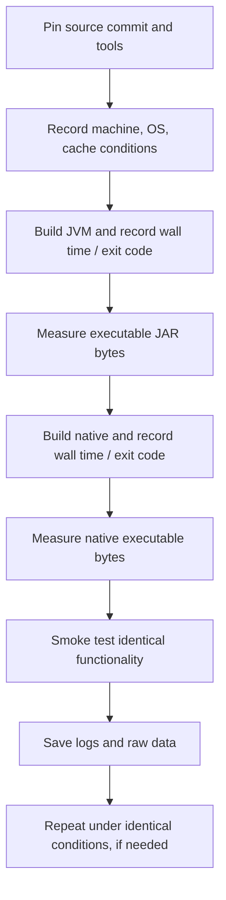

# Recording Build Duration, Artifact Size, and Initial Measurement Conditions

## 1. Objective: Creating a Baseline for the First Spring Boot Application

After compiling a Spring Boot application into a GraalVM Native Image, learners often observe that the native build starts quickly while the build step can take longer than the JVM build. To draw evidence-based conclusions, you must explicitly record **what was measured, on which machine, and using which commands**.

This lesson belongs to the **First Application** chapter of the **SPRING_BOOT_NATIVE_IMAGE** module. Throughout the module, learners use **Spring AOT** and **GraalVM Native Image**, practicing with Maven/Gradle, reflection/resources, compatibility testing, container packaging, and operating native builds. On the first build, we establish a **baseline** to have reference data when optimizing, changing tool versions, or measuring startup and memory later.

After this lesson, you will be able to:

- Define the timing boundaries for JVM and native build commands.
- Record the exact size of the **right artifact** in raw bytes.
- Document machine environment, toolchain, cache state, and flags so others can reproduce the measurement.
- Tabulate per-run results, verify validity conditions, and accurately interpret differences.
- Distinguish JAR, native executable, and container image sizes from runtime operational metrics.

**Scope:** this lesson measures **artifact creation cost**. Application startup time and runtime RAM are separate runtime measurements requiring their own start/end definitions and sampling methods.

## 2. Defining Metrics Before Measuring

| Field | Meaning | Unit |
|---|---|---|
| `build_variant` | Either `jvm` or `native` | Text |
| `build_wall_seconds` | Elapsed wall-clock time from before invoking the command until the command exits | Seconds |
| `build_exit_code` | Command exit code; typically `0` indicates success | Integer |
| `artifact_kind` | Artifact type: `boot-jar`, `native-executable`, or `container-image` | Text |
| `artifact_path` | Exact path of the inspected output file | Path |
| `artifact_bytes` | Output file size reported by the filesystem | Bytes |
| `cache_state` | State of dependency/cache, build outputs, and daemon | Text |
| `repeat_index` | Ordinal index of the run under identical conditions | Integer |

**Wall-clock time** reflects how long a user waits. It differs from total CPU time across compiler threads. GraalVM Native Image can run tasks in parallel, so total CPU time can exceed wall-clock time.

Keep byte counts in raw integers. When displaying MiB:

```text
MiB = artifact_bytes / (1024 * 1024)
MB  = artifact_bytes / (1000 * 1000)
```

Always state explicitly whether MB or MiB is used, as different tools round and display using different bases.

### Which Artifact Is Being Measured?

| Object | What It Contains | Comparison Caveat |
|---|---|---|
| Spring Boot executable JAR | Application code and packaged dependencies; usually compressed | Still requires an external Java environment outside the JAR |
| GraalVM native executable | AOT-compiled code and required runtime components in the binary | May still depend on system libraries |
| Container image | Filesystem layers, base image, artifact, and related libraries | Image size calculation differs from single file size or push/pull transfer size |
| Artifact in registry | Uploaded/downloaded layers, potentially compressed | Do not substitute these byte counts for executable size |

A JAR being smaller than a native binary **does not automatically** mean the entire JVM deployment uses less disk space: the JAR may rely on an external JRE/JDK or a large container base image. Conversely, a smaller native binary does not guarantee lower runtime RAM. Define the exact comparison boundary.

## 3. Controlling Variables in the Experiment



For a meaningful comparison:

1. Use **the same source commit**, same dependencies, and same application functionality; change only the steps required to enable native.
2. Use **the same test policy**. For instance, skip tests in both timed build commands, then run unit/smoke tests separately. Do not compare a JVM build that runs tests against a native build that skips tests without accounting for that difference.
3. Keep CPU/RAM, CI resource limits, storage devices, and other running applications steady.
4. Record native flags, JVM build flags, Gradle daemon settings, and cache state. Native builds can vary significantly with optimization levels or memory limits.
5. Check the exit code **immediately after each command**. A failed command must not be recorded as a completed build.
6. Measure artifact size **immediately after its build**. A subsequent `clean` command may delete the prior run's file.
7. If running multiple iterations, record order and timestamps; avoid drawing conclusions from a run affected by slow networking or heavy background load.

### How Do Warm and Cold Differ?

- **Warm dependencies + clean project output:** dependencies and toolchain are already prepared; project build outputs are deleted before each run. This fits initial experiments aimed at measuring artifact creation when the environment is ready.
- **Cold end-to-end:** starts from a clean environment per a clear definition, potentially including downloading dependencies, pulling builder images, or installing toolchains. This usually reflects the total time to provision a fresh CI environment.

`mvn clean` and `gradle clean` do not clear the Maven local repository, Gradle dependency caches, Gradle daemon, or OS filesystem caches. Therefore, **do not label a build "cold" merely because you ran clean**.

For the first application, use **warm dependencies + clean project output** and explicitly document the policy for reproducibility. Environment preparation takes place before timing starts.

## 4. Metadata Set to Record Alongside Results

| Group | Minimum Values to Record |
|---|---|
| Source | Application name, Git commit, branch/tag, or version identifier |
| Spring | Spring Boot version, Spring AOT profile, and related config |
| Java | Java major version, vendor/distribution, actual version string |
| Native toolchain | `native-image --version` output, GraalVM distribution/JDK major |
| Build tool | Maven/Gradle wrapper, Spring Boot plugin, GraalVM Native Build Tools version |
| OS and CPU | Operating system, release, x86_64/ARM64 architecture, CPU model, core count |
| RAM and disk | Available RAM / memory limit, SSD/HDD or storage characteristics |
| Environment | Local/CI/container, virtualization, CPU quota, and memory limit |
| Measurement state | Cache state, clean policy, Gradle daemon policy, network downloads |
| Command | Full command, profiles, test policy, flags, and relevant environment variables |
| Outcome | Duration, exit code, output file, artifact bytes, build log, and smoke test |

Do not record tokens, passwords, or secrets in published logs. Keep only the environment details needed for reproducibility after redacting sensitive data.

Tool check example on Linux/macOS:

```bash
java -version
javac -version
native-image --version
./mvnw --version       # Only if using Maven
./gradlew --version    # Only if using Gradle
```

Corresponding example on Windows PowerShell:

```powershell
java -version
javac -version
native-image --version
.\mvnw.cmd --version
.\gradlew.bat --version
```

`java -version` in the terminal may not reflect the JDK actually selected by Maven/Gradle Java toolchains or the native plugin. Inspect both build logs and toolchain config when verifying.

## 5. Timing Maven Builds on Linux

Assume the project is configured with the Spring Boot Maven Plugin and GraalVM Native Build Tools, with a valid `native` profile. If that profile does not exist yet, configure it per the documentation of your exact Spring Boot release; do not assume `-Pnative` works in every POM.

First warm dependencies and verify the JVM build works **outside the baseline timing**:

```bash
java -version
native-image --version
./mvnw --version
./mvnw -DskipTests package
```

The first native build may download additional dependencies/plugins even after warming JVM; note if logs show downloads during the timed window. In this experiment we measure **the entire clean + build command** and use `-DskipTests` in both variants.

On Linux with GNU `/usr/bin/time`:

```bash
mkdir -p measurements

/usr/bin/time \
  -f 'wall_seconds=%e\nuser_cpu_seconds=%U\nsystem_cpu_seconds=%S' \
  -o measurements/maven-jvm.time \
  ./mvnw -DskipTests clean package \
  > measurements/maven-jvm-build.log 2>&1

echo "jvm_exit_code=$?"

/usr/bin/time \
  -f 'wall_seconds=%e\nuser_cpu_seconds=%U\nsystem_cpu_seconds=%S' \
  -o measurements/maven-native.time \
  ./mvnw -Pnative -DskipTests clean native:compile \
  > measurements/maven-native-build.log 2>&1

echo "native_exit_code=$?"
```

**Execute sequentially:** run the JVM build, check its exit code, locate and **record the JAR size** before running the next `clean` command. Only then time the native build. Running both commands back-to-back as shown above will not automatically save the JAR size between runs.

The `%e`, `%U`, `%S` format specifiers and `-f` flag belong to GNU time on Linux. On macOS/BSD, `/usr/bin/time` takes different flags. The `echo` lines show status after each command; in automated scripts, capture the exit code immediately after the command and **abort** if non-zero. If the native build fails, do not treat an old binary as the new run's result.

### Artifact Sizes on Linux

Artifact names and paths depend on `artifactId`, `version`, and plugin config. List candidates and **pick the exact file**:

```bash
find target -maxdepth 2 -type f -name '*.jar'
find target -maxdepth 2 -type f -perm -111

# Replace with actual paths of the just-built artifacts.
stat -c '%n,%s' target/native-demo-0.0.1-SNAPSHOT.jar
stat -c '%n,%s' target/native-demo
```

`stat -c '%n,%s'` on GNU/Linux prints the file name and size in **bytes**. Do not sum all `*.jar` files under `target`: there may be original JARs, test JARs, or files from other builds. Do not mistake `original-*.jar` for the Spring Boot executable JAR. If the native command just ran with `clean`, the previous JVM run's JAR may have been deleted: save its byte count before switching variants.

## 6. Timing Gradle Builds on Linux

Assume the project applies the Spring Boot Gradle Plugin and `org.graalvm.buildtools.native` at compatible versions. Gradle has a daemon, incremental builds, and caches that must be explicitly documented.

Check and prepare:

```bash
java -version
native-image --version
./gradlew --version
./gradlew -q javaToolchains
./gradlew --no-daemon bootJar -x test
```

The preparation command downloads dependencies and surfaces errors before timing starts. In the example, `--no-daemon` and `-x test` are used consistently across runs; if you want to measure a warm Gradle daemon, design a separate benchmark and state it explicitly.

```bash
mkdir -p measurements

/usr/bin/time -f 'wall_seconds=%e' \
  -o measurements/gradle-jvm.time \
  ./gradlew --no-daemon clean bootJar -x test \
  > measurements/gradle-jvm-build.log 2>&1

echo "jvm_exit_code=$?"

# Record bootJar size right after the JVM build, before the next clean run.

/usr/bin/time -f 'wall_seconds=%e' \
  -o measurements/gradle-native.time \
  ./gradlew --no-daemon clean nativeCompile -x test \
  > measurements/gradle-native-build.log 2>&1

echo "native_exit_code=$?"
```

Verify the files actually created by the tasks before measuring sizes:

```bash
find build/libs -maxdepth 1 -type f -name '*.jar'
find build/native/nativeCompile -maxdepth 1 -type f

# Replace with your project's actual paths.
stat -c '%n,%s' build/libs/native-demo-0.0.1-SNAPSHOT.jar
stat -c '%n,%s' build/native/nativeCompile/native-demo
```

`bootJar` typically resides in `build/libs/`; the native binary typically resides in `build/native/nativeCompile/`, though names and output directories can be reconfigured. `gradle clean` clears project outputs, not dependency caches or every Gradle build cache. If the project enables `org.gradle.caching` or passes `--build-cache`, note it explicitly and keep it constant. `--no-daemon` may also cause Gradle to spawn a single-use daemon depending on environment settings.

## 7. Measuring on Windows PowerShell

On Windows you can use `System.Diagnostics.Stopwatch` to measure elapsed wall time. The example below measures a Maven native build; the Maven Wrapper and `native` profile must be properly configured in the project.

```powershell
New-Item -ItemType Directory -Force -Path .\measurements | Out-Null

$watch = [System.Diagnostics.Stopwatch]::StartNew()
& .\mvnw.cmd -Pnative -DskipTests clean native:compile *> .\measurements\maven-native-build.log
$buildExitCode = $LASTEXITCODE
$watch.Stop()

[PSCustomObject]@{
    variant      = "native"
    wall_seconds = [Math]::Round($watch.Elapsed.TotalSeconds, 3)
    exit_code    = $buildExitCode
} | Export-Csv .\measurements\maven-native-result.csv -NoTypeInformation -Encoding UTF8

if ($buildExitCode -ne 0) {
    throw "Native build failed; see measurements\maven-native-build.log"
}
```

PowerShell times **the entire** `clean native:compile` command. The `*>` redirection writes build output to the log file. `$LASTEXITCODE` is captured immediately after the native command and checked before using the data. Measure JVM similarly by changing the command to `.\mvnw.cmd -DskipTests clean package` and updating the log/CSV file names. With Gradle, the timed command can be `.\gradlew.bat --no-daemon clean nativeCompile -x test`.

Retrieve byte sizes via:

```powershell
# Adjust paths to match actual artifacts.
(Get-Item .\target\native-demo-0.0.1-SNAPSHOT.jar).Length
(Get-Item .\target\native-demo.exe).Length
```

`Get-Item.Length` returns the file's byte count. Measure the JAR **before** a native `clean` command deletes it. Native Image on Windows also requires a compatible C/C++ toolchain and SDK; a failed build caused by missing tools does not represent a valid native compile duration.

## 8. Reusable Baseline Recording Template

A result set should contain **environment metadata** and a **per-build results table**.

### 8.1. Metadata Template

```yaml
measurement_id: spring-native-first-app-001
measurement_date: "<YYYY-MM-DD>"
source_commit: "<git-commit>"
project_name: "<application name>"
spring_boot_version: "<version>"
java_version: "<version + vendor>"
graalvm_native_image_version: "<native-image --version>"
build_tool: "<Maven or Gradle wrapper + version>"
native_build_tools_plugin_version: "<plugin version>"
build_os: "<OS + release>"
build_architecture: "<x86_64 / aarch64 / ...>"
cpu: "<CPU model + logical cores>"
ram_gib: "<RAM or memory limit>"
disk: "<SSD/HDD and I/O config>"
environment: "<local / CI / container>"
cache_state: warm_dependencies_clean_project_output
test_policy: skip_in_measured_build_test_separately
timing_scope: entire_clean_and_build_command
notes: "<other traits affecting the measurement>"
```

Placeholders inside `<...>` must be **filled in from the actual environment**, not pre-populated as measured data. You do not need to record every environment variable—only factors affecting reproducibility.

### 8.2. Results Table

| Run | Variant | Build command | Exit code | Wall time (s) | Artifact path | Artifact bytes |
|---|---|---|---|---:|---|---:|
| 1 | JVM | `./mvnw -DskipTests clean package` | _fill_ | _fill_ | _actual JAR_ | _fill_ |
| 1 | Native | `./mvnw -Pnative -DskipTests clean native:compile` | _fill_ | _fill_ | _actual binary_ | _fill_ |
| 2 | JVM | _same command and cache policy_ | _fill_ | _fill_ | _actual JAR_ | _fill_ |
| 2 | Native | _same command and cache policy_ | _fill_ | _fill_ | _actual binary_ | _fill_ |

Keep raw data in CSV for analysis. Minimal header:

```csv
measurement_id,repeat_index,variant,build_command,exit_code,wall_seconds,artifact_kind,artifact_path,artifact_bytes,cache_state
```

If `build_command` contains commas or double quotes, escape it per CSV standards. Keep seconds and bytes as plain numbers—never mix unit suffixes like `45s` or `1.2GB` into numeric columns.

### 8.3. Preserving Evidence

Alongside the results table, retain redacted build logs, tool version outputs, OS/CPU/RAM specs, exact artifact paths, exit codes, smoke test evidence, and the Git commit. SHA-256 checksums can confirm an artifact copied to another machine matches the measured file; checksums do not replace byte sizes or functional tests.

## 9. Smoke-Testing Artifacts Before Accepting Results

Exit code `0` indicates the command finished successfully, yet **does not prove** the native build is fully compatible with the application. At minimum:

1. Run the exact JAR via `java -jar <jar-path>` on a compatible Java runtime.
2. Run the native executable directly on the matching OS/architecture and library environment.
3. Use the same inputs and profile to smoke-test key endpoints or business tasks.
4. If the app uses reflection, JSON serialization, resources, proxies, or JNI, exercise those branches on native; errors may surface only at runtime.
5. Verify the tested file matches the recorded path, byte size, and checksum; if rebuilt, update metadata.

Example with a running app exposing `/hello`:

```bash
curl --fail --silent --show-error http://localhost:8080/hello
```

`curl` latency against an already-running app **is not startup time**. When measuring startup later, define process launch time, readiness milestone, and observation method identically for JVM and native. Runtime memory must also be measured via RSS/working set or a defined metric at the same load and timing; never use build-time compiler memory to draw conclusions about runtime RAM.

## 10. Repeating Measurements and Aggregating Results

A single build is easily skewed by downloads, disk contention, CPU thermal throttling, background processes, or daemon state. If resources permit, run **at least three successful builds per variant** under the same preparation policy. For rigorous experiments, increase iterations, control ordering, and report variance.

Save every raw result. Also present the **median** and min/max range to dampen the impact of an abnormally slow run.

Purely **hypothetical** example illustrating the math, not a Spring Boot benchmark:

```text
Hypothetical durations:     121 s, 130 s, 124 s
Sorted ascending:           121 s, 124 s, 130 s
Median:                     124 s
Min-max range:              121-130 s
```

Once `T_native` and `T_jvm` are measured under the **same definition** and conditions:

```text
build_time_ratio    = median_native_wall_seconds / median_jvm_wall_seconds
artifact_size_ratio = native_executable_bytes / executable_jar_bytes
```

If `build_time_ratio > 1`, the native build took more wall time **in that measurement**. Do not infer that every app behaves the same or that runtime is slower. `artifact_size_ratio` compares only the sizes of **the two selected files**, not the total disk footprint of both deployment approaches.

Do not use the hypothetical numbers above as measured data. If a build fails, leave success metrics blank and record the failure cause.

## 11. When Building with Containers or Cloud Native Buildpacks

`spring-boot:build-image` and `bootBuildImage` can encompass AOT, Native Image compilation, layer packaging, pulling builder/run images, and Docker daemon overhead. Thus, **total build-image wall time** differs from running `nativeCompile` alone.

Record:

- Builder/run image by tag/digest; actual GraalVM/JDK inside the builder.
- OS/CPU architecture, libc, and runtime libraries.
- Whether builder/layers were pulled over the network or already cached.
- Exact command timed, wall-time scope, and output image name/digest.
- Evidence that the container holds a **native executable** and runs the app properly.

Example checking the byte size reported by Docker:

```bash
docker image inspect my-native-app:local --format '{{.Size}}'
```

The `.Size` field is Docker's reported image size—not the native executable's byte size, compressed push/pull size, or container runtime RAM. Store it in its own column, such as `docker_image_reported_bytes`. When comparing JVM and native containers, use the same Docker CLI and explicitly note differing base images/runtimes.

## 12. Common Pitfalls

| Symptom | Why It Is Wrong | How to Fix |
|---|---|---|
| One side runs `clean`, the other runs incremental build | Unequal amount of work | Standardize clean/cache policy |
| First run downloads dependencies, second uses cache | Only one side pays network download time | Separate cold/warm and pre-warm dependencies |
| Using `ls -lh` as raw byte source | Sizes are rounded | Use `stat` or `Get-Item.Length` |
| Treating compiler peak RAM as application RAM | Confuses build-time with runtime | Measure runtime RSS/working set separately |
| Native build fails yet old binary is measured | Artifact does not belong to this run | Check exit code, timestamp, and exact file |
| Running native `clean` before recording JAR size | JVM build's JAR may be deleted | Record byte size right after the JVM build |
| Inconsistent test policy | Both commands execute different steps | Keep test flags identical or document clearly |
| Comparing only JAR vs. binary to infer total footprint | JAR relies on an external JRE/JDK | Measure runtime/container footprint as well if needed |
| Mixing Docker image size with executable size | Different types of objects measured | Use distinct metrics and columns |
| JVM measured on laptop, native measured on CI | Different hardware and resource limits | Record environment or re-measure on the same host |
| Changing Java/GraalVM between runs | Tool changes can skew results | Pin versions and establish a fresh baseline |
| Calling a build with `clean` a cold cache | Dependency/other caches still persist | Define cold/warm accurately |

## 13. Hands-on Exercises

### Exercise A — First Application Baseline

1. Record Git commit, Spring Boot, Java, GraalVM, plugins, and wrapper.
2. Record OS/CPU/RAM, CI/local environment, and cache policy.
3. Build JVM and native with identical test/clean rules.
4. Save each command, exit code, wall time, and file size (bytes).
5. Smoke-test both artifacts with identical inputs; record results.
6. Fill actual measurements into the Section 8 table and attach logs.

**Completion:** at least one successful JVM/native build pair, accurate file measurements, and smoke test evidence.

### Exercise B — Stability Check

Run three iterations for each variant under the warm dependencies + clean project output policy. Compute the median and min/max range. If the first run is slower, inspect download logs, daemon activity, filesystem caches, and system load before drawing conclusions.

### Exercise C — Deployment Size

Measure the JAR and native executable first, then also measure the JVM container image and native container image (if available). Answer: **why can a JAR be smaller than a native executable while a JVM container can be larger than a native container?** Hint: a JAR requires a Java runtime elsewhere; native binaries and base images bundle different components. Base your answer on measured bytes rather than assumptions.

## 14. Baseline Handover Checklist

- [ ] Source commit, Spring Boot, Java, GraalVM, plugins, and wrapper pinned.
- [ ] OS/CPU/RAM, CI/local/container environment, and cache state recorded.
- [ ] Exact commands, test policy, and wall-clock timing scope saved.
- [ ] Exit code, wall time, and logs saved for each build run.
- [ ] JAR/native executable measured accurately in raw bytes.
- [ ] Container image size distinguished from artifact file size.
- [ ] Both JVM and native smoke-tested with the same business logic.
- [ ] Raw data preserved for re-comparison when upgrading tools or changing config.

## Conclusion

A valuable baseline records **both the results and the exact circumstances under which they were produced**. Build duration, JAR size, native executable size, and container image size are distinct metrics; startup time and runtime memory require separate measurements. Only by holding source code, Spring Boot, GraalVM, Maven/Gradle, caches, and hardware constant can you credibly evaluate the benefits and costs of Spring AOT/GraalVM Native Image in subsequent testing, packaging, and operational stages.
