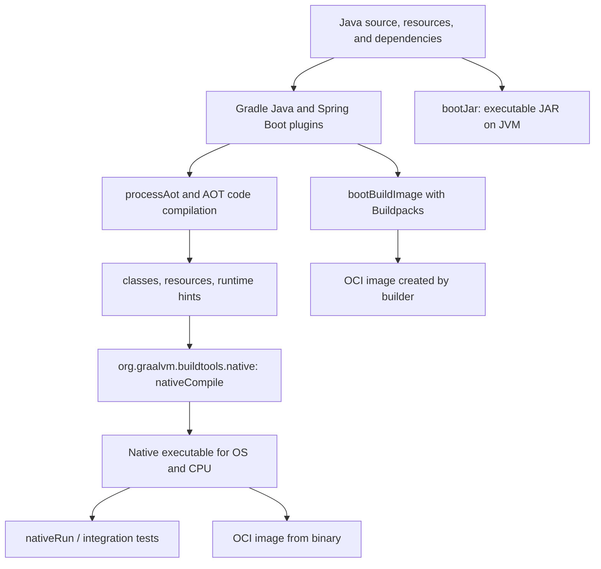

# Integrating the Spring Boot Gradle Plugin with org.graalvm.buildtools.native

## 1. Objectives and Context

In the **SPRING_BOOT_NATIVE_IMAGE** module, we use **Spring AOT** to prepare a Spring Boot application for ahead-of-time compilation, and then use **GraalVM Native Image** to produce a native executable. The ultimate goal is to verify compatibility, measure startup time and memory footprint compared to the JVM build, and package and operate the application in containers.

This lesson in the **Gradle** chapter focuses on **how the two Gradle plugins work together**:

- `org.springframework.boot`: provides Spring Boot tasks such as `bootJar`, `bootRun`, `processAot`, and `bootBuildImage`; recognizes Spring's AOT processing.
- `org.graalvm.buildtools.native`: configures and runs Native Image through tasks such as `nativeCompile`, `nativeRun`, and `nativeTest`, while selecting a compatible GraalVM/toolchain.

When applied together in a supported Spring Boot project, **the Spring Boot Gradle plugin integrates AOT processing with Native Build Tools**, so that the classes and metadata generated by AOT become inputs to native compilation. Learners do not need to write a manual script to copy the classpath and invoke `native-image` by hand to achieve standard integration.

After this lesson, you will be able to:

1. Configure a Gradle project (Kotlin DSL or Groovy DSL) that uses both the Spring Boot plugin and GraalVM Native Build Tools.
2. Explain the roles, dependency relationships, and outputs of JVM, AOT, and native tasks.
3. Distinguish between the JDK running Gradle, the Java toolchain selected by Gradle, and the GraalVM Native Image actually used during the build.
4. Compile, run, test, and package a native application; record reflection/resource errors so they can be addressed in the right place.
5. Collect a set of evidence to compare JVM/native builds and verify that the image runs on the target platform.

> **Expectation boundary:** a successful `nativeCompile` run only proves that an executable was created. You still need to run integration tests, verify library compatibility, measure performance under identical conditions, and test the container in the target environment.

## 2. Integration Architecture: Who Produces What?

`org.springframework.boot` is responsible for processing the Spring model: discovering configurations, beans, relevant auto-configurations, and generating AOT code/hints. `org.graalvm.buildtools.native` takes the necessary outputs to invoke GraalVM Native Image and produce a binary for the target OS/CPU.



The diagram illustrates two containerization paths: **packaging the already-built binary** and **letting Cloud Native Buildpacks create the image**. `bootBuildImage` does not necessarily use the exact file in `build/native/nativeCompile/`; the builder can perform its own build process.

| Component | Primary Inputs | Outputs or Responsibilities |
| --- | --- | --- |
| Gradle Java plugin | Java source, dependencies, Java toolchain | Compiles Java and runs standard tests. |
| Spring Boot Gradle plugin | Spring application, build configuration | `bootJar`, `bootRun`, Spring AOT, and related tasks. |
| Spring AOT | Spring application context at build time | Bootstrap support code, metadata/hints for mechanisms that must be known ahead of time. |
| GraalVM Native Build Tools | Java/AOT outputs, classpath, GraalVM, binary configuration | `nativeCompile`, `nativeRun`, `nativeTest` (depending on version/test suite). |
| GraalVM Native Image | Bytecode and provided metadata/hints | Platform-specific native executable file. |
| Spring Boot Buildpacks | Source artifact, builder, and buildpacks | OCI image; can build a native image when configured appropriately. |

Key point: **Spring AOT is not a machine-code compiler**; GraalVM Native Image **does not automatically infer every dynamically accessed reflection call or resource**. When AOT does not automatically register sufficient hints, developers need to add well-founded configuration.

## 3. Pre-Configuration Checks

You need to prepare:

- A **Spring Boot application that supports AOT/native**, with Java and Gradle versions compatible with the chosen Spring Boot version.
- A **GraalVM JDK with Native Image** and an appropriate C toolchain/linker when building native locally. For Buildpacks, the build environment inside the builder can provide these components.
- A Gradle Wrapper (`gradlew` / `gradlew.bat`) whose version satisfies the requirements of the Spring Boot Gradle plugin and Native Build Tools.
- Basic knowledge of `build.gradle.kts` or `build.gradle`, Gradle tasks, Spring beans, dependency resolution, and application testing.

There is no single version matrix that works across every release cycle. Before choosing version numbers, check the official documentation corresponding to the **specific release** of Spring Boot, Gradle, GraalVM, and Native Build Tools. At a minimum, cross-check the pairs: **Spring Boot–Java–Gradle**, **Native Build Tools–Gradle–GraalVM**, and **GraalVM–OS/architecture/C toolchain**.

In the project root directory, inspect your environment:

```bash
java -version
javac -version
./gradlew --version
./gradlew -q javaToolchains
native-image --version
```

On Windows, use `gradlew.bat` and the corresponding shell tools. If `native-image --version` is not found on your machine but the project only builds via Cloud Native Buildpacks, this is not necessarily an error: inspect GraalVM inside the **builder image**. If building directly with `nativeCompile`, verify the Native Image tool that the plugin actually selects.

### Three JDKs That Can Differ

| Selection Source | Purpose | How to Check |
| --- | --- | --- |
| `java` on `PATH` | Runs `java` commands typed in the terminal. | `java -version` and command path. |
| JVM running Gradle/daemon | Runs the Gradle process. | `./gradlew --version`, daemon configuration, and logs. |
| Java toolchain/Native Image plugin selection | Compiles Java and builds the native executable. | `javaToolchains`, plugin configuration, `compileJava`/`nativeCompile --info` logs. |

Setting `languageVersion = 21` in the Java toolchain **only requests Java 21**; it does not automatically guarantee Gradle uses GraalVM if the machine has multiple JDK 21 installations. For native builds, read the log of the **actual task** to verify the GraalVM path, especially when `JAVA_HOME` and `PATH` differ.

## 4. Creating the Kotlin DSL Configuration (`build.gradle.kts`)

Below is a skeleton for a minimal REST application. Strings in the form `<..._VERSION>` are **version placeholders** that must be replaced with actual versions confirmed compatible **before running Gradle**. For clarity in the example, we choose **Java 21**; a project can choose another Java version when supported by the Spring Boot/GraalVM release.

```kotlin
plugins {
    java
    id("org.springframework.boot") version "<SPRING_BOOT_VERSION>"
    id("io.spring.dependency-management") version "<DEPENDENCY_MANAGEMENT_VERSION>"
    id("org.graalvm.buildtools.native") version "<NATIVE_BUILD_TOOLS_VERSION>"
}

group = "com.example"
version = "0.0.1-SNAPSHOT"

java {
    toolchain {
        languageVersion.set(JavaLanguageVersion.of(21))
    }
}

repositories {
    mavenCentral()
}

dependencies {
    implementation("org.springframework.boot:spring-boot-starter-web")
    testImplementation("org.springframework.boot:spring-boot-starter-test")
    testRuntimeOnly("org.junit.platform:junit-platform-launcher")
}

tasks.withType<Test>().configureEach {
    useJUnitPlatform()
}

graalvmNative {
    binaries {
        named("main") {
            imageName.set("native-gradle-demo")
        }
    }
}
```

**Explanation of each option:**

- `java` provides Java compilation, test tasks, and Java toolchains.
- `org.springframework.boot` creates Spring Boot tasks and knows how to wire AOT outputs into the native process when paired with the right plugin.
- `io.spring.dependency-management` is one **way** to import dependency versions/BOMs for Spring Boot. It is not a Native Image plugin and not the only mandatory option: you can use `platform(...)`/Gradle BOMs depending on project configuration. If you omit this plugin, you must manage dependency versions through another mechanism.
- `org.graalvm.buildtools.native` is a **Gradle plugin**, placed inside `plugins { ... }`, not declared as an application dependency with `implementation(...)`.
- `graalvmNative.binaries.named("main")` configures the executable name of the main application. You do not need to configure `mainClass` if Gradle/Spring Boot already detects the entry point accurately; if there are multiple entry points, declare it explicitly.
- `useJUnitPlatform()` is the standard JUnit Platform test configuration; native testing also requires compatible test configuration/scope.

**Do not hard-code versions from an old blog post.** In a repository that has a version catalog or plugin management in `settings.gradle.kts`, keep versions in **one unified configuration source** to avoid mismatched declarations across two places. The examples here show direct plugin configuration for illustration.

### 4.1. Explicit Entry Point

If Gradle cannot determine the main class due to multiple entry points, configure the Spring Boot plugin to select the class containing `main`:

```kotlin
springBoot {
    mainClass.set("com.example.NativeGradleDemoApplication")
}
```

In the sample application, that class can be:

```java
package com.example;

import org.springframework.boot.SpringApplication;
import org.springframework.boot.autoconfigure.SpringBootApplication;
import org.springframework.web.bind.annotation.GetMapping;
import org.springframework.web.bind.annotation.RestController;

@SpringBootApplication
public class NativeGradleDemoApplication {
    public static void main(String[] args) {
        SpringApplication.run(NativeGradleDemoApplication.class, args);
    }
}

@RestController
class HelloController {
    @GetMapping("/api/hello")
    Greeting hello() {
        return new Greeting("Spring Boot Native Gradle");
    }
}

record Greeting(String message) {}
```

Place the file under `src/main/java/com/example/NativeGradleDemoApplication.java`. When using another example, adjust the package and main class to match; the Java file above is an **application example**, independent of the plugin configuration.

### 4.2. If the Project Uses Groovy DSL (`build.gradle`)

This is the equivalent configuration in Groovy syntax. Choose **one of the two DSLs** when editing the main build file; do not paste both snippets directly into the same project.

```groovy
plugins {
    id 'java'
    id 'org.springframework.boot' version '<SPRING_BOOT_VERSION>'
    id 'io.spring.dependency-management' version '<DEPENDENCY_MANAGEMENT_VERSION>'
    id 'org.graalvm.buildtools.native' version '<NATIVE_BUILD_TOOLS_VERSION>'
}

group = 'com.example'
version = '0.0.1-SNAPSHOT'

java {
    toolchain {
        languageVersion = JavaLanguageVersion.of(21)
    }
}

repositories {
    mavenCentral()
}

dependencies {
    implementation 'org.springframework.boot:spring-boot-starter-web'
    testImplementation 'org.springframework.boot:spring-boot-starter-test'
    testRuntimeOnly 'org.junit.platform:junit-platform-launcher'
}

tasks.withType(Test).configureEach {
    useJUnitPlatform()
}

graalvmNative {
    binaries {
        main {
            imageName = 'native-gradle-demo'
        }
    }
}
```

Kotlin DSL uses `imageName.set(...)` while Groovy DSL typically uses assignment `imageName = ...`. Detailed options may vary by Native Build Tools version; for different binary names, check the `graalvmNative` extension provided by the plugin version in use.

## 5. Proving That AOT Is Wired into the Native Task Graph

Reading the task graph is the most important step to confirm that **the integration actually works**. First, list the tasks in the project (a command that does not build native):

```bash
./gradlew tasks --all

# Only plan the tasks; do not execute native compilation yet:
./gradlew nativeCompile --dry-run
```

In a project with full plugin configuration, you will typically see tasks such as:

| Task | Role | Expectation |
| --- | --- | --- |
| `compileJava`, `processResources`, `classes` | Standard Java/resources compilation. | Serves both the JVM build and dependent steps. |
| `bootJar` | Packages the executable Spring Boot JAR. | Runs on the JVM, not a native binary. |
| `bootRun` | Runs the application on the JVM from the project classpath. | Used as a functional baseline. |
| `processAot` | Runs Spring AOT to analyze the context and generate code/metadata. | Input for subsequent AOT/native tasks. |
| `compileAotJava`, `processAotResources` | Compiles/processes AOT outputs in supported versions. | Links in the native task graph. |
| `nativeCompile` | Invokes GraalVM Native Image to create the executable. | Depends on required generated code/resources/hints outputs. |
| `nativeRun` | Runs the executable from the corresponding native workflow. | Tests startup and endpoints. |
| `nativeTest` | Compiles/runs native tests when supported/configured. | Complements testing compared to the JVM. |
| `bootBuildImage` | Creates an OCI image via Buildpacks. | Can create a JVM or native image depending on builder configuration. |

**How to confirm properly:** in `nativeCompile --dry-run` or `nativeCompile --info` logs, verify the participation of `processAot` and related AOT tasks. Specific task names and dependency ordering can vary between plugin versions; do not write manual dependencies just because the log does not match task names in an older guide.

Expected flow:

```text
Java source/resources
    -> Spring AOT (processAot, compile/process generated outputs)
    -> classpath + runtime hints
    -> GraalVM Native Build Tools (nativeCompile)
    -> build/native/nativeCompile/<executable-name>
```

The path above is the **common output layout**, which may vary by binary configuration, Gradle/plugin version, and OS. On Windows, the executable usually has a `.exe` extension; the most accurate way is to read the build log.

### Do Not Manually Force Native Tasks to Depend on `bootJar`

`bootJar` and `nativeCompile` are **two different artifact types**. The Spring Boot plugin already provides AOT integration for native tasks, so manually adding `dependsOn("bootJar")` or using the executable JAR itself as the Native Image classpath can create redundant task graph edges, mismatched inputs, or mask AOT errors. Only intervene in dependencies/task inputs if there is a specific requirement and you understand the plugin mechanics of the version in use.

## 6. Workflow from JVM to Native Executable

### Stage 1 — Run JVM as a Baseline

```bash
./gradlew clean test bootJar
./gradlew bootRun
```

In another terminal:

```bash
curl -i http://localhost:8080/api/hello
```

With the sample code, expect HTTP 200 and JSON `{"message":"Spring Boot Native Gradle"}`. If `bootRun` or JVM tests already fail, fix them before moving to native. Record request and test results to compare against the same API contract.

### Stage 2 — Inspect Spring AOT Separately

```bash
./gradlew processAot --info
```

This task can expose errors in application context creation, bean conditions, profile configuration, libraries lacking AOT support, or annotation processing. AOT outputs are generated by Gradle in the build directory; **do not edit generated sources directly**, because the next build can overwrite them.

Some bean conditions are evaluated by Spring AOT during the build phase, so verify how configurations and profiles affect the bean graph. Pay attention to distinguishing runtime properties that are still read at runtime from structural context decisions already baked into the AOT output.

### Stage 3 — Native Compilation

```bash
./gradlew nativeCompile

# When you need to trace which Gradle/GraalVM was selected:
./gradlew nativeCompile --info
```

`nativeCompile` typically consumes significant CPU/RAM and can run longer than `bootJar`. If the process fails, look for the first meaningful error in the log: missing toolchain, linker/header error, reflection/resource issue, AOT failure, or incompatible dependency. Do not confuse warnings printed near the end with the root cause.

For the sample where `imageName` is set to `native-gradle-demo`, the path on Linux/macOS usually looks like:

```bash
./build/native/nativeCompile/native-gradle-demo
```

Only use the command above after confirming the executable was actually created at that path. On Windows, use the corresponding `.exe` executable.

### Stage 4 — Run and Verify the Native Build

```bash
./gradlew nativeRun
```

Open another terminal and call the API again:

```bash
curl -i http://localhost:8080/api/hello
```

Do not run `bootRun` and `nativeRun` concurrently on the same port 8080; stop the previous instance before starting the next, or change the port in a controlled manner. If `nativeRun` does not fit the project's execution mechanism, you can run the binary directly at the actual path produced by `nativeCompile`.

Once a working native build is up, run broader checks: JSON serialization, validation, authentication, database, TLS, resource files, proxies/transactions, logging, profiles, timezones, and startup failure conditions.

### Stage 5 — Testing in Native Mode

```bash
./gradlew test
./gradlew nativeTest
```

`test` runs standard JVM tests; `nativeTest` uses the plugin's native testing capability with supported test suites and frameworks. Depending on the plugin version and test source set configuration, `nativeTest` can take considerable time and requires AOT metadata for tests. **Do not assume every JVM integration test automatically runs properly in native mode**: verify the number of executed tests and run supplementary system tests against the executable/container.

## 7. Intentional Native Build Tools Configuration

The plugin provides the `graalvmNative` extension to configure binaries and native options. Kotlin DSL example:

```kotlin
graalvmNative {
    binaries {
        named("main") {
            imageName.set("native-gradle-demo")
            buildArgs.add("--verbose")
        }
    }
}
```

`--verbose` is used to observe additional diagnostic details when needed; it does not need to be enabled for every build. Do not copy old `buildArgs` mechanically: some flags may be renamed, removed, or affect correctness/performance depending on the GraalVM version.

For a project with multiple application types or test source sets, configure the appropriate binary (`main`, `test`, or the configuration corresponding to the plugin version) and entry point. In a Spring Boot application, let the plugin use the default AOT path unless there is a specific reason to customize it.

### 7.1. Toolchain Detection and JVM vs. GraalVM Mismatches

Gradle may use one JDK to run the daemon and another JDK to compile. A JDK that has a valid `javac` does not necessarily contain `native-image`. When encountering errors about GraalVM not being found or the plugin picking the wrong JDK:

1. Run `./gradlew --version` and `./gradlew -q javaToolchains` to inspect the runtime and JDKs detected by Gradle.
2. Check `JAVA_HOME`, and the paths of `java` and `native-image` in the **exact shell running Gradle**.
3. Read `./gradlew nativeCompile --info` to see **which Native Image executable the task actually invokes**.
4. Cross-check the project's Java toolchain, the GraalVM version, and Native Build Tools' toolchain detection capabilities.
5. If building in CI or inside a container, perform verification steps **inside the runner/builder**, because host results can differ.

Some versions of Native Build Tools allow tuning Java toolchain detection via `graalvmNative.toolchainDetection`. Only change this flag after identifying the root cause and reading the documentation for your exact plugin version; disabling detection without proving which executable gets selected may simply shift the error to another JDK.

### 7.2. Runtime Hints for Reflection/Resources

Suppose the application reads a template from `src/main/resources/templates/welcome.txt` using a dynamic filename. If the resource is not automatically registered for native by Spring or a library, you can declare:

```java
package com.example;

import org.springframework.aot.hint.RuntimeHints;
import org.springframework.aot.hint.RuntimeHintsRegistrar;
import org.springframework.context.annotation.Configuration;
import org.springframework.context.annotation.ImportRuntimeHints;

@Configuration(proxyBeanMethods = false)
@ImportRuntimeHints(TemplateResourceHints.class)
class NativeHintsConfig {}

final class TemplateResourceHints implements RuntimeHintsRegistrar {
    @Override
    public void registerHints(RuntimeHints hints, ClassLoader classLoader) {
        hints.resources().registerPattern("templates/*.txt");
    }
}
```

Place the example in a corresponding Java file under package `com.example`; only register resources actually used by the application. For dynamic reflection invoking constructors/methods of classes that cannot be inferred from code, register the exact types and members via `hints.reflection()` or appropriate Spring annotations. Bulk reflection registration is unnecessary: Spring AOT and native-ready libraries can generate much of the metadata automatically. After changing hints, **rebuild native** and re-run the exact flow that previously failed.

## 8. Building Native Containers with Gradle Buildpacks

There are two common paths:

1. **`nativeCompile` → binary → Dockerfile/OCI image:** full control over the binary and base image; you must ensure runtime libraries, architecture, and execution permissions yourself.
2. **`bootBuildImage` + Buildpacks:** let the builder create the image. When native mode is enabled and the builder supports it, the buildpack can build the binary during the container build process.

Kotlin DSL configuration example using `BootBuildImage`:

```kotlin
import org.springframework.boot.gradle.tasks.bundling.BootBuildImage

tasks.named<BootBuildImage>("bootBuildImage") {
    imageName.set("example/native-gradle-demo:local")
    environment.put("BP_NATIVE_IMAGE", "true")
}
```

Then run:

```bash
./gradlew bootBuildImage
docker image inspect example/native-gradle-demo:local
docker run --rm -p 8080:8080 example/native-gradle-demo:local
```

This requires a Docker daemon or a container runtime/builder supporting the corresponding deployment method. `BP_NATIVE_IMAGE=true` requires a builder that supports Native Image; it is not a guarantee that **every** builder has the full toolchain. Read the buildpack logs to confirm GraalVM and native executable generation, verify the binary type inside the image, and then call the container's API/health endpoints.

**Note on Kotlin DSL:** if using the `import` statement above, place it at the top of `build.gradle.kts` per Kotlin rules. If the project configures tasks using different syntax, ensure `bootBuildImage` still receives the proper environment and imageName. Equivalent Groovy example:

```groovy
tasks.named('bootBuildImage') {
    imageName = 'example/native-gradle-demo:local'
    environment = ['BP_NATIVE_IMAGE': 'true']
}
```

A project can pass `nativeCompile` locally while `bootBuildImage` fails because the builder/container has a different CPU architecture, platform, or dependency version. Both build methods must be verified independently.

## 9. Diagnosing Common Integration Errors

| Symptom | Common Explanation | What to Check |
| --- | --- | --- |
| `Plugin ... not found` | Wrong plugin ID/version, unreachable Gradle Plugin Portal/repository, or incompatible Gradle version. | Check `plugins`, `pluginManagement`, network/repository access, and plugin version docs. |
| Missing `nativeCompile` task | `org.graalvm.buildtools.native` not applied to the right project or plugin application failed. | `./gradlew tasks --all`, multi-project configuration, and plugin resolution logs. |
| Missing `processAot` task | Spring Boot plugin not properly applied, unsupported version, or inspecting the wrong subproject. | Verify the project is a Spring Boot application and check the task graph. |
| `nativeCompile` does not pick up AOT outputs | Conflicting plugin versions, wrong project/source set, or incorrect custom task graph wiring. | `nativeCompile --dry-run`, `--info` logs, remove unnecessary custom wiring. |
| Build reports GraalVM Native Image not found | Standard JDK selected instead of GraalVM, or Native Image is not ready. | `JAVA_HOME`, `javaToolchains`, `native-image --version`, and executable in task logs. |
| Native Image C compiler, headers, or linker error | Incomplete OS toolchain or mismatched architecture. | Actual compiler/linker/SDK and GraalVM error log. |
| AOT reports bean initialization or condition error | Bean graph or Spring configuration evaluated at build time differs from runtime expectations. | Profiles/properties/build environment, dependencies, and `processAot` logs. |
| Native reports missing class/member/resource | Dynamic reflection, proxy, or resource lacks hints. | Reproduce the failing flow, write minimal runtime hints, re-run native tests. |
| `nativeRun` behaves differently from `bootRun` | The two artifacts use different initialization mechanisms, configs/profiles, or incompatible dynamic libraries. | Compare environment, JSON, database, TLS, logging, and shutdown/termination tests. |
| `nativeTest` runs fewer tests than `test` | Test config/source set/native support differs. | Inspect test reports, task configuration, and test filters. |
| `bootBuildImage` still builds a JVM image | Native builder/environment not configured, or builder unsupported/native setting not applied. | Buildpack logs, `BP_NATIVE_IMAGE`, image metadata, startup process. |
| Native starts fast but fails in production | Missing integration, security, data serialization, and external connection testing. | Run contract tests + smoke tests on the target image. |

Especially in **multi-project Gradle builds**, the native plugin must be applied to the appropriate **Spring Boot application subproject**. If the plugin is declared only with `apply false` at the root, projects that have not applied the plugin will not have native tasks; apply it specifically in the module containing the application, and check that module's dependencies and entry point.

## 10. Hands-On Lab: Verifying Both Builds from One Gradle Project

**Context:** the development team has a REST API returning JSON at `/api/hello` and needs to verify that adding Native Build Tools does not alter the application contract, while also producing a native container to measure startup/memory.

### Implementation Steps

1. Choose matching versions of Gradle Wrapper, Spring Boot, Java, Native Build Tools, and GraalVM based on release documentation; record them in your report.
2. Add both the Spring Boot and GraalVM Native Build Tools plugins to `build.gradle.kts`/`build.gradle` along with an appropriate dependency management mechanism.
3. Run `./gradlew test bootJar` and `./gradlew bootRun`; save the baseline response.
4. Run `./gradlew nativeCompile --dry-run` to inspect the AOT task graph; record the relevant tasks.
5. Run `./gradlew processAot`, then `./gradlew nativeCompile`; save the path and Native Image version from the log.
6. Run `./gradlew nativeRun` and call the API again; run `nativeTest` if supported by your test suite/plugin and check how many tests actually execute.
7. Test reflection, resources, JSON, and critical integrations; add runtime hints only when backed by concrete evidence.
8. Run `bootBuildImage` with a native-capable builder, inspect the image, and smoke-test via the container.
9. Measure startup-to-ready, RSS, and—where needed—latency/throughput of both builds under **identical conditions**; record the number of runs and configuration.

### Suggested Results Record

| Item to Record | JVM | Native |
| --- | --- | --- |
| Build command and artifact | `bootJar` + JAR | `nativeCompile` + executable; `bootBuildImage` if used |
| Java/GraalVM/Gradle/plugin versions | *Record actuals* | *Record actuals* |
| JVM and native tests | *Pass/fail + test count* | *Pass/fail + test count* |
| HTTP responses / error cases | *Record results* | *Compare same tests* |
| Startup-to-ready (median of multiple runs) | *Measured ms* | *Measured ms* |
| RSS under defined conditions | *Measured MiB* | *Measured MiB* |
| Additional limitations/metadata | *If any* | *Hints and rationale* |
| Container OS/architecture | *If any* | *OS/architecture + builder/tag/digest* |

Do not record sample numbers in place of empirical results. For startup, choose a consistent **readiness** milestone (for example, a readiness endpoint enabled and properly configured), because a "Started ..." log line can appear before external dependencies are truly ready. For memory, specify whether you measured RSS/working set or heap; results vary with container limits and load.

### Completion Criteria

- [ ] Gradle resolves both the Spring Boot plugin and GraalVM Native Build Tools from properly configured sources.
- [ ] The `nativeCompile` task graph includes the relevant Spring AOT steps; AOT generates code successfully.
- [ ] The plugin selects the right GraalVM, Java toolchain, and target platform compiler/linker.
- [ ] JVM and native builds return the exact same API contract, including critical error paths.
- [ ] `test`, supported native tests, and smoke/integration tests all have comparable reports.
- [ ] The native container is confirmed to have the right artifact type and OS/architecture.
- [ ] There is a comparison report covering startup, memory, and build-time or throughput trade-offs under repeatable conditions.

If a gate is not met, record the **open issue** and collected evidence; do not conclude native readiness solely because the executable was generated successfully.

## 11. Self-Check Questions

1. Why might a project that applies only `org.graalvm.buildtools.native` without Spring Boot AOT integration behave differently when running natively?
2. What artifact types do `bootJar`, `nativeCompile`, and `bootBuildImage` produce, and how do their inputs/outputs relate?
3. Is `java.toolchain.languageVersion` sufficient to guarantee that Native Image uses the intended GraalVM? Which logs should you check?
4. Why is running `nativeCompile --dry-run` useful before actually compiling, and what still needs to be verified afterward?
5. When a native build is missing a template at runtime, which project resources, Spring AOT behavior, or Gradle configurations should you inspect before adding hints?
6. Why are `nativeTest` and container-based integration tests still necessary after `nativeCompile` succeeds?
7. Can the native image produced by `bootBuildImage` be assumed identical to the binary from `nativeCompile` on the host? Why or why not?

## 12. Official Documentation

DSL APIs, JDK detection mechanisms, task graphs, and Buildpacks support vary by version. When applying to a specific project, cross-reference documentation for the **exact version in use**:

- [Spring Boot Gradle Plugin Reference](https://docs.spring.io/spring-boot/gradle-plugin/index.html): Gradle plugin, Java toolchains, tasks, and packaging.
- [Spring Boot — GraalVM Native Image](https://docs.spring.io/spring-boot/reference/packaging/native-image/index.html): building native images with Gradle/Maven, AOT, and Buildpacks.
- [GraalVM Native Build Tools](https://graalvm.github.io/native-build-tools/latest/): `org.graalvm.buildtools.native`, `nativeCompile`, `nativeTest`, and binary configuration.
- [Gradle — Toolchains for JVM projects](https://docs.gradle.org/current/userguide/toolchains.html): how Gradle selects JDKs to compile, Gradle's JVM, and toolchain discovery.
- [Spring Framework — Ahead-of-Time Processing](https://docs.spring.io/spring-framework/reference/core/aot.html): Spring AOT and runtime hints.
- [GraalVM Native Image](https://www.graalvm.org/latest/reference-manual/native-image/): toolchain requirements, compilation, and compatibility diagnostics.

**Key takeaway:** combining the Spring Boot Gradle plugin with `org.graalvm.buildtools.native` lets Gradle feed Spring AOT output into the GraalVM compilation pipeline. A solid integration has a **clear task graph, correct toolchain, working executable, thorough functional testing, and reproducible performance/container evidence**.
