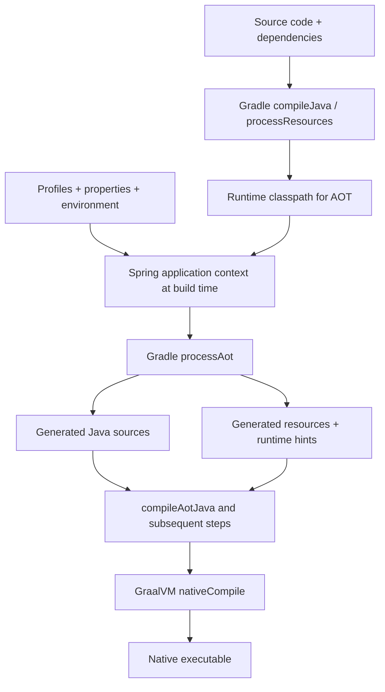

# processAot and Configuration Inputs of Application Analysis

## 1. Why Understand the Inputs to `processAot`?

In the **SPRING_BOOT_NATIVE_IMAGE** module, we compile Spring Boot into a **GraalVM Native Image** using **Spring AOT**, practice Gradle/Maven builds, configure reflection and resources, run compatibility tests, package containers, and evaluate startup time and memory footprint. For Gradle projects, the **`processAot`** task is a major milestone: it triggers build-time processing of the Spring application context, generates supporting sources/resources for an optimized runtime, and registers metadata for the Native Image step.

A common misconception is that `processAot` analyzes an application completely independent of configuration. It must run with **the appropriate classpath, profiles, properties, environment variables, and configuration conditions** so Spring can determine which beans and behaviors to prepare. Changing these inputs can alter the generated AOT code, and sometimes cause the build to fail right at this stage.



**Distinction:** a successful `processAot` run proves the Spring AOT task completed with **the set of inputs present at that time**. It does not mean `nativeCompile` will succeed or that every profile/feature will work properly after deployment.

## 2. Where Does the `processAot` Task Live in Gradle?

In an application using an AOT-capable Spring Boot Gradle Plugin, Gradle provides tasks to run AOT processing and compile the generated outputs. When integrated with GraalVM Native Build Tools, the native pipeline consumes these results.

Commonly used commands (run in the project directory containing the Gradle Wrapper):

```bash
./gradlew tasks --all
./gradlew processAot
./gradlew nativeCompile
```

On Windows, use `gradlew.bat`. Running `tasks --all` helps verify task names in the exact plugin version you are using, because task integration and organization can vary across Spring Boot/Gradle versions.

| Task or Stage | Primary Role | Results to Verify |
|---|---|---|
| `compileJava`, `processResources` | Prepares application bytecode and resources | Classes/resources match current source |
| `processAot` | Processes the Spring application context in AOT mode | Generated Java sources, resources, and metadata |
| `compileAotJava` and related tasks | Compiles the generated AOT code | Class files for AOT |
| `nativeCompile` | Uses GraalVM Native Image to create the executable | Native file for target OS/architecture |
| `nativeTest` (when configured) | Tests via a native test executable | Native test results |

Output directories usually live under `build/generated/aotSources`, `build/generated/aotResources`, or corresponding paths configured by the plugin. Do not hard-code expectations around folder names if the project uses a different version or convention; read the logs and Gradle task configuration to identify them accurately.

## 3. Types of Inputs That Govern AOT Analysis

### 3.1. Sources, Dependencies, and Classpath

Spring AOT discovers beans from annotations, configuration classes, auto-configurations, component scanning, and many other framework integrations. Therefore:

- Adding or removing a `@Configuration`, `@Component`, or `@Bean` can change the bean graph.
- Changing dependencies or versions can add or remove auto-configurations and discovered classes.
- The presence of a class on the classpath can change `@ConditionalOnClass` evaluation.
- Component scan and package configurations also alter which beans are analyzed.

Example:

```java
@Configuration
class MessagingConfiguration {
    @Bean
    @ConditionalOnClass(name = "com.example.messaging.FastClient")
    MessagingGateway gateway() {
        return new MessagingGateway();
    }
}
```

If `FastClient` is present on the build-time classpath, the condition may evaluate differently than when that dependency is absent. The class name in this example is purely illustrative. **The classpath for `processAot` must represent the artifact intended to be built**, not an arbitrary IDE classpath.

### 3.2. Active Profiles

Beans declared with `@Profile` depend on the profile Spring uses during the AOT run:

```java
@Configuration
class StorageConfiguration {
    @Bean
    @Profile("local")
    StorageClient localClient() {
        return new InMemoryStorageClient();
    }

    @Bean
    @Profile("prod")
    StorageClient productionClient() {
        return new RemoteStorageClient();
    }
}
```

If AOT analysis runs with the `local` profile, you cannot assume that switching the native executable to the `prod` profile afterward will cause Spring to automatically assemble a brand-new bean graph. Some bean decisions are fixed during AOT; configuration values used inside runtime logic can still be read at runtime, depending on how the application is designed.

Example of configuring a profile specifically for **the Gradle task**:

```groovy
// build.gradle (Groovy DSL)
tasks.named("processAot") {
    args("--spring.profiles.active=prod")
}
```

Or with Kotlin DSL in a project that has the corresponding task type:

```kotlin
// build.gradle.kts
tasks.named<org.springframework.boot.gradle.tasks.aot.ProcessAot>("processAot") {
    args("--spring.profiles.active=prod")
}
```

These examples illustrate passing **application arguments** to Spring AOT. Task configuration APIs can vary by Spring Boot version; if the Gradle compiler reports it cannot find the task type or method, look up the API of the plugin version you are using instead of guessing unverified configuration.

### 3.3. Application Properties and Environment Variables

`application.yml`, `application.properties`, profile-specific files, and `PropertySource` sources can all affect bean creation conditions:

```java
@Configuration
class ExportConfiguration {
    @Bean
    @ConditionalOnProperty(
        prefix = "feature",
        name = "export-enabled",
        havingValue = "true"
    )
    ExportService exportService() {
        return new ExportService();
    }
}
```

If at AOT time `feature.export-enabled=false`, the bean may not be included in the prepared application model. Flipping the value at runtime does not mean every bean creation condition will be re-evaluated.

In `build.gradle`, on Gradle/Spring Boot versions that support setting environment variables for the AOT task, you can write for example:

```groovy
tasks.named("processAot") {
    environment("FEATURE_EXPORT_ENABLED", "true")
}
```

Before applying this, verify that the task exposes the `environment` API and that Spring maps the property accordingly; this is an intentional configuration for the **build-time environment**, not an environment variable automatically baked into the binary.

Parameters such as database addresses, passwords, tokens, hostnames, and secrets must not be embedded into AOT sources or build logs. When bean creation depends on configuration, use safe build-time values and avoid making unnecessary external connections during AOT processing.

### 3.4. JVM Arguments, System Properties, and Conditional Variables

Some libraries and custom configurations read `System.getProperty` or `System.getenv` directly, causing AOT results to differ between a laptop and CI. Distinguish between:

- **Gradle daemon JVM**: the process running Gradle.
- **Process executing `processAot`**: typically a Java process forked by the task with the application's classpath and arguments.
- **Native executable runtime**: the process running after the build finishes.

For example, passing `-Dfoo=bar` on the Gradle command line does not guarantee the AOT Java process receives that property the same way as passing a system property directly to the task. Use the task's `systemProperty`/configuration API appropriately and verify via logs or targeted condition tests.

Do not base bean decisions on the current clock, randomness, unstable network data, or build machine state; doing so makes AOT outputs non-reproducible.

## 4. Categorizing Configuration: Build-Time Decisions vs. Runtime Values

An essential part of Spring AOT is understanding **what is decided at build time** and **what can vary at runtime**.

| Information Type | Examples | Proper Handling |
|---|---|---|
| Bean creation conditions | `@Profile`, `@ConditionalOnProperty`, `@ConditionalOnClass` | Define representative build configuration; test the bean graph |
| Component discovery | Component scan, auto-configuration | Keep classpath and packages consistent |
| Reflection/resource hints | Payload types, templates, proxies | Register when AOT cannot infer automatically |
| Runtime business parameters | Request rate limits, display messages | Design to be read at runtime if changes are needed |
| Runtime environment details | Secrets, endpoints, certificates, mounted files | Supply via runtime environment config/secrets |
| Toolchain | Java, GraalVM, Gradle, plugin versions | Record and pin in build configuration/CI |

For example, a `@ConfigurationProperties` class holding only a threshold value on an already-existing bean can bind to the runtime environment; that does not mean changing a threshold will activate a new `@ConditionalOnProperty` branch that AOT did not retain.

**Practical rule:** if a property decides **whether a bean is created or not**, treat it as an AOT analysis input that needs verification. If a property only governs **behavior inside an existing bean**, consider reading it at runtime and testing accordingly.

## 5. Observing Inputs Effectively Without Leaking Secrets

Before modifying configuration, confirm which tasks Gradle actually runs:

```bash
./gradlew processAot --info
```

Depending on the plugin version, logs can reveal the main class, task dependencies, classpath paths, or passed arguments. Do not dump the entire environment into CI logs, as this can expose secrets. To verify a build profile, use a safe verification flag and a small test observing a specific bean.

You can write a small test for profiles:

```java
@SpringBootTest
@ActiveProfiles("prod")
class ProductionWiringTest {

    @Autowired
    ApplicationContext context;

    @Test
    void hasProductionGateway() {
        assertThat(context.containsBean("productionClient")).isTrue();
    }
}
```

This example uses JUnit, Spring Boot Test, and AssertJ; add the corresponding imports in your project. This JVM test verifies the context under the test's profile, yet **does not by itself prove `processAot` ran with `prod`**. You must inspect the Gradle configuration and run the native executable to verify both stages.

If you suspect AOT used the wrong profile, record in the build report the **requested profile**, task name, and plugin version. With a small test, use a bean/endpoint whose behavior differs across profiles to verify actual output after native compilation.

## 6. A Typical Failure Scenario

Suppose the application contains:

```java
@Bean
@ConditionalOnProperty(
    name = "reports.enabled",
    havingValue = "true"
)
ReportGenerator reportGenerator() {
    return new ReportGenerator();
}
```

On the developer's machine, `reports.enabled=true` is supplied via an environment variable, so `processAot` includes `ReportGenerator` in the AOT configuration. In CI, that variable is absent; `processAot` can still report **BUILD SUCCESS**, but the generated bean model differs from what was intended. When deploying the native executable and setting `reports.enabled=true`, endpoints requiring `ReportGenerator` may fail to work.

How to investigate systematically:

1. Check the bean condition and the property source used **during the AOT run**.
2. Confirm which profiles/properties the Gradle task was configured with in CI, and whether dependencies/configurations differ from the dev machine.
3. Rebuild from a deterministic configuration without reusing old native artifacts.
4. Run the native executable through the business scenario requiring `ReportGenerator`.
5. If the feature must toggle flexibly at runtime, consider always registering the bean and placing the `enabled` logic inside the bean, or designing AOT-compatible configuration.

Do not try to fix a bean missing due to `@ConditionalOnProperty` by indiscriminately adding reflection hints. Reflection metadata enables dynamic access to classes/members; it does not force Spring to instantiate a bean that an AOT condition excluded.

## 7. Running AOT in a Reproducible Gradle Pipeline

A sensible workflow sequence:

```bash
./gradlew clean test
./gradlew processAot
./gradlew nativeCompile
```

`clean` should be run intentionally on a build workspace you control, avoiding deleting artifacts needed for comparison. In CI, separate stages can improve visibility, but when `nativeCompile` already depends on AOT, avoid running duplicate tasks unnecessarily. Gradle manages the task graph and incremental builds according to your project configuration.

To compare two different AOT configurations, run independent builds with distinct artifact names or output directories; record the commit, profiles, non-sensitive properties, dependency lockfiles, Gradle wrapper version, and GraalVM version. Never share one executable across two experiments that expect different bean graphs.

### Directional Example Configuration

```groovy
// build.gradle
plugins {
    id 'java'
    id 'org.springframework.boot' version '3.x.y' // Replace with an actual compatible version
    id 'io.spring.dependency-management' version '1.x.y'
    id 'org.graalvm.buildtools.native' version '0.x.y'
}

tasks.named('processAot') {
    args('--spring.profiles.active=native')
}
```

The strings `3.x.y`, `1.x.y`, and `0.x.y` are **placeholders**, not versions to run directly; replace them with versions verified to be compatible. If using plugin management or Gradle conventions, plugin declarations may live elsewhere.

In many projects, you should manage the AOT profile via fixed build configuration rather than letting developers pick it ad hoc via shell environment variables. When building multiple variants, name each variant clearly and keep configuration records so operators know which binary was built for which environment.

## 8. Gradle Inputs Affect Caching and Incremental Builds

Gradle has task input/output tracking and caching; however, whether `processAot` outputs can be safely reused depends on how the plugin declares inputs and the version running. If AOT reads dynamic data outside the inputs Gradle tracks, someone may mistakenly think changing an environment variable forced AOT to re-run.

When changing a profile/property that affects the bean graph:

- Check the log to see whether `processAot` actually re-ran or was marked `UP-TO-DATE`/`FROM-CACHE`.
- Choose a stable way to declare inputs in task/build configuration.
- When suspecting cache staleness, try `--rerun-tasks` for an isolated verification run to test your hypothesis, then fix the input declarations if needed.
- Do not treat clearing the cache as a long-term solution; make sure build inputs are properly tracked.

Example:

```bash
./gradlew processAot --rerun-tasks --info
```

`--rerun-tasks` can increase build times and should not be enabled by default in CI merely to mask improperly declared task inputs.

## 9. From AOT to Native and Containers

After `processAot`, the `nativeCompile` step uses GraalVM Native Image to perform reachability analysis and link the executable. An error in `nativeCompile` is not necessarily caused by the AOT profile; it can stem from missing reflection/resource hints, incompatible libraries, the native toolchain, or build RAM.

When running containers, separate two groups of configuration:

- **Build-time configuration**: classpath, profiles, and properties that determine the bean model during Spring AOT; Gradle/GraalVM and the OS/architecture used for compilation.
- **Runtime configuration**: HTTP port, datasource URL, secrets, certificates, resource mounts, container memory, and behavior-controlling values designed to vary at runtime.

A native executable built for Windows does not run directly inside a Linux container; you must build the artifact for the target OS/CPU. When benchmarking JAR vs. native, keep the same source code, functionality, and request workload; explicitly record the profiles used for AOT and runtime, because bean graph differences make comparisons unfair.

## 10. `processAot` Diagnostic Checklist

| Question | Evidence to Inspect |
|---|---|
| Did the task actually run? | `processAot` logs, task status, and fresh outputs |
| Which profile did the application context use? | `args`/task configuration, profile-specific bean tests |
| Did dependencies/classpath change? | Dependency versions, plugin versions, task classpath |
| Which properties govern bean creation? | `@ConditionalOnProperty`, `@Profile`, configuration classes |
| Are secrets or external connections read during AOT? | Stack traces, initializer logic, safe config sources |
| Is stale caching involved? | `UP-TO-DATE`, `FROM-CACHE`, declared task inputs |
| AOT succeeded, yet native failed? | `nativeCompile` error logs, native toolchain, hints |
| Native behaves differently than expected? | Integration tests on the fresh executable, runtime configuration |

## 11. Self-Check Questions

1. Why can `processAot` produce different results on a laptop versus CI even for the exact same commit?
2. Which kinds of properties should be treated as inputs determining the AOT bean model?
3. Why does changing `SPRING_PROFILES_ACTIVE` when launching a native executable not necessarily cause Spring to instantiate additional beans from another `@Profile`?
4. What suspicion should arise if `processAot` reports `UP-TO-DATE` after you changed an environment property?
5. When a native executable lacks a bean controlled by `@ConditionalOnProperty`, why might adding reflection metadata fail to solve it?
6. How do you distinguish between the success of `processAot`, `nativeCompile`, and runtime testing?

**Remember:** `processAot` analyzes **a specific Spring application with a specific classpath and build-time configuration**. Keeping profiles, properties, dependencies, and task inputs consistent gives Native Image the right bean graph; you must then verify the executable in the real runtime environment before evaluating startup, memory, and performance.
