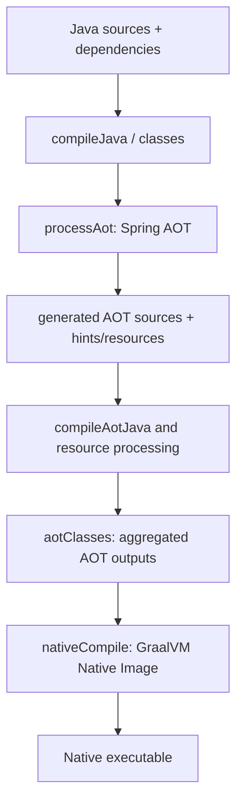

# nativeCompile and Its Dependency Relationship with Spring AOT

## 1. Lesson Objectives

In the **SPRING_BOOT_NATIVE_IMAGE** module, we use Spring AOT and GraalVM Native Image to turn a Spring Boot application into a native executable, then evaluate startup time, memory usage, compatibility, and container packaging. In **Gradle**, a central task is `nativeCompile`. What must be understood is that **`nativeCompile` does not replace Spring AOT on its own**: Gradle and its plugins coordinate multiple tasks to supply AOT-processed code, runtime hints, and the classpath to the GraalVM compiler.

After this lesson, the reader should be able to:

- Explain the responsibilities of `processAot`, `compileAotJava`, `aotClasses`, and `nativeCompile`.
- Inspect the actual task graph with Gradle and verify data flowing from Spring AOT to GraalVM.
- Write a minimal configuration for the Spring Boot Gradle plugin and the GraalVM Native Build Tools plugin.
- Distinguish between Spring AOT code-generation errors, Java compilation errors, and Native Image analysis/linking errors.
- Run and test the native executable to establish a well-founded comparison with the JVM build.

The examples assume a modern Spring Boot version with AOT/native support alongside compatible Gradle and GraalVM JDK versions. **Task names or how plugins wire tasks together can vary by version**; inspecting your project's task graph is the final source of truth.

## 2. Two AOT Layers with Different Roles

The term "AOT" appears in both Spring and GraalVM, yet they are two distinct steps:

| Stage | Primary Tool | Work Performed | Output |
|---|---|---|---|
| Spring application analysis | Spring AOT via Spring Boot Gradle plugin | Processes bean definitions, configurations, context bootstrap code, and runtime hints | Generated Java sources, resources, and metadata |
| Compiling generated Java | `JavaCompile` and related Gradle tasks | Compiles Spring AOT code into bytecode | AOT `.class` files and resources |
| Native compilation | GraalVM Native Image via GraalVM Native Build Tools | Reachability analysis, AOT compilation to machine code, and linking | Native executable for target OS/CPU |

Spring AOT typically replaces container operations that can be determined ahead of time with generated code. GraalVM Native Image needs **both the application code and Spring AOT outputs** to trace runtime code paths and package the binary. Reflection, proxy, resource, and serialization metadata supplied by Spring AOT and libraries tell Native Image about components that cannot be fully inferred from static calls.

Therefore, saying "running `nativeCompile` is Spring AOT" is imprecise: **Spring AOT is a preparation phase**, while `nativeCompile` is the Gradle task that triggers native compilation.

## 3. Task Graph: How Do Gradle Steps Relate?

With a supported Spring Boot + GraalVM Native Build Tools plugin setup, the processing chain can be visualized as follows:



The diagram only depicts **data flow and logical relationships**, not an exact replica of every task graph edge across all Gradle versions. Depending on the plugins, some tasks may run in parallel, include additional compile/resource steps, or use different task names.

Notable tasks:

| Task | Role | When to Invoke Directly |
|---|---|---|
| `processAot` | Launches Spring AOT processing and generates code/hints for the application | When inspecting AOT errors or viewing generated code before building the binary |
| `compileAotJava` | Compiles Java sources generated by AOT | When analyzing compile errors in generated sources |
| `processAotResources` (if present) | Processes resources of the AOT source set | When inspecting copied resources/output artifacts |
| `aotClasses` | Aggregates classes and resources of the AOT source set | When ensuring AOT outputs are ready |
| `nativeCompile` | Invokes Native Image to create the executable | When building the native program |
| `nativeTest` | Runs tests compiled natively, if configured | When verifying compatibility in the native environment |
| `bootJar` | Creates a Spring Boot executable JAR for the JVM | When capturing a JVM baseline for comparison |

**Important:** the integration between Spring Boot and GraalVM Native Build Tools sets up the appropriate task dependencies and classpaths automatically. Users generally do not need to write `nativeCompile.dependsOn(processAot)` manually. Adding manual dependencies without understanding the plugin version can make the task graph hard to maintain or create wrong data paths. Inspect the task graph first.

## 4. Minimal Gradle Configuration

The example below shows the logic inside `build.gradle` (Groovy DSL); plugin versions are managed in the project's plugin configuration or added where plugins are declared. This is a **mechanism illustration**, not a standalone build file that can run without supplying versions and repositories.

```groovy
plugins {
    id 'java'
    id 'org.springframework.boot'
    id 'org.graalvm.buildtools.native'
}

group = 'com.example'
version = '0.0.1-SNAPSHOT'

java {
    toolchain {
        languageVersion = JavaLanguageVersion.of(21)
    }
}

repositories {
    mavenCentral()
}

dependencies {
    implementation 'org.springframework.boot:spring-boot-starter-web'
    testImplementation 'org.springframework.boot:spring-boot-starter-test'
}

tasks.named('test') {
    useJUnitPlatform()
}
```

In a project using Spring Boot's dependency management, the Spring dependency-management plugin, or a Gradle platform/BOM depending on configuration, starter dependency versions are managed accordingly. If the build reports missing versions, check the project's BOM/dependency management setup; do not treat the snippet above as a complete declaration for every project.

A self-contained project can use the plugins DSL and declare versions compatible with its Spring Boot/Gradle/GraalVM stack:

```groovy
plugins {
    id 'org.springframework.boot' version '<spring-boot-plugin-version>'
    id 'org.graalvm.buildtools.native' version '<native-build-tools-version>'
    id 'io.spring.dependency-management' version '<dependency-management-plugin-version>'
    id 'java'
}
```

**Replace placeholders with real versions compatible with the project**; placeholder syntax in `<...>` is not a valid Gradle version. Use the Gradle Wrapper (`./gradlew`) to standardize the Gradle version, and configure plugins in a version catalog/settings if the project follows a specific convention.

Environment prerequisites for native builds:

- A JDK/GraalVM with a compatible `native-image` tool (or a toolchain/download mechanism supported by the plugin).
- A C compiler, linker, and development libraries on Linux; equivalent toolchains on macOS/Windows.
- Sufficient CPU, RAM, and disk space for whole-program analysis and compilation.
- Application dependencies with AOT/native compatibility and required metadata.

`java -version` only reports the shell's JDK; check `./gradlew -version` and Gradle toolchains because the Gradle daemon/Java toolchain may select a different JDK.

## 5. What Does Gradle Do When Running nativeCompile?

Command:

```bash
./gradlew nativeCompile
```

In a properly integrated configuration, Gradle first resolves dependencies and runs the necessary preparation tasks. Spring AOT analyzes application context information, producing Java sources/resources and runtime hints. Gradle compiles the AOT outputs, combines them with the relevant classpath, and GraalVM Native Image then performs static analysis and compiles them into an executable.

A conceptual sequence example:

```text
> Task :compileJava
> Task :classes
> Task :processAot
> Task :compileAotJava
> Task :processAotResources
> Task :aotClasses
> Task :nativeCompile
```

This log snippet only **illustrates stage names**, rather than guaranteeing Gradle always prints these exact lines or order. The task graph depends on Gradle, plugin versions, and incremental build state; some tasks may report `UP-TO-DATE` or `FROM-CACHE`.

Run Gradle in dry-run mode to simulate the task graph only:

```bash
./gradlew nativeCompile --dry-run
```

This command is useful for seeing which tasks get selected. However, `--dry-run` **does not verify that AOT outputs were generated properly or that the binary compiles**, because it does not execute task actions.

To inspect details on failure:

```bash
./gradlew nativeCompile --info --stacktrace
```

Only enable `--debug` when truly needed, and avoid sharing logs that contain secrets or sensitive configuration in reports. Specific output depends on plugins and environment.

## 6. processAot Is More Than a File Copy Step

Spring AOT creates components that reduce the need for dynamic processing at runtime. For example, in a Spring Boot application with a controller and service:

```java
@SpringBootApplication
public class DemoApplication {
    public static void main(String[] args) {
        SpringApplication.run(DemoApplication.class, args);
    }
}

@Service
class GreetingService {
    String greet(String name) {
        return "Hello, " + name;
    }
}
```

When running `processAot`, Spring AOT can generate bean instantiation code, bean factory registrations, application context initializers, and appropriate runtime hints. The exact generated source content depends on the framework version and application context structure.

This has two consequences:

1. **Configuration conditions evaluated during the AOT step** can affect the set of beans/configurations present in the image. Do not assume changing a profile or property at runtime can override every decision finalized at build time.
2. **Dynamic access** may require extra runtime hints if Spring AOT or libraries cannot automatically infer enough information (reflection, dynamic proxies, resource loading, serialization, JNI).

For instance, if an application chooses a class using a runtime environment variable name and invokes its constructor reflectively, Native Image may lack the corresponding member even though the JVM runs it fine. In that case, register appropriate hints or switch to a Spring-managed bean selection mechanism.

## 7. Inspecting Generated Sources and Metadata

Before running a full native compile, you can run:

```bash
./gradlew processAot
```

Then inspect the AOT output directories configured by the plugin. In common Spring Boot Gradle plugin versions, outputs typically reside under `build/generated/aotSources/` or `build/generated/aotResources/`, though **you should not assume fixed paths** without confirming your plugin version and task configuration. Some versions use different subfolder and source set names.

Look for these artifact types:

- **Generated Java sources:** bean registration and application context initialization code.
- **AOT resources/metadata:** information aiding runtime configuration and resource handling.
- **Runtime hints for Native Image:** reflection/resource/proxy/serialization declarations depending on integration level.

Do not edit generated sources directly as a "quick fix": the next build step can regenerate and overwrite them. If a hint or bean registration is missing, update your configuration source or the appropriate Spring AOT API, then re-run the task.

You can query Gradle about tasks and source sets without relying on path assumptions:

```bash
./gradlew tasks --all
./gradlew help --task processAot
```

`help --task` provides basic task descriptions/configuration when the task exists, whereas output path details may require checking `--info` logs or the project's plugin configuration.

## 8. Which Sources and Resources Reach nativeCompile?

A native executable requires an ordered combination of **application classes**, **Spring AOT generated classes**, dependencies, and required resources. If Native Build Tools invokes `native-image` with only the regular JVM classpath, AOT-generated code may not be picked up properly.

The integration between the Spring Boot plugin and Native Build Tools handles this coordination in supported setups. From Gradle's perspective, distinguish between:

| Input | Example | Why It Is Needed |
|---|---|---|
| Application Java classes | `DemoApplication.class`, controllers, services | Business logic |
| AOT generated classes | Compiled bean registrations / application context initializers | Optimized initialization code generated by Spring AOT |
| Runtime hints/metadata | Reflection or resource configuration | Supports reachability when dynamic access exists |
| Dependency JARs | Spring Framework, Jackson, drivers, other libraries | Library code and metadata |
| Resources | `application.properties`, templates, message bundles when declared | Data read at runtime |
| Native toolchain | GraalVM, C compiler/linker, system libraries | Compiling and linking the executable |

When debugging, identify which kind of input is missing before adding Gradle dependencies. **A missing classpath entry** manifests differently from **missing reflection metadata**, and both differ from **a linker error**.

## 9. Configuring nativeCompile and Avoiding Wrong Task Graph Interventions

The `org.graalvm.buildtools.native` plugin provides a DSL to configure Native Image. Example of common options in Groovy DSL:

```groovy
graalvmNative {
    binaries {
        main {
            imageName = 'demo-native'
            buildArgs.add('--verbose')
        }
    }
}
```

This sets the binary name and asks Native Image to log more details for diagnostics. You do not need `--verbose` permanently on CI if logs become too large. Depending on the plugin version, DSL properties may differ; check the documentation for the installed version and the output of `./gradlew help --task nativeCompile`.

Do not copy task dependency snippets from old tutorials while ignoring Spring Boot's current integration. For example:

```groovy
// Shown strictly as a warning; do not add manually when plugins already integrate properly.
// tasks.named('nativeCompile') {
//     dependsOn tasks.named('processAot')
// }
```

Adding a bare task dependency **does not guarantee** GraalVM receives the generated source sets and resources produced by Spring AOT. A real integration must guarantee both execution order and **the inputs passed to `native-image`**.

If the project uses custom build logic, inspect classpaths and plugin integration; returning to the standard integration is usually better before adding custom task wiring.

## 10. Running and Testing the Native Binary

After `nativeCompile` finishes, the executable usually resides under:

```text
build/native/nativeCompile/<binary-name>
```

Example run on Linux/macOS:

```bash
./build/native/nativeCompile/demo-native
```

The path and file extension may vary by OS, target, and `imageName` setting. Check the actual file in the build output; on Windows, executables normally end in `.exe`.

Testing should cover:

1. **Startup:** the process starts, the Spring context initializes, and the web server accepts requests.
2. **API contract:** status codes, JSON bodies, and error handling match the JVM build for identical inputs.
3. **Dynamic access:** serialization, reflection, proxies, resources, entity mappings, and uncommon branches.
4. **Integrations:** database connections, SSL, messaging, and external services in a test environment.
5. **Operational metrics:** measure readiness, RSS, throughput, and latency once functional equivalence is established.

If your plugin and project configuration support native tests, run:

```bash
./gradlew nativeTest
```

Do not treat `nativeTest` as an automatic replica of every integration test running against an external process. It is a plugin-provided test mechanism; you still need black-box HTTP tests against the real executable/container to verify packaging and runtime environment.

Compare against the JVM build:

```bash
./gradlew bootJar
java -jar build/libs/<spring-boot-jar>.jar
```

Replace the placeholder with the actual artifact. Use the same Spring profile, dependency versions, and workload. Do not conclude native "saves memory" solely from executable file size; measure RSS or behavior under matching memory limits.

## 11. Common Errors by Stage

| Symptom | Stage to Inspect | Approach |
|---|---|---|
| `Task 'nativeCompile' not found` | Gradle plugin configuration | Confirm `org.graalvm.buildtools.native` is applied to the right project |
| `native-image: command not found` or GraalVM not found | Native toolchain | Check JDK/toolchains, Native Image, and the plugin's tool detection mechanism |
| `processAot` fails creating application context | Spring AOT | Check bean configuration, conditional configs, and dependencies requiring build-time init |
| `compileAotJava` fails | Compiling generated code | Inspect generated sources, Java version, and underlying Spring AOT errors |
| Native Image reports missing reflection/resource | Reachability metadata | Register `RuntimeHints` or appropriate metadata, then rebuild |
| `gcc`/`ld` error or missing `zlib` | Toolchain/linking | Install compiler, headers, and development libraries matching the environment |
| Build succeeds, yet a native endpoint fails | Runtime compatibility | Run tests covering that branch, inspect stack traces, and compare with JVM |
| Binary runs on builder, yet fails in container | OS/architecture/libc or runtime resources | Check ELF/shared libraries, CA certificates, file permissions, and runtime image |

When an error occurs, prioritize the first error reported in the failing task; an overly long Gradle stack trace may merely reflect downstream consequences of an earlier AOT or linker failure.

### Illustrative Case: Build Lacks the processAot Task

If `./gradlew nativeCompile --dry-run` does not list `processAot` and your project requires Spring AOT, inspect **plugin versions and how the plugins are combined** first. You cannot immediately conclude there is an error solely from not seeing one task line: plugins may configure inputs or execute work differently depending on version. Verify that AOT-generated sources are actually being consumed in the Native Image build before adjusting configuration.

### Illustrative Case: processAot Runs, Yet JSON Endpoint Fails

This is typically a metadata/serialization/business-path issue, not automatically a dependency error between tasks. Inspect DTOs, JSON converters, dynamically chosen concrete classes, and runtime hints. Only investigate task wiring if generated classes/resources genuinely fail to reach the native compiler.

## 12. Practice Lab: Inspecting the Task Graph

**Context:** a simple Spring Boot project with a `GET /api/hello` endpoint, using Java 21 and the Gradle Wrapper, already declaring the Spring Boot plugin and GraalVM Native Build Tools.

**Step 1 — Verify the toolchain**

```bash
./gradlew --version
java -version
native-image --version
```

Verify the actual JDK matches the plugin/application requirements. On Linux, confirm the compiler/linker as needed.

**Step 2 — Inspect the task graph**

```bash
./gradlew nativeCompile --dry-run
```

Note the selected AOT tasks; compare them against `processAot`, `compileAotJava`, and `aotClasses` in your current configuration. Do not treat a dry-run result as a successful build.

**Step 3 — Run Spring AOT alone**

```bash
./gradlew processAot --info
```

Inspect actual generated source/resource outputs. Examine generated code related to your application and any runtime hints; do not edit generated files.

**Step 4 — Build the Native Image**

```bash
./gradlew nativeCompile --info
```

Follow the Native Image log: reachability analysis, compilation, linking, and final artifact. Record build time, architecture, and JVM/toolchain configuration.

**Step 5 — Compare behavior**

Run the `bootJar` JVM build and the native executable, sending the same set of valid/invalid requests. Record status/body, time-to-readiness, and RSS under identical conditions.

**Step 6 — Test an AOT change**

Add a bounded reflection or resource-loading behavior; re-run native tests. If metadata is missing, add `RuntimeHints` in application source and rebuild to observe Spring AOT's role in the Gradle pipeline.

Sample report table:

| Item | JVM | Native |
|---|---|---|
| Build command | `./gradlew bootJar` | `./gradlew nativeCompile` |
| Artifact | Spring Boot JAR | Native executable |
| Endpoint contract | Record actual result | Record actual result |
| Time to readiness | Measure multiple runs | Measure multiple runs |
| Idle/loaded RSS | Measure with same tool | Measure with same tool |
| Errors and fixes | Record from logs | Record from logs |

## 13. Conclusion

In Gradle, `nativeCompile` is the task that builds an executable via GraalVM Native Image; **Spring AOT supplies the generated code and runtime hints that the native build needs to consume**. Task dependencies ensure AOT runs at the right time, but the decisive factor is that **Spring AOT outputs enter the native compiler's inputs**. When using compatible Spring Boot and GraalVM Native Build Tools plugins, this integration is already wired; developers need to understand and verify the task graph rather than adding dependencies mechanically.

Mastering this chain helps categorize errors by phase, avoid misconfiguring the build, and produce a native build that can be verified, measured, containerized, and operated consistently alongside the JVM build.
