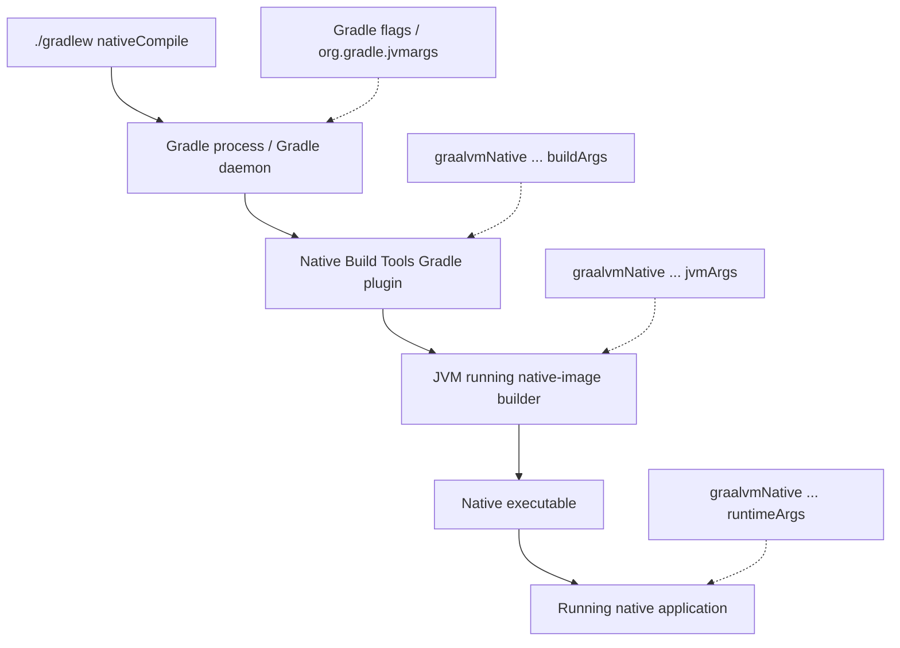

# Configuring `graalvmNative`, Binary Name, and Build Arguments

## 1. Context and Target Outcomes

When using **Spring Boot**, **Spring AOT**, and **GraalVM Native Image** with **Gradle**, the `nativeCompile` command compiles the application into a native executable. However, real-world projects often need finer control over the executable filename, optimization flags, logging modes, compile-time arguments, and separate settings for the application binary versus the test binary.

That is the role of the **GraalVM Native Build Tools Gradle plugin** and the `graalvmNative` extension.

After this lesson, you will be able to:

- Understand `graalvmNative` and its two configurations `binaries.main` and `binaries.test`.
- Set the executable name using `imageName` and locate the right artifact after `nativeCompile`.
- Pass options to the `native-image` compiler via `buildArgs` in Groovy DSL or Kotlin DSL.
- Distinguish between `buildArgs`, `jvmArgs`, `runtimeArgs`, and built-in properties like `verbose`, `fallback`, and `quickBuild`.
- Run builds, execute tests, diagnose errors, and distinguish a **native binary name** from a Cloud Native Buildpacks **container image name**.

**Running example:** a Spring Boot application whose Gradle project is named `order-service`, needing an executable named `order-service-native`, while retaining the ability to build a container image and measure startup speed/RSS for comparison with the JVM build.

> This content assumes your Spring Boot and Gradle project already works and uses **compatible** versions of Spring Boot, Gradle, JDK/GraalVM, and GraalVM Native Build Tools. Examples primarily illustrate the Native Build Tools extension. If your existing project already has a `plugins` or `graalvmNative` block, merge into that block rather than creating duplicate configuration blocks.

## 2. Where Does `graalvmNative` Sit in the Spring Boot AOT Workflow?

Gradle involves plugins with distinct responsibilities:

| Component | Primary Responsibility |
|---|---|
| `org.springframework.boot` | Builds the Spring Boot application and integrates AOT tasks when a compatible Native Build Tools plugin is present |
| `org.graalvm.buildtools.native` | Provides the `graalvmNative` extension, `nativeCompile`, `nativeRun`, `nativeTest`, and configuration for `native-image` |
| GraalVM `native-image` | Performs reachability analysis, AOT compilation, and machine-code linking for the target OS/CPU |
| Spring Boot `bootBuildImage` | Packages an OCI/container image via Cloud Native Buildpacks; uses its own builder configuration mechanism |


This diagram simplifies task dependencies. With a modern Spring Boot Gradle plugin and Native Build Tools properly applied, Gradle ensures Spring AOT runs before building the native executable. You typically run `nativeCompile`, rather than calling `processAot` and wiring the classpath manually.

### 2.1. Declaring the Plugin

In a project that already has `org.springframework.boot` and the Java plugin, GraalVM Native Build Tools must also be applied. The following snippet shows only the **addition** to an existing `plugins` block:

```groovy
// build.gradle (Groovy DSL)
plugins {
    id 'org.graalvm.buildtools.native' version '1.1.19'
}
```

```kotlin
// build.gradle.kts (Kotlin DSL)
plugins {
    id("org.graalvm.buildtools.native") version "1.1.19"
}
```

Version `1.1.19` illustrates the syntax based on a version released at the time of writing. In a real project, use the version permitted by your Spring Boot, Gradle, and GraalVM compatibility matrix; if Spring Initializr or your project already manages versions in a plugin catalog, keep your existing declaration style. **Do not replace your entire project `plugins` block with the single-plugin snippet above.**

To compile natively **on the host machine**, you generally need a GraalVM JDK with the `native-image` tool, plus an appropriate native compiler/linker and system libraries. `bootBuildImage` is the buildpacks container path, which can provide the toolchain inside the builder image and requires a Docker environment. Both paths have separate execution configurations.

### 2.2. Verifying the Plugin Exposes Tasks

```bash
./gradlew --version
./gradlew tasks --all
```

In the task list, look for `nativeCompile`, `nativeRun`, `nativeTestCompile`, and `nativeTest`. If they are missing, first verify the plugin is applied to the right module with a compatible version, rather than tweaking GraalVM options.

## 3. Structure of the `graalvmNative` Extension

This extension configures the binaries managed by Native Build Tools. The two default entries to know are:

- **`binaries.main`**: the application executable, produced by `nativeCompile` and launched by `nativeRun`.
- **`binaries.test`**: the executable containing the native test suite, tied to `nativeTestCompile` and `nativeTest`.

General configuration structure:

```groovy
// build.gradle
graalvmNative {
    binaries {
        main {
            // Applies only to the application executable.
        }
        test {
            // Applies only to the executable used for native tests.
        }
    }
}
```

With Kotlin DSL, binaries can be selected via `named("main")` and `named("test")`:

```kotlin
// build.gradle.kts
graalvmNative {
    binaries {
        named("main") {
            // Configure the main binary.
        }
        named("test") {
            // Configure the test binary.
        }
    }
}
```

Configuration can also apply to both binaries via `binaries.all { ... }`. Only place an option inside `all` if it genuinely makes sense for both application builds and native test builds.

### 3.1. Commonly Used Properties

| Option inside `binaries.main`/`test` | Meaning | Recommendation |
|---|---|---|
| `imageName` | Name of the generated native executable | Use a clear, stable name for CI/CD and launch scripts |
| `mainClass` | Main class used as entry point | Override only when automatic entry-point detection is incorrect |
| `verbose` | Enables detailed logging when running Native Image | Useful for build diagnostics |
| `fallback` | Controls Native Image fallback mode | For production native artifacts, normally keep `false` |
| `quickBuild` | Prefers faster builds under supported conditions | Useful for iteration; check performance and optimization trade-offs |
| `debug` | Generates debug info in supported versions/toolchains | Enable only when debugging; can increase build time and binary size |
| `buildArgs` | List of options passed to `native-image` | Use for extra flags not exposed as dedicated properties |
| `jvmArgs` | JVM options for running the native build tool | Not equivalent to runtime JVM options for the executable |
| `runtimeArgs` | Application arguments used when running `nativeRun` | Not compilation arguments |

These properties are processed by the **Native Build Tools plugin**; they are not arbitrary Gradle properties or Spring Boot `application.yml` keys.

## 4. Sample Configuration in Groovy DSL (`build.gradle`)

Suppose the project already applies compatible Java, Spring Boot, and GraalVM Native Build Tools plugins. Add:

```groovy
graalvmNative {
    binaries {
        main {
            // Sets the application executable name, not the Docker image name.
            imageName = 'order-service-native'

            // Prints detailed compilation information.
            verbose = true

            // Do not produce a fallback image instead of the intended native executable.
            fallback = false

            // Example Native Image optimization flag.
            buildArgs.add('-O2')
        }

        test {
            // Speeds up the feedback loop when building native tests.
            quickBuild = true
        }
    }
}
```

Specific meaning:

1. `main` configures only the application executable. When running `nativeCompile`, the file normally sits in `build/native/nativeCompile/` named `order-service-native` on Linux/macOS or `order-service-native.exe` on Windows.
2. `verbose = true` helps inspect the native compiler, yet **does not switch runtime application logs to DEBUG**.
3. `fallback = false` ensures the build does not silently fall back to an executable requiring a JVM. In recent plugin versions, fallback is typically `false` by default; stating it explicitly helps readers of the build file.
4. `buildArgs.add('-O2')` passes an optimization flag to GraalVM. Its exact effect and supported `-O` levels depend on the Native Image version; do not assume increasing optimization always improves startup, throughput, and build time simultaneously.
5. `quickBuild` on **test** does not alter the optimization level of **main**. This is useful when you want to verify test executability natively without using the heavier release build profile.

If the project already has a `graalvmNative` block, **merge properties into the existing block** instead of creating two separate blocks that complicate reading and maintenance.

## 5. Equivalent Configuration in Kotlin DSL (`build.gradle.kts`)

```kotlin
graalvmNative {
    binaries {
        named("main") {
            imageName.set("order-service-native")
            verbose.set(true)
            fallback.set(false)
            buildArgs.add("-O2")
        }

        named("test") {
            quickBuild.set(true)
        }
    }
}
```

The main difference between the two DSLs is value assignment syntax:

| Intent | Groovy DSL | Kotlin DSL |
|---|---|---|
| Select main binary | `main { ... }` | `named("main") { ... }` |
| Set name | `imageName = 'order-service-native'` | `imageName.set("order-service-native")` |
| Enable verbose | `verbose = true` | `verbose.set(true)` |
| Add build arg | `buildArgs.add('-O2')` | `buildArgs.add("-O2")` |

Native Build Tools uses Gradle `Property<T>` and `ListProperty<String>` types; in Kotlin DSL, `.set(...)`/`.add(...)` ensures type-safe usage and avoids invalid assignments. If a snippet found online is written in Groovy, do not paste it verbatim into `build.gradle.kts`.

## 6. Understanding `imageName` Properly: Binary Name, Not Container Image Name

Inside `graalvmNative.binaries.main`, **`imageName` is the native executable name**. The word "image" here refers to the GraalVM compilation product, not a Docker/OCI image.

Example:

```groovy
graalvmNative {
    binaries {
        main {
            imageName = 'billing-native'
        }
    }
}
```

When run:

```bash
./gradlew nativeCompile

# Linux/macOS: common path
./build/native/nativeCompile/billing-native
```

On Windows, you normally use `build\native\nativeCompile\billing-native.exe` and run in PowerShell:

```powershell
.\gradlew.bat nativeCompile
.\build\native\nativeCompile\billing-native.exe
```

**Paths and extensions depend on platform, plugin, and build configuration**; always inspect the actual task output. The `imageName` value must not contain Docker repository/tag syntax like `registry.example.com/team/billing:1.0`; registry/tag naming belongs to the **container image**.

### 6.1. Changing the Binary Name for a Single Run

Gradle Native Build Tools also provides a CLI option to override the binary name for a single invocation:

```bash
./gradlew nativeCompile --image-name=billing-native-debug
```

Per the plugin documentation, `--image-name` affects Native Build Tools' output filename for that run. It is not equivalent to `--imageName` on `bootBuildImage`. In CI/CD pipelines requiring reproducibility, keep the default name in the DSL and use CLI overrides only for ad-hoc experimentation.

### 6.2. When You Need to Change the Container Image Name of `bootBuildImage`

This is a **separate** configuration managed by the Spring Boot Gradle plugin:

```groovy
// build.gradle, separate example for container image
tasks.named('bootBuildImage') {
    imageName = "registry.example.com/team/order-service:${project.version}"
}
```

Kotlin DSL example, when the Spring Boot plugin is applied:

```kotlin
import org.springframework.boot.gradle.tasks.bundling.BootBuildImage

tasks.named<BootBuildImage>("bootBuildImage") {
    imageName.set("registry.example.com/team/order-service:${project.version}")
}
```

**Distinction:**

| Configuration Site | Related Command | Result |
|---|---|---|
| `graalvmNative.binaries.main.imageName` | `nativeCompile` | Filename of the native executable on disk |
| `bootBuildImage.imageName` | `bootBuildImage` | Repository and tag of the OCI/container image |

Renaming the native executable **does not automatically rename** the buildpacks image repository/tag. Conversely, changing the OCI tag **does not change** how Gradle names the executable when running `nativeCompile` directly.

## 7. `buildArgs`: Passing Arguments to the GraalVM Compiler

### 7.1. Basic Syntax

`buildArgs` is a list of option strings passed to the `native-image` tool during the **compilation phase**. Example:

```groovy
graalvmNative {
    binaries {
        main {
            buildArgs.add('-O2')
            buildArgs.add('--verbose')
        }
    }
}
```

```kotlin
graalvmNative {
    binaries {
        named("main") {
            buildArgs.addAll("-O2", "--verbose")
        }
    }
}
```

Each list entry represents **one `native-image` option**, not an entire shell command. Options that carry values must follow the exact format expected by the tool. For example:

```groovy
buildArgs.add('--initialize-at-run-time=com.example.orders.NativeState')
```

This is only an example **when the application actually has** `com.example.orders.NativeState` and a sound reason to request runtime class initialization. Do not copy an illustrative class path into another project. For multi-token options, check the format expected by the plugin/`native-image`; current Native Build Tools docs include single-string examples such as `--emit build-report`.

### 7.2. Choosing the Right Place for Options

| Goal | Appropriate Tool/Configuration | Example |
|---|---|---|
| Rename executable | `imageName` | `imageName = 'order-service-native'` |
| Enable native compiler logs | `verbose` property or matching arg | `verbose = true` |
| Disable fallback | `fallback` property | `fallback = false` |
| Tune native optimization | `buildArgs` | `buildArgs.add('-O2')` |
| Adjust class initialization policy | `buildArgs`, after root-cause analysis | `--initialize-at-run-time=...` |
| Increase memory for JVM running native-image builder | `jvmArgs`, depending on plugin/toolchain | `jvmArgs.add('-Xmx6g')` (example only) |
| Pass properties to app during `nativeRun` | `runtimeArgs` | `runtimeArgs.add('--server.port=9090')` |
| Supply Spring profile at runtime | Application arguments or runtime env vars | `--spring.profiles.active=prod` |

Avoid putting Spring Boot runtime arguments such as `--server.port=9090` into `buildArgs`. The native compiler's job is not to open a web server port; that is an argument for the application when running.

### 7.3. Distinguishing Build Time vs. Runtime in Class Initialization

GraalVM distinguishes classes that can be initialized at **build time** from classes that must wait until **runtime**. For classes whose static initializers depend on the running host, randomness, environment, or runtime state, forcing early initialization can cause errors or unexpected behavior.

Conditional example:

```java
package com.example.orders;

public final class NativeState {
    // Purely illustrative state that must be evaluated when the process runs.
    private static final long STARTED_AT = System.nanoTime();

    public static long startedAt() {
        return STARTED_AT;
    }

    private NativeState() {}
}
```

If the build reveals that a class genuinely needs runtime initialization and GraalVM/the framework has not handled it already, you can apply:

```kotlin
graalvmNative {
    binaries {
        named("main") {
            buildArgs.add("--initialize-at-run-time=com.example.orders.NativeState")
        }
    }
}
```

This is a **technical example**, not advice to add `--initialize-at-run-time` to every class with a `static` field. Always inspect `native-image` logs/errors, understand static initialization, and check impacts on related dependencies. Overly broad settings can increase startup work or conflict with classes already managed by the framework.

### 7.4. Reflection and Resource Cases

A typical error when building/running native is a library accessing types or resources by dynamic name that reachability analysis did not discover. This is **not automatically solved by a generic `buildArgs` flag**. In Spring Boot, prefer Spring AOT and `RuntimeHints` to register types needed for reflection, resources, proxies, or serialization.

Example:

```java
import org.springframework.aot.hint.RuntimeHints;
import org.springframework.aot.hint.RuntimeHintsRegistrar;

class OrderResourceHints implements RuntimeHintsRegistrar {
    @Override
    public void registerHints(RuntimeHints hints, ClassLoader classLoader) {
        hints.resources().registerPattern("templates/orders/*.html");
    }
}
```

This `RuntimeHintsRegistrar` class must be properly registered in the application, e.g., via `@ImportRuntimeHints(OrderResourceHints.class)` on a configuration class. The purpose of this snippet is to contrast Spring AOT metadata with compiler options. Avoid adding sweeping reflection/resource flags unnecessarily, as they bloat native image size and complicate diagnostics.

## 8. `buildArgs`, `jvmArgs`, `runtimeArgs`, and Gradle Options

Their names look similar, yet they target **different processes**:



Key distinctions:

- **`org.gradle.jvmargs`** in `gradle.properties` tunes the JVM running the Gradle daemon; it does not automatically raise RAM for every native compiler process or builder container.
- **`graalvmNative.binaries.main.jvmArgs`** passes JVM options to the process executing `native-image`, depending on plugin version and toolchain setup.
- **`graalvmNative.binaries.main.buildArgs`** passes native-image compilation options; used for compilation strategies and GraalVM flags.
- **`graalvmNative.binaries.main.runtimeArgs`** supplies arguments when executing via `nativeRun`; it does not modify the compiled artifact.
- **`application.yml`**, environment variables, and CLI args like `--server.port=9090` are application settings read during Spring Boot startup when applicable.

Example configuration for running the app after building:

```groovy
graalvmNative {
    binaries {
        main {
            imageName = 'order-service-native'
            runtimeArgs.add('--server.port=9090')
        }
    }
}
```

When running `./gradlew nativeRun`, the app receives `--server.port=9090`. When running the executable directly, pass arguments on the launch command:

```bash
./build/native/nativeCompile/order-service-native --server.port=9090
```

Note: if this configuration is used for benchmarking, keep the exact same port, profile, resources, and load conditions when comparing native against the JVM build.

## 9. Separate Configuration for Main and Test; Checking Output

On large projects, do not assume every `main` setting is appropriate for native tests. For instance, enabling aggressive optimizations on `main` can lengthen native test compilation without adding bug-detection value.

```groovy
graalvmNative {
    binaries {
        main {
            imageName = 'order-service-native'
            buildArgs.add('-O2')
        }
        test {
            quickBuild = true
            verbose = true
        }
    }
}
```

Related Gradle tasks:

```bash
# Compile the main native executable
./gradlew nativeCompile

# Run the main binary (building if needed)
./gradlew nativeRun

# Compile the executable for running native tests
./gradlew nativeTestCompile

# Run tests in the native environment
./gradlew nativeTest
```

`nativeTest` can consume substantial time and memory. Unit tests passing on the JVM do not substitute for running tests on a native executable, especially flows exercising reflection, serialization, resources, JNI, or runtime-only code paths.

### 9.1. Checking Output Filename and Location

On Linux/macOS:

```bash
./gradlew nativeCompile
ls -lah build/native/nativeCompile

# Run if imageName = 'order-service-native' is set
./build/native/nativeCompile/order-service-native
```

On Windows PowerShell:

```powershell
.\gradlew.bat nativeCompile
Get-ChildItem .\build\native\nativeCompile
.\build\native\nativeCompile\order-service-native.exe
```

If you do not see the configured filename, check the logs to see whether `nativeCompile` actually ran or was `UP-TO-DATE`/`SKIPPED`, whether configuration errors occurred in another module, or whether `--image-name` CLI override was passed.

## 10. Controlled Use of Build Arguments in CI/CD

When moving from experimentation to pipelines, the goal is that **the same configuration produces the same artifact**, making changes easy to review and performance differences easy to trace.

### 10.1. What Should Be Managed in Source Control

- Stable binary names per module/service.
- Tested `buildArgs` compatible with your GraalVM version and backed by clear rationale.
- Matching plugin, Gradle wrapper, JDK/GraalVM, and native toolchain versions.
- Runtime hints or metadata verified by tests.
- Procedures to measure startup, RSS, CPU, and throughput to catch impacts after every option change.

### 10.2. Testing Options on the Command Line

Native Build Tools supports several task-specific CLI options. For example:

```bash
# One-off binary name override; avoid editing build files during quick tests
./gradlew nativeCompile --image-name=order-service-candidate
```

Depending on plugin version, options like `--build-args` (to append) and `--force-build-args` (to replace the DSL build arguments list) may be available. Because their effects differ, read the task help and inspect logs before adopting them in CI:

```bash
./gradlew help --task nativeCompile
./gradlew nativeCompile --info
```

`--info` helps inspect steps executed by Gradle/plugins, though output may include local paths and environment details; exercise caution before sharing logs externally. For release builds, put required settings into the DSL rather than relying on long, hard-to-reproduce command lines.

### 10.3. Avoid Confusing `nativeCompile` with Cloud Native Buildpacks

`nativeCompile` uses **GraalVM Native Build Tools running directly**. Meanwhile, `bootBuildImage` uses **Spring Boot Cloud Native Buildpacks** to build a container image. Combined with GraalVM Native Build Tools, Spring Boot can produce an image containing a native executable, yet configuring arguments for the builder/buildpack follows a separate path.

For example, Paketo Native Image Buildpack provides `BP_NATIVE_IMAGE_BUILD_ARGUMENTS` to pass arguments to `native-image` **inside the buildpack**. If you configure `buildArgs` inside `graalvmNative.binaries.main`, **do not assume** all of those options pass through verbatim to the buildpack during `bootBuildImage`.

Separate CNB configuration example in Groovy DSL, **applicable only when the builder in use supports this environment variable**:

```groovy
tasks.named('bootBuildImage') {
    environment.put('BP_NATIVE_IMAGE_BUILD_ARGUMENTS', '-O2')
}
```

To avoid confounding benchmarks, explicitly record the build path (`nativeCompile` vs. `bootBuildImage`), builder image, GraalVM version, and exact option set used. A container image built via buildpacks has a different runtime filesystem, library linking, and toolset than an executable built directly on the host.

## 11. Common Configuration Errors and Fixes

| Symptom | Possible Cause | Inspection and Fix |
|---|---|---|
| `Could not find method graalvmNative()` | `org.graalvm.buildtools.native` not applied, wrong module configured, or plugin failure | Inspect `plugins` and module task list |
| `Task 'nativeCompile' not found` | Native plugin not applied in the right place | Run `./gradlew tasks --all` and check active build script |
| `native-image` not found | GraalVM JDK/native toolchain not properly detected | Check GraalVM, `native-image --version`, and Gradle/plugin toolchains |
| Groovy/Kotlin DSL error on `set` or `imageName` | Wrong DSL syntax, confusing `binaries` properties with another task | Cross-check `build.gradle` vs. `build.gradle.kts` and selected plugin API |
| Expected filename missing | `imageName` set on `test` instead of `main`, task skipped, or CLI override | Inspect `binaries.main`, logs, and `build/native/nativeCompile/` |
| `Unrecognized option` or parser error | Flag unsupported in your Native Image version or malformed arg | Check native compiler output and flag docs for your GraalVM version |
| `Error: Classes that should be initialized at run time got initialized during image building` | Class initialization configuration or incompatible library | Read stack trace; evaluate a narrowly scoped runtime-init flag |
| Native build succeeds, yet request fails with reflection/resource error | Metadata missing for GraalVM at runtime | Test failing branch, add Spring RuntimeHints or accurate metadata |
| Native compiler OOM | Insufficient RAM for compiler, Gradle/OS/container limits | Check logs, peak memory, compiler JVM settings, and build machine limits |
| `bootBuildImage` produces OCI image without binary name | Confusing GraalVM `imageName` with `bootBuildImage.imageName` | Configure `bootBuildImage` separately and inspect Docker image tags |
| Runs on build machine, fails in target environment | Mismatched OS/CPU or system libraries | Build for the right target, inspect executable and matching runtime image |

**Triage tip:** if the error occurs during **Gradle project configuration**, suspect DSL or plugin setup; if it occurs while **`native-image` is running**, suspect compiler/flags/resources; if it occurs when **running the executable**, check runtime config, reflection, resources, and deployment environment.

## 12. Practice: Customizing and Verifying the `order-service-native` Binary

### Requirements

A Spring Boot project with at least one HTTP endpoint, applying compatible versions of the Spring Boot and GraalVM Native Build Tools plugins. The build machine has a working GraalVM and native toolchain. Run one JVM JAR build and one native build as a baseline; do not modify source code between the two builds.

### Steps

**Step 1: set the executable name and build options.** Add the `graalvmNative` block for your DSL, set `imageName` to `order-service-native`, enable `verbose`, set `fallback = false`, and add `-O2` for the `main` binary.

**Step 2: verify configuration and build.**

```bash
./gradlew tasks --all
./gradlew bootJar
./gradlew nativeCompile
```

Observe the logs to verify Spring AOT participated, `native-image` received the expected options, and the task completed successfully.

**Step 3: run the native application.**

```bash
./build/native/nativeCompile/order-service-native
```

On Windows, run the corresponding `.exe`. Test a business endpoint and readiness endpoint if Actuator is configured. Never infer compatibility from `BUILD SUCCESS` alone.

**Step 4: run native tests if available in the project.**

```bash
./gradlew nativeTest
```

Pay close attention to business flows using serialization, reflection, resources, databases, or libraries with native/JNI bindings.

**Step 5: measure under controlled variations.** Record build time, executable size, time from process start to readiness, idle and under-load RSS, and throughput/p95 latency once steady. Repeat measurements on the same platform and workload for comparison.

### Results Sheet

| Metric | Spring Boot JVM (`bootJar`) | Native (`nativeCompile`) | Notes |
|---|---|---|---|
| Spring Boot, Java/GraalVM versions | *(record)* | *(record)* | Same source revision |
| Gradle, Native Build Tools versions | *(record)* | *(record)* | Configuration and plugins |
| Artifact | JAR | `order-service-native` | Verify actual filename |
| Build arguments | Not applicable to native-image | `-O2`, additional args | Note any CLI overrides |
| Build duration | *(measure)* | *(measure)* | Native usually requires more build resources |
| Startup to readiness (median) | *(measure)* | *(measure)* | Multiple cold starts |
| Idle / peak RSS | *(measure)* | *(measure)* | Identical resource limits |
| Throughput and p95 latency | *(measure)* | *(measure)* | Same load and appropriate warm-up |
| Smoke/native tests | *(result)* | *(result)* | Watch reflection/resources |

**Completion criteria:** you can explain why `graalvmNative`'s `imageName` does not produce a Docker tag, what `buildArgs` is for, how your chosen flags match your GraalVM version, and whether the native build behaves accurately under real workload.

## 13. Self-Check Questions

**1. Where should `imageName = 'order-service-native'` be placed to rename the executable created by `nativeCompile`?**

Inside `graalvmNative { binaries { main { ... } } }`. Changing `bootBuildImage.imageName` affects only the OCI/container image name.

**2. Why should `--server.port=9090` not be put inside `buildArgs`?**

That is a runtime Spring Boot application argument. `buildArgs` targets the `native-image` tool at compile time; use `runtimeArgs` for `nativeRun` or pass the argument directly when running the binary.

**3. What should you use to increase native build diagnostics without turning on application debug logs?**

You can set `verbose = true` inside `binaries.main` or use the corresponding Native Image option. Detailed build logging is separate from Spring Boot runtime logging configuration.

**4. Does an option configured on `binaries.main` automatically apply to `binaries.test`?**

No. Each binary has its own configuration. If you want shared settings, consider `binaries.all`, checking first that the option suits tests.

**5. Can `--initialize-at-run-time` fix every reflection error?**

No. Class initialization and reflection metadata are two distinct issues. Diagnose the specific error and prefer Spring AOT/`RuntimeHints` mechanisms for dynamic access.

## 14. Key Takeaways

`graalvmNative` is the Native Build Tools configuration entry point in Gradle. **`binaries.main.imageName`** defines the executable name; **`buildArgs`** supplies Native Image compiler flags; **`verbose`, `fallback`, `quickBuild`** directly express common build options. In Kotlin DSL, use `named("main")` and `Property.set(...)`; in Groovy DSL, use a `main { ... }` block with standard assignment.

Keep `nativeCompile` executable settings separate from `bootBuildImage` OCI image settings, test the native build after changing flags, and measure startup/memory on identical workloads. That is how you evaluate GraalVM Native Image's benefits and costs rather than relying on a single passing build.

### Official References

- [GraalVM Native Build Tools — Gradle Plugin](https://graalvm.github.io/native-build-tools/latest/gradle-plugin.html)
- [GraalVM Native Build Tools — End-to-End Gradle Guide](https://graalvm.github.io/native-build-tools/latest/end-to-end-gradle-guide.html)
- [Spring Boot — Developing Your First GraalVM Native Application](https://docs.spring.io/spring-boot/how-to/native-image/developing-your-first-application.html)
- [Spring Boot — Gradle Plugin, OCI Image Packaging](https://docs.spring.io/spring-boot/gradle-plugin/packaging-oci-image.html)
- [GraalVM — Native Image Options](https://www.graalvm.org/latest/reference-manual/native-image/overview/Options/)
- [Paketo Native Image Buildpack — Configuration](https://github.com/paketo-buildpacks/native-image)
