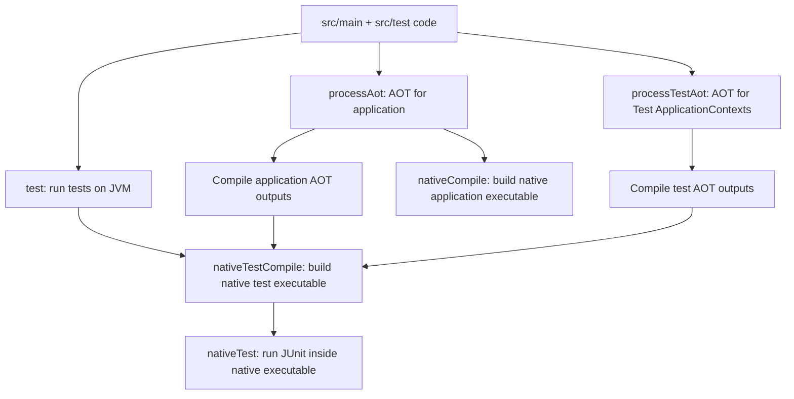
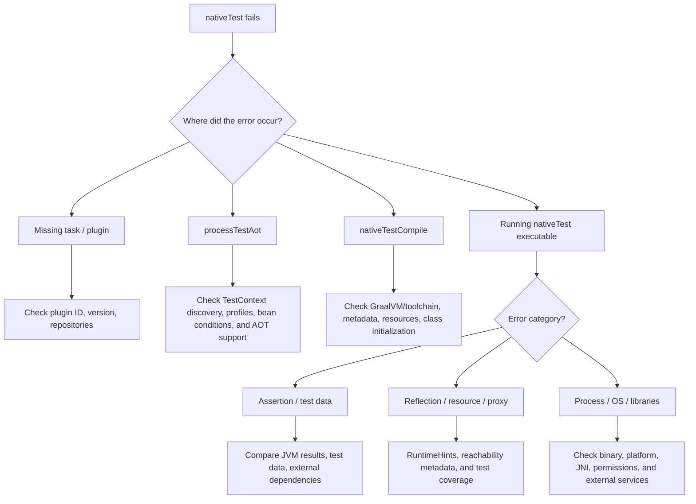

# `processTestAot` and `nativeTest` for Test Code in Gradle

> **Chapter: Gradle** — In the **SPRING_BOOT_NATIVE_IMAGE** module, Spring Boot applications are processed by **Spring AOT** and compiled using **GraalVM Native Image**. Beyond building the application, we must confirm that Spring tests also work under the AOT model and native environment. Two key tasks are `processTestAot` and `nativeTest`.

## 1. Learning Objectives

After this lesson, you will be able to:

1. Distinguish between `test`, `processAot`, `processTestAot`, `nativeTestCompile`, `nativeTest`, and `nativeCompile`.
2. Explain why Spring needs to generate dedicated `ApplicationContextInitializer` code for contexts used in tests.
3. Configure Gradle to run JUnit on the JVM, generate test AOT outputs, and execute tests with GraalVM Native Image.
4. Read outputs and determine whether a failure belongs to test discovery, AOT processing, native compilation, or test execution.
5. Design a sound testing strategy that combines JVM speed with verification of reflection, resources, and compatibility in the native build.

## 2. Distinguishing Application Tasks from Test Tasks

On the JVM, a `@SpringBootTest` typically asks the Spring TestContext Framework to build an `ApplicationContext` when the test runs. When running via Native Image, beans, configuration conditions, and metadata must be analyzed **before runtime**. Therefore, Spring AOT has one branch for the main application and one branch for **the `ApplicationContext` instances used in the test suite**.

| Gradle Task | Inputs and Work Performed | Output | Runs Native Tests? |
|---|---|---|---|
| `test` | Runs tests in the `test` source set on the JVM (typically using JUnit Platform) | JVM unit/integration test results | No |
| `processAot` | Analyzes Spring configuration of the **main application** | Generated sources, resources, and hints for the application | No |
| `processTestAot` | Analyzes tests backed by Spring TestContext and the contexts used in tests | AOT context initialization code, metadata/hints for **tests** | No |
| `nativeCompile` | Compiles the **main application** together with AOT outputs | Native executable to run the application | No |
| `nativeTestCompile` | Compiles test code, the JUnit test engine, and AOT outputs of both application and tests | **Native executable for tests** | Compiles only |
| `nativeTest` | Ensures the test binary is built and runs tests inside the native executable | Native test execution results | **Yes** |

Two tasks are frequently confused:

- **`processTestAot` does not compile a Native Image and does not verify assertions pass.** It executes only the Spring AOT phase for tests.
- **`nativeTest` is not `nativeCompile`.** The former builds and runs the native test runner; the latter builds the application binary. A passing test suite does not automatically prove a production container image runs every real-world endpoint properly.

Starting with Spring Boot 3.x/4.x, when a project applies both the Spring Boot Gradle plugin and a compatible GraalVM Native Build Tools plugin, Spring Boot automatically configures the AOT tasks and feeds the outputs of **both `processAot` and `processTestAot`** into the native test build. You do not need to write a manual class-copying pipeline when using the supported integration.

### Conceptual Processing Flow



The diagram shows **data relationships and typical steps**, not the exact ordering of every task across all Gradle versions. Current Native Build Tools versions require running JVM tests before executing native tests; inspect the actual task graph with `./gradlew nativeTest --dry-run`.

## 3. Prerequisites for the Example

You need:

- A Spring Boot project with application code in `src/main/java` and tests in `src/test/java`.
- Compatible versions of the Spring Boot Gradle plugin, Gradle Java plugin, and GraalVM Native Build Tools plugin.
- A JDK/GraalVM supported by the Spring Boot version, the `native-image` executable, a C compiler/linker, and required development libraries on the build OS.
- An appropriate JUnit Platform test engine, typically JUnit Jupiter, with tests that already pass on the JVM.

The following **Groovy DSL** example uses the version pair illustrated in Spring Boot **4.2.0** documentation: `org.springframework.boot` version `4.2.0` and `org.graalvm.buildtools.native` version `1.1.18`. If your project uses Spring Boot 3.x or another version, consult [AOT Processing for that exact branch](https://docs.spring.io/spring-boot/4.2/gradle-plugin/aot.html) and adjust according to its support matrix; do not blindly copy sample versions to replace existing dependencies.

```groovy
// build.gradle (Groovy DSL) - minimal configuration for the sample app
plugins {
    id 'java'
    id 'org.springframework.boot' version '4.2.0'
    id 'org.graalvm.buildtools.native' version '1.1.18'
}

group = 'com.example'
version = '0.0.1-SNAPSHOT'

repositories {
    mavenCentral()
}

dependencies {
    implementation 'org.springframework.boot:spring-boot-starter'
    testImplementation 'org.springframework.boot:spring-boot-starter-test'
    testRuntimeOnly 'org.junit.platform:junit-platform-launcher'
}

tasks.named('test') {
    useJUnitPlatform()
}
```

This snippet illustrates a project with a **Spring Boot application**. Plugins may require dedicated repository/`pluginManagement` configuration inside corporate networks. You also need a compatible Gradle Wrapper version and a GraalVM installation with `native-image`; the plugin does not replace preparing the OS compiler/toolchain.

To confirm the plugins register tasks, run:

```bash
./gradlew tasks --all
./gradlew nativeTest --dry-run
java -version
native-image --version
```

On Windows PowerShell or Command Prompt, use `gradlew.bat` instead of `./gradlew`. If `nativeTest` or `processTestAot` does not exist, check plugin IDs, plugin resolution, and versions before editing test code.

## 4. Spring Boot Example and `@SpringBootTest`

Create the sample application:

```java
// src/main/java/com/example/demo/DemoApplication.java
package com.example.demo;

import org.springframework.boot.SpringApplication;
import org.springframework.boot.autoconfigure.SpringBootApplication;
import org.springframework.context.annotation.Bean;

@SpringBootApplication
public class DemoApplication {

    @Bean
    GreetingService greetingService() {
        return new GreetingService();
    }

    public static void main(String[] args) {
        SpringApplication.run(DemoApplication.class, args);
    }
}

class GreetingService {
    String greet(String name) {
        return "Hello, " + name;
    }
}
```

Create an integration test using Spring TestContext:

```java
// src/test/java/com/example/demo/GreetingServiceTest.java
package com.example.demo;

import org.junit.jupiter.api.Test;
import org.springframework.beans.factory.annotation.Autowired;
import org.springframework.boot.test.context.SpringBootTest;

import static org.junit.jupiter.api.Assertions.assertEquals;

@SpringBootTest
class GreetingServiceTest {

    @Autowired
    GreetingService greetingService;

    @Test
    void greetsCustomer() {
        assertEquals("Hello, Linh", greetingService.greet("Linh"));
    }
}
```

On the JVM, `test` uses JUnit to instantiate the test, Spring TestContext constructs the context, injects `GreetingService`, and runs the assertion. In native mode, Spring AOT analyzes the context configuration of `GreetingServiceTest` and generates appropriate initialization code; Native Build Tools embeds the test code and JUnit engine into the native executable to run that same assertion.

A pure Java test that does not use Spring TestContext can still be part of the native test suite thanks to Native Build Tools' JUnit support; however, it **does not create a dedicated `ApplicationContext` for `processTestAot` to analyze**. Keep this distinction in mind if `processTestAot` produces little output despite the project having many unit tests.

## 5. Running Each Stage Properly

### 5.1. Step 1: Run Tests on the JVM

```bash
./gradlew test
```

This is the fastest feedback loop for application logic. If tests already fail on the JVM, fix the test or application bug first; native execution will not cure failing assertions.

### 5.2. Step 2: Run `processTestAot`

```bash
./gradlew processTestAot --info
```

Spring AOT scans TestContext-based tests, identifies the unique `ApplicationContext` instances to build, and generates **context initialization sources**, resources, and hints to prepare for native compilation. In large systems, multiple tests sharing the same configuration share a single context; thus, the number of AOT contexts **does not necessarily equal the number of test classes**.

This task normally depends on source/test compilation steps; outputs reside in generated directories under `build/`, depending on configuration and Spring Boot Gradle plugin version. Inspect `--info` and `aot`/`aotTest` tasks when verifying outputs; do not rely on one fixed output path across all releases.

**Limitation of this step:** a completed `processTestAot` run proves only that Spring could analyze/generate code for the discovered test contexts. It does not prove Native Image has sufficient reflection metadata, that the executable can link, or that all tests actually pass at runtime.

### 5.3. Step 3: Compile the Native Test Executable

```bash
./gradlew nativeTestCompile --info
```

Native Build Tools invokes GraalVM Native Image to build an executable containing the test suite and required JUnit Platform components. When integrated with Spring Boot, the test binary uses both application and test AOT outputs. Reachability analysis, class initialization, and native linking happen here, consuming significantly more CPU/RAM than `processTestAot`.

Running `nativeTestCompile` separately is useful when separating **native compilation errors** from **runtime test assertion failures**. Even if this task succeeds, it does not guarantee all tests pass.

### 5.4. Step 4: Run Tests Inside Native Image

```bash
./gradlew nativeTest --info
```

This is the primary command to run native tests end-to-end. In a properly configured project, Gradle triggers all required dependencies/tasks before running the test binary. **You do not need to invoke commands 5.2, 5.3, and 5.4 separately on every CI run**; they are separated here for learning and diagnostics.

In the Native Build Tools version described in current documentation, JVM tests execute before native tests run. When reading logs, distinguish between the `test` report and native test results, rather than mistaking two test passes for an accidental duplicate run.

If you only want to compile the **application** for deployment, run `./gradlew nativeCompile`. That command does not mean `nativeTest` was run. Conversely, a passing `nativeTest` run should still be complemented by smoke tests on the **production application binary** or real container image.

### Command and Verification Coverage Table

| Command | What Is Verified | What Is **Not** Yet Verified |
|---|---|---|
| `./gradlew test` | Tests pass on the JVM | AOT/native compatibility |
| `./gradlew processTestAot` | Spring can generate AOT outputs for test contexts | Native compilation, test execution |
| `./gradlew nativeTestCompile` | Native image containing tests compiles | Assertions pass |
| `./gradlew nativeTest` | Selected tests pass inside the native executable | Production binary/container, performance under real load |
| `./gradlew nativeCompile` | Native application executable builds | Native tests or real-world runtime behavior |

## 6. Why Can AOT Tests Differ from JVM Tests?

### 6.1. `ApplicationContext` Is Prepared at Build Time

Spring AOT locks in many context configuration decisions during the build. Annotations such as `@Profile`, `@ConditionalOnProperty`, `@ConditionalOnClass`, and conditional test configurations can diverge if the AOT build environment does not match the native test environment.

Example:

```java
@Configuration
class FeatureConfiguration {

    @Bean
    @ConditionalOnProperty(name = "feature.report.enabled", havingValue = "true")
    ReportService reportService() {
        return new ReportService();
    }
}
```

If at the time `processTestAot` analyzes the context `feature.report.enabled` evaluates to false, you cannot assume flipping an environment variable when running native tests will make that bean appear. Put required profiles/properties consistently into **test configuration and AOT time**, and rebuild whenever conditions governing the bean set change.

Specifically, `processTestAot` is a `JavaExec` task. You can configure system properties or environment variables for the **AOT processing stage**:

```groovy
// build.gradle — add only when tests require specific AOT-time conditions
tasks.named('processTestAot') {
    systemProperty 'feature.report.enabled', 'true'
}
```

This property applies to **AOT processing**; it does not automatically ensure the same value is passed to the test executable when it runs. For most Spring tests, a cleaner approach is declaring profiles/properties directly on tests (`@ActiveProfiles`, `@TestPropertySource`), keeping stages consistent and documenting build profiles/env vars. If you need runtime variables for `nativeTest`, check the `graalvmNative.binaries.test`/test executable configuration API of the plugin version in use.

### 6.2. Reflection, Dynamic Proxies, Serialization, and Resources

The JVM can look up classes/methods by string, read resources at runtime, and create dynamic proxies. Native Image relies on static analysis and reachability metadata. Operations recognized by Spring through standard annotations/configuration usually already have hints; custom code or third-party libraries may require extra hints.

For example, suppose a test loads `src/test/resources/fixtures/order.json` using a dynamic string. If the native image omits the resource, the test passes on the JVM yet fails at native runtime. You can register it with `@ImportRuntimeHints`:

```java
package com.example.demo;

import org.springframework.aot.hint.RuntimeHints;
import org.springframework.aot.hint.RuntimeHintsRegistrar;
import org.springframework.context.annotation.ImportRuntimeHints;

@ImportRuntimeHints(TestResourceHints.class)
class OrderResourceTest {
    // Actual @Test methods go here.
}

class TestResourceHints implements RuntimeHintsRegistrar {
    @Override
    public void registerHints(RuntimeHints hints, ClassLoader classLoader) {
        hints.resources().registerPattern("fixtures/*.json");
    }
}
```

This snippet focuses on metadata and is **not yet a complete test**. For files needed inside the native executable, load via `getResourceAsStream()` from the classpath; do not assume resources still live at OS filesystem paths like `src/test/resources/...` once packaged.

For reflection or serialization errors, use the appropriate `RuntimeHints` API, such as `@RegisterReflectionForBinding` for DTOs or `RuntimeHintsRegistrar` for dynamically accessed types. Do not add "open all reflection" across entire packages when only a single constructor or resource is missing.

### 6.3. Test Frameworks, Extensions, and TestContext Can Have Limitations

Native Build Tools runs tests on the **JUnit Platform**; the plugin supports JUnit Jupiter and Vintage, while other `TestEngine` implementations require compatible configuration. Spring TestContext Framework supports AOT tests, yet certain test features relying on runtime dynamism cannot behave identically to the JVM.

Areas to review specifically:

- Extensions/libraries generating bytecode or using agents, instrumentation, and certain runtime class-mocking techniques.
- `@ContextHierarchy` and custom `ContextLoader` or `TestExecutionListener` implementations lacking AOT support.
- Tests expecting dynamic bean/profile selection after AOT processing.
- Tests reading files from local paths, loading resources based on input, or performing reflection outside Spring AOT's visibility.
- Testcontainers, databases, and external services: verify Docker/ports/hostnames, resource startup timing, and availability both **during AOT processing** and **when native tests run**.

**Limitations vary by Spring Framework version.** For instance, Spring Framework 7.0 docs note `@ContextHierarchy` is not yet supported in AOT test mode; `@PersistenceContext` and `@PersistenceUnit` cannot inject directly into the test class itself in AOT mode, whereas `@Autowired` with `EntityManager`/`EntityManagerFactory` is a viable option starting in Framework 7.0. Before changing code, read [AOT Support for Tests](https://docs.spring.io/spring-framework/reference/7.0/testing/testcontext-framework/aot.html) for your project's framework version.

### 6.4. Temporarily Excluding Tests Unsuited for AOT

Spring Framework provides `@DisabledInAotMode` to skip a class/method in AOT/native mode. Example:

```java
import org.springframework.test.context.aot.DisabledInAotMode;

@DisabledInAotMode
@SpringBootTest
class UsesRuntimeBytecodeInstrumentationTest {
    // This test continues running on the JVM, but is skipped in AOT/native mode.
}
```

This is a technique to **isolate incompatible tests**, not a way to certify that the feature is native-compatible. If multiple test classes share **the same `ApplicationContext` configuration**, Spring may require all classes sharing that context to be annotated consistently to avoid conflicts; see [`@DisabledInAotMode`](https://docs.spring.io/spring-framework/reference/testing/annotations/integration-spring/annotation-disabledinaotmode.html).

For JUnit Jupiter, `@DisabledInNativeImage` controls execution only inside Native Image; unlike `@DisabledInAotMode`, it does not convey skipping AOT test context processing. Use the annotation with the right scope, and explicitly list excluded tests in coverage reports.

## 7. Stage-by-Stage Error Diagnosis



| Log Symptom | Likelihood | Helpful Action |
|---|---|---|
| `Task 'processTestAot' not found` or `Task 'nativeTest' not found` | Missing Spring Boot/AOT or Native Build Tools plugin, or version mismatch | `./gradlew tasks --all`; inspect `plugins` and Gradle compatibility |
| AOT finds no test contexts, or fewer outputs than expected | Tests do not use Spring TestContext, were excluded, wrong source set, or shared contexts | Check `test` source set, `@SpringBootTest`/`@ContextConfiguration`, and `--info` |
| `BeanCreationException` or missing bean during `processTestAot` | Build-time profiles/properties/conditions differ from expected test environment | Record `processTestAot` environment and test annotations |
| `UnsupportedFeatureError` or class initialization error in `nativeTestCompile` | Feature unsupported by Native Image or wrong-phase class initialization | Confirm GraalVM release, stack trace, and minimal reproducer |
| `MissingReflectionRegistrationError`, missing resource | Missing hint/metadata | Add `RuntimeHints` or test resources and recompile |
| Native test runs, yet assertions fail | Environment difference, data/locale/timezone mismatch, or app bug | Re-run with identical data on JVM; do not assume a GraalVM bug immediately |
| Native executable passes locally, fails in CI | Different OS/CPU/toolchain, file permissions, or external services | Compare versions, runner architecture, process environment, and Docker |

When investigating, record Java/GraalVM, Spring Boot, Spring Framework, Gradle Wrapper, and GraalVM Native Build Tools versions, the first failing task, and profile/property arguments. If native builds take long, **reproduce first with `./gradlew processTestAot --info`** when the failure is in Spring AOT; proceed to full native compilation only when verifying Native Image behavior.

### Note on `spring.test.aot.processing.failOnError`

Spring Framework defaults to **failing immediately** during test AOT processing if an error occurs. You can set the Java system property `spring.test.aot.processing.failOnError=false` to continue analysis and log warnings while investigating multiple broken tests, but **never use it to mask errors in a pipeline certifying native compatibility**. Once fixed, re-enable fail-fast behavior so CI catches incompatible test contexts.

## 8. Organizing Tests so CI Stays Fast and Reliable

Compiling Native Image can take several minutes and significant RAM, so running the entire native test suite on every minor edit is rarely efficient. Spring Boot recommends **running the majority of unit/integration tests on the JVM**, then using targeted native tests to catch AOT, reflection, and resource discrepancies.

A useful strategy:

| Test Tier | Command / Execution | When | Goal |
|---|---|---|---|
| Unit/integration on JVM | `./gradlew test` | Every commit / pull request | Business logic and standard Spring behavior |
| Test AOT analysis | `./gradlew processTestAot` | PRs changing beans, test contexts, profiles, or hints | Catch build-time configuration errors |
| Compile/run native tests | `./gradlew nativeTest` | Nightly, pre-release, or on critical changes | Verify compatibility in the test executable |
| Smoke/integration on real binary | `./gradlew nativeCompile`, run binary/container and send real requests | Before deployment | Application scenarios and production config |
| Benchmarks | Compare start-to-readiness, RSS, and throughput between JVM/native | After functional tests pass | Measure operational gains of Native Image |

Do not compare **`nativeTest` runtime** against **production application startup time**; the native test executable also bundles the JUnit engine, fixtures, and test logic. To evaluate startup and memory per module goals, measure the application binary built by `nativeCompile` or its container image directly.

If integration tests live in a separate source set, Native Build Tools supports registering an **additional test binary** via the `registerTestBinary` API; the default `nativeTest` task focuses on the `test` source set. Verify AOT tasks/conditions for each extra test suite and the generated task names; do not assume adding a Gradle `integrationTest` task automatically runs under `nativeTest`.

### Suggested Results Record

| Stage | PASS/FAIL | Duration | Evidence/Notes |
|---|---|---|---|
| `test` (JVM) | … | … | Test count, assertion failures |
| `processTestAot` | … | … | AOT contexts and warnings |
| `nativeTestCompile` | … | … | Native Image log, metadata errors if any |
| `nativeTest` | … | … | Actual tests run/passed/skipped in native |
| Production native smoke test | … | … | Endpoints, JSON, DB, resources |
| JVM/native readiness + RSS | … | … | Same machine, resource limits, run count |

In your report, explicitly list tests skipped via `@DisabledInAotMode` or `@DisabledInNativeImage` so conclusions do not overclaim coverage beyond what actually executed.

## 9. Practice Exercises

**Scenario A — JVM passes, yet `processTestAot` fails with a missing bean.** A test uses `@ConditionalOnProperty("payment.mock")` to create a mock bean. Check which properties exist during **AOT processing**, compare with the JVM test, and adjust configuration so bean creation is determined consistently.

**Scenario B — `processTestAot` passes, yet `nativeTestCompile` fails on reflection.** A JSON test fixture contains a class name loaded via `Class.forName`. Locate where the class name is resolved, identify the required constructor/method, add scoped metadata, and rebuild. Why was a passing `processTestAot` insufficient?

**Scenario C — `nativeTest` runs, yet only part of the suite executes.** Some tests use `@DisabledInAotMode`, and a separate suite is named `integrationTest`. Inspect test engines, annotations, source sets, and additional test binary registration; record the actual number of executed tests.

**Scenario D — Native tests pass, yet a REST API in the container fails.** The real app needs a resource accessed only on a rare request. Run smoke/integration tests directly against the **application binary/image**, add resource hints, and explain why passing in the test executable did not guarantee every production resource was present.

## 10. Self-Check Questions

1. How do `processAot` and `processTestAot` differ in terms of which `ApplicationContext` instances they analyze?
2. Which task **actually executes assertions inside Native Image**: `processTestAot`, `nativeTestCompile`, or `nativeTest`?
3. Why does a successful `./gradlew nativeCompile` not prove `@SpringBootTest` runs in native mode?
4. If a pure JUnit test does not use Spring TestContext, does `processTestAot` need to create a context for it?
5. If you change a profile/runtime property after `processTestAot` has run, will Spring arbitrarily re-evaluate bean creation conditions at native runtime?
6. When should you use `@DisabledInAotMode`, and what must you watch out for when multiple tests share a context configuration?
7. Why should you record passed/skipped test counts instead of merely reporting `nativeTest BUILD SUCCESSFUL`?
8. Why should you not use `nativeTest` execution time to draw conclusions about production native app startup performance?

## Key Takeaways

**`processTestAot` prepares Spring TestContext for AOT; `nativeTestCompile` builds the test executable; `nativeTest` runs JUnit inside Native Image.** Spring Boot and GraalVM Native Build Tools integrate these stages when plugins are configured properly. An effective loop runs most functional tests on the JVM, executes test AOT when needed, runs native tests at key CI checkpoints, and separately validates the production application binary. Declare Native Image compatibility only after verifying metadata, bean conditions, and real operational behaviors.

## Official References

- [Spring Boot 4.2 — Gradle Plugin: Ahead-of-Time Processing](https://docs.spring.io/spring-boot/4.2/gradle-plugin/aot.html): `processAot`, `processTestAot`, `nativeTest` integration, and `JavaExec` configuration.
- [Spring Boot 4.2 — Testing GraalVM Native Images](https://docs.spring.io/spring-boot/4.2/how-to/native-image/testing-native-applications.html): AOT/native test workflow, JVM test selection, Gradle commands.
- [GraalVM Native Build Tools — Gradle Plugin](https://graalvm.github.io/native-build-tools/latest/gradle-plugin): `nativeTestCompile`, `nativeTest`, JUnit Platform, and the `test` binary.
- [Spring Framework 7.0 — Ahead of Time Support for Tests](https://docs.spring.io/spring-framework/reference/7.0/testing/testcontext-framework/aot.html): TestContext AOT, hints, limitations, and error handling.
- [Spring Framework — `@DisabledInAotMode`](https://docs.spring.io/spring-framework/reference/testing/annotations/integration-spring/annotation-disabledinaotmode.html): when tests are excluded from AOT/native.
- [Spring Framework — AOT Optimizations](https://docs.spring.io/spring-framework/reference/core/aot.html): classpath constraints, `@Profile`, and `@Conditional` during bean creation.
