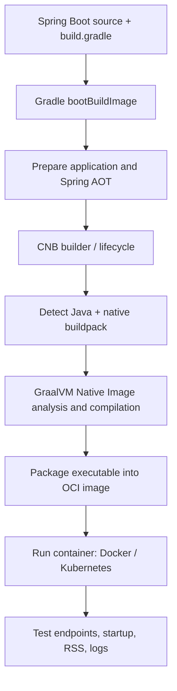

# bootBuildImage to Create a Native Container Image with Buildpacks

## Lesson Objectives

In the **Spring Boot Native Image** module, we use **Spring AOT** to prepare application initialization and **GraalVM Native Image** to compile Java to machine code. For **Gradle** projects, Spring Boot's `bootBuildImage` task can integrate with **Cloud Native Buildpacks** to build an **OCI container image** containing the native application, ready to run via Docker or a compatible container platform.

This lesson guides you through a specific build pipeline: **Spring Boot source → Gradle → buildpacks → native executable → container image**. You will learn how to configure it, read build logs, run the container, verify that it is a native build, and troubleshoot common failures.

After this lesson, you will be able to:

- Distinguish between `bootBuildImage`, `bootJar`, and `nativeCompile`.
- Prepare Gradle, a Docker/container daemon, and a builder that supports Native Image.
- Configure `BP_NATIVE_IMAGE=true` for a compatible builder, build the image, and set the image name.
- Read Cloud Native Buildpacks and GraalVM Native Image stages in build logs.
- Run, test, and measure startup time and memory footprint of a native container.
- Distinguish between AOT, reflection/resource, native compiler, buildpack, and runtime errors.

> **Version note:** Spring Boot, GraalVM Native Build Tools, Paketo buildpacks, and builder images may change integration mechanics, defaults, and log formats across versions. Commands and configurations below assume a Spring Boot project with compatible plugins; in practice, verify against your exact plugin/builder versions. Illustrative logs and figures are not benchmark results.

## 1. What Problem Does `bootBuildImage` Solve?

The **`bootBuildImage`** task is provided by the **Spring Boot Gradle plugin**. Rather than requiring developers to write a Dockerfile manually, the task sends application content to **Cloud Native Buildpacks (CNB)** so the builder detects the application, selects appropriate buildpacks, installs build-time components, and produces an OCI-compliant container image.

High-level path:



**Role of each component:**

| Component | Responsibility |
|---|---|
| Spring Boot Gradle plugin | Provides the `bootBuildImage` task and application build integration |
| Spring AOT | Generates context initialization / bean registration code and required runtime hints |
| GraalVM Native Build Tools | Integrates native tasks/options and Spring AOT into Gradle per configuration/version |
| Cloud Native Buildpacks lifecycle | Orchestrates detection, building, and exporting the container image |
| Compatible Java/Native Image buildpack | Provisions the JDK/native compiler inside the builder environment and compiles the application |
| Builder image | Contains the lifecycle, buildpack set, and build environment |
| Run image | Supplies the OS components required to run the application inside a container |
| Generated image | Final deployable artifact: an OCI image with the native executable and matching metadata/layers |

**Key distinction:** `bootBuildImage` is not just another alias for `nativeCompile`. Native compilation is executed by the buildpack during container image creation; you do not need to run `nativeCompile` locally before running `bootBuildImage`.

### 1.1. Comparing Three Gradle Tasks

| Task | Primary Output | When to Use? |
|---|---|---|
| `bootJar` | JVM-runnable JAR (under default configuration) | Delivering/running JVM apps, functional testing |
| `nativeCompile` | Native executable in the build directory | Running directly on matching OS/CPU, local native debugging |
| `bootBuildImage` | OCI container image, either **JVM or native** | Packaging and running in a container environment |

Simply running `./gradlew bootBuildImage` is **not sufficient proof** that the resulting image is native. You must have compatible native configuration and evidence in the buildpack log that Native Image actually compiled the binary.

## 2. Pre-Build Prerequisites

### 2.1. Required Components

1. **A Spring Boot project** on a version supporting Spring AOT/Native Image and compatible Java; for example, many Spring Boot 3.x projects use Java 17 or newer.
2. **A working Gradle Wrapper** for the project, with the Spring Boot Gradle plugin applied.
3. **AOT/native integration** suited to the project version; many Spring Boot projects apply `org.graalvm.buildtools.native` so Spring Boot auto-configures the related tasks.
4. **A running Docker daemon or compatible container runtime** reachable by Gradle.
5. **A native-image-capable builder**, typically a Paketo builder matching Java and the target CPU architecture.
6. **Sufficient CPU, RAM, and disk space** for native compilation inside the container; build requirements are typically much higher than runtime requirements.

Quick check:

```bash
./gradlew --version
docker version
docker info
./gradlew tasks --all
```

On Windows, use `.\gradlew.bat` in PowerShell. If `docker version` shows only client details and reports it cannot connect to the server, Gradle will not be able to reach the Docker daemon either.

**Advantage of buildpacks:** the developer workstation **does not necessarily** need `native-image` or a local C compiler installed; the buildpack can install the needed tools **inside the builder container environment**. Your machine still needs Java/Gradle to run the build and a Docker/container daemon to create the image.

### 2.2. Operating System and Architecture

An image built with a Linux builder normally contains a **Linux** executable, not a Windows `.exe`. Therefore, learners on Windows can still build Linux images when Docker Desktop is running **Linux containers**. The `amd64`/`arm64` architecture must be supported by the builder, buildpacks, runtime image, and target deployment platform.

Native compilation is tied to the target OS/CPU. Do not assume a builder running on one architecture automatically cross-compiles executables for any other architecture. If production differs from the build machine's architecture, verify support and the corresponding image build workflow.

## 3. Sample Application to Test the Native Container

Suppose your Gradle project already includes the `spring-boot-starter-web` dependency. Create a simple application:

```java
package com.example.nativecontainer;

import org.springframework.boot.SpringApplication;
import org.springframework.boot.autoconfigure.SpringBootApplication;
import org.springframework.web.bind.annotation.GetMapping;
import org.springframework.web.bind.annotation.RestController;

@SpringBootApplication
public class NativeContainerApplication {
    public static void main(String[] args) {
        SpringApplication.run(NativeContainerApplication.class, args);
    }
}

@RestController
class HelloController {
    @GetMapping("/hello")
    String hello() {
        return "Hello from native container";
    }
}
```

You can place `HelloController` in the same `NativeContainerApplication.java` file since it is not declared `public`, or put it in a separate file inside a component-scanned package. With Spring Boot 3.x, ensure Java and dependency configurations are compatible.

Run on the JVM for a functional baseline:

```bash
./gradlew bootRun
```

In another terminal:

```bash
curl -i http://localhost:8080/hello
```

Expected output is **HTTP 200** with body `Hello from native container`. Stop `bootRun` before starting the container on the same port 8080.

## 4. Configuring `bootBuildImage` to Enable Native Mode

### 4.1. Gradle and Spring AOT Integration

In `build.gradle` using **Groovy DSL**, projects usually already have the Spring Boot plugin, Java plugin, and dependency management. To work with Native Image, many setups also apply GraalVM Native Build Tools:

```groovy
plugins {
    id 'java'
    id 'org.springframework.boot' version '<SPRING_BOOT_VERSION>'
    id 'io.spring.dependency-management' version '<DEPENDENCY_MANAGEMENT_VERSION>'
    id 'org.graalvm.buildtools.native' version '<NATIVE_BUILD_TOOLS_VERSION>'
}

repositories {
    mavenCentral()
}

dependencies {
    implementation 'org.springframework.boot:spring-boot-starter-web'
}

java {
    toolchain {
        languageVersion = JavaLanguageVersion.of(21)
    }
}
```

The `<...VERSION>` strings are **illustrative placeholders**, not literal plugin versions to run directly. Replace them with versions compatible with your project (or keep plugin versions generated by Spring Initializr/your template). If your project already has `plugins`, `repositories`, or `dependencies` blocks, **add to the existing blocks** rather than creating duplicates. The example uses Java 21; you may choose another version supported by Spring Boot and the builder.

In some Spring Boot versions, applying the GraalVM Native Build Tools plugin automatically configures `bootBuildImage` for native builds. Still inspect the logs rather than inferring behavior solely from the plugin's presence.

### 4.2. Specifying the Native Buildpack

With a **Paketo builder that supports** the `BP_NATIVE_IMAGE` environment variable, configure `build.gradle`:

```groovy
tasks.named('bootBuildImage') {
    imageName = "native-container-demo:0.1.0"
    environment = ['BP_NATIVE_IMAGE': 'true']
}
```

Here:

- `imageName` sets the image name/tag stored in the local Docker image store upon a successful build.
- `environment` is the **build environment passed to the buildpacks**; `BP_NATIVE_IMAGE=true` instructs supporting buildpacks to select the native path.
- The `BP_NATIVE_IMAGE` variable name is **not** a universal mandatory flag across every CNB builder. Non-Paketo builders may enable native differently or not support it at all.

If you are using `build.gradle.kts`, translate this to Kotlin DSL rather than copying the Groovy syntax directly. Exact task APIs may differ across plugin versions.

> **Practical warning:** setting `BP_NATIVE_IMAGE=true` in your shell environment, e.g., `BP_NATIVE_IMAGE=true ./gradlew bootBuildImage`, **does not guarantee** the variable is forwarded into the builder's build environment. The explicit approach is setting it in `bootBuildImage.environment` (or the task's environment mechanism), then confirming in the build log.

### 4.3. Builder and Run Image

By default, the Spring Boot plugin chooses a builder suited to the version in use. When customization is needed, the task can specify **`builder`** and **`runImage`** to select the buildpack/runtime ecosystem. Do not pick arbitrary values: the run image must be compatible with the builder and its stack/lifecycle.

Responsibility diagram:

```text
Builder image (build time)
    |
    +-- CNB lifecycle
    +-- Java / Spring / native buildpacks
    +-- Compiler, JDK, and build tools
    |
    v
Generated OCI image
    |
    +-- Required runtime OS libraries / launcher
    +-- Application native executable
    +-- Metadata and layers
```

A container running a native application **does not need a JVM to execute Java bytecode**. However, the image still includes the base runtime and required OS libraries, so you cannot assume the image is `scratch` or contains nothing beyond a single executable file.

## 5. Running `bootBuildImage` and Reading Logs

### 5.1. Build Command

In the project root directory:

```bash
./gradlew bootBuildImage
```

When extra diagnostics are needed:

```bash
./gradlew bootBuildImage --info --stacktrace
```

On Windows PowerShell:

```powershell
.\gradlew.bat bootBuildImage
```

You do not need to run `nativeCompile` beforehand. When `bootBuildImage` runs with native configuration, native compilation happens inside the Cloud Native Buildpacks builder.

### 5.2. Ordering of Log Layers

Actual logs interleave multiple layers:

```text
Gradle
  |
  +-- compileJava / processAot / compileAotJava / bootJar...
  |       (tasks vary by version and configuration)
  |
  +-- bootBuildImage
          |
          +-- CNB lifecycle: DETECTING
          +-- CNB lifecycle: ANALYZING / RESTORING
          +-- CNB lifecycle: BUILDING
          |       |
          |       +-- Java / native buildpack
          |       +-- GraalVM Native Image: analysis / compile / create image
          |
          +-- CNB lifecycle: EXPORTING
          +-- Docker local image store
```

**Do not equate Gradle's `processAot` with CNB's `ANALYZING`**:

- `processAot` is a **Spring AOT** task generating bootstrap sources/metadata.
- CNB `ANALYZING` belongs to the lifecycle and determines image layers/metadata for building and caching.
- **GraalVM Native Image's** `Performing analysis` performs **reachability** analysis across Java code.

All three involve the word "analysis" yet perform completely different jobs. Likewise, do not insist every log prints the exact same set of Gradle tasks: plugin AOT integration and builder behavior evolve across versions.

### 5.3. Illustrative Build Log

This is an **abridged, composite sample log** to practice recognizing stages, not a verbatim log from a specific Gradle/Paketo release:

```text
> Task :compileJava
> Task :processAot
> Task :compileAotJava
> Task :bootBuildImage

Building image 'docker.io/library/native-container-demo:0.1.0'

[creator] ===> DETECTING
[creator] ... Paketo Java buildpacks ...
[creator] ===> ANALYZING
[creator] ===> RESTORING
[creator] ===> BUILDING
[creator] ... Native Image support enabled ...
[creator] ... GraalVM Native Image ...
[creator] [1/8] Initializing...
[creator] [2/8] Performing analysis...
[creator] ...
[creator] [...] Compiling methods...
[creator] [...] Creating image...
[creator] ... Finished generating native executable ...
[creator] ===> EXPORTING
[creator] ... Image: native-container-demo:0.1.0 ...

BUILD SUCCESSFUL
```

When reading real logs, look for evidence at **two independent layers**:

1. **Did native compilation occur?** Look for Native Image messages such as compiler initialization, `Performing analysis`, `Compiling methods`, and executable creation. Seeing only Java buildpacks or AOT tasks is insufficient.
2. **Was the OCI image exported successfully?** Look for the `EXPORTING` phase, the image name/tag, and `bootBuildImage` task completion. Native Image compiling successfully while image export fails still leaves you without a deployable artifact.

### 5.4. How Do CNB Lifecycle and Native Compiler Messages Differ?

| Message | Origin | What You Should Check |
|---|---|---|
| `> Task :bootBuildImage` | Gradle | Task creating the image |
| `DETECTING` | CNB lifecycle | Which buildpacks detected the app and whether native is supported |
| `ANALYZING` / `RESTORING` | CNB lifecycle | Layer/image caching and metadata |
| `BUILDING` | CNB lifecycle | Buildpacks installing toolchains and running compilation |
| `Performing analysis` | GraalVM Native Image | Reachable types/methods, reflection metadata, class initialization |
| `Compiling methods` | GraalVM Native Image | Native compilation CPU/RAM and duration |
| `EXPORTING` | CNB lifecycle | Successful creation/push of image/layers |
| `BUILD SUCCESSFUL` | Gradle | Gradle finished the task graph; runtime verification is still required |

Do not hard-code expectations around `[1/8]` numbering or exact GraalVM phase names, as counts and formatting change across compiler versions.

## 6. Verifying the OCI Image Contains a Native Application

### 6.1. Inspecting the Built Image

With the sample configuration:

```bash
docker image ls native-container-demo
docker image inspect native-container-demo:0.1.0 --format '{{.Os}}/{{.Architecture}}'
```

This checks the image name/tag and architecture. **`docker image inspect` verifies only image metadata; it does not prove by itself that the binary inside is native**. Proof of a native build still relies on builder/configuration and Native Image logs (or inspecting the executable inside the image with an appropriate tool).

Sometimes the full name carries a registry prefix such as `docker.io/library/...`. Docker may display an equivalent shorthand. If the image name is missing, check the exact name/tag printed in the `bootBuildImage` log.

### 6.2. Running the Container and Testing HTTP

```bash
docker run --rm --name native-container-demo -p 8080:8080 native-container-demo:0.1.0
```

In another terminal:

```bash
curl -i http://localhost:8080/hello
```

Expected result:

```text
HTTP/1.1 200
...

Hello from native container
```

Actual HTTP headers will include details depending on the web server and application version. On PowerShell, you can use:

```powershell
$response = Invoke-WebRequest -Uri 'http://localhost:8080/hello' -UseBasicParsing
$response.StatusCode
$response.Content
```

Stop the container with `Ctrl+C` in its terminal or `docker stop native-container-demo`. Depending on configuration, the process inside the image may run as a non-root user without a shell; do not assume `docker exec ... /bin/bash` is available.

### 6.3. Signs Proving a Native Build

To be confident you just built a **native image**:

1. The task is configured for a **native-capable buildpack**; if using Paketo, `BP_NATIVE_IMAGE` actually reached the buildpack environment, or the plugin's automatic native integration is confirmed.
2. Logs show a **GraalVM Native Image build** and report creating the executable.
3. The image exports successfully under the expected name/tag.
4. The container runs and endpoints return the expected responses.
5. When strict verification is needed, inspect the process/executable structure using appropriate image inspection tools; **never** infer native status solely from fast startup or small image size.

For example, if logs only show a Java/JVM runtime installed into the image with no Native Image compiler step, investigate the build configuration before drawing conclusions about native benefits.

## 7. Build Time, Resources, and Caching

Native compilation can consume substantial **CPU, RAM, and disk space** while creating the image. This is **different** from the RAM required by the running container.

Buildpacks leverage layers/caching to speed up subsequent builds; cache reuse depends on the builder, configuration, dependency changes, and application content. Even when caching avoids re-downloading components, **native compilation can still be the longest step** whenever code changes.

| Metric | Where to Measure | Meaning |
|---|---|---|
| Total `bootBuildImage` time | Gradle/CI logs | Build cost and pipeline feedback time |
| Native compilation time | GraalVM logs during `BUILDING` | Cost of building the executable |
| Builder peak RAM/CPU | Docker Desktop/daemon/CI monitor | Resource sizing for build machines |
| OCI image size | `docker image ls` / registry | Image storage and transfer |
| Running container RSS/working set | `docker stats` / Kubernetes metrics | Basis for memory requests/limits |
| Time to readiness | Health probe or timer from container start | Real-world startup benefit |

**Never compare** builder RAM during compilation against JVM RSS at runtime; they are two completely different metrics.

Example of monitoring resources of the running container:

```bash
docker stats native-container-demo
```

When evaluating native against JVM, run both images with the **same application, profile, data, CPU/RAM limits, endpoints, and load level**. Measure multiple runs; beyond startup and RAM, compare throughput, p95/p99 latency, error rates, and build costs.

## 8. Common Errors with `bootBuildImage`

| Symptom | Possible Cause | Inspection/Fix |
|---|---|---|
| `Task 'bootBuildImage' not found` | Spring Boot Gradle plugin not applied or wrong subproject | Check `plugins`, `./gradlew tasks --all`, and active module |
| `Cannot connect to Docker daemon` | Docker not running, wrong Docker host/context, or missing permissions | Check `docker version`, `docker info`, Docker Desktop/daemon |
| Builder download error | Registry/network/credentials/proxy issue or nonexistent image | Check builder tag, registry access, and proxy settings |
| Buildpack does not choose native | Builder lacks native support, `BP_NATIVE_IMAGE` not passed, or incompatible plugin config | Inspect `DETECTING`/`BUILDING` phases, build env vars, and Native Image logs |
| `UnsupportedClassVersionError` or incompatible JDK | Java bytecode version differs from builder-supported toolchain | Align Gradle Java toolchain, target compatibility, and builder JDK |
| Error in Spring AOT processing | Bean config, annotation processing, conditional beans, or code executed during AOT | Read root stack trace; fix source/config and re-run |
| Native compilation OOM or killed | Docker/CI memory limit set too low | Increase builder memory, trim unnecessary dependencies, monitor peak RAM |
| Reflection/proxy/resource error | Library uses dynamic access not covered by AOT/native metadata | Add targeted Runtime Hints/metadata and re-test native |
| `EXPORTING` fails after successful compile | Image store, registry, write permission, or disk space issue | Check export/daemon logs; verify whether the image actually exists |
| Container starts, yet endpoint does not respond | Wrong port/mapping, wrong context path, app crash, or runtime config | Check `docker logs`, `docker ps`, `curl`, and Spring logs |
| Image runs locally, yet fails on cluster | Different OS/CPU, missing secrets/config/network, or resource limits | Verify architecture, env vars, policies, probes, and cluster logs |

### 8.1. Why Can Spring AOT Build Succeed While Native Still Fails?

Spring AOT generates `ApplicationContext` initialization code and runtime hints that the framework can infer, yet it cannot know every class name or resource resolved solely **at runtime**. Example:

```java
String fileName = request.getParameter("template");
var stream = getClass().getResourceAsStream("/templates/" + fileName);
```

If the application genuinely needs dynamic resource access in the native executable, register it explicitly:

```java
import org.springframework.aot.hint.RuntimeHints;
import org.springframework.aot.hint.RuntimeHintsRegistrar;
import org.springframework.context.annotation.Configuration;
import org.springframework.context.annotation.ImportRuntimeHints;

final class TemplateResourceHints implements RuntimeHintsRegistrar {
    @Override
    public void registerHints(RuntimeHints hints, ClassLoader classLoader) {
        hints.resources().registerPattern("templates/*.txt");
    }
}

@Configuration(proxyBeanMethods = false)
@ImportRuntimeHints(TemplateResourceHints.class)
class NativeResourceConfiguration {}
```

This example targets `.txt` resources actually present in `src/main/resources/templates/`. Keep the pattern narrow to match business needs; if the library/framework already registers the resource, do not duplicate it. For reflection or JDK proxies, use the corresponding hint groups.

**Note:** only accept filenames from requests after validating against an allowlist to prevent unintended resource access. Here the example illustrates how the native compiler learns which resources to include in the image.

### 8.2. Build-Time vs. Runtime Configuration

Native images use configuration during AOT processing to determine **the bean set and bean registration conditions** in many cases. For instance, `@Profile` or `@ConditionalOnProperty` can produce different bean graphs depending on build-time configuration.

Therefore, do not expect a native container image to materialize beans excluded from the AOT build simply because you change an environment variable at runtime. Distinguish between:

- **Build environment:** conditions affecting AOT/native compilation and image contents.
- **Runtime environment:** business values read by existing beans at runtime, DB addresses, credentials, and deployment settings.

Do not bake production secrets into image build configurations by habit. Secrets should be supplied via runtime secret/config mechanisms; only what is strictly required for building should enter the builder, following pipeline security practices.

## 9. Deploying the Image to a Container Environment

Once verified locally, you can deploy the image using standard container workflows: Docker, Kubernetes, or any OCI-compliant platform. Real-world pipelines typically cover **tagging**, **pushing to a registry**, **deploying**, **readiness probes**, **monitoring**, and **rollback**.

With Kubernetes, pay attention to:

- **Image architecture:** image and node must match; never assume an image built on Linux/amd64 runs on every ARM node.
- **Startup/readiness probes:** use an endpoint/check that genuinely reflects readiness to serve. Native starts faster, yet DB connections, migrations, or I/O operations can still be slow.
- **Memory requests/limits:** base them on RSS under representative and peak load, avoiding OOM kills caused by sizing purely on low idle RSS.
- **Autoscaling:** replica creation time includes scheduling, image pull, process startup, and readiness; Native Image improves mainly a portion of that chain.
- **Artifact provenance:** use trusted builder/run images, pin versions when reproducible builds matter, and track security updates.

For long-running services, throughput/latency under load matter just as much as startup and RAM. Deciding to adopt native in production must rest on **compatibility tests and matched-condition benchmarks**, not just image size or a single startup measurement.

## 10. Hands-On Lab: From Gradle Build to Running Native Container

### Step 1 — Prepare

Create or use a Spring Boot project with a `GET /hello` endpoint and the Spring Web dependency. Ensure the JVM build runs cleanly, the Docker daemon is active, and the builder supports native builds.

### Step 2 — Configure

In `build.gradle`, apply compatible Spring AOT/native plugins and add the `bootBuildImage` configuration with `imageName` and `BP_NATIVE_IMAGE=true` as in Section 4. Verify this buildpack environment is passed by the task.

### Step 3 — Build and Record Logs

```bash
./gradlew bootBuildImage --info
```

Record total duration, selected buildpacks, GraalVM Native Image compiler indicators, the `EXPORTING` phase, and the image name/tag.

### Step 4 — Run and Test

```bash
docker run --rm --name native-container-demo -p 8080:8080 native-container-demo:0.1.0
```

Test `GET http://localhost:8080/hello`. Record the HTTP status/body, startup log, and container RSS once steady.

### Step 5 — Compare and Explain

Prepare a JVM container build from **the exact same source code** using the corresponding JVM build flow. Run under identical environment/load and compare time-to-readiness, idle/peak RSS, p95 latency, throughput, image size, and build time. If native improves startup yet requires more build resources, explain the trade-off.

### Self-Check Questions

1. Why might `bootBuildImage` produce a JVM image if native settings are misconfigured?
2. What is the difference between `processAot`, buildpacks' `ANALYZING`, and GraalVM's `Performing analysis`?
3. Why is setting `BP_NATIVE_IMAGE=true` in the shell not guaranteed to reach the buildpacks?
4. If native compilation reports success yet `EXPORTING` fails, can you declare the image ready to deploy?
5. What evidence is required to confirm the running image is native and that startup/RAM gains are real?

**Remember:** in Spring Boot Gradle projects, `bootBuildImage` orchestrates **Cloud Native Buildpacks** to build container images. Building a **native OCI image** requires a native-capable builder, proper buildpack/native configuration, native compiler evidence in the logs, and testing the running container. Strong results are confirmed only through **compatibility tests, readiness time, memory footprint, and performance** under representative deployment conditions.
