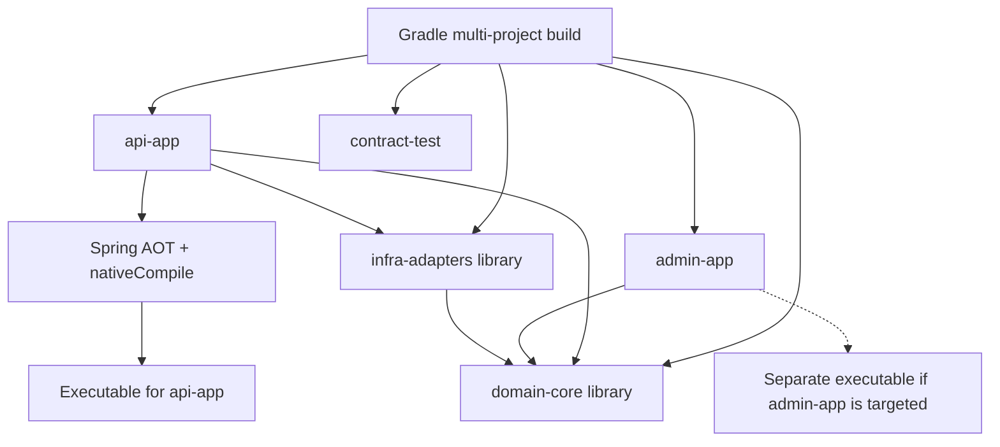

# Multi-Module Projects: Selecting the Right Application, Classpath, and Packaged Dependencies

## 1. Why Are Multi-Module Projects Prone to Building the Wrong Native Image?

A multi-module Gradle repository may contain multiple Spring Boot applications, shared libraries, test modules, and configuration-only modules. When building a **GraalVM Native Image** for Spring Boot, you cannot simply run `nativeCompile` in the root directory and assume Gradle knows which application to package.

Three things must be identified simultaneously:

1. **The right application module**: the module containing the Spring Boot entry point, plugin configuration, and native tasks to build.
2. **The right runtime classpath**: the set of classes and resources the application needs at runtime, including outputs of dependent modules and runtime libraries.
3. **The right packaged dependencies**: which artifacts belong in the final application, which are compile/test-only, and which native artifacts must be present in the target environment.

In the **SPRING_BOOT_NATIVE_IMAGE** module, Spring AOT analyzes the application at build time while GraalVM Native Image creates an executable for the target OS/architecture. Selecting the wrong module or classpath can cause build failures, missing beans/resources, or—worse—produce an executable that runs with missing functionality.



The goal is producing an artifact for **one selected application** with all required runtime dependencies, rather than turning every module in the repository into a standalone executable.

## 2. Recognizing a Gradle Multi-Project Structure

Example repository layout:

```text
shop-platform/
  settings.gradle
  build.gradle
  gradle.properties
  api-app/
    build.gradle
    src/main/java/...
  admin-app/
    build.gradle
    src/main/java/...
  domain-core/
    build.gradle
    src/main/java/...
  infra-adapters/
    build.gradle
    src/main/java/...
  contract-test/
    build.gradle
    src/test/java/...
```

The `settings.gradle` file declares subprojects:

```groovy
rootProject.name = 'shop-platform'

include 'api-app'
include 'admin-app'
include 'domain-core'
include 'infra-adapters'
include 'contract-test'
```

Gradle identifies subprojects by paths such as `:api-app` and `:domain-core`. The root project has path `:`. Folder names usually match project paths yet can be remapped in settings, so always rely on Gradle project paths instead of guessing from directory names.

List projects with:

```bash
./gradlew projects
```

Inspect AOT/native tasks for a specific application:

```bash
./gradlew :api-app:tasks --all
```

This confirms the plugins are applied to `:api-app` and the corresponding tasks exist. Not every library module has `processAot` or `nativeCompile`; these tasks belong to application modules configured with Spring Boot and Native Build Tools.

## 3. Distinguishing Root Project, Application Modules, and Library Modules

| Module Type | Typical Contents | Should It Produce Its Own Native Executable? |
|---|---|---|
| Root project | Plugin management, repositories, shared config, `include` subprojects | No, unless the root is also a configured application |
| Spring Boot application | Main class, web endpoints, application config, Spring Boot plugin | Yes, when it is the target application |
| Domain/library | Entities, services, interfaces, business logic | Usually no; packaged into depending applications |
| Infrastructure adapter | Repository adapters, clients, messaging integrations | Usually no; packaged as a runtime dependency |
| Test module | Test fixtures, contract/integration tests | Not a default production executable |

A library module can still contain classes discovered by Spring component scanning or imported into an application context. It does not need its own `main()` method or native executable to be included in the image. What matters is that the application module has a runtime dependency on that library and AOT recognizes its configuration properly.

For example, `domain-core` is not a standalone application, yet its `OrderService` and `OrderPolicy` classes must be present on `:api-app`'s runtime classpath.

## 4. Declaring Dependencies Between Modules

In `api-app/build.gradle`:

```groovy
plugins {
    id 'java'
    id 'org.springframework.boot'
    id 'io.spring.dependency-management'
    id 'org.graalvm.buildtools.native'
}

dependencies {
    implementation project(':domain-core')
    implementation project(':infra-adapters')

    testImplementation 'org.springframework.boot:spring-boot-starter-test'
}
```

This snippet assumes plugin versions are managed at the root or via `pluginManagement`, and the application module uses compatible versions. You do not need to repeat versions in every module if the project uses convention plugins.

Dependency configurations carry distinct semantics:

- `implementation`: dependency needed for compiling and running the current module, without exposing it transitively on consumers' compile classpaths.
- `api`: used when applying the Java Library plugin and the dependency is part of the public API consumers must see at compile time.
- `runtimeOnly`: needed at runtime, not needed to compile the current module's code directly.
- `compileOnly`: needed only at compile time; excluded from the runtime classpath under standard configuration.
- `testImplementation`, `testRuntimeOnly`: scoped exclusively to test compilation/runtime.

**Native Image uses the runtime classpath**, so a library required to run the application that was declared only as `compileOnly` can fail at runtime or during native analysis. Conversely, test-only dependencies must not accidentally leak into production artifacts.

### Runtime Dependency Example

Suppose `:infra-adapters` uses a JDBC driver at runtime. If the driver must be loaded when running, declare it under the appropriate runtime configuration in the adapter-providing module, or in the application module per your project's dependency strategy. Confirm the driver is actually on the final runtime classpath, not solely on the compile classpath.

## 5. Targeting the Right Application Module When Running Tasks

Gradle supports qualifying tasks by project path:

```bash
./gradlew :api-app:processAot
./gradlew :api-app:nativeCompile
```

On Windows:

```bat
gradlew.bat :api-app:processAot
gradlew.bat :api-app:nativeCompile
```

This is the unambiguous way to build the right application in a multi-module repository. Running:

```bash
./gradlew nativeCompile
```

at the root may report the task is missing, or run the task in a root-configured project depending on plugin layout. Never rely on the current working directory to guess the target module.

Inspect the task graph with:

```bash
./gradlew :api-app:nativeCompile --dry-run
```

`--dry-run` prints the tasks scheduled to execute without running task actions. It is helpful for verifying task dependencies before a resource-heavy build. However, it does not verify classpath contents or executable quality.

## 6. Main Class and Spring Boot Configuration

Each application module must define the right entry point. Example:

```java
package com.example.shop.api;

import org.springframework.boot.SpringApplication;
import org.springframework.boot.autoconfigure.SpringBootApplication;

@SpringBootApplication
public class ApiApplication {
    public static void main(String[] args) {
        SpringApplication.run(ApiApplication.class, args);
    }
}
```

If the repository contains both `ApiApplication` and `AdminApplication`, ensure the Gradle/Spring Boot plugin on `:api-app` picks the right main class. You can configure it explicitly:

```groovy
springBoot {
    mainClass = 'com.example.shop.api.ApiApplication'
}
```

Exact configuration depends on the Spring Boot Gradle Plugin version. If the task reports it cannot find a main class or picks the wrong one, check the plugin configuration and source sets of **that exact application project**.

Component scanning matters too. If the main class lives in package `com.example.shop.api` while domain classes live outside its subpackages, Spring may not scan those components automatically. Use an appropriate root package or explicit scan/import configuration. AOT will not auto-fix component scan errors.

## 7. Runtime Classpath: What Actually Enters the Application

The application's classpath comprises outputs of its `main` source set plus runtime dependencies. In a multi-module project, Gradle resolves the dependency graph and constructs the runtime classpath from the application module's configuration.

Inspect runtime dependencies with:

```bash
./gradlew :api-app:dependencies --configuration runtimeClasspath
```

Trace a specific dependency with:

```bash
./gradlew :api-app:dependencyInsight --dependency domain-core --configuration runtimeClasspath
```

Configuration names may vary if the project customizes source sets or plugins. For standard Java applications, `runtimeClasspath` is the right starting point.

Check:

- Does `:domain-core`'s output enter the runtime classpath?
- Does `:infra-adapters` bring the required runtime dependencies for drivers/clients?
- Did any test-only library leak into production?
- Are two versions of the same library colliding due to dependency conflicts?
- Are resources in library modules placed where the classpath can read them?
- Is GraalVM metadata provided by dependencies preserved in the artifact/dependency graph?

Native Image analyzes the selected classpath along with metadata. If a module is absent from the runtime dependency graph, do not expect its classes to appear in the executable.

## 8. Packaged Dependencies and Spring Boot Artifacts

A Spring Boot executable JAR normally packages runtime dependencies under `BOOT-INF/lib` and application classes under `BOOT-INF/classes`. In a Gradle multi-project build, project dependencies like `:domain-core` are packaged according to the application's runtime configuration.

You can build `bootJar`:

```bash
./gradlew :api-app:bootJar
```

Then inspect the JAR contents:

```bash
jar tf api-app/build/libs/api-app.jar
```

Artifact names and paths vary with `archiveFileName`, version, and plugin configuration. Verify that expected project dependencies are inside the JAR. For Native Image, the plugin pipeline uses classpaths and AOT outputs rather than treating the fat JAR directly as the native executable; `bootJar` is useful for inspecting the JVM package, not a substitute for `nativeCompile`.

Do not assume that just because a library appears inside `bootJar`, every class/resource in it is guaranteed to survive into the native executable. Reachability analysis strips unreachable parts, and metadata determines how dynamic access is retained.

## 9. Resources and Metadata in Library Modules

A library module can contain resources:

```text
infra-adapters/
  src/main/resources/
    templates/
      invoice.txt
    META-INF/
      native-image/
        com.example/
          infra-adapters/
            reachability-metadata.json
```

When the library enters the runtime classpath, its bundled resources and metadata can assist native builds. Still verify:

1. Resources are packaged into the library's JAR.
2. The application module has a runtime dependency on the library.
3. Resource-reading code uses an appropriate classpath/resource loader.
4. Metadata matches the schema and GraalVM version in use.
5. Real native test scenarios successfully access the resource after building.

If the application loads resources by dynamic name or a library uses reflection, appropriate Spring Runtime Hints or reachability metadata are required. Merely adding a module to the dependency graph does not guarantee every dynamic behavior is native-compatible.

## 10. AOT in Multi-Module Projects

Usually only the application module runs `processAot` for the Spring application context. Library modules supply bytecode, resources, and optionally metadata/hints for the application's AOT step to consume. Do not run AOT separately on every library solely because they contain Spring classes.

Example:

```bash
./gradlew :api-app:processAot --info
./gradlew :api-app:nativeCompile --info
```

When AOT fails, inspect `:api-app`'s context: component scans, auto-configurations, profiles, properties, and dependencies. If native compilation fails after AOT, check GraalVM analysis errors, metadata, toolchain, linker, or build memory.

AOT outputs are normally generated inside the application module's build directory. Exact paths vary by plugin/version. Never copy generated sources manually from one module to another to "patch" a build; fix the application module's dependencies or configuration and let Gradle manage the task graph.

## 11. Example Root and Module Configuration

A simple setup declaring plugin versions at the root:

```groovy
// settings.gradle
rootProject.name = 'shop-platform'
include 'api-app', 'domain-core', 'infra-adapters'
```

```groovy
// build.gradle (root)
plugins {
    id 'org.springframework.boot' version '3.x.y' apply false
    id 'io.spring.dependency-management' version '1.x.y' apply false
    id 'org.graalvm.buildtools.native' version '0.x.y' apply false
}

allprojects {
    repositories {
        mavenCentral()
    }
}
```

```groovy
// api-app/build.gradle
plugins {
    id 'java'
    id 'org.springframework.boot'
    id 'io.spring.dependency-management'
    id 'org.graalvm.buildtools.native'
}

dependencies {
    implementation project(':domain-core')
    implementation project(':infra-adapters')
}
```

```groovy
// domain-core/build.gradle
plugins {
    id 'java-library'
}

dependencies {
    // Declare domain business dependencies here.
}
```

`3.x.y`, `1.x.y`, and `0.x.y` are placeholders and must be replaced with real plugin versions compatible with your JDK, Gradle, and Spring Boot versions. Real projects may use convention plugins or a version catalog instead of centralized root declarations as shown here.

## 12. Common Errors

| Symptom | Possible Cause | Inspection Approach |
|---|---|---|
| `Task 'nativeCompile' not found` | Plugin not applied on the application module or wrong project path invoked | `projects`, `:api-app:tasks --all` |
| Native build builds the wrong application | Running root task or wrong main class selected | Invoke `:module:task`, check `springBoot.mainClass` |
| Class from library not found | Missing `implementation project(...)` or dependency is `compileOnly` | Inspect `runtimeClasspath` |
| Runtime error due to missing driver | Driver missing from runtime dependencies | `dependencies --configuration runtimeClasspath` |
| AOT missing bean | Wrong component scan, profile, or conditional property | Inspect the application module's application context |
| Native missing resource | Resource not packaged or missing hint | Check library JAR, Runtime Hints, native tests |
| Version conflict | Multiple modules pull conflicting versions | `dependencyInsight` |
| Native build linker error | Incompatible toolchain/OS/architecture or native library | Check GraalVM, compiler/linker, binary dependencies |

Do not put every dependency into `api` as a workaround for classpath errors. Use configurations matching each dependency's real role, then inspect the compile/runtime graph.

## 13. End-to-End Verification for an Application Module

A reproducible verification sequence:

```bash
./gradlew projects
./gradlew :api-app:dependencies --configuration runtimeClasspath
./gradlew :api-app:tasks --all
./gradlew :api-app:bootJar
./gradlew :api-app:processAot
./gradlew :api-app:nativeCompile
```

These steps assume plugins and tasks are already configured. You may skip `bootJar` if you only need the native pipeline; it is helpful when inspecting the JVM package. For CI builds, record the commit, Gradle Wrapper, JDK/GraalVM, plugin versions, target OS/architecture, and application project path.

After building, verify:

- The right executable for `:api-app` was freshly generated.
- Required runtime libraries are present in the dependency graph.
- Resources, Runtime Hints, and metadata from dependent modules are recognized.
- HTTP smoke tests and integration tests run against the native executable itself.
- Containers package the right artifact for the target OS/CPU.
- JAR/native benchmarks use identical functionality, profiles, and workloads.

If the repository has both `:api-app` and `:admin-app`, repeat the workflow independently for each application when building two executables; never assume one `:api-app:nativeCompile` run also builds `:admin-app`.

## 14. Self-Check Questions

1. Why can a library module be packaged into a native executable even though it has no `main()` method?
2. How do differences between `implementation`, `runtimeOnly`, and `compileOnly` affect the runtime classpath?
3. Why is invoking `:api-app:nativeCompile` clearer than invoking `nativeCompile` at the root?
4. How do you verify that a dependency from `:infra-adapters` is actually on `:api-app`'s runtime classpath?
5. If a JAR contains a resource yet the native executable cannot read it, which steps must you check?
6. Why should you not run `processAot` independently on every library module?
7. If a repository contains two Spring Boot applications, how do you ensure each executable uses the right main class and dependencies?

**Remember:** in a multi-project Gradle build, target the right **application project**, inspect the **runtime classpath**, and confirm **dependencies/resources/metadata are packaged**. Spring AOT and GraalVM Native Image can only build the right executable for the application and dependency graph that the application module's tasks actually consume.
