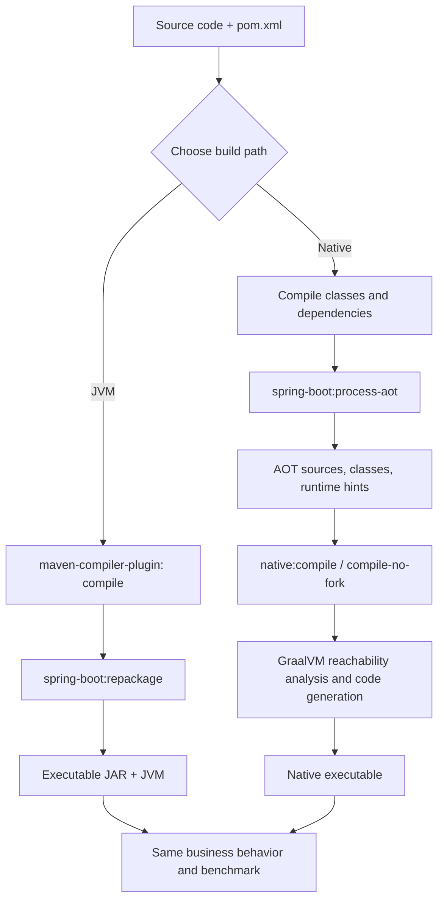

# Spring Boot Maven plugin and GraalVM Native Build Tools Maven plugin

## 1. Two plugins solving two different parts of the job

In the **SPRING_BOOT_NATIVE_IMAGE** module, the goal is to compile a Spring Boot application into a **GraalVM Native Image** via **Spring AOT**, and then verify improvements in startup time, memory usage, and compatibility. For a Maven project, two plugins typically appear together:

- **Spring Boot Maven plugin** (`org.springframework.boot:spring-boot-maven-plugin`) manages Spring Boot-specific tasks: running the application, packaging an executable JAR, AOT processing, and building container images using buildpacks.
- **GraalVM Native Build Tools Maven plugin** (`org.graalvm.buildtools:native-maven-plugin`) connects Maven with GraalVM's `native-image` tool, taking the output after AOT processing and compiling the native executable.

The first plugin understands how Spring Boot prepares the `ApplicationContext`, beans, and runtime hints; the second plugin orchestrates GraalVM's compilation phase. **Proper Maven lifecycle configuration** is required so that the two steps happen in sequence. Simply adding regular Java dependencies does not automatically enable the entire pipeline.

### Learning objectives

You will learn how to distinguish each plugin's responsibilities, configure `pom.xml` with Spring Boot Starter Parent or a custom parent, invoke the right Maven goals, inspect AOT/native outputs, run both JVM and native builds for comparison, and identify reflection/resource/proxy errors as well as CI errors.

## 2. From Java source code to native executable



On the native branch, Spring AOT analyzes the configurations/beans it can determine at build time, generates initialization code, and contributes metadata for reflection, Java dynamic proxies, resources, serialization, or JNI. GraalVM continues using those outputs to perform *reachability analysis* and compile an executable for the **target operating system and CPU architecture**.

| Component | Primary input | Output |
| --- | --- | --- |
| `maven-compiler-plugin` | Java sources and classpath | `.class` files |
| `spring-boot:repackage` | JAR and dependencies | Executable JAR runnable with `java -jar` |
| `spring-boot:process-aot` | Bean definitions, configuration, and application classpath | Generated initialization code, runtime hints, AOT data |
| `native:compile` | Maven project and required build chain | Native executable; this goal **forks** the required Maven lifecycle |
| `native:compile-no-fork` | Inputs already prepared in the current lifecycle | Native executable, used when the goal is already bound to the lifecycle |
| `spring-boot:build-image` | Application and appropriate builder image | OCI container image via Cloud Native Buildpacks |

**Do not confuse Maven's `compile` with `native:compile`.** `mvn compile` compiles Java into bytecode; `native:compile` is a GraalVM Native Build Tools goal for creating a native binary. Similarly, `spring-boot:process-aot` only prepares AOT and **does not create a native executable by itself**.

## 3. Preparing tools and the Maven project

### 3.1. Environment requirements

To practice, choose a **compatible version set** of Spring Boot, Java, and GraalVM. The examples below use Spring Boot **3.5.0** and Java **21** as illustrative baselines; this is not a claim about the latest version or the version every project must use. Check the compatibility guide for your exact Spring Boot/GraalVM versions in your real environment.

The build machine requires:

1. A JDK/GraalVM with an invocable `native-image`, and consistent `JAVA_HOME`/`PATH` configuration.
2. Maven or the project's Maven Wrapper (`mvnw`/`mvnw.cmd`).
3. The C/C++ compiler, linker, and native libraries/headers required by GraalVM on the build operating system.
4. Sufficient CPU, RAM, and disk space: Native Image analysis and compilation can require significantly more resources than a JAR build.

Verify the environment on Linux/macOS:

```bash
java -version
javac -version
native-image --version
./mvnw -version
```

On Windows PowerShell, the corresponding Maven Wrapper command is `.\mvnw.cmd -version`. On Windows, GraalVM Native Image also requires the native toolchain/linker supported by the GraalVM version; on Linux, it requires the corresponding compiler and development libraries. If `native-image --version` fails, fix the toolchain before troubleshooting Maven plugins.

### 3.2. Minimal REST application

The Maven examples below assume an application with package `com.example.demo`, artifact `hello-native`, and a simple endpoint:

```java
package com.example.demo;

import java.util.Map;
import org.springframework.boot.SpringApplication;
import org.springframework.boot.autoconfigure.SpringBootApplication;
import org.springframework.web.bind.annotation.GetMapping;
import org.springframework.web.bind.annotation.RestController;

@SpringBootApplication
@RestController
public class DemoApplication {
    public static void main(String[] args) {
        SpringApplication.run(DemoApplication.class, args);
    }

    @GetMapping("/hello")
    public Map<String, String> hello() {
        return Map.of("message", "Hello Native");
    }
}
```

The file is located at `src/main/java/com/example/demo/DemoApplication.java`. `GET /hello` will be the first functional check: both the JAR/JVM build and the Native Image must return JSON with equivalent content. Do not add databases, external integrations, or libraries using dynamic reflection to the starter exercise before having a working baseline.

## 4. Common configuration: using Spring Boot Starter Parent

### 4.1. Illustrative `pom.xml`

In most applications created from Spring Boot templates with `spring-boot-starter-parent`, the parent provides dependency management, plugin management, and the build profiles needed for the standard workflow. Explicitly declare **both the Spring Boot Maven plugin and the Native Build Tools plugin**:

```xml
<?xml version="1.0" encoding="UTF-8"?>
<project xmlns="http://maven.apache.org/POM/4.0.0"
         xmlns:xsi="http://www.w3.org/2001/XMLSchema-instance"
         xsi:schemaLocation="http://maven.apache.org/POM/4.0.0
             https://maven.apache.org/xsd/maven-4.0.0.xsd">
    <modelVersion>4.0.0</modelVersion>

    <parent>
        <groupId>org.springframework.boot</groupId>
        <artifactId>spring-boot-starter-parent</artifactId>
        <version>3.5.0</version>
        <relativePath/>
    </parent>

    <groupId>com.example</groupId>
    <artifactId>hello-native</artifactId>
    <version>0.0.1-SNAPSHOT</version>
    <name>hello-native</name>

    <properties>
        <java.version>21</java.version>
    </properties>

    <dependencies>
        <dependency>
            <groupId>org.springframework.boot</groupId>
            <artifactId>spring-boot-starter-web</artifactId>
        </dependency>
        <dependency>
            <groupId>org.springframework.boot</groupId>
            <artifactId>spring-boot-starter-test</artifactId>
            <scope>test</scope>
        </dependency>
    </dependencies>

    <build>
        <plugins>
            <plugin>
                <groupId>org.springframework.boot</groupId>
                <artifactId>spring-boot-maven-plugin</artifactId>
            </plugin>
            <plugin>
                <groupId>org.graalvm.buildtools</groupId>
                <artifactId>native-maven-plugin</artifactId>
            </plugin>
        </plugins>
    </build>
</project>
```

In this template, **do not guess plugin versions**: Spring Boot Starter Parent manages the supported plugins for the version in use. If your organization has a policy to pin different plugin versions, verify their compatibility and inspect the **effective POM** before building.

A Maven plugin differs from a Maven dependency in execution:

- A plugin must reside under `<build><plugins>...` for Maven to execute its goals.
- The `spring-boot-starter-web` dependency belongs under `<dependencies>`, providing runtime/compile libraries for the application.
- Declaring a plugin in `pluginManagement` only specifies **how the plugin is managed**; to activate the plugin from that configuration, you still need to ensure the plugin is applied and its executions are bound properly.
- `<parent>` specifies the parent POM in Maven; `<dependencyManagement>` only controls dependency versions and **does not automatically replace** plugin/lifecycle configurations from the parent.

### 4.2. Checking the native profile in the effective POM

With Spring Boot Starter Parent, a profile named `native` is configured to coordinate Spring AOT processing and native compilation. The option to activate a Maven profile uses **uppercase `-P`**:

```bash
./mvnw help:active-profiles -Pnative
./mvnw help:effective-pom -Pnative
```

When inspecting the output, confirm that:

1. The `native` profile is actually active (not a custom profile name that has not been defined).
2. The `spring-boot:process-aot` goal appears in the appropriate build configuration.
3. `native-maven-plugin` has a valid version and the intended execution/native goal.
4. Maven is using the right JDK/GraalVM and declared Java target.

**Note:** `-Pnative` activates a **Maven profile**, not a universal "enable Native Image" flag across all projects. With a custom parent, this profile might not exist even if a native plugin is declared.

## 5. Building and running: JAR/JVM vs. Native Image

### 5.1. Creating the baseline JAR

```bash
./mvnw clean package
java -jar target/hello-native-0.0.1-SNAPSHOT.jar
```

Open another terminal to verify:

```bash
curl -fsS http://localhost:8080/hello
# Expected: {"message":"Hello Native"}
```

Running the JAR first helps separate standard Spring Boot application issues from errors that only surface during native compilation or execution. If the JAR does not work yet, resolve the functional issue before moving to Native Image.

### 5.2. Invoking Native Build Tools

For a project inheriting Starter Parent with both plugins added as above:

```bash
./mvnw -Pnative native:compile
```

Breakdown of each part:

- `./mvnw` uses the Maven version configured by the project wrapper.
- `-Pnative` activates the standard profile from Spring Boot Starter Parent and configures AOT processing.
- `native:compile` is a goal of GraalVM Native Build Tools; it coordinates the necessary Maven inputs and invokes the `native-image` compiler.

You can also trigger the build via the lifecycle if the **effective POM** already binds native compilation to an appropriate phase:

```bash
./mvnw -Pnative package
```

The outcome of `package` depends on the specific execution configuration; check the output and logs instead of assuming every POM with a `native` profile produces a native binary with this command. For hands-on practice, `-Pnative native:compile` is straightforward and commonly used when configuring with Spring Boot Starter Parent.

When the build succeeds, the executable is usually created inside `target/`. Its name is based on the artifact and Native Build Tools settings; in the example, it may be `target/hello-native` (or `target/hello-native.exe` on Windows). The actual filename/path is reported in the build log—do not hardcode it if the project has changed `imageName`.

```bash
# After stopping the JVM process:
./target/hello-native

# From another terminal:
curl -fsS http://localhost:8080/hello
```

Do not run both builds on the same port simultaneously. If automated comparison is needed, configure different ports and ensure requests, profiles, and DB/cache conditions match. A native executable does not require a JVM installed on the runtime machine, though it still depends on native libraries and a matching OS/CPU platform.

### 5.3. Purpose of `compile` and `compile-no-fork`

In the GraalVM Native Build Tools Maven plugin:

| Goal | When to use | Key notes |
| --- | --- | --- |
| `native:compile` | Run directly from the CLI to build native | Can fork the required Maven lifecycle; used in the Starter Parent example |
| `native:compile-no-fork` | Bound as an execution to the `package` phase in POM | Does not fork the lifecycle; preceding phases must have already prepared AOT/classes completely |
| `spring-boot:process-aot` | Generate Spring AOT code and metadata | Performs only the AOT step, does not produce a binary |
| `spring-boot:repackage` | Package a JAR to run on the JVM | Does not compile a Native Image |

If you bind `native:compile` to a Maven phase and it forks the lifecycle again, build loops or unintended goal executions can occur. In lifecycle-bound executions, **`compile-no-fork`** is normally used while ensuring `process-aot` runs beforehand. When invoking `native:compile` directly, let the plugin execute the required lifecycle parts according to the active configuration.

## 6. Projects not inheriting Spring Boot Starter Parent

Many organizations use a custom parent POM or only import a BOM:

```xml
<dependencyManagement>
    <dependencies>
        <dependency>
            <groupId>org.springframework.boot</groupId>
            <artifactId>spring-boot-dependencies</artifactId>
            <version>3.5.0</version>
            <type>pom</type>
            <scope>import</scope>
        </dependency>
    </dependencies>
</dependencyManagement>
```

Importing a BOM manages **dependency versions** but does not automatically bring the **plugin management and native profile** of `spring-boot-starter-parent` into the project. Without Starter Parent, you must explicitly configure `spring-boot-maven-plugin`, `native-maven-plugin`, their versions, and their executions/lifecycle bindings.

One way to organize this is placing the AOT/native integration into a profile enabled only when building native. The following example is a **configuration skeleton for the plugin/profile section**; integrate it into a `pom.xml` with a custom parent and complete Java compiler, dependencies, and `spring-boot:repackage` configurations suited to your application:

```xml
<profiles>
    <profile>
        <id>native</id>
        <build>
            <plugins>
                <plugin>
                    <groupId>org.springframework.boot</groupId>
                    <artifactId>spring-boot-maven-plugin</artifactId>
                    <version>3.5.0</version>
                    <executions>
                        <execution>
                            <id>process-aot</id>
                            <phase>process-classes</phase>
                            <goals>
                                <goal>process-aot</goal>
                            </goals>
                        </execution>
                    </executions>
                </plugin>
                <plugin>
                    <groupId>org.graalvm.buildtools</groupId>
                    <artifactId>native-maven-plugin</artifactId>
                    <version>0.10.6</version>
                    <executions>
                        <execution>
                            <id>build-native</id>
                            <phase>package</phase>
                            <goals>
                                <goal>compile-no-fork</goal>
                            </goals>
                        </execution>
                    </executions>
                </plugin>
            </plugins>
        </build>
    </profile>
</profiles>
```

With this style of configuration, an illustrative command is:

```bash
./mvnw -Pnative clean package
```

**Plugin versions and the effective POM must be verified** because a custom parent might define `repackage` executions, AOT goals, or lifecycles that differ from the example. The versions above are illustrative baselines and must align with your actual Spring Boot and GraalVM/Native Build Tools setup. When `process-aot` and `compile-no-fork` run as part of the lifecycle, do not also invoke `native:compile` without understanding which goals are already executing: it can trigger duplicate compilation and waste CI resources.

In a multi-module/aggregator Maven setup, declare the plugins in the **Spring Boot application module** (the module containing the main class and appropriate runtime classpath). Do not enable native compilation across all library modules. When multiple `main` classes exist, configure main class selection consistently across Spring Boot and Native Build Tools before building.

## 7. Observing Spring AOT and Native Image output

### 7.1. Generated sources and runtime hints

Spring AOT can generate Java sources to construct the `ApplicationContext` and beans, along with runtime metadata for:

- **Reflection:** dynamically selected constructors, methods, and fields.
- **JDK dynamic proxies:** sets of interfaces implemented by `java.lang.reflect.Proxy`.
- **Resources:** classpath files, resource bundles, or resource patterns that must be included in the binary.
- **Serialization/JNI:** cases requiring special access mechanisms.

With Maven, AOT outputs are typically placed under `target/` paths such as `target/spring-aot/`, though exact paths and how sources/resources/classes are organized vary by Spring Boot plugin version. Verify from the actual build logs and output contents. **Do not manually edit generated sources or metadata in `target`** because the next build will regenerate them.

Why does metadata matter? The JVM allows many dynamic proxy creations, class lookups, or resource reads at runtime. GraalVM Native Image needs that information ahead of time to analyze and include the relevant components in the executable. AOT bridges this gap, though it cannot automatically know every path driven by runtime strings or plugins loaded after build time.

### 7.2. Example of adding resource and reflection hints

Suppose the application reads `src/main/resources/rules/pricing.json` and uses reflection to invoke the constructor of `PricingRule` (both must actually exist in the project). A `RuntimeHintsRegistrar` can declare:

```java
package com.example.demo;

import org.springframework.aot.hint.MemberCategory;
import org.springframework.aot.hint.RuntimeHints;
import org.springframework.aot.hint.RuntimeHintsRegistrar;
import org.springframework.context.annotation.Configuration;
import org.springframework.context.annotation.ImportRuntimeHints;

@Configuration(proxyBeanMethods = false)
@ImportRuntimeHints(ExtraNativeHints.class)
class NativeHintsConfiguration {
}

final class ExtraNativeHints implements RuntimeHintsRegistrar {

    @Override
    public void registerHints(RuntimeHints hints, ClassLoader classLoader) {
        hints.resources().registerPattern("rules/pricing.json");
        hints.reflection().registerType(
            PricingRule.class,
            MemberCategory.INVOKE_DECLARED_CONSTRUCTORS
        );
    }
}
```

For a JDK proxy using a known interface, you can use:

```java
hints.proxies().registerJdkProxy(RatePort.class);
```

This is an example **for a `RatePort` interface that exists in the application**. Do not add this line if the application has no such interface; native-compatible Spring libraries may provide hints automatically. Identify the exact error category before registering hints: a reflection hint does not embed JSON files, a resource hint does not register JDK proxies, and a JDK proxy hint does not enable a library to generate arbitrary subclass bytecode after the native image is built.

## 8. Native tests and compatibility verification

A successful Native Image build only proves the executable was created. Many failures appear **when executing uncommon branches**, such as serializers using reflection, resources read under specific locales, or libraries creating dynamic proxies.

Minimum verification workflow:

1. **Build the JVM baseline:** run tests and `GET /hello` on the JAR from the same commit.
2. **Build native:** record tool versions, build duration/peak RAM, and build logs.
3. **Smoke test the binary:** call `/hello` and compare HTTP status/JSON body against the JVM build.
4. **Test dynamic branches:** endpoints using reflection, resources, proxies, transactions, serialization, or DB access (if present in the project).
5. **Test in a real container environment:** verify OS/architecture, libc, certificates, environment variables, and profiles.

GraalVM Native Build Tools provides support for running tests as a native executable, but Maven `native:test` and test profiles/executions must be configured properly for the project. You may encounter setups with a `nativeTest` profile, yet **do not assume** Starter Parent or every custom parent provides a profile by that name out of the box. Inspect the effective POM and test goals before using them in CI.

### Comparing costs fairly

| Metric | JVM mode | Native Image mode | Conditions to keep identical |
| --- | --- | --- | --- |
| Build time | `clean package` | `-Pnative native:compile` | Cache, test policy, runner CPU/RAM |
| Peak build RAM | Maven/JDK build | GraalVM analysis/compiler | Runner/cgroup and measurement tool |
| Startup to readiness | `java -jar` | Native executable | Profile, DB/cache, readiness check |
| Post-startup memory | RSS/process/container | RSS/process/container | Background load, memory limit |
| Latency and throughput | After JVM warm-up | After appropriate native warm-up | RPS, concurrency, endpoint, dataset |
| Compatibility | Baseline business results | Native business results | Same inputs and expected behavior |

Native Image typically excels in cold start and can reduce memory footprint, but native compilation consumes additional time and CPU/RAM; under sustained long-running workloads, JVM JIT can achieve higher throughput. Do not draw conclusions from a single build, a single request, or an isolated RSS number.

## 9. Container packaging with Maven: related but separate build path

Besides goals that create a native executable directly on the host, the **Spring Boot Maven plugin** provides `spring-boot:build-image`, which uses Cloud Native Buildpacks to produce an OCI image. If the builder/buildpacks support GraalVM Native Image, you can request a native build via the `BP_NATIVE_IMAGE=true` environment variable.

Example configuration inside `spring-boot-maven-plugin`:

```xml
<plugin>
    <groupId>org.springframework.boot</groupId>
    <artifactId>spring-boot-maven-plugin</artifactId>
    <configuration>
        <image>
            <name>hello-native:local</name>
            <env>
                <BP_NATIVE_IMAGE>true</BP_NATIVE_IMAGE>
            </env>
        </image>
    </configuration>
</plugin>
```

With a running Docker daemon and an appropriate builder image:

```bash
./mvnw spring-boot:build-image
docker run --rm -p 8080:8080 hello-native:local
```

This is **a separate build path** from `native:compile`: the builder supplies its own toolchain and Native Image workflow. Be sure to check the logs to confirm the resulting image actually contains a native executable. Do not treat an image built with default `spring-boot:build-image` settings as native unless native build support is enabled and available.

If you write a multi-stage Dockerfile and copy the binary produced by `native:compile`, match the binary's OS/architecture, library linking mode, and CA certificates with the runtime base image. A native executable does not require a JVM at runtime, but it **cannot run arbitrarily across different OSes, libc implementations, or CPU architectures**.

## 10. Troubleshooting common Maven Native Build errors

| Symptom | Cause to check | Appropriate action |
| --- | --- | --- |
| `No plugin found for prefix 'native'` | Missing `native-maven-plugin` or plugin not resolved | Check plugin declaration, repositories, and effective POM |
| `The requested profile "native" could not be activated` | Parent/profile undefined or named differently | Inspect active profiles; explicitly configure the native profile |
| `spring-boot:process-aot` does not run | Goal not bound or profile not enabled | Inspect effective POM, lifecycle, and execution ID |
| Linker/C compiler error | Missing native toolchain or wrong OS | Check `native-image --version` and native compiler/linker |
| Native build runs out of RAM | Reachability analysis/compiler exceeds RAM or small CI quota | Increase runner RAM, limit parallel jobs, inspect OOM logs |
| Class/constructor inaccessible via reflection | Missing runtime metadata for dynamic access | Register hint for the exact member, re-run the failing case |
| Classpath resource not found | Resource not included in image or wrong path | Check `src/main/resources` and resource hint |
| Proxy cannot be created | Missing JDK proxy metadata or unsupported class-based proxy | Distinguish JDK proxy vs. subclass proxy, inspect the library |
| Native behaves differently from JVM per profile | Bean graph/`@Conditional` already resolved at build time | Compare build-time and runtime configurations |
| `native:compile` runs twice in one build | Compile bound to lifecycle while also invoked manually | Choose a single invocation path, check executions in effective POM |
| Multiple main classes cause wrong selection | Main class not configured consistently | Specify the Spring Boot main class and native entrypoint |
| Binary fails inside container | Mismatched OS/CPU, libc, libraries, or CA certs | Build/test on a compatible target, check runtime image |

### Reading errors by stage

- **Maven model/profile error:** occurs before compilation; check parent, dependency/plugin management, and profiles.
- **Spring AOT processing error:** usually relates to bean conditions, bean graphs, or configuration that must be known at build time.
- **GraalVM analysis/compile error:** check metadata, dynamic features, linker, and CI resources.
- **Binary runtime error:** trigger the failing flow directly; identify reflection/resource/proxy/serialization issues and environment configuration.

Do not attempt to fix all native errors by opening reflection across every class. That will not resolve linker failures, wrong profiles, missing external filesystem files, or runtime bytecode generation. Narrow down the failing case, add accurate metadata, and cover that flow in a native integration test.

## 11. Hands-on practice: verify the role of both Maven plugins yourself

**Requirement:** Create a `hello-native` application or use a Spring Boot app with a simple endpoint, configure **both Maven plugins**, build via both JVM and native paths, and record the evidence.

1. **Check tools:** record `java -version`, `native-image --version`, and `./mvnw -version`. Identify the target OS/CPU.
2. **Inspect the effective POM:** confirm `spring-boot-maven-plugin`, `native-maven-plugin`, and the `native` profile are actually in effect.
3. **JVM build:** run `./mvnw clean package`; call `/hello` and save the status/response.
4. **Native build:** run `./mvnw -Pnative native:compile` with Starter Parent, or `./mvnw -Pnative clean package` if you bound `compile-no-fork` to the proper lifecycle phase.
5. **Observe AOT:** locate the generated Java sources, resources, and metadata in the build output.
6. **Test the binary:** run the executable and call the same endpoint; check the response, errors, and readiness time.
7. **If dynamic features exist:** add a real resource or reflection operation, declare `RuntimeHints` when needed, and re-test on native.
8. **Evaluate:** compare build time, startup time, RSS, and p95 under identical load conditions; document real compatibility/CI costs.

| Evidence | Acceptance criteria |
| --- | --- |
| `pom.xml` and effective POM | Both plugins present, profile/goals configured properly |
| JVM build log | JAR runs and basic tests PASS |
| Native build log | Spring AOT and `native-image` execute successfully |
| Artifact | Executable produced for the target OS/CPU |
| HTTP smoke test | JAR and native return the same business result |
| Runtime hints (if applicable) | Metadata added only for proven cases |
| Measurement table | Clear methodology, identical conditions, and explicit configuration recorded |

**Self-check questions:**

- If `native-maven-plugin` is already in `pom.xml` but `spring-boot:process-aot` is not invoked, what can happen when Native Image analyzes a Spring application?
- Why might `-Pnative` work with Spring Boot Starter Parent yet be ignored in a project that only imports the `spring-boot-dependencies` BOM?
- When `native:compile-no-fork` is bound to `package`, why should you avoid also invoking `native:compile` in the same command without checking executions?
- Why does an executable that builds successfully still need testing for actual reflection, resource, and proxy paths?

## 12. Summary

The **Spring Boot Maven plugin** handles Spring Boot stages such as `repackage`, `process-aot` processing, and `build-image`; the **GraalVM Native Build Tools Maven plugin** coordinates GraalVM `native-image` via `native:compile` or `native:compile-no-fork`. When using **Spring Boot Starter Parent**, the `native` profile simplifies wiring both plugins together. When using a custom parent, versions, profiles, and executions/lifecycle bindings must be defined explicitly and verified with the effective POM.

The desired outcome is **the same application running correctly on both the JVM and as a native executable**, with clear build logs, thorough compatibility tests, and fair startup/memory measurements. Proper coordination between these two Maven plugins forms the foundation for configuring reflection/resources, native testing, container image creation, and running Spring Boot applications with GraalVM Native Image.
