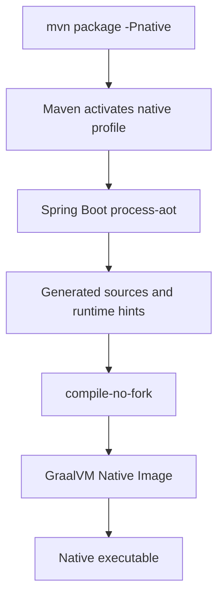

# Native profile when using spring-boot-starter-parent

## 1. Purpose of the native Maven profile

In the **SPRING_BOOT_NATIVE_IMAGE** module, a Spring Boot application is prepared with Spring AOT and then compiled into a GraalVM Native Image to evaluate startup time, memory usage, compatibility, and operations. When a project uses **`spring-boot-starter-parent`**, you can declare a Maven profile named `native` to group configuration dedicated strictly to native builds.

A Maven profile separates native plugin executions, build arguments, and settings from the standard JVM build lifecycle. When the profile is not activated, the project can still build and run an executable JAR on the JVM. When `-Pnative` is activated, Maven runs the additional Spring AOT and GraalVM Native Image phases according to the declared configuration.

Key takeaways:

- **Spring Boot Maven Plugin** runs the `process-aot` goal to analyze the application context and generate AOT code/hints.
- **GraalVM Native Build Tools Maven Plugin** runs the `compile-no-fork` goal to invoke the Native Image compiler with the appropriate classpath and outputs.
- **The `native` Maven profile** groups these executions into an explicit build option.
- **`spring-boot-starter-parent`** provides dependency/plugin management and helpful defaults; it does not install GraalVM, a C compiler, or a linker on the build machine.

The profile name `native` is not a mandatory Maven keyword. It is a project-chosen ID; another name also works as long as you invoke `-P<profile>` consistently.

## 2. Relationship between parent POM, plugin management, and profiles

A Spring Boot Maven project typically has the structure:

```text
project
├── pom.xml
├── src/main/java
├── src/main/resources
└── target/
```

The parent POM is commonly declared as follows:

```xml
<parent>
    <groupId>org.springframework.boot</groupId>
    <artifactId>spring-boot-starter-parent</artifactId>
    <version>${spring-boot.version}</version>
    <relativePath/>
</parent>
```

`spring-boot-starter-parent` provides dependency management, plugin management, and common Maven settings for Spring Boot. However, keep these distinctions clear:

| Concept | Meaning |
|---|---|
| `parent` | Inherits default configurations from Spring Boot |
| `dependencyManagement` | Manages dependency versions without automatically adding dependencies |
| `pluginManagement` | Manages default plugin versions/configurations; plugins still must be declared to execute |
| `build/plugins` | Declares plugins that participate in the build |
| `profiles/profile` | Enables/disables a group of configurations by profile ID |

Do not assume the parent manages every version of GraalVM Native Build Tools across all Spring Boot versions. Check the effective POM to see the actual plugin version and declare the version explicitly if your project's dependency/plugin management does not provide it.

## 3. Example native profile configuration

Here is an illustrative example for a project using the Spring Boot parent, Spring Boot Maven Plugin, and GraalVM Native Build Tools Maven Plugin. The Spring Boot, Java, and Native Build Tools versions must be chosen to be compatible with one another.

```xml
<project>
    <modelVersion>4.0.0</modelVersion>

    <parent>
        <groupId>org.springframework.boot</groupId>
        <artifactId>spring-boot-starter-parent</artifactId>
        <version>${spring-boot.version}</version>
        <relativePath/>
    </parent>

    <groupId>com.example</groupId>
    <artifactId>native-demo</artifactId>
    <version>0.0.1-SNAPSHOT</version>

    <properties>
        <java.version>21</java.version>
        <native-build-tools.version>${native.build.tools.version}</native-build-tools.version>
    </properties>

    <dependencies>
        <dependency>
            <groupId>org.springframework.boot</groupId>
            <artifactId>spring-boot-starter-web</artifactId>
        </dependency>
    </dependencies>

    <build>
        <plugins>
            <plugin>
                <groupId>org.springframework.boot</groupId>
                <artifactId>spring-boot-maven-plugin</artifactId>
            </plugin>
        </plugins>
    </build>

    <profiles>
        <profile>
            <id>native</id>
            <build>
                <plugins>
                    <plugin>
                        <groupId>org.springframework.boot</groupId>
                        <artifactId>spring-boot-maven-plugin</artifactId>
                        <executions>
                            <execution>
                                <id>process-aot</id>
                                <goals>
                                    <goal>process-aot</goal>
                                </goals>
                            </execution>
                        </executions>
                    </plugin>

                    <plugin>
                        <groupId>org.graalvm.buildtools</groupId>
                        <artifactId>native-maven-plugin</artifactId>
                        <version>${native-build-tools.version}</version>
                        <extensions>true</extensions>
                        <executions>
                            <execution>
                                <id>build-native</id>
                                <goals>
                                    <goal>compile-no-fork</goal>
                                </goals>
                            </execution>
                        </executions>
                    </plugin>
                </plugins>
            </build>
        </profile>
    </profiles>
</project>
```

The properties `${spring-boot.version}` and `${native.build.tools.version}` are placeholders to illustrate centralized version management; replace them with valid versions or define the corresponding properties. Do not copy the XML verbatim without choosing valid versions. The example also omits test dependencies, repositories, and other configurations used in a real application.

Across different Spring Boot/plugin versions, the integration configuration may evolve. Check the documentation for the **exact Spring Boot and Native Build Tools versions** before finalizing your POM. Avoid mixing snippets from different plugin generations.

## 4. Why are both process-aot and compile-no-fork needed?

The two goals handle two distinct phases.

### process-aot

The `process-aot` goal of the Spring Boot Maven Plugin prepares the Spring application. It generates AOT outputs such as bean registration/context initialization code and runtime hints. Configuration decisions may be evaluated at build time, so the profiles/properties used during AOT should reflect the intended target environment configuration.

### compile-no-fork

The `compile-no-fork` goal of the Native Build Tools Maven Plugin invokes the Native Image compiler within the current Maven lifecycle without forking another Maven build. It uses the prepared native output/classpath to perform reachability analysis, machine code compilation, and linking.



Execution ordering and actual inputs also depend on plugin integration and versions. Merely adding both goals to the POM does not guarantee every version coordinates properly; the official reference configuration for the version you use is the authoritative baseline.

## 5. Activating the profile with Maven

After setting up a compatible GraalVM JDK/Native Image and OS toolchain, run:

```bash
./mvnw -Pnative native:compile
```

This command activates the `native` profile and invokes the Native Build Tools goal. In configurations where executions are bound to the Maven lifecycle, you can also use:

```bash
./mvnw -Pnative package
```

The second approach runs the lifecycle up to `package`, including executions bound to the lifecycle and inter-plugin dependencies. If the POM only declares a goal without an appropriate execution/phase, running `package` may not trigger the native build as expected.

Different integration setups or plugin versions may recommend `native:compile`, `native:compile-no-fork`, or `package` in different ways. Check your POM and the documentation for your active version; do not swap goals arbitrarily.

With Maven Wrapper, the Maven version is controlled via the project's wrapper configuration. To verify the profile is active:

```bash
./mvnw help:active-profiles -Pnative
```

To inspect the effective POM:

```bash
./mvnw help:effective-pom -Pnative
```

From the effective POM, inspect the actual plugins, executions, goals, phases, and versions after parent/profile inheritance. This is the best way to detect overridden configurations or plugins declared in the wrong location.

## 6. Keeping JVM and native builds separate

Typically there are two primary build workflows:

| Purpose | Example command | Output |
|---|---|---|
| Build executable JAR | `./mvnw clean package` | JAR run on the JVM |
| Build native via goal | `./mvnw -Pnative native:compile` | Native executable |
| Build lifecycle package with profile | `./mvnw -Pnative package` | Artifact according to POM executions/phases |

When comparing JVM and native, note that a native build may also produce an intermediate JAR or run standard Maven phases. That does not mean the native executable is a JAR; the executable is a native binary for the target OS/CPU.

To run the JVM baseline:

```bash
java -jar target/native-demo-0.0.1-SNAPSHOT.jar
```

The filename depends on `artifactId`/`version` and the Spring Boot repackage configuration. Check the actual file in `target/` rather than assuming the example name always matches.

To run the native executable, locate the artifact produced by Native Build Tools (usually in the project's native output directory, depending on the plugin/version):

```bash
./target/native-demo
```

The path above is illustrative only. Check the build logs and actual output files; on Windows, it may end with `.exe`.

## 7. Configuring build arguments and environment

Native Image compilation typically consumes more CPU/RAM and time than a JAR build. When debugging is needed, you can pass build arguments through the Native Build Tools plugin configuration. Conceptual example:

```xml
<configuration>
    <buildArgs>
        <buildArg>--verbose</buildArg>
    </buildArgs>
</configuration>
```

Place the configuration inside the right plugin in your POM and check the schema for your Native Build Tools version. `--verbose` is useful when investigating compiler/linker errors, though it does not necessarily need to be enabled on every CI build.

The build machine needs GraalVM Native Image and a compatible C toolchain. On Linux, this generally requires a compiler, linker, libc development files, and related development libraries. These dependencies belong to the **build environment**, whereas the runtime container needs any shared libraries the executable dynamically links against.

You can verify the environment with:

```bash
java -version
native-image --version
gcc --version
ld --version
./mvnw -version
```

These commands must run inside the same environment used for the Maven build (host or builder container). Maven may use a different JDK than your shell if toolchains or environment variables are configured separately.

## 8. Native profile and environment-specific Spring configuration

A Maven profile controls which plugins/executions participate in the build; a Spring profile controls application configuration. The two concepts share a name but operate at different layers.

- Maven profile: activated with `-Pnative`.
- Spring profile: typically activated via `spring.profiles.active`, environment variables, or application configuration.
- Properties used during Spring AOT can affect which bean structure is analyzed and generated at build time.

For instance, a project may pass a Spring profile to the AOT step through supported plugin configuration or environment settings. Ensure the AOT configuration matches the target native runtime environment. Do not assume changing `SPRING_PROFILES_ACTIVE` in a container can alter every bean decision already baked in during the AOT build.

If a Spring profile toggles beans on or off, test that profile in both JVM and native modes. When multiple configuration variants require different bean graphs, you may need separate native artifacts or a design where differences are handled via runtime configuration without changing the bean graph.

## 9. Checking common errors

| Symptom | Possible cause | What to check |
|---|---|---|
| `Unknown lifecycle phase` or unrecognized goal | Wrong plugin/goal or undeclared plugin | Verify plugin coordinates and versions |
| `native` profile not active | Wrong ID or profile declared in another POM | Run `help:active-profiles` and check which POM is being built |
| `process-aot` does not run | Execution not added or profile configuration not activated | Inspect effective POM and Maven execution output |
| Native goal runs before AOT output exists | Incorrect task/lifecycle wiring or version-mismatched plugin config | Compare against official snippets and execution order |
| `native-image` not found | GraalVM/toolchain not installed or Maven uses another JDK | Check `JAVA_HOME`, Maven version output, and Native Image |
| Missing GCC/linker/header errors | Missing OS toolchain | Install development packages in the builder |
| Native build succeeds but reflection/resource fails | Insufficient reachability metadata | Add runtime hints/metadata, rebuild, and test the path |
| Binary works on host but fails in container | Architecture/libc mismatch or missing shared library/resource | Inspect ELF, dependencies, and runtime image |

Categorize errors by phase: Maven profile/plugin resolution, Spring AOT, Native Image compilation/linking, or runtime. A `ClassNotFoundException` during a native request will not be solved by changing Maven phases if the true cause is missing reflection metadata.

## 10. Diagnostic workflow with Maven

When a build does not behave as expected, run sequentially:

```bash
# 1. Confirm active profiles
./mvnw help:active-profiles -Pnative

# 2. View configuration after inheritance
./mvnw help:effective-pom -Pnative

# 3. Observe lifecycle/task execution
./mvnw -Pnative -DskipTests package

# 4. When detailed logs are needed
./mvnw -Pnative -X native:compile
```

Skipping tests in step 3 should only be used to isolate build issues; never use that result as release evidence. Once the build succeeds, run the full test suite again. `-X` logs may contain environment details and properties; review before sharing.

To verify Spring AOT in isolation, you can invoke its goal directly when supported by the plugin/version:

```bash
./mvnw spring-boot:process-aot
```

If that goal succeeds but the native compiler fails, focus on the Native Image and toolchain logs. If AOT fails earlier, resolve the application context/bean configuration issue before investigating the linker.

## 11. Hands-on exercise: creating a native profile for a Spring Boot application

**Context:** A Spring Boot REST API already works properly on the JVM. The project uses `spring-boot-starter-parent`, Maven Wrapper, and a GraalVM JDK with Native Image.

**Step 1 — Verify the JVM baseline**

```bash
./mvnw clean verify
java -jar target/<application-artifact>.jar
```

Call the endpoint and record status/body and readiness time. Replace the placeholder with the actual artifact name.

**Step 2 — Add the native profile**

Declare the Spring Boot `process-aot` execution and GraalVM Native Build Tools `compile-no-fork` using compatible versions. Ensure plugin versions are explicitly managed.

**Step 3 — Inspect the Maven model**

```bash
./mvnw help:active-profiles -Pnative
./mvnw help:effective-pom -Pnative
```

Confirm the profile is active and plugin executions are accurate.

**Step 4 — Build native**

```bash
./mvnw -Pnative native:compile
```

Observe AOT output, reachability analysis, compilation, and linking. Record the GraalVM version, toolchain, OS/architecture, and build duration.

**Step 5 — Run native and re-test**

Run the generated native executable and send the same set of requests used against the JVM build. If errors occur, determine whether they stem from Spring AOT, metadata, toolchain, or the runtime container.

**Step 6 — Measure performance**

Measure process startup to readiness, idle and under-load RSS, and throughput/latency as appropriate. Use identical configurations, data, CPU/RAM limits, and measurement methodology across both modes.

Recording table:

| Metric | JVM | Native |
|---|---|---|
| Build command | `./mvnw clean verify` | `./mvnw -Pnative native:compile` |
| Artifact | Executable JAR | Native executable |
| Endpoint contract | Record results | Record results |
| Startup to readiness | Measure multiple runs | Measure multiple runs |
| RSS idle / under load | Record measurement method | Record measurement method |
| Compatibility issues | Note if any | Note if any |

## 12. Notes on CI and containers

The `native` profile works well for letting CI explicitly select native build jobs:

```bash
./mvnw -B -Pnative native:compile
```

In pipelines, pin the versions of Maven Wrapper, JDK/GraalVM, plugins, builder image, and OS. Native compilation is resource-intensive, so allocate sufficient RAM/CPU and cache dependencies/build artifacts where safe. Caching does not replace testing the resulting binary.

When packaging containers, you can use a builder image containing GraalVM and the toolchain, then copy the executable into a compatible runtime image. The runtime image does not need Maven, compilers, or GraalVM Native Image just to run the executable, but it must include required shared libraries, CA certificates, timezone data, and runtime resources. Verify architecture and libc before releasing.

## 13. Conclusion

When using `spring-boot-starter-parent`, the `native` Maven profile provides a clean way to enable Spring AOT and GraalVM Native Image for native builds while keeping the familiar JVM build path intact. **Spring Boot Maven Plugin with `process-aot` prepares the code/hints; Native Build Tools with `compile-no-fork` produces the native executable.** The parent POM helps manage configurations but does not replace GraalVM or the OS toolchain.

Understanding profiles, executions, and phase ordering helps pinpoint whether an error originates in Maven, Spring AOT, or Native Image, while establishing a reproducible build process for functional testing, startup/memory benchmarking, and safe container deployment.
