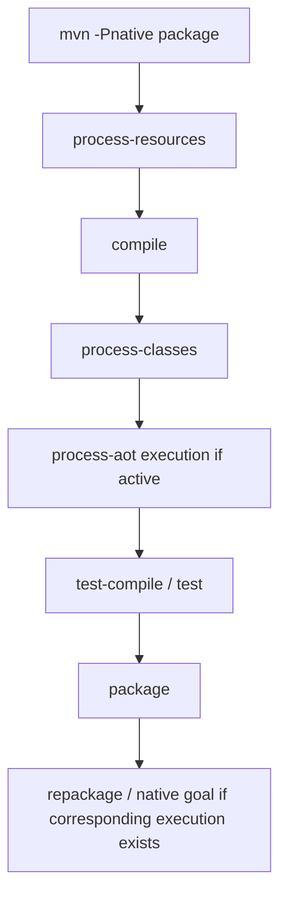

# spring-boot:process-aot and executions in the build lifecycle

In the **SPRING_BOOT_NATIVE_IMAGE** module, Maven handles two related but distinct sets of tasks: **preparing a Spring Boot application for Ahead-of-Time (AOT) processing** and **compiling it into a GraalVM Native Image**. The key is understanding **which phase** `spring-boot:process-aot` runs in, how an `execution` attaches that goal to the Maven lifecycle, and why invoking a goal standalone can behave differently from running a full build command.

This lesson focuses on the **Spring Boot Maven Plugin** and how it pairs with **GraalVM Native Build Tools**. By the end of the lesson, you will be able to read a `pom.xml`, pinpoint where the AOT step is triggered, inspect generated code, and diagnose different errors at build time and runtime. The illustrative examples apply to Spring Boot projects with AOT support (especially Spring Boot 3.x projects); default configurations and goals should always be verified against the exact Spring Boot/plugin version in use.

## 1. What does `spring-boot:process-aot` do?

`process-aot` is a **goal of `spring-boot-maven-plugin`**. It invokes Spring's AOT processor to analyze information determinable at build time and generate components used to initialize the application context.

For a typical Spring Boot application, this process can:

- Analyze configuration models and **bean definitions** resolved by Spring during the AOT phase.
- Generate bean registration code, instance creation support code, and context initialization structures.
- Aggregate **runtime hints** for reflection, resources, proxies, or other mechanisms requiring Native Image metadata when supported by the framework/libraries.
- Prepare generated code and resources for subsequent compilation, packaging, and native-image build steps.

**What `process-aot` does NOT do:** by itself, it **does not** compile the application into a native executable. That is the job of GraalVM Native Image, typically invoked by Maven through `org.graalvm.buildtools:native-maven-plugin`. Nor does it mean all business beans are pre-instantiated and carried over from the build machine into the binary.

For example, AOT may determine that `InvoiceController` depends on `InvoiceService` and generate registration and instantiation logic for both beans. When the native process runs, Spring still instantiates the required **bean instances** according to their actual lifecycle. For reflection behavior that Spring cannot infer from configuration, the application may still need to declare `RuntimeHints` explicitly.


The path above is a **conceptual flow**. Exactly which goals Maven runs, how many times, and in what order depends on `executions`, profiles, `pluginManagement`, and lifecycle-forking goals in the effective POM.

## 2. Distinguishing phase, goal, execution, and profile

Maven has terms that are easily conflated:

| Concept | Meaning | Example |
| --- | --- | --- |
| **Lifecycle** | Ordered sequence of phases to build a project | `default` |
| **Phase** | Stage within a lifecycle; running a phase typically runs all preceding phases | `compile`, `process-classes`, `test`, `package` |
| **Goal** | A task provided by a Maven plugin | `spring-boot:process-aot`, `native:compile` |
| **Execution** | Configuration to run one or more goals at a specified phase or the goal's default phase | `<execution><id>process-aot</id>...` |
| **Profile** | A set of Maven configurations activated only when appropriate, often used to enable native builds | `-Pnative` |
| **Plugin management** | Where default plugin versions/configurations are managed; does not mean goals run automatically | `<pluginManagement>...` |

**Goal** is "what to do"; **execution** is "how to invoke that goal during a build"; **phase** is "when in the build lifecycle"; **profile** is "under which build configuration".

Syntax examples:

```bash
# Invoke a goal directly using the plugin prefix:
./mvnw spring-boot:process-aot

# Invoke phases in the Maven lifecycle:
./mvnw clean package

# Enable the native profile and invoke the Native Build Tools goal:
./mvnw -Pnative native:compile
```

The first two commands are **not equivalent**. Calling `spring-boot:process-aot` directly instructs Maven to execute that goal, whereas `package` steps through lifecycle phases and only runs `process-aot` if an active execution binds it. Invoking a goal directly also **does not guarantee** earlier compile phases have run; if compiled classes are missing, AOT may fail or use stale outputs.

## 3. Where `process-aot` fits in the Maven lifecycle

In typical Spring Boot Maven Plugin 3.x configurations, `process-aot` has a **default phase of `process-classes`**. Maven can infer this phase when you configure the goal in an execution without explicitly specifying `<phase>`.

Relevant milestones in the `default` lifecycle:

| Maven phase | What to note |
| --- | --- |
| `generate-sources` | Some plugins may generate sources before compilation |
| `process-resources` | Copies and filters main resources as configured |
| `compile` | Compiles the application's main Java source code |
| **`process-classes`** | **Typical location for binding the `spring-boot:process-aot` execution** |
| `process-test-resources` / `test-compile` | Prepares test resources and compiles test code |
| `test` | Runs unit/integration tests according to plugins and config |
| `package` | Packages the artifact; can run repackage and native compile goals if bound |
| `verify` | Final lifecycle checks when configured |

These phases **do not automatically correspond 1:1 with plugin goal names**. A plugin can declare its own default phase; an execution in the POM can override that phase. Goals capable of **forking the lifecycle** can also trigger an additional lifecycle segment inside a direct goal invocation.

Visualized:



The diagram depicts only **relevant milestones**, not every single phase or goal order within the same phase. Other executions in the POM may also run at those points.

### Why is compilation needed before AOT?

Spring AOT needs to inspect the application code and relevant dependencies to locate the main application class, process annotations/configurations, and analyze the bean graph. If you invoke the goal manually against an uncompiled directory, do not expect it to always assemble all inputs on its own.

To **verify AOT via the lifecycle** in a project with a bound execution, you can run:

```bash
./mvnw -Pnative clean process-classes
```

This command runs through the phases preceding `process-classes`, so main classes are compiled before the `process-aot` execution runs. If the profile does not yet contain the execution, `process-classes` will not enable AOT on its own; configure the POM first.

## 4. Binding `process-aot` to a Maven execution

The POM snippet below illustrates how to declare the **`process-aot`** goal inside the `native` profile when the project does not yet have a corresponding execution. This snippet **augments an existing `pom.xml`** — the project still requires Spring Boot dependencies, compatible plugin management/versions, and Native Build Tools configuration.

```xml
<profiles>
    <profile>
        <id>native</id>
        <build>
            <plugins>
                <plugin>
                    <groupId>org.springframework.boot</groupId>
                    <artifactId>spring-boot-maven-plugin</artifactId>
                    <executions>
                        <execution>
                            <id>process-aot</id>
                            <goals>
                                <goal>process-aot</goal>
                            </goals>
                        </execution>
                    </executions>
                </plugin>

                <plugin>
                    <groupId>org.graalvm.buildtools</groupId>
                    <artifactId>native-maven-plugin</artifactId>
                </plugin>
            </plugins>
        </build>
    </profile>
</profiles>
```

In this configuration:

1. When `native` is **not activated**, the execution inside the profile does not participate in the build simply because you run `mvn package`.
2. When running with `-Pnative`, Maven merges the profile configuration into the effective POM.
3. The `process-aot` execution binds the `process-aot` goal to the goal's default phase (typically `process-classes` in Spring Boot 3.x). You may explicitly write `<phase>process-classes</phase>` to document intent after confirming it fits the plugin version.
4. `native-maven-plugin` is declared, yet **merely declaring the plugin does not guarantee `mvn package` will produce a native executable**. Either a native compilation execution must be bound to the lifecycle or an appropriate native goal must be invoked.

**Important:** many projects generated from Spring Initializr with **GraalVM Native Support** or using Spring Boot starter parent already include native configuration out of the box. Do not copy the snippet above blindly into your POM. Inspect the effective POM to avoid registering duplicate executions or unintentionally triggering AOT.

### What role does the execution `id` play?

In:

```xml
<execution>
    <id>process-aot</id>
    <goals>
        <goal>process-aot</goal>
    </goals>
</execution>
```

- `<id>process-aot</id>` is the **execution identifier** used by Maven to manage and merge inherited configurations.
- `<goal>process-aot</goal>` is the **actual goal name** provided by the plugin.
- The two strings may match for readability, but they are fundamentally different things.
- Renaming the execution id does not create a new goal; conversely, listing the same goal across multiple executions can cause AOT processing to run multiple times in a single build.

An execution can have `<phase>`, `<configuration>`, and multiple `<goal>` entries. If `<phase>` is omitted, verify **whether the goal has a default phase**; never guess a default solely from the goal name.

## 5. Why are `process-aot` and `native:compile` two separate steps?

The two plugins operate at different layers:

| Component | Plugin | Primary input | Output/purpose |
| --- | --- | --- | --- |
| **Spring AOT** | `org.springframework.boot:spring-boot-maven-plugin` | Bytecode, Spring configuration, dependencies, build-time properties/conditions | Generated sources, registration code, AOT hints/resources |
| **GraalVM Native Image** | `org.graalvm.buildtools:native-maven-plugin` | Classes, dependencies, generated AOT code/metadata, and native toolchain | Native executable |
| **Spring Boot repackage** | `org.springframework.boot:spring-boot-maven-plugin` | JAR/WAR artifact and dependencies | Executable Spring Boot archive for supported packaging types |

The `spring-boot:repackage` goal is not `spring-boot:process-aot`: repackage processes the **artifact**, while process-aot processes the **application model and generates code**. Native Image compilation is a subsequent step beyond both.

### Two common native goals

With GraalVM Native Build Tools Maven Plugin, you commonly encounter:

- `native:compile`: a convenient goal to build a native executable that **forks the required lifecycle segment** before native compilation according to the plugin's mechanism.
- `native:compile-no-fork`: a goal intended for when preparatory phases have already run in the lifecycle and you do not want to fork another lifecycle; usually bound to an execution in `package`.

Thus, the common command:

```bash
./mvnw -Pnative native:compile
```

typically triggers the preparation chain (including `process-aot` if profiles/executions are properly configured) and then runs native compilation. However, if the project lacks an AOT execution or the native plugin is incompatibly configured, **even a properly named command can build without AOT or fail**. Always inspect the logs and effective POM.

Conversely:

```bash
./mvnw -Pnative package
```

runs `process-aot` if the corresponding execution is bound, while whether a **native executable** exists after `package` depends on whether a native compilation goal is bound to `package`. A project that only declares `native-maven-plugin` without binding a goal may produce only a JAR.

### Illustrative execution map when wanting native compile in `package`

The following example shows the **binding intent** of the native goal in a project that already has dependencies, versions, and an AOT execution:

```xml
<plugin>
    <groupId>org.graalvm.buildtools</groupId>
    <artifactId>native-maven-plugin</artifactId>
    <executions>
        <execution>
            <id>build-native</id>
            <phase>package</phase>
            <goals>
                <goal>compile-no-fork</goal>
            </goals>
        </execution>
    </executions>
</plugin>
```

When this plugin snippet is inside an active `native` profile, `mvn -Pnative package` can execute native compilation in the `package` phase, **after** the AOT step bound to `process-classes`. In practice, check the goal ordering logs and the plugin configuration for the Spring Boot version in use.

There is no need to declare multiple native executions with the same responsibility if the parent/plugin already configures that goal. To keep the lifecycle clear, choose **one explicit way to trigger native compilation**.

## 6. Output artifacts after `process-aot`

AOT typically generates code and metadata under the `target/` build directory. For many Spring Boot 3.x versions, common locations include:

```text
target/
├── classes/                         # Compiled application classes
├── spring-aot/
│   └── main/
│       ├── sources/                 # Generated AOT Java sources
│       ├── resources/               # AOT resources / metadata
│       └── classes/                 # Part of AOT-supporting output
└── ...                              # JAR, test reports, native executable...
```

Directory names and how the compiler integrates generated outputs can vary across versions/plugins, so **this is an orientation map**, not a guarantee every project contains all three subfolders. Generated classes and metadata may appear in locations already integrated into the build output.

Signs to look for:

- Spring-generated source code for bean registration or application context initialization.
- Reflection, resource, or proxy metadata when needed by the framework/libraries and supplied via runtime hints.
- Logs from the `spring-boot:process-aot` goal indicating it executed during the Maven build.
- The classpath received by Native Build Tools containing compiled code and the required AOT outputs.

Commands you can use to inspect on Linux/macOS:

```bash
# Run up to the phase containing the AOT execution, using the configured profile.
./mvnw -Pnative clean process-classes

# View generated outputs.
find target/spring-aot -type f

# Check locations containing metadata when present.
find target -type f -path '*/META-INF/native-image/*'
```

With PowerShell on Windows, you can use:

```powershell
.\mvnw.cmd -Pnative clean process-classes
Get-ChildItem -Path target\spring-aot -Recurse -File
Get-ChildItem -Path target -Recurse -File |
    Where-Object { $_.FullName -match 'META-INF[\\/]native-image[\\/]' }
```

If `target/spring-aot` does not exist, **first confirm the goal actually ran**. Do not jump to concluding Spring AOT does not support your application solely because the inspection path differs in another version.

### Do not manually edit generated sources

Generated AOT code is a **build artifact**. If you change bean definitions, auto-configuration, or runtime hints, modify the **original source/POM/configuration** and rebuild; do not edit generated sources in `target/` because `clean` deletes them or the next AOT run overwrites them.

## 7. Reading the effective POM and verifying which executions run

When a POM inherits from a parent or imports complex configurations, looking at just a snippet of `pom.xml` can miss executions supplied by the parent, profiles, or plugin management.

### Viewing the POM resolved by Maven

```bash
# Requires maven-help-plugin; writes the effective POM for easier inspection.
./mvnw -Pnative help:effective-pom -Doutput=target/effective-pom.xml

# View goal metadata of the resolved Spring Boot plugin version.
./mvnw help:describe \
  -Dplugin=org.springframework.boot:spring-boot-maven-plugin \
  -Dgoal=process-aot \
  -Ddetail
```

In the effective POM, look for `spring-boot-maven-plugin`, `native-maven-plugin`, `<execution>` blocks, `<id>`, `<phase>`, `<goals>`, and `<configuration>`. Remember that **an execution under `pluginManagement`** is managed configuration; verify how it is actually activated on the real plugin.

The `help:describe` command is valuable across plugin versions: it lets you verify the goal's default phase, parameters, and dependency requirements instead of relying on instructions from an older version.

### Reading logs by goal sequence

A build log might look like (illustrative; version numbers and plugin order vary by project):

```text
--- maven-resources-plugin:...:resources (...) @ native-baseline ---
--- maven-compiler-plugin:...:compile (...) @ native-baseline ---
--- spring-boot-maven-plugin:...:process-aot (process-aot) @ native-baseline ---
--- maven-compiler-plugin:...:testCompile (...) @ native-baseline ---
--- maven-surefire-plugin:...:test (...) @ native-baseline ---
--- native-maven-plugin:...:compile-no-fork (build-native) @ native-baseline ---
```

From the line `spring-boot-maven-plugin:...:process-aot (process-aot)`, you can infer that **the `process-aot` goal was executed by Maven under the execution with id `process-aot`**. However, **the log only proves the goal ran**; it does not guarantee runtime reflection/resource branches are all correct. Testing the native executable is still required.

### Why can the same goal run twice?

Several reasons:

1. `process-aot` is declared in the parent and also declared in the child POM under a different execution id.
2. Multiple active profiles each carry an execution.
3. A goal is invoked directly while its execution also runs via a forked lifecycle.
4. Configuration merging and plugin ordering behave differently than the POM author expected.

If logs show AOT running repeatedly, inspect execution IDs, profile scopes, the effective POM, and your invocation command before adding another execution to "fix" it.

## 8. `process-test-aot` and native tests: a separate step from application AOT

Spring Boot Maven Plugin also provides an AOT tool for **test contexts**, typically via the `process-test-aot` goal in supported versions. This handles processing test configurations and generating code/hints for eligible Spring test contexts.

Distinction:

| Purpose | Goal or mechanism | Scope |
| --- | --- | --- |
| Prepare the application's application context | `spring-boot:process-aot` | Main application |
| Prepare Spring test contexts for native testing | `spring-boot:process-test-aot` | Selected tests/contexts |
| Run unit/integration tests on the JVM | `mvn test` and test plugins | JVM |
| Build/run native tests | GraalVM Native Build Tools and corresponding test-plugin integrations | Native test executable |

**Do not assume** `process-aot` creates a native test executable or runs tests. Depending on the Spring Boot/Native Build Tools version, `native:test` and related executions may be included in the native profile; running standard `mvn test` still requires checking which test goals are actually active.

A passing test on the JVM does not replace testing runtime paths on the native binary. Whenever you add reflection, serialization, or dynamic resource cases, test them in the actual native environment.

## 9. Common errors and causes at each phase

| Symptom | Likely cause | How to inspect and resolve |
| --- | --- | --- |
| Running `mvn package` shows no `process-aot` in logs | Missing execution or `native` profile not active | Check `-Pnative`, active profiles, and effective POM |
| Running `spring-boot:process-aot` directly reports main class not found | Sources uncompiled or incorrect classpath/module config | Run lifecycle through `process-classes`; check main class and compiler output |
| AOT error reading configuration/conditions | Bean registration depends on runtime data, processor cannot analyze at build time | Review `@Conditional`, dynamic bean registration, build-time properties |
| Generated AOT code exists but no native executable | Native compile not invoked or native goal not bound to lifecycle | Check native plugin, `compile-no-fork` execution, and command used |
| Native compilation reports missing toolchain | Incompatible GraalVM Native Image/compiler/linker or environment | Verify Java/GraalVM version and OS requirements |
| Native executable starts but reflection fails on an endpoint | A type/member not preserved via metadata | Check `RuntimeHintsRegistrar`, library hints, test that branch |
| Resource readable on JVM returns null in native | Resource not packaged/declared properly | Verify resource exists at build time and pattern in runtime hints |
| Changing `@Profile` / properties at runtime does not make a bean appear | Bean graph was already decided during AOT | Review conditions evaluated at build time; rebuild or redesign |
| AOT runs twice and causes side effects | Multiple executions or forked lifecycle; processor not build-time idempotent | Inspect effective POM, eliminate duplicate executions and isolate side effects |

### Pitfall: using `-DskipTests` to "skip everything test-related"

`-DskipTests` generally tells test plugins to skip **test execution**, while compiling test sources, running AOT test goals, or other executions depends on plugins, profiles, and configurations. It **does not mean** skipping the entire `test` phase or every goal in the build.

To know precisely what was skipped, inspect your project's Maven logs. In a Native Image compatibility pipeline, skipping tests can yield a green build without proof that the application works properly.

### Pitfall: fixing native errors by editing generated code

Editing generated code might make a local build "pass" once, but it is not reproducible. Fix definitions, hints, or dependencies in the original source and configuration. If generated code does not match expectations, trace the cause in the AOT inputs.

### Note on build-time side effects

Spring AOT analyzes the application context and may need to initialize **certain infrastructure beans/processors** for analysis, though it is not running the full business workload. Components involved in AOT should not call production APIs, write real data, or depend on operational runtime secrets during build time.

Changing configuration conditions/profiles at build time can alter the set of bean definitions included in the generated context. To deploy a single binary across multiple environments, separate conditions that **determine the bean structure** from runtime values like timeouts, URLs, or credentials read when instances initialize.

## 10. Reproducible hands-on workflow

Suppose a Spring Boot REST project named `native-baseline` was generated from Spring Initializr with Spring Web, Actuator, and GraalVM Native Support dependencies. The commands below demonstrate **two separate learning goals**: observing AOT and completing a native build.

**Step 1 — confirm environment and configuration**

```bash
./mvnw --version
java -version
native-image --version
./mvnw -Pnative help:effective-pom -Doutput=target/effective-pom.xml
```

Ensure the Java, GraalVM, and Maven plugin versions match your chosen Spring Boot version. If `native-image` is not on `PATH`, Native Build Tools may have its own toolchain mechanism; verify the configuration instead of assuming the command is always globally available.

**Step 2 — run to the phase containing the AOT execution**

```bash
./mvnw -Pnative clean process-classes
```

Look for the `spring-boot-maven-plugin:...:process-aot` log entry and inspect generated outputs in `target/spring-aot` or the build location reported by the plugin. If the goal did not run, resolve the execution configuration before attempting native compilation.

**Step 3 — build native from the prepared state**

```bash
./mvnw -Pnative native:compile
```

The `native:compile` goal may re-run Maven phases via Native Build Tools' fork mechanism; therefore this command is **a separate full build**, not necessarily just running the final step on top of Step 2's outputs. Inspect the logs to see exactly how many times each goal ran.

At the end of a successful build, check the executable inside `target/` (name and extension depend on OS/config). For example, Linux may run `./target/native-baseline`, while Windows may have `target\native-baseline.exe`. Take the exact filename from Maven's output.

**Step 4 — verify behavior**

```bash
# Run the native executable (adjust name according to actual output).
./target/native-baseline

# In another terminal:
curl --fail --silent --show-error http://127.0.0.1:8080/actuator/health
curl --fail --silent --show-error http://127.0.0.1:8080/api/greeting?name=Lan
```

The API paths are illustrative: replace them with your application's real endpoints. The goal is for both JVM and native to return identical HTTP statuses/JSON before comparing **startup time**, **RSS**, artifact size, and build duration. To compare startup times, use a consistent start-to-ready measurement rather than only reading plugin build durations.

**Step 5 — record evidence**

Save in your experiment report: Spring Boot, Java/GraalVM, and Maven versions, Git commit, active profiles, build command, `process-aot` goal log excerpt, generated output path, native executable path, and endpoint results. That way, if reflection/resource errors or startup variations appear, you know **which build inputs** produced the measured binary.

## 11. Practice exercise

Given a hypothetical `pom.xml` with the following configuration:

```xml
<profiles>
  <profile>
    <id>native</id>
    <build>
      <plugins>
        <plugin>
          <groupId>org.springframework.boot</groupId>
          <artifactId>spring-boot-maven-plugin</artifactId>
          <executions>
            <execution>
              <id>main-aot</id>
              <goals>
                <goal>process-aot</goal>
              </goals>
            </execution>
          </executions>
        </plugin>
      </plugins>
    </build>
  </profile>
</profiles>
```

Assume the Spring Boot Maven Plugin uses `process-classes` as the default phase for this goal and the rest of the POM has no native compile execution.

1. When running `./mvnw clean package` **without `-Pnative`**, does the `process-aot` goal in the profile above execute? Why?
2. When running `./mvnw -Pnative clean process-classes`, which preparatory steps must happen before AOT? Does execution id `main-aot` change the goal name?
3. Does declaring only the execution above guarantee `./mvnw -Pnative package` outputs a native executable? What additional mechanism is needed?
4. If you invoke `./mvnw spring-boot:process-aot` right after cloning the project without compiling, what problem might occur?
5. When the native executable builds successfully but calling a reflection endpoint fails, is this necessarily a Maven lifecycle error? How would you isolate it?
6. If the parent POM already defines a `process-aot` execution, why should you inspect the effective POM before adding an execution in the child?

### Reference answers

- **1:** No; the profile containing the execution was not activated.
- **2:** Maven runs up to `process-classes`, including prior preparation/compilation steps; `main-aot` is only the execution identifier, while the goal remains `process-aot`.
- **3:** No; you must invoke a suitable native compilation goal or bind that goal to the lifecycle with Native Build Tools.
- **4:** AOT may lack compiled class/dependency outputs or use stale results; run the lifecycle with the execution up to `process-classes`.
- **5:** Not necessarily; inspect native behavior, reflection/resource metadata, and the specific execution path once you confirm the build ran properly.
- **6:** To avoid duplicate/repeated AOT processing executions and to check how profile/plugin management inheritance behaves in practice.

**Acceptance criteria:** explain **goal – execution – phase – profile**, identify when `spring-boot:process-aot` runs in Maven, distinguish it from `spring-boot:repackage` and `native:compile`, inspect generated AOT artifacts, and read logs/effective POM to diagnose errors at the right build stage.
