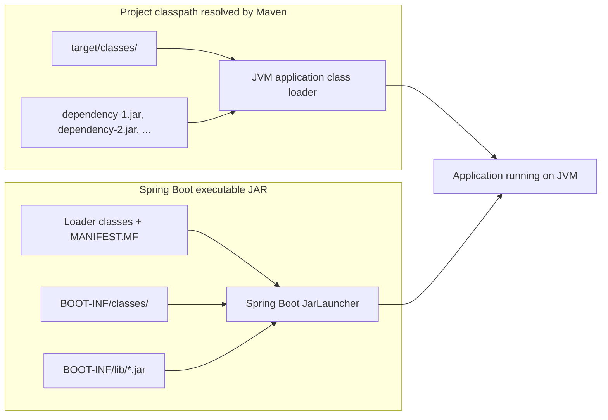
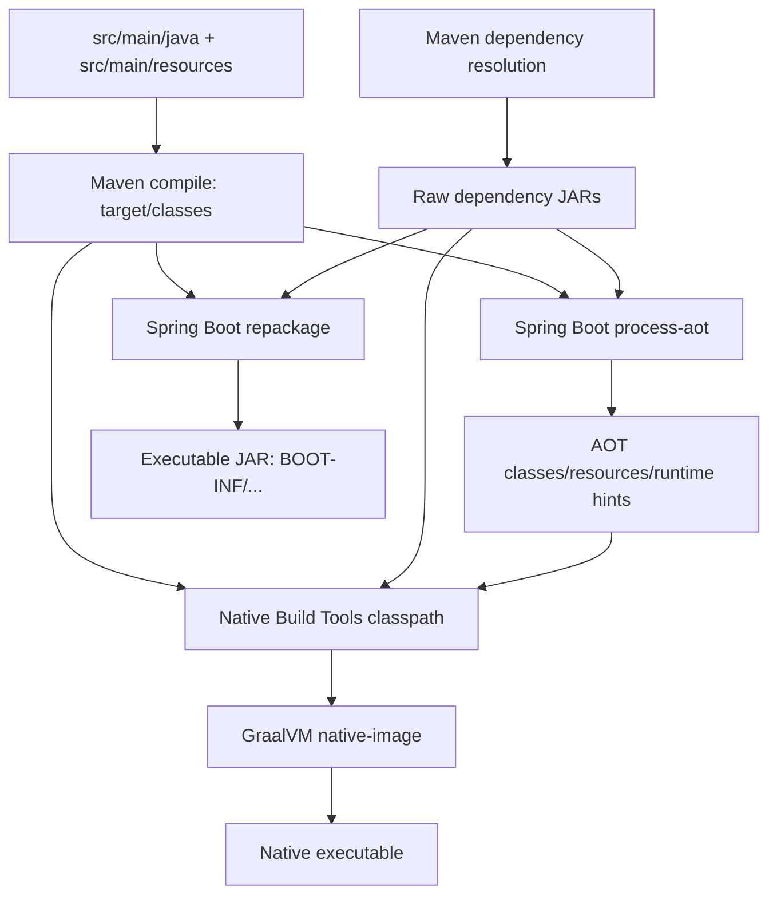

# How the raw classpath differs from the Spring Boot executable JAR layout

## 1. The issue to understand before building native

In the **SPRING_BOOT_NATIVE_IMAGE** module, we migrate a Spring Boot application from the JVM to **GraalVM Native Image** with the help of **Spring AOT**, then verify compatibility, measure startup time/memory, and package containers. A common configuration mistake when working with Maven is **confusing the classpath used to compile/run the application with how Spring Boot packages an executable JAR**.

Two familiar ways of running the app can produce the exact same HTTP response:

```bash
# Running with Maven: uses the project classpath and dependency resolution
./mvnw spring-boot:run

# Running from the executable JAR repackaged by Spring Boot
java -jar target/native-demo-0.0.1-SNAPSHOT.jar
```

However, these are **two different class-loading mechanisms**. If you pass the executable JAR directly as a standard library entry in `java -cp`, or feed it as the classpath input to `native-image` without accounting for its internal layout, the class loader or native compiler may **fail to see the required classes and libraries**.

Lesson objectives:

1. Identify the raw classpath Maven provides for a project: `target/classes` and resolved dependency JARs.
2. Read the layout of a Spring Boot executable JAR: `BOOT-INF/classes`, `BOOT-INF/lib`, launcher, and manifest.
3. Explain why `java -jar` succeeds while `java -cp <boot-jar> <app-main>` can throw `ClassNotFoundException`.
4. Understand why Native Image needs inputs analyzable via a real classpath, Spring AOT code, and runtime hints, rather than relying on the Boot launcher's nested JAR mechanism.
5. Inspect Maven builds, analyze failures, and verify functional equivalence between JVM and native builds.

> **Principle:** an executable JAR is a **deployment format** prepared by Spring Boot for its own launcher; the Maven project classpath is the **set of classes and dependencies** used for compiling/running/testing. When building native, let Spring Boot Maven Plugin and GraalVM Native Build Tools handle the inputs properly.

## 2. What makes up Maven's raw classpath?

Suppose an application has main class `com.example.demo.NativeDemoApplication` and depends on `spring-boot-starter-web`. After compiling with Maven, the project layout typically looks like:

```text
native-demo/
├── pom.xml
├── src/main/java/com/example/demo/NativeDemoApplication.java
├── src/main/resources/application.properties
└── target/
    ├── classes/
    │   ├── com/example/demo/NativeDemoApplication.class
    │   └── application.properties
    └── test-classes/                 # When tests are compiled
```

When running the application from the project classpath, the JVM needs to know:

- **Application class root:** `target/classes`. From this root, the JVM resolves `com/example/demo/NativeDemoApplication.class`.
- **Dependency JARs:** JAR files resolved by Maven, usually stored in the Maven local repository (`~/.m2/repository`) or the configured repository environment.
- **Resources:** files from `src/main/resources` are typically copied into `target/classes` (or other configured resource roots).
- **Test classes and libraries:** `target/test-classes`, test dependencies, and the separate test classpath used when running tests; these are **not** production deployment artifacts by default.

Maven determines the dependency set based on scope, optional/transitive exclusions, and dependency management; the actual classpath paths also depend on the build goal/plugin being executed. For example:

```text
target/classes
~/.m2/repository/org/springframework/boot/spring-boot-...jar
~/.m2/repository/org/springframework/spring-context-...jar
~/.m2/repository/com/fasterxml/jackson/core/jackson-databind-...jar
...
```

The `...` ellipses above are illustrative only: **do not hardcode JAR names or versions**. Maven selects actual dependencies from `pom.xml`, BOMs, and dependency resolution.

### 2.1. What is a classpath entry?

In a traditional Java classpath, an entry is usually:

1. **A package root directory**, such as `target/classes`. When looking up `com.example.demo.NativeDemoApplication`, the class loader appends `com/example/demo/NativeDemoApplication.class` to that directory.
2. **A standard JAR**, containing classes/resources under paths the class loader treats as relative to the root of the JAR.

Example (Linux/macOS; shown only to illustrate classpath shape):

```bash
java -cp "target/classes:/path/to/spring-context.jar:/path/to/other-library.jar" \
  com.example.demo.NativeDemoApplication
```

In practice, **every required dependency** must be present, not just two sample JARs. On Windows, the classpath separator is a semicolon (`;`) instead of a colon (`:`). Hand-crafted classpath commands therefore easily miss a library or use the wrong separator.

The command `./mvnw spring-boot:run` lets the plugin compute the classpath from the project; this is usually the simplest option for checking application behavior before packaging.

### 2.2. Inspecting the runtime classpath resolved by Maven

From the directory containing the application's `pom.xml`, you can run:

```bash
./mvnw clean compile
./mvnw dependency:tree

# Write the runtime dependency JAR list to a diagnostic file
./mvnw dependency:build-classpath \
  -DincludeScope=runtime \
  -Dmdep.outputFile=target/runtime-classpath.txt
```

`dependency:tree` shows direct and transitive dependencies along with resolved versions. `dependency:build-classpath` (Maven Dependency Plugin) exports the dependency list by scope; the generated file **does not include `target/classes` if you only ask for the dependency list**. When constructing a classpath manually to run the application, you must include the appropriate classes directory.

These goal names and parameters assume the Maven Dependency Plugin can be downloaded and executed by Maven in the project. The output file in the example is a **diagnostic artifact**, not a permanent Native Image configuration file.

One way to launch directly using the runtime classpath on POSIX systems:

```bash
APP_CP="target/classes:$(cat target/runtime-classpath.txt)"
java -cp "$APP_CP" com.example.demo.NativeDemoApplication
```

The example assumes the main class, dependencies, and resources have been built properly. This command demonstrates **the main class sitting under `target/classes`**; it does not need the Boot loader. In a multi-module Maven build, run the goal in the application module and note that sibling reactor modules may alter paths depending on how Maven resolves them.

## 3. How does a Spring Boot executable JAR change the layout?

When using `spring-boot-maven-plugin:repackage`, a standard JAR is transformed into a Spring Boot executable JAR. Inside, it is not simply "all classes at the root" like a normal library JAR:

```text
native-demo-0.0.1-SNAPSHOT.jar
├── META-INF/
│   └── MANIFEST.MF
├── org/springframework/boot/loader/...
│   └── ... launcher classes ...
└── BOOT-INF/
    ├── classes/
    │   ├── com/example/demo/NativeDemoApplication.class
    │   └── application.properties
    ├── lib/
    │   ├── spring-boot-...jar
    │   ├── spring-context-...jar
    │   ├── jackson-databind-...jar
    │   └── ...
    ├── classpath.idx          # Optional
    └── layers.idx             # Optional for layered JARs
```

Key points to remember:

- **Application classes** live inside `BOOT-INF/classes/`, not at the JAR root.
- **Dependency JARs** are stored as **nested JARs** inside `BOOT-INF/lib/`.
- **The Spring Boot loader/launcher** places its classes where the JVM can start the launcher; it creates its own class-loading mechanism and loads classes and libraries from `BOOT-INF`.
- `META-INF/MANIFEST.MF` points to the launcher and the application main class, typically via `Main-Class` and `Start-Class` attributes.
- `BOOT-INF/classpath.idx` and `BOOT-INF/layers.idx` are optional metadata depending on version and build settings; they do not turn nested JARs into entries usable directly by a standard Java classpath loader.

For some modern Spring Boot versions, the manifest may look like:

```text
Main-Class: org.springframework.boot.loader.launch.JarLauncher
Start-Class: com.example.demo.NativeDemoApplication
```

This is an **illustrative example**. Older Boot versions use a different launcher package name, such as `org.springframework.boot.loader.JarLauncher`. Read the manifest **of the artifact you actually built**, rather than assuming a fixed name across all releases.

### 3.1. Distinguishing `java -jar` and `java -cp`

When running:

```bash
java -jar target/native-demo-0.0.1-SNAPSHOT.jar
```

The JVM reads `Main-Class` in the manifest and launches the **Spring Boot launcher**. The launcher sets up class loading so the application and nested dependency JARs can run from the executable JAR format.

By contrast, when running:

```bash
# Intentionally incorrect usage example against a Boot executable JAR
java -cp target/native-demo-0.0.1-SNAPSHOT.jar \
  com.example.demo.NativeDemoApplication
```

The standard JVM classpath loader looks for `com/example/demo/NativeDemoApplication.class` **at the root of the JAR**, whereas the file actually resides at `BOOT-INF/classes/com/example/demo/NativeDemoApplication.class`. Consequently, the command typically fails with:

```text
Error: Could not find or load main class com.example.demo.NativeDemoApplication
Caused by: java.lang.ClassNotFoundException: com.example.demo.NativeDemoApplication
```

This error does not mean the class is missing from the artifact; it shows **the class path does not match the classpath root being searched**. Similarly, placing an intact Boot executable JAR on another program's classpath **does not make the JARs inside `BOOT-INF/lib` part of that classpath**.

### 3.2. Visual comparison diagram



Both flows can achieve **equivalent business behavior**, yet their class-loading structures and artifact layouts differ. This difference becomes critical when moving to static analysis tools like GraalVM Native Image.

## 4. Inspecting and comparing real Maven artifacts

### 4.1. Minimal configuration in `pom.xml`

Assuming the project uses a Spring Boot version with AOT/native support, such as declaring the starter and Spring Boot Maven Plugin:

```xml
<dependencies>
    <dependency>
        <groupId>org.springframework.boot</groupId>
        <artifactId>spring-boot-starter-web</artifactId>
    </dependency>
</dependencies>

<build>
    <plugins>
        <plugin>
            <groupId>org.springframework.boot</groupId>
            <artifactId>spring-boot-maven-plugin</artifactId>
        </plugin>
    </plugins>
</build>
```

This is a **configuration snippet inside a complete POM**, not a standalone `pom.xml`. When using `spring-boot-starter-parent` or appropriate dependency management, dependency/plugin versions must follow your project's configuration. If not using the parent and the plugin goal is not bound to the lifecycle, configure `repackage` explicitly per the Spring Boot Maven Plugin docs for your version.

Then run:

```bash
./mvnw clean package
```

The artifact path depends on `artifactId`, `version`, classifier, and final name. For this example, assume the file is `target/native-demo-0.0.1-SNAPSHOT.jar`.

### 4.2. Viewing executable JAR contents

The following commands **only inspect the generated artifact**:

```bash
jar tf target/native-demo-0.0.1-SNAPSHOT.jar

# Linux/macOS: filter only relevant paths
jar tf target/native-demo-0.0.1-SNAPSHOT.jar \
  | grep -E '^(BOOT-INF/classes/|BOOT-INF/lib/|org/springframework/boot/loader/)'

# If unzip is available, read the manifest without extracting everything
unzip -p target/native-demo-0.0.1-SNAPSHOT.jar META-INF/MANIFEST.MF
```

On PowerShell, you can filter the listing with:

```powershell
jar tf .\target\native-demo-0.0.1-SNAPSHOT.jar |
  Select-String '^(BOOT-INF/classes/|BOOT-INF/lib/|org/springframework/boot/loader/)'
```

If you do not see `BOOT-INF/classes` and `BOOT-INF/lib`, verify whether the file you are reading is actually a **repackaged Spring Boot executable JAR** or just an **ordinary JAR**, or whether the project uses a custom layout/packaging type. Never infer from the `.jar` extension alone that a file is a Boot executable JAR.

### 4.3. Comparing the three execution paths

| Execution method | Primary inputs | Who sets up the classpath? | Expected result |
| --- | --- | --- | --- |
| `./mvnw spring-boot:run` | Project classes and Maven-resolved dependencies | Spring Boot Maven Plugin | Runs the app from the project, typically without using the repackaged JAR. |
| `java -jar app.jar` | Spring Boot executable JAR | JVM reads manifest; Boot launcher handles `BOOT-INF` | Runs the app from the deployment artifact. |
| `java -cp app.jar com.example.Main` | Only the JAR file as a standard classpath entry | Standard JVM classpath loader | Typically fails because app classes sit under `BOOT-INF/classes`. |
| `java -cp target/classes:<dependencies> com.example.Main` | Raw classes and dependency JARs | Standard JVM classpath loader | Runs properly if the classpath is complete and config matches. |

In the last row, `<dependencies>` represents all appropriate JAR paths—shorthand notation rather than literal command-line syntax. On Windows, separate classpath entries with `;`.

## 5. Why does GraalVM Native Image care about this difference?

GraalVM Native Image builds an executable by analyzing **classes, dependencies, and metadata/hints** at build time. This process does not operate identically to the JVM launching the Boot loader and dynamically loading nested JARs. Therefore, **do not assume** the following command is equivalent to Maven Native Build Tools:

```bash
# Not the standard native path for a Spring Boot executable JAR
native-image -jar target/native-demo-0.0.1-SNAPSHOT.jar
```

That command may fail to analyze the application/dependencies inside `BOOT-INF`, or see only loader-related entries and miss necessary metadata. Even when the main class is found, Spring Boot relies on proxies, reflection, serialization, resources, and initialization logic requiring AOT support. A JAR that runs with `java -jar` **does not automatically mean** it can be fed as-is into `native-image`.

In the standard integration model:

1. **Maven** resolves the project's dependency graph, compiled classes, and resources.
2. **Spring Boot Maven Plugin** runs `spring-boot:process-aot` to analyze the application context and generate code plus runtime hints for Native Image.
3. **GraalVM Native Build Tools Maven Plugin** uses the appropriate inputs (including AOT when properly configured) to invoke Native Image with the right classpath and build arguments.
4. **Native Image** builds the executable for the target OS/architecture.



The diagram is a logical model: **AOT output names and paths, Maven goal dependencies, and lifecycle ordering may differ across versions/plugin configurations**. Never assume the native plugin simply takes `target/classes` and skips AOT; verify from actual build logs.

### 5.1. Role of the executable JAR in native builds

A Spring Boot executable JAR remains useful:

- It is the **standard JVM artifact** for smoke testing and keeping as a baseline/rollback version.
- It serves as input for **Spring Boot Buildpacks** when configuring `spring-boot:build-image`; the builder can produce either a JVM or native image depending on buildpack mode and support.
- It is a deployment artifact operated via `java -jar` or a launcher when appropriate.

However, it is not necessarily the **right classpath input for the native compiler**. Native builds should rely on the Maven/AOT integration rather than passing a repackaged executable JAR after `-cp` or unpacking it ad hoc and hoping nested JARs work.

### 5.2. Can `BOOT-INF` be unpacked to build a classpath?

In principle, you can extract `BOOT-INF/classes` as a **root directory** and the nested JARs in `BOOT-INF/lib` as **individual JARs** to assemble a valid classpath. However, this is a manual step prone to breaking dependency order, metadata, resource handling, and generated AOT outputs; it **does not replace** the Spring AOT/native integration pipeline.

That is different from appending `BOOT-INF/classes` to a classpath string pointing inside a compressed JAR: standard classpath loaders do not treat a subpath inside a JAR archive as an independent directory entry. Even if directories are unpacked properly, all real dependency JARs must still be listed as separate paths.

If an external tool outside Maven strictly requires a flattened classpath, build that classpath from **compiled project classes + Maven dependency resolution + AOT outputs** per the tool's documentation, then test compatibility. Do not switch to that path automatically just because `native-image -jar` failed.

## 6. Standard Maven workflow when migrating from JVM to native

Before running, verify that Java, Spring Boot, GraalVM, and Maven Native Build Tools have **compatible** versions, and that Native Image has the required C compiler/linker in the build environment. The commands below apply to a project **already configured with the proper plugins and `native` profile**; `-Pnative` does not create missing profiles or plugins.

### Step 1 — Run on the JVM and lock down the contract

```bash
./mvnw clean verify
./mvnw spring-boot:run
```

In another terminal, test an endpoint appropriate for your application; for example:

```bash
curl -i http://localhost:8080/api/hello
```

Record HTTP status, JSON body, validation behavior, and relevant error handling. This runs from the project classpath and serves as the baseline for native comparison.

### Step 2 — Package, inspect JAR layout, and re-run

```bash
./mvnw clean package
jar tf target/native-demo-0.0.1-SNAPSHOT.jar
java -jar target/native-demo-0.0.1-SNAPSHOT.jar
```

Replace the example filename with the actual filename from Maven's output. If `java -jar` works well while invoking the main class via `java -cp <boot-jar>` fails, use the `jar tf` output to verify this is a classpath/packaging difference—not yet an indicator of native incompatibility.

### Step 3 — Inspect AOT independently

```bash
./mvnw -Pnative spring-boot:process-aot
```

Inspect logs for the bean graph, dependencies, profile/condition resolution, and generated code, resources, and hints. This step **does not produce a native executable**; it prepares the Spring AOT output. Do not modify generated sources directly because subsequent builds may overwrite them.

### Step 4 — Compile with Native Build Tools

```bash
./mvnw -Pnative native:compile

# When deep logs are needed to trace plugins, AOT, and Native Image:
./mvnw -Pnative native:compile -X
```

The `native:compile` goal belongs to the GraalVM Native Build Tools Maven Plugin. Standard integration passes AOT outputs through the proper native configuration/lifecycle; **inspect logs to confirm they were actually included in the build**. If you invoke the goal alone on a POM without Spring AOT configured, do not conclude the binary is ready.

The executable path is usually inside `target/` with a name determined by the project, native plugin configuration, and platform; do not assume the name always matches the JAR name. After building, run the actual executable and re-test the same APIs/configs as on the JVM.

### Step 5 — Test and benchmark

Run the same functional test suite on both JVM and native. Prioritize paths prone to closed-world analysis issues: reflection, JSON serialization, templates/resources, dynamic proxies, JDBC/drivers, TLS, localization, caching, and external integrations. Use native test mode if supported by the plugin/test framework; add out-of-process/container smoke tests to verify real behavior.

When measuring startup/memory, clearly define **process start → readiness** and the memory metric measured such as RSS or working set. Run multiple iterations with identical data/resources, reporting medians and measurement conditions. Native builds may start faster and use less memory in certain workloads, while trade-offs in build time, CPU, or throughput must be measured in practice.

### Step 6 — Package containers via the right build path

If using Cloud Native Buildpacks:

```bash
./mvnw -Pnative spring-boot:build-image \
  -Dspring-boot.build-image.imageName=example/native-demo:local
```

The builder must support native mode and have matching profile/buildpack configuration. Inspect logs to confirm the created image actually contains a native executable rather than assuming `-Pnative` yields a native image in every project. When packaging a native executable directly via a Dockerfile, choose a matching runtime base image, libc/architecture, and file permissions.

## 7. Symptoms that frequently cause misdiagnosis

| Symptom | Why might this happen? | What to check |
| --- | --- | --- |
| `java -jar app.jar` works, but `java -cp app.jar com.example.Main` throws class not found. | Main class is inside `BOOT-INF/classes` and requires the Boot launcher. | `jar tf`, manifest, `BOOT-INF/classes`. |
| ClassLoader cannot find `org.springframework...` when putting the boot JAR on classpath manually. | Dependency JARs are **nested** in `BOOT-INF/lib`, not standard classpath entries. | Compare Maven runtime classpath and JAR contents. |
| `native-image -jar boot-app.jar` fails to recognize app/dependencies. | Native Image does not replicate Boot nested-JAR loading and AOT inputs automatically. | Use Maven Native Build Tools, native classpath logs, AOT. |
| `jar tf` shows no `BOOT-INF`. | Reading a regular JAR, repackage skipped, or artifact uses a different layout. | `spring-boot-maven-plugin`, lifecycle, classifier, finalName, actual artifact. |
| After `package`, both a JAR and `.original` file exist. | Spring Boot repackage can preserve the pre-repackaged artifact depending on config. | Identify which file is the boot executable JAR via `jar tf`/manifest. |
| Native build succeeds, but reading a resource from `src/main/resources` fails. | Resource not included in native image or dynamic path lacks resource hints. | Check `target/classes`, resource path, AOT hints, native runtime. |
| JVM runs fine, native JSON deserialization fails. | Reflection/member binding insufficiently analyzed or registered. | Reproduce failing DTO, inspect runtime hints, and run native tests. |
| Spring Boot AOT fails on a bean/condition. | Build-time profile/condition or AOT-incompatible dependency. | `spring-boot:process-aot` logs and build/run configuration. |
| Maven dependency classpath differs from libs inside Boot JAR. | Scope/optional/exclusions, repackage layout, classifier, or plugin config alters what is packaged. | `dependency:tree`, effective POM, `jar tf`; reconcile scopes. |
| Image behaves differently on CI than locally. | Different JDK/GraalVM/OS/architecture, environment variables, Docker builder, or resources. | Record fingerprints and test on a real runner/container. |

**Critical distinction:** a `ClassNotFoundException` when invoking the main class directly with the wrong classpath is a **packaging/classpath error**. A `ClassNotFoundException` that appears only when running the native executable may come from **dynamic class access** omitted from the Native Image binary, or from an incompatible design. Despite the identical exception name, the causes and fixes differ.

### 7.1. Avoid "fixing" by copying dependencies haphazardly

When a native build reports missing classes, do not copy JARs out of `BOOT-INF/lib` into your project and append each to `-cp` if Maven already manages dependencies. Doing so easily creates **two versions of a library**, breaks resolution order, or becomes unreproducible in CI. First check `pom.xml`, `dependency:tree`, plugin classpaths, and AOT/native logs.

Likewise, do not use a `BOOT-INF/lib/*` wildcard pointing **inside a compressed JAR**: that is not a filesystem directory of standalone JARs. Java classpath wildcards only work on actual entries/paths supported by the classpath mechanism and do not unpack nested JARs inside a Boot archive.

### 7.2. `BOOT-INF` can change with packaging type

The examples above describe the common **Spring Boot executable JAR**. Executable WARs use a different layout (e.g., `WEB-INF/classes`/`WEB-INF/lib`), and plugin layouts can be customized. The case addressed here is an executable JAR with `BOOT-INF`; if your project produces a WAR or custom layout, inspect the real artifact and the corresponding launcher documentation.

## 8. Hands-on exercise: demonstrating the two different classpaths

**Context:** A Maven project uses Spring Boot Web and has a `GET /api/hello` endpoint. The team wants to compile it to GraalVM Native Image to evaluate startup/memory, but one member tried `native-image -jar target/app.jar` and hit class-loading errors.

### Tasks

1. Run `./mvnw clean compile` and point out the root directory for compiled classes/resources.
2. Run `./mvnw dependency:tree` and export the runtime dependency classpath. Record at least three real dependency JARs with their versions.
3. Run `./mvnw package`, locate the executable JAR, read its manifest, and list `BOOT-INF/classes` and `BOOT-INF/lib`.
4. Run `java -jar <actual-artifact>.jar` and save the API response. Try invoking the main class via `java -cp <boot-jar>` to record the expected class-loading error; run this only after verifying the exact main class.
5. Use the configured Spring Boot AOT and GraalVM Native Build Tools to build via `./mvnw -Pnative native:compile`. Record the classpath/AOT inputs from plugin logs, the output binary path, and the exact GraalVM/toolchain version used.
6. Run the native binary; verify the same endpoint, validation, JSON, resources, and key exceptions.
7. Measure startup-to-ready and RSS for both JVM and native under identical conditions; record actual results and reproduction steps.

### Suggested results table

| Item | Maven classpath/JVM run from project | Spring Boot executable JAR | GraalVM native executable |
| --- | --- | --- | --- |
| Primary inputs | `target/classes` + dependency JARs | `BOOT-INF/classes` + nested `BOOT-INF/lib` | Classes/dependencies/AOT/hints supplied by native plugin |
| Launch mechanism | Main class with standard classpath / `spring-boot:run` | Spring Boot launcher via `java -jar` | OS executes native binary |
| Where to verify | `dependency:tree`, build-classpath, compiler output | `jar tf` and manifest | Native plugin logs, binary artifact |
| Dynamic resource reading | JVM classpath rules | Boot loader supports nested archives | Depends on AOT/resource hints and native image contents |
| Test/HTTP status | *Measure in practice* | *Measure in practice* | *Measure in practice* |
| Startup/RSS | *Measure in practice* | *Measure in practice* | *Measure in practice* |

The separation in the table does not imply functional divergence: **the goal is equivalence on the API contract** despite different packaging, class loading, and startup mechanisms.

### Completion checklist

- [ ] Can explain why `target/classes` is a valid classpath root while `BOOT-INF/classes` **inside a JAR** is not automatically an independent classpath entry.
- [ ] Can point to actual classes/dependencies inside `BOOT-INF` using the artifact listing.
- [ ] Can distinguish `Main-Class` (Boot launcher) from `Start-Class` (application main class) in the current version's manifest.
- [ ] Has empirical evidence that `spring-boot:run`, `java -jar`, and `java -cp boot.jar Main` do not share the same class-loading mechanism.
- [ ] Native build uses properly configured Maven/Spring AOT/Native Build Tools; logs confirm classpath/AOT inputs and selected toolchain.
- [ ] Native build passes the same key API/integration tests; benchmark results state clear measurement sources.
- [ ] Does not claim native compatibility or superior speed solely from `native:compile` succeeding.

## 9. Self-assessment questions

1. Why does `java -jar` locate the main class in a Spring Boot executable JAR, whereas `java -cp app.jar com.example.Main` can fail to find it?
2. When Maven runs `spring-boot:run`, which directory acts as the classpath root for application code?
3. Can `BOOT-INF/lib/example.jar` be treated as an ordinary Java classpath entry while still nested inside another JAR? Why?
4. What does `spring-boot:repackage` alter in the JAR structure, and what remains unchanged in the project's dependency graph?
5. Why is invoking `native-image -jar boot-app.jar` not equivalent to the Spring AOT + Native Build Tools integration?
6. When native runtime reports a missing resource, which sources should you compare to distinguish a resource missing from the JVM classpath vs. missing from the native image?
7. What evidence should you gather to confirm the native compiler used the right AOT outputs, dependencies, and toolchain?

## 10. Official references

Launcher layouts, package names, Maven plugin lifecycles, and Native Image flags may evolve between releases. Always cross-check against your **actual project version**:

- [Spring Boot — Executable JAR Format](https://docs.spring.io/spring-boot/specification/executable-jar/index.html): `BOOT-INF` structure, nested JARs, and launcher.
- [Spring Boot Maven Plugin](https://docs.spring.io/spring-boot/maven-plugin/index.html): `repackage`, `spring-boot:run`, AOT, and build-image.
- [Spring Boot — GraalVM Native Image](https://docs.spring.io/spring-boot/reference/packaging/native-image/index.html): Spring AOT/native workflows with Maven and Gradle.
- [GraalVM Native Build Tools](https://graalvm.github.io/native-build-tools/latest/): `native-maven-plugin`, classpath, plugin goals, and native testing.
- [GraalVM Native Image](https://www.graalvm.org/latest/reference-manual/native-image/): reachability analysis, build options, and compatibility requirements.
- [Maven Dependency Plugin — build-classpath](https://maven.apache.org/plugins/maven-dependency-plugin/build-classpath-mojo.html): exporting the dependency classpath for diagnostics.

**Key takeaway:** the **project classpath**, the **Spring Boot executable JAR**, and **Native Image inputs** are three related but non-identical concepts. Understanding `target/classes`, `BOOT-INF/classes`, `BOOT-INF/lib`, and the Boot launcher helps pinpoint packaging errors accurately, avoid misconfigured classpaths, and produce verifiable native builds.
