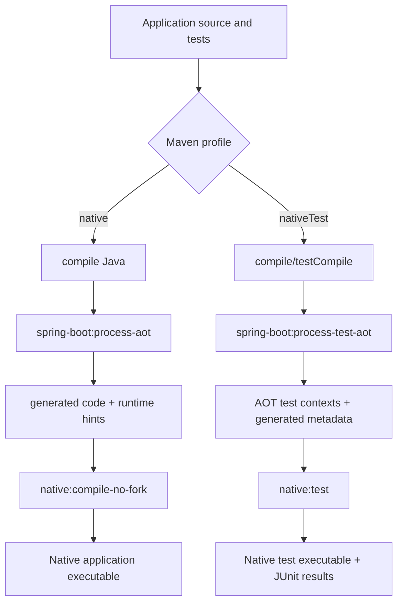
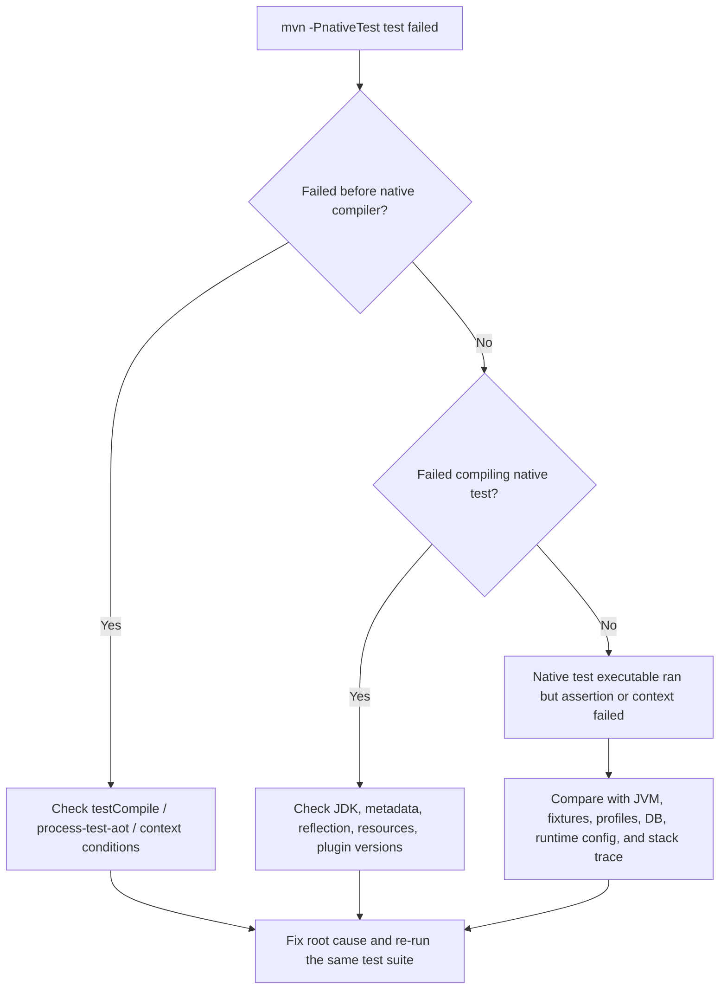

# Configuring AOT and native tests without Spring Boot parent

A Spring Boot project can use Maven **without inheriting** `org.springframework.boot:spring-boot-starter-parent`. This happens frequently when a company maintains its own parent POM, uses a multi-module Maven build, or wants direct control over plugin versions. The application can still be compiled into a **GraalVM Native Image** with Spring AOT and run tests inside a native executable, but the Maven configurations that Spring Boot parent normally supplies must be declared explicitly.

This lesson belongs to the **Maven** chapter of the `SPRING_BOOT_NATIVE_IMAGE` module. The focus is distinguishing **application AOT** from **test AOT**, creating the `native` and `nativeTest` Maven profiles without Spring Boot parent, reading execution logs, and diagnosing failures. These skills form the foundation for compatibility testing, startup/memory benchmarking, and native container packaging.

## 1. Why does omitting Spring Boot parent require extra configuration?

`spring-boot-starter-parent` carries many convenient defaults, including:

- Version management for Spring Boot dependencies.
- Compiler settings, UTF-8 encoding, parameter-name metadata, and Maven plugin versions.
- The `spring-boot:repackage` execution for producing an executable JAR.
- The `native` profile to run application AOT processing and prepare Native Build Tools.
- The `nativeTest` profile to run test AOT processing and execute tests in Native Image.

When using a different parent POM, you can still **import the `spring-boot-dependencies` BOM** inside `dependencyManagement`. However, importing a BOM only manages **dependency versions**; it **does not inherit** `pluginManagement`, plugin executions, or Maven profiles from `spring-boot-starter-parent`.

| Declaration | What it provides | What it does not provide automatically |
| --- | --- | --- |
| Importing `spring-boot-dependencies` with `type=pom, scope=import` | Versions for Spring Boot starters and BOM-managed libraries | Spring Boot Maven plugin version/executions, `nativeTest` profile |
| `spring-boot-maven-plugin` | Goals `repackage`, `process-aot`, `process-test-aot` | Automatic execution if you only add the plugin without configuring its goals |
| `native-maven-plugin` | Building native executables, running native tests, applying reachability metadata | Inferring missing Spring AOT choices, bean graphs, or resource contents |
| `maven-compiler-plugin` | Compiling Java, preserving parameter metadata when `parameters` is enabled | Automatic compiler config like Spring Boot parent |
| `maven-surefire-plugin` | Running JUnit tests on the JVM | Running tests inside GraalVM Native Image without Native Build Tools and test AOT config |

**Important Maven rule:** `<pluginManagement>` only supplies configuration for plugins **actually used/declared** under `<build><plugins>`. An entry appearing solely in `pluginManagement` does not trigger goals by itself. Likewise, naming a profile `nativeTest` does not make Maven auto-generate executions like Spring Boot parent.

## 2. Understanding both build paths before editing `pom.xml`



Three categories of tasks must be distinguished:

1. **`spring-boot:process-aot`:** Spring analyzes the application, evaluates bean conditions matching the build environment, and generates sources/classes/resources/hints for Native Image. This is the step for the **main application**.
2. **`spring-boot:process-test-aot`:** Spring Test AOT analyzes the `ApplicationContext` instances needed by tests based on Spring TestContext/JUnit and generates corresponding code. This is the step for **tests**, and does not replace application `process-aot` in every workflow.
3. **`native:test`:** Native Build Tools compiles a **native test executable**, bundling the JUnit Platform engine and discovered tests, and executes it. This is not the command that sends HTTP requests to the application binary built under `native`.

Keeping these separate prevents a common misconception: **`mvn test` passing on the JVM does not prove `native:test` will pass**, because reflection, proxies, resources, and the required context graph may be handled differently during GraalVM analysis.

## 3. Environment requirements and versions used in the example

This lesson uses a **concrete illustrative setup** you can try in a small `jar`-packaged Maven project:

| Component | Illustrative value | Notes |
| --- | --- | --- |
| Spring Boot | `3.5.16` | Example picks the Spring Boot 3.5.x line; if your project uses another line, align plugins and BOM accordingly. |
| Java / GraalVM JDK | `21` | Use a GraalVM build with `native-image` matching Java 21; ensure `JAVA_HOME` points to the right toolchain. |
| GraalVM Native Build Tools Maven plugin | `0.10.6` | Compatible version documented for Spring Boot 3.5.x; do not assume the latest plugin version fits every Boot branch. |
| Maven Compiler Plugin | `3.14.1` | Enable `<release>21</release>` and `<parameters>true</parameters>`. |
| Maven Surefire Plugin | `3.5.4` | Supports JUnit Platform; Native Build Tools requires a sufficiently recent Surefire to run native tests. |
| Maven | `3.6.3+` for Spring Boot 3.5.x | Projects should use `mvnw` to pin the Maven version across the team. |

The version numbers above illustrate **one configuration set**, not a requirement that every application use those exact versions. When upgrading Spring Boot/GraalVM, consult the compatibility matrix and official documentation for your chosen versions.

Check the tools before building:

```bash
java -version
./mvnw --version
native-image --version
```

If `native-image` is unavailable, install a compatible GraalVM distribution or use Cloud Native Buildpacks (which requires a container environment). On Windows, replace `./mvnw` with `mvnw.cmd`; direct host native builds also require C/C++ build tools and OS toolchain support.

## 4. Creating a small application and test to observe

The example assumes this structure:

```text
native-demo/
├── pom.xml
└── src/
    ├── main/java/com/example/nativebuild/
    │   ├── NativeBuildApplication.java
    │   └── HelloController.java
    └── test/java/com/example/nativebuild/
        └── NativeBuildApplicationTests.java
```

`NativeBuildApplication.java`:

```java
package com.example.nativebuild;

import org.springframework.boot.SpringApplication;
import org.springframework.boot.autoconfigure.SpringBootApplication;

@SpringBootApplication
public class NativeBuildApplication {
    public static void main(String[] args) {
        SpringApplication.run(NativeBuildApplication.class, args);
    }
}
```

`HelloController.java`:

```java
package com.example.nativebuild;

import java.util.Map;
import org.springframework.web.bind.annotation.GetMapping;
import org.springframework.web.bind.annotation.RestController;

@RestController
class HelloController {
    @GetMapping("/hello")
    Map<String, String> hello() {
        return Map.of("message", "Hello Native");
    }
}
```

`NativeBuildApplicationTests.java`:

```java
package com.example.nativebuild;

import org.junit.jupiter.api.Test;
import org.springframework.beans.factory.annotation.Autowired;
import org.springframework.boot.test.context.SpringBootTest;

import static org.junit.jupiter.api.Assertions.assertEquals;

@SpringBootTest
class NativeBuildApplicationTests {
    @Autowired
    HelloController controller;

    @Test
    void springContextRegistersController() {
        assertEquals("Hello Native", controller.hello().get("message"));
    }
}
```

The test uses `@SpringBootTest` to actually create a Spring context and verify a business bean. This is a **wiring smoke test**; system testing should add HTTP requests, validation, JSON, resources, database, and error cases based on real features.

## 5. Complete `pom.xml` without inheriting `spring-boot-starter-parent`

The configuration below illustrates a **standalone Spring Boot application with JAR packaging** and no `<parent>` section. If your organization uses a custom parent POM, keep that parent and **merge** the missing entries; avoid duplicating executions/versions already declared in your corporate parent.

```xml
<?xml version="1.0" encoding="UTF-8"?>
<project xmlns="http://maven.apache.org/POM/4.0.0"
         xmlns:xsi="http://www.w3.org/2001/XMLSchema-instance"
         xsi:schemaLocation="http://maven.apache.org/POM/4.0.0
                             https://maven.apache.org/xsd/maven-4.0.0.xsd">
    <modelVersion>4.0.0</modelVersion>

    <groupId>com.example</groupId>
    <artifactId>native-demo</artifactId>
    <version>0.0.1-SNAPSHOT</version>
    <packaging>jar</packaging>

    <properties>
        <java.version>21</java.version>
        <project.build.sourceEncoding>UTF-8</project.build.sourceEncoding>
        <spring-boot.version>3.5.16</spring-boot.version>
        <native.buildtools.version>0.10.6</native.buildtools.version>
    </properties>

    <!-- Import BOM: manages dependencies, does not bring Boot parent profiles. -->
    <dependencyManagement>
        <dependencies>
            <dependency>
                <groupId>org.springframework.boot</groupId>
                <artifactId>spring-boot-dependencies</artifactId>
                <version>${spring-boot.version}</version>
                <type>pom</type>
                <scope>import</scope>
            </dependency>
        </dependencies>
    </dependencyManagement>

    <dependencies>
        <dependency>
            <groupId>org.springframework.boot</groupId>
            <artifactId>spring-boot-starter-web</artifactId>
        </dependency>
        <dependency>
            <groupId>org.springframework.boot</groupId>
            <artifactId>spring-boot-starter-test</artifactId>
            <scope>test</scope>
        </dependency>
    </dependencies>

    <build>
        <plugins>
            <!-- No Spring Boot parent, so declare compiler explicitly. -->
            <plugin>
                <groupId>org.apache.maven.plugins</groupId>
                <artifactId>maven-compiler-plugin</artifactId>
                <version>3.14.1</version>
                <configuration>
                    <release>${java.version}</release>
                    <parameters>true</parameters>
                </configuration>
            </plugin>

            <plugin>
                <groupId>org.apache.maven.plugins</groupId>
                <artifactId>maven-surefire-plugin</artifactId>
                <version>3.5.4</version>
            </plugin>

            <plugin>
                <groupId>org.springframework.boot</groupId>
                <artifactId>spring-boot-maven-plugin</artifactId>
                <version>${spring-boot.version}</version>
                <configuration>
                    <mainClass>com.example.nativebuild.NativeBuildApplication</mainClass>
                </configuration>
                <executions>
                    <execution>
                        <id>repackage</id>
                        <goals>
                            <goal>repackage</goal>
                        </goals>
                    </execution>
                </executions>
            </plugin>
        </plugins>
    </build>

    <profiles>
        <!-- Build native application: mvn -Pnative package -->
        <profile>
            <id>native</id>
            <build>
                <plugins>
                    <plugin>
                        <groupId>org.springframework.boot</groupId>
                        <artifactId>spring-boot-maven-plugin</artifactId>
                        <executions>
                            <execution>
                                <id>process-aot</id>
                                <phase>process-classes</phase>
                                <goals>
                                    <goal>process-aot</goal>
                                </goals>
                            </execution>
                        </executions>
                    </plugin>

                    <plugin>
                        <groupId>org.graalvm.buildtools</groupId>
                        <artifactId>native-maven-plugin</artifactId>
                        <version>${native.buildtools.version}</version>
                        <extensions>true</extensions>
                        <configuration>
                            <!-- Raw compiled classes, not the Boot repackaged JAR. -->
                            <classesDirectory>${project.build.outputDirectory}</classesDirectory>
                            <mainClass>com.example.nativebuild.NativeBuildApplication</mainClass>
                            <imageName>native-demo</imageName>
                        </configuration>
                        <executions>
                            <execution>
                                <id>reachability-metadata</id>
                                <phase>generate-resources</phase>
                                <goals>
                                    <goal>add-reachability-metadata</goal>
                                </goals>
                            </execution>
                            <execution>
                                <id>compile-native</id>
                                <phase>package</phase>
                                <goals>
                                    <goal>compile-no-fork</goal>
                                </goals>
                            </execution>
                        </executions>
                    </plugin>
                </plugins>
            </build>
        </profile>

        <!-- Native test: mvn -PnativeTest test -->
        <profile>
            <id>nativeTest</id>
            <build>
                <plugins>
                    <plugin>
                        <groupId>org.springframework.boot</groupId>
                        <artifactId>spring-boot-maven-plugin</artifactId>
                        <executions>
                            <execution>
                                <id>process-test-aot</id>
                                <phase>process-test-classes</phase>
                                <goals>
                                    <goal>process-test-aot</goal>
                                </goals>
                            </execution>
                        </executions>
                    </plugin>

                    <plugin>
                        <groupId>org.graalvm.buildtools</groupId>
                        <artifactId>native-maven-plugin</artifactId>
                        <version>${native.buildtools.version}</version>
                        <extensions>true</extensions>
                        <configuration>
                            <classesDirectory>${project.build.outputDirectory}</classesDirectory>
                        </configuration>
                        <executions>
                            <execution>
                                <id>native-test</id>
                                <phase>test</phase>
                                <goals>
                                    <goal>test</goal>
                                </goals>
                            </execution>
                        </executions>
                    </plugin>
                </plugins>
            </build>
        </profile>
    </profiles>
</project>
```

**Design rationale:** `repackage`, the compiler, and Surefire are declared in the shared build because the JVM build needs them as well. The `native` and `nativeTest` profiles are kept separate so routine `mvn test` does not accidentally trigger a native build, and `mvn -PnativeTest test` does not have to build the full application executable. Executions in profiles sharing the same `groupId:artifactId` as the Spring Boot plugin in the main build are merged by Maven into the effective POM.

### 5.1. Why is `<parameters>true</parameters>` needed?

Spring MVC, constructor binding, and several injection mechanisms may need **parameter names**. Spring Boot parent automatically configures the compiler to emit this metadata via `-parameters`; here we enable it explicitly in Maven Compiler Plugin. Do not leave Maven's default compiler level or plugin versions unmanaged when targeting native builds.

### 5.2. Why must `mainClass` be specified?

In projects with multiple classes containing `main()`, AOT/Boot plugins may pick the wrong class or fail to resolve the entry point. Here, `mainClass` is set explicitly for both the Boot plugin (for `repackage` and `process-aot`) and Native Build Tools (for `compile-no-fork`).

### 5.3. Why use `classesDirectory`?

Spring Boot `repackage` builds an **executable fat JAR** with its own layout. Native Build Tools needs a classpath the compiler understands; when building native from raw compiled classes, we point to `${project.build.outputDirectory}` plus dependencies so the fat JAR is not treated like a flat standard JAR. If you change packaging or use a corporate parent, verify the effective POM, actual classpath, and output logs.

### 5.4. Role of `add-reachability-metadata`

Some third-party libraries require reflection/resource/proxy metadata. Native Build Tools can pull metadata from the **GraalVM Reachability Metadata Repository**. The `add-reachability-metadata` goal is helpful when metadata needs to be staged as resources inside the artifact for downstream build steps, especially when creating container images via Buildpacks.

It **does not replace** Spring `RuntimeHints` and does not guarantee every library is compatible. For direct native builds, the plugin also automatically applies reachability metadata depending on active version and configuration. Do not add broad metadata indiscriminately before identifying an actual failure or relevant library.

## 6. Running each phase and observing results

In the example using Maven Wrapper, run commands from the directory containing `pom.xml`.

### 6.1. Verify the JVM build first

```bash
./mvnw clean test
./mvnw package
java -jar target/native-demo-0.0.1-SNAPSHOT.jar
```

In another terminal:

```bash
curl -i http://localhost:8080/hello
```

Expect `HTTP 200` and JSON containing `"Hello Native"`. This is the **baseline**; JVM passing does not prove all native tests will pass.

### 6.2. Inspect AOT output without building native

```bash
./mvnw -Pnative -DskipTests process-classes
```

The `process-classes` phase runs after compilation and triggers the `spring-boot:process-aot` execution. Depending on the version, generated code and resources usually live under:

```text
target/
└── spring-aot/
    └── main/
        ├── sources/
        ├── resources/
        └── classes/
```

Look for bean registration code, `ApplicationContextInitializer` classes, and resources/hints. `@Profile` and `@ConditionalOnProperty` conditions affecting the bean graph may already be evaluated during this step, so build-time profiles must be controlled.

### 6.3. Build the native application

```bash
./mvnw -Pnative -DskipTests package
```

With the profile in this lesson, `package` runs compilation, `process-aot`, `repackage`, and `native:compile-no-fork`. The native binary is typically at `target/native-demo` on Linux/macOS or the corresponding OS executable name. Run:

```bash
./target/native-demo --server.port=8081
curl -i http://localhost:8081/hello
```

The message and status must match the JVM build. Do not compare startup time or memory before testing functional parity across real endpoints and flows.

If you want to keep JVM unit tests during this build, omit `-DskipTests`. That flag is shown in the example only to separate the native compilation step from native tests; do not enable it by default in CI pipelines where tests gate releases.

### 6.4. Run native tests

```bash
./mvnw -PnativeTest test
```

Check logs across three milestones:

1. `maven-compiler-plugin:testCompile` compiled tests.
2. `spring-boot:process-test-aot` analyzed Spring TestContext and generated test code/hints.
3. `native-maven-plugin:test` built the native test executable and ran JUnit Platform inside that executable.

Native tests can take substantially longer to build than JVM tests. The exact path of the test executable and reports produced by Native Build Tools/Surefire depends on version and config; inspect logs and `target/` from the real build rather than guessing exact filenames. If zero tests are discovered, do not count that run as a passing native test suite.

### 6.5. Comparing commonly confused commands

| Command | What you actually test/build |
| --- | --- |
| `./mvnw test` | JVM tests using Surefire; does not run native unless a native goal is bound to the phase. |
| `./mvnw -Pnative process-classes` | Compiles sources and runs Spring AOT for the **application**; does not create an executable yet. |
| `./mvnw -Pnative package` | Builds the application native executable per the profile in this lesson. |
| `./mvnw -PnativeTest test` | Runs AOT for **tests** and executes tests inside a native executable. |
| `./mvnw -PnativeTest -DskipNativeTests test` | Skips native tests; cannot be used to claim native testing passed. |
| `./mvnw -Pnative -DskipTests package` | Builds the native application while skipping JVM tests in that run; does not replace native tests. |

In particular, `mvn -Pnative native:compile` and `mvn -Pnative package` are **not completely synonymous** in every POM. The `compile` goal may fork the lifecycle per plugin behavior, whereas `compile-no-fork` is designed to bind to a phase once Maven has compiled the required inputs. With the configuration above, use `package` to follow the declared executions accurately.

## 7. Ensuring Spring AOT receives the right build-time configuration

Spring AOT analyzes the ApplicationContext **before runtime**. Configurations that determine which beans exist must be selected when AOT runs, not only passed when launching the native executable.

Example:

```java
@Configuration(proxyBeanMethods = false)
class AuditConfiguration {
    @Bean
    @ConditionalOnProperty(name = "feature.audit.enabled", havingValue = "true")
    AuditWriter auditWriter() {
        return new AuditWriter();
    }
}
```

If `feature.audit.enabled` is absent or false when `process-aot` runs, the bean may be excluded from generated registrations. Passing `--feature.audit.enabled=true` later when running the executable will not necessarily bring back an excluded bean.

You can specify Spring profiles for `process-aot` in the plugin configuration, for example:

```xml
<plugin>
    <groupId>org.springframework.boot</groupId>
    <artifactId>spring-boot-maven-plugin</artifactId>
    <executions>
        <execution>
            <id>process-aot</id>
            <goals><goal>process-aot</goal></goals>
            <configuration>
                <profiles>
                    <profile>native-build</profile>
                </profiles>
            </configuration>
        </execution>
    </executions>
</plugin>
```

This snippet illustrates **integrating into an existing execution**, not adding a duplicate execution ID/goal to the sample `pom.xml`. Another approach is passing appropriate properties to AOT via parameters supported by Spring Boot Maven plugin. Distinguish `-Pnative` (Maven profile) from `spring.profiles.active` (Spring application profile): they are not the same thing.

Environment values such as ports, database URLs, timeouts, or `@Value` properties on already-registered beans can normally vary across runs, though you should still verify they do not influence bean selection.

## 8. Native tests differ from JVM tests

A JUnit test can pass on the JVM yet fail in native mode because of:

- **Different test context construction:** conditions, customizers, or runtime-only configurations incompatible with AOT processing.
- **Reflection and proxies:** libraries or test fixtures instantiating classes from string names, mocks, or dynamic proxies not fully anticipated by AOT.
- **Resources and serialization:** JSON fixtures, templates, schema files, properties, or serialization libraries missing metadata/packaging entries.
- **External services:** tests depending on databases, containers, certificates, or endpoints; failures may come from the environment rather than Native Image.
- **Discovery:** the native test executable may fail to discover tests if JUnit Platform/Surefire versions or test naming do not match.

When errors occur, isolate them systematically:



### 8.1. Inspecting actual profile and execution state

Maven resolves plugin executions from the **effective POM**, combining corporate parents, plugin management, profiles, and child declarations. So when a goal fails to run, check:

```bash
./mvnw help:active-profiles -PnativeTest
./mvnw help:effective-pom -PnativeTest
./mvnw help:effective-pom -Pnative
```

Search the output for `process-aot`, `process-test-aot`, `compile-no-fork`, `test` executions, and plugin versions. If a plugin appears only inside `<pluginManagement>` with no active execution, the cause is usually missing configuration under `<build><plugins>` of the application module.

To cut down log noise while inspecting, you can use `-Doutput=effective-pom.xml` in your **practice project**; this writes the file in your working directory. Never commit files containing sensitive build environment details to version control.

### 8.2. Distinguishing test-skipping options

| Option | Practical effect |
| --- | --- |
| `-DskipTests` | Skips executing JVM tests and is typically honored by Native Build Tools to skip native tests too; may still compile tests depending on lifecycle. |
| `-Dmaven.test.skip=true` | Skips compiling tests as well per Maven configuration; `process-test-aot` has no test classes to analyze. |
| `-DskipNativeTests` | Skips only Native Build Tools native tests while JVM tests can still run. |

Never mark a CI native-test stage successful if the command includes flags that skip native execution. Similarly, running JVM tests with a flag enabling Spring AOT mode only tests AOT-generated code on the JVM; it is not a native executable verification.

## 9. Common errors when configuring Maven without Starter Parent

| Symptom | Causes worth checking | Resolution approach |
| --- | --- | --- |
| `mvn -Pnative package` only produces a JAR | Profile missing or inactive; missing `compile-no-fork` execution | Check `help:active-profiles` and effective POM; bind the goal to the right phase. |
| `target/spring-aot/main` missing | Missing `process-aot`, goal skipped, or build stopped before phase | Inspect Maven logs and `process-classes` execution. |
| `Unknown lifecycle phase/native goal` | Wrong goal name, plugin undeclared, profile name typo | Verify `groupId/artifactId`, plugin version, and Maven syntax. |
| `No main manifest attribute` or main class not found | Native plugin inspecting wrong JAR or no clear entry point | Set `mainClass`, use raw `classesDirectory`, verify classpath. |
| Native test discovers zero tests | JUnit Platform/Surefire too old, test classes uncompiled, test AOT skipped | Upgrade compatible plugins, check `process-test-aot` and test discovery logs. |
| Native compiler reports unsupported reflection/proxy | Missing Runtime Hints or third-party metadata | Trace stack/call path, add minimal hints or update compatible libraries. |
| Resource found on JVM but missing in native | Resource not packaged into the native image | Check classpath path and `RuntimeHints.resources()`. |
| Bean exists on JVM but missing on native | `@Profile`/`@ConditionalOnProperty` differed during AOT | Compare build config and generated bean registrations. |
| Build fails on Windows/Linux container | GraalVM C/C++ toolchain, OS, architecture, or builder environment | Check `native-image --version`, compiler/linker, and target platform. |
| Multi-module build fails on aggregator `pom` | Native plugin running on module without `mainClass` or tests | Activate executions only in the application module; put `pluginManagement` in parent and declare plugins in target modules. |

Whenever fixing reflection or resources, rebuild the native artifact and re-run native tests; changing Maven profiles or AOT configuration can alter the **application structure compiled into the binary**. Avoid solving failures by skipping tests or enabling reflection on every class before pinpointing the gap.

## 10. Corporate parent POM and multi-module setups

In multi-module Maven builds, a corporate parent typically looks like:

```text
company-parent/                 (packaging: pom)
├── pom.xml                     (pluginManagement/dependencyManagement)
├── native-core/                (library module)
└── native-api/                 (Spring Boot application module)
```

Recommended structure:

1. Put **versions** for Spring Boot, Java, Maven plugins, and BOMs in `dependencyManagement`/`pluginManagement` where the organization controls them.
2. In the `native-api` module, declare the **plugins actually used** under `<build><plugins>` along with the executions required for the application/tests.
3. Do not unconditionally bind `native:compile-no-fork` or `native:test` to every `pom` module or library lacking an entry point/tests.
4. Inspect the effective POM of the **application module**, not just the aggregator POM.
5. When using `-pl :native-api -am`, verify reactor scope and ensure dependent modules build without being forced into producing native binaries if they are plain libraries.

Example Maven invocation from reactor root (illustrative only when executions are properly scoped to target modules):

```bash
./mvnw -pl :native-api -am -Pnative package
./mvnw -pl :native-api -am -PnativeTest test
```

These commands also traverse dependent modules. If the native profile in the parent is configured so that it applies globally, `-am` can still trigger native goals in unintended modules. Review `effective-pom` and restrict execution scope before putting this in CI.

## 11. Role of native tests in the development workflow

Native compilation and native test images generally take more time and RAM than JVM tests. A sensible workflow:

| Stage | Verification step | Goal |
| --- | --- | --- |
| Daily code changes | `mvn test` | Fast feedback covering unit/integration tests on the JVM. |
| Before creating a native release | `mvn -PnativeTest test` | Catch Spring Test AOT and reflection/resource/proxy issues by running tests in a native executable. |
| Before shipping | `mvn -Pnative package` + run request suite | Verify the real application binary, HTTP contracts, and live connections. |
| When containerizing | Build native container + run same request suite | Catch differences in DNS, timezone, TLS, volumes, and runtime base image. |
| When benchmarking performance | Measure cold start, RSS, CPU, and latency after parity | Fair JVM/native comparison without skipping functionality. |

You can schedule native tests in CI at a cadence matching your project's budget; **do not use build speed as an excuse to drop native-sensitive test cases completely**. Beyond `@SpringBootTest`, prioritize tests that actually exercise JSON, templates, database drivers, reflection, TLS, and framework extensions difficult to infer statically.

## 12. Self-verification checklist

- [ ] `pom.xml` has no `spring-boot-starter-parent` yet explicitly manages BOM or dependency versions.
- [ ] Spring Boot Maven plugin is declared with exact version, `repackage` goal, and `mainClass`.
- [ ] Maven compiler has a pinned version, matching `release`, and `parameters` enabled.
- [ ] `native` profile has `process-aot` and Native Build Tools `compile-no-fork` in appropriate phases.
- [ ] `classesDirectory` points to raw compiled classes, avoiding confusion with the repackaged JAR.
- [ ] `nativeTest` profile has `process-test-aot` and `native:test`, using a JUnit Platform-compatible Surefire version.
- [ ] `mvn test` on the JVM succeeds with tests actually discovered and executed.
- [ ] `mvn -PnativeTest test` genuinely builds and runs the native test executable without skipping.
- [ ] `mvn -Pnative package` produces the native application and `/hello` returns the expected response.
- [ ] Build-time environment variables/profiles during AOT match the bean graph expected inside the binary.
- [ ] In multi-module projects, plugin executions run only in the appropriate modules.
- [ ] Endpoints and business side effects are verified before comparing startup time or memory usage.

### Self-practice questions

1. Why does importing `spring-boot-dependencies` without declaring `spring-boot-maven-plugin` fail to automatically provide `nativeTest`?
2. How do `process-aot` and `process-test-aot` differ in the targets they analyze?
3. Why is a passing `mvn test` insufficient proof that tests can run in Native Image?
4. Why does `native:compile-no-fork` make sense when bound to `package`, whereas invoking a goal directly requires checking the lifecycle carefully?
5. How does a `No main manifest attribute` error relate to using a repackaged JAR instead of the raw classpath?
6. A module with `packaging=pom` and no `mainClass` fails during a reactor native build: which section of the effective POM should you inspect?

## References and version alignment notes

- [Spring Boot Maven Plugin — Using the Plugin](https://docs.spring.io/spring-boot/3.5/maven-plugin/using.html): BOM, configuration without parent inheritance, main class, and plugin executions.
- [Spring Boot Maven Plugin — Ahead-of-Time Processing](https://docs.spring.io/spring-boot/3.5/maven-plugin/aot.html): `process-aot`, `process-test-aot`, and the purpose of native profiles.
- [Spring Boot — Testing GraalVM Native Images](https://docs.spring.io/spring-boot/3.5/how-to/native-image/testing-native-applications.html): native tests, JVM AOT mode, and requirements when not using parent.
- [GraalVM Native Build Tools — Maven Plugin](https://graalvm.github.io/native-build-tools/0.10.6/maven-plugin.html): `compile-no-fork`, `test`, `classesDirectory`, skip flags, and reachability metadata.
- [Spring Boot — System Requirements](https://docs.spring.io/spring-boot/3.5/system-requirements.html): Java, Maven, GraalVM, and Native Build Tools versions matching the 3.5 line.

Documentation links are pinned to the branch or versions matching the illustrative `pom.xml`. When upgrading to Spring Boot 4.x or newer Native Build Tools, review plugin goals and compatible versions before copying executions.

**Desired outcome:** even without `spring-boot-starter-parent`, you have a `pom.xml` that cleanly controls two separate paths: **Spring AOT + building the native application** and **Spring Test AOT + native tests**. Reading the effective POM, per-phase logs, and native executable outputs lets you catch functional discrepancies before optimizing cold start, memory, or container releases.
