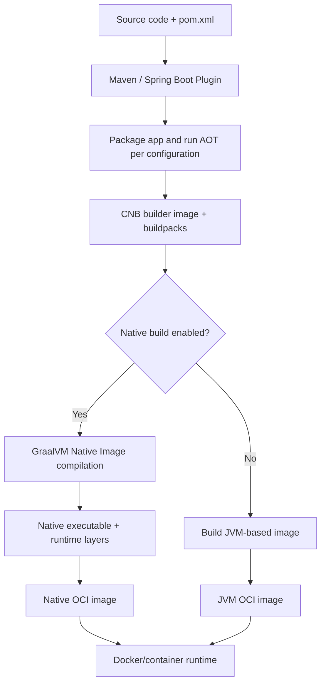
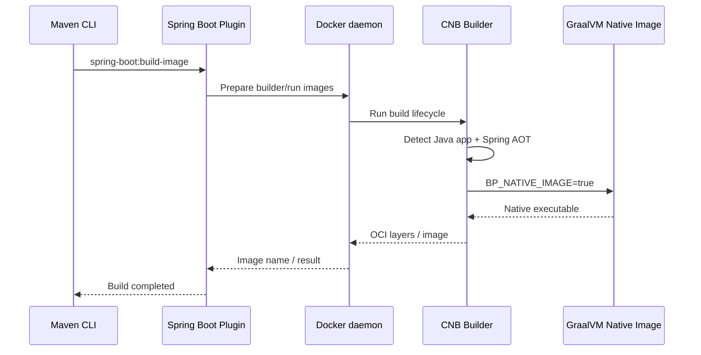
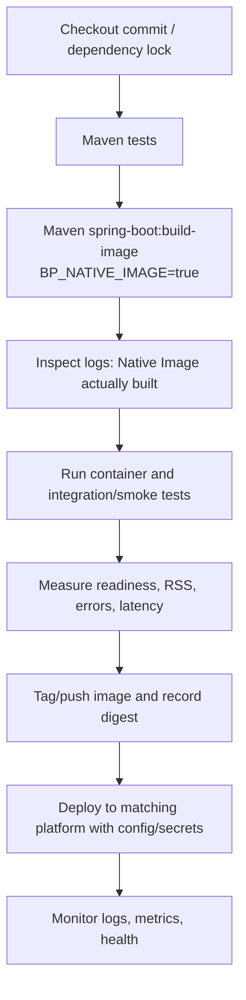

# `spring-boot:build-image` for creating a native container image

When deploying a **Spring Boot Native Image**, the goal is not only to produce an executable with GraalVM, but also to package that executable into a **container image** that can run on servers or orchestration platforms. With Maven, the **`spring-boot:build-image`** goal of **Spring Boot Maven Plugin** creates an OCI image using **Cloud Native Buildpacks**. When properly configured to enable native compilation, buildpacks use GraalVM Native Image and Spring AOT to produce an image running the application as a native executable.

Important point: **running `spring-boot:build-image` alone does not guarantee the image is native**. Without enabling and verifying the native build path, buildpacks may package a standard **JVM** application as usual. This lesson guides you through configuring, building, inspecting logs, running, and verifying the actual result.

## 1. Learning objectives

After this lesson, you will be able to:

- Explain the roles of the Maven goal `spring-boot:build-image`, Cloud Native Buildpacks, the builder image, and the run image.
- Distinguish `spring-boot:build-image`, `native:compile`, and standard JAR packaging.
- Configure **`BP_NATIVE_IMAGE=true`** and the appropriate native Maven profile to build an OCI image containing a native executable.
- Run the container and inspect ports, health/readiness, logs, and indicators confirming a native build.
- Set image names/tags, handle image pushing, and manage version metadata when integrating images into CI/CD.
- Diagnose build-environment, native compiler memory, reflection, resource, and platform-compatibility errors.
- Measure startup, RSS, and image size, comparing against a JVM build under equivalent conditions.

## 2. How does `spring-boot:build-image` work?

`spring-boot:build-image` is a goal of `org.springframework.boot:spring-boot-maven-plugin`. It coordinates with **Cloud Native Buildpacks (CNB)** to produce an **OCI container image**, typically via a compatible Docker daemon/API. You do not need to write a `Dockerfile` yourself for this flow.

General workflow:



### Participating components

| Component | Role |
| --- | --- |
| **Maven** | Reads `pom.xml`, invokes plugins, coordinates goals and dependencies |
| **Spring Boot Maven Plugin** | Executes `build-image`, coordinates packaging, and invokes the buildpacks process |
| **Builder image** | Build environment containing the lifecycle and compatible buildpacks |
| **Buildpacks** | Detects the application, selects dependencies/toolchains, and builds image layers |
| **Spring AOT** | Prepares Spring configuration code and metadata to support native compilation |
| **GraalVM Native Image** | Analyzes and compiles the application into a native executable |
| **Run image** | Supplies OS/runtime components needed by application layers at runtime |
| **OCI image** | Packaged, tagged artifact runnable with Docker or a compatible OCI runtime |

**The builder image and run image are different.** The builder carries compilation tools, so it can be large and consume substantial RAM when compiling Native Image. The run image is the base of the resulting image; it only needs runtime essentials. Therefore, the builder size is not the deployed image size, and compilation RAM is not the RAM required by the service handling requests.

### Buildpacks does not automatically mean Native Image

Common Java buildpacks can produce a JVM image containing a JRE and application layers. To produce a **native image**, native mode must be enabled according to your builder/buildpack version. With common Paketo Java Native Image buildpacks, the buildpack environment variable **`BP_NATIVE_IMAGE=true`** is one way to enable native mode.

Never infer an image is native solely from its tag name, goal name, having GraalVM on the host, or using buildpacks. Always verify the **build mode and resulting artifact inside**.

## 3. Prerequisites

Assume the project is a Maven-managed Spring Boot application with AOT/Native Image support. Before running `build-image`, prepare:

1. **JDK and Maven/Maven Wrapper** compatible with your Spring Boot version to run the Maven build.
2. **Spring Boot Maven Plugin** in `pom.xml` and native configuration matching your Spring Boot/GraalVM versions.
3. A running **compatible Docker daemon/API**, accessible by the Maven process and able to pull builder/run images.
4. **Network and artifact repository access** for Maven as well as buildpacks downloading dependencies/toolchains.
5. **Sufficient CPU, RAM, and disk space** for the GraalVM Native Image compiler running inside the builder.
6. A **target OS/CPU architecture** supported by the builder/run images and runtime environment.

A major advantage of CNB builds is that **the host machine does not necessarily need GraalVM Native Image installed directly**; the buildpack can supply the toolchain inside the builder. The host still needs Java/Maven for Maven steps and Docker to run the builder. Specific requirements depend on plugin configuration and lifecycle executions.

Verify the platform before building:

```bash
java -version
./mvnw -version
docker version
docker info
```

`docker version` displays both client and server details. If the server/daemon is unreachable, having the Maven plugin alone is not enough to build an image.

**Scope note:** command examples use `./mvnw` on Linux/macOS; on Windows, use `mvnw.cmd`. Replace example app names, ports, and registries with real project values.

## 4. Configuring Maven to build a native container image

### 4.1. Basic configuration in `pom.xml`

Example `spring-boot-maven-plugin` configuration for an illustrative application named `order-service`:

```xml
<build>
    <plugins>
        <plugin>
            <groupId>org.springframework.boot</groupId>
            <artifactId>spring-boot-maven-plugin</artifactId>
            <configuration>
                <image>
                    <name>example/order-service:1.0.0</name>
                    <env>
                        <BP_NATIVE_IMAGE>true</BP_NATIVE_IMAGE>
                    </env>
                </image>
            </configuration>
        </plugin>
    </plugins>
</build>
```

Meaning:

- `<name>` sets the name and tag of the generated OCI image; here `example/order-service:1.0.0`.
- `<env>` passes environment variables to the **buildpacks image-building process**. `BP_NATIVE_IMAGE=true` instructs supporting buildpacks to enable Native Image mode.
- The Spring Boot plugin must have an appropriate version managed, typically via the project's parent/BOM/plugin management.

This is a **plugin configuration snippet**, not a complete `pom.xml`. The project still needs dependencies, Java version, repositories, and related build settings. Never copy plugin snippets from another version without checking documentation for your Spring Boot/buildpacks versions.

Once `pom.xml` explicitly configures `BP_NATIVE_IMAGE=true`, invoke the goal as:

```bash
./mvnw spring-boot:build-image
```

If the project provides a `native` Maven profile for this build path, you can use:

```bash
./mvnw -Pnative spring-boot:build-image
```

**`-Pnative` only matters when a `native` profile exists and is properly configured in the project.** It is a conventional profile name in Native Build Tools-enabled Spring Boot projects, not a universal Maven switch across every `pom.xml`. Always inspect which plugins, goals, AOT options, and environment settings that profile enables.

Specifically, when intending for Native Image to compile **inside the buildpacks builder**, check whether the profile inadvertently binds a host-side `native:compile` step to the `package` lifecycle. If so, it may demand GraalVM on the host and compile twice.

### 4.2. Naming the image from the command line

You can override the image name using the Spring Boot plugin property:

```bash
./mvnw spring-boot:build-image \
  -Dspring-boot.build-image.imageName=example/order-service:1.0.1
```

This example assumes `BP_NATIVE_IMAGE=true` is already in plugin configuration, or an equivalent native build configuration is active. Changing the image name **does not enable native compilation by itself**.

In pipelines, tags are commonly derived from the application version or commit SHA; record the image digest after publishing so you know the exact artifact tested and deployed.

### 4.3. Configuring builder/run images when needed

Spring Boot Maven Plugin supports `builder` and `runImage` options. Structural example:

```xml
<configuration>
    <image>
        <name>example/order-service:1.0.0</name>
        <builder>your-compatible-builder-image</builder>
        <runImage>your-compatible-run-image</runImage>
        <env>
            <BP_NATIVE_IMAGE>true</BP_NATIVE_IMAGE>
        </env>
    </image>
</configuration>
```

`your-compatible-builder-image` and `your-compatible-run-image` are **placeholders** and must be replaced with **real image names** forming a compatible pair. Do not pick builder and run images arbitrarily just for small size. Verify Java/Native Image support, OS, architecture, libc/ABI, lifecycle compatibility, and runtime libraries needed by the executable.

For basic hands-on exercises, **keeping the plugin's default supported builder/run images** is usually simpler. When customizing, pin versions or digests and test the final image thoroughly on the target platform.

## 5. Hands-on build of a native OCI image

Assume:

- The Spring Boot project exposes an HTTP endpoint at `/hello`.
- `pom.xml` configures the plugin from Section 4 with `BP_NATIVE_IMAGE=true`.
- Docker is running, Maven Wrapper works, and the builder supports native compilation.
- The target image name is `example/order-service:1.0.0`.

Run:

```bash
./mvnw clean spring-boot:build-image
```

`clean` clears prior Maven build outputs to reduce the chance of stale artifacts. The build typically proceeds through steps like:

1. Maven reads sources/dependencies and produces the Spring Boot artifact per project configuration.
2. Spring Boot plugin connects to the Docker daemon, selects builder/run images, and passes application contents into the CNB flow.
3. Buildpacks detect a Java/Spring Boot application; with native mode enabled, they prepare components needed for Spring AOT and GraalVM Native Image.
4. The Native Image compiler analyzes reachable code, applies metadata/hints, and generates the executable.
5. The CNB lifecycle packages the executable and required runtime layers into an OCI image.
6. The image appears in the configured Docker daemon's image store, or is published if configured.

**Phase names and log ordering** can vary across Spring Boot Plugin, builder, and buildpack versions. The key is checking the logs for real **native-image compilation** and confirming a successful finish.



### Identifying a native build in logs

Exact log messages vary across versions, so look for evidence of the **Java Native Image buildpack / native-image toolchain**, native analysis/compilation phases, and executable creation. Conversely, if logs only show a Java runtime/JRE being packaged with a JAR, it is likely a **JVM image**.

Never rely solely on `BUILD SUCCESS` to conclude native compilation occurred. Maven reports success when building a valid JVM image too.

### After the Maven build finishes

Verify the image exists:

```bash
docker image ls example/order-service
docker image inspect example/order-service:1.0.0
```

`inspect` reveals OCI image metadata, OS/architecture, configuration, and diagnostic fields. It **does not by itself prove** the app inside is a Native Image: combine build logs, layer/content inspection, and runtime testing.

## 6. Running and verifying the native app in a container

Suppose Spring Boot listens on port 8080:

```bash
docker run --rm --name order-native \
  -p 8080:8080 \
  example/order-service:1.0.0
```

In another terminal:

```bash
curl -fsS http://localhost:8080/hello
```

If the application configures Spring Boot Actuator and a readiness probe:

```bash
curl -fsS http://localhost:8080/actuator/health/readiness
```

The readiness endpoint only works when the project adds the appropriate dependency and configuration. Otherwise, call an endpoint native to your service. When using a different port, check `server.port` and Docker's `-p` mapping.

### Inspecting metadata, logs, and resources

```bash
# From another terminal while the container is still running
docker logs order-native
docker stats --no-stream order-native

# Check image platform
docker image inspect \
  --format '{{.Os}}/{{.Architecture}}' \
  example/order-service:1.0.0
```

Some buildpack images launch the application via a **CNB launcher**. Seeing a launcher in `Entrypoint` metadata therefore does not indicate whether it runs a JVM; verify whether the launcher executes a **native executable** or `java`. On the other hand, seeing `java -jar` in the command path signals the image did not take the intended native path.

**Reliable verification approach:** keep build logs showing the Native Image compiler, inspect native build settings, and test the artifact inside the target image. If you need direct binary/bytecode inspection, use an inspection tool in a compatible debug environment to inspect the executable invoked by the launcher; minimal runtime images may omit `sh`, `file`, and `ldd`.

### Startup and memory

The hypothesis to test is whether native starts faster and uses less memory than JVM in some workloads. Record:

- **Startup to readiness:** from container/process creation until the app endpoint serves requests.
- **RSS/working set:** process/container resident memory at idle and under load.
- **Latency p50/p95/p99 and throughput:** run identical request scenarios, data, and resource caps.
- **Build duration and image size:** measure native compilation cost and distribution cost separately.

Compare on the **exact same commit, dependencies, ports, configuration, and CPU/RAM limits**. Never infer superior throughput from faster cold starts, nor mistake the builder's Native Image compiler RAM for runtime service RAM.

## 7. Pushing the image to a container registry

If the Maven build produced the image in the local Docker daemon, you can push it using the standard Docker workflow:

```bash
# Log in to the registry with an appropriate credential mechanism
docker login registry.example.com

# Tag the built image
docker tag example/order-service:1.0.0 \
  registry.example.com/team/order-service:1.0.0

# Push the image
docker push registry.example.com/team/order-service:1.0.0
```

`registry.example.com` is an illustrative host—replace it with your real registry. Never write passwords or tokens into `pom.xml`, shell history, or build logs. In CI, use credential stores, secret providers, or CI-native registry authentication.

Spring Boot Maven Plugin also provides an option to **publish images directly** via `build-image` in supported plugin versions and configs. Whichever method you choose, verify:

1. The built and tested image is genuinely the native build.
2. Repository, tag, and OS/architecture match the registry and target runtime environment.
3. The tested artifact digest is preserved during promotion.
4. Registry access and secrets are managed outside source code.

A tag like `latest` is mutable. For production, identifying images by commit/version tag plus **image digest** ensures exact traceability.

## 8. Comparing `build-image` with `native:compile` and Dockerfile

| Approach | Primary output | Where compilation runs | Packaging responsibility |
| --- | --- | --- | --- |
| `./mvnw package` | Spring Boot JAR | Maven/JDK in build environment | No OCI image yet |
| `./mvnw -Pnative native:compile` | Native executable on filesystem (when plugin configured) | GraalVM toolchain of the environment running the goal | Separate image packaging mechanism required |
| `./mvnw spring-boot:build-image` with native mode | OCI image containing Native Image | GraalVM/native compilation provided by CNB builder per config | Buildpacks manage layers and runtime image |
| Multi-stage `Dockerfile` | Native OCI image | Builder stage defined in `Dockerfile` | Dockerfile author picks runtime base, copies binary, sets entrypoint |
| `spring-boot:build-image` without native enabled | Typically a JVM OCI image | Buildpacks assemble Java runtime + app layers | Produces container image, but misses native objective |

If the goal is a **container image holding a native executable**, `build-image` reduces how much Dockerfile and toolchain setup you maintain directly. If you need granular control over OS packages, native linker flags, or base images, a multi-stage Dockerfile may fit better. Either way, test the binary against your runtime environment's libraries, reflection/resources, and configuration.

## 9. Troubleshooting when building or running a native image

### 9.1. Build succeeds, but the image still runs on the JVM

**Symptom:** the image runs, yet build logs show no Native Image compilation and runtime uses JVM/JAR.

**Common causes:** `BP_NATIVE_IMAGE=true` was not passed to the CNB builder, the `native` profile did not behave as expected, or the selected builder/buildpacks lack Native Image support.

**Resolution:**

1. Inspect `<image><env><BP_NATIVE_IMAGE>true...` in `pom.xml`.
2. If using `-Pnative`, confirm the profile exists and is active.
3. Check buildpack logs to see whether the `native-image` compiler ran.
4. Verify Native Image support and tool versions in the builder/buildpacks.
5. Rebuild and verify the newly built image, avoiding stale tags pointing to an older image.

### 9.2. Maven cannot connect to Docker

**Symptom:** errors connecting to Docker daemon/API, Docker socket not found, or permission denied.

**Resolution:** run `docker version`/`docker info` in the exact environment executing Maven; check Docker Desktop/service, Docker context, socket, and user/CI permissions. Running Maven inside a container also needs a valid connection to a daemon—Docker API access is not available automatically.

### 9.3. Cannot pull builder or dependencies

**Symptom:** image pull, TLS, proxy, DNS, dependency resolution, or artifact registry access failures.

**Resolution:** confirm the builder/run image names exist and support your platform; inspect network, proxy, CA certificates, credentials, and Maven repositories. Never over-permission registry access merely to bypass auth errors.

### 9.4. Native Image compiler runs out of RAM or build takes too long

**Symptom:** buildpack invokes `native-image` and hits OOM, the build container is killed, or CI runs out of disk space.

**Resolution:** increase RAM/CPU/disk limits for the Docker daemon and builder, tune Native Image build options if needed, trim unnecessary dependencies, and inspect build logs. Native compilation is heavier than JAR packaging; this is a **build cost**, not proof the runtime app needs the same RAM.

### 9.5. Reflection, proxies, or resources fail on native

**Symptom:** `ClassNotFoundException`/reflection errors, JSON binding failures, missing templates or classpath files, while the JVM image works normally.

Native Image must know many dynamic accesses ahead of time. Spring AOT provides hints for common cases, yet third-party libraries or custom code may require additions. Example:

```java
import org.springframework.aot.hint.RuntimeHints;
import org.springframework.aot.hint.RuntimeHintsRegistrar;
import org.springframework.context.annotation.Configuration;
import org.springframework.context.annotation.ImportRuntimeHints;

class ReportHints implements RuntimeHintsRegistrar {
    @Override
    public void registerHints(RuntimeHints hints, ClassLoader classLoader) {
        hints.resources().registerPattern("templates/report.html");
    }
}

@Configuration(proxyBeanMethods = false)
@ImportRuntimeHints(ReportHints.class)
class ReportNativeConfiguration {
}
```

The example above registers one specific resource; `templates/report.html` must actually exist on the build classpath. If the application uses reflection, serialization, proxies, or JNI, register hints matching the exact operation. After adding hints, **rebuild** and test the resulting native binary/image.

### 9.6. Native container fails to start due to OS/CPU/libc

**Symptom:** `exec format error`, `No such file or directory` even though the binary exists, or `GLIBC_x.y not found`.

**Likely cause:** the image was built for the wrong OS/CPU, lacks a dynamic loader/shared library, or builder and run images are ABI-incompatible. A Linux amd64 native executable cannot run natively on Linux arm64 or Windows. Builder and run images must share a compatible platform contract.

**Resolution:** inspect `docker image inspect`, node architecture, base image, and build settings; rebuild for the correct target. For multi-architecture container images, build a **separate native artifact** per architecture rather than simply re-labeling platforms.

### 9.7. Changing profile at runtime does not activate a bean

**Symptom:** passing `SPRING_PROFILES_ACTIVE=prod` to `docker run`, yet a bean determined at AOT time remains missing.

**Possible cause:** `@Profile`, `@ConditionalOnProperty`, or classpath conditions altered the **bean graph at build time**. Runtime config changes cannot reliably trigger analysis and generation of new beans.

**Resolution:** inspect profiles/properties active during Maven AOT/buildpacks, keep the bean graph stable, or build separate artifacts when configurations change bean structure. Do not embed secrets into the builder just to make a build profile resemble production.

## 10. Integrating `build-image` into CI/CD

A release pipeline might look like:



### Decisions to pin in the pipeline

| Decision | Why it matters |
| --- | --- |
| Commit, dependencies, and Java version | Reproduces the binary when investigating issues |
| Spring Boot plugin, buildpacks, and builder/run images | Prevents unexpected toolchain/ABI shifts |
| Native mode and AOT profiles | Ensures the image holds a native executable and intended bean graph |
| OS/CPU architecture | Prevents images failing on target nodes |
| Docker daemon resource limits | Native compilation can consume high RAM and CPU |
| Integration tests on native image | Catches reflection, resource, TLS, and external system failures |
| Image digest and provenance checks | Ensures the tested artifact matches the deployed artifact |
| Secrets and registry credentials | Keeps sensitive data out of source code and images |

If CI only runs `mvn test` on the JVM, it **has not adequately verified the native path**. At minimum, run smoke tests directly against the resulting container image; for services with heavy serialization, reflection, dynamic proxies, JDBC, or REST clients, run integration tests covering real business flows.

### Operating a native image

The native runtime still requires:

- Correct runtime config, databases, TLS/certificates, DNS/networking, and mounted filesystems.
- Health/readiness checks and proper process termination/graceful shutdown handling.
- Monitoring CPU, RSS, latency, errors, and logs from the container runtime.
- Appropriate resource limits, tag/digest management, and a rollback plan.

**Not every buildpack image includes a shell or `apt`/`apk`.** When debugging is needed, use debug images or external observability tools rather than assuming you can exec into a production image and install packages.

## 11. Capstone exercise

**Context:** A Spring Boot application exposes `GET /hello` and uses Maven, aiming to produce a native OCI image named `example/order-service:1.0.0`.

1. Verify the Docker daemon and Java/Maven Wrapper using `docker version`, `java -version`, and `./mvnw -version`.
2. In `pom.xml`, configure `spring-boot-maven-plugin` with `<image><name>example/order-service:1.0.0</name>` and `<env><BP_NATIVE_IMAGE>true</BP_NATIVE_IMAGE></env>`, ensuring plugin/buildpack versions support native mode.
3. Run `./mvnw clean spring-boot:build-image`. If using a project `native` profile, inspect its exact contents before adding `-Pnative`.
4. Inspect the logs and confirm GraalVM Native Image compilation actually executed.
5. Run `docker image ls example/order-service` and `docker image inspect`; confirm the image's OS/CPU architecture.
6. Run `docker run --rm --name order-native -p 8080:8080 example/order-service:1.0.0`, send `GET /hello`, and inspect logs and health.
7. Test a path involving JSON, reflection, resources, database, or HTTPS if supported by the app; add hints and rebuild when errors appear.
8. Measure startup to readiness and RSS; to compare with JVM, build a JVM image from the same commit with identical resource limits and run the same workload.
9. Push the verified image to a registry with a versioned tag; record the image digest and deploy to the verified platform.

**Self-check question:** When `spring-boot:build-image` reports success yet the container still starts with Java, what should you check? First check **buildpack native mode** (`BP_NATIVE_IMAGE`/native profile), Native Image compilation logs, and image contents. Changing the tag or re-running the exact same goal will not turn the image into a native build.

## 12. Key takeaways

- `spring-boot:build-image` produces an **OCI image** using Cloud Native Buildpacks. The native goal is only met when the builder/buildpacks actually compile a **GraalVM Native Image**.
- **`BP_NATIVE_IMAGE=true`** is the standard configuration to enable native mode in the Paketo ecosystem; **`-Pnative`** requires a matching Maven profile whose contents must be inspected.
- Spring AOT prepares code/metadata for the Spring container; GraalVM Native Image compiles the executable; buildpacks package the executable with runtime layers.
- The host machine may not need GraalVM Native Image installed directly when using a builder with its own toolchain, though it still needs a matching Maven/JDK, Docker daemon, and ample build resources.
- **Verify native builds via build logs and artifact testing**, not merely `BUILD SUCCESS`, image names, or the fact that it runs in Docker.
- Native containers still carry OS/architecture, libc, reflection/resource, and operational constraints. Measure startup, RSS, and compatibility directly on the target deployment image.

Once you master the build path, the next step is using the same Spring Boot project to build **both JVM and native images**, verify functional equivalence, and record measurements for startup, memory, latency, and build costs. Empirical measurements determine whether migrating to Native Image fits your workload.
