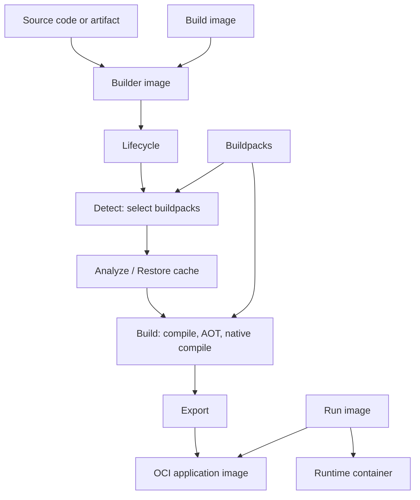

# Cloud Native Buildpacks and the Roles of Builder, Buildpack, and Run Image

## 1. What Problem Do Cloud Native Buildpacks Solve?

When packaging a Spring Boot application as a container, the development team needs to turn source code and dependencies into an image that can run reliably in the deployment environment. Writing a manual Dockerfile for each project can repeat a lot of configuration: choosing a base image, installing a JDK, downloading dependencies, building the artifact, creating a user, setting environment variables, and cleaning up build tools. If projects implement this differently, applying security updates and maintaining the process also becomes difficult.

**Cloud Native Buildpacks (CNB)** is a specification and tool ecosystem that turns application source code or artifacts into OCI container images through reusable components. Buildpacks detect the application, provide dependencies, and perform build steps; the builder orchestrates the process; the run image provides the foundation when the container runs.

In the **SPRING_BOOT_NATIVE_IMAGE** module, CNB can integrate Spring Boot and GraalVM Native Image to produce a container holding a native executable. This helps standardize the packaging process, though you must distinguish a successful image build from the native application actually running correctly and meeting startup/memory targets.



CNB can use buildpacks from multiple providers. The Spring Boot Maven/Gradle plugin usually provides a convenient way to invoke buildpacks; the `pack` tool is an option for working directly with the lifecycle. The plugin, builder, and buildpack versions must be compatible with one another.

## 2. Three Core Components: Builder, Buildpack, and Run Image

### Builder

A **builder image** is the environment used during the image creation phase. A builder typically contains or references:

- The CNB lifecycle to orchestrate the detect, analyze, restore, build, and export phases.
- Buildpacks and metadata for buildpack selection.
- Build-time dependencies/toolchains required by the buildpacks.
- Configuration identifying a compatible run image for the output image.

The builder is the build environment, not the final deployed image by default. It may contain compilers, a JDK, GraalVM Native Image, Maven/Gradle, or tools needed only at build time.

### Buildpack

A **buildpack** is a component that provides application detection and transformation logic. In a single build, multiple buildpacks can participate according to order and compatibility rules.

For example, a buildpack chain might:

1. Detect a Java/Spring Boot project.
2. Provide a JDK or runtime/build dependencies.
3. Run Maven/Gradle and produce an artifact.
4. Integrate Spring AOT and Native Image when configured for native builds.
5. Package the launcher, metadata, and application content into image layers.

Not every buildpack performs all of this work. Specific capabilities depend on the selected buildpacks, the builder, and the application configuration.

### Run image

A **run image** is the minimal filesystem and runtime foundation used when the application container runs. It typically contains only what is needed for runtime, such as operating system libraries and CA certificates as chosen by the provider.

A run image differs from a builder image: the build image may contain a large toolchain, while the run image targets a smaller runtime environment. When using a native executable, the run image must still include the OS libraries that the executable dynamically links against.

| Component | When used | Typical contents | Is it the deployed image? |
|---|---|---|---|
| Builder image | Build | Lifecycle, buildpacks, compilers, build dependencies | No |
| Buildpack | Detect/build | Logic to select and process the application | Not a standalone application image |
| Run image | Runtime | OS foundation and libraries needed at runtime | Serves as the base of the application image |
| Application image | Runtime | App artifact/layers, launcher, and run image | Yes |

## 3. Lifecycle: From Source to Container Image

The CNB lifecycle splits the workflow into phases. Phase names and details may vary by lifecycle version, but the common model includes:

- **Detect**: checks which buildpacks recognize the application and which group of buildpacks needs to run.
- **Analyze**: reads metadata from a previous image to determine which layers can be reused.
- **Restore**: restores layers from cache.
- **Build**: buildpacks perform work such as installing dependencies, compiling, generating AOT outputs, native compiling, and creating layers.
- **Export**: combines the layers, metadata, and run image to create the OCI image.

Some lifecycles also have phases such as creator or other extended steps depending on the version. You do not need to invoke each phase manually when using the Spring Boot plugin; the plugin typically orchestrates them through buildpacks integration.

Caching helps avoid repeating unchanged steps, but it does not guarantee that a native build will always be fast or use little RAM. GraalVM Native Image can consume significant resources during the build phase; dependency and layer caching does not eliminate native analysis/compilation costs when inputs require a rebuild.

## 4. How Are Builder Image and Run Image Related?

A builder is configured to produce images compatible with a run image. During export, the lifecycle combines application layers with the run image according to CNB metadata and rules. You should not arbitrarily swap the final base image for another image without verifying compatibility.

Illustrative diagram:

```text
Builder image
  - CNB lifecycle
  - Java buildpack
  - Maven / Gradle support
  - GraalVM Native Image toolchain (if supported by the builder)
             |
             v
      Build application
             |
             v
Application image
  - Run image layers
  - Native executable
  - Runtime metadata / launcher
```

A builder can support multiple application types and multiple run images, but that does not mean every builder has the Native Image toolchain or the right buildpack versions. When building a Spring Boot native application, select a builder that supports native compilation according to the Spring Boot/GraalVM documentation and inspect the logs to confirm the right buildpacks ran.

## 5. Spring Boot Integration with Cloud Native Buildpacks

The Spring Boot Maven Plugin and Gradle Plugin can invoke buildpacks to create an image. This lets the project declare image building right inside the build tool.

### Maven

For a project with the Spring Boot Maven Plugin configured and a suitable Docker daemon/engine available:

```bash
./mvnw spring-boot:build-image
```

This command builds a container image according to the plugin configuration. The image name is usually derived from project metadata, though it can be customized. To build as a Native Image, configure the corresponding native build settings for your Spring Boot plugin version; do not assume `build-image` always produces a native executable by default.

### Gradle

With the Spring Boot Gradle Plugin:

```bash
./gradlew bootBuildImage
```

Similarly to Maven, this task builds an image through CNB. Check the builder, environment, and buildpack configuration to determine whether the image is JVM or native.

### Native image via buildpacks

Some Spring Boot configurations support requesting a native image build through buildpacks using the corresponding build property, for example with the Maven plugin:

```bash
./mvnw spring-boot:build-image -Pnative
```

And Gradle:

```bash
./gradlew bootBuildImage -Pnative
```

Profile and property syntax depend on the actual project configuration. For Spring Boot, native image build guides typically use the native profile/property declared by the project. Before running, inspect the POM/build.gradle and plugin version documentation; a `native` profile name does not exist automatically unless the project defines it.

## 6. Which Buildpacks Participate in a Spring Boot Application?

Spring Boot buildpacks typically select buildpacks based on the source/artifact type and configuration. A Java pipeline may include the following roles:

| Buildpack role | Example responsibilities |
|---|---|
| Paketo/Java buildpack or equivalent Java buildpack | Detects Java application, configures runtime/build dependencies |
| Maven/Gradle buildpack | Runs the build tool when source is built inside the lifecycle |
| Spring Boot buildpack | Handles Spring Boot specifics and executable archives |
| Native Image buildpack/component | Provides Native Image integration if supported by the builder |
| Environment/CA certificates | Provides certificates and appropriate runtime configuration |

This is a description of roles, not a guarantee that every builder has separate buildpacks with those exact names. Some capabilities are combined into one buildpack or provided by the plugin. Read the detect/build logs to see buildpack IDs, versions, order, and created layers.

## 7. Configuring Builder and Run Image

The Spring Boot plugin generally allows customizing the builder and run image. Gradle example:

```groovy
tasks.named("bootBuildImage") {
    builder = "paketobuildpacks/builder-jammy-base"
    // runImage = "paketobuildpacks/run-jammy-base"
    imageName = "example/quote-service:1.0.0"
}
```

This is an illustrative configuration; builder/run image names may change across Paketo generations and Spring Boot versions. Confirm that the image tag exists and that the builder supports your target. Do not pick a builder based solely on the name `base` or `tiny`; check the stack, buildpack order, OS, architecture, and Native Image support.

A smaller run image can reduce image size, but if it omits libraries required by the native executable, the container may fail to start. Conversely, a larger run image does not necessarily increase runtime RSS proportionally; filesystem size and process memory are different quantities.

## 8. Configuring Environment for Build and Runtime

CNB separates the environment intended for buildpacks from the environment used when the application runs. This is important to watch when Spring AOT decides the bean graph based on profiles/properties.

- **Build-time environment**: controls the build tool, AOT, native compiler, proxy, cache, and buildpack selection.
- **Launch-time environment**: controls the application when the container runs, such as HTTP port, runtime profile, datasource endpoint, and business configuration designed to change at runtime.

Do not place real secrets in build arguments, Dockerfiles, build logs, or application layers. Use the CI/registry/orchestrator secret mechanism and mount/provide environment variables at runtime in accordance with deployment policies.

Example of running a container with a profile and port:

```bash
docker run --rm -p 8080:8080 \
  -e SPRING_PROFILES_ACTIVE=prod \
  example/quote-service:1.0.0
```

This command is illustrative only; the image must contain the appropriate executable and launcher. A runtime profile cannot automatically recreate beans that were excluded from the AOT graph due to a different build-time profile. Design configuration to clearly separate build-time fixed decisions from values allowed to change at runtime.

## 9. Native Executable and Run Image Must Be Compatible

Native Image does not mean the binary is completely independent of the operating system. The executable may dynamically link to glibc or other system libraries. If you build in one environment but run in a run image lacking the required ABI/libraries, the container can fail even though native compilation succeeded.

When choosing a builder/run image, verify:

1. OS family and distribution version.
2. CPU architecture (amd64/x86_64, arm64/aarch64).
3. libc and shared libraries required by the executable.
4. CA certificates, timezone data, and libraries needed for TLS/timezone handling.
5. User, filesystem permissions, temporary directory, and application ports.
6. Mounted files/configurations required by the application at runtime.

Do not copy a Windows `.exe` binary into a Linux run image. The artifact must be built for the exact target OS/architecture; if production is a Linux container, build on Linux or use an explicitly supported cross-compilation pipeline.

## 10. Cache and Layers: Speeding Up Builds While Understanding Limits

CNB creates layers per buildpack, enabling reuse of dependencies or artifacts that rarely change. There are two common cache types: layer cache and volume/image cache depending on the tool. On rebuilds, the lifecycle analyzes old layers and restores those still valid.

Benefits:

- Reduces repeated dependency downloads.
- Reuses certain build artifacts.
- Supports incremental builds across image builds.

Limitations:

- Changing the JDK, GraalVM, builder, or buildpack version can invalidate the cache.
- Changing source/configuration affecting AOT or Native Image will require rerunning the related steps.
- Caching does not guarantee keeping an old native executable if build inputs change.
- Caches should not unintentionally contain secrets or private data.

When building native, the GraalVM analysis/compile phase may still take the most time and RAM. Monitor actual logs and measurements instead of assuming caching will make native builds as fast as JAR builds.

## 11. Observing and Diagnosing Buildpacks

When an image build fails, categorize errors by stage:

| Stage | Symptom | Investigation direction |
|---|---|---|
| Docker/daemon | Cannot connect to Docker daemon | Check Docker Engine, permissions, and socket/pipe |
| Detect | No matching buildpack found | Check builder, source layout, and buildpack order |
| Build tool | Maven/Gradle dependency resolution error | Check wrapper, repository, credentials, and network |
| Spring AOT | Bean creation/profile/property error | Check build-time configuration and generated outputs |
| Native Image | Reachability, hints, compiler, or OOM | Check GraalVM, metadata, toolchain, RAM |
| Export | Image/layer creation error | Check registry, permissions, disk space, and metadata |
| Runtime | Container exits or missing library | Check run image, binary ABI, launch env, and logs |

Use detailed logs from the Maven/Gradle plugin or `pack` to find which buildpack detected the app and which phase failed. Do not look only at the final `build failed` message; the root error usually appears earlier.

## 12. Fairly Comparing JVM and Native Images

Buildpacks can produce either JVM or native images. To evaluate the impact of Native Image:

- Use the same source commit, application module, and features.
- Keep equivalent functional/profile configuration, understanding which profile is used at build-time AOT.
- Use the same type of run image when feasible, or explicitly note base image differences.
- Compare image size, build time, startup to readiness, idle RSS, and RSS under load.
- Keep the same CPU/memory limits and workload; measure latency/throughput.
- Record builder peak RAM during build separately from container RSS at runtime.

| Metric | JVM Image | Native Image |
|---|---:|---:|
| Image build time | … | … |
| Peak RAM during build | … | … |
| Image size | … | … |
| Time to readiness | … | … |
| Idle RSS | … | … |
| Peak RSS under load | … | … |
| p95 latency at same load | … | … |

The table above is a template for recording metrics, not empirical results. A smaller image does not necessarily have lower RSS; faster native startup does not guarantee higher throughput. Conclusions must be based on real workloads.

## 13. Pre-Deployment Checklist

- Builder supports the right application type, Spring Boot version, and native toolchain.
- Buildpack order and versions are defined; logs confirm expected buildpacks ran.
- Spring AOT and Native Image compilation completed.
- Produced artifact matches the OS/architecture of the run image.
- Run image has sufficient shared libraries, CA certificates, and runtime dependencies.
- Runtime profile, port, datasource, secrets, and file mounts are properly configured.
- Container runs with an appropriate user/permissions and does not require a build toolchain.
- Smoke tests and integration tests are executed against the newly built image.
- JVM/native benchmarks use equivalent conditions, separating build RAM from runtime RAM.

## 14. Self-Check Questions

1. How does a builder image differ from a run image in purpose and contents?
2. Which CNB lifecycle phases do buildpacks participate in?
3. Why does a successful image build not prove a native container can run in production?
4. Why should you not assume every Spring Boot builder supports GraalVM Native Image?
5. When changing the runtime profile, what might remain unchanged because decisions were already made during Spring AOT?
6. Why can a native executable still depend on shared libraries in the run image?
7. When benchmarking JVM and native images, which build metrics must be separated from runtime metrics?

**Remember:** Cloud Native Buildpacks organizes the packaging workflow through **builder**, **buildpack**, **lifecycle**, and **run image**. For Spring Boot Native Image, verify that the builder/buildpacks support native compilation, configure AOT properly, build the executable for the target platform, and test the final application image before deployment.
