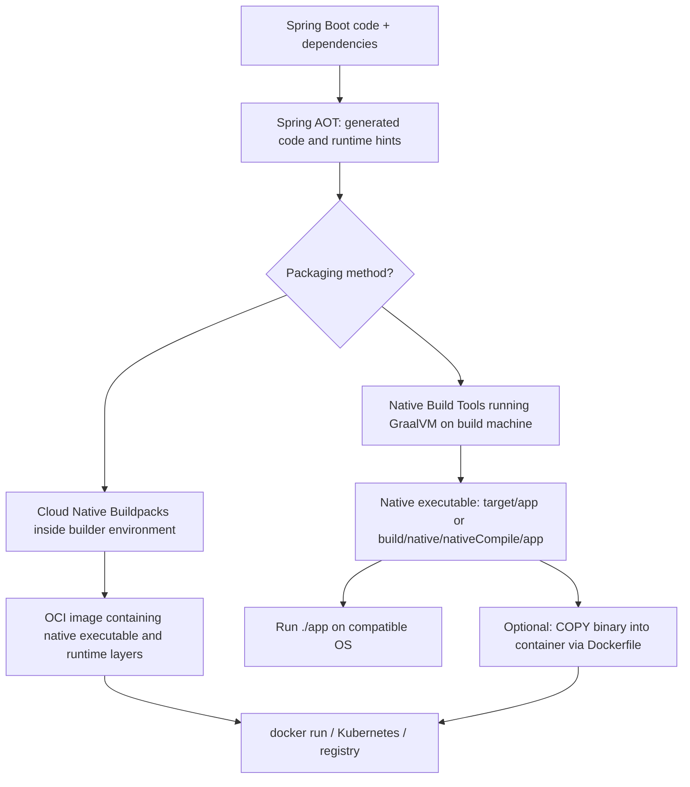
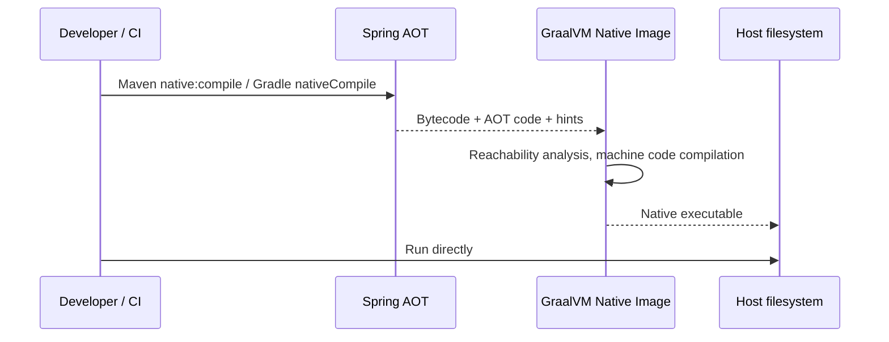
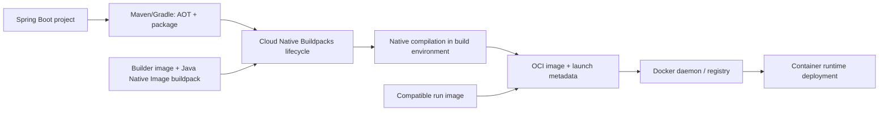

# Distinguishing Local Executable Builds from Container Image Builds

> **Chapter:** Buildpacks  
> **Module:** `SPRING_BOOT_NATIVE_IMAGE`  
> **Learning Objective:** Understand the difference between building a **native executable on the build machine** using GraalVM Native Build Tools and building an **OCI container image** using Cloud Native Buildpacks. Practice the corresponding Maven/Gradle build paths, identify the output artifacts, verify the actual runtime, and choose the right workflow for a Spring Boot application using Spring AOT.

## 1. One Application, Two Output Types

After Spring Boot analyzes the application with **Spring AOT**, there are two common ways to create a natively running application:

1. **Build a native executable on the build machine:** use GraalVM Native Build Tools to invoke the Native Image compiler in the host environment; produce an executable file for the corresponding OS and CPU.
2. **Build a native container image:** use Spring Boot's **Cloud Native Buildpacks (CNB)** integration; the buildpack prepares the environment, invokes the Native Image compiler inside the container build process, and packages the result as an **OCI image** runnable by a container runtime.

Both can use **Spring AOT + GraalVM Native Image**. The main differences are the **build workflow, build environment, managed output, and deployment method**.

A fundamental note: **"container image" does not automatically mean "native image"**. Spring Boot can produce an OCI image running `java -jar` on the JVM, or an OCI image running a native executable. Whether the output is native or not is determined by the **buildpack/plugin configuration**, not by having an image extension or being stored in Docker.



In the `SPRING_BOOT_NATIVE_IMAGE` module, we want to measure **startup time and memory** benefits while understanding build operations, reflection/resource requirements, compatibility testing, and deploying native apps in containers. Distinguishing these two build paths helps avoid comparing the wrong artifacts or confusing build environment errors with application code bugs.

## 2. Both Use the Word "Image", Yet Refer to Different Things

| Term | Nature | Example |
|---|---|---|
| **GraalVM Native Image** | Technology/compiler that produces machine code from a pre-analyzed Java application | Produces file `target/native-demo` |
| **Native executable** | Program file running directly on a compatible OS/CPU, typically without HotSpot JVM | `./native-demo`, `native-demo.exe` |
| **OCI container image** | Distribution artifact composed of layers, manifest, process configuration, metadata, and filesystem | `native-demo:local` |
| **CNB builder image** | Build environment containing the lifecycle and buildpacks | Compatible Paketo builder |
| **Run image** | Base runtime layers used to run the application in the resulting image | Minimal Linux Paketo run image |
| **Buildpack** | Component that detects inputs, prepares the toolchain, builds, and packages the application | Paketo Java Native Image Buildpack |

Two concepts to distinguish clearly:

- **Native Image is a way to produce the executable program code.**
- **Container image is a way to package and distribute the running program.**

Therefore, it is completely possible to **build the executable first and package it with a Dockerfile**, or **let a buildpack compile the native executable and package the OCI image in a single workflow**.

## 3. Direct Comparison of the Two Build Paths

| Aspect | Local executable build | Build OCI container image via Buildpacks |
|---|---|---|
| Primary tools | GraalVM Native Build Tools: Maven `native:compile`, Gradle `nativeCompile` | Spring Boot Maven `spring-boot:build-image`, Gradle `bootBuildImage` |
| Where Native Image compiler runs | GraalVM toolchain in the machine/runner build environment | Buildpack environment inside the builder/container |
| Minimum requirements | GraalVM with `native-image` and compatible native toolchain | Compatible container engine/API, compatible builder; GraalVM Native Image does not have to be installed on the host |
| Spring AOT | Integrated by plugin into the native pipeline | Integrated so buildpacks receive the prepared AOT inputs |
| Primary artifact | Executable file on the filesystem | OCI image in image store/daemon or registry |
| Test run | `./target/native-demo` | `docker run native-demo:local` |
| OS/CPU dependency | Binary for the platform targeted by the compiler | Image typically for the builder environment's OS/CPU; verify platform |
| Distribution method | Copy file, package installer, or build container manually | Push image to registry and deploy via container runtime |
| Runtime/CA/libc packaging | Managed by the deployer | Builder and run image provide runtime layers per stack |
| Packaging automation level | Optional via Dockerfile/CI | Buildpacks handle most of the layout and launcher |
| Cache/layer tracking | Relies on separate build tools and CI | CNB provides image layers and buildpack caching mechanisms |
| Base image customization | Full control when using a Dockerfile | Constrained by compatible builder/run images, configurable |
| Is the artifact native? | **Yes**, if `nativeCompile` succeeds | **Only**, if the build image configuration is native |

**Common mistake:** `./mvnw spring-boot:build-image` without native configuration can build a **JVM container image**. To get an OCI image containing a native executable, you must enable the proper profile/plugin/options supported by Spring Boot and the builder.

## 4. Path A — Building a Native Executable Locally

### 4.1. Processing Flow



With modern Spring Boot and properly configured Native Build Tools, the native compile step uses Spring AOT outputs. RuntimeHints for reflection, resources, proxies, serialization, etc., help the compiler understand behaviors that are hard to detect via static analysis.

Requirements:

- **JDK/GraalVM** compatible with the project's Spring Boot version; `native-image` tool available.
- Compiler/linker and development libraries for the corresponding operating system.
- Sufficient CPU and RAM; Native Image compilation can use significantly more resources than building a JAR.
- Appropriate Maven/Gradle configuration for the plugin to invoke Spring AOT and Native Build Tools.

**Check toolchain (Linux/macOS or command environment with tools installed):**

```bash
java -version
native-image --version
```

If `native-image` is not found or `java` points to a different JDK, fix the toolchain first. Do not confuse a compiler installation error with a Spring AOT or reflection issue.

### 4.2. Maven

For a project using `spring-boot-starter-parent` and the `org.graalvm.buildtools:native-maven-plugin` plugin, the `native` profile usually provides the necessary integration:

```bash
./mvnw -Pnative native:compile
```

Maven on Windows uses `mvnw.cmd` in the corresponding environment. For example, on Linux/macOS, the artifact is typically created under `target/`:

```bash
./target/native-demo
```

The actual filename depends on the application name and build configuration. Completing the build **does not automatically create an OCI image**; `docker image ls` will not necessarily show a new image.

If the project does not use `spring-boot-starter-parent`, you must explicitly configure the Spring AOT goals, native plugin, and corresponding packaging steps. Do not copy commands assuming every POM defines a `native` profile.

### 4.3. Gradle

A project applying the Spring Boot Gradle plugin and `org.graalvm.buildtools.native` can run:

```bash
./gradlew nativeCompile
```

The output is usually located in:

```text
build/native/nativeCompile/native-demo
```

Run:

```bash
./build/native/nativeCompile/native-demo
```

Once `nativeCompile` finishes, you have an executable that runs on a compatible platform. Whether the application runs properly still depends on system libraries, certificates, and dependency native support.

### 4.4. Pros and Limitations of Path A

**Advantages:** fast and convenient for debugging the binary locally, testing CLI flags, checking startup differences against a JAR, integrating with appropriate tests or profilers, and easily passing the file into a custom packaging step.

**Limitations:** requires installing/maintaining the native toolchain on the build runner; executable depends on OS/architecture and may depend on libc/dynamic loader; requires setting up distribution, execute permissions, CAs, external resources, and images yourself if running in a container.

**On Windows:** native executables built in a Windows environment usually have `.exe`. A Docker Linux container **cannot run a Windows executable directly**. To create a Linux image, compile the Linux binary in a compatible Linux environment or let a Linux Buildpacks builder compile it.

## 5. Path B — Building an OCI Image with Cloud Native Buildpacks

### 5.1. What Does CNB Do?

**Cloud Native Buildpacks** is a mechanism to build an image from an application based on a **lifecycle and buildpacks**, avoiding writing every Dockerfile step manually. The selected builder decides which buildpacks run; the run image provides the filesystem layers needed when the container runs.

With Spring Boot:

1. Maven/Gradle prepares the application artifact along with the appropriate Spring AOT outputs.
2. The Spring Boot plugin invokes the buildpack lifecycle via the container API.
3. The Paketo builder detects the Java application and native build plan.
4. The Java Native Image buildpack supplies the compiler in the build environment and compiles the native executable.
5. The lifecycle builds an OCI image with the executable and required runtime layers, storing it in the image store/daemon under the configured image name.



This path **does not require GraalVM/native-image pre-installed on the host**, because the compiler can be provided by the buildpack. However, the machine or CI still needs a **compatible container runtime/build service**, network access to pull the builder/dependencies (or a prepared offline cache), and sufficient CPU/RAM for native compilation.

In particular, an image produced by a buildpack may use a **very minimal run image without a shell**. Do not expect `docker exec -it <container> sh` to always work; lacking a shell does not prove the image is broken.

### 5.2. Maven: `spring-boot:build-image` in Native Mode

For a project using the Spring Boot starter parent and native plugin, reference command:

```bash
./mvnw -Pnative spring-boot:build-image \
  -Dspring-boot.build-image.imageName=native-demo:local
```

Meaning:

- `-Pnative`: activates the Maven profile that builds the AOT/native pipeline supported by the project.
- `spring-boot:build-image`: runs the Spring Boot plugin to build an OCI image using CNB.
- `-Dspring-boot.build-image.imageName=native-demo:local`: specifies the output image name/tag.

Do not use this tag name to infer the contents are definitely native; check the plugin/profile and **builder logs** showing that the native image compiler ran.

**If using Maven without a `native` profile or native plugin**, the command above may not produce the expected result. Before practicing, verify your application's POM has both plugins configured and check the Spring Boot documentation for your **project version**.

### 5.3. Gradle: `bootBuildImage`

When a Gradle project uses the Spring Boot plugin **and** the `org.graalvm.buildtools.native` plugin, Spring Boot automatically integrates the AOT tasks and configures `bootBuildImage` for the native path (per current Spring Boot documentation):

```bash
./gradlew bootBuildImage
```

To control the image name, you can configure `build.gradle.kts`:

```kotlin
import org.springframework.boot.gradle.tasks.bundling.BootBuildImage

tasks.named<BootBuildImage>("bootBuildImage") {
    imageName.set("native-demo:local")
}
```

This Kotlin DSL snippet assumes the Spring Boot/Gradle plugins are applied and versions are compatible. If the native plugin is not applied, `bootBuildImage` may build a **JVM image**. The image state must be verified via logs and test results, not just the task name.

### 5.4. Running the Newly Built OCI Image

After a successful build:

```bash
docker image ls native-demo
docker image inspect native-demo:local
```

Start the container:

```bash
docker run --rm \
  --name native-demo \
  -p 8080:8080 \
  -e SPRING_PROFILES_ACTIVE=prod \
  native-demo:local
```

Test from another terminal:

```bash
curl --fail --show-error http://127.0.0.1:8080/
```

The `/` path is an example when the application serves an endpoint there; for your own application, call an actual endpoint or enabled health/readiness endpoint.

A buildpack image typically carries **launch metadata** and an entrypoint provided by CNB. The execution command may look different from `/app/native-demo` in a hand-written Dockerfile; that is normal. You do not need to override ENTRYPOINT if the builder detected and configured the right process type.

## 6. Maven/Gradle: Same Native Goal, Different Artifact Types

Remember command groups by **output**, rather than just memorizing tool names:

| Purpose | Maven | Gradle | Output |
|---|---|---|---|
| **Local native executable** | `./mvnw -Pnative native:compile` | `./gradlew nativeCompile` | Executable file in `target/` or `build/native/nativeCompile/` |
| **Native container image via Buildpacks** | `./mvnw -Pnative spring-boot:build-image` | `./gradlew bootBuildImage` with native plugin | OCI image in container engine/image store |
| **JVM executable JAR** | `./mvnw package` | `./gradlew bootJar` | JAR run by JVM |
| **JVM container image via Buildpacks** | `./mvnw spring-boot:build-image` when native is not enabled | `./gradlew bootBuildImage` when native is not enabled | OCI image containing JVM + JAR/runtime |

This table shows **typical behavior**. Profiles/task names may be customized by developers. Before adding them to CI/CD, read your project's own Maven/Gradle configuration to know which tasks a command actually triggers.

### Why Must AOT Be Checked for Both Flows?

GraalVM Native Image restricts certain forms of dynamic discovery. Spring AOT supplies generated code and runtime hints so the compiler retains required reflection, resources, proxies, and Spring structures. If metadata is missing:

- The build may fail because required structures were not discovered.
- The build may also **succeed while failing at runtime in feature branches** such as JSON binding, reflection, templates, TLS, or plugins.
- Switching from a local executable build to an image build **does not automatically fix** a library that is not yet native-compatible.

That is why the same smoke/integration test suite must pass against the **actual artifact** of each build path.

## 7. Advanced Option: Using `pack` to Build from an AOT JAR

When you need control over the builder or want to use Cloud Native Buildpacks without calling the Spring Boot goal directly, you can use the `pack` CLI.

**Crucial requirement:** the input must be a Spring Boot executable JAR **that already contains the required AOT generated assets and runtime hints**. An ordinary JVM JAR that has not gone through AOT steps cannot be assumed sufficient to convert into a native image.

Example following Spring Boot documentation for a compatible Paketo builder:

```bash
pack build native-demo:local \
  --builder paketobuildpacks/ubuntu-resolute-builder \
  --run-image paketobuildpacks/ubuntu-resolute-run-tiny \
  --path target/native-demo-0.0.1-SNAPSHOT.jar \
  --env BP_NATIVE_IMAGE=true
```

This is an **example for a current builder/version combination supported by Spring Boot documentation**. Older projects may use different builders and JDKs; verify Spring Boot, JDK/GraalVM, and stack versions before applying.

The `BP_NATIVE_IMAGE=true` variable is a **Paketo build-time option** requesting native compilation. It is not an environment variable used by the application to resolve a Spring Boot property when the container runs.

**Distinguishing environment prefixes:**

| Prefix | Timing | Example |
|---|---|---|
| `BP_*` | Buildpack build phase | `BP_NATIVE_IMAGE=true` |
| `BPL_*` | Mechanism provided by buildpack at container launch (depends on buildpack) | Paketo runtime configuration variables |
| Spring Boot runtime properties | When the application runs, on JVM or native | `SERVER_PORT=9090`, `SPRING_PROFILES_ACTIVE=prod` |

Do not write `docker run -e BP_NATIVE_IMAGE=true ...` expecting an **already-built JVM image** to turn itself into a native executable. Compilation finished before `docker run` started.

## 8. If You Already Built an Executable, Do You Still Need Buildpacks?

Not necessarily. You can use a **Dockerfile** to package a native executable built on the build machine:

```dockerfile
# Pre-built Linux native binary, compatible with the run image.
FROM debian:bookworm-slim
WORKDIR /app
COPY target/native-demo /app/native-demo

EXPOSE 8080
ENTRYPOINT ["/app/native-demo"]
```

Build the image:

```bash
docker build -t native-demo:manual .
docker run --rm -p 8080:8080 native-demo:manual
```

This Dockerfile is illustrative only. Ensure the copied file has execute permission and **matches the OS, architecture, libc, shared libraries, and certificates** in the base image. A native executable is not always a completely static binary. If the container runs as a user without read/write permissions to required paths, adjust the image or runtime configuration.

In practice, there are **three models** to distinguish:

1. **Local native executable:** `nativeCompile` → run binary locally.
2. **Local native executable then Dockerfile:** `nativeCompile` → `docker build` → OCI image.
3. **Buildpacks native OCI:** `build-image`/`bootBuildImage` → buildpack compiles native inside builder → OCI image.

Models (2) and (3) share the same **distribution output type** (an OCI image), but differ in how they manage the compiler, build environment, image layers, launcher, and runtime dependencies.

## 9. OS, CPU Architecture, and Multi-Platform Build Considerations

**GraalVM Native Image is generally not an arbitrary cross-compiler.** A native binary built for one platform/toolchain does not automatically run on another platform.

| Build machine or environment | Directly usable output | Things to note |
|---|---|---|
| Windows with Windows native toolchain | Windows executable, usually `.exe` | Do not copy this binary into a Linux OCI image and run it |
| Linux `amd64` with matching GraalVM | Linux `amd64` executable | Verify glibc/musl and dynamic loader |
| Linux `arm64` | Linux `arm64` executable | Does not run natively on `amd64` |
| Docker Desktop on Windows/macOS using Linux builder | Linux image for the selected/supported builder architecture | Host OS differs from Linux inside build container |
| Multi-architecture CI build | Separate artifacts/images per platform | Must build/test each platform and produce a matching manifest list/index |

For Buildpacks, pay attention to compatibility across **builder image, run image, architecture, and runtime**. Passing `--platform` to a Docker command **does not automatically turn a wrong-architecture binary into the right binary**. Emulation can be helpful but carries performance and toolchain support risks; prefer building and testing on an environment matching the target.

**Example:** an application needs to deploy to Linux `amd64` Kubernetes. A developer on ARM macOS can build a local ARM macOS executable to test logic, but that binary cannot run inside a Linux `amd64` pod. You can use a Linux `amd64` CI runner or a corresponding builder to produce the deployment artifact.

## 10. Choosing a Build Path by Purpose

| Need | Starting option | Reason |
|---|---|---|
| Learning native mechanics, quick trials, debugging reflection/resource errors | Local native executable | Immediate output file and direct execution |
| Comparing native vs JAR startup/RSS on the same host | Native executable + JVM baseline | Reduces differences from container networking/filesystem |
| Deploying to Kubernetes or OCI platforms | Buildpacks native OCI image | Ready-to-distribute artifact for registry/orchestrator |
| CI without GraalVM installed, but with Docker/build service | Buildpacks | Compiler is supplied inside the builder |
| Needing exact base image, user, OS packages, and filesystem layout | Native build then Dockerfile | Full control over packaging rules |
| Standardizing buildpacks, cache, and image structure across services | Buildpacks | Shared builder/run image and lifecycle |
| Multiple deployment architectures | Native build or Buildpacks on builders/runners matching each architecture | Outputs remain platform-dependent; test each variant |

Neither option is automatically better on every metric. Buildpacks can be convenient operationally, yet **native compilation still consumes heavy CPU/RAM/time**; using a builder does not remove that cost. Local native builds can be handy for experiments, yet distributing a single binary can be harder to manage than an OCI image in Kubernetes.

## 11. Verifying the Result Is the Right Artifact Type

### 11.1. For a Local Native Executable

After running `native:compile` or `nativeCompile`:

```bash
# Replace name/path with the actual file.
ls -lh target/native-demo
file target/native-demo

# Test run and pass runtime configuration.
./target/native-demo --server.port=9090
```

In another terminal, verify the endpoint/health is served. The `file` command is commonly available on Linux/macOS; Windows requires equivalent tools. Do not see the file exists and assume runtime succeeded.

### 11.2. For an OCI Image Built by Buildpacks

```bash
docker image ls native-demo
docker image inspect native-demo:local
docker run --rm -p 9090:8080 native-demo:local
```

For a web app listening on port 8080 inside the container, test `http://127.0.0.1:9090/` or an actual endpoint.

Distinguish the evidence:

- **Build log:** must show the Native Image compiler actually ran inside the builder when native was requested.
- **Plugin/build configuration:** must confirm the native profile/task and matching builder.
- **Smoke test:** container starts and executes required APIs.
- **Image inspect:** shows OS, architecture, size, labels, and entrypoint. **Image name or entrypoint name alone is insufficient to prove native**, because the CNB launcher can look the same for JVM and native.

When inspecting libraries/runtime inside a minimal image, do not assume `sh` or `bash` exists. You can use buildpack inspection/SBOM/logs or specialized tools to inspect image layers. A "tiny" run image may intentionally omit a shell.

### 11.3. Which Pipeline Do Errors Belong To?

| Error or symptom | Usually belongs to | Investigation direction |
|---|---|---|
| `native-image: command not found` when running `nativeCompile` locally | Local executable | Check GraalVM/JAVA_HOME/PATH/toolchain |
| Docker daemon unreachable during `build-image` | Buildpacks | Check container engine/API, permissions, socket/context |
| Builder does not support JDK/GraalVM version | Buildpacks | Check builder, Java version, and project compatibility |
| Out of memory during native compile | Both | Check actual host or Docker VM/CI RAM/CPU |
| Linux binary does not run on Mac or Windows | Local executable | Check artifact OS/CPU |
| Run image missing dynamic loader/CA certs | OCI image | Check run image, libraries, TLS, and certs |
| `docker run` runs JVM despite wanting native | Buildpacks | Check native profile/plugin, `BP_NATIVE_IMAGE`, and logs |
| `ClassNotFoundException`, reflection/resource errors on API call | Both if sharing AOT metadata | Fix RuntimeHints, resources, library compatibility, and rebuild |
| Image runs but service is not ready | Both at deployment | Check port, dependency startup, and readiness probe |

## 12. Designing a Fair Comparison Test

Suppose a Spring Boot REST service has the same source code and the same feature set. Build three artifacts:

- **JVM baseline:** run the JVM JAR.
- **Native local:** binary from `nativeCompile`.
- **Native CNB:** OCI image from `build-image`/`bootBuildImage` in native mode.

You can add a **JVM CNB image** to separate JVM overhead from container differences.

### 12.1. Metrics to Measure

| Metric | Native local | Native in OCI image | Notes |
|---|---|---|---|
| Build time | Maven/Gradle + GraalVM on host | Plugin + builder + native compilation + packaging | Record download/cold cache time separately |
| Time to readiness | Process start → endpoint ready | Container start → endpoint ready | Container adds overhead, so state the starting point clearly |
| Idle memory | RSS/PSS or equivalent OS tool | RSS/PSS/cgroup memory under equivalent conditions | Do not substitute file size for memory |
| Memory under load | Measured after warm-up/stabilization | Measured at same concurrency and data | Record cgroup limit and platform |
| Throughput and p95/p99 latency | Load test with same scenario | Same load test as local | Networking/container can have an impact |
| Distribution size | Executable size | OCI image and layer sizes | These are two different size metrics |
| Compatibility | Integration tests on binary | Smoke/integration tests in container | Must test JSON, TLS, resources, reflection, database |

**Do not** compare "60 MB binary size" with "100 MB image" and conclude the former uses less RAM. Binary size, image size, startup time, RSS, and throughput are all distinct quantities.

### 12.2. Keeping Test Conditions Stable

1. Use the **same commit**, same Spring Boot version, dependencies, and runtime hints.
2. Specify the JDK/GraalVM/toolchain, builder/run image, and OS/CPU architecture. Some measured differences may stem from compiler versions rather than packaging methods.
3. Use the same properties, port, profile, and external resources. Spring AOT conditions affecting bean topology must match at build time.
4. Repeat multiple runs to compute startup p50/p95; separate cold cache from warm cache.
5. Use the same CPU/RAM limits, dataset, and request counts for benchmarks. For containers, report cgroup limits and networking setup.
6. Run integration tests on actual artifacts and separately log **build tool failures**, **native runtime failures**, and **container failures**.

If the same native app is compiled with **two different GraalVM versions**, do not attribute every startup/memory difference to Docker or Buildpacks. Either align the toolchain or report the difference as an experimental variable.

### Measurement Recording Table

| Option | Ready p50 (ms) | Ready p95 (ms) | Idle RSS (MiB) | p99 latency (ms) | Throughput (req/s) | Build duration (min) |
|---|---:|---:|---:|---:|---:|---:|
| JVM JAR | — | — | — | — | — | — |
| Native local | — | — | — | — | — | — |
| Native OCI via Buildpacks | — | — | — | — | — | — |
| JVM OCI via Buildpacks (optional) | — | — | — | — | — | — |

The "—" placeholders must be replaced with actual run results; this lesson does not assume Native Image always beats JVM in throughput.

## 13. Hands-On: Creating Both Artifact Types from the Same Project

Suppose a project named `native-demo` was created from Spring Initializr or equivalent setup, with Spring Web and GraalVM Native Support. All commands below are **samples for a project with properly configured plugins/profiles**.

**Step 1 — Check local environment:**

```bash
java -version
native-image --version
docker version
```

`docker version` needs to show a connection to the engine to run Buildpacks. If you only intend to build the image, `native-image` may not need to succeed on the host machine; the compiler will run inside the builder. With newer Spring Boot versions, check the builder and JDK version matrix separately.

**Step 2 — Build native executable:**

```bash
./mvnw -Pnative native:compile

# Replace native-demo with actual filename in target.
./target/native-demo --server.port=8081
```

Call the corresponding endpoint, recording startup to readiness and idle memory.

**Step 3 — Build OCI image containing native executable:**

```bash
./mvnw -Pnative spring-boot:build-image \
  -Dspring-boot.build-image.imageName=native-demo:local
```

Inspect logs to confirm the native buildpack compiled it, then:

```bash
docker run --rm \
  -p 8082:8080 \
  -e SERVER_PORT=8080 \
  native-demo:local
```

On the host, call the endpoint on port `8082` and record startup to readiness. If the project configures `server.port` differently from 8080, adjust the mapping. For Gradle, replace the two build commands with `./gradlew nativeCompile` and `./gradlew bootBuildImage` once the native plugin is applied.

**Step 4 — Cross-check outputs:**

- Check `target/native-demo` and executable file metadata.
- Check `docker image inspect native-demo:local` and build logs.
- Test endpoints across both paths, especially JSON payloads, templates/resources, TLS, or reflection-based APIs.
- Compare startup and RAM stats, recording OS/CPU, compiler version, Docker/CI resources, and runtime configuration.
- Try `docker run -e APP_MESSAGE=...` for your project's own application property (if any). Do not use `BP_NATIVE_IMAGE` at runtime to change binary type.

**Step 5 — Draw an evidence-based conclusion:** if the goal is **deploying with Kubernetes/OCI**, the buildpack image is usually the appropriate distribution unit. If the goal is **debugging Native Image and running directly**, the local executable is easier to control. Both must pass native compatibility tests.

## 14. Misconceptions to Avoid

**"`build-image` always produces a native executable."** No. It can build a JVM image when native mode is not enabled or the project is not configured for native builds.

**"Running `nativeCompile` makes a Docker image appear automatically."** No. Native Build Tools primarily produce an executable file; getting an OCI image requires an extra packaging step or choosing Buildpacks.

**"Using Buildpacks requires installing GraalVM locally."** No. With an appropriate builder, the buildpack supplies the compiler in the build environment; however, you still need JDK/project configuration and a compatible container build service.

**"Having a container image means you can download a Linux file and run it on any OS."** No. Images and binaries depend on OS/architecture, and containers require a compatible runtime.

**"Switching to Buildpacks automatically fixes reflection/resource errors."** No. Information needed by Native Image must be declared via Spring AOT/RuntimeHints or equivalent metadata mechanisms, and real feature branches must be tested.

**"A native executable is always self-contained with all system libraries."** No. Depending on linking and build setup, the executable may require a loader, libc, CA certificates, or dynamic libraries. This affects run image selection.

**"Faster build means faster application startup."** No such inference exists. Build duration, runtime startup, and memory are independent metrics.

## 15. Remember

When choosing a build path for a Spring Boot Native Image application, answer three questions:

1. **What output do you need?** A directly runnable executable or an OCI image to push to a registry?
2. **Where will you build?** GraalVM Native Image on a local machine/CI runner or a Cloud Native Buildpacks builder with a managed toolchain?
3. **Where will it run?** A host with matching OS/CPU, a Docker runtime, or Kubernetes needing a platform-matching image?

A **local native executable** is the result of direct compilation with Native Build Tools. A **native OCI image from Buildpacks** is a distribution unit created inside a builder, containing the compiled executable and corresponding runtime layers. Both benefit from Spring AOT and both require testing reflection/resources, native compatibility, runtime configuration, startup, and memory based on real measurements.

### References

- [Spring Boot — Developing Your First GraalVM Native Application](https://docs.spring.io/spring-boot/how-to/native-image/developing-your-first-application.html)
- [Spring Boot — Advanced Native Images Topics](https://docs.spring.io/spring-boot/reference/packaging/native-image/advanced-topics.html)
- [Spring Boot Maven Plugin — Packaging OCI Images](https://docs.spring.io/spring-boot/maven-plugin/build-image.html)
- [Paketo Buildpacks — Java Buildpack How-to](https://paketo.io/docs/howto/java/)
- [Paketo Native Image Buildpack — Configuration](https://github.com/paketo-buildpacks/native-image)
- [Cloud Native Buildpacks — Documentation](https://buildpacks.io/docs/)
