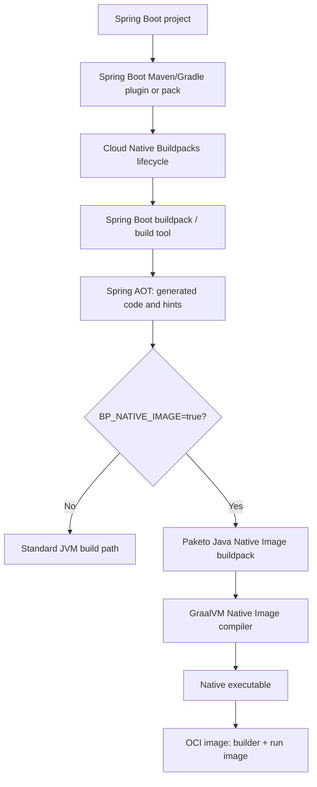
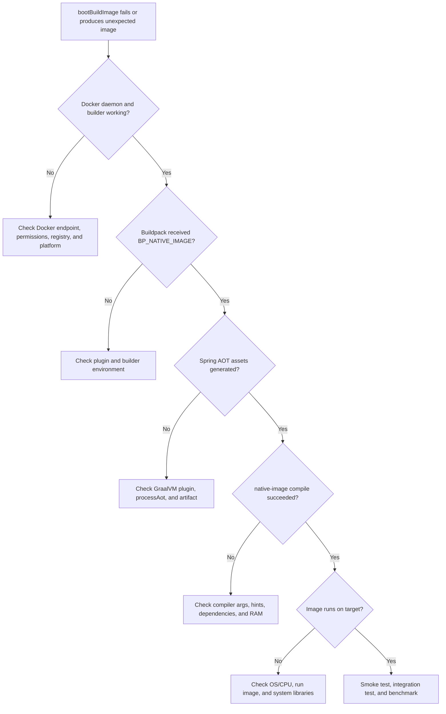

# `BP_NATIVE_IMAGE` and Spring Boot Build Plugin Integration

## 1. Lesson Objectives

When packaging a Spring Boot application as a container image using **Cloud Native Buildpacks (CNB)**, a group of buildpacks detects the application type, provisions tools, and creates a runnable image. For a standard Java application, buildpacks can produce an image running on the JVM. For an application targeting **GraalVM Native Image**, the build process must be instructed to produce a native executable instead.

The **`BP_NATIVE_IMAGE`** environment variable is an important build-time signal telling Paketo's Java Native Image buildpack to participate and compile the application into a native executable. Spring Boot integrates CNB through its Maven/Gradle plugins, allowing developers to configure or trigger this workflow right inside the build file.

After this lesson, you will be able to:

- Explain when `BP_NATIVE_IMAGE` is read and what it changes in the build lifecycle.
- Understand the relationship among Spring AOT, the Spring Boot build plugin, Paketo buildpacks, and the GraalVM Native Image compiler.
- Configure `bootBuildImage` using Gradle Groovy DSL/Kotlin DSL and `spring-boot:build-image` using Maven.
- Distinguish automatic integration by the Spring Boot plugin from explicit configuration when using `pack` or buildpacks directly.
- Pass native-image build arguments, choose a compatible builder, inspect the image, and troubleshoot common issues.

The running example is the `order-service` service. The goal is to build an `order-service:native` container image containing a native executable, serving an HTTP endpoint, and ready for startup/RSS measurement.

## 2. What Is `BP_NATIVE_IMAGE`?

`BP_NATIVE_IMAGE` is a **build-time** configuration variable used by the Paketo Native Image Buildpack to determine whether to compile the application into a GraalVM Native Image. Common values are:

| Value | Meaning |
|---|---|
| `true` | Instructs the buildpack to perform a native image build if the builder has the required compatible buildpacks and toolchain |
| `false` or unset | Does not enable a native image build via this variable; the buildpack may take the normal JVM path depending on the build plan and configuration |

Basic example with `pack`:

```bash
pack build order-service:native \
  --path . \
  --env BP_NATIVE_IMAGE=true
```

This is a general example for a source build with a suitable buildpack configuration. A Spring Boot project must also run **Spring AOT** and produce the required generated assets/metadata before GraalVM compiles natively. Simply setting `BP_NATIVE_IMAGE=true` does not automatically fix all AOT, reflection, resource, or dependency errors.

### 2.1. Where Is This Variable Read?

In the Paketo ecosystem, the Java Native Image Buildpack is a component within the Java native buildpack group. The `paketo-buildpacks/native-image` component participates when `BP_NATIVE_IMAGE` is set or when an upstream buildpack requests native-image in the build plan. When participating, it requests the Native Image builder, invokes `native-image`, and replaces the application bytecode with a native executable in the image.



In Spring Boot's integrated flow, the plugin can orchestrate AOT and pass the appropriate buildpack variables. When using `pack` or buildpack components directly, the builder operator must ensure AOT assets and environment variables are configured for the right build path.

### 2.2. Build-Time vs. Runtime

`BP_NATIVE_IMAGE` must be present **when building the image**. The following configuration does not enable native compilation:

```bash
# Has no effect on enabling a compilation that has already finished.
# This is only an environment variable when the container runs.
docker run --rm -e BP_NATIVE_IMAGE=true order-service:latest
```

At `docker run` time, the buildpack lifecycle is already over. This environment variable cannot turn an existing JVM image into a native image. You must rerun the build workflow with the variable passed into the builder.

## 3. Roles of Spring AOT and the Spring Boot Build Plugin

### 3.1. Three Components with Distinct Responsibilities

| Component | Role in native build |
|---|---|
| Spring AOT | Analyzes Spring configuration at build time, generates initialization code and metadata/hints for reflection, resources, serialization, proxies, or JNI when needed |
| Spring Boot Maven/Gradle plugin | Orchestrates AOT tasks, packages the application, and integrates Cloud Native Buildpacks |
| Paketo Java Native Image buildpack | Supplies/detects the native-image toolchain, invokes the GraalVM Native Image compiler, and produces an image containing the native executable |

Spring AOT is not a native compiler. Nor does the GraalVM Native Image compiler inherently understand all of Spring's dynamic behaviors. Therefore, the workflow needs both the AOT data generated by Spring and the native-image buildpack to execute compilation.

### 3.2. Automatic Integration with the Spring Boot Gradle Plugin

In modern Spring Boot versions supporting native images, when a project applies the GraalVM Native Image Gradle plugin (`org.graalvm.buildtools.native`), the Spring Boot Gradle plugin automatically configures the required AOT tasks. `bootBuildImage` is configured to create a native image instead of a JVM-based image.

This means that for a project configured with the right plugins and compatible versions, you typically only need:

```bash
./gradlew bootBuildImage
```

The Spring Boot plugin handles the integration, including AOT and setting up the necessary buildpack environment. Not every project needs to manually add `BP_NATIVE_IMAGE` to the build file; first verify whether the native plugin is applied and check the `bootBuildImage` logs.

Minimal plugin block example illustrating the relationship:

```groovy
// build.gradle — illustrative; keep your project's existing plugins and versions.
plugins {
    id 'java'
    id 'org.springframework.boot' version '<spring-boot-version>'
    id 'org.graalvm.buildtools.native' version '<compatible-native-build-tools-version>'
}
```

```kotlin
// build.gradle.kts
plugins {
    java
    id("org.springframework.boot") version "<spring-boot-version>"
    id("org.graalvm.buildtools.native") version "<compatible-native-build-tools-version>"
}
```

Version placeholders must be replaced with actual versions compatible with your Gradle wrapper, JDK/GraalVM, and Spring Boot. Do not copy illustrative versions as release versions.

### 3.3. When Should `BP_NATIVE_IMAGE` Be Configured Explicitly?

Explicit configuration is useful when:

- Using `pack build` directly and needing to enable the native-image buildpack.
- Using a custom builder or CNB pipeline without Spring Boot plugin auto-integration.
- Wanting to clearly document the native environment variable inside the `bootBuildImage` configuration.
- Needing to verify the buildpack receives the exact value when changing builders or CI workflows.

Do not add the variable mechanically if the Spring Boot plugin already configures it automatically. Distinguish **automatic integration** from **explicit declaration to control a customized build flow**.

## 4. Configuring Gradle with `bootBuildImage`

The Spring Boot Gradle plugin provides the `bootBuildImage` task to build an OCI image from the application. The task has an `environment` property to pass build-time variables to the builder.

### 4.1. Groovy DSL

If you need explicit declaration, configure it in `build.gradle`:

```groovy
tasks.named('bootBuildImage') {
    environment['BP_NATIVE_IMAGE'] = 'true'
}
```

To also set the builder and OCI image name:

```groovy
tasks.named('bootBuildImage') {
    builder = 'paketobuildpacks/ubuntu-resolute-builder'
    imageName = "order-service:native"
    environment['BP_NATIVE_IMAGE'] = 'true'
}
```

The builder name here is only an example. Choose a supported builder that includes the Java Native Image buildpack and matches your project's OS/architecture and Java version. Spring Boot can select a default builder automatically if you omit it.

### 4.2. Kotlin DSL

In `build.gradle.kts`:

```kotlin
import org.springframework.boot.gradle.tasks.bundling.BootBuildImage

tasks.named<BootBuildImage>("bootBuildImage") {
    environment.put("BP_NATIVE_IMAGE", "true")
}
```

A fuller example:

```kotlin
import org.springframework.boot.gradle.tasks.bundling.BootBuildImage

tasks.named<BootBuildImage>("bootBuildImage") {
    builder.set("paketobuildpacks/ubuntu-resolute-builder")
    imageName.set("order-service:native")
    environment.put("BP_NATIVE_IMAGE", "true")
}
```

In Kotlin DSL, `environment` is a map property, so use `put`. Syntax may differ if the project uses a very old plugin version; verify against the API of your current Spring Boot version.

### 4.3. Running the Build and Inspecting the Image

```bash
./gradlew bootBuildImage

# List images created in the Docker daemon
docker image ls

# Inspect image metadata
docker image inspect order-service:native

# Test run the application
docker run --rm -p 8080:8080 order-service:native
```

Once the container starts, call an actual endpoint of the application. For example, if Spring Boot Actuator is enabled:

```bash
curl -fsS http://localhost:8080/actuator/health
```

A successful `docker image inspect` only confirms the image exists. Check the build logs or the image's process type/entrypoint to make sure the image contains a native executable rather than a JVM application.

## 5. Configuring Maven with `spring-boot:build-image`

The Spring Boot Maven plugin can use Cloud Native Buildpacks via the `spring-boot:build-image` goal. When using `spring-boot-starter-parent`, a `native` profile is provided to orchestrate the necessary native steps, including Spring AOT and appropriate build-image configuration.

### 5.1. Using the Native Profile

For a Maven project already using the Spring Boot parent and declaring a compatible Native Build Tools plugin:

```bash
./mvnw -Pnative spring-boot:build-image
```

The `native` profile in the Spring Boot parent reduces manual configuration. Before using it, verify the project declares `org.graalvm.buildtools:native-maven-plugin` and the required Spring Boot plugins.

### 5.2. Passing `BP_NATIVE_IMAGE` Explicitly

In `pom.xml`, configure the variable in the `image.env` section of the Spring Boot Maven plugin:

```xml
<plugin>
    <groupId>org.springframework.boot</groupId>
    <artifactId>spring-boot-maven-plugin</artifactId>
    <configuration>
        <image>
            <name>order-service:native</name>
            <env>
                <BP_NATIVE_IMAGE>true</BP_NATIVE_IMAGE>
            </env>
        </image>
    </configuration>
</plugin>
```

If the `native` profile already configures the variable and required executions, do not duplicate configuration unnecessarily. The XML snippet above illustrates passing an environment variable to the builder, not replacing the AOT/native plugin declarations.

### 5.3. Without Using the Spring Boot Parent

If the project does not inherit from `spring-boot-starter-parent`, you must configure the appropriate executions for your Spring Boot version yourself. In a standard native flow, ensure the Spring Boot plugin's `process-aot` goal executes before building the image and that required reachability metadata steps are integrated per Native Build Tools.

AOT execution example:

```xml
<plugin>
    <groupId>org.springframework.boot</groupId>
    <artifactId>spring-boot-maven-plugin</artifactId>
    <executions>
        <execution>
            <id>process-aot</id>
            <goals>
                <goal>process-aot</goal>
            </goals>
        </execution>
    </executions>
</plugin>
```

This illustrates the execution block, not a complete `pom.xml`. Follow the documentation for your exact Spring Boot/Native Build Tools versions to configure `add-reachability-metadata`, classpath, and required plugins. If using the parent `native` profile, do not re-declare executions already managed by that profile.

## 6. Using `pack` Directly with a Spring Boot AOT Artifact

The Spring Boot plugin is not the only CNB runner. The `pack` CLI can also run buildpacks. An approach less dependent on the builder's source-build setup is to create an executable JAR already containing AOT assets, then use `pack` to turn that JAR into a native container image.

### 6.1. Creating a JAR with AOT Assets

With Gradle where the GraalVM Native Image plugin and Spring Boot plugin are applied:

```bash
./gradlew bootJar
```

With Maven using the Spring Boot parent and native profile, you can build the artifact using the project's corresponding native pipeline. Verify the JAR contains the generated classes and AOT/hints metadata before feeding it to the buildpack.

### 6.2. Turning the JAR into a Native Container Image

```bash
pack build order-service:native \
  --builder paketobuildpacks/ubuntu-resolute-builder \
  --run-image paketobuildpacks/ubuntu-resolute-run-tiny \
  --path build/libs/order-service-1.0.0.jar \
  --env BP_NATIVE_IMAGE=true
```

Adjust the JAR path, builder name, and run image to match your actual artifact and builder. The builder and run image must be compatible with each other and with the deployment platform.

Some buildpack versions/components support `BP_NATIVE_IMAGE_BUILT_ARTIFACT` to specify the JAR to compile when building from an artifact. When using the Java Native Image component directly or a buildpack group that does not auto-detect the artifact, set this variable per the buildpack's documentation. With the integrated Spring Boot composite buildpack, artifact selection may already be orchestrated automatically.

**Key takeaway:** the JAR must contain AOT generated assets. Running a plain `bootJar` without the corresponding AOT step will not let `BP_NATIVE_IMAGE=true` synthesize all the metadata Spring requires.

## 7. Common Native Image Buildpack Environment Variables

Besides `BP_NATIVE_IMAGE`, the Paketo Native Image Buildpack offers several useful configuration variables:

| Variable | Purpose | When to use |
|---|---|---|
| `BP_NATIVE_IMAGE` | Enable/disable native image build | Enable when you want an image containing a native executable |
| `BP_NATIVE_IMAGE_BUILD_ARGUMENTS` | Pass arguments directly to the `native-image` command | When adding GraalVM options such as optimization levels or class initialization settings |
| `BP_NATIVE_IMAGE_BUILD_ARGUMENTS_FILE` | Point to a file containing arguments in Java argument file format | When the argument list is long or needs to be versioned in source |
| `BP_NATIVE_IMAGE_BUILT_ARTIFACT` | Specify the application JAR to be compiled | When building from a JAR and the buildpack cannot auto-identify the artifact |
| `BP_BINARY_COMPRESSION_METHOD` | Select native executable compression if supported by the buildpack | When considering `upx` or `gzexe`; must test runtime image and platform |

These variables belong to the buildpack; not every CNB builder supports the same versions or components. Check the buildpacks list inside your builder and the reference docs for the version you use.

### 7.1. Passing Build Arguments

Example using Gradle `bootBuildImage`:

```groovy
tasks.named('bootBuildImage') {
    environment['BP_NATIVE_IMAGE'] = 'true'
    environment['BP_NATIVE_IMAGE_BUILD_ARGUMENTS'] = '-O2'
}
```

Kotlin DSL:

```kotlin
tasks.named<BootBuildImage>("bootBuildImage") {
    environment.put("BP_NATIVE_IMAGE", "true")
    environment.put("BP_NATIVE_IMAGE_BUILD_ARGUMENTS", "-O2")
}
```

Maven:

```xml
<image>
    <env>
        <BP_NATIVE_IMAGE>true</BP_NATIVE_IMAGE>
        <BP_NATIVE_IMAGE_BUILD_ARGUMENTS>-O2</BP_NATIVE_IMAGE_BUILD_ARGUMENTS>
    </env>
</image>
```

`-O2` is an example optimization flag; do not assume this level is always best for every application. Native builds are time- and resource-intensive; compare startup, throughput, CPU, and binary size results before selecting production flags.

### 7.2. Using an Arguments File

When you have many options, you can store a file in the source tree, e.g., `config/native-image.args`:

```text
-O2
--initialize-at-run-time=com.example.orders.RuntimeState
```

Then configure the file path according to the buildpack mechanism in use:

```groovy
tasks.named('bootBuildImage') {
    environment['BP_NATIVE_IMAGE'] = 'true'
    environment['BP_NATIVE_IMAGE_BUILD_ARGUMENTS_FILE'] = 'config/native-image.args'
}
```

The file path is resolved within the workspace received by the buildpack. Verify the file is included in the build context and mounted/copied to the right location. Do not store secrets in argument files because build contents can appear in logs or metadata.

### 7.3. Do Not Confuse Gradle Arguments with native-image Arguments

| Variable/config | Receiving tool | Example |
|---|---|---|
| `BP_GRADLE_BUILD_ARGUMENTS` | Gradle command run by Paketo Gradle Buildpack | `--no-daemon build` |
| `BP_NATIVE_IMAGE_BUILD_ARGUMENTS` | GraalVM `native-image` command | `-O2` |
| `BP_NATIVE_IMAGE_BUILD_ARGUMENTS_FILE` | Arguments file for `native-image` | `config/native-image.args` |
| `BP_NATIVE_IMAGE` | Native Image Buildpack | `true` |
| `BP_JVM_VERSION` | JVM/toolchain installed by buildpack for build | `25` (if supported by builder) |

For instance, setting `BP_GRADLE_BUILD_ARGUMENTS=--no-daemon build` does not replace `BP_NATIVE_IMAGE_BUILD_ARGUMENTS`. One controls running the build tool; the other controls the native compiler.

## 8. Builder, Run Image, and Native Platform

### 8.1. The Builder Must Have Compatible Buildpacks

A CNB builder contains the lifecycle, buildpacks, and run image metadata. Not every Java builder includes the native-image component. During builds, inspect detection/build plan logs to confirm the Java buildpack and Native Image buildpack participated.

The Paketo Java Native Image buildpack is a composite buildpack containing components such as the GraalVM toolchain and the Native Image buildpack. The builder must provide the right buildpack suite and toolchain compatible with your Spring Boot/JDK version.

### 8.2. Builder Image and Run Image Have Different Roles

| Image | Role |
|---|---|
| Builder image | Contains the CNB lifecycle, buildpacks, and toolchain to compile the application |
| Run image | Runtime foundation containing system libraries required to run the application image |
| Application image | Produced image containing the native executable along with required runtime components |

Native Image still depends on the operating system, CPU architecture, ABI, and system libraries. Choosing an incompatible builder and run image can cause build or runtime failures. For minimal images such as `tiny`, verify CA certificates, timezone data, dynamic libraries, and every dependency used by the application.

### 8.3. CPU Architecture

A native executable is compiled for a specific build/target platform. `linux/amd64` and `linux/arm64` must be verified separately. When deploying to a multi-architecture cluster, build the corresponding image per architecture and publish a multi-platform manifest once the pipeline has produced all variants.

Do not use `--platform` assuming an amd64 executable automatically turns into arm64. Check the Spring Boot plugin's `imagePlatform`, the platforms supported by the builder, and the CPU architecture of the runner.

## 9. Monitoring the Build and Verifying the Native Image

### 9.1. Stages to Recognize in Logs

A native container build typically includes these stages:

1. Spring Boot plugin packages or prepares the source/artifact.
2. Docker daemon pulls the builder/run image and creates the builder environment.
3. CNB lifecycle runs detection and the build plan.
4. Build tool/buildpack processes the application, running Spring AOT if required by the flow.
5. Native Image buildpack prepares the GraalVM Native Image toolchain.
6. `native-image` runs reachability analysis, applies metadata, and compiles the executable.
7. CNB exports the application image with the matching run image.

Step 6 can account for most of the build time. If a build fails, read the final portion of the logs to determine whether the error occurred in AOT, dependencies, the native compiler, or image export.

### 9.2. Inspecting the Image

```bash
docker image inspect order-service:native
docker image ls order-service

# Run the application
docker run --rm -p 8080:8080 order-service:native
```

Check startup logs, readiness endpoints, and business requests. If the image carries process metadata, you can inspect the entrypoint/process type to confirm the image runs a native executable.

Do not rely solely on a `:native` tag name or the image existing. Tags are assigned by the builder operator; buildpack logs and actual contents prove the native compiler ran.

### 9.3. Verifying the Native Image Compiler Version

Paketo buildpacks provide a Software Bill of Materials (SBOM)/Bill of Materials (BOM) to inspect components included in the build. Use the builder/runtime SBOM inspection mechanism for your version to verify GraalVM or Native Image Toolkit was actually used. This is helpful when a builder changes versions while application config stays the same.

## 10. Common Errors and Troubleshooting

| Symptom | Possible cause | Resolution |
|---|---|---|
| Image builds but still runs on JVM | `BP_NATIVE_IMAGE` was not passed at build time or builder did not activate native buildpack | Check `bootBuildImage` environment, build plan logs, and participating buildpacks |
| `BP_NATIVE_IMAGE` is set but native-image builder not found | Builder lacks native buildpack/toolchain or has incompatible version | Choose a compatible Paketo Java Native Image builder and check buildpack order |
| `native-image` reports missing class/hint/resource | Spring AOT did not run, AOT assets missing, or library needs runtime hints | Verify `process-aot`, check generated hints, and add `RuntimeHints` where needed |
| Buildpack cannot find executable JAR | Wrong artifact path, multi-module picked wrong module, or pattern mismatch | Check `BP_GRADLE_BUILT_MODULE`, `BP_GRADLE_BUILT_ARTIFACT`, or equivalent Maven variables |
| Building from JAR fails because artifact is unspecified | Using component buildpack directly without declaring JAR to compile | Check `BP_NATIVE_IMAGE_BUILT_ARTIFACT` per buildpack reference |
| `Unrecognized option` | `BP_NATIVE_IMAGE_BUILD_ARGUMENTS` contains invalid flag or wrong compiler version | Remove flags one by one, check matching Native Image docs and build log |
| Native build hits OOM/exit 137 | Builder container or Docker VM lacks RAM/CPU | Increase build runner/Docker resources, lower concurrency, check memory limits |
| Pulling builder/run image fails with `401`/`denied` | Missing registry permissions or bad credentials | Configure `builderRegistry` and test pull/push permissions separately |
| Build succeeds but container fails at start | Run image missing libraries, wrong OS/CPU/ABI, or filesystem permissions | Check run image, ELF interpreter, libc, native libraries, and architecture |
| Buildpacks do not reflect new configuration | Cache or stale image causes you to inspect a different artifact | Verify image tag, build ID, and clear cache only when needing a clean test |

### 10.1. Categorizing Errors by Stage



## 11. Hands-On Exercise: Enabling Native Image via the Spring Boot Gradle Plugin

### Prerequisites

- A Spring Boot application with an HTTP endpoint and Actuator health/readiness if using readiness probes.
- Compatible versions of Gradle wrapper, Spring Boot Gradle plugin, and GraalVM Native Image plugin.
- Working Docker daemon with sufficient RAM/CPU and ability to pull builder/run images.
- A builder containing the Paketo Java Native Image buildpack and matching toolchain.

### Step 1 — Apply the Native Plugin

Ensure `build.gradle` or `build.gradle.kts` includes `org.graalvm.buildtools.native`. Do not add it again if the project already has it.

### Step 2 — Inspect AOT and Image Tasks

```bash
./gradlew tasks --all
```

Look for `processAot` and `bootBuildImage`. When the Native Image plugin is applied, the Spring Boot plugin configures the related AOT tasks.

### Step 3 — Build the Image

```bash
./gradlew bootBuildImage
```

Read the logs to confirm the native buildpack was activated. If your project's builder or plugin version requires explicit declaration, add:

```groovy
tasks.named('bootBuildImage') {
    environment['BP_NATIVE_IMAGE'] = 'true'
}
```

### Step 4 — Run and Verify

```bash
docker image ls
docker run --rm -p 8080:8080 <image-name>:<tag>
```

In another terminal, call `/actuator/health` or an actual endpoint of your application. Confirm the buildpack logs indicate a native image was created.

### Step 5 — Try a Build Argument

Add `BP_NATIVE_IMAGE_BUILD_ARGUMENTS=-O2` via `bootBuildImage`'s `environment`, rebuild, and record build time, image size, startup, and RSS. Compare against the baseline without this option on the same machine and workload.

### Result Recording Sheet

| Item | Result to record |
|---|---|
| Spring Boot / Gradle / GraalVM Native Image version | _(record)_ |
| Builder image and buildpack versions | _(record)_ |
| `BP_NATIVE_IMAGE` | `true` / _(actual value)_ |
| Spring AOT | Ran / did not run; logs or generated assets |
| `BP_NATIVE_IMAGE_BUILD_ARGUMENTS` | _(record)_ |
| Application image name/tag | _(record)_ |
| Build result | PASS/FAIL and failing stage |
| Smoke/readiness test | PASS/FAIL |
| Startup to readiness | _(measure)_ |
| Idle RSS / peak RSS | _(measure)_ |

## 12. Common Misconceptions

**"`BP_NATIVE_IMAGE=true` is enough for every Spring Boot project to build natively."** Incorrect. The builder needs the native-image buildpack/toolchain; the app must have AOT assets, compatible dependencies, and required reflection/resource configuration.

**"`BP_NATIVE_IMAGE` is a runtime variable."** Incorrect. It is a build-time variable. Setting it when running a container does not change an already-compiled executable.

**"`Spring AOT` and `Native Image` are the same step."** Incorrect. Spring AOT generates Spring code/metadata; the GraalVM Native Image compiler performs static analysis and generates machine code.

**"Using `bootBuildImage` requires manually declaring `BP_NATIVE_IMAGE`."** Not always necessary. With compatible Spring Boot Gradle plugin and GraalVM Native Image plugin versions, Spring Boot automatically configures AOT and the native image build. Explicit declaration suits customized flows or direct `pack` usage.

**"You can take old Spring Native configs and apply them verbatim to modern Spring Boot."** Do not do this. Spring Boot 3+ has built-in native support and Spring AOT. Spring Native examples from the Spring Boot 2 era may use different plugins, dependencies, and configuration styles.

**"`BP_NATIVE_IMAGE_BUILD_ARGUMENTS` is the same as `BP_GRADLE_BUILD_ARGUMENTS`."** Incorrect. One passes options to `native-image`; the other passes parameters to the Gradle buildpack.

**"A successful build means the image is production-ready."** Incorrect. You must run integration tests and check runtime libraries, architecture, health/readiness, observability, and performance measurements on the target platform.

## 13. Conclusion

`BP_NATIVE_IMAGE` is the build-time switch for the Paketo Java Native Image Buildpack to produce a GraalVM Native Image inside a container image. In the integrated Spring Boot workflow, the Spring Boot Maven/Gradle plugin orchestrates Spring AOT and passes the appropriate configuration to the buildpack. With Gradle, applying `org.graalvm.buildtools.native` enables the Spring Boot plugin to automatically configure AOT and `bootBuildImage` for native images. With Maven, the Spring Boot parent's `native` profile can orchestrate the necessary executions.

When customizing, clearly identify whether the build runs via `bootBuildImage`, `spring-boot:build-image`, or `pack`; pass variables to the **builder at build time**; select a compatible builder/run image; and add `BP_NATIVE_IMAGE_BUILD_ARGUMENTS` only for concrete technical reasons. After building, verify a native executable was truly created, run integration tests, and measure startup/RSS before putting the image into operation.

### Official References

- [Spring Boot — Developing Your First GraalVM Native Application](https://docs.spring.io/spring-boot/how-to/native-image/developing-your-first-application.html)
- [Spring Boot — Advanced Native Images Topics](https://docs.spring.io/spring-boot/reference/packaging/native-image/advanced-topics.html)
- [Spring Boot — Gradle Plugin: Packaging OCI Images](https://docs.spring.io/spring-boot/gradle-plugin/packaging-oci-image.html)
- [Spring Boot — Maven Plugin: Ahead-of-Time Processing](https://docs.spring.io/spring-boot/maven-plugin/aot.html)
- [Paketo — How to Build Java Apps as a GraalVM Native Image](https://paketo.io/docs/howto/java/)
- [Paketo — Java Native Image Buildpack Reference](https://paketo.io/docs/reference/java-native-image-reference/)
- [Paketo Buildpack for Native Image — Configuration](https://github.com/paketo-buildpacks/native-image)
- [Paketo — From deprecation warnings to Spring Boot performance (2026)](https://blog.paketo.io/posts/spring-boot-performance/)
