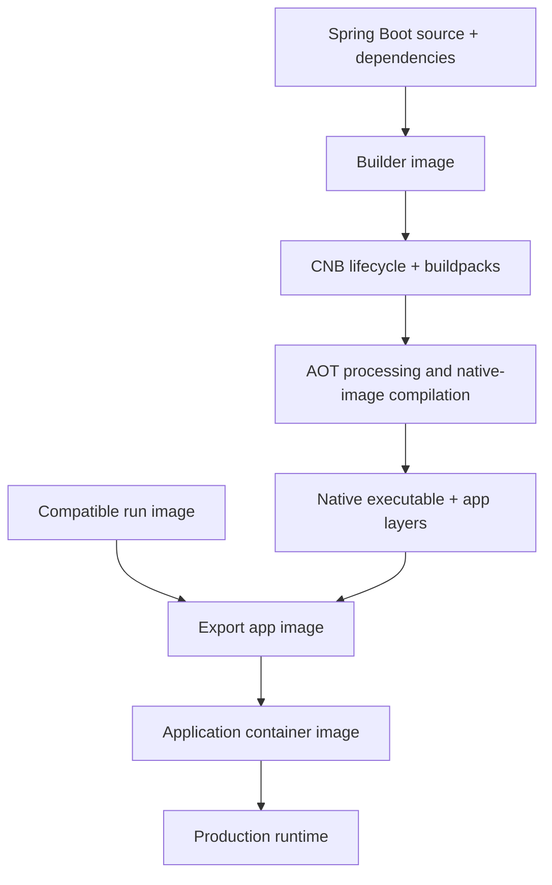

# Choosing Compatible Builder, Run Image, and Versions Instead of Relying on Defaults

When packaging Spring Boot with **Cloud Native Buildpacks**, you often only need a single command like `mvn spring-boot:build-image` or `gradle bootBuildImage`. However, a short command can hide many critical decisions: which builder provides the buildpacks and build tools, which run image serves as the base for the final container, and whether those versions are compatible with one another.

With **GraalVM Native Image**, these decisions matter even more. The native executable is created in the build environment and will run on a specific operating system, CPU architecture, and runtime libraries. A default image might work today and break when a default tag shifts to a new builder. For reliable builds, you should **deliberately choose the builder, run image, and version set**, then record them so builds remain reproducible and can be safely updated.

## 1. Builder and Run Image Have Different Roles

Cloud Native Buildpacks (CNB) separates container image creation into components. Two images to distinguish are the **builder image** and the **run image**.

### Builder image: the environment that builds the application

The builder is the input to the buildpacks process. A CNB builder typically provides:

- **Lifecycle:** the tool orchestrating the detect, analyze, restore, build, and export phases.
- **Buildpacks:** the set of components detecting the application and creating required layers.
- **Build environment/stack:** the platform and libraries used during the build.
- **Stack and run image metadata:** identifiers for the compatible runtime environments supported by the builder.

For Spring Boot native, the builder must include the appropriate buildpacks to detect a Java application, provision the JDK/GraalVM Native Image toolchain, and compile the executable. For instance, certain Paketo builders provide a Java buildpack ecosystem capable of producing a native image when enabled via the corresponding environment variable.

The builder is **not** the final container in which the application runs. It may contain compilers, a JDK, GraalVM, and many tools only needed at build time.

### Run image: the foundation that runs the application

The run image is the base image for container images exported by buildpacks. It provides the minimal environment the application needs at runtime, such as:

- Operating system and system libraries.
- Runtime libraries that a dynamically linked native executable requires.
- CA certificates, timezone data, and base components needed by the application.
- User, group, and filesystem configuration per the run image's design.

For a native executable, the run image generally does not need to carry a full JDK or GraalVM compiler. However, a native binary can still depend on glibc or other system libraries; therefore, **the smallest run image is not necessarily the most suitable run image**.

### Build flow



The builder participates in building the application; the run image supplies the base layers for the exported image. Runtime layers go into the app image, while the build toolchain is not automatically carried over into production.

| Question | Builder | Run image |
| --- | --- | --- |
| Where is it used? | Build time | Runtime |
| Contains lifecycle/buildpacks? | Yes | No |
| Needs compiler/GraalVM? | Possibly, depending on buildpacks | Typically no |
| Provides system libraries at runtime? | Serves as the build environment | Yes, serves as the app image base |
| Affects the native binary? | Directly via toolchain and build config | Via ABI and libraries needed by the binary at runtime |

## 2. Stack ID and Compatibility Between the Two Images

Cloud Native Buildpacks uses a **stack ID** to identify the build/run platform supported by a builder. A builder may declare a default run image and its stack ID. The chosen run image must be compatible with the stack supported by the builder; if the stack ID mismatches, the lifecycle may reject exporting the image.

Conceptually:

```text
Builder:
  stack ID = <stack-id>
  build image = <build-environment>
  default run image = <compatible-run-image>

Overridden run image:
  stack ID must be compatible with builder
```

A matching stack ID is an important CNB compatibility condition, yet **not the sole proof** that the application will run properly. A native executable also depends on CPU architecture, ABI, libc, and required shared libraries.

### Why is a native executable sensitive to the run image?

Native Image compiles Java code into machine code for a target environment. If the executable links against the C runtime library or system libraries present in the build environment, the runtime container must provide compatible libraries.

For example:

- A binary built for Linux x86_64 cannot run natively on a Linux ARM64 container.
- A binary depending on glibc cannot run on a run image lacking a compatible glibc.
- A binary needing a shared library that was stripped from the run image can fail at startup even though the build succeeded.
- TLS can fail if the runtime image lacks suitable CA certificates.
- An application handling timezones may behave differently if the runtime image lacks the necessary timezone data.

Therefore, when choosing a builder and run image, verify **stack**, **OS**, **libc**, **architecture**, and **runtime libraries** together.

## 3. Choosing a Builder for Your Application's Needs

Do not select a builder just because its name includes `base` or `full` or because it is the default for a Spring Boot release. Evaluate these criteria:

| Criterion | What to verify | Reason |
| --- | --- | --- |
| Java buildpack | Does the builder include a suitable Java buildpack? | Detects Spring Boot artifacts and processes Java applications |
| Native Image support | Is there a buildpack/toolchain supporting GraalVM Native Image? | Required to produce a native executable inside buildpacks |
| Java/GraalVM version | Are compatible JDK and Native Image versions available? | Affects APIs, compiler, flags, and buildability |
| Stack/OS | Which stack and Linux distribution does the builder use? | Determines ABI and run image pairing |
| Architecture | Does the builder support `linux/amd64`, `linux/arm64`, or your target architecture? | Avoids producing binaries for the wrong architecture |
| Buildpacks release | Are the buildpacks still maintained and receiving security updates? | Avoids outdated toolchains or unsupported buildpacks |
| Build environment | Are compiler, headers, and libraries needed by native dependencies present? | Some dependencies require system tools at build time |
| Reproducibility | Can you pin the builder by version/digest? | Prevents unintended drift between builds |

### Builder variants and size

An ecosystem may offer multiple builder variants with different sets of buildpacks and packages. For example, a `base` builder often has a curated subset of buildpacks, whereas a `full` variant may offer more buildpacks or tools. Exact classifications depend on the provider and release.

- **A larger builder does not automatically mean a proportionally larger final app image.** Build-only tools do not necessarily end up in the runtime image.
- **A smaller builder is not always better.** If it lacks a needed buildpack or compiler, the build will fail or require complex customization.
- Choose a builder with **all required components**, clear support, and active updates; do not choose on size alone.

If using Paketo, check the metadata and buildpack list of that exact builder release. Naming patterns like `builder-<distro>-<variant>` are conventions of certain releases, not universal rules across all CNB builders.

## 4. Choosing a Run Image for the Application and Deployment Environment

The run image should be lean while containing everything the executable and application need. Check:

1. **Stack ID:** compatible with the selected builder.
2. **Distro and libc:** matches the binary produced in the build environment.
3. **Architecture:** matches the target container platform.
4. **Shared libraries:** includes all required runtime libraries.
5. **Certificates and timezone:** suitable for HTTPS, TLS, and date/time handling.
6. **User and filesystem permissions:** the app can read files, write temporary directories, and bind configured ports.
7. **Security maintenance:** the run image receives patches, follows a release process, and publishes vulnerability notices.
8. **Debuggability:** an overly minimal image may lack a shell or diagnostic tools; you need external ways to observe logs/metrics.

### Choosing a minimal image with verification

A small run image can shrink download size and attack surface, but real workflows must be tested. For example, an app calling external HTTPS APIs needs CA certificates; an app using regional timezones needs timezone data; an app writing files needs appropriate filesystem permissions.

Do not add debugging tools to the production image merely for convenience. You can use ephemeral debug containers or observability tools in the deployment environment, depending on the platform.

## 5. Locking Versions via a Compatibility Matrix

A native build involves more than one version. Related components can include:

| Component | Info to record | How to verify |
| --- | --- | --- |
| Spring Boot | Framework version | POM/Gradle and dependency report |
| Spring Boot Maven/Gradle plugin | Plugin version | Build file/effective POM |
| Java | Major version and vendor | `java -version` or buildpack logs |
| GraalVM Native Image | Distribution and version | Buildpack logs/toolchain metadata |
| Builder | Tag and digest | Image metadata/registry |
| CNB lifecycle | Version and Platform API | Builder metadata/logs |
| Java/native buildpacks | Name and version of each buildpack | `pack inspect-builder` or build logs |
| Stack | Stack ID and distro release | Builder/run image metadata |
| Run image | Tag and digest | Registry metadata |
| OS/architecture | e.g., Linux amd64 or arm64 | Image manifest and build/deploy environment |
| Runtime libraries | libc and required shared libraries | Inspect image and run native binary |

**There is no single version pair that fits every project.** Compatibility must be verified per release of Spring Boot, buildpacks, GraalVM, and stack. When upgrading a component, read the vendor's compatibility notes and rebuild/retest the application.

### Avoid moving tags as production configuration

For example, `paketobuildpacks/builder-jammy-base:latest` or `paketobuildpacks/run-jammy-base:latest` may point to newer images over time. A build today and a build next week might use different lifecycles, buildpacks, OS packages, or toolchains even with unchanged source code.

For reproducible builds, pin a **specific release tag** or even better a **digest**:

```text
paketobuildpacks/builder-jammy-base:<builder-release>@sha256:<builder-digest>
paketobuildpacks/run-jammy-base:<run-release>@sha256:<run-digest>
```

The strings above are illustrative placeholders. Replace them with actual tags and digests verified from the registry; do not copy them verbatim into your build file.

Pinning digests identifies the exact image bytes used, though it also means you must **proactively update** when security patches or new releases arrive. Reproducibility and security go together: lock versions to control change, then perform planned upgrades and rerun tests.

## 6. Configuring Builder and Run Image with the Spring Boot Maven Plugin

The Spring Boot Maven Plugin supports configuring images when running the `spring-boot:build-image` goal. Two key properties are `builder` and `runImage`.

The example below illustrates a configuration for a **Paketo builder/run image pair from the Ubuntu Jammy family**. Tags are illustrative only; in real projects pin verified releases and digests.

```xml
<plugin>
    <groupId>org.springframework.boot</groupId>
    <artifactId>spring-boot-maven-plugin</artifactId>
    <configuration>
        <image>
            <builder>
                paketobuildpacks/builder-jammy-base:<builder-release>
            </builder>
            <runImage>
                paketobuildpacks/run-jammy-base:<run-release>
            </runImage>
            <env>
                <BP_NATIVE_IMAGE>true</BP_NATIVE_IMAGE>
            </env>
        </image>
    </configuration>
</plugin>
```

Explanation:

- `builder` specifies the builder image that the Spring Boot plugin passes to buildpacks.
- `runImage` overrides the default run image supplied by the builder. Set this only after verifying stack ID and compatibility.
- `BP_NATIVE_IMAGE=true` is the environment variable used by the Paketo Java Native Image buildpack to request building a native executable. This is a **contract of that specific buildpack**; other builders may configure this differently.
- The native buildpack must be included in the builder and have a compatible toolchain. Simply setting the environment variable cannot supply a missing buildpack.

For projects using a `native` profile, you can place the image configuration inside that profile so you do not accidentally build natively on every package run. Example command when the profile and AOT are properly configured:

```bash
./mvnw -Pnative spring-boot:build-image
```

Before running, verify the project configures Spring AOT for the native profile matching your Spring Boot version. Read logs to confirm `process-aot` (if required by configuration) and the native image buildpack actually executed. `spring-boot:build-image` packages the application via buildpacks; it does not automatically fix missing runtime hints in application code.

If `runImage` is not overridden, the builder can supply its default run image from metadata. That is a valid choice once you have verified the builder release, though for production builds you should record the exact run image selected in logs and image metadata.

## 7. Configuring Builder and Run Image with Gradle

With Gradle Groovy DSL, you can configure the `bootBuildImage` task:

```groovy
tasks.named("bootBuildImage") {
    builder = "paketobuildpacks/builder-jammy-base:<builder-release>"
    runImage = "paketobuildpacks/run-jammy-base:<run-release>"

    environment = [
        "BP_NATIVE_IMAGE": "true"
    ]
}
```

This example uses Groovy DSL. With Kotlin DSL, property configuration syntax differs; use the `BootBuildImage` task type and the property API of your Spring Boot Gradle Plugin version.

Build the image:

```bash
./gradlew bootBuildImage
```

If the project has a dedicated native profile/task configuration, activate it according to the project's build file. Inspect logs to confirm AOT processing, the native-image buildpack, and the run image were all selected properly. Do not assume the `bootBuildImage` task automatically runs the same set of AOT/native tasks in every configuration; task relationships depend on plugin version and Gradle setup.

### When should `BP_NATIVE_IMAGE` not be enabled?

If the goal is to produce a **JVM** image, do not enable this flag. Buildpacks will create a standard JVM image. If the goal is an image containing a **native executable**, enable native mode per the builder's guide and verify logs show the native buildpack ran. Do not build an image and rely solely on its tag name to conclude it holds a native binary.

## 8. Inspecting Builder, Run Image, and App Image Before Deployment

After a successful build, verify three separate things:

- The actual builder that was used.
- The actual run image used during export.
- That the final app image contains the right native executable and runs in the target environment.

With the Pack CLI, common inspection commands include:

```bash
# View builder metadata and buildpacks.
pack inspect-builder paketobuildpacks/builder-jammy-base:<builder-release>

# View metadata of the built app image.
pack inspect-image example.com/native-baseline:1.0.0

# View image manifest and platforms in the registry.
docker buildx imagetools inspect example.com/native-baseline:1.0.0
```

Exact syntax can vary by Pack CLI version; use `pack help inspect-builder` and `pack help inspect-image` to verify. When inspecting local images, you can use `docker image inspect`. Do not assume inspecting the builder reveals the full digest of the final run image; cross-check build logs and app image metadata as well.

### Verifying the native executable actually runs

Start the image with the same ports, environment, and resource limits expected in production:

```bash
docker run --rm --name native-baseline -p 8080:8080 \
  example.com/native-baseline:1.0.0
```

From another terminal, call the health endpoint and at least one business endpoint. For example:

```bash
curl --fail --silent --show-error \
  http://127.0.0.1:8080/actuator/health

curl --fail --silent --show-error \
  "http://127.0.0.1:8080/api/greeting?name=Lan"
```

Then check logs, exit code, and container status. A successful image build only confirms packaging finished; **running correctly on the target runtime** provides evidence of runtime compatibility.

## 9. CPU Architecture and Binary Compatibility

A native executable is compiled for a specific target architecture. Having a multi-architecture manifest on the builder image does not mean a produced binary automatically runs on every architecture.

For example:

| Build target | Runtime target | Expected result |
| --- | --- | --- |
| Linux amd64 | Linux amd64 | Compatible if OS/ABI and libraries match |
| Linux arm64 | Linux arm64 | Compatible if OS/ABI and libraries match |
| Linux amd64 | Linux arm64 | Cannot natively run an amd64 binary on an arm64 CPU |
| Linux/glibc | Linux/musl | May be incompatible if the binary depends on glibc |
| Linux | Windows | Not a native binary for the same platform |

When building multi-architecture images, verify which targets the builder/buildpacks support, which Docker/BuildKit platform is used, and the toolchain's cross-compilation mechanism. If supported cross-compilation is unavailable, build on runners matching each architecture or build separate image variants.

Beyond architecture, verify dynamic dependencies. A native executable can build cleanly yet fail at startup on a minimal run image complaining about a missing shared library. Cross-check required libraries against the image's packages/runtime. Do not fix this by shipping the entire builder inside the production image; instead, choose a compatible run image or adjust build/linking configuration.

## 10. Updating Versions While Staying Reproducible

Pinning digests does not mean keeping an image forever. A controlled update workflow can include:

1. **Record baseline:** Spring Boot, plugins, Java, GraalVM, builder, buildpacks, stack ID, run image, architecture, and digests.
2. **Choose a small change:** e.g., upgrade builder/run image within the same release family, or upgrade Spring Boot/plugin separately; avoid changing many factors at once.
3. **Check compatibility notes:** see which Java/GraalVM, stack, and run image the buildpack release supports.
4. **Rebuild from a fixed source commit:** do not reuse old outputs to evaluate the impact of a new builder.
5. **Run native tests:** health, business endpoints, TLS, resources, timezone, file permissions, and reflection-using paths.
6. **Re-measure:** startup-to-ready, RSS, image size, and build duration in an environment matching the baseline.
7. **Save new digests:** retain old image info for traceability or rollback.

If a buildpack release has a security vulnerability, prioritize updating according to organizational policy and run regression tests. Pinning digests tells you exactly which image ran; it does not replace applying security patches.

### Change Matrix and Minimum Test Scope

| Change | Minimum verification |
| --- | --- |
| Changing run image only | Stack ID, libc/shared libraries, TLS certificates, timezone, permissions, native runtime smoke tests |
| Changing builder | Buildpack detect, Java/GraalVM version, AOT, native compile, generated metadata, image export |
| Changing Java/GraalVM buildpack | Compiler compatibility, native flags, binary architecture/ABI, runtime smoke tests |
| Changing Spring Boot/plugin | AOT task/goal, generated code, runtime hints, buildpack integration, tests |
| Changing CPU architecture | Builder manifest, native target architecture, runtime image platform, deployment nodes |
| Changing OS/stack | Stack ID, libc, packages, shared libraries, certificates, timezone, full native tests |

## 11. Common Errors

| Symptom | Possible cause | Resolution |
| --- | --- | --- |
| Buildpacks reject run image | Stack ID incompatible with builder | Use the run image declared by the builder or pick a builder/run image pair sharing a stack |
| Native buildpack not found | Builder lacks Native Image buildpack or release mismatch | Choose a builder with native support; verify metadata and build logs |
| `BP_NATIVE_IMAGE=true` yet output is still JVM | Environment variable did not reach buildpack, unsupported buildpack, or wrong profile setup | Check plugin env, detect/build logs, and launch process type |
| Native build fails in compiler | Incompatible JDK/GraalVM/toolchain or native dependency | Check buildpack version, Java version, architecture, and compiler logs |
| Executable reports missing shared library at runtime | Run image missing library or ABI mismatch | Use a matching-stack run image, add appropriate runtime dependency, and rebuild |
| TLS/HTTPS fails inside container | Missing or differing CA certificates, proxy/trust config | Verify certificates in run image and runtime config |
| Works locally but fails on another node | Different CPU architecture, kernel/OS, or container limits | Compare platform manifests, architecture, and runtime limits |
| Today's build differs from yesterday's despite unchanged source | Using moving tags like `latest`; buildpacks/dependencies changed | Pin tags/digests and record all build metadata |
| Final image is too large | Run image or runtime layers unoptimized; extra packages added | Inspect layers and choose a verified minimal run image |

## 12. Hands-On Exercise: Building a Native Image with a Pinned Builder/Run Image Pair

Assume a Spring Boot app already has a health endpoint and a business endpoint. Choose a builder with Java Native Image support and a compatible run image according to the builder release metadata. Do not use the illustrative tags above without verifying actual versions.

**Step 1 — Record choices before building**

Create a notes table:

| Component | Value to fill in |
| --- | --- |
| Spring Boot version | Project version |
| Maven/Gradle plugin version | Project version |
| Java version | Version used by buildpack/toolchain |
| GraalVM Native Image version | Version shown in build logs |
| Builder | Repository, tag, digest |
| Buildpacks | Java and native buildpack names/versions |
| Stack ID | Builder metadata value |
| Run image | Repository, tag, digest |
| Target platform | e.g., `linux/amd64` |
| Native mode | Confirm `BP_NATIVE_IMAGE=true` if using Paketo Java buildpack |

**Step 2 — Configure explicitly**

In Maven, set `builder`, `runImage`, and the native variable inside the Spring Boot Maven Plugin configuration. In Gradle, set the corresponding values on the `bootBuildImage` task. Use the same selected image pair across the entire trial.

**Step 3 — Build and read logs**

Run the build-image goal/task per project configuration. Record the builder, run image, buildpack versions, Java/GraalVM toolchain, and confirm native-image compilation actually occurred. If AOT did not run, check profile/task execution before continuing.

**Step 4 — Inspect the image**

Use Pack or Docker inspect to verify app image metadata. Run the container, call health and business endpoints, and check logs for shared library, TLS, timezone, or filesystem permission errors.

**Step 5 — Record results and test an upgrade**

Build once with the pinned image pair. Then try upgrading one component in a controlled way (for example, builder and run image to the next compatible release), rebuild/retest, and record changes in startup, RSS, image size, and build duration.

### Self-Check Questions

1. What components does a builder image contain that a run image does not need?
2. Why might a run image with a different stack ID from the builder be rejected by the CNB lifecycle?
3. Is having the same stack ID enough to guarantee a native executable runs on every CPU architecture?
4. Can `BP_NATIVE_IMAGE=true` automatically install a missing native buildpack into a builder?
5. Why does pinning digests improve reproducibility while still requiring a version upgrade process?
6. If a native executable builds successfully but reports a missing shared library at runtime, should you check the builder or the run image first?
7. Why does a larger builder image not necessarily make the final app image proportionally larger?

**Success criteria:** be able to explain the distinct roles of builder and run image; select an image pair with compatible stack/OS/architecture; pin and record versions/digests; configure Spring Boot buildpacks to create a native executable; verify the final image via runtime tests; and establish a controlled upgrade workflow instead of relying on default tags.
