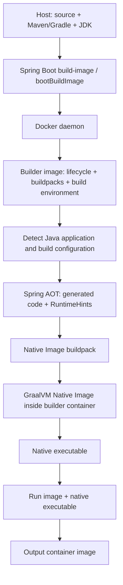

# Building with Docker Without Installing GraalVM Locally

## 1. Objective

To create a GraalVM Native Image, you normally need a JDK/GraalVM with the `native-image` component and a compatible native compilation toolchain. Installing these tools directly on every developer machine can be time-consuming and hard to synchronize across Windows, macOS, Linux, and CI.

**Cloud Native Buildpacks (CNB)** lets you package an application in a container-driven workflow. With Spring Boot, the Maven Plugin or Gradle Plugin connects to the Docker daemon and passes the application and build configuration into a **builder image**. Buildpacks inside the builder provision tools, execute Spring AOT and Native Image compilation, and produce a **container image** capable of running the application.

Therefore, the host machine does not need GraalVM or `native-image` installed directly. The host still needs:

- A running Docker Engine, Docker Desktop, or Docker-compatible daemon with access permissions.
- A compatible JDK to run Maven/Gradle and the project wrapper.
- Source code, Spring Boot configuration, and connectivity to dependency repositories/container registries as needed.
- Sufficient CPU, RAM, and disk storage for compilation inside the builder container.

In the **SPRING_BOOT_NATIVE_IMAGE** module, this approach standardizes the build environment, tests compatibility, and creates deployable images. The goal is to verify that the image actually contains a **native executable** compiled by GraalVM.

After this lesson, learners will be able to:

- Explain the roles of the Docker daemon, builder image, buildpacks, and run image.
- Configure the Spring Boot Maven/Gradle Plugin to enable native builds via buildpacks.
- Create container images without installing GraalVM on the host.
- Run and inspect images, confirming that native compilation occurred.
- Troubleshoot common issues involving the Docker daemon, builder, architecture, memory, and native metadata.

## 2. How Do Buildpacks Work?

Docker provides a daemon for managing images/containers. **Buildpacks** are a mechanism to detect application types, provision dependencies/build tools, and package artifacts following a standard workflow. CNB is not synonymous with an ordinary `docker build` command.

A native build workflow with Spring Boot and buildpacks:



| Component | Role |
|---|---|
| **Host** | Holds source, Maven/Gradle wrapper, and JDK to run the build tool; no GraalVM installation required |
| **Docker daemon** | Pulls builder/run images, creates the build container environment, and stores the output image |
| **Builder image** | Contains CNB lifecycle, buildpacks, and environment to detect/compile the application |
| **Buildpack** | Analyzes the application, selects dependencies/tools, and executes build steps |
| **Spring AOT** | Analyzes Spring configuration, generates initialization support code, and supplies RuntimeHints |
| **Native Image buildpack** | Invokes GraalVM Native Image to compile application code inside the builder |
| **Run image** | Provides the operating system foundation and runtime libraries for the final container |

Builder image and run image have distinct duties. The builder contains compilation tools; the run image contains the foundation needed to run the product. They must match the stack used by the builder.

### Does Docker compile into a Native Image by itself?

**No.** The Docker daemon only executes container/image operations. To produce a Native Image, the workflow must use a builder containing a buildpack that supports GraalVM Native Image and enable native mode. Packaging a JAR to run on a JRE/JDK still yields a JVM application inside a container.

With Spring Boot, the two convenient entry points are:

- Maven: goal `spring-boot:build-image`.
- Gradle: task `bootBuildImage`.

These integrations orchestrate the CNB lifecycle via the Docker daemon and produce an image after the build.

## 3. Host Machine Requirements

### 3.1. Checking the Docker daemon

```bash
docker version
docker info
```

`docker version` must show both Client and Server. If only Client appears or a connection error is reported, start Docker Engine/Docker Desktop, select the right Docker context, and verify daemon permissions.

On Windows/macOS, Docker Desktop typically provides a Linux daemon via a virtual machine environment. When building Linux images, Docker Desktop must be in Linux containers mode with sufficient resources. On Linux, users need permission to run Docker per host policy.

### 3.2. Checking JDK and wrapper

Maven/Gradle still runs on the host, so a JDK compatible with Spring Boot and the build tool is required:

```bash
java -version
./mvnw --version
./gradlew --version
```

On Windows PowerShell use `.\mvnw.cmd --version` and `.\gradlew.bat --version`.

The host JDK does not have to be GraalVM. The builder image provides the native toolchain according to the builder's configuration and capabilities. Still, the **Java major version must remain compatible**: bytecode/AOT assets produced by the host must be supported by the Native Image compiler inside the builder. Some buildpack workflows select a GraalVM Native Image matching the Java version used to compile the application. Therefore, verify the exact Spring Boot release and builder requirements before building; do not interpret "no GraalVM needed on host" as "host Java version doesn't matter." You also do not need `native-image --version` on the host; read buildpack logs to identify the GraalVM/Native Image used inside the container.

### 3.3. Resources and connectivity

Native compilation consumes significant CPU, RAM, and I/O. Check:

- Does the Docker daemon have enough memory, CPU, and disk space to pull the builder, create caches, and compile?
- Can the machine download required Java dependencies and builder/run images?
- Does the registry require login or enforce rate limits?
- Does the Docker context point to a local or remote daemon? Actual compute resources belong to the machine running the daemon.
- Which architecture do the host, builder, and target image use, e.g., `linux/amd64` or `linux/arm64`?

You do not need to install GraalVM, `native-image`, GCC, or a native linker on the host for this buildpack approach. Tools needed for compilation are supplied by the appropriate builder environment.

## 4. Choosing a Builder with Native Image Support

Not every builder image includes the Native Image buildpack. Before building, verify:

1. The chosen builder contains a suitable Java buildpack and Native Image buildpack.
2. The buildpack release supports your project's Java/GraalVM and Spring Boot versions.
3. The builder has a stack and architecture compatible with the deployment environment.
4. The run image is compatible with the builder and includes system libraries required by the native binary.
5. Builder and run image versions/tags are pinned for reproducible builds.

Builder names change across Spring Boot lines and buildpack generations. Examples in official guides:

| Spring Boot doc line | Illustrative builder in guide | Notes |
|---|---|---|
| Spring Boot 3.4 | `paketobuildpacks/builder-jammy-java-tiny:latest` | Jammy builder for the 3.4 line's native image workflow |
| Spring Boot 3.5 | `paketobuildpacks/builder-noble-java-tiny:latest` | Noble builder per 3.5 plugin documentation defaults |
| Spring Boot 4.1 native-image guide | `paketobuildpacks/builder-noble-java-tiny:latest` | 4.1 documentation requires building apps with at least JDK 25 for the buildpacks workflow |

These names are **examples tied to doc releases**, not a universal compatibility list for every app. Choose a builder according to the guide for your project's exact release; do not copy an old builder name onto a new major release. In CI, prefer pinning specific tested tags or digests rather than relying on the moving `latest` tag.

### Builder and run image are distinct

- The builder image is used at build time; it may contain GraalVM, compiler, linker, and buildpack lifecycle.
- The run image is the base for the final container; it only needs required runtime components.
- A builder containing GraalVM does not mean the final container carries the entire GraalVM suite.
- A native executable may still depend on system libraries; the run image must satisfy those dependencies.

If you change the builder or run image, rebuild, run smoke tests, and re-evaluate image size.

## 5. Enabling Native Image with the Spring Boot Maven Plugin

With Maven, the project needs `spring-boot-starter-parent` to inherit the Spring Boot-provided `native` profile and declare `org.graalvm.buildtools:native-maven-plugin` under `<build><plugins>`. The `native` profile configures the required AOT and reachability metadata steps. Without the Spring Boot parent, you must configure the corresponding executions manually, including `process-aot` and `add-reachability-metadata` per the exact release documentation.

The parent section looks like (replace the version with the Spring Boot release chosen by your project):

```xml
<parent>
    <groupId>org.springframework.boot</groupId>
    <artifactId>spring-boot-starter-parent</artifactId>
    <version>4.1.3</version>
    <relativePath/>
</parent>
```

Declare the Native Build Tools plugin in `pom.xml`:

```xml
<build>
    <plugins>
        <plugin>
            <groupId>org.graalvm.buildtools</groupId>
            <artifactId>native-maven-plugin</artifactId>
        </plugin>
    </plugins>
</build>
```

Then configure the image inside the `native` profile so normal JVM builds do not accidentally switch to native.

Example addition in `pom.xml`:

```xml
<profiles>
    <profile>
        <id>native</id>
        <build>
            <plugins>
                <plugin>
                    <groupId>org.springframework.boot</groupId>
                    <artifactId>spring-boot-maven-plugin</artifactId>
                    <configuration>
                        <image>
                            <name>example/spring-boot-native:0.0.1</name>
                            <builder>paketobuildpacks/builder-noble-java-tiny:latest</builder>
                            <env>
                                <BP_NATIVE_IMAGE>true</BP_NATIVE_IMAGE>
                            </env>
                        </image>
                    </configuration>
                </plugin>
            </plugins>
        </build>
    </profile>
</profiles>
```

Key points:

- `image.name` sets the output image name per project convention.
- `image.builder` selects the builder image used to execute buildpacks.
- `image.env` passes environment variables to buildpacks at build time.
- `BP_NATIVE_IMAGE=true` instructs the native-image-supporting buildpack to perform native compilation.

If the Spring Boot Maven Plugin is already declared in the parent or `pluginManagement`, verify the profile configuration applies to the plugin actually executing. If the project does not inherit from the Spring Boot parent, declare a plugin version matching your Spring Boot release per project docs.

Run the build:

```bash
./mvnw -Pnative spring-boot:build-image
```

Maven runs on the host, while Native Image compilation runs inside the builder container environment. The host does not need GraalVM or `native-image` installed.

### Using native configuration by default

You can place the image configuration directly on the Spring Boot Maven Plugin so every `spring-boot:build-image` run uses native. For projects producing both JVM and native images, a dedicated profile keeps commands and intent clearer.

## 6. Enabling Native Image with the Spring Boot Gradle Plugin

With Gradle, apply the GraalVM Native Image plugin `org.graalvm.buildtools.native`. The Spring Boot Gradle Plugin automatically configures AOT tasks when this plugin is applied; the `bootBuildImage` task then builds a native image. Declare the plugins in the `plugins` block using versions compatible with your Spring Boot/Gradle wrapper:

```groovy
plugins {
    id 'org.springframework.boot' version '<spring-boot-version>'
    id 'org.graalvm.buildtools.native' version '<native-build-tools-version>'
}
```

Values in `<...>` are placeholders and must be replaced with verified versions. With Gradle Groovy DSL, configure `bootBuildImage`:

```groovy
tasks.named("bootBuildImage") {
    imageName = "example/spring-boot-native:0.0.1"
    builder = "paketobuildpacks/builder-noble-java-tiny:latest"
    environment = [
        "BP_NATIVE_IMAGE": "true"
    ]
}
```

With Kotlin DSL (`build.gradle.kts`), you can configure the typed task explicitly:

```kotlin
import org.springframework.boot.gradle.tasks.bundling.BootBuildImage

tasks.named<BootBuildImage>("bootBuildImage") {
    imageName = "example/spring-boot-native:0.0.1"
    builder = "paketobuildpacks/builder-noble-java-tiny:latest"
    environment = mapOf(
        "BP_NATIVE_IMAGE" to "true"
    )
}
```

The builder name in this example illustrates the Noble configuration commonly seen in Spring Boot 4.1 guides; replace it with a builder supported by your exact release documentation and pin a verified tag/digest. The Spring Boot Gradle Plugin and GraalVM Native Build Tools plugin coordinate to produce AOT assets and activate the native buildpack; `bootBuildImage` uses buildpacks and the Docker daemon, whereas `nativeCompile` typically invokes the Native Image toolchain directly on the configured build environment. Do not confuse these two paths. When running only `bootBuildImage`, GraalVM compilation happens inside the builder; do not run `nativeCompile` on the host if your goal is avoiding installing GraalVM on that machine.

Run the task:

```bash
./gradlew bootBuildImage
```

The `bootBuildImage` task consumes Gradle's application output (usually depending on `bootJar`), then orchestrates image building. If the build fails, inspect task logs and buildpack logs to pinpoint the failing step.

## 7. Where Is BP_NATIVE_IMAGE Passed?

`BP_NATIVE_IMAGE` is a buildpack configuration variable read during the **image creation stage**. In the Maven example, it sits in `image.env`; in Gradle, it sits in `environment` of the `bootBuildImage` task.

```text
Maven / Gradle host
    |
    | Sends build image configuration
    v
Docker daemon
    |
    v
Builder container
    |
    | BP_NATIVE_IMAGE=true
    v
Native Image buildpack
    |
    v
GraalVM Native Image compilation
    |
    v
Container image containing native executable
```

Do not just run:

```bash
docker run -e BP_NATIVE_IMAGE=true example/spring-boot-native:0.0.1
```

At `docker run` time, the image is already built. Container launch environment variables cannot go back and trigger Native Image compilation. To turn a JVM image into a native image, you must rerun **build image** with the proper buildpack configuration.

Distinguish clearly:

- **Build-time environment:** variables passed to the builder/buildpack during build, e.g., `BP_NATIVE_IMAGE`.
- **Runtime environment:** variables read by the application when the container runs, e.g., port or external endpoint config.
- **Host environment:** shell variables running Maven/Gradle; only effective if forwarded by plugins per configuration.

## 8. Running the Container and Verifying the Result

After Maven/Gradle builds successfully, the Docker daemon will have the image under the configured name/tag. List images:

```bash
docker images
```

Inspect image metadata and platform:

```bash
docker image inspect example/spring-boot-native:0.0.1 \
  --format '{{.Os}}/{{.Architecture}} {{.Size}}'
```

Run the container, assuming the app listens on port 8080:

```bash
docker run --rm --name spring-native-demo \
  -p 8080:8080 \
  example/spring-boot-native:0.0.1
```

From another terminal, call an endpoint:

```bash
curl --fail --silent --show-error http://localhost:8080/hello
```

Replace `/hello` with an actual endpoint in your project. Inspect container logs and the response; do not rely solely on `docker run` exiting without errors.

### Verifying the image is genuinely a Native Image

A running container alone does not prove it holds a native executable. Check multiple pieces of evidence:

1. Build logs include the Native Image buildpack step and a successful GraalVM compilation process.
2. Logs contain Native Image toolchain/version details used inside the builder.
3. `BP_NATIVE_IMAGE=true` was passed inside the image build configuration, not merely to the runtime container.
4. The buildpack reports creating a native executable or selecting a process matching the native artifact.
5. The container runs and handles requests successfully; features using reflection/resources are also tested if present in the app.

You can inspect the image command/entrypoint to assist diagnostics:

```bash
docker image inspect example/spring-boot-native:0.0.1 \
  --format '{{.Config.Entrypoint}} {{.Config.Cmd}}'
```

The entrypoint may go through the buildpacks launcher, so looking at the command name alone is insufficient. Combine build logs and runtime tests.

## 9. Do Buildpacks Automatically Handle Every Compatibility Issue?

**No.** Buildpacks supply the build environment and orchestrate compilation steps. They cannot automatically turn every Java library into a Native Image-compatible library.

The application must still satisfy AOT and reachability analysis constraints:

- Reflection requires appropriate metadata if targets cannot be determined by static analysis.
- Resources read dynamically by name/path may require registration to be included in the image.
- Dynamic proxies, serialization, JNI, and class initialization must be verified per library used.
- Arbitrary plugin JARs loaded after build will not magically appear inside the native executable.
- Dependencies with features unsupported in native mode can break the build or fail at runtime.

Spring AOT and RuntimeHints help describe components required by a Spring application, yet real business paths still need testing. When JVM works and native fails, read the stack trace and identify the dynamic operation missing metadata; do not assume Docker or the builder is the sole culprit.

## 10. Platform and Architecture Limits

A native executable is compiled for a specific platform. A builder running on Linux ARM64 generally creates artifacts for Linux ARM64; it does not implicitly produce Windows or macOS binaries. With containers, check:

- The builder image supports the Docker daemon's architecture.
- The run image is compatible with the stack and libraries used by the builder.
- The final image matches the target OS/architecture.
- Native/JNI libraries and ABI (e.g., glibc/musl) match.
- The deployment environment meets the system requirements of the built image.

Docker Buildx and QEMU support some multi-architecture workflows, though not every GraalVM Native Image combination can be cross-compiled. The safest route is building on a runner matching the target architecture or using cross-compilation configurations explicitly supported by GraalVM/buildpacks, then testing the image in the corresponding environment.

Check image architecture:

```bash
docker image inspect example/spring-boot-native:0.0.1 \
  --format '{{.Os}}/{{.Architecture}}'
```

Do not push a `linux/amd64` image to a `linux/arm64` node expecting Docker to convert the binary automatically. Multi-architecture manifests also require each child image to be built and verified for its exact architecture.

## 11. Cache, Build Time, and Image Size

Buildpacks can reuse cache layers across builds. Subsequent runs can be faster; results depend on Docker volumes/caches, dependency caches, pre-pulled builder/run images, and unchanged layers.

When measuring duration, note clearly:

- Whether builder/run images were pulled for the first time or already local.
- Whether dependencies were cached or needed downloading.
- Whether buildpack caches were reused.
- Whether source, dependencies, or config changed, forcing layers to rerun.
- Whether measured time covers the entire `build-image`/`bootBuildImage` goal or only the Native Image compile step in logs.

Container image size does not equal executable size. The image includes the run image, launcher, and other layers. Use Docker to record figures:

```bash
docker image inspect example/spring-boot-native:0.0.1 \
  --format '{{.Size}}'
```

The `.Size` field reflects how Docker represents image size; it is not the native executable file size, compressed push/pull transfer size, or runtime container RAM. When comparing JVM and native images, use identical measurement criteria and tools, and document the builder/run images. Actual size depends on dependencies, resources, flags, and packaging.

## 12. CI Integration

A typical CI pipeline needs:

1. Check out the exact commit.
2. Install the JDK and run the Maven/Gradle wrapper.
3. Provide a Docker daemon or remote builder daemon accessible to the job.
4. Use a builder/run image pinned by tag or digest.
5. Enable `BP_NATIVE_IMAGE=true` in the image build configuration.
6. Build the image, saving logs and version metadata.
7. Run container smoke tests.
8. Only after tests pass, publish the image per project policy.

Example verification and build commands in a Linux job:

```bash
java -version
docker version
docker info

./mvnw -Pnative spring-boot:build-image
docker image inspect example/spring-boot-native:0.0.1
```

Build commands are only part of the pipeline; CI also needs registry authentication, commit/release tagging, cache management, and security policies. Never print registry passwords/tokens to command logs. If the Docker daemon runs remotely, CPU/RAM resources and caches live on the remote machine, not the runner invoking Maven.

With buildpacks, the CI host does not need GraalVM installed, though the builder image must be downloadable or pre-cached. If the organization uses proxies, mirrors, or an internal registry, configure image and dependency download paths accordingly.

## 13. Common Errors and Resolutions

| Symptom | Possible cause | How to check |
|---|---|---|
| `Cannot connect to the Docker daemon` | Docker Engine not running, wrong context, or missing permissions | `docker version`, `docker info`, check Docker context and permissions |
| Builder image not found | Wrong tag, unreachable registry, or image not pulled | Check name/tag, network, and registry credentials |
| Build succeeds but runs as JVM | `BP_NATIVE_IMAGE` not passed or builder lacks Native Image buildpack | Check `image.env`/`environment`, logs, and selected buildpacks |
| Native buildpack not detected | Builder lacks suitable buildpack or release unsupported | Choose a verified builder with support, check buildpack order |
| Maven/Gradle build image fails at AOT | Spring AOT, dependency, or app configuration error | Run JVM build/tests first, read AOT logs |
| Native compilation runs out of RAM or gets killed | Docker daemon/builder container lacks memory/CPU | Increase Docker daemon/CI runner resources, lower parallelism if appropriate |
| Reflection/resource errors when running container | RuntimeHints or resource metadata incomplete | Reproduce on native, register proper hints, and rebuild |
| Container fails to run on target node | Wrong OS/architecture, ABI, or native libraries | Check image inspect, builder/run stack, and target node |
| Image lacks expected tag | Default image name or differing plugin config | Check `image.name`/`imageName`, logs, and `docker images` |
| First build is much slower | Pulling builder, run image, dependencies, and cold cache setup | Separate cold/warm runs, log cache state and build logs |
| Docker build timeout | Long native compilation or under-resourced runner | Check buildpack logs, CI timeout, CPU/RAM, and disk space |

Do not treat every error by randomly swapping builders. Identify the failing step in the logs first, then change one configuration factor and rebuild to verify.

## 14. Hands-On Exercises

### Exercise A — Building a native container image on a machine without GraalVM

1. Verify the Docker daemon and host JDK.
2. Confirm the builder has the Native Image buildpack and pick an appropriate tag/digest.
3. Configure the Maven profile or Gradle `bootBuildImage` with `BP_NATIVE_IMAGE=true`.
4. Build the image using the wrapper.
5. Read logs to verify GraalVM Native Image compilation occurred inside the builder.
6. Run the container, call an endpoint, and record the results.

**Completion criteria:** no GraalVM installation required on host; image builds cleanly, logs confirm native compilation, and smoke test passes.

### Exercise B — Comparing with a JVM container

Build a JVM image and a native image from the same source commit. Record builder/run images, cache state, wall build time, image size, architecture, and endpoint results. Do not include initial builder pull time in native compile duration if measuring the compiler alone; if measuring the entire pipeline, keep the scope identical across both runs.

### Exercise C — Checking architecture boundaries

Build an image for one architecture, inspect it with `docker image inspect`, then check the architecture of the deployment environment. Explain why an incompatible image cannot run simply by changing environment variables during `docker run`.

## 15. Pre-Handoff Image Checklist

- [ ] Docker daemon is running and Maven/Gradle can connect.
- [ ] Host JDK meets Spring Boot and build tool requirements.
- [ ] No GraalVM/`native-image` installation needed on the host.
- [ ] Builder is pinned and includes a compatible Native Image buildpack.
- [ ] `BP_NATIVE_IMAGE=true` is passed in the **build-time environment**.
- [ ] Logs confirm the GraalVM Native Image compilation step.
- [ ] Run image is compatible with the builder and runtime libraries.
- [ ] Image matches the target environment's OS/architecture.
- [ ] Container runs and passes smoke tests.
- [ ] Tags/digests, logs, versions, and cache state are saved for reproducibility.

## References

- [Spring Boot 3.4 — Developing Your First GraalVM Native Application](https://docs.spring.io/spring-boot/3.4/how-to/native-image/developing-your-first-application.html): native image workflow using Cloud Native Buildpacks, Jammy builder, and Docker requirements.
- [Spring Boot 4.1 — Developing Your First GraalVM Native Application](https://docs.spring.io/spring-boot/4.1/how-to/native-image/developing-your-first-application.html): Noble builder, JDK requirements, and Maven/Gradle configuration for native buildpacks.
- [Spring Boot Maven Plugin — Packaging OCI Images](https://docs.spring.io/spring-boot/maven-plugin/build-image.html): configuring builder, run image, environment, and `build-image` goal.
- [Spring Boot Gradle Plugin — Packaging OCI Images](https://docs.spring.io/spring-boot/gradle-plugin/packaging-oci-image.html): configuring `bootBuildImage` task and image properties.
- [Spring Boot — Advanced Native Image Topics](https://docs.spring.io/spring-boot/reference/packaging/native-image/advanced-topics.html): converting an executable JAR with AOT assets into a native container image via buildpacks.

## Conclusion

Using Spring Boot `build-image` or `bootBuildImage` with Cloud Native Buildpacks creates a GraalVM Native Image inside a **builder container**, so the host machine does not need GraalVM installed directly. The host still needs a Docker daemon, a JDK to run the build tool, and sufficient resources for native compilation. What determines success is choosing a builder with a compatible Native Image buildpack, passing `BP_NATIVE_IMAGE=true` at build time, ensuring a matching run image, and verifying the image via logs and smoke tests. Once the builder, architecture, and cache are standardized, teams can reproduce native container images across developer laptops and CI without installing GraalVM separately on every host.
