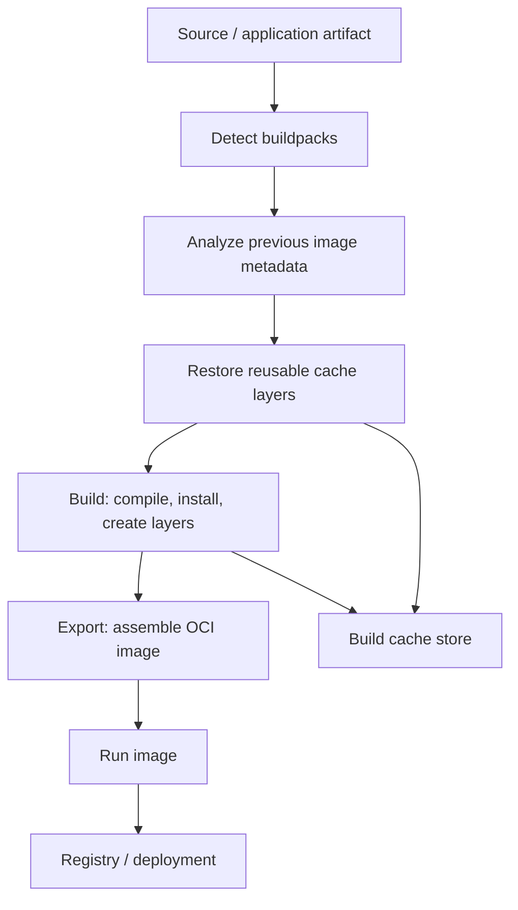

# Buildpack Cache, Image Layers, and Build Time Impact

## 1. Why Cache and Image Layers Matter

In the **SPRING_BOOT_NATIVE_IMAGE** module, a Spring Boot application is processed with Spring AOT and compiled into a GraalVM Native Image, then packaged as a container for deployment. When using Cloud Native Buildpacks (CNB), packaging does not merely create a single image from a developer-written Dockerfile. The builder and buildpacks detect the application, install runtime/build tools, create **layers**, and export an OCI image.

Native builds are often time-consuming because GraalVM must perform reachability analysis, compile large amounts of code to machine code, and link the executable. If every build re-downloads dependencies, reinstalls toolchains, or reruns unchanged steps, CI durations grow. **Buildpack caching** and **image layer reuse** help reuse valid outputs across builds.

Distinguish two concepts:

- **Build cache:** stores data produced by buildpacks for reuse in subsequent builds, typically via a volume/cache store or platform-provided cache mechanism.
- **Image layers:** filesystem layers and metadata packaged in the OCI image. A registry/client can reuse existing layers when digests match, reducing upload/pull data transfer.

Buildpack caching can shorten artifact creation time; image layer reuse can shorten export, push, pull, and deploy time. The two mechanisms are related but do not replace each other.

## 2. How Buildpacks Build an Image

Cloud Native Buildpacks uses a builder comprising buildpacks, a build image, and a run image. The lifecycle orchestrator coordinates phases to turn source or an artifact into an image:



Phase names and details may vary by lifecycle version, though the conceptual model usually covers detect, analyze, restore, build, export, and launch. Not every buildpack has cacheable layers; the lifecycle uses buildpack metadata to decide which layers can be restored or must be rebuilt.

| Component | Role |
|---|---|
| Builder image | Provides lifecycle, buildpacks, and build environment |
| Buildpack | Detects the application, installs dependencies/tools, and creates build or launch layers |
| Build image | Build environment, usually containing compilers and development tools |
| Run image | Minimal runtime foundation to run the application |
| Cache store | Stores reusable build layers |
| OCI image | Final artifact comprising filesystem layers, config, and metadata |

A builder can contain multiple buildpacks grouped into a buildpack order. Matching buildpacks are detected and participate in build order. Changing the builder or buildpack version can alter layers, cache keys, or build output.

## 3. Distinguishing Buildpack Cache from OCI Image Layers

| Criterion | Buildpack cache | OCI image layer |
|---|---|---|
| Purpose | Avoid repeating build work | Reuse already-packaged image content |
| Location | Cache volume, cache store, or platform mechanism | Local image, registry, container runtime |
| Target contents | Downloaded dependencies, tool artifacts, buildpack layers marked cacheable | Filesystem diff/layer inside the image |
| When used | Restored before build, written back after build | Export, push, pull, and container creation |
| Most visible impact | Reduces build duration | Reduces data transfer and image distribution work |
| Lifecycle | Can be invalidated or pruned | Persists by tag/digest and registry policy |

For example: a buildpack downloads Maven dependencies and stores them in cache. On the next build, the cache avoids re-downloading those artifacts. However, the native executable may still need recompiling if source code or compilation-affecting configuration changed.

Conversely, if the final image has an unchanged OS/runtime layer, the registry may already hold that layer and only receive changed layers. An old layer being reused does not prove the native compiler reused compilation output.

## 4. Layer Types in Buildpacks

Buildpacks can create layers with metadata describing usage and cacheability:

- **Build layer:** needed only during the build, e.g., compiler/tooling or compile-supporting dependencies.
- **Launch layer:** needed when running the application, e.g., runtime components or application files.
- **Cache layer:** stores data for future builds, not necessarily included in the runtime image.

A single layer can carry multiple metadata flags—for instance, used at both build and launch, or cached. Do not treat these three types as three fixed directories or three permanently disjoint layers. Buildpacks decide layer types and metadata per CNB API/version.

In a native application:

- The C compiler, linker, and GraalVM Native Image are needed in the build environment.
- The native executable and required shared libraries belong in the runtime image.
- Dependency caches and intermediate data can belong in cache/build layers and need not enter the runtime image.

Properly separating build-only and launch layers keeps the runtime image smaller, reduces attack surface, and avoids shipping compilers to production. Cache layers only help if the buildpack marks them cacheable and the lifecycle preserves the cache store.

## 5. Which Steps Can Caching Speed Up?

A native build can spend time in multiple parts:

1. Resolving and downloading Maven/Gradle dependencies.
2. Installing or preparing GraalVM, compiler, linker, and development packages.
3. Running Spring AOT, generating code and runtime hints.
4. Running GraalVM Native Image: reachability analysis, compilation, and linking.
5. Creating OCI layers and exporting the image.
6. Pushing the image to a registry.

Caching can help reduce step 1, part of step 2, and certain other buildpack steps if supported by the buildpack. Caching does not automatically eliminate steps 3/4. Native compilation depends on source, classpath, toolchain, build arguments, and AOT configuration; when those inputs change, outputs may need to be regenerated.

Practical examples:

| Change between two builds | Cache that can be reused | Parts likely to rerun |
|---|---|---|
| Only editing a README that is not packaged | Dependencies and many unchanged layers | Native compilation may be skipped if buildpack ignores README as input |
| Editing one Java service class | Dependencies remain unchanged | Spring AOT and native compilation usually must rerun |
| Changing a Spring Boot dependency version | Part of download cache remains usable | Compile, AOT, and native image usually rerun |
| Changing builder/buildpack version | Some dependency caches may remain | Layers from changed buildpack versions may be invalidated |
| Changing target architecture or native compiler flags | Shared cache may be incompatible | Native compilation must rerun for the new target |

This table shows general trends; actual results depend on cache keys and buildpack metadata. Do not promise a fixed speedup percentage.

## 6. Cache Invalidation: When Is Cache No Longer Usable?

A cache is only safe when relevant inputs remain compatible. Common reasons a cache is skipped or invalidated:

- Buildpack ID/version or order changes.
- Builder image, build image, or run image changes.
- Dependency lockfile, JDK/GraalVM version, or native toolchain changes.
- Architecture, OS, libc, or target ABI differs.
- Build arguments, environment variables, or profiles affecting output change.
- Cache store is pruned, deleted, or not attached to the current runner.
- Layer metadata is no longer valid or checksums mismatch.

Specifically for Native Image, caches should not be shared unconditionally between `linux/amd64` and `linux/arm64`, between glibc and musl, or across different GraalVM/compiler installations if the cache contains target-dependent artifacts. Cache keys must distinguish critical inputs to avoid reusing mismatched object/native artifacts.

Stale caches can cause hard-to-diagnose errors if a buildpack or tool has a bug. When verification is needed, run a clean build in a controlled environment and compare outputs. Clear caches only for good reason; frequent wiping destroys performance gains and hides cache-key configuration issues.

## 7. Building Native Images with Spring Boot Buildpacks

The Spring Boot Maven/Gradle plugin can integrate Cloud Native Buildpacks to create OCI images. With Maven, a common example is:

```bash
./mvnw spring-boot:build-image
```

With Gradle:

```bash
./gradlew bootBuildImage
```

To build a native image, configure the buildpack/builder and native mode according to your Spring Boot plugin version's capabilities, or choose a builder supporting GraalVM Native Image. In Spring Boot versions supporting the corresponding properties, native mode can be enabled via plugin configuration. Conceptual Maven example:

```xml
<configuration>
    <image>
        <builder>paketobuildpacks/builder-noble-java-tiny</builder>
        <env>
            <BP_NATIVE_IMAGE>true</BP_NATIVE_IMAGE>
        </env>
    </image>
</configuration>
```

The builder name in this example must be verified against existing tags compatible with your platform/Spring Boot version. `BP_NATIVE_IMAGE` is a buildpack variable commonly used in the Paketo ecosystem to enable native image builds; exact support, configuration syntax, and compatible builders must be checked per buildpack version. Not every builder includes a suitable compiler or native buildpack.

Buildpacks typically need access to the Docker daemon to export images. In CI, configure the daemon/socket or the platform's equivalent build mechanism. The `build-image` command does not just emit an executable in the build directory; it produces an OCI image under the configured name/tag.

## 8. Observing Image Layers and Cache

Use container tools to inspect the image after building. With Docker:

```bash
docker images
docker history orders-service:latest
docker inspect orders-service:latest
```

- `docker images` displays image/tag, reported size, and ID.
- `docker history` shows layer/history entries and corresponding sizes; it does not fully describe buildpack cache origins.
- `docker inspect` shows image config/metadata such as entrypoint, environment, and layer identifiers.

You can inspect OCI layer details using tools like `crane manifest`, `skopeo inspect`, or registry tools. When comparing, use digests/layer digests instead of relying solely on tags; tags can be reassigned to different images.

For buildpacks, lifecycle logs typically show which layers were restored, reused, rebuilt, or exported. Exact log wording depends on the lifecycle version. Read logs alongside image history to separate two questions: **did the buildpack reuse build data?** and **did the image exporter reuse layers?**

## 9. Fairly Measuring Cache Impact

To evaluate whether caching reduces build time, run builds under controlled conditions:

- **Cold build:** empty cache or fresh runner; record dependency download, AOT/native compilation, and export times.
- **Warm build:** keep cache intact, rebuild the same source/config, record time per phase.
- **Source-change build:** edit one Java file while keeping dependencies/toolchain constant; observe which phases rerun.
- **Dependency-change build:** update one dependency; observe invalidation and cache reuse.
- **Control clean build:** remove build outputs in a controlled manner while preserving or clearing cache per measurement goal.

Sample recording table:

| Run | Cache | Source/dependency | AOT time | Native compile time | Export time | Total time |
|---|---|---|---:|---:|---:|---:|
| Cold | Empty | Baseline | Measure | Measure | Measure | Measure |
| Warm | Present | Unchanged | Measure | Measure | Measure | Measure |
| Source change | Present | Java changed | Measure | Measure | Measure | Measure |
| Dependency change | Present | Dependency changed | Measure | Measure | Measure | Measure |

Do not compare a cold build on a slow machine against a warm build on a faster runner. Keep CPU/RAM, network, Docker daemon, builder/run image, architecture, and toolchain versions constant. Run multiple iterations and report medians or distributions. Separate download, Spring AOT, GraalVM compile, and image export times; measuring total wall time alone hides where caching helped.

## 10. Organizing Caches in CI/CD

Caching in CI typically has two tiers:

1. **Build tool cache:** Maven local repository or Gradle dependency/build cache.
2. **Buildpack cache:** cache store/volume passed across lifecycle invocations.

These are two independent caches. A Maven dependency cache can help plugins/buildpacks fetch artifacts faster, yet it does not replace buildpack layer caching. Conversely, buildpack caching does not guarantee the build process's Maven local repository is preserved.

A pipeline should:

- Key caches by OS, architecture, builder/buildpack version, and critical dependencies/toolchains.
- Use per-branch caches or a safe restore fallback strategy.
- Never store secrets in cache layers or images.
- Never share native artifact caches across incompatible targets.
- Enforce size and age pruning policies to prevent unbounded cache growth.
- Ensure the runner actually mounts/restores the cache volume; declaring a cache key in CI does not automatically mean the buildpack lifecycle receives it.

Some ephemeral CI platforms spin up a fresh runner per job. Without a remote cache or persistent volume, warm builds may not preserve cache across jobs. In that case, consider a builder service or platform-supported caching mechanism.

## 11. Cache and Supply Chain Security

Cache is a build input and must be managed as part of the supply chain. Practical principles:

- Reuse caches only from trusted sources; prevent untrusted jobs from writing caches consumed by release pipelines.
- Separate caches between external pull requests and release pipelines if artifact poisoning is a risk.
- Pin builder images by explicit tag, and consider digests when strict reproducibility is needed.
- Update builder/run images to pick up security patches; stale caches must never become an excuse to keep an outdated runtime base.
- Scan the final image and inspect dependencies/native libraries.
- Never put credentials, tokens, or secret config files into cached/exported layers.

When a builder or buildpack updates, caches may be invalidated and builds may slow down temporarily. That is a reasonable cost for receiving updated toolchains and security patches; do not freeze an old builder forever just for fast warm builds.

## 12. Common Issues

| Symptom | Possible cause | How to check |
|---|---|---|
| Every build re-downloads dependencies | Maven/Gradle or buildpack cache not preserved | Check cache mounts, CI keys, and restore logs |
| Logs report cache restored yet native compile is still slow | Cache only stores dependency/tool layers, not GraalVM compile outputs | Separate AOT and native compilation times |
| Fast build yet image push remains slow | Large OCI layers or many changed layer digests | Check layer history/digests and registry transfer |
| Unchanged image yet build still reruns | Build cache and image layer reuse are separate mechanisms | Inspect lifecycle logs and image digests |
| Cache incompatible after builder update | Buildpack ID/version or metadata changed | Verify builder/buildpack versions and test a cold build |
| Native binary fails in runtime image | Missing shared library, wrong libc/architecture, or missing resource | Inspect ELF, runtime base, and smoke tests |
| Cache keeps growing continuously | Many stale layers/keys/branches never pruned | Apply retention and cleanup policies |

## 13. Hands-On Exercise: Measuring Cold and Warm Builds

**Context:** a Spring Boot service already capable of building a native OCI image using Buildpacks.

**Step 1 — Record the environment.** Note Spring Boot version, Maven/Gradle version, builder image/tag, buildpack version, GraalVM/toolchain, OS, and architecture.

**Step 2 — Run a cold build.** Use a clean runner or empty cache store as supported by CI. Build the native image and save phase timing logs.

**Step 3 — Run a warm build.** Keep the cache store and rebuild the same source/config. Record which layers are restored, which are rebuilt, and durations for AOT, Native Image, and export.

**Step 4 — Edit one Java class.** Rebuild and observe whether dependency caches are retained while AOT/native compilation reruns.

**Step 5 — Change a dependency or builder.** Observe cache invalidation; verify the build still produces a binary for the target platform.

**Step 6 — Inspect the image.** Check image digest, layer history, and run the container. Send test requests and measure readiness/RSS to confirm the artifact still works.

Completion criteria: cold/warm logs collected, clear explanation of which caches were used, separation of build time from export/push time, identified cause of cache invalidation, and proof that the final image runs properly.

## 14. Conclusion

Buildpack caching reuses dependencies and restorable build layers; OCI image layers reuse filesystem layers during export, push, and pull. For Spring Boot Native Image, both mechanisms can reduce time and data transfer, yet **neither guarantees skipping Spring AOT or GraalVM compilation when source, dependencies, toolchains, or configuration change**.

To optimize properly, read lifecycle logs, separate build caching from image layer reuse, key caches by target/toolchain, measure cold and warm builds in the same environment, and always test the executable inside the runtime image. Build speed only matters when the final native artifact is functionally correct, compatible, and safe to release.
