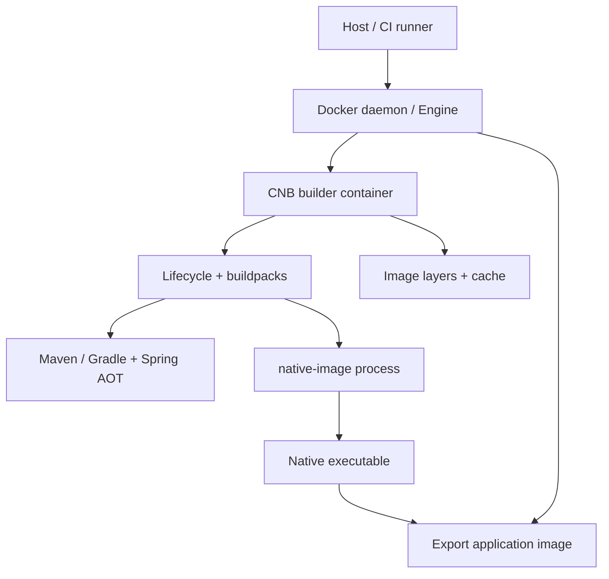

# Resources for the Docker Daemon and the `native-image` Process During Builds

## 1. Why Separate Docker Daemon and `native-image` Resources?

When creating a container image for a Spring Boot application with **Cloud Native Buildpacks (CNB)** and GraalVM Native Image, the build machine may run multiple components simultaneously: the Docker daemon, CNB lifecycle, builder container, buildpacks, Maven/Gradle, Spring AOT, and the `native-image` process. These components can consume CPU, RAM, disk space, and I/O differently.

A common mistake is seeing an OOM during a native build and only increasing Java heap size, when Docker Desktop or the CI runner is actually capping total container memory. In another case, the Docker daemon has ample resources, yet the `native-image` process running inside the builder hits its heap limit or gets killed by a cgroup memory limit.

In the **SPRING_BOOT_NATIVE_IMAGE** module, at least three scopes should be separated:

- **Docker daemon/engine and host environment**: manages containers, image layers, volumes, networking, and storage.
- **Builder container/CNB lifecycle**: runs buildpacks, the build tool, and child processes.
- **GraalVM Native Image process**: runs reachability analysis, optimizations, and native code generation; typically one of the largest RAM consumers during the build.



The Docker daemon and the builder container are not necessarily the same process or on the same machine. With Docker Desktop on Windows/macOS, the engine typically runs inside a separately managed Linux VM environment. With a remote Docker context, the daemon may even live on another host. Therefore, observing only the RAM of the terminal running the build command is insufficient.

## 2. Resource Types to Monitor

| Resource | Docker daemon/host | Builder and native-image |
|---|---|---|
| CPU | Container orchestration, layer compression/writing, networking | Java compile, AOT, reachability analysis, optimization, code generation |
| RAM | Daemon, VM, caches, and other containers | Builder JVM, native-image heap, native memory, linker, and child processes |
| Disk | Image store, layers, volumes, build caches | Temporary files, generated sources, object files, intermediate executables |
| I/O | Image pull/push, layer extraction, metadata | Reading classpath/dependencies, writing outputs, linker |
| Process/thread | Docker service, container runtime | Gradle/Maven, Java builder, compiler, linker, buildpack processes |

Do not mechanically add together every RSS number when processes share pages or reside in containers/VMs with different accounting mechanisms. When assessing the limits of a CI job, **cgroup/container or VM** metrics are usually more useful than a single PID.

## 3. Understanding Memory Limits in Docker

### Docker Engine on Linux

On Linux, Docker containers are constrained by cgroups and runtime configuration. A container can be OOM-killed when total memory exceeds its limit even before the Java heap reaches `-Xmx`. Check the actual cgroup limit (paths and files depend on cgroup v1/v2):

- cgroup v2 typically provides `memory.max`, `memory.current`, and `memory.events`.
- cgroup v1 typically has files such as `memory.limit_in_bytes`, `memory.usage_in_bytes`, and `memory.failcnt`.

Do not assume a container has permission to read all cgroup files; CI or the runtime may mount different namespaces.

### Docker Desktop on Windows/macOS

Docker Desktop runs Linux containers inside a Linux VM environment. Resources allocated to the VM can limit the builder's total available RAM/CPU, even when the host has plenty of free RAM. Docker Desktop configuration varies by version and backend (WSL 2/Hyper-V on Windows, Virtualization framework on macOS).

When a native build hits OOM on Docker Desktop:

1. Check total RAM and CPU allocated to Docker Desktop/VM.
2. Check whether the builder container has its own limit.
3. Check other applications and other containers consuming resources.
4. Check disk space inside the VM and the Docker image store.
5. Observe peak memory of the build container while `native-image` runs.

Do not treat physical host RAM as guaranteed usable RAM inside the Linux builder VM.

## 4. `native-image` Heap Is Not Total Build RAM

The GraalVM Native Image builder runs on a JVM. You can configure the builder JVM's heap via the `-J` option, for example:

```bash
native-image -J-Xmx4g -jar app.jar app
```

This is a direct Native Image command example; Spring Boot applications typically require the proper AOT/plugin workflow. `-J-Xmx4g` sets the heap limit for the builder JVM, not the total RSS of the process, the builder container, or the Docker VM.

Total build memory can also include:

- Builder JVM heap.
- Builder native memory and off-heap data structures.
- Maven/Gradle daemon or orchestrating process.
- Compiler/linker and child processes.
- Page cache, memory-mapped files, and other services in the same container/VM.

Consequently, if the builder heap is set to 4 GiB, the container can consume more than 4 GiB. Conversely, if the cgroup gives the container only 3 GiB, raising `-J-Xmx` to 4 GiB can cause the build to be killed earlier.

**Heap configuration must fit within the container budget**, leaving room for native overhead, child processes, and the system. Never copy an `-Xmx` number from a developer workstation onto a runner with a smaller memory limit.

## 5. Identifying Which Process Is Consuming RAM

On a Linux host, you can inspect containers:

```bash
docker stats
```

This displays CPU, memory, network, and block I/O per running container. During a build, identify the builder container by name/ID and watch peak usage. `docker stats` reflects Docker's perspective; exact numbers and how memory cache is shown can vary across platforms.

Inspect processes inside the container (if the image includes the right tools):

```bash
docker top <builder-container-id>
```

If you have access to the container's process namespace, use `ps` to identify Java/`native-image`/compiler processes. Some minimal builder images lack `ps`, `top`, or a full shell; observe from the host or use container monitoring tools.

On Linux, inspect cgroup information:

```bash
cat /sys/fs/cgroup/memory.current
cat /sys/fs/cgroup/memory.max
cat /sys/fs/cgroup/memory.events
```

These files illustrate cgroup v2 at the root cgroup; containers may see different mount points and paths. `memory.events` can help detect `oom`/`oom_kill` events if readable.

On a Windows host using Docker Desktop, you can watch the Docker Desktop/WSL VM in Task Manager and use `docker stats` from the terminal. With a remote Docker daemon, local host metrics do not represent the remote server; monitor the machine running the daemon.

## 6. CPU Resources: Native Builds Can Run in Parallel

Native Image compilation and Java build steps can use multiple CPUs. Gradle/Maven, compiler, and linker may run in parallel depending on configuration. If the Docker VM is only given a few vCPUs, the build slows down even if the host has many cores.

Contributing factors:

- Gradle worker count and parallel build configuration.
- Number of compiler/linker processes used by Native Image.
- Container/runner CPU quota.
- Other concurrent CI jobs.
- Actual CPU speed of the VM and host.

Do not increase worker counts unboundedly. When RAM is constrained, raising parallelism can make multiple compilers/tasks retain data simultaneously, driving peak RAM higher. Tuning parallelism requires measuring both build time and peak memory.

With Gradle, you can cap workers using:

```bash
./gradlew --max-workers=2 bootBuildImage
```

The `--max-workers` flag controls Gradle's worker count and **does not necessarily limit every internal thread/process of GraalVM or buildpacks**. It is part of overall tuning, not a substitute for container limits.

## 7. Disk and Cache Are Also Build Resources

Buildpacks use layers and caches to reuse dependencies or artifacts across builds. Native Image also generates sources, temporary files, object files, and intermediate executables. Thus, disk space can run out before RAM or CPU becomes a bottleneck.

Check Docker disk usage:

```bash
docker system df
```

On a Linux host, check the filesystems holding the Docker data root and workspace:

```bash
df -h
du -sh ~/.gradle/caches ~/.m2/repository
```

Cache paths can vary by user and configuration. With Docker Desktop, the Docker image store may reside inside a virtual disk; free space on the Windows/macOS drive and free space inside the virtual disk are two separate views to inspect.

Do not run `docker system prune -a --volumes` indiscriminately: this command can delete unreferenced images, caches, and volumes that users still need. When freeing space, identify which resources can safely be removed and follow CI/ops team procedures.

## 8. Buildpacks: Builder Container and Resource Limits

When Spring Boot invokes CNB via Maven or Gradle, the plugin uses the Docker daemon to create a builder container, run the lifecycle, and export the application image. Depending on the plugin, builder, and environment, configuration options may exist to control container creation or the build environment.

Gradle example:

```groovy
tasks.named("bootBuildImage") {
    builder = "paketobuildpacks/builder-jammy-base"
    imageName = "example/native-service:1.0.0"
}
```

This is only an example of selecting a builder and image name; not every tag supports native builds. Verify builder/buildpack compatibility with Spring Boot, GraalVM, OS, and target architecture.

If you need to limit resources for the builder container, first check the API/configuration of your Spring Boot plugin and Docker environment. Do not assume a single universal Gradle property exists across every version to set a memory limit. Some limits are configured at Docker Desktop/VM, the CI runner, or Docker daemon configuration; enforcement depends on the platform.

With the `pack` command, options and resource settings also depend on the CLI and builder versions. Read `pack build --help` for your installed version and the specific builder's documentation rather than copying Docker CLI flags onto `pack` if unsupported.

## 9. Step-by-Step OOM Troubleshooting

Suppose a Spring Boot native build inside the builder container halts mid-analysis in GraalVM. A grounded troubleshooting sequence:

1. **Identify the root error**: do logs show `OutOfMemoryError: Java heap space`, another allocation error, or was the process OOM-killed by the OS?
2. **Identify the constrained scope**: Docker Desktop VM, CI runner, builder container, or a specific JVM process?
3. **Measure peaks**: inspect `docker stats`, cgroup memory events, CI metrics, and `native-image` logs.
4. **Check builder heap**: if the error is genuinely heap exhaustion, tune `-J-Xmx` within the container limit plus remaining overhead.
5. **Tune parallelism**: reduce Gradle workers or concurrency if multiple tasks/processes compete for RAM.
6. **Provision adequate resources**: increase runner or Docker VM RAM/CPU if the current budget is insufficient.
7. **Rebuild and verify**: verify exit code, the new native artifact, then run smoke/integration tests on the image.

Do not try to solve OOM simply by raising heap if the cgroup is already out of memory. Nor should you blame the Docker daemon solely because the build was invoked through Docker: `native-image` may be the largest memory consumer inside the builder container.

## 10. Example Investigation Using Measurements

Suppose a Docker Desktop VM is allocated 6 GiB of RAM. During the build, the builder container reaches nearly 5.8 GiB and terminates with an OOM kill. JVM logs show no `Java heap space`, while cgroup reports `oom_kill` incrementing.

Interpretation:

- The total limit of the builder environment is around 6 GiB.
- The builder, `native-image`, and helper processes consumed nearly the entire budget.
- There is insufficient evidence to blame the Java heap; the cgroup can kill the process even when heap hasn't reached max.
- Increasing `-J-Xmx` may make the situation worse.
- You need to reduce contention/concurrency, increase VM memory, or adjust workload/build strategy, then re-measure.

Conversely, if the container has a 10 GiB limit yet logs clearly report `Java heap space` inside the `native-image` builder at a 2 GiB heap setting, you can consider increasing the builder heap while monitoring total memory and overhead. These numbers are illustrative examples, not universal baselines for every project.

## 11. Separating Build Resources from Runtime Resources

The builder image and the application image serve different roles. A native-image build can require substantial RAM/CPU and scratch disk, whereas the container running the executable only needs a runtime budget suited to its workload. Do not use peak build RAM as the memory limit for a production pod.

| Metric | Build stage | Runtime stage |
|---|---|---|
| CPU | Compile, AOT, reachability analysis, link | Request handling, GC, I/O |
| RAM | Builder JVM, compiler, child processes | Native runtime heap, stacks, native memory |
| Disk | Caches, sources, objects, temporary outputs | Image layers, logs, and app-written files |
| What to measure | Builder/cgroup/VM peak | RSS/working set, peak under load |
| Configuration | Docker VM/runner, builder container, builder heap | Container memory limit, heap/runtime config, workload |

When comparing JAR and native, measure build peak RAM separately from running application memory. Native can reduce startup and runtime memory in some workloads, yet benefits must be confirmed through measurement.

## 12. Checklist Before Running Native Builds in CI

- Determine whether the Docker daemon is local or remote, Docker Desktop VM or Linux runner.
- Document memory/CPU limits of the host, VM, and builder container.
- Confirm the builder/buildpack supports Native Image for the GraalVM/Spring Boot versions in use.
- Measure peak RAM and disk usage of a representative build.
- Distinguish Java heap errors from cgroup OOM kills.
- Configure Gradle/Maven concurrency to fit the memory budget.
- Keep caches where disk space is sufficient and do not wipe actively used volumes/images.
- Collect buildpack logs, `native-image` logs, container stats, and exit codes.
- After building, run smoke tests and integration tests against the application image.
- Size runtime memory limits from real load measurements, independent of build resources.

## 13. Self-Check Questions

1. Why can the Docker daemon/VM run out of RAM even when a Windows host has plenty of free RAM?
2. Which memory region does `-J-Xmx` cap, and why does it not cap total builder container memory?
3. How do you distinguish `Java heap space` from a container OOM kill?
4. Why can increasing Gradle workers raise peak RAM during a native build?
5. What does CNB caching save, and why might `native-image` still have to rerun?
6. Why should the builder container's memory limit not be used as the application container's memory limit?
7. When building via a remote Docker daemon, where must resources be observed?

**Remember:** buildpacks only orchestrate packaging; actual resources are consumed by Docker/VM, the builder, the build tool, and `native-image`. Measure the right process/container/cgroup scope, distinguish heap from total RAM, and separate build budgets from runtime budgets to diagnose OOMs based on evidence.
