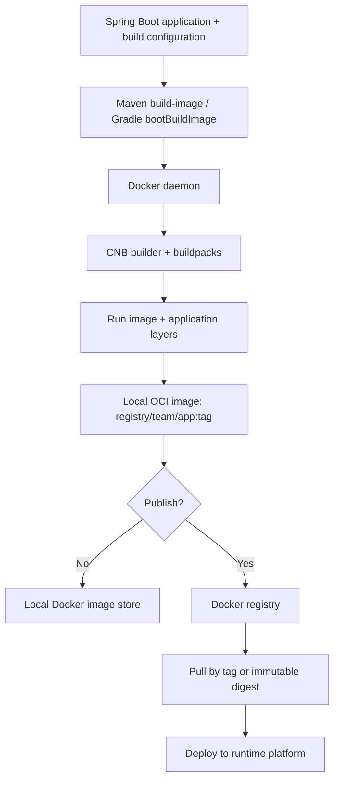
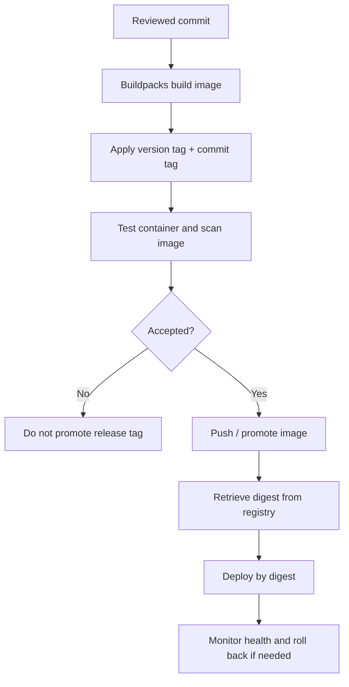

# Naming, Tagging, and Publishing Images to a Registry

> **Chapter: Buildpacks.** In the **SPRING_BOOT_NATIVE_IMAGE** module, Spring AOT prepares the application and GraalVM Native Image builds the native executable. Cloud Native Buildpacks (CNB) packages the application into an OCI image for deployment. This lesson guides you through naming images, managing tags, and pushing images to a registry using the Spring Boot Maven/Gradle plugin.

## 1. Learning Objectives

After this lesson, you will be able to:

1. Read and construct OCI image names including registry, namespace, repository, and tag.
2. Distinguish image name, tag, digest, builder image, and run image.
3. Configure image names and multiple tags in the Spring Boot Maven/Gradle plugin.
4. Choose between building a local image or publishing directly to a Docker registry.
5. Configure registry authentication without hardcoding secrets in source code.
6. Verify an image after pushing and deploy the exact verified image.

## 2. What Image Do Buildpacks Produce?

Cloud Native Buildpacks takes the application and builder, then runs buildpacks to produce an **OCI image** runnable by a container runtime. With Spring Boot, you can use:

- Maven goal `spring-boot:build-image`.
- Gradle task `bootBuildImage`.

Both use the Docker daemon to work with the builder/run image and produce the application image. When publishing is disabled, the image is created in the Docker daemon's local image store. When publishing is enabled, the plugin pushes the resulting image to the registry specified in the image name.

For a Spring Boot native application, buildpacks must be configured to produce a GraalVM Native Image. For example, with Paketo Java buildpacks, the build-time variable `BP_NATIVE_IMAGE=true` instructs the buildpack to build a native executable. When using the Spring Boot plugin, this variable is passed via `image.env` (Maven) or `environment` (Gradle). Use a builder/buildpack compatible with your project's Spring Boot, Java, and GraalVM versions.



**Builder image**, **run image**, and **application image** are three distinct concepts:

| Image type | Role | Example name |
|---|---|---|
| Builder image | Environment containing lifecycle and buildpacks to build the application | `paketobuildpacks/builder-noble-java-tiny:latest` |
| Run image | Base layer used when launching the application after build | `paketobuildpacks/ubuntu-noble-run:latest` |
| Application image | Final image containing application layers and required runtime | `registry.example.com/team/orders:1.4.2` |

The configured name for the application image does not rename the builder or run image. If the builder/run image resides in a private registry requiring authentication, configure builder registry credentials separately; those differ from credentials used to publish the application image.

## 3. OCI Image Name Structure

An image reference typically has the form:

```text
[registry-host[:port]/][namespace/]repository[:tag][@digest]
```

Example:

```text
registry.example.com:5000/platform/orders-api:1.4.2
```

Where:

- `registry.example.com:5000`: registry host and port.
- `platform`: namespace or project.
- `orders-api`: image repository name.
- `1.4.2`: version-identifying tag.

| Reference | Meaning |
|---|---|
| `orders-api` | Defaults to `docker.io/library/orders-api:latest` |
| `team/orders-api:1.4.2` | Repository `team/orders-api` on Docker Hub |
| `registry.example.com/team/orders-api:1.4.2` | Repository on a private registry |
| `registry.example.com:5000/team/orders-api:git-a1b2c3d` | Private registry with port and commit-based tag |
| `registry.example.com/team/orders-api@sha256:...` | Image reference by digest |

If no registry is specified, Docker defaults to `docker.io`; if no namespace is specified, Docker Hub uses `library` for official images. If no tag is given, the default tag is `latest`. Therefore, declare the full registry/repository and tag in release pipelines to avoid accidentally pushing to Docker Hub or relying on the default tag.

Repository names typically use lowercase letters, digits, and appropriate separators. Tags may contain uppercase letters, digits, underscores, periods, and hyphens; slashes are not allowed in tags. If a Git branch name looks like `feature/payment`, normalize it to a valid string like `feature-payment` before creating a tag.

### 3.1. How Do Image Name, Tag, and Digest Differ?

- **Image name/reference** identifies the registry and repository where the image is stored.
- **Tag** is a human-readable label, e.g., `1.4.2` or `git-a1b2c3d`. A tag can be moved to a new image on republish; thus tags are not inherently immutable.
- **Digest** is a content identifier, typically formatted as `sha256:...`. Deploying by digest pins the exact tested image contents.

For instance, the same image can carry multiple tags:

```text
registry.example.com/team/orders-api:1.4.2
registry.example.com/team/orders-api:release-2026-11
registry.example.com/team/orders-api:git-a1b2c3d
```

The tags above can point to the same image manifest. Rebuilding and publishing under the same tag can point that tag to different content. A registry enforcing *immutable tags* may reject overwriting an existing tag.

## 4. Naming and Tagging Strategy

The image name should remain stable per application and repository environment; tags should answer **which version this is, from which source code it was built, and for which environment**.

| Tag type | Example | Purpose |
|---|---|---|
| Version release | `1.4.2` | Release version, easy to look up |
| Commit | `git-a1b2c3d` | Trace back to the exact commit that built the image |
| Build number | `build-582` | Trace the CI run |
| Release channel | `stable`, `staging` | Moving label for a deployment channel |
| Convenience alias | `latest` | Use only when team conventions clearly define its meaning |

Recommendations:

1. Create an immutable version or commit tag for every release build.
2. If using moving tags like `stable` or `latest`, update them only after the image passes testing and approval.
3. Never use `latest` as the sole identifier in production deployment manifests.
4. Record the actual digest after pushing and use that digest in critical deployment steps.
5. Do not reuse the same repository/tag for both JVM and native variants if the two images differ in behavior or purpose.

Example distinguishing two image variants:

```text
registry.example.com/platform/orders-api:1.4.2-jvm
registry.example.com/platform/orders-api:1.4.2-native
```

The `native` tag is only a team-assigned label; it does not make an image native by itself. Buildpack configuration—specifically `BP_NATIVE_IMAGE=true` with a compatible Paketo Java Native Image buildpack—determines the native build.

## 5. Configuring Image Name and Publishing with Maven

The Spring Boot Maven plugin provides the `spring-boot:build-image` goal. By default, the image name is derived from the Maven project's `artifactId` and `version`; specify a full name when publishing to an organizational registry.

Configuration example in `pom.xml`:

```xml
<build>
    <plugins>
        <plugin>
            <groupId>org.springframework.boot</groupId>
            <artifactId>spring-boot-maven-plugin</artifactId>
            <configuration>
                <image>
                    <name>registry.example.com/platform/orders-api:1.4.2-native</name>
                    <env>
                        <BP_NATIVE_IMAGE>true</BP_NATIVE_IMAGE>
                    </env>
                    <publish>true</publish>
                </image>
                <tags>
                    <tag>registry.example.com/platform/orders-api:git-a1b2c3d</tag>
                </tags>
                <docker>
                    <publishRegistry>
                        <username>${env.REGISTRY_USER}</username>
                        <password>${env.REGISTRY_PASSWORD}</password>
                    </publishRegistry>
                </docker>
            </configuration>
        </plugin>
    </plugins>
</build>
```

Explanation:

- `image.name` is the primary image reference, including registry, repository, and tag.
- `image.env` passes build-time variables to the builder; `BP_NATIVE_IMAGE=true` asks Paketo to build a native image if supported by the builder/buildpacks in use.
- `image.publish` enables publishing to the registry. When disabled, the plugin creates a local image on the Docker daemon.
- `tags` declares one or more additional full image references. Additional tags should point to the same repository/image per team convention.
- `docker.publishRegistry` provides authentication credentials for publishing. The target registry is determined from the registry part of the image name; the `url` property in credentials (if used) does not replace the registry part of the image reference.

`REGISTRY_USER` and `REGISTRY_PASSWORD` are environment variables supplied by a CI secret store or runtime environment. Never commit real values into `pom.xml`. If the Docker CLI already has a credential helper or login info in `~/.docker/config.json`, the Spring Boot plugin can use that Docker config when explicit credentials are omitted; check the plugin docs for your exact version.

Run:

```bash
./mvnw spring-boot:build-image
```

If you only want a local build, omit `<publish>true</publish>`. You can pass properties on the command line:

```bash
./mvnw spring-boot:build-image \
  -Dspring-boot.build-image.imageName=registry.example.com/platform/orders-api:1.4.2-native
```

To publish directly, enable the `spring-boot.build-image.publish` property or configure `image.publish` as shown above. If the goal is bound to the `package` lifecycle in the POM, use `build-image-no-fork` per plugin documentation to avoid unnecessary lifecycle forking.

## 6. Configuring Image Name and Publishing with Gradle

With Gradle, the Spring Boot plugin creates the `bootBuildImage` task when an appropriate Java/War plugin is applied. You can set `imageName`, additional tags, builder environment variables, and publish mode right in the task.

**Groovy DSL** example:

```groovy
// build.gradle
tasks.named("bootBuildImage") {
    imageName = "registry.example.com/platform/orders-api:" + project.version + "-native"
    tags = ["registry.example.com/platform/orders-api:git-a1b2c3d"]
    environment["BP_NATIVE_IMAGE"] = "true"
    publish = true
    docker {
        publishRegistry {
            username = providers.environmentVariable("REGISTRY_USER").get()
            password = providers.environmentVariable("REGISTRY_PASSWORD").get()
        }
    }
}
```

**Kotlin DSL** example:

```kotlin
// build.gradle.kts
tasks.named<BootBuildImage>("bootBuildImage") {
    imageName.set("registry.example.com/platform/orders-api:" + project.version + "-native")
    tags.set(listOf("registry.example.com/platform/orders-api:git-a1b2c3d"))
    environment.put("BP_NATIVE_IMAGE", "true")
    publish.set(true)
    docker {
        publishRegistry {
            username.set(providers.environmentVariable("REGISTRY_USER").get())
            password.set(providers.environmentVariable("REGISTRY_PASSWORD").get())
        }
    }
}
```

With Kotlin DSL, import `BootBuildImage` if not auto-imported by the IDE:

```kotlin
import org.springframework.boot.gradle.tasks.bundling.BootBuildImage
```

Run the task:

```bash
./gradlew bootBuildImage
```

If `publish` is false (default), the image is created locally. When `publish` is enabled, the plugin pushes the image to the registry. If the registry requires no authentication, omit `docker.publishRegistry`. If credentials are not passed directly, the plugin can read existing Docker CLI configuration and credential helpers.

**Version note:** property names and DSL syntax may vary by Spring Boot Gradle plugin version. The examples above use Groovy/Kotlin properties per the current plugin API; if your project uses a different version, consult the *Packaging OCI Images* section in the matching documentation branch. The `tags` list must contain full image references, not bare tag strings.

## 7. Logging In and Pushing Images via Docker CLI

### 7.1. Build locally, then tag and push manually

This flow is useful when separating build permissions from publish permissions. First, build the image locally:

```bash
./mvnw spring-boot:build-image \
  -Dspring-boot.build-image.imageName=orders-api:1.4.2-native
```

Or:

```bash
./gradlew bootBuildImage --imageName=orders-api:1.4.2-native
```

Then log in to the registry. Docker CLI may prompt for the password interactively:

```bash
docker login registry.example.com --username "$REGISTRY_USER"
```

In Linux CI, pass the password via standard input to avoid exposing the password directly on the command line:

```bash
printf '%s' "$REGISTRY_PASSWORD" | docker login registry.example.com \
  --username "$REGISTRY_USER" --password-stdin
```

Apply full tags and push:

```bash
docker tag orders-api:1.4.2-native registry.example.com/platform/orders-api:1.4.2-native
docker tag orders-api:1.4.2-native registry.example.com/platform/orders-api:git-a1b2c3d
docker push registry.example.com/platform/orders-api:1.4.2-native
docker push registry.example.com/platform/orders-api:git-a1b2c3d
```

`docker tag` adds another reference to an existing local image; it does not rebuild the application. `docker push` uploads the image by tag to the registry. If tagging for another repository, use the full target reference and ensure write permission to that repository.

### 7.2. Build and publish directly from the Spring Boot plugin

If you want the plugin to perform both steps, configure `publish=true` and registry credentials as in the Maven/Gradle examples above. This is typically concise for CI pipelines granted publish permissions.

| Approach | Advantage | When to use |
|---|---|---|
| Plugin local build, Docker CLI tag/push | Cleanly separates build from release; easy to add tags after verification | When wanting to review/scan the local image before publishing |
| Plugin direct build and publish | Fewer commands; consistent Maven/Gradle configuration | When CI already authenticates to the registry and needs automated publishing |

`publish=true` sends the image out to a registry. Place it in release jobs or jobs guarded by clear branch/tag conditions rather than enabling it accidentally on every developer build.

## 8. Verifying Built and Published Images

### 8.1. Verifying the local image

List images:

```bash
docker image ls registry.example.com/platform/orders-api
```

Inspect metadata:

```bash
docker image inspect registry.example.com/platform/orders-api:1.4.2-native
```

Test run the container:

```bash
docker run --rm --publish 8080:8080 registry.example.com/platform/orders-api:1.4.2-native
```

Call the health endpoint or application API to verify. For a native image, test real behavior, runtime config, database connections, resources, and required system libraries. Docker successfully creating an image does not yet prove the executable is compatible with the deployment environment.

### 8.2. Verifying the registry after pushing

Pull the exact newly published tag from the registry:

```bash
docker pull registry.example.com/platform/orders-api:1.4.2-native
```

Then inspect the image:

```bash
docker image inspect registry.example.com/platform/orders-api:1.4.2-native
```

With Docker Buildx, inspect the manifest on the registry:

```bash
docker buildx imagetools inspect registry.example.com/platform/orders-api:1.4.2-native
```

The output shows which manifest or image index the tag points to and which platforms are published. With supporting registries, take the digest from inspect/pull results to pin deployments:

```text
registry.example.com/platform/orders-api@sha256:<actual-digest>
```

Replace the placeholder with the real digest. Never guess a digest from a tag or copy a sample digest into production configs.

### 8.3. Reading push results

| Symptom | Common meaning | Resolution |
|---|---|---|
| `unauthorized` / HTTP 401 | Not logged in, expired token, or invalid credentials | Re-authenticate; check credential helper and token |
| `denied: requested access to the resource is denied` | Account lacks push permission on repository or wrong namespace | Check write permissions and repository path |
| `manifest unknown` on pull | Tag does not exist or pushed to a different registry/repository | Verify full image reference and push output |
| `name unknown` / repository not found | Repository/project not created or wrong namespace | Create repository per registry policy and verify URL |
| HTTP 413 / upload timeout | Registry/proxy caps upload size or duration | Check reverse proxy, registry storage, and upload limits |
| TLS certificate error | Registry uses a CA not trusted by the Docker daemon | Install CA properly into the Docker host trust store |
| Image runs on wrong architecture | Image/native executable does not match deployment platform | Build and publish for the right platform; verify manifest |

## 9. Tags, Digests, and Safe Release Workflows

Tags help humans identify images; digests let runtimes fetch exact contents. A pipeline can follow this workflow:



Example policy:

- Every CI build creates a unique tag like `git-a1b2c3d` or `build-582`.
- On release, apply version tag `1.4.2` and optionally a `stable` alias.
- Update `latest` only if the team has clearly defined what it represents.
- Record the digest in deployment records so production knows the exact running image.
- Roll back using the stored digest or version tag rather than relying on a moving tag that may have been overwritten.

If the registry supports **immutable tags**, enable that policy for version/commit tags. Moving tags such as `stable` still need separate governance. Feature-branch build jobs should not have permission to overwrite release tags.

### 9.1. Do not confuse tags with native mode or architecture

The tag name `native` is merely team-defined metadata. To confirm an image contains a native executable:

1. Check buildpack logs to confirm the GraalVM Native Image step ran.
2. Verify `BP_NATIVE_IMAGE=true` was passed at **build time** and the builder includes a compatible native buildpack.
3. Run the image and confirm the application process is a native executable per builder configuration.
4. Record the builder/run image, GraalVM, OS, and architecture used.

A native image is usually tied to a specific OS/CPU. Adding a `linux-arm64` tag to an image built for `linux/amd64` does not convert the binary to ARM64. To support multiple architectures, build for each target platform or use a multi-platform/manifest-list workflow supported by the builder and registry; inspect the manifest after publishing.

## 10. Hands-On Exercise

Suppose a Spring Boot service named `orders-api` is at version `1.4.2`. The company registry is `registry.example.com` and the namespace is `platform`. The team needs to publish a native image and be able to roll back to an exact build.

Steps:

1. Set the primary image name to `registry.example.com/platform/orders-api:1.4.2-native`.
2. Add an extra tag `registry.example.com/platform/orders-api:git-a1b2c3d`.
3. Configure `BP_NATIVE_IMAGE=true` in the buildpack environment for a compatible builder.
4. Configure credentials via CI secrets or a Docker credential helper.
5. Build locally and inspect the image with `docker image inspect`.
6. Log in to the registry, apply the additional tag, and push both tags; or configure the plugin to publish directly.
7. Pull the tag back from the registry, run the container, and call the health endpoint.
8. Record the verified image digest and use that digest in a sample deployment.

| Field | Actual value |
|---|---|
| Source commit | … |
| Spring Boot / GraalVM / builder | … |
| Primary image reference | … |
| Additional tag | … |
| Registry | … |
| Build mode | JVM / Native Image |
| Push result | Pass / Fail |
| Registry digest | … |
| OS / architecture | … |
| Container smoke test | Pass / Fail |

## 11. Self-Check Questions

1. What components make up a full image reference?
2. Why might omitting a tag in the image name cause the plugin to use `latest`?
3. Does the Spring Boot plugin's `tags` setting take bare tag strings or full image references?
4. What is the difference between `publish=true` and building only a local image?
5. Which two purposes do `docker.publishRegistry` and `docker.builderRegistry` serve?
6. Why does `docker tag` not create a new build?
7. Why are version/commit tags and digests better suited than `latest` for production deployments?
8. If an image carries a `native` tag yet buildpacks did not run GraalVM Native Image, what can you conclude?
9. Why does a `linux-arm64` tag not allow an amd64 executable to run on ARM64?

## Remember

**Naming identifies the right registry/repository; tags describe the build; digests identify exact content; publishing sends the image to a registry.** The Spring Boot Maven plugin uses `spring-boot:build-image`, and the Gradle plugin uses `bootBuildImage`. Both can build local images or publish directly when publish configuration and registry authentication are enabled. For native builds, configure compatible buildpacks (e.g., `BP_NATIVE_IMAGE=true` with the Paketo Java Native Image buildpack), inspect the image after building/pushing, and deploy using verified version tags or digests.

## Official References

- [Spring Boot 4.2 — Packaging OCI Images (Maven)](https://docs.spring.io/spring-boot/4.2/maven-plugin/build-image.html): setting image name, configuring `publish`, registry credentials, and tags.
- [Spring Boot 3.5 — Packaging OCI Images (Gradle)](https://docs.spring.io/spring-boot/3.5/gradle-plugin/packaging-oci-image.html): `bootBuildImage`, image name, tags, publish, registry credentials, and platform.
- [Paketo — Building Java Apps with Buildpacks](https://paketo.io/docs/buildpacks/language-family-buildpacks/java/): building Java and native images with `BP_NATIVE_IMAGE`.
- [Paketo — Java Native Image Buildpack Reference](https://paketo.io/docs/reference/java-native-image-reference/): component buildpacks for native images.
- [Paketo — Configuration](https://paketo.io/docs/howto/configuration/): build-time and runtime environment variables.
- [Docker — docker image tag](https://docs.docker.com/reference/cli/docker/image/tag/): creating references/tags for images.
- [Docker — docker image push](https://docs.docker.com/reference/cli/docker/image/push/): pushing images to a registry.
- [Docker — docker login](https://docs.docker.com/reference/cli/docker/login/): authenticating with a registry and using `--password-stdin`.
- [OCI Distribution Specification](https://github.com/opencontainers/distribution-spec): protocol for distributing images via registries.
