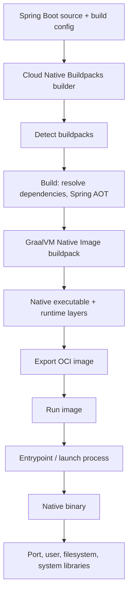

# Running the Container and Verifying Binary, Ports, User Permissions, and System Dependencies

## 1. Objective: Verifying the Native Image in a Real Runtime Environment

After Spring Boot is compiled into a **GraalVM Native Image**, the next step is packaging and running the executable in a container. In the **SPRING_BOOT_NATIVE_IMAGE** module, a successful build only proves the compiler produced an artifact; you must also verify that the container actually launches the native binary, the application listens on the right port, the process runs as an appropriate user, the filesystem has required permissions, and all OS libraries are available.

This lesson uses **Cloud Native Buildpacks** to build the OCI image, then verifies the image with Docker. Key topics:

- Configuring the Spring Boot Maven/Gradle plugin to request a native image build.
- Reading buildpack logs and image metadata to verify artifact type, entrypoint, ports, OS, and architecture.
- Running the container and checking HTTP responses, readiness, and logs.
- Checking user/group, read/write permissions, temporary directories, and volumes.
- Checking libc, native libraries, CA certificates, timezone, DNS, and system dependencies.
- Diagnosing common issues before deploying to Kubernetes or other container platforms.

> Illustrative commands use the Docker CLI and an image named `hello-native:local`. Replace the image name, ports, endpoints, and paths according to your real application. Buildpacks offer various builders/buildpacks; always confirm your chosen builder supports GraalVM Native Image and is compatible with your project's Spring Boot/GraalVM versions.

## 2. How Do Buildpacks Package an Application?

Buildpacks convert application source code or artifacts into an OCI image through a standardized pipeline. Instead of writing a manual Dockerfile to install a JDK, GraalVM, compiler, and runtime image, the builder picks appropriate buildpacks to prepare the build environment and run image.



A builder typically includes the lifecycle, buildpacks, and a build image; the resulting image uses a compatible run image. Buildpacks manage layers and application metadata, such as the launch process. When native build is enabled, the corresponding buildpack executes Spring AOT and invokes GraalVM Native Image in the build environment. The exported image contains the executable along with required runtime components.

Distinguish these concepts:

| Component | Role | What to verify |
| --- | --- | --- |
| **Builder image** | Environment containing lifecycle and buildpacks to create the image | Has native-supporting buildpack, compiler, and compatible toolchain |
| **Build image** | OS base used during compilation | Has build dependencies and matches toolchain |
| **Run image** | OS base used when the container runs | Has runtime libraries needed by the executable |
| **OCI application image** | Final image containing application and launch metadata | Right OS/architecture, user, process, port, and runtime layers |

Buildpacks normally maintain compatibility between the build image and run image. Do not arbitrarily swap the run image for an ultra-minimal or `scratch` image after building: a native binary may dynamically link against libc or other libraries missing from the new image.

## 3. Prerequisites Before Building a Native Image

Preparation:

1. A Spring Boot application that already builds and runs properly on the JVM.
2. A Spring Boot Maven plugin or Gradle plugin compatible with the project.
3. A Docker daemon or container backend usable by the plugin.
4. A builder image containing a buildpack that supports GraalVM Native Image; the builder may be pulled from a registry if not cached.
5. Sufficient CPU/RAM/disk for native compilation, which normally consumes more resources than building a JAR.
6. Registry access permissions if the builder or dependencies must be pulled from a private registry.

Check Docker and machine architecture:

```bash
docker version
docker info --format '{{.OSType}}/{{.Architecture}}'
```

If using Linux/macOS to build natively outside Buildpacks, also check:

```bash
java -version
native-image --version
```

With Buildpacks, the GraalVM toolchain can be provided inside the builder/buildpack; `native-image` does not have to be installed directly on the host. Still, read logs to verify the native buildpack was detected and executed. If logs only show a Java/JVM build, the resulting image may still be running a JAR.

## 4. Enabling Native Image in Cloud Native Buildpacks

The Spring Boot Maven/Gradle plugin integrates with Buildpacks. The buildpack environment variable `BP_NATIVE_IMAGE=true` instructs the Java native buildpack to build a Native Image, provided the chosen builder supports that capability.

### 4.1. Maven

In `pom.xml`, configure `spring-boot-maven-plugin`:

```xml
<build>
    <plugins>
        <plugin>
            <groupId>org.springframework.boot</groupId>
            <artifactId>spring-boot-maven-plugin</artifactId>
            <configuration>
                <image>
                    <name>hello-native:local</name>
                    <env>
                        <BP_NATIVE_IMAGE>true</BP_NATIVE_IMAGE>
                    </env>
                </image>
            </configuration>
        </plugin>
    </plugins>
</build>
```

Build the image:

```bash
./mvnw spring-boot:build-image
```

The plugin invokes the Buildpacks lifecycle to detect, build, and export the image. Logs are crucial evidence: look for the native/GraalVM buildpack and the native executable creation step. If the builder lacks native support or the environment variable was not passed into the build phase, fix the builder/plugin configuration instead of assuming the image is already native.

### 4.2. Gradle

In `build.gradle` (Groovy DSL), configure the `bootBuildImage` task:

```groovy
tasks.named('bootBuildImage') {
    imageName = 'hello-native:local'
    environment = [
        'BP_NATIVE_IMAGE': 'true'
    ]
}
```

Run:

```bash
./gradlew bootBuildImage
```

With Kotlin DSL, property configuration syntax may differ; refer to the `BootBuildImage` type for your Spring Boot Gradle plugin version. Maven and Gradle are two choices depending on your project's build system and do not need to be applied together.

### 4.3. Inspecting Build Results

After building:

```bash
docker image ls hello-native
docker image inspect hello-native:local
```

Read logs to confirm the native-image buildpack was actually used and the build completed. Buildpack names, builder version, run image, and layers depend on project configuration. Do not rely on the image name or a `native` tag to conclude the binary inside is native.

Useful metadata inspection commands:

```bash
# OS and architecture recorded in the image manifest.
docker image inspect --format '{{.Os}}/{{.Architecture}}' hello-native:local

# Default image user. An empty result means Docker defaults to root.
docker image inspect --format '{{if .Config.User}}{{.Config.User}}{{else}}root (default){{end}}' hello-native:local

# Entrypoint, command, and ports declared in the image config.
docker image inspect --format '{{json .Config.Entrypoint}} {{json .Config.Cmd}}' hello-native:local
docker image inspect --format '{{json .Config.ExposedPorts}}' hello-native:local
```

`EXPOSE`/`ExposedPorts` is only port-describing metadata; it **does not automatically publish ports to the host**. You still must specify port mappings when running the container.

## 5. Verifying the Container Actually Runs a Native Executable

Do not look at the image name alone. Combine three pieces of evidence:

1. **Build log:** shows the native-image buildpack/GraalVM Native Image step and successful compilation log.
2. **Image launch configuration:** check `Entrypoint`, `Cmd`, process type, and buildpacks metadata.
3. **Running process:** inspect the actual process inside the container and confirm the command is the application's native executable, not `java -jar`.

Example inspecting launch config and process:

```bash
docker image inspect --format '{{json .Config.Entrypoint}} {{json .Config.Cmd}}' hello-native:local

docker run -d --name hello-native-check -p 18080:8080 hello-native:local
docker top hello-native-check
docker logs hello-native-check
```

Buildpacks may place the executable at a buildpack-managed path; do not hardcode paths from another builder. Use launch metadata and build logs to see which process is started. Some minimal run images **lack a shell, `ps`, `file`, or `ldd`**; thus `docker exec ... sh` can fail even while the application runs normally. `docker top` and `docker inspect` let you inspect from the host without needing a shell inside the container.

When you need to inspect binary file attributes such as ELF format, architecture, or dynamic linker, inspect the artifact in the build workspace or extract the exact executable from the image per launch metadata and run compatible analysis tools. Do not guess filenames/paths inside the image.

Once finished checking, stop and remove the container:

```bash
docker stop hello-native-check
docker rm hello-native-check
```

## 6. Checking Ports, Bind Address, and Readiness

### 6.1. Mapping host port and container port

Assume Spring Boot listens on port `8080` inside the container. Run:

```bash
docker run --rm --name hello-native \
  -p 18080:8080 \
  hello-native:local
```

Here `18080` is the host port and `8080` is the container port. Verify:

```bash
curl -i http://localhost:18080/hello
```

If the endpoint returns HTTP 200 and expected JSON, the path from host to the container process works. If the host port is already in use, change the left number, e.g., `-p 18081:8080`; if the app is configured on another port, change the right number accordingly.

### 6.2. The application must listen on a reachable interface

Inside a container, Spring Boot typically uses port `8080` and binds to the server's default interface. If configured with `server.address=127.0.0.1`, the app only listens on loopback inside the container; Docker port mapping from the host will fail to reach it. Do not bind to loopback when accepting requests over the container network.

You can change the port via Spring Boot's environment variable:

```bash
docker run --rm --name hello-native \
  -e SERVER_PORT=8081 \
  -p 18080:8081 \
  hello-native:local
```

When changing `SERVER_PORT`, update the container port in `-p` and corresponding probe settings. Do not confuse a port in image metadata with the port the app is actually listening on.

### 6.3. Checking readiness/liveness

For long-running deployed services, provide health endpoints to distinguish a running process from an application ready to receive traffic. Add `spring-boot-starter-actuator` and configure:

```properties
management.endpoint.health.probes.enabled=true
management.endpoints.web.exposure.include=health
```

When health probes are enabled, standard endpoints are:

- `GET /actuator/health/liveness`: whether the process is still alive.
- `GET /actuator/health/readiness`: whether the application is ready for traffic.

Check inside the container:

```bash
curl -i http://localhost:18080/actuator/health/readiness
curl -i http://localhost:18080/actuator/health/liveness
```

Expose only endpoints allowed by security policy. In Kubernetes, configure HTTP readiness/liveness probes or a startup probe tuned to real startup times. If adding a Docker `HEALTHCHECK`, ensure the run image includes the specified probe binary; many minimal images lack `curl` or `wget`.

## 7. Checking User, Group, and Filesystem Permissions

### 7.1. Confirming the container does not unintentionally run as root

Containerized applications should run as a non-root user whenever the workload allows. Buildpacks usually configure a non-privileged user in the run image, yet **inspect the actual image** instead of assuming:

```bash
docker image inspect --format '{{if .Config.User}}{{.Config.User}}{{else}}root (default){{end}}' hello-native:local
```

If the output is a UID/GID like `1000:1000` or a specific username, that is the user declared in the image config. If empty, Docker defaults to running the process as root. You can check the running process with:

```bash
docker top hello-native
```

Some minimal images lack the `id` command or a shell, so you cannot rely solely on `docker exec ... id`. When enforcing a custom user via `--user`, ensure that UID/GID has read access to the executable, certificates, configs, and write access to directories required by the app.

### 7.2. Testing a read-only filesystem

A native executable usually does not need to write to the application installation directory. Test running the container with a read-only root filesystem while mounting `/tmp` as tmpfs if frameworks or libraries need a temp directory:

```bash
docker run --rm --name hello-native-readonly \
  --read-only \
  --tmpfs /tmp:rw,nosuid,size=64m \
  -p 18080:8080 \
  hello-native:local
```

If the app starts and serves requests normally, that is a good sign for restricting write privileges. If a library needs to execute temporary files or write to another directory, grant only the specific permission/directory required and re-evaluate; do not make the entire filesystem writable just to hide an error.

### 7.3. Volumes and data ownership

If the app needs to write files, custom logs, or persistent data, mount a volume at the **exact configured data directory**:

```bash
docker volume create hello-native-data

docker run --rm \
  --mount type=volume,source=hello-native-data,target=/var/lib/hello \
  -p 18080:8080 \
  hello-native:local
```

This example only mounts the volume; the app must be configured to actually write to `/var/lib/hello`. A fresh Docker volume may have ownership mismatched with the image user. Read the UID/GID from image config, then initialize volume ownership via a controlled setup step or platform init mechanism. Avoid running production apps as root just to write to a volume.

In Kubernetes, align `runAsUser`, `runAsGroup`, `fsGroup`, `readOnlyRootFilesystem`, and PersistentVolume permissions. Security context values must match the image's actual UID/GID and cluster policy.

## 8. Checking OS Dependencies and Architecture

Native Image needs no JVM at runtime, yet the executable can still depend on **native system libraries**. Common dependencies include libc, SSL/crypto libraries, native libraries used by JNI, CA certificates, and system data such as timezone files.

### 8.1. OS and CPU architecture

Inspect the image:

```bash
docker image inspect --format '{{.Os}}/{{.Architecture}}' hello-native:local
docker info --format '{{.OSType}}/{{.Architecture}}'
```

For example, a `linux/amd64` image is built for x86-64. If the host is `linux/arm64`, do not assume an amd64 binary will run directly. Emulation can be used if supported by the Docker host, though performance and stability do not match native execution. For production, build and test artifacts for each exact target architecture.

Passing `--platform` when running a container only tells Docker to select/emulate an image platform; it **does not recompile** the native executable for another architecture. Multi-architecture images require manifests and binaries built for each platform.

### 8.2. libc and dynamic libraries

Many GraalVM native executables on Linux link against glibc and OS dynamic libraries. If built against glibc yet run on a musl-only image (or vice versa), the binary may fail to start. Similarly, `error while loading shared libraries` or `not found` usually indicates missing runtime libraries or a missing dynamic linker.

When you have the executable in the build workspace, use tools in a compatible Linux environment to inspect it:

```bash
file ./hello-native
readelf -l ./hello-native
ldd ./hello-native
```

`file` reports format/architecture; `readelf -l` can show the ELF interpreter; `ldd` lists dynamic libraries required by the binary. Only run `ldd` on trusted binaries in an appropriate system. Any `not found` entry must be resolved by supplying the corresponding library or building with an appropriate linking configuration.

With Buildpacks, builder/run images are designed to pair by stack; prefer keeping a run image compatible with the builder. If changing the run image, verify libc, the dynamic linker, and all native libraries. Never switch to `scratch` or Alpine merely for a smaller image without proving the binary is compatible.

### 8.3. CA certificates, HTTPS, and timezone

An app making HTTPS calls may start cleanly yet fail on outbound requests because the run image lacks CA certificates, a truststore, or proper TLS configuration. Test a real HTTPS request from the app inside the final container. If Native Image bakes certificate data at build time per toolchain configuration, rebuild the image when certificate sources change; do not assume adding a file at runtime works for every build setup.

Timezone and locale must also be verified in the final environment: `TZ` variable, timezone data, supported locales, and how Native Image was built. If business logic depends on timezones, dates/times, or number/currency formatting, test with real values rather than merely confirming process startup.

Other dependencies to check when used by the application:

- **DNS and networking:** internal service access, proxies, DNS search domains, IPv4/IPv6.
- **JNI/native libraries:** drivers or native libraries matching target architecture and ABI.
- **Font/image processing:** fontconfig, fonts, and imaging libraries if the app generates PDFs/images.
- **Temp directory:** write permission and `/tmp` capacity, especially for libraries extracting or creating temporary files.
- **Locale/timezone data:** formatting, parsing, and time calculations for the target environment.

## 9. Observing the Running Container

After starting the container in the background:

```bash
docker ps
docker logs hello-native
docker inspect hello-native
docker stats --no-stream hello-native
docker top hello-native
```

Each command answers a different question:

| Command | Information |
| --- | --- |
| `docker ps` | Whether the container is running and current port mappings |
| `docker logs` | Application stdout/stderr logs |
| `docker inspect` | Image, state, user, network, mounts, entrypoint, and configuration |
| `docker stats` | CPU, memory, network I/O, and block I/O at observation time |
| `docker top` | Processes currently running inside the container |

If the container exits immediately after start, inspect `docker ps -a` and `docker logs <container>`. Exit codes, Spring initialization logs, and dynamic linker messages usually separate application config errors from OS errors.

For long-running containers, send logs to stdout/stderr for platform collection. Test graceful shutdown when Docker sends SIGTERM; you can enable:

```properties
server.shutdown=graceful
spring.lifecycle.timeout-per-shutdown-phase=20s
```

Timeout values must suit request processing time, orchestrator termination grace periods, and actual cleanup tasks.

## 10. Container Runtime Troubleshooting Table

| Symptom | Possible cause | Verification and resolution |
| --- | --- | --- |
| Container exits immediately, non-zero exit code | Native binary initialization failure, missing config, or missing shared library | Read `docker logs`, exit code, build logs, and binary dependencies |
| `exec format error` | Wrong architecture or executable format | Compare image architecture with host; build for the right platform |
| `no such file or directory` even though binary exists | Missing ELF interpreter/dynamic linker or wrong path/working directory | Run `readelf -l`, check libraries and launch path |
| `error while loading shared libraries` | Run image missing native library | Check `ldd` in a compatible environment; pick a matching-stack run image |
| Host cannot reach endpoint | Port not published, wrong port mapped, or app bound to loopback | Check `docker ps`, `ExposedPorts`, `-p`, and server address |
| Container runs but readiness fails | App still starting, DB/DNS/config error, or health group disabled | Check logs, readiness endpoint, and external dependencies |
| `Permission denied` at launch | Binary lacks execute bit or user cannot read file | Check file mode, ownership, and image user |
| `Permission denied` when writing files | Read-only root filesystem, wrong volume owner, or non-writable path | Provide tmpfs/volume for the right path; fix ownership per UID/GID |
| HTTPS handshake/certificate error | Missing CA/truststore or mismatched TLS config | Test HTTPS in the run image; add certificates properly |
| Wrong locale/timezone | Missing data or mismatched configuration | Check `TZ`, locale, and native-image build configuration |
| Works on amd64 but fails on arm64 | Binary or native dependency built for only one architecture | Build/test separately per target platform |
| Cannot run `docker exec ... sh` | Minimal run image contains no shell | Use `docker inspect`, `docker top`, logs, or a compatible diagnostic image |

Do not apply quick workarounds like `--privileged`, running as root, mounting the entire filesystem writable, or adding random libraries. Identify the exact missing permission, path, ABI, and dependency; then rebuild the image and rerun the same tests.

## 11. Pre-Deployment Verification Checklist

| Area | Verification question |
| --- | --- |
| Native build | Do logs prove the GraalVM Native Image buildpack ran and built the binary? |
| Launch process | Does the entrypoint/process actually run the native executable, not `java -jar`? |
| Image platform | Does OS/CPU architecture match deployment nodes? |
| Port | Does the app bind to the right interface, with accurate port mapping/service target port? |
| Health | Do readiness/liveness probes accurately reflect application and required dependency state? |
| User | Does the image run non-root under a verified UID/GID? |
| Filesystem | Can the root filesystem be read-only; do `/tmp` and volumes have least-privilege permissions? |
| System libraries | Are libc, dynamic linker, and JNI/native libraries compatible with the run image? |
| Certificates | Do outbound HTTPS and truststores work inside the final image? |
| Configuration | Are profiles, env vars, secrets, and external configs passed at runtime without baking secrets into the image? |
| Observability | Are logs, metrics, exit codes, and shutdown behavior verified? |
| Reproducibility | Are builder, buildpack, run image, toolchain, commit, and image digest recorded? |

## 12. Hands-On Exercise: Build, Run, and Verify the Image

**Context:** Application `hello-native` has a `GET /hello` endpoint and already runs as a JAR on the JVM. Your task is to build a container image with Buildpacks in GraalVM Native Image mode and verify runtime behavior.

**Steps:**

1. Record Spring Boot, Java, Docker, builder versions, and host architecture.
2. Configure Maven `spring-boot:build-image` or Gradle `bootBuildImage` with `BP_NATIVE_IMAGE=true`.
3. Build the image, save logs, and verify the native-image buildpack ran.
4. Use `docker image inspect` to verify OS, architecture, user, entrypoint, and exposed ports.
5. Run the container with port mapping `-p 18080:8080`, call `/hello`, and record HTTP status/body.
6. Use `docker top`, `docker logs`, and `docker stats` to inspect processes, logs, and resources.
7. Test `--read-only` mode with tmpfs for `/tmp`; determine which directories genuinely need write access.
8. If the app uses a volume, test UID/GID and mount permissions with the image's exact user.
9. Test HTTPS/DNS or native libraries actually used by the app; confirm the run image supplies all dependencies.
10. Record the image digest, builder/run image, OS/architecture, smoke test results, and any discovered limits.

**Completion criteria:**

- Image was built with the native buildpack, backed by log evidence.
- Launch process is a native executable matching the target OS/architecture.
- Endpoint returns expected responses over the mapped host port.
- Container runs as an unprivileged user per verified configuration.
- Filesystem and volumes have minimal required permissions.
- OS dependencies, certificates, and networking used by the app work in the run image.
- Logs, readiness, shutdown, and runtime metrics are observable.

## 13. Summary

Operating GraalVM Native Image inside containers requires verifying the full path from **Buildpacks builder → native compilation → OCI image → launch process → runtime OS**. Build logs confirm how the image was created; image inspection and process inspection confirm the binary/entrypoint; HTTP probes confirm ports and readiness; UID/GID and filesystem checks confirm permissions; and libc, architecture, CA, and native library checks confirm system dependencies.

A reliable native container is one that runs the right binary on the target platform, accepts traffic on the configured port, operates with least privilege, and includes the necessary runtime libraries and data. Only after these conditions pass should you use that same image to benchmark startup, RSS, and throughput and promote it into release pipelines.
