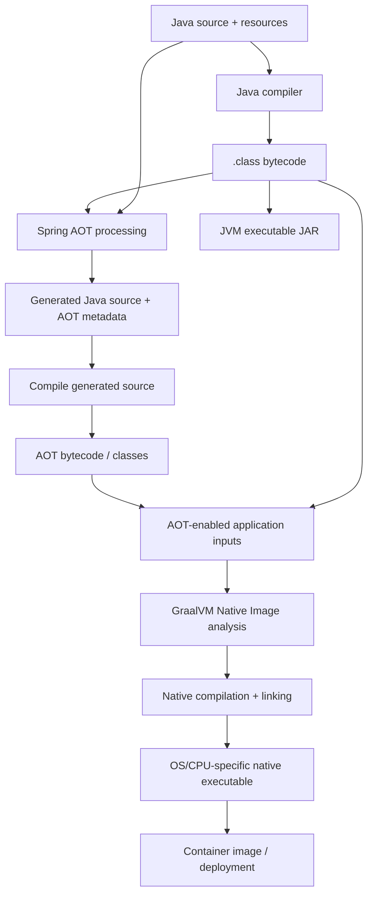

# Distinguishing Source, Bytecode, AOT Code, and Native Binary

## Lesson Objectives

When building a **Spring Boot Native Image** application, a project can produce several types of intermediate files and final products. These files often live in the same build directory, have very similar names, and are all loosely called "artifacts", yet they carry very different meanings.

This lesson distinguishes four important types:

1. **Source code** — Java source code written by developers.
2. **Bytecode** — JVM instruction code compiled from Java, typically stored in `.class` files and packaged inside a JAR.
3. **Generated AOT code** — Java code and metadata created by Spring AOT to prepare application configuration ahead of runtime.
4. **Native binary** — an executable file compiled by GraalVM Native Image into machine code for the target operating system and architecture.

After this lesson, you will be able to:

- Explain which stage creates each artifact and which tool consumes it.
- Distinguish Java code generated by Spring AOT from a native binary.
- Recognize common output directories in Maven and Gradle.
- Use command-line tools to inspect JAR contents, bytecode, and executable formats.
- Choose the right artifact for running, container packaging, debugging, and deployment.

> **Principle:** a `.jar` file can contain bytecode that has undergone AOT processing, but that does not turn it into a native binary. Only when the Native Image compiler produces an executable matching the target OS/CPU do you have a native product.

## 1. Four Types of Artifacts in a Build Pipeline

### 1.1. Source Code

This is what developers directly create and edit:

- `.java` files containing classes, interfaces, records, annotations, and business logic.
- Resources such as `.properties`, `.yml`, templates, JSON files, certificates, or data in `src/main/resources`.
- Build configuration such as `build.gradle`, `pom.xml`, Gradle Wrapper, and Maven Wrapper.

Example:

```java
package com.example.hello;

import org.springframework.web.bind.annotation.GetMapping;
import org.springframework.web.bind.annotation.RestController;

@RestController
class HelloController {
    @GetMapping("/hello")
    String hello() {
        return "Hello Spring Boot";
    }
}
```

Source code is easy to read and edit, but the JVM does not execute this Java text directly. First, the compiler must translate it into bytecode. With Native Image, source and dependencies also go through AOT/reachability analysis steps before becoming machine code.

### 1.2. Bytecode — JVM Instruction Code

The Java compiler (`javac`) translates `.java` source into `.class` files. Inside a `.class` file are JVM bytecode, the constant pool, field/method descriptors, and metadata for the JVM. Bytecode is designed for the **Java Virtual Machine**, not a specific CPU instruction set.

For example, for the `hello()` method above, the compiler can emit bytecode containing instructions equivalent to loading a string and returning the result. You can inspect it with:

```bash
javap -c -p build/classes/java/main/com/example/hello/HelloController.class
```

Bytecode is generally portable across multiple operating systems and CPU architectures as long as a compatible JVM and suitable dependencies are available. However, this portability is not absolute: an application can still depend on a specific Java version, JNI, native libraries, filesystem behavior, or platform-specific features.

**A JAR is not synonymous with plain bytecode.** JAR is a ZIP-based archive format; it can contain `.class` files, resources, metadata, and library dependencies. A Spring Boot executable JAR typically embeds the application alongside nested dependencies so the Spring Boot launcher can run them on the JVM.

### 1.3. Generated AOT Code

**Spring AOT** analyzes the application configuration at build time and generates Java code and metadata to support bootstrapping. The generated code can include components such as:

- Code that registers analyzed bean definitions.
- A generated `ApplicationContextInitializer` to apply those registrations to the context.
- Code/support for bean initialization and infrastructure configuration under the AOT model.
- Runtime hints for reflection, proxies, resources, or serialization when the framework can infer them or when they are declared.

Generated AOT code usually consists of **Java source** (`.java`) and accompanying resources. Afterward, the build tool can compile these sources into `.class` files. They remain Java source / JVM bytecode at their respective stages; a generated `.java` file by itself is not native machine code.

As an illustrative example, Spring AOT may generate an initializer that calls into bean registration logic:

```java
// Illustrative code, not a fixed generated class name
final class HelloApplication__ApplicationContextInitializer
        implements ApplicationContextInitializer<GenericApplicationContext> {

    @Override
    public void initialize(GenericApplicationContext context) {
        new HelloApplication__BeanRegistrations()
                .registerBeanDefinitions(context);
    }
}
```

The actual class names and structure depend on the Spring Boot / Spring Framework version and build configuration. Do not edit generated sources directly; update the original source/configuration or Runtime Hints and re-run AOT instead.

### 1.4. Native Binary — Native Executable

**GraalVM Native Image** analyzes bytecode and metadata, determines the reachable code (reachability analysis), then compiles it to machine code and packages it as an executable. This file targets a specific combination of operating system, CPU architecture, and ABI environment.

Characteristics:

- Runs directly as an operating system executable, without needing a JVM to load Java bytecode.
- Includes the application's machine code and the required native runtime components.
- Can start faster and consume less memory in many Spring Boot workloads, though the actual improvement must be measured.
- Is typically tied to the target OS/CPU; a Linux x86-64 executable cannot simply be renamed to `.exe` to run on Windows.
- May require dynamic operating system libraries such as libc or other native libraries, depending on build options and packaging environment.

A native binary does not mean "no runtime at all". Native Image has its own runtime for memory management, threads, exceptions, and required services; the difference is that the application does not run on a JVM interpreting/JIT-compiling bytecode.

## 2. Artifact Transformation Map

A typical build path:



This diagram is a conceptual model. Exact task ordering and how plugins organize the classpath may vary by version. In particular, AOT is not necessarily a linear branch completely separate from bytecode: Spring AOT analyzes the application model and generates code/metadata, and those generated sources are then processed by the compiler. Native Image uses those prepared inputs to create the executable.

### 2.1. Quick Comparison Table

| Artifact | Example Name / Extension | Produced By | Used For | Runs Directly as a Native Executable? |
|---|---|---|---|---|
| Source | `HelloController.java` | Developer | Input to compiler/framework | No |
| Java bytecode | `HelloController.class` | `javac` / Gradle / Maven compiler | Loaded and executed by JVM | No |
| Executable JAR | `app.jar` | Spring Boot / Maven / Gradle packaging | Run via `java -jar` on JVM | No |
| Generated AOT source | `...__ApplicationContextInitializer.java` | Spring AOT | Pre-generated bootstrap code | No |
| AOT compiled classes | Generated `.class` | Java compiler after Spring AOT | Input for AOT runtime / Native Image | No |
| Native executable | `app`, `app.exe` | GraalVM Native Image | Runs directly on target OS/CPU | Yes |
| OCI container image | `app:1.0` | Buildpacks / Docker | Distributing the application and runtime environment | Runs via container runtime |

## 3. Where Do Artifacts Typically Live in Maven and Gradle?

Exact paths depend on plugin versions, project names, modules, and build configuration. The paths below are **common examples**, not a guarantee that every project has every directory.

### 3.1. Maven

After running the appropriate goals, you may see:

```text
target/
├── classes/                         # Application .class files and resources
├── generated-sources/               # Other generated sources (if any)
├── spring-aot/
│   └── main/
│       ├── sources/                  # Java source generated by Spring AOT
│       ├── resources/                # AOT resources / metadata
│       └── classes/                  # Class output depending on configuration
├── app.jar                           # Executable JAR, name depends on artifact
└── app                               # Native executable, if native-compiled
```

Common goals:

```bash
# Compile Java and package JAR
./mvnw clean package

# Generate Spring AOT source/metadata
./mvnw spring-boot:process-aot

# Native compilation with configured native profile/plugin
./mvnw -Pnative native:compile
```

Not every project needs to run all three commands manually in sequence. `native:compile` with an appropriately integrated profile can orchestrate the necessary AOT/compile steps. The purpose of the example is to illustrate each stage and what artifact type to look for.

### 3.2. Gradle

Some commonly seen outputs:

```text
build/
├── classes/
│   └── java/main/                    # .class files of Java source
├── resources/main/                   # Copied resources
├── generated/
│   ├── aotSources/                   # Generated Java source
│   └── aotResources/                 # AOT resource/metadata
├── libs/
│   └── app.jar                       # JAR, name depends on project
└── native/
    └── nativeCompile/
        └── app                       # Native executable, if built
```

Common tasks:

```bash
# JVM JAR
./gradlew clean bootJar

# Spring AOT processing
./gradlew processAot

# Native executable
./gradlew nativeCompile
```

Generated AOT outputs can reside in `build/generated/aotSources` and `build/generated/aotResources`; paths can change depending on the plugin. If you do not see them, inspect the task outputs or the project's generated source directories configuration.

### 3.3. Container Image Is Another Packaging Product

With Spring Boot Buildpacks, Gradle `bootBuildImage` or Maven `spring-boot:build-image` creates an **OCI image**. The image can contain a JVM or native application depending on buildpack configuration. An OCI image itself is an archive of layers, metadata, and a filesystem—not a single `.class` file or a single binary.

When building a native container image, the GraalVM executable usually lives inside the image filesystem alongside required OS libraries. Therefore, check the buildpack logs and test the container; do not infer that an image is native merely from its tag name or size.

## 4. Bytecode vs. AOT Bytecode: Where Do They Differ?

Regular application bytecode is produced from source written by developers. AOT processing can generate additional Java source, which the compiler then compiles into bytecode. Both can be `.class` files, but their origins and roles differ:

| Criterion | Application Bytecode | Generated AOT Bytecode |
|---|---|---|
| Origin | `src/main/java` | Source generated by Spring AOT |
| Content | Controllers, services, repositories, original configuration... | Bean definition registrations, initializers, and bootstrap helpers |
| Created by | Java compiler | Java compiler after Spring AOT processing |
| Used in JVM | JVM executes classes via normal runtime mechanisms | Can be used in AOT-enabled mode on the JVM |
| Used in Native Image | Part of the analysis input | Provides prepared code/metadata for native analysis |

**AOT is a way of preparing an application before runtime, not the name of a single file format.** Depending on the stage, AOT outputs can include `.java`, `.class`, resources, and metadata. Do not call all of them "native code".

## 5. Inspecting Each Artifact Type with Tools

### 5.1. Viewing JAR Contents

List the contents of a JAR:

```bash
jar tf build/libs/app.jar
```

With a Spring Boot executable JAR, you may see:

```text
META-INF/
BOOT-INF/
├── classes/
│   └── com/example/hello/HelloController.class
└── lib/
    ├── spring-boot-....jar
    └── spring-web-....jar
org/springframework/boot/loader/...
```

Directory names and launcher paths vary by Spring Boot version. What to look for is that the application's `.class` files reside in the archive and dependencies are packaged in the appropriate layout. A JAR runs with:

```bash
java -jar build/libs/app.jar
```

This command requires a compatible JVM. If you launch a `.jar` file by double-clicking it, the operating system may use a configured file association, but the execution mechanism is still the JVM.

### 5.2. Reading Bytecode

For a compiled class file:

```bash
javap -classpath build/classes/java/main -c -p com.example.hello.HelloController
```

- `-c` displays method bytecode.
- `-p` displays non-public members as well.
- `-classpath` specifies where to find the class to inspect.

`javap` disassembles the class file; it does not prove the class has been turned into native machine code. The JVM can compile bytecode into machine code via JIT at runtime, but that is a different mechanism from GraalVM producing a native executable ahead of deployment.

### 5.3. Finding Generated AOT Sources

With Gradle, you can search for generated Java files:

```bash
find build/generated -type f -name '*.java'
find build/generated -type f -name '*ApplicationContextInitializer*.java'
```

With Maven:

```bash
find target/spring-aot -type f -name '*.java'
find target/spring-aot -type f -name '*ApplicationContextInitializer*.java'
```

On PowerShell:

```powershell
Get-ChildItem -Path build/generated -Recurse -Filter '*.java'
Get-ChildItem -Path target/spring-aot -Recurse -Filter '*.java'
```

If no file matches `*ApplicationContextInitializer*`, AOT has not necessarily failed: generated class names vary by version and application structure. Inspect the task output and look for implementations of `ApplicationContextInitializer` or bean registration classes in the generated source tree.

### 5.4. Identifying a Native Executable

On Linux:

```bash
file build/native/nativeCompile/app
readelf -h build/native/nativeCompile/app
ldd build/native/nativeCompile/app
```

Meaning:

- `file` identifies the file format and architecture.
- `readelf -h` reads the ELF header to show the executable type and machine architecture.
- `ldd` displays the shared libraries required by the executable (if supported by the tool and binary format).

On macOS you can use `file` and `otool -hv`; on Windows you can use Visual Studio tools such as `dumpbin /headers app.exe`. Exact tools depend on the operating system.

If `file` reports an ELF 64-bit LSB executable for x86-64, that indicates Linux ELF format and x86-64 architecture—not Java bytecode. Some native executables may be partially or fully statically linked, so `ldd` is not the sole test and may report that the file is not a dynamic executable.

## 6. Portability and Runtime Requirements

### 6.1. Java Bytecode

Java bytecode is designed to run on a compatible JVM, so the same JAR can usually run on Windows, Linux, or macOS provided that:

- A JDK/JRE matching the bytecode version is present.
- Dependencies and native libraries (if any) are compatible.
- Environment configuration, file/network permissions, and dependent services are appropriate.

Bytecode does not carry a JVM with it. An executable JAR requires a pre-installed Java environment or a separate runtime packaging mechanism.

### 6.2. Native Binary

A native executable depends on the build target combination. A Linux x86-64 binary cannot run directly on Windows x86-64 simply because the CPU shares the same architecture; executable formats and OS ABIs differ. Likewise, Linux ARM64 and Linux x86-64 are not directly compatible.

| Artifact | OS-Dependent | CPU-Dependent | Requires JVM to Run? |
|---|---|---|---|
| Java source | Not directly | Not directly | Requires compiler to produce bytecode |
| `.class` bytecode | Via JVM/OS | Via JVM/CPU | Yes |
| Executable JAR | Via JVM/OS | Via JVM/CPU | Yes |
| Generated AOT `.java` | Not directly | Not directly | Not run directly; requires compiler and appropriate runtime flow |
| AOT `.class` | Via JVM/Native Image | Via runtime/compiler | Yes if running on JVM |
| Native executable | Yes | Yes | No JVM needed; may still require OS libraries |

Do not confuse "no JVM required" with "runs everywhere". When deploying, build for the exact OS/CPU/libc or choose a compatible container base/run image.

## 7. A Complete Example: Tracing Build Outputs

Suppose a Gradle project has `HelloController` and is configured with Spring Boot AOT and GraalVM Native Build Tools.

### Step 1 — Produce Bytecode and JAR

```bash
./gradlew clean bootJar
```

Inspect:

```bash
ls -lh build/libs/
jar tf build/libs/app.jar
```

You find the controller's `.class` file and dependencies inside the JAR. This is a **JVM artifact**.

### Step 2 — Generate AOT Code

```bash
./gradlew processAot
```

Locate generated sources/resources in `build/generated` (exact paths depend on the plugin). Read the initializer and bean registration classes to understand what Spring prepared. This is an **AOT-generated artifact**; the source is still Java.

### Step 3 — Compile Native

```bash
./gradlew nativeCompile
```

Check the output directory reported in the log, typically:

```text
build/native/nativeCompile/
└── app
```

Use `file`/`readelf` on Linux to identify the binary. Only this is the **native executable**.

### Step 4 — Run Both Products

JAR:

```bash
java -jar build/libs/app.jar
```

Native:

```bash
./build/native/nativeCompile/app
```

Both commands can serve the same endpoint, but their launch mechanisms differ. The JAR launches a JVM; the native version launches an OS executable.

### Step 5 — Container Packaging (If Needed)

```bash
./gradlew bootBuildImage
```

This task creates an OCI image. If you want the image to contain the native build, you must configure the native builder/buildpack properly and verify in the log that GraalVM Native Image compilation ran. Do not assume `bootBuildImage` always produces a native image.

## 8. Choosing the Right Artifact for Each Purpose

| Purpose | Appropriate Artifact | Reason |
|---|---|---|
| Fast development and debugging on JVM | Source + classes/JAR | Fast feedback loop, rich IDE tooling |
| Distributing a cross-platform Java application | Executable JAR | Uses a compatible JVM on the target platform |
| Analyzing how Spring prepares the context | Generated AOT sources/resources | Exposes the code and metadata generated by AOT |
| Inspecting bytecode and compiler output | `.class` + `javap` | Lets you observe JVM instructions |
| Running the application without a JVM | Native executable | Runs directly on target OS/CPU |
| Deploying with Docker/Kubernetes | JVM or native OCI image | Distributed together with required filesystem/runtime |
| Investigating reflection/resource errors in native | Generated metadata + native build/runtime logs | Identifies what the framework inferred vs. what needs additional hints |

Do not delete the build directory just because you see many similar-looking artifacts before identifying which file you need to debug or deploy. You can run `clean` to regenerate outputs when a clean build is needed, but keep your sources/config and save any logs needed for analysis.

## 9. Self-Check Exercises

1. Can a `.class` file be executed directly with `./MyClass.class`? Explain the role of the JVM.
2. If `processAot` produces a `__ApplicationContextInitializer.java` file, why can it not yet be called a native binary?
3. An executable JAR contains many `.class` files. Which command lists the archive contents, and which command lets you view a class's bytecode?
4. If `file app` reports ELF 64-bit for Linux x86-64, can you copy that file and run it on Windows x86-64? Why or why not?
5. `bootBuildImage` completes, but the log shows no sign of the GraalVM Native Image compiler. What should you check before calling that image native?
6. Sketch the path from `src/main/java` to the native executable and point out where Spring AOT participates.

**Takeaway:** source is the human-edited input; bytecode is JVM code; AOT code is generated source/metadata that prepares bootstrap; a native binary is machine code compiled for the target platform. Correctly identifying each artifact helps you run the right command, read the right logs, look in the right place when errors happen, and choose the right product to deploy Spring Boot.
