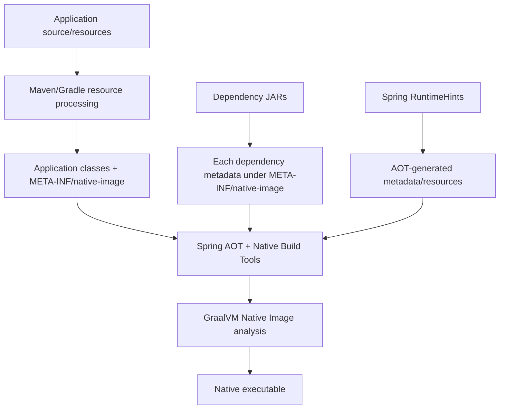
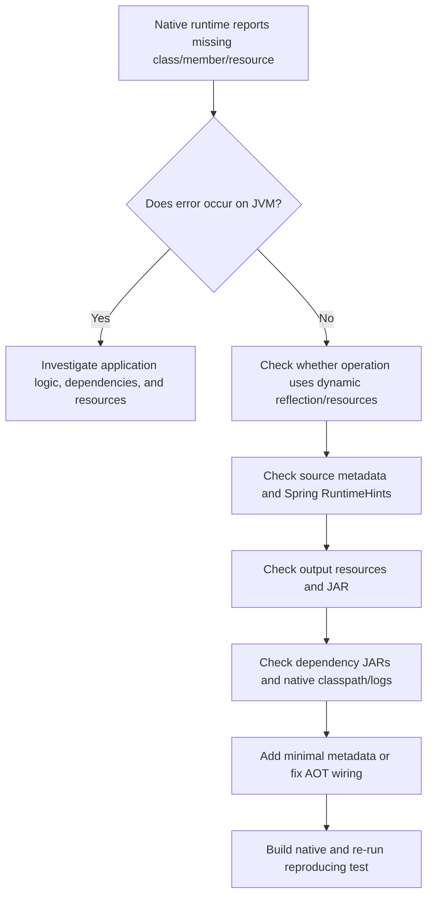

# `META-INF/native-image` and How Metadata Travels with the Classpath

## 1. Why Must Metadata Travel with the Classpath?

In the **SPRING_BOOT_NATIVE_IMAGE** module, a Spring Boot application is processed with **Spring AOT** and then compiled into a **GraalVM Native Image** to validate compatibility, startup time, memory usage, and container operability. An important part of this pipeline is supplying Native Image with information that static code analysis cannot fully infer on its own.

The JVM can perform many dynamic operations at runtime: looking up a class by string name, invoking constructors via reflection, reading resources from configuration-driven paths, creating proxies, or loading JNI libraries. Native Image analyzes the reachable code set at build time under a **closed-world** model. If a class, method, or resource is only used dynamically without appropriate metadata, that element may not be included in the executable.

GraalVM supports **reachability metadata** to describe elements that must be retained or allowed access at runtime. Metadata is typically placed under:

```text
META-INF/native-image/
```

This directory has a special meaning: metadata is packaged inside a **classpath entry** (an output directory or dependency JAR) so Native Image can discover it during the build. Therefore, metadata needs to be packaged with the artifact that owns it and appear on the native compilation classpath.

After this lesson, learners will be able to:

1. Explain the relationship between the classpath, dependency JARs, and `META-INF/native-image`.
2. Identify metadata for reflection, resources, proxies, serialization, and JNI.
3. Place metadata in the right location under source resources so Maven/Gradle includes it in the artifact.
4. Distinguish library-provided metadata from runtime hints generated by Spring AOT.
5. Verify that metadata is actually present in the JAR and fed into the native build.
6. Diagnose cases where the JVM runs fine but the native executable lacks a class, member, or resource.

> **Principle:** metadata only takes effect when discovered by Native Image during the build. A JSON file sitting somewhere in the repository that is not copied to output resources or is missing from the native build classpath cannot help the executable.

## 2. The Classpath Is a Collection of Sources Holding Classes and Metadata

The classpath is not just a directory of `.class` files. It can consist of multiple entries:

- Application output classes, such as `target/classes` in Maven or `build/classes/java/main` in Gradle.
- Copied output resources, often alongside output classes or in a separate resource output directory.
- Dependency JARs resolved by Maven/Gradle.
- Generated classes/resources, including some Spring AOT outputs.

Each entry can carry its own classes, resources, and metadata. For example:

```text
Native Image classpath
├── target/classes/
│   ├── com/example/...
│   └── META-INF/native-image/com.example/orders/
│       └── reachability-metadata.json
├── spring-context-....jar
│   └── META-INF/native-image/...
├── third-party-library-....jar
│   └── META-INF/native-image/...
└── other-dependency-....jar
```

This is a logical diagram. One JAR containing metadata does not necessarily share the exact layout of another JAR; the `META-INF/native-image` directory can sit at the root of each dependency JAR. Native Image processes metadata from the classpath entries supplied by the build process.

### 2.1. Metadata Belongs with the Artifact That Owns It

Suppose the library `com.acme:document-engine` uses reflection to instantiate an implementation from a class name read from configuration. If the library packages reachability metadata inside its own JAR, applications using the library can automatically pick up that metadata when the dependency is placed on the native classpath.

```text
document-engine-2.4.0.jar
├── com/acme/document/...
└── META-INF/
    └── native-image/
        └── com.acme/
            └── document-engine/
                └── reachability-metadata.json
```

Placing metadata close to its owning artifact ensures that:

- The library self-describes its dynamic access requirements.
- Consuming applications do not have to copy configuration for every dependency.
- Metadata is distributed alongside the library version, making upgrades and change tracking easier.
- Multiple libraries can supply their own configurations without overwriting each other's files.

Subdirectories by group/artifact are an organized way to avoid filename collisions. Directory names should remain stable within the artifact; do not pick arbitrary names and assume the plugin maps them automatically from Maven coordinates.

### 2.2. How Does the Native Classpath Differ from the JVM Runtime Classpath?

A JVM application can run via the Spring Boot launcher, a Maven plugin, or an IDE-configured classpath. Native Image is built from the classpath and inputs prepared by the native plugin. These sources are related but not always identical:

| Source | Role | What to Verify |
| --- | --- | --- |
| `target/classes` / `build/classes` | Compiled application bytecode | Are application classes and metadata/resources present? |
| Dependency JAR | Library classes and resources | Does the JAR contain `META-INF/native-image`? |
| Spring AOT outputs | Generated bootstrap/context code and runtime hints | Are AOT outputs consumed by the native task? |
| Native plugin classpath | Actual input set passed to GraalVM | Do plugin logs show which dependencies and metadata were supplied? |
| Spring Boot executable JAR | Repackaged JVM artifact | Do not assume this JAR acts like a standard Java classpath entry; nested JARs require the Boot launcher or corresponding integration. |

Therefore, do not inspect only `jar tf app.jar` and conclude all metadata was used by Native Image. Inspect the artifacts, dependency graph, and native build logs.

## 3. Common Types of Reachability Metadata

Metadata can describe several kinds of dynamic access. Depending on the GraalVM version, the unified `reachability-metadata.json` format or individual JSON configuration files may be used. Use the schema documented for your target GraalVM version.

| Runtime Requirement | Common Metadata | Example |
| --- | --- | --- |
| Reflection | `reflection` in `reachability-metadata.json` or `reflect-config.json` | Instantiating via `Constructor.newInstance`, invoking methods via reflection. |
| Resource | `resources` or `resource-config.json` | Reading templates, config files, certificates, or schemas from the classpath. |
| Dynamic proxy | `proxy` or `proxy-config.json` | Creating dynamic interface proxies. |
| Serialization | `serialization` or `serialization-config.json` | Serializing/deserializing certain types through mechanisms requiring metadata. |
| JNI | `jni` or `jni-config.json` | Accessing classes/members from native code. |
| Resource bundle | `bundles` or corresponding resource bundle config | Reading localized messages via `ResourceBundle`. |

Not every class in an application needs reflection registration. Direct calls that can be statically analyzed generally do not need extra metadata. Register only what is genuinely accessed dynamically; overly broad declarations can bloat the binary and diminish the benefits of reachability analysis.

### 3.1. Unified Metadata Format

With GraalVM versions supporting the modern reachability metadata format, reflection and resource needs can be organized in one file:

```json
{
  "reflection": [
    {
      "type": "com.example.plugins.JsonPlugin",
      "allDeclaredConstructors": true,
      "allPublicMethods": true
    }
  ],
  "resources": {
    "includes": [
      {
        "pattern": "templates/.*\\.txt"
      }
    ]
  }
}
```

This is a schema illustration: replace the class and resource pattern with actual elements, and check your GraalVM version because the metadata format can evolve. `pattern` is an expression following Native Image's metadata format; backslashes must be properly escaped in JSON. Do not copy examples without verifying type names and resource paths.

One way to organize this in an application:

```text
src/main/resources/
└── META-INF/
    └── native-image/
        └── com.example/
            └── orders-api/
                └── reachability-metadata.json
```

When Maven processes resources, the file is copied to output resources, typically `target/classes/META-INF/native-image/...`; when Gradle processes resources, the file typically appears under `build/resources/main/META-INF/native-image/...`. Resource filtering or custom source sets can alter the result, so verify the actual output.

### 3.2. Traditional Separate Configuration Files

Many projects and dependencies still contain metadata in separate files:

```text
META-INF/native-image/com.example/orders-api/
├── reflect-config.json
├── resource-config.json
├── proxy-config.json
├── serialization-config.json
├── jni-config.json
└── native-image.properties
```

Example `reflect-config.json`:

```json
[
  {
    "name": "com.example.plugins.JsonPlugin",
    "allDeclaredConstructors": true,
    "allPublicMethods": true
  }
]
```

Example `resource-config.json`:

```json
{
  "resources": {
    "includes": [
      {
        "pattern": "templates/.*\\.txt"
      }
    ]
  }
}
```

Legacy files still appear in many libraries and guides. Do not place both formats describing the exact same requirement haphazardly; this can hurt maintainability or cause duplicate declarations. When upgrading GraalVM, check compatibility, deprecation warnings, and how to migrate to the unified metadata format.

### 3.3. What Is `native-image.properties` Used For?

`native-image.properties` can supply Native Image options for the artifact containing that file. Minimal example:

```properties
Args = --verbose
```

This example only enables verbose logging for diagnostics. Real options should be weighed carefully according to the GraalVM version and build goals. Avoid placing arbitrary global flags or class-initialization options inside a dependency because they can affect every application consuming that library.

If a library requires a special flag, document the reason, scope of impact, and verified versions. Application Maven/Gradle plugin configuration can also supply build arguments; check how option sources are combined in the logs rather than assuming ordering or precedence.

## 4. Placing Metadata in Project Resources

### 4.1. With Maven

In a Maven application, place metadata files under `src/main/resources`, not `src/main/java`:

```text
src/main/
├── java/com/example/...
└── resources/
    ├── application.properties
    └── META-INF/native-image/com.example/orders-api/
        └── reachability-metadata.json
```

Run resource processing/compilation and inspect:

```bash
./mvnw clean process-resources

# Check if the file reached output resources
find target/classes/META-INF/native-image -type f
```

On Windows, you can use `Get-ChildItem` to inspect the directory tree. Do not rely on the Linux `find` command if you are using pure PowerShell.

Then package the JAR:

```bash
./mvnw package
jar tf target/orders-api-0.0.1-SNAPSHOT.jar
```

The JAR path in the example should be replaced with your actual artifact name. In a standard JAR, metadata usually appears directly under `META-INF/native-image/...`. In a Spring Boot executable JAR, application resources typically sit inside `BOOT-INF/classes/META-INF/native-image/...`; this is an internal location within the application archive understood by the Boot launcher when running on the JVM. Native Build Tools integrating with Spring Boot prepare the appropriate native classpath; do not automatically assume that a resource inside an executable JAR will be found by Native Image's standard classpath loader like a root-level resource.

### 4.2. With Gradle

In a Gradle application, the source location is similar:

```text
src/main/resources/
└── META-INF/native-image/com.example/orders-api/
    └── reachability-metadata.json
```

Inspect after resource processing:

```bash
./gradlew processResources
find build/resources/main/META-INF/native-image -type f
```

After packaging:

```bash
./gradlew jar
jar tf build/libs/orders-api-0.0.1-SNAPSHOT.jar
```

The JAR name depends on `archiveBaseName`, version, and build configuration. With Spring Boot, `bootJar` creates an executable JAR and places resources into `BOOT-INF/classes`; `jar` and `bootJar` can be two distinct artifacts. Verify the exact artifact your application distributes and the exact classpath used by `nativeCompile`.

### 4.3. Metadata in Dependency JARs

A library providing metadata needs to package the files inside its own JAR. When that dependency appears on the native classpath, GraalVM can read the corresponding metadata. Check dependencies:

```bash
./mvnw dependency:tree
./mvnw dependency:build-classpath \
  -DincludeScope=runtime \
  -Dmdep.outputFile=target/runtime-classpath.txt
```

Once you have the JAR path from the dependency classpath, inspect its contents:

```bash
jar tf /path/to/dependency.jar | grep 'META-INF/native-image/'
```

`/path/to/dependency.jar` is a placeholder; replace it with the resolved JAR path. With Gradle, you can use `dependencies` and `dependencyInsight` to determine the selected artifact/version, then inspect the corresponding JAR.

If metadata is absent from the dependency JAR and only exists in the library's source repository, consuming applications will not see it automatically. You must either release a new library version with properly packaged metadata or supply the metadata in the application if you own the configuration and understand the dependency's exact requirements.

## 5. How Do Spring AOT `RuntimeHints` and GraalVM Metadata Relate?

Spring Framework provides the **Runtime Hints** API to describe dynamic accesses that the framework or application requires when running in an AOT/native environment. Example:

```java
package com.example.orders;

import org.springframework.aot.hint.MemberCategory;
import org.springframework.aot.hint.RuntimeHints;
import org.springframework.aot.hint.RuntimeHintsRegistrar;
import org.springframework.context.annotation.Configuration;
import org.springframework.context.annotation.ImportRuntimeHints;

@Configuration(proxyBeanMethods = false)
@ImportRuntimeHints(OrderRuntimeHints.class)
class NativeHintsConfiguration {}

final class OrderRuntimeHints implements RuntimeHintsRegistrar {
    @Override
    public void registerHints(RuntimeHints hints, ClassLoader classLoader) {
        hints.reflection().registerType(
            OrderPlugin.class,
            MemberCategory.INVOKE_DECLARED_CONSTRUCTORS,
            MemberCategory.INVOKE_PUBLIC_METHODS
        );
        hints.resources().registerPattern("templates/order-confirmation.txt");
    }
}
```

This example assumes `OrderPlugin` and the resource `templates/order-confirmation.txt` actually exist. Place the class in an appropriate package/file, import the exact APIs for the Spring Framework version you use, and register only members invoked dynamically. Do not register every constructor/method/field if the application does not need them.

**Spring AOT processes `RuntimeHints`** and generates the outputs needed for the native build. Generated outputs can include bootstrap code and Native Image metadata/resources; paths and file details vary by Spring Boot/Framework version and plugins. Therefore:

- Prefer the `RuntimeHints` API when requirements are tied to a Spring application and can be expressed in code.
- Use metadata files under `META-INF/native-image` when providing configuration at the artifact/dependency level or when a library does not integrate with Spring.
- Avoid declaring the same requirement in multiple places unnecessarily; when duplicates exist, know which source is generating metadata and inspect the final output.
- Read AOT/native build logs and generated outputs to confirm hints are actually translated into configuration used by GraalVM.

`RuntimeHints` is not a JSON file, and `@ImportRuntimeHints` does not directly turn a class into a native binary. It is part of the AOT input; the native plugin together with GraalVM perform the executable compilation.

## 6. How Does Native Image Discover Metadata on the Classpath?

Conceptually, the native build receives a set of classpath entries. Native Image looks for metadata in `META-INF/native-image` locations across the entries included in the build, then merges the applicable configurations during analysis. Metadata can come from:

1. **Application:** files placed in `src/main/resources/META-INF/native-image/...` and copied to output resources.
2. **Libraries:** files inside published dependency JARs.
3. **Spring AOT:** hints processed and transformed into inputs for native compilation.
4. **Build tooling:** metadata or configuration provided by plugins/build processes in the manner of the version in use.



This is a conceptual model, not a guarantee of a fixed task order. Maven/Gradle plugins determine the exact classpath and generated outputs. Check actual logs from `native:compile` or `nativeCompile`, especially when a project has multiple modules, custom source sets, or buildpacks.

### 6.1. Metadata Is Not a Regular Business Resource

These two files serve different purposes:

| File | Role |
| --- | --- |
| `META-INF/native-image/.../reachability-metadata.json` | Instructions for Native Image on components needing support during native build. |
| `application.properties` or `templates/email.html` | Data/configuration that the application reads at runtime. |

Putting `reachability-metadata.json` into a JAR does not mean the Spring application will read it as business configuration. Conversely, a template already residing in a JVM JAR does not automatically guarantee that template is included in the native image when the resource-loading path is dynamic.

### 6.2. Metadata Cannot Fix Every Compatibility Issue Automatically

Metadata helps Native Image recognize dynamic access points; it does not fix broken logic, incompatible dependencies, misconfigured environments, or missing native libraries on the target OS. If a library uses JNI, the corresponding native binary and required system libraries must still be present. If reflection metadata only registers a class without the member being invoked, runtime can still fail.

## 7. Verifying Metadata Entered the Artifact and Native Build

### Step 1 — Confirm Source Metadata

Check the exact path, filename, and JSON syntax. Metadata should sit under `src/main/resources` (or the corresponding resource source set), not merely in a documentation folder or temporary directory.

### Step 2 — Confirm Resource Output

Maven:

```bash
./mvnw clean process-resources
find target/classes/META-INF/native-image -type f
```

Gradle:

```bash
./gradlew clean processResources
find build/resources/main/META-INF/native-image -type f
```

If `find` is unavailable in your shell, use your operating system's directory listing command. What you want to verify is that resource processing copied the file into the output.

### Step 3 — Confirm Metadata in the Application JAR

Maven standard JAR:

```bash
jar tf target/orders-api-0.0.1-SNAPSHOT.jar | grep 'META-INF/native-image/'
```

A Spring Boot executable JAR may show the application resource path starting with `BOOT-INF/classes/META-INF/native-image/`. This reflects Boot's archive layout, not the root path of a plain JAR. When the native plugin processes the application, check logs and generated outputs to confirm the corresponding configuration is provided to GraalVM.

### Step 4 — Confirm Dependency Metadata

Inspect the dependency tree and the actual dependency JAR. Do not merely see a dependency name in `pom.xml` and assume metadata is present: the dependency might be excluded, have an unsuitable scope, or resolve to a different version. In multi-module builds, inspect the published/resolved artifact that the application actually consumes.

### Step 5 — Confirm AOT and Native Build

With Maven (assuming the profile/plugin is configured):

```bash
./mvnw -Pnative spring-boot:process-aot
./mvnw -Pnative native:compile
```

With Gradle:

```bash
./gradlew processAot
./gradlew nativeCompile
```

Use verbose logs when needed:

```bash
./mvnw -Pnative native:compile -X
# or
./gradlew nativeCompile --info
```

Look for evidence showing AOT outputs, the Native Image executable/version, the classpath, and the metadata configs used. Task/goal names and wiring depend on plugin versions. Do not mark verification complete simply because the compile task returned exit code 0; you must also run the executable and test the code paths that required metadata.

## 8. Using the Native Image Tracing Agent to Discover Metadata

When a JVM application performs many dynamic operations that are hard to enumerate, the Native Image tracing agent can record accesses during **executed scenarios** and generate suggested metadata. Exact usage depends on the GraalVM version; some releases support the agent via a JVM option:

```bash
java -agentlib:native-image-agent=config-output-dir=target/native-agent-config \
  -jar target/orders-api-0.0.1-SNAPSHOT.jar
```

Run the JVM application with the agent, then exercise representative business flows. The agent can write metadata to the specified directory. This is **observed data**, not complete proof of every runtime behavior.

Limitations to remember:

- Unexecuted code paths are not observed by the agent; rarely used endpoints, error paths, other profiles, or special production data can be missed.
- Outputs may be broader than necessary and should be reviewed to trim excess configuration.
- Schema, version, and output location must be checked before placing metadata under `src/main/resources/META-INF/native-image`.
- Do not replace Spring AOT `RuntimeHints` or native testing with a single agent run.

The right workflow is: run the agent with clear test scenarios → review generated metadata → refine to actual needs → build native → re-run tests and check for errors.

## 9. Common Errors and Root-Cause Identification

| Symptom | Possible Cause | How to Check / Fix |
| --- | --- | --- |
| Native reports missing constructor/method while JVM works | Reflection metadata lacks the class or member. | Identify the exact member invoked; add minimal `RuntimeHints` or reflection metadata. |
| Native cannot find template/certificate/schema | Resource not included in native image or resource pattern is wrong. | Check resource output, path in JAR, `resources` metadata, and how the resource is read. |
| Metadata exists in source but missing from JAR | Placed in wrong directory, resource filtering/source set, or packaging config. | Check `process-resources`/`processResources` and JAR listing. |
| Metadata exists in app JAR but still missing in native | Plugin does not use that artifact/classpath, nested JAR layout, or AOT output unwired. | Check native task graph, classpath/plugin logs, and generated outputs. |
| Library has metadata in source but dependency JAR lacks it | Metadata not published/packaged. | Inspect actual dependency JAR; release artifact with proper resources or add config in app. |
| JSON metadata parse error | Invalid schema, trailing comma/escaping, or file formatted for another GraalVM version. | Validate JSON and check schema/docs for exact GraalVM release. |
| Metadata changed but build does not reflect it | Build cache/stale output or task input unrecognized in custom config. | Run controlled clean build; inspect task inputs/logs and resource output. |
| Duplicate or conflicting metadata | Multiple artifacts declare identical configs, paths, or flags. | Use separate subdirectories, remove duplicates, and identify config sources. |
| Agent generates huge numbers of reflection entries | Observed scenario too broad or framework accesses many classes. | Review and narrow down; prefer `RuntimeHints`/official library metadata. |
| Binary builds successfully but fails at runtime | Incomplete metadata for untested flows, or environment/native library error. | Reproduce with native tests; classify as reflection, resource, JNI, OS library, or app logic. |

### 9.1. Isolation Sequence



Always start from the stack trace and failing operation. Do not add every class to reflection config just to mask a wrong resource path or an excluded dependency.

## 10. Hands-On Exercise: Packaging Metadata with the Application

**Context:** a Spring Boot service reads `templates/order-confirmation.txt` and instantiates an `OrderPlugin` implementation from configuration. The JVM runs normally, but the native executable reports a missing resource or constructor.

### Tasks

1. Create resource `src/main/resources/templates/order-confirmation.txt` and class `OrderPlugin` in an application package.
2. Choose the appropriate declaration approach: Spring `RuntimeHintsRegistrar` for application-tied needs, or `reachability-metadata.json` in `src/main/resources/META-INF/native-image/<group>/<artifact>/`.
3. If using JSON, verify the schema matches your GraalVM version and register only the constructors/methods actually required.
4. Run Maven `process-resources` or Gradle `processResources`; confirm metadata appears in output resources.
5. Package the JAR and inspect the metadata path using `jar tf`. When checking a dependency, inspect the actual dependency JAR rather than only listing filenames in the Boot executable archive.
6. Run Spring AOT and the Native Image build; save logs showing the classpath and metadata used.
7. Run the native executable, invoke the flow that reads the template and instantiates the plugin; also test missing-resource and invalid-class-name error cases.
8. Record the final metadata, justification for each entry, JVM/native test results, and startup/RSS metrics if collected.

### Result Record

| Evidence | Value to Record |
| --- | --- |
| Source metadata path | `src/main/resources/META-INF/native-image/...` or location of `RuntimeHints` in source. |
| Resource output | File path after `process-resources`/`processResources`. |
| Packaged artifact | JAR name and metadata location inside the JAR. |
| Dependency metadata | Dependency coordinates, version, and file inside JAR if applicable. |
| AOT/native build | Task/goal, GraalVM version, classpath and metadata logs. |
| Registered reflection/resources | Class/member/path names and business justification. |
| Functional results | JVM/native tests and error scenarios. |
| Performance | Startup-to-ready, RSS, iteration count, and measurement conditions. |

### Completion Criteria

- [ ] Explain why `META-INF/native-image` must appear on the native build classpath.
- [ ] Distinguish metadata in application resources from metadata packaged in dependency JARs.
- [ ] Prove metadata was copied to output and placed at the right location inside the artifact.
- [ ] Prove Spring AOT/Native Build Tools consumed the corresponding inputs.
- [ ] Runtime hints/metadata declare only classes, members, and resources with real demand.
- [ ] The native executable runs the defined business flow and error tests.
- [ ] Document the exact GraalVM/schema version and reproducible evidence.

## 11. Self-Assessment Questions

1. Why is metadata placed in `META-INF/native-image` of a dependency JAR useful to applications consuming that dependency?
2. Does a JSON file sitting in a repository directory without being copied into the artifact by resource processing help Native Image? Why or why not?
3. What is the difference between Spring `RuntimeHintsRegistrar` and a `reachability-metadata.json` file?
4. Why shouldn't `BOOT-INF/classes/META-INF/native-image` in an executable JAR be confused with root `META-INF/native-image` of a plain classpath JAR?
5. What kinds of metadata might the tracing agent miss if test scenarios do not exercise enough code paths?
6. When a resource is missing in native, what layers should you verify from source resources to the native classpath?
7. Why shouldn't you register reflection for every class as a default fix?

## 12. Official Documentation

Reachability metadata formats and Native Image options can change across releases. Consult the documentation for your actual GraalVM and Spring versions:

- [GraalVM Native Image — Reachability Metadata](https://www.graalvm.org/latest/reference-manual/native-image/metadata/): metadata format, locations, and how configuration is supplied.
- [GraalVM Native Image — Metadata in JAR files](https://www.graalvm.org/latest/reference-manual/native-image/metadata/#metadata-in-jar-files): how metadata travels with classpath/dependency JARs.
- [GraalVM Native Image — Tracing Agent](https://www.graalvm.org/latest/reference-manual/native-image/metadata/AutomaticMetadataCollection/): collecting metadata from observed execution paths.
- [Spring Framework — Runtime Hints](https://docs.spring.io/spring-framework/reference/core/aot.html): hints API and AOT processing.
- [Spring Boot — GraalVM Native Image](https://docs.spring.io/spring-boot/reference/packaging/native-image/index.html): AOT/native integration via Maven, Gradle, and Buildpacks.
- [GraalVM Native Build Tools](https://graalvm.github.io/native-build-tools/latest/): Maven/Gradle plugins, native compilation, and testing.

**Key takeaway:** `META-INF/native-image` is where reachability metadata can be distributed alongside artifacts and the classpath. A reliable native application needs version-appropriate metadata, placed in the right location, covering the exact dynamically accessed elements, with tests proving the metadata was used at both build time and runtime.
