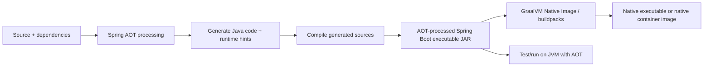
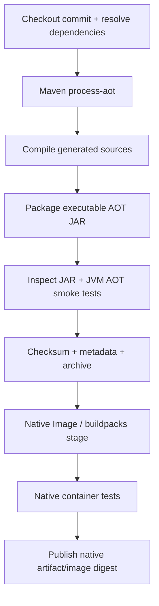

# Spring Boot Executable JAR Containing AOT Results for Downstream Conversion

In the process of creating a **GraalVM Native Image**, a Spring Boot application usually needs a preparation step before compiling into machine code: **Spring AOT (Ahead-of-Time processing)** analyzes configuration, prepares the bean graph, and generates the required Java code and metadata. These results can be compiled and packaged alongside the application into an **AOT-processed Spring Boot executable JAR**. The JAR is a convenient intermediate artifact to inspect, archive, or hand off to the downstream native build step.

Important to remember: **an executable JAR still contains Java bytecode and still runs on the JVM**. The AOT results inside the JAR help Spring initialize the container along a pre-computed path and provide metadata for Native Image. It is not yet a native executable. Converting it into a native binary requires GraalVM Native Image or an appropriate buildpacks/native build pipeline.

## 1. Learning Objectives

After this lesson, you will be able to:

- Explain how an AOT-processed executable JAR differs from a standard Spring Boot JAR and a native executable.
- Configure Maven to run Spring AOT in the build pipeline and package the results into the JAR.
- Identify key components inside an executable JAR such as `BOOT-INF/classes`, `BOOT-INF/lib`, the manifest, and native-image metadata.
- Inspect the JAR with `jar tf`, `unzip`, or equivalent tools, confirming generated code and resources were packaged.
- Run and test the AOT artifact on the JVM when needed, while understanding the constraints of the build-time profile and configuration.
- Hand off the right artifact along with build metadata to the downstream Native Image step, avoiding confusing a JAR with a native binary.

## 2. Role of the Executable JAR in the Native Image Pipeline

A typical pipeline can be divided into stages:



Each stage produces a distinct kind of output:

| Stage | Artifact / Output | Purpose |
| --- | --- | --- |
| Application compilation | Java classes / bytecode | Produces application classes and dependencies |
| Spring AOT | Generated Java sources, generated resources, runtime hints | Prepares container structure and dynamic access metadata |
| Compile and package | AOT-processed executable JAR | Bundles application classes, AOT code, resources, and runtime libraries |
| Native Image compilation | Native executable | Performs reachability analysis and generates machine code for the target platform |
| Container packaging | Native OCI image | Packages the executable along with required runtime layers |

**Not every pipeline requires using an executable JAR as the direct input to the native compiler.** Some plugins consume compiled classes and metadata from the build directory; buildpacks can accept the JAR as the application artifact and then execute downstream steps. The role of the JAR here is a packaged artifact that can be inspected and handed off; how native tooling consumes it depends on the Maven plugin, Native Build Tools, or buildpacks in use.

## 3. How Do a Standard JAR and an AOT-Processed JAR Differ?

A standard Spring Boot JAR contains application bytecode, runtime libraries, and packaging metadata. At runtime, Spring typically discovers configuration, evaluates conditions, and prepares the bean factory during startup.

With AOT, the build performs an extra step analyzing Spring configuration. Outputs can include:

- Generated Java classes for registering beans and preparing container initialization.
- Generated code compiled into bytecode and bundled into the artifact.
- Runtime hints for reflection, resources, proxies, serialization, or accesses Native Image must know ahead of time.
- Metadata/resources created during AOT that must be present on the classpath.

| Aspect | Standard Executable JAR | AOT-Processed Executable JAR |
| --- | --- | --- |
| Application bytecode | Yes | Yes |
| Runtime dependencies | Yes | Yes |
| Generated AOT classes | Usually no | Yes, if AOT processing ran and outputs were packaged |
| Native-image hints/metadata | May come from libraries or manual config | May additionally come from Spring AOT and extensions |
| How bean graph is prepared | Primarily standard runtime mechanisms | Uses an initialization path prepared at build time |
| Is it a native executable? | No | No |
| Needs JVM when running the JAR? | Yes | Yes |
| Can it serve as a Native Image prep step? | Requires running AOT separately if workflow demands | Yes, per configured toolchain workflow |

**An AOT-processed JAR can still be run on the JVM.** Application Java methods still execute on the JVM and JIT can still compile hot code while the application runs. Spring AOT prepares framework structure ahead of time; it does not replace JIT entirely nor compile all application bytecode to native machine code.

## 4. Configuring Maven to Run Spring AOT and Package the JAR

### 4.1. Declaring the Spring Boot Maven Plugin

In `pom.xml`, the project needs `spring-boot-maven-plugin` compatible with its Spring Boot version. You can configure an execution for the `process-aot` goal inside a dedicated Maven profile:

```xml
<profiles>
    <profile>
        <id>aot</id>
        <build>
            <plugins>
                <plugin>
                    <groupId>org.springframework.boot</groupId>
                    <artifactId>spring-boot-maven-plugin</artifactId>
                    <executions>
                        <execution>
                            <id>process-aot</id>
                            <goals>
                                <goal>process-aot</goal>
                            </goals>
                        </execution>
                    </executions>
                </plugin>
            </plugins>
        </build>
    </profile>
</profiles>
```

`aot` is a project-chosen profile name, not a built-in default profile across all applications. If the project already declares Spring Boot Maven Plugin under `<build><plugins>`, add the execution to the existing configuration rather than duplicating the plugin declaration.

The `process-aot` goal requires the application to be instantiable in the build environment so Spring can analyze configuration. Plugin version, Maven lifecycle binding, and accompanying native plugins must follow the configuration for your Spring Boot version. In projects that already have a `native` profile, you can place the AOT execution in that profile or invoke a separate profile matching your project's workflow.

### 4.2. Running AOT and Packaging

With the example profile above:

```bash
./mvnw -Paot clean package
```

This command tells Maven to activate the `aot` profile and execute the `package` lifecycle. In the logs, verify that the `process-aot` goal is actually invoked, generated classes/resources are compiled, and the packaging step produces the executable JAR.

If you only run:

```bash
./mvnw clean package
```

you must not assume the output includes AOT. That is only true if the project configured an AOT execution bound to the default lifecycle or active profile.

The JAR location is typically:

```text
target/<artifactId>-<version>.jar
```

The actual filename depends on `artifactId`, `version`, `finalName`, and Maven configuration. In a multi-module project, identify the exact module containing the Spring Boot application and the exact artifact packaged.

### 4.3. Conditional Configuration and Profiles During AOT

Spring AOT analyzes configuration in the build environment. Factors affecting the bean graph can include:

- `@Profile` and which profiles are active during AOT processing.
- `@ConditionalOnProperty` and property conditions.
- `@ConditionalOnClass`, the classpath, and dependency versions.
- `@ConditionalOnBean` / `@ConditionalOnMissingBean`.
- `@Import` configurations, component scanning, and auto-configuration.

For example, if bean `AuditService` is only registered when `feature.audit.enabled=true` during AOT processing, changing this property when running the JAR does not automatically create a new bean. Manage values that govern container structure as part of the build recipe.

Not every runtime property is frozen. Operational values like endpoints, timeouts, or credentials can be supplied at runtime if the code reads them at runtime and they do not alter the prepared bean graph. Distinguish **structural properties** from **operational configuration properties**.

### 4.4. Example Invoking AOT via an Existing `native` Profile

Many projects use a `native` profile to bundle Spring AOT and GraalVM Native Build Tools settings. In that case the command might be:

```bash
./mvnw -Pnative clean package
```

Only use this command if your project's `native` profile actually declares the AOT execution and appropriate lifecycle. There is no universal built-in Maven profile named `native` applied automatically to every project.

If your goal is solely to build an AOT-processed executable JAR for handoff, make sure the lifecycle does not force the native compiler to run during `package`. You can separate `aot-jar` and `native` profiles as needed: the former produces the intermediate JAR, while the latter runs native compilation or container builds.

## 5. Typical Contents Inside an Executable JAR

A Spring Boot executable JAR uses a nested JAR structure. Abbreviated example:

```text
application.jar
├── META-INF/
│   └── MANIFEST.MF
└── BOOT-INF/
    ├── classes/
    │   ├── com/example/Application.class
    │   ├── com/example/...
    │   ├── <generated AOT classes>
    │   └── META-INF/
    │       └── native-image/
    │           └── <generated hints and metadata>
    ├── lib/
    │   ├── spring-boot-*.jar
    │   ├── spring-context-*.jar
    │   └── <application dependencies>.jar
    ├── classpath.idx
    └── layers.idx
```

This is an illustrative diagram; **subdirectory names, generated classes, metadata, and index files vary by Spring Boot, plugin, and dependency versions**. Do not rely on a specific generated class name as a stable contract.

### 5.1. `META-INF/MANIFEST.MF`

An executable JAR's manifest typically points to the launcher and application class:

```text
Manifest-Version: 1.0
Main-Class: org.springframework.boot.loader.launch.JarLauncher
Start-Class: com.example.Application
```

This is an example from one generation of the Spring Boot loader; launcher package names can differ across versions. `Main-Class` points to the Spring Boot loader entry point; `Start-Class` is the application class. When a JAR has undergone AOT processing, the manifest still serves normal executable JAR execution.

### 5.2. `BOOT-INF/classes`

This is where application classes and resources reside. When AOT processing is configured and outputs are properly packaged, it may contain:

- Bytecode of classes written by developers.
- Bytecode of Java classes generated by Spring AOT after compilation.
- Metadata and resources generated by AOT or extensions.
- Application config/resources packaged per Spring Boot rules.

Generated classes typically handle bean registration, wiring, and preparing the application context. They are **Java bytecode** inside the JAR—not native machine code.

### 5.3. `BOOT-INF/lib`

This directory holds runtime dependencies packaged as nested JARs, such as Spring Framework, logging, JDBC drivers, and application libraries. These libraries remain necessary when running the executable JAR on the JVM.

When transitioning to Native Image, the toolchain analyzes application classes and dependencies to determine reachable code. Not every dependency in `BOOT-INF/lib` is guaranteed to remain intact in the native binary; GraalVM can strip unreachable code based on analysis and metadata.

### 5.4. `META-INF/native-image` and Runtime Hints

Native image metadata can describe reflection, resource, proxy, serialization, or JNI needs. Common filenames in the GraalVM ecosystem include:

| Metadata | Meaning |
| --- | --- |
| `reflect-config.json` | Types/members requiring reflection access |
| `resource-config.json` | Resource patterns to include in the image |
| `proxy-config.json` | Dynamic proxy definitions |
| `serialization-config.json` | Types requiring serialization support |
| `jni-config.json` | Elements accessed via JNI |

Spring AOT and libraries may provide hints in different locations or use newer metadata mechanisms depending on the GraalVM version. Therefore, this table helps identify information categories rather than claiming every JAR contains all five files. If a specific JSON file is not visible, you cannot immediately conclude hints are missing; inspect AOT outputs, plugin behavior, and merged metadata in the build.

## 6. Inspecting the JAR After Packaging

### 6.1. Checking the File and Contents

Locate the generated artifact:

```bash
ls -lh target/*.jar
```

On Windows PowerShell you can use:

```powershell
Get-ChildItem target -Filter *.jar
```

List JAR contents:

```bash
jar tf target/application.jar
```

Filter areas of interest on Linux/macOS:

```bash
jar tf target/application.jar | grep -E 'BOOT-INF/classes|BOOT-INF/lib|META-INF/native-image'
```

On Windows PowerShell:

```powershell
jar tf target/application.jar | Select-String 'BOOT-INF/classes|BOOT-INF/lib|META-INF/native-image'
```

`application.jar` is just an example; replace it with the actual filename. Do not grep only for `META-INF/native-image` and assume all AOT outputs are present. Also inspect generated classes, AOT goal logs, and compilation results.

### 6.2. Inspecting the Manifest

On Linux/macOS you can read the manifest directly:

```bash
unzip -p target/application.jar META-INF/MANIFEST.MF
```

Or extract the JAR into a temporary directory and read the manifest file. Confirm it is an executable Spring Boot JAR with the proper launcher and main class.

### 6.3. Inspecting Generated Classes and AOT Outputs

During the build, the Spring Boot Maven Plugin usually places AOT outputs inside a subdirectory under `target/spring-aot/`; exact structure depends on the version. Inspect Maven logs for actual output paths and verify:

1. AOT processing ran.
2. Expected generated sources/resources exist.
3. Generated Java code was compiled into classes.
4. Relevant classes/resources were included in the executable JAR.
5. Necessary runtime hints are retained in the artifact or recognized by the native toolchain via the corresponding mechanism.

If you see generated sources without generated classes in the JAR, the compile/package step may be misconfigured. Do not manually copy the generated folder into the JAR without understanding the lifecycle; fix the plugin configuration so outputs are processed properly.

## 7. Testing the AOT-Processed Executable JAR on the JVM

An AOT-processed JAR is still a Java artifact. When you want to test the AOT code path on the JVM, Spring Boot supports enabling AOT mode at runtime via a property:

```bash
java -Dspring.aot.enabled=true -jar target/application.jar
```

This property instructs Spring to use the prepared AOT components. If omitted, the application may follow the standard initialization path depending on configuration/version; therefore, check logs and behavior of the exact artifact.

If the application uses profiles that affect the bean graph, run with configuration matching the AOT environment used at build time:

```bash
java \
  -Dspring.aot.enabled=true \
  -Dspring.profiles.active=prod \
  -jar target/application.jar
```

This example is valid only if `prod` was the profile accounted for during AOT. Do not assume you can switch to an unprocessed profile and expect Spring to rebuild the entire bean graph.

Minimum verification checks:

- The application starts up and reaches readiness.
- Key beans are registered and dependency injection works.
- HTTP endpoints and primary business flows return correct results.
- Serialization/JSON binding, resources, database, and TLS work if used by the project.
- Logs do not show the application falling back to an unexpected initialization path or missing generated components.

### An AOT JAR Still Uses JIT

When running on the JVM, Java methods are still executed by the JVM. JIT can compile hot code based on runtime profiling data. Spring AOT reduces framework analysis/initialization work; it does not disable JIT and does not convert all bytecode into machine code ahead of runtime.

## 8. Handing Off the JAR to the Downstream Native Image Step

Once the AOT-processed JAR is verified, hand it off together with build metadata so the native compilation step can reproduce results cleanly.

### 8.1. Artifact Metadata to Record

| Attribute | Example / Information to Record |
| --- | --- |
| Artifact name | `order-service-1.0.0.jar` |
| SHA-256 | Checksum of the exact tested JAR file |
| Commit | Commit SHA that produced the artifact |
| Java/Spring | JDK, Spring Boot, and Spring Framework versions |
| Maven | Maven Wrapper/Maven version, plugin version |
| AOT | Profile, properties, active conditions, and AOT outputs |
| Dependencies | Dependency tree/lock and repository provenance if any |
| Downstream build platform | OS, architecture, GraalVM/Native Image version |
| Test evidence | JVM AOT smoke test and integration test results |

Example generating a checksum on Linux/macOS:

```bash
sha256sum target/application.jar
```

On PowerShell:

```powershell
Get-FileHash target/application.jar -Algorithm SHA256
```

The checksum confirms that the file used in the downstream step is the exact artifact built and tested. Filename and version in the path alone are not enough to prove identical contents.

### 8.2. What Does Native Compilation Consume?

In the next step, GraalVM Native Image needs application code, dependency bytecode, AOT generated classes, and native metadata. Depending on the pipeline:

- Native Build Tools can consume compiled classes from Maven's build directory together with the runtime classpath.
- Spring Boot buildpacks can accept the executable JAR, analyze and prepare application layers, and run the native build inside a builder.
- A custom pipeline can unpack/prepare the classpath from the JAR, provided it preserves dependencies and metadata accurately.

Therefore, **do not assume the raw command `native-image -jar application.jar` is the standard way to convert any Spring Boot executable JAR into a native binary**. A Spring Boot JAR is a nested executable archive; Native Image needs integration that properly handles the launcher, classpath, AOT metadata, and Spring hints. Use compatible Native Build Tools / Spring Boot plugins / buildpacks or the workflow documented for your project version.

### 8.3. Differences Between an AOT JAR and a Native Executable

| Characteristic | AOT Executable JAR | Native Executable |
| --- | --- | --- |
| Format | ZIP/JAR containing bytecode and nested dependencies | Machine code for OS/architecture |
| How to run | `java -jar app.jar` | Execute binary directly |
| JVM/JRE | Required | Typically no JVM required |
| AOT generated classes | May reside in `BOOT-INF/classes` | Used during analysis/compilation, not executed as class files |
| Runtime hints | Packaged or supplied to the native toolchain | Already consumed to produce the executable; not necessarily retained as JSON files |
| Platform compatibility | JAR can run on compatible JVMs across multiple OS/CPUs | Binary is tied to the target platform |
| JIT | Present when running on JVM | No HotSpot JIT in the standard JVM sense |

The JAR is an intermediate artifact that can be archived and handed off. The native executable is the output of the subsequent conversion step.

## 9. Troubleshooting

### 9.1. Build Succeeds but JAR Lacks AOT

**Symptom:** `jar tf` shows only ordinary application classes/dependencies; no signs of generated AOT classes, and Maven logs do not show `process-aot` running.

**Cause:** profile not activated, execution not declared, AOT goal not bound to the right lifecycle, or compile/package steps did not include generated outputs in the artifact.

**Resolution:**

1. Run Maven with the intended profile and enable sufficiently verbose logging to see invoked goals.
2. Inspect `spring-boot-maven-plugin` execution and lifecycle configuration for the version in use.
3. Check where AOT outputs are created and whether they are compiled.
4. Inspect the JAR after packaging, not just the generated source directory.
5. Run a clean build and verify the new checksum/artifact.

### 9.2. JAR Runs Normally but Fails When Enabling AOT

**Symptom:** `java -jar` works, but adding `-Dspring.aot.enabled=true` reports missing beans or initialization errors.

**Possible causes:** AOT profile/properties differ from runtime config, beans registered dynamically, custom registrar/post-processor lacks AOT support, or incomplete generated output.

**Resolution:** identify the missing bean, build-time conditions, active profile, classpath, and related extension points; then fix configuration or AOT contributions accordingly and rebuild. Do not try to patch structural bean errors by adding reflection hints if the root issue is that the bean was never registered.

### 9.3. JAR Has AOT but Native Build Reports Missing Reflection/Resources

**Symptom:** JVM AOT smoke tests pass, but Native Image hits reflection, serialization, proxy, or resource errors.

**Cause:** code or libraries perform dynamic accesses not fully described by metadata/hints, or a resource was not included in the native image.

**Resolution:** inspect the native-image build report/log, add appropriate Spring Runtime Hints or metadata, re-run native compilation, and test the binary. An AOT-processed JAR does not guarantee the native compiler infers every dynamic access.

### 9.4. Native Build Uses a Stale Artifact

**Symptom:** source or AOT configuration changed, yet the native binary does not reflect the change.

**Cause:** pipeline picked up the wrong JAR, stale cache, mutable tag, or artifact from another module.

**Resolution:** run a clean build when needed, verify artifact paths, record SHA-256, use immutable versions/tags, and validate digests in the native compilation stage. In multi-module Maven builds, confirm the right module ran AOT and produced the executable JAR.

### 9.5. Running the JAR Reports Missing Main Class or Dependencies

**Cause:** using a plain JAR instead of an executable Spring Boot JAR, repackage configuration did not run, or nested dependencies are missing from the artifact.

**Resolution:** check `META-INF/MANIFEST.MF`, `Main-Class`/`Start-Class`, `BOOT-INF/lib`, and the Maven `repackage` goal. Run the exact artifact created by the Spring Boot plugin.

## 10. Recommended CI/CD Workflow



In the pipeline, separate:

- **AOT JAR job:** builds and archives the executable JAR along with checksum, commit, and build config.
- **Native build job:** retrieves the exact JAR or compiled outputs required by the toolchain, running Native Image/buildpacks on the appropriate platform.
- **Native test job:** runs the actual executable/container, validating endpoints, reflection/resources, database/TLS, and readiness.
- **Publish job:** publishes only tested artifacts; records image digest and provenance info.

If you only want to produce a native container image directly using Spring Boot buildpacks, you can use `spring-boot:build-image` with native mode configured. When you need an intermediate artifact that can be archived and reused independently, an AOT executable JAR is a separate build product useful for handoff and investigation.

## 11. Comprehensive Practice Exercise

**Context:** the Maven project `order-service` uses Spring Boot, exposes HTTP endpoints, and includes a bean active only under the `prod` profile. The goal is to build an executable JAR containing AOT outputs for the downstream native build step.

1. Verify Maven Wrapper, JDK, and Spring Boot plugin version.
2. Create an `aot` profile (or use an existing native profile) to invoke the `process-aot` goal in the appropriate lifecycle.
3. Run `./mvnw -Paot clean package`; observe logs confirming AOT processing and compilation of generated sources.
4. Locate the JAR in `target/`; use `jar tf` to inspect `BOOT-INF/classes`, `BOOT-INF/lib`, generated classes, and related metadata.
5. Inspect `META-INF/MANIFEST.MF` and confirm this is an executable Spring Boot JAR.
6. Run `java -Dspring.aot.enabled=true -Dspring.profiles.active=prod -jar target/order-service-1.0.0.jar` if `prod` was the profile used during AOT; test readiness and business flows.
7. Generate the SHA-256 checksum, record the commit and AOT config, and hand off the exact JAR to the downstream Native Image step.
8. In the native build step, use compatible toolchains/plugins/buildpacks and test the binary/container on the target platform.

**Self-check question:** Why does a JAR containing generated AOT classes and `META-INF/native-image` still require a JVM when run with `java -jar`? Because those components are still Java bytecode and metadata; they prepare the Spring container and support native compilation, but are not yet operating system machine code.

## 12. Key Takeaways

- Spring AOT analyzes configuration and generates code/metadata at build time; generated code must be compiled and packaged to become part of the executable JAR.
- An AOT-processed executable JAR contains bytecode, generated classes, runtime dependencies, and related metadata. **It is still a Java JAR**, not a native executable.
- Maven must invoke `spring-boot:process-aot` in the appropriate profile/lifecycle before packaging; do not assume every `mvn package` command creates an AOT artifact.
- Inspect `BOOT-INF/classes`, `BOOT-INF/lib`, the manifest, generated classes, and native metadata to confirm the artifact was produced properly.
- Profile/property conditions affecting the bean graph must remain consistent between build and runtime; runtime hints support dynamic accesses but do not register missing beans.
- The downstream Native Image step consumes the classpath, generated code, and metadata via Native Build Tools or appropriate buildpacks; do not assume invoking raw `native-image -jar` works for every Spring Boot executable JAR.
- Record checksums, commits, toolchain versions, AOT configuration, and test evidence to ensure the right artifact advances to the native stage.

Once you produce an inspectable and reproducible AOT executable JAR, you establish a clean artifact boundary between **preparing the Spring application** and **compiling into a native executable**. This forms the foundation for making the downstream native build repeatable, traceable, and independently testable.
