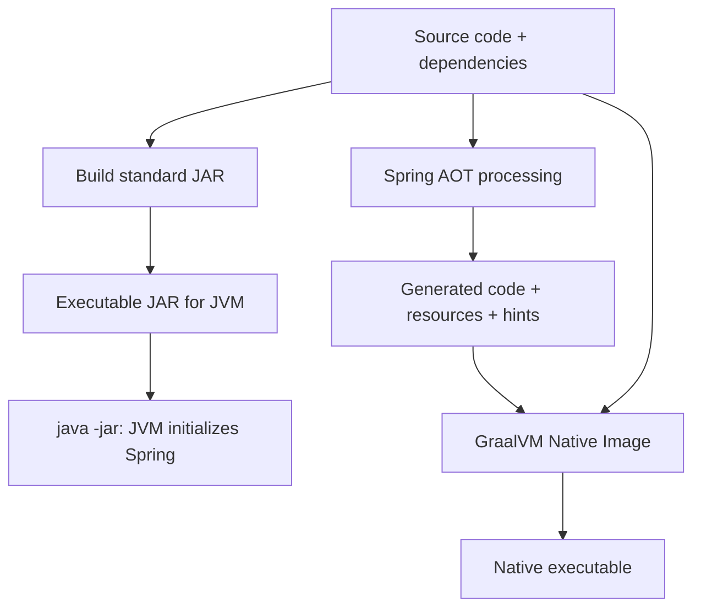
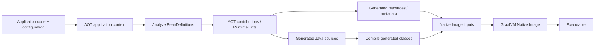

# Limitations of a Standard JAR Without Spring AOT Results

> **Chapter:** Build Artifacts  
> **Module:** `SPRING_BOOT_NATIVE_IMAGE`  
> **Goal:** Distinguish an executable JAR running on the JVM from the Spring AOT outputs required for GraalVM Native Image; understand the limitations of a standard JAR during native compilation, container image creation, and compatibility testing.

## 1. A Runnable JAR Does Not Mean It Went Through Spring AOT

A Spring Boot application is commonly packaged into an **executable JAR**. This file contains the application's bytecode, dependency libraries, and metadata for the Spring Boot Launcher to start the application on the JVM.

Example:

```bash
# Maven
./mvnw clean package

# Gradle
./gradlew clean bootJar

# Run the application on the JVM
java -jar target/native-demo.jar
```

This is a valid JVM artifact. However, if a build only runs `package` or `bootJar` under standard configuration, you cannot assume Spring AOT ran or that AOT outputs were packaged.

Spring AOT processes the application context at build time. It analyzes bean definitions and configuration, generates determinable initialization code, and aggregates the required resource and runtime hints. These outputs allow GraalVM Native Image to process the Spring application in an environment with constraints on reflection and dynamic discovery.

Distinguish three kinds of outputs:

- **Standard JAR:** bytecode and dependencies for the JVM to run the application using normal mechanisms.
- **AOT output:** generated sources/classes, resources, and metadata from Spring AOT processing.
- **Native executable:** machine-code file produced by GraalVM Native Image from the application together with corresponding AOT inputs and metadata.



**The `.jar` extension does not determine whether an artifact contains AOT.** A JAR can be packaged after AOT if the build is configured to include those results in the artifact. This lesson focuses on a standard JAR that **does not yet contain Spring AOT results**.

## 2. What Does a Standard Executable JAR Contain?

Typical structure of a Spring Boot executable JAR:

```text
native-demo.jar
├── META-INF/
│   └── MANIFEST.MF
└── BOOT-INF/
    ├── classes/
    │   ├── com/example/NativeDemoApplication.class
    │   └── application.yml
    └── lib/
        ├── spring-boot-*.jar
        ├── spring-context-*.jar
        ├── spring-web-*.jar
        └── other-dependencies.jar
```

| Component | Role |
|---|---|
| `META-INF/MANIFEST.MF` | Launch metadata, typically specifying the Spring Boot launcher |
| `BOOT-INF/classes` | Application bytecode and resources |
| `BOOT-INF/lib` | Nested dependency JARs |
| `application.yml` | Default configuration bundled with the application |
| Dependency metadata | May contain GraalVM configs or Spring hints supplied by libraries |

The JAR holds enough information for the JVM to load classes, read resources, and initialize Spring. However, this structure **does not automatically generate AOT initialization code for the application context**.

A dependency may contain `META-INF/native-image/...` with the library's own reflection/resource configuration. That helps Native Image, but does not replace AOT code and hints generated from your application's configuration. Likewise, if the JAR contains a `RuntimeHintsRegistrar` class, the presence of that class does not prove the registrar was discovered and executed by Spring AOT.

## 3. What Does Spring AOT Add?

The AOT process analyzes the application context in the build environment and produces outputs usable at runtime or during native compilation. Depending on the Spring Boot version and Maven/Gradle setup, exact directory layouts may vary.

| Output | Purpose |
|---|---|
| **Generated Java sources** | Pre-represents context initialization, bean factory setup, and bean registrations |
| **Generated classes** | Compiled classes from generated code, used in the AOT runtime |
| **Generated resources** | Resources or descriptor files needed for the AOT application |
| **Runtime hints** | Declarations for reflection, resources, proxies, serialization, JNI, or other dynamic access |
| **Build information** | Helps native/buildpack plugins pass the right AOT outputs to compilation |



### 3.1. Generated Code Differs from `RuntimeHints`

Do not treat `RuntimeHints` as the entirety of AOT output.

- **Generated initialization code** describes Spring initialization steps determinable at build time.
- **Reflection hints** help the compiler retain classes/members accessed via reflection.
- **Resource hints** request retaining classpath files needed at runtime.
- **Proxy hints** declare proxy interfaces to be generated.
- **Serialization/JNI hints** declare types or native elements needing support.
- **Dependency metadata** supports native behavior within libraries themselves.

An application may declare a `RuntimeHintsRegistrar` in source or JAR. The registrar only contributes when Spring AOT discovers and invokes it through the corresponding registration mechanism. **Having the registrar class inside the JAR does not mean its hints were aggregated into the native build.**

## 4. Limitations When Using a Standard JAR as Native Image Input

### 4.1. No Generated Spring Initialization Code

A standard JAR can contain original configuration classes, annotations, and `@Bean` methods. Yet without running AOT, the initializers generated from the application context are not guaranteed to be on the native compiler's input classpath.

Native Image does not perform all of Spring AOT on its own just by reading class names and annotations. A proper Spring Boot native workflow requires the corresponding AOT results.

### 4.2. Static Analysis Cannot See Every Dynamic Behavior

Example:

```java
Class<?> type = Class.forName(configuredClassName);
Object instance = type.getDeclaredConstructor().newInstance();
```

If `configuredClassName` only comes from runtime configuration, the compiler may not know that class and constructor must be retained. Without metadata, the binary may build successfully yet fail on the reflection branch at runtime.

Spring AOT and `RuntimeHints` help declare these access paths. They cannot automatically infer arbitrary classes loaded from external data.

### 4.3. Resources May Not Be Retained

An application may read templates, schemas, JSON, certificates, or files by runtime names. A file present in a standard JAR **is not guaranteed** to be included in the native executable. You must declare resource hints or corresponding include configuration, then verify on the binary.

### 4.4. Dependency Metadata Is Not Enough for the Application

Native-friendly libraries may supply their own metadata, but they cannot know all beans, dynamic classes, templates/resources, proxies, or configuration conditions owned by the application.

### 4.5. No Evidence of Build-Time Bean Topology

Spring AOT must process the application context with the right build configuration. A standard JAR without AOT provides no proof that `@Profile`, `@ConditionalOnProperty`, and the bean set were evaluated accurately for the native binary.

Conditions that alter the bean graph are generally decided at build time. Running native with a different profile may not instantiate beans that were absent during AOT processing.

### 4.6. Converting a JAR to a Container Image Does Not Add AOT

Buildpacks can package a JAR into a JVM image. To create a native image, the pipeline needs native mode, AOT inputs, and a compatible toolchain. Switching the command to `spring-boot:build-image`, `bootBuildImage`, or `pack build` does not by itself prove Spring AOT ran.

## 5. Comparing the Three Artifact Types

| Criterion | Standard JAR | AOT-Processed Artifact | Native Executable |
|---|---|---|---|
| Application bytecode | Yes | Yes | Compiled into binary per reachability |
| Run on JVM | Yes | Possible, if packaged and AOT mode enabled appropriately | Does not use `java -jar` |
| Generated Spring AOT classes | Not guaranteed | Yes, if build puts them into artifact/classpath | Consumed during native compilation |
| Generated resources/hints | Not guaranteed | Present per AOT outputs | Used to produce binary/metadata |
| AOT-processed bean model | Not guaranteed | Yes | Part of the build workflow |
| Usable for Spring Boot native workflow | Insufficient if missing AOT outputs | Yes, if toolchain is compatible | Is the native build result |
| Changing source/hints while reusing old artifact | No | Cannot assume; may require re-running AOT/build | Requires rebuild |

**An AOT-processed JAR does not have a different file extension.** It can still be `.jar`. What matters is whether the build pipeline ran AOT and fed the outputs into the right runtime/native inputs.

## 6. Maven Workflow: From Standard JAR to Native Executable

### 6.1. Build Baseline JVM JAR

```bash
./mvnw clean package
java -jar target/native-demo.jar
```

This JAR is suitable for running on the JVM. If the POM does not configure an AOT execution, do not treat `package` as proof that AOT ran.

### 6.2. Run Spring AOT Processing

In a project configured with the Spring Boot Maven Plugin:

```bash
./mvnw spring-boot:process-aot
```

This goal generates AOT outputs. In several common Maven setups, outputs reside under `target/spring-aot/main` with sources, classes, and resources. Paths can vary by plugin version or project configuration; read logs and task configurations rather than hardcoding paths.

This output is an **intermediate result**, not a native executable. Subsequent compilation steps must consume these freshly generated outputs.

### 6.3. Build Native Using Configured Profile

In a project using Spring Boot starter parent and an appropriate `native` profile:

```bash
./mvnw -Pnative native:compile
```

The standard profile usually connects AOT processing with GraalVM Native Build Tools. Check logs to confirm `process-aot` ran and the native compiler received corresponding inputs.

If a custom POM has not wired the native goal to AOT, running `native:compile` alone does not guarantee the complete Spring Boot native workflow.

### 6.4. Create a Container Image in Native Mode

When the native profile and Spring Boot build-image plugin are configured:

```bash
./mvnw -Pnative spring-boot:build-image \
  -Dspring-boot.build-image.imageName=native-demo:local
```

This is the OCI image creation pipeline. Verify builder logs show native compilation actually occurred. If the native profile is not enabled, the same `build-image` goal can produce a JVM image from a standard JAR.

## 7. Gradle Workflow: From Standard JAR to Native Executable

### 7.1. Build Baseline JVM JAR

```bash
./gradlew clean bootJar
```

The artifact typically lands in `build/libs/`. Running `bootJar` alone does not prove AOT processing ran.

### 7.2. Run AOT and Native Compile

In a project applying the Spring Boot Gradle plugin and GraalVM Native Build Tools plugin:

```bash
./gradlew processAot
./gradlew nativeCompile
```

In standard setups, `nativeCompile` normally depends on `processAot`, so running `nativeCompile` can trigger AOT automatically. Invoking `processAot` separately is useful when inspecting intermediate outputs.

Exact paths for generated sources/classes/resources depend on plugin versions and Gradle configuration. Check task outputs and project logs.

### 7.3. Create a Native OCI Image

```bash
./gradlew bootBuildImage
```

When the native plugin and corresponding configuration are applied, the Spring Boot Gradle plugin can coordinate with Buildpacks to produce an image containing a native executable. Without native configuration, `bootBuildImage` can produce a JVM image.

**A task name is not proof of artifact type.** Inspect build logs and run the image to verify.

## 8. Why Does `native-image -jar app.jar` Not Replace Spring AOT?

GraalVM Native Image can accept a JAR or classpath depending on invocation. However, Spring Boot Native Image is a framework-integrated workflow. Spring AOT generates application information that the native compiler requires.

Running:

```bash
native-image -jar target/native-demo.jar
```

does not automatically equate to:

1. Creating the application context at build time.
2. Analyzing bean definitions and configuration conditions.
3. Invoking AOT processors/contributions.
4. Generating initializer code and aggregating `RuntimeHints`.
5. Compiling from proper AOT inputs.

A simple program might compile under GraalVM with manual metadata. However, that does not reproduce the full Spring AOT pipeline. Applications using reflection, proxies, resources, or complex Spring configuration may reveal failures only at runtime.

**Preferred approach:** use plugins/profiles integrating Spring AOT with Native Build Tools or Buildpacks according to your Spring Boot version's guide. If you must invoke `native-image` directly, manage generated outputs, classpath, and equivalent metadata yourself, then test thoroughly.

## 9. How to Verify Whether a JAR Contains AOT Outputs

You cannot conclude solely from the filename. Combine build logs, artifact contents, and runtime behavior.

### 9.1. Inspect JAR Structure

```bash
jar tf target/native-demo.jar
```

On Linux/macOS you can filter:

```bash
jar tf target/native-demo.jar | grep -Ei "BOOT-INF|META-INF/native-image|aot|generated"
```

Normally you will see `BOOT-INF/classes`, `BOOT-INF/lib`, and the manifest. Dependency JARs are nested in `BOOT-INF/lib`, so the command above lists nested JAR filenames without deeply traversing their contents.

A dependency may carry its own `META-INF/native-image`. That is library metadata, not proof the application has AOT initializers or hints.

### 9.2. Inspect AOT Outputs

After `process-aot` or `processAot`, inspect the output directory announced by the task. With Maven, a common location is `target/spring-aot/main`. Look for generated sources, classes, and resources.

Do not hard-rely on specific initializer class names or paths; they can vary across versions. Cross-check file timestamps against the AOT run for the exact commit.

### 9.3. Inspect Pipeline Logs

Look for evidence that:

- Spring AOT processing ran on the application context.
- Generated sources/resources were produced and passed to compilation.
- Native Build Tools or the native buildpack actually ran the compiler.
- The native executable was created successfully.

Merely seeing `package`, `bootJar`, or Buildpacks logs saying "exporting image" is not enough to conclude the application was natively compiled.

### 9.4. Functional Testing Across Artifacts

| Test | Standard JAR on JVM | Native Executable |
|---|---|---|
| Startup | `java -jar` | Run binary directly |
| REST endpoint | Verify JVM application | Verify binary functionality |
| Reflection | JVM can handle dynamically | Needs appropriate hints |
| Resource | JVM classloader reads resource in JAR | Resource must be retained in binary or read from external filesystem |
| Dynamic class loading | More flexible in some cases | Constrained by analyzed/packaged code |
| Profiles altering bean graph | Evaluated on JVM startup | Must match AOT configuration at build time |

A JVM JAR running smoothly does not prove the native binary works too. Integration tests must run against **the native executable itself** or the native container image.

## 10. Error Example: JAR Has Template, Native Fails to Read It

Suppose the application has the file:

```text
src/main/resources/templates/invoice.html
```

JVM code reads the template from the classpath and works normally. Inside a standard JAR, the file sits under `BOOT-INF/classes/templates/invoice.html`.

When creating a native executable, if resource hints are missing or mismatched, the template may not be retained in the binary. The build can succeed, yet invoice generation fails when a user calls it.

Resolution steps:

1. Identify the mechanism and exact path used to read the resource.
2. Use Spring AOT/`RuntimeHints` or GraalVM resource config to declare the resource to retain.
3. Re-run AOT processing and native compilation.
4. Call the invoice generation endpoint on the native executable.
5. If templates must be swapped after deployment, consider reading from the filesystem or external mounts rather than embedding into the binary.

Example registering resource hints:

```java
import org.springframework.aot.hint.RuntimeHints;
import org.springframework.aot.hint.RuntimeHintsRegistrar;
import org.springframework.context.annotation.ImportRuntimeHints;

class InvoiceResourceHints implements RuntimeHintsRegistrar {

    @Override
    public void registerHints(RuntimeHints hints, ClassLoader classLoader) {
        hints.resources().registerPattern("templates/*.html");
    }
}

@ImportRuntimeHints(InvoiceResourceHints.class)
class InvoiceConfiguration {
}
```

This is an illustrative example; packages and configuration layout must match your Spring Framework version. The registrar must be discovered by AOT processing. Merely having the registrar class inside the JAR is not enough.

## 11. Other Limitations to Understand

### A JAR Is Not an Application Context Snapshot

A JAR contains bytecode and resources. It does not store a process heap, does not hold open database connections, and is not a checkpoint of a running Spring context. Spring AOT generates initialization code; it does not serialize the entire runtime state into the JAR.

### AOT Does Not Solve Every Dynamic Behavior

Plugins loaded by arbitrary names, post-deploy classpath changes, runtime bytecode generation, or undeclared proxies may require redesign. AOT and `RuntimeHints` only support behaviors that can be determined or declared appropriately ahead of build time.

### A Passing Build Does Not Prove Compatibility

The native compiler does not necessarily know every branch invoked in production. Test reflection, serialization, resources, TLS, JDBC, JSON binding, dynamic proxies, and critical configuration branches.

### Standard JARs Still Have Value

A JVM JAR remains a useful artifact to:

- Develop and run the application on the JVM.
- Serve as a baseline comparing startup, RSS, throughput, and latency.
- Inspect classpath/dependencies and run integration tests.
- Distribute the application when systems do not need a native executable.

Keeping a baseline JAR provides a reliable control for benchmarking Native Image. Just distinguish each artifact's purpose clearly.

## 12. Hands-On Exercise: From Standard JAR to Native Executable

Assume the project exposes `/actuator/health` or an equivalent health endpoint.

**Step 1 — Build the baseline JVM JAR:**

```bash
./mvnw clean package
java -jar target/native-demo.jar
```

Confirm the application starts and the health endpoint returns the expected status. Record the commit, JDK, and configuration.

**Step 2 — Inspect the JAR:**

```bash
jar tf target/native-demo.jar
```

Note `BOOT-INF/classes`, `BOOT-INF/lib`, the manifest, and existing metadata. Do not assume AOT ran just because you see native metadata inside a dependency.

**Step 3 — Run AOT:**

Maven:

```bash
./mvnw spring-boot:process-aot
```

Gradle:

```bash
./gradlew processAot
```

Check logs and generated outputs. If the native plugin has already wired tasks properly, native compile may run AOT automatically; no need to repeat unless inspecting outputs.

**Step 4 — Build the native executable:**

Maven:

```bash
./mvnw -Pnative native:compile
```

Gradle:

```bash
./gradlew nativeCompile
```

Run the newly created binary and call the health endpoint.

**Step 5 — Test critical functionality:**

Run the same integration tests against the JVM JAR and native executable. Prioritize branches using reflection, JSON binding, serialization, resources, TLS, and databases. A health endpoint only proves basic startup, not full feature compatibility.

**Step 6 — Create a container image if needed:**

Use a Dockerfile packaging the executable or configured Buildpacks native mode. Inspect logs to confirm AOT processing and native compilation actually took place.

**Step 7 — Record results:**

| Artifact | Build Command | How to Run | Purpose |
|---|---|---|---|
| Standard JAR | `mvn package` / `gradle bootJar` | JVM | Baseline |
| AOT output | `process-aot` / `processAot` | Input to AOT/native pipeline | Generated sources/classes/resources/hints |
| Native executable | `native:compile` / `nativeCompile` | Run directly | Native compatibility, startup, memory |
| Native OCI image | `build-image` / `bootBuildImage` in native mode | Container runtime | Packaging and operations |

## 13. Artifact Verification Checklist

- [ ] Identified whether the JAR is a standard JVM JAR or an artifact packaged after AOT.
- [ ] Reviewed the task graph and build logs to confirm `process-aot`/`processAot` ran.
- [ ] Inspected generated sources/classes/resources and know the output path of your plugin.
- [ ] Verified application `RuntimeHints` were discovered and aggregated.
- [ ] Avoided confusing dependency native metadata with application AOT outputs.
- [ ] Native compiler ran and produced an executable for the target OS/CPU.
- [ ] Binary was executed and integration-tested on the native artifact itself.
- [ ] Tested reflection, resources, proxies, serialization, TLS, and database if used by the app.
- [ ] Profiles/conditionals affecting bean topology were selected correctly at build time.
- [ ] If creating an OCI image, verified the image runs the native executable rather than a JVM launcher.
- [ ] Kept the JVM JAR as a baseline for fair comparison.

## 14. Key Takeaways

A **standard JAR without Spring AOT results** is a valid JVM artifact, yet it does not automatically carry all the initialization code and metadata required by Spring Boot Native Image. Bytecode, annotations, resources, and dependency metadata are important inputs; they do not replace Spring AOT analyzing the application context, generating initializers, and aggregating `RuntimeHints` for the application.

Look at **the process that created the artifact**, not just the file extension: a standard JAR comes from `package`/`bootJar`; AOT outputs come from `process-aot`/`processAot`; a native executable comes from `native:compile`/`nativeCompile`; a native OCI image requires a compatible Buildpacks/Docker pipeline. Ultimately, only testing the native executable itself confirms that reflection, resource, and business branches work in the deployment environment.

### References

- [Spring Boot Reference — Ahead-of-Time Processing](https://docs.spring.io/spring-boot/reference/packaging/aot.html)
- [Spring Boot Reference — GraalVM Native Images](https://docs.spring.io/spring-boot/reference/packaging/native-image/introducing-graalvm-native-images.html)
- [Spring Boot Maven Plugin — process-aot](https://docs.spring.io/spring-boot/maven-plugin/process-aot.html)
- [Spring Boot Gradle Plugin — AOT tasks](https://docs.spring.io/spring-boot/gradle-plugin/aot.html)
- [Spring Framework Reference — Ahead of Time Optimizations](https://docs.spring.io/spring-framework/reference/core/aot.html)
- [GraalVM Native Image — Build Overview](https://www.graalvm.org/latest/reference-manual/native-image/)
