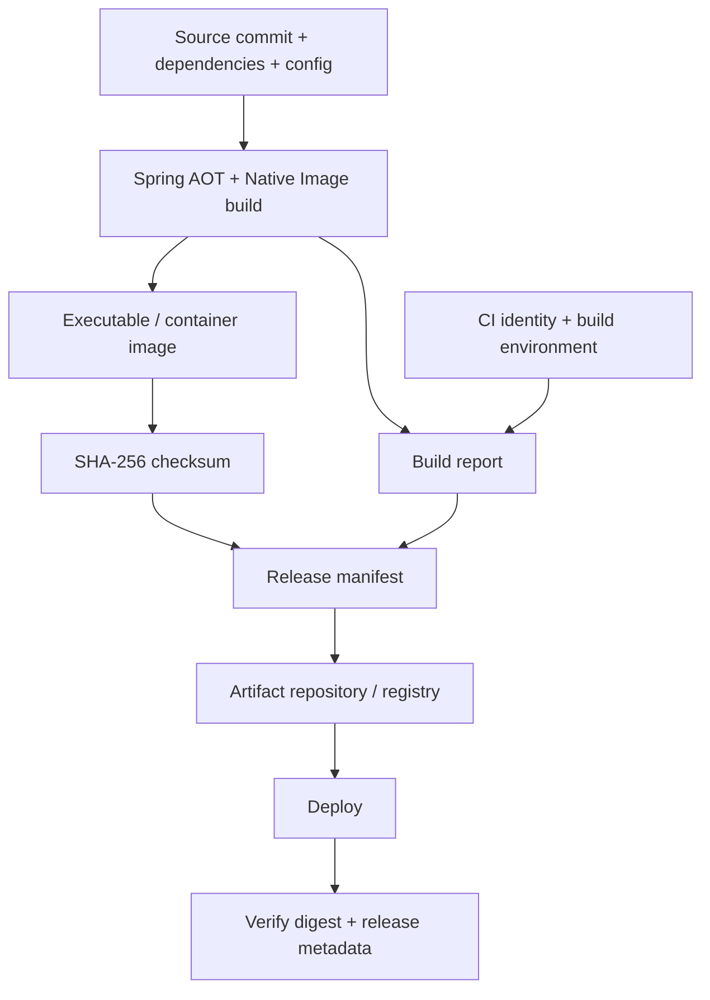

# Managing Checksums, Build Reports, and Artifact Input Traceability

## 1. Why Trace Native Image Artifacts?

A **GraalVM Native Image** build of a Spring Boot application produces a deployment artifact that may be an executable, a container image, or both. When a defect surfaces in production, the team must be able to answer: which commit produced this binary, which JDK/GraalVM and plugin versions were used, which AOT profile was active, which dependencies were included, on which OS/architecture was it built, and was the artifact altered after the build?

Three mechanisms support this:

- **Checksum** establishes a content fingerprint of a file/artifact, detecting modified or wrongly downloaded files.
- **Build report/manifest** records inputs, tools, non-sensitive configuration, outputs, and artifact locations.
- **Provenance/attestation** links the artifact to the build process and source identity, supporting auditing and software supply chain security.

In the **SPRING_BOOT_NATIVE_IMAGE** module, this information helps reproduce Maven/Gradle builds, Spring AOT configs, reflection/resource metadata handling, container packaging, and performance comparisons across native releases. A matching checksum does not prove an application is free of vulnerabilities or built from a trusted source; it only verifies content integrity against an algorithm and checksum source you trust.



## 2. What Is a Checksum and When Is It Used?

A checksum is a hash value computed from the bytes of a file. With SHA-256, identical input bytes yield the same digest; even a tiny change in the file typically yields a completely different digest.

Checksums are useful for:

1. Verifying an artifact was not unexpectedly altered after upload/download.
2. Distinguishing two binaries that share the same filename but differ in content.
3. Cross-checking a file in the build directory against the file stored in an artifact repository.
4. Recording an audit trail in release manifests.

A checksum **is not a digital signature**. If an attacker can alter both the artifact and its accompanying checksum file, they can recompute the checksum. To verify publisher origin, you need a digital signature or attestation signed by a trusted identity, paired with a corresponding verification policy.

### Computing SHA-256

Linux:

```bash
sha256sum build/native/nativeCompile/app
```

macOS:

```bash
shasum -a 256 build/native/nativeCompile/app
```

Windows PowerShell:

```powershell
Get-FileHash .\build\native\nativeCompile\app.exe -Algorithm SHA256
```

Filenames and paths depend on Gradle/Maven configuration, OS, and project structure. Record the algorithm alongside the digest; never record a bare hash string without the filename or algorithm.

Creating a checksum file (Linux):

```bash
sha256sum app > app.sha256
sha256sum -c app.sha256
```

On Windows you can export the digest from `Get-FileHash` into a manifest or use an appropriate checksum utility. When verifying, compare the exact artifact and ensure the checksum file comes from a trusted source.

## 3. Which Artifacts Need Checksums?

A Spring Boot Native Image pipeline can produce multiple outputs:

| Artifact | Contents | Checksum Purpose |
|---|---|---|
| JVM JAR | Bytecode and runtime dependencies | Cross-checking the JVM baseline |
| Native executable | Binary for specific OS/CPU | Verifying the deployed file |
| OCI container image | Image layers and configuration | Using the registry's image digest |
| SBOM | List of software components | Verifying accompanying component inventory |
| Build report/manifest | Metadata of the build run | Ensuring the report binds to the exact release |
| Test report | Test results | Tying test evidence to a specific build |

Do not use a JAR's checksum to verify a native executable; they are two different files. For container images, registries normally provide an **OCI digest** (e.g. `sha256:...`) of the image manifest/index. This digest identifies the referenced OCI object; it differs from a SHA-256 checksum computed on an exported TAR archive.

## 4. What Should a Build Report Record?

A good build report lets others understand how an artifact was produced without guessing from its filename. Recommended fields:

| Category | Fields to Record |
|---|---|
| Identity | Service/module, artifact name, version, build ID |
| Source | Git commit SHA, branch/tag, dirty state |
| Toolchain | JDK/GraalVM/Native Image versions, Maven/Gradle wrapper, plugin versions |
| Build config | OS, architecture, AOT profile, target platform, build task |
| Dependencies | Lockfile/checksums or SBOM, resolved dependency graph |
| Results | Exit code, build duration, test summary, artifact path/size |
| Integrity | SHA-256 of executable/JAR, OCI digest if applicable |
| Provenance | CI workflow/run ID, builder image digest, identity executing build |
| Performance | Startup, RSS, peak build memory, and workload if measured |

Never put secrets, access tokens, passwords, private keys, sensitive environment variable values, or repository credentials into reports. For sensitive settings, log only variable names or safely redacted indicators; never dump the entire environment.

### Example JSON Build Manifest

```json
{
  "service": "SPRING_BOOT_NATIVE_IMAGE",
  "artifact": {
    "name": "quote-service",
    "version": "1.4.0",
    "type": "native-executable",
    "file": "quote-service",
    "sha256": "<sha256-digest>"
  },
  "source": {
    "repository": "example/shop-platform",
    "commit": "<git-commit-sha>",
    "dirty": false
  },
  "build": {
    "tool": "Gradle",
    "task": ":api-app:nativeCompile",
    "java": "<jdk-version>",
    "graalvm": "<graalvm-version>",
    "springBoot": "<spring-boot-version>",
    "os": "linux",
    "architecture": "amd64",
    "aotProfile": "prod"
  },
  "verification": {
    "unitTests": "passed",
    "nativeSmokeTest": "passed"
  }
}
```

Values inside `<...>` are placeholders to replace with real data. This is a project-managed illustrative structure, not a mandatory schema enforced by Gradle, Spring Boot, or GraalVM. You can add timestamps, CI run IDs, image digests, SBOMs, and performance reports as needed.

## 5. Collecting Build Inputs in Gradle

Gradle provides tasks and project properties that a pipeline can capture. A straightforward approach is passing CI metadata as Gradle properties or environment variables, then consuming them in a project script/report task. Avoid guessing versions from filenames or hardcoding values that diverge from the environment.

Example build command:

```bash
./gradlew :api-app:nativeCompile
```

Record at least:

- Project path: `:api-app`.
- Actual task: `:api-app:nativeCompile`.
- Checked-out Git commit.
- Java/GraalVM versions in the build environment.
- Gradle Wrapper version and plugin versions.
- Profiles/properties active when Spring AOT ran.
- OS and architecture of the runner/target.

You can inspect basic details with:

```bash
./gradlew --version
java -version
native-image --version
git rev-parse HEAD
git status --short
```

Commands must run in the exact build environment that produced the artifact. If the Gradle daemon runs with a different JDK than the current shell, `java -version` in the shell is not enough to prove the daemon used that JDK; inspect Gradle daemon/toolchain configuration and task logs.

### Outputs and Checksums

After native compilation succeeds, locate the exact output path configured by the plugin/project. For example, Gradle tasks often create the executable under `build/native/nativeCompile/`, though names and locations can differ. Compute checksums only after the artifact is complete and positively identified.

```bash
sha256sum build/native/nativeCompile/api-app
```

Do not use overly broad wildcards to checksum every file in `build/` and attach the wrong digest to a release. A manifest must clearly link artifact name, path, platform, and digest.

## 6. Maven: Equivalent Build Recording

With Maven, the wrapper pins the Maven distribution per project configuration:

```bash
./mvnw -Pnative native:compile
./mvnw --version
java -version
native-image --version
git rev-parse HEAD
```

The `native` profile is an illustrative configuration; the project must define the appropriate profile and plugins. Record the actual Maven Wrapper, Spring Boot Maven Plugin, Native Build Tools plugin, and GraalVM versions.

Native output paths usually sit in `target/`, yet never assume the filename. Inspect plugin configuration and build logs to obtain the artifact path, then compute the checksum on that exact file.

## 7. Verifying Checksums After Storage and Download

A standard lifecycle:

1. Build the artifact in CI.
2. Compute SHA-256 and store the digest in the report.
3. Upload the artifact and report to trusted storage.
4. Download the artifact into the testing/deployment environment.
5. Recompute the checksum and compare against the digest in the verified report.
6. Proceed with deployment only when the artifact and metadata satisfy policy.

Linux example:

```bash
sha256sum -c app.sha256
```

If it prints `OK`, the file's bytes match the digest in the checksum file. That does not prove the digest came from trusted CI if `app.sha256` could have been modified alongside the artifact.

With Windows PowerShell:

```powershell
$actual = (Get-FileHash .\app.exe -Algorithm SHA256).Hash.ToLower()
$expected = (Get-Content .\app.exe.sha256).Trim().ToLower()
if ($actual -ne $expected) {
    throw "SHA-256 mismatch"
}
```

This snippet assumes the checksum file holds only the digest; if the file format includes a filename, algorithm, or multiple fields, parse it according to that format rather than calling a simple `Trim()`.

## 8. Container Images: Use Digests Instead of Tags Alone

A tag such as `quote-service:1.4.0` is a mutable reference that can be updated. An OCI digest identifies the manifest/index content returned by the registry. When deploying, record the image digest rather than relying on the tag alone.

Example retrieving an image digest after pushing:

```bash
docker push registry.example.com/quote-service:1.4.0
docker inspect --format='{{index .RepoDigests 0}}' registry.example.com/quote-service:1.4.0
```

`RepoDigests` output depends on the registry and image state. With multi-architecture images, a digest may point to a manifest list/index; record the exact platform exercised in tests. Do not manually hash a layer directory and call that an OCI digest.

When building with Cloud Native Buildpacks, the builder image, buildpack versions, and run image also shape the output. For reproducibility, record the builder/run image digests and buildpack identifiers/versions alongside native configuration. The same source commit with a different builder or GraalVM version can yield a different binary.

## 9. What Information Do SBOM and Provenance Add?

An **SBOM (Software Bill of Materials)** enumerates software components inside an artifact or image: dependencies, versions, package identities, and related metadata. It helps audit libraries, licenses, and known vulnerabilities. An SBOM is not a checksum and does not prove which commit built an artifact.

**Provenance** describes the origin and process that created an artifact: source, builder, parameters, workflow, and build identity. Formats such as in-toto Statements and SLSA provenance provide standardized structures binding this information to a subject (artifact).

A trustworthy release can combine:

- Digest of the artifact/image.
- SBOM generated for that exact artifact/image.
- Provenance/attestation bound to the subject digest.
- Signature or publishing identity authenticating the origin.
- Verification policy enforced in the deployment pipeline.

Do not generate reports assuming that simply including a `commit` field establishes verified provenance. To establish trust, sign or issue attestations through controlled CI/identity systems and verify signatures/issuers upon consumption.

## 10. Traceable Performance Comparisons

In Spring Boot Native Image work, checksums and build reports also guarantee that startup/RSS metrics are measured on the exact intended artifact. When running repeated benchmarks, you must know which binary each run measured.

A performance report should include:

- Artifact SHA-256 or OCI digest.
- Source commit and build ID.
- GraalVM/JDK, Spring Boot, and plugin versions.
- OS/CPU architecture and container limits.
- Active profiles and AOT/runtime configuration.
- Workload, concurrency, and warm-up/measurement duration.
- Startup-to-readiness, idle/peak RSS, and latency/throughput.
- Iteration count and aggregation method.

Template:

| Attribute | JVM Artifact | Native Artifact |
|---|---|---|
| Commit | … | … |
| Build ID | … | … |
| Artifact digest | … | … |
| Toolchain | … | … |
| Platform | … | … |
| Startup to readiness | … ms | … ms |
| Idle RSS | … MiB | … MiB |
| Peak RSS under load | … MiB | … MiB |
| p95 latency | … ms | … ms |

This table is a template for empirical measurements. Never conclude native is faster or lighter based solely on digest or artifact type.

## 11. Common Pitfalls

| Symptom | Possible Cause | Resolution |
|---|---|---|
| Checksum differs after download | Corrupted file, wrong artifact, incomplete upload/download | Compare path, size, and digest, and re-download from a trusted source |
| Digest matches but artifact is untrusted | Checksum/report may have been altered alongside artifact | Verify signature/attestation and publisher origin |
| Manifest records wrong commit | CI passed wrong variable or report generated outside build | Bind metadata directly in pipeline and check dirty state |
| Same commit produces different binaries | Different toolchain, dependency, timestamp, environment, or non-reproducible build | Record all tool versions/inputs and check reproducible-build assumptions |
| Image tag points to different content | Mutable tag or registry updated tag | Deploy by digest and verify registry digest |
| SBOM does not match image | SBOM generated from JAR or source rather than final image | Generate/verify SBOM bound to exact image digest |
| Benchmarks hard to compare | Missing artifact digest and load conditions | Attach build report and workload specs to every result |

## 12. Artifact Release Checklist

- Source commit and working tree state are clearly recorded.
- Gradle/Maven Wrapper, JDK/GraalVM, Spring Boot, and plugin versions are recorded.
- Application module, build task, AOT profile, OS, and architecture are specified.
- Artifact path, size, and SHA-256 are saved in the manifest.
- OCI image digest is recorded after push when releasing containers.
- Checksum is verified after download or prior to deployment.
- SBOM and provenance bind to the exact artifact digest when supported by the pipeline.
- Reports contain no secrets or credentials.
- Test reports and benchmarks reference the exact build ID/digest.
- Release policy verifies origin and signatures/attestations when supply-chain assurance is required.

## 13. Self-Check Questions

1. What does a SHA-256 checksum verify, and what can it not prove?
2. Why can a native executable's checksum not replace an OCI image digest?
3. Which fields in a build report are necessary to reproduce a Spring Boot Native Image build?
4. Why is recording only the Git commit insufficient to reproduce a binary?
5. How does an OCI digest differ from a container tag?
6. How do an SBOM, provenance, and checksums complement one another?
7. How do you ensure benchmark numbers remain tied to the exact released executable?

**Takeaway:** checksums verify byte content, build reports record inputs and outputs, and provenance/attestation authenticate the origin and creation process of an artifact. Combining them with test reports and digest-pinned benchmarks makes Spring Boot Native Image artifacts traceable, auditable, and releasable under control.
