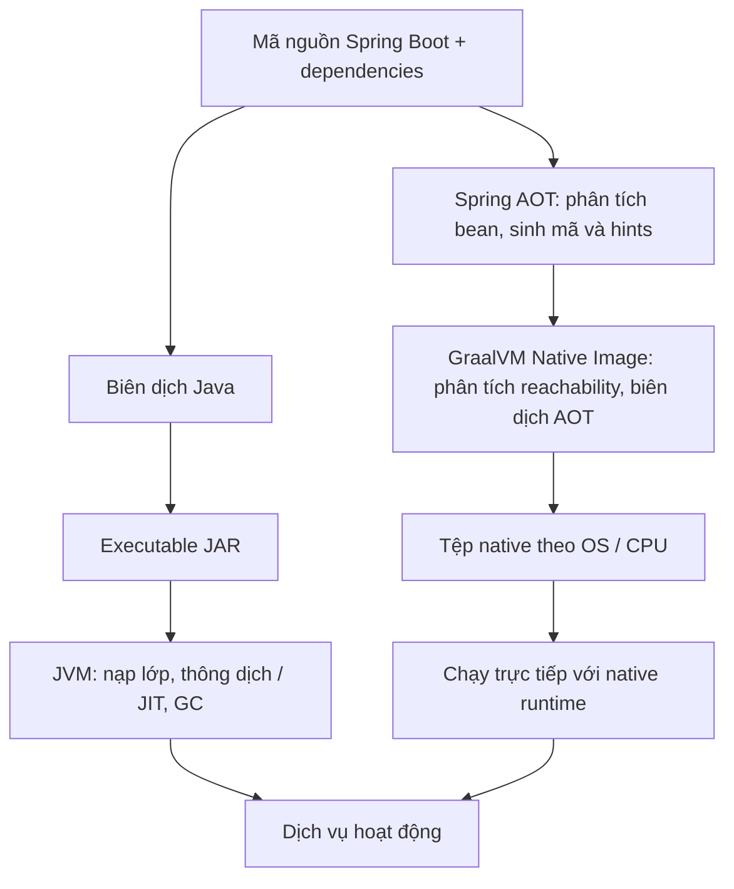

# Phân biệt JAR chạy trên JVM với tệp thực thi native

## Mục tiêu học tập

Sau bài học, bạn có thể:

1. Giải thích vì sao một ứng dụng Spring Boot có thể được đóng gói thành **JAR chạy trên JVM** hoặc **tệp thực thi native** từ cùng mã nguồn.
2. Phân biệt vai trò của JVM/JIT, Spring Ahead-of-Time (Spring AOT) và GraalVM Native Image.
3. So sánh thời gian khởi động, bộ nhớ, hiệu năng khi tải kéo dài, thời gian build, tính tương thích và cách triển khai.
4. Chạy thử hai bản đóng gói bằng Maven/Gradle, đo bằng cùng một kịch bản và lựa chọn phù hợp với hệ thống thực tế.

## 1. Cùng một ứng dụng, hai cách phân phối

Giả sử nhóm phát triển một REST API Spring Boot phục vụ đơn hàng. Ứng dụng dùng Spring Web, Jackson, cấu hình môi trường và có thể kết nối cơ sở dữ liệu. Mục tiêu nghiệp vụ không đổi, nhưng cách ứng dụng **được biên dịch, khởi động và vận hành** khác nhau.

**Bản JAR chạy trên JVM** là gói chứa Java bytecode, tài nguyên, metadata và các dependency cần thiết (đối với Spring Boot executable JAR). Khi chạy `java -jar app.jar`, máy phải có Java runtime tương thích. JVM nạp lớp, quản lý bộ nhớ và có thể biên dịch các đoạn bytecode thường được gọi sang mã máy bằng JIT (*Just-in-Time*).

**Bản GraalVM Native Image** là chương trình mã máy dành cho một hệ điều hành/kiến trúc cụ thể, được tạo ở giai đoạn build. Chạy `./app` trên Linux hoặc `app.exe` trên Windows mà không cần cài thêm JVM để thực thi chương trình đó. Tệp vẫn mang theo các thành phần runtime cần thiết như quản lý bộ nhớ, garbage collection và luồng; từ “native” **không đồng nghĩa** với việc không có runtime hoặc luôn liên kết tĩnh mọi thư viện hệ điều hành.

Sơ đồ đường đi:



> **Điểm cốt lõi:** JAR giữ nhiều quyết định và tối ưu hóa cho thời điểm chạy; Native Image chuyển đáng kể công việc phân tích, tạo mã và biên dịch sang thời điểm build.

### JAR có phải tệp thực thi không?

Tên gọi *Spring Boot executable JAR* nghĩa là JAR chứa cấu trúc, manifest và launcher để khởi động bằng `java -jar`. Bản chất JAR vẫn là một archive có bytecode, không phải chương trình mã máy được hệ điều hành thực thi trực tiếp như GraalVM Native Image. Một số cách đóng gói có thể thêm shell launcher, nhưng điều đó không loại bỏ nhu cầu có Java runtime.

## 2. Bảng so sánh theo vòng đời ứng dụng

| Tiêu chí | Spring Boot JAR trên JVM | Spring Boot Native Image |
|---|---|---|
| Đầu ra build | `.jar` chứa bytecode, thư viện, tài nguyên | Binary mã máy, ví dụ `app` hoặc `app.exe` |
| Lệnh chạy điển hình | `java -jar app.jar` | `./app` hoặc `app.exe` |
| Phụ thuộc Java khi triển khai | Cần JRE/JDK phù hợp hoặc container image có Java runtime | Không cần JVM riêng; vẫn phụ thuộc OS/kiến trúc và có thể phụ thuộc thư viện hệ thống |
| Thời điểm biên dịch mã máy | JVM có thể dùng JIT trong lúc ứng dụng chạy | Phần lớn mã ứng dụng được biên dịch trước khi chạy |
| Phân tích lớp/dependency | Tải và liên kết động linh hoạt tại runtime | Phân tích *closed world* và mã có thể tiếp cận (*reachability*) khi build |
| Khởi động | Thường mất thêm thời gian cho JVM, nạp lớp và thiết lập Spring context | Thường khởi động nhanh hơn đáng kể |
| Bộ nhớ | Có chi phí của JVM, class metadata, JIT, heap và các cấu trúc runtime | Thường có dấu chân bộ nhớ thấp hơn, nhưng phụ thuộc ứng dụng và workload |
| Hiệu năng tải dài | JIT có thể tối ưu các điểm nóng sau khi warm-up; thường là lợi thế khi tải ổn định | Không có quá trình warm-up JIT tương tự; thông lượng/độ trễ không chắc tốt hơn |
| Thời gian và tài nguyên build | Thường nhanh và nhẹ hơn | Phân tích và native compilation có thể tốn nhiều phút, CPU và RAM |
| Tính linh hoạt runtime | Hỗ trợ tốt class loading, reflection và cấu hình động của hệ sinh thái Java | Cần reachability metadata/hints cho các cơ chế động; classpath cố định khi build |
| Phân phối | Một JAR có thể chạy trên nhiều OS/CPU khi có Java runtime tương thích | Phải build đúng nền tảng đích hoặc dùng chuỗi cross-build được hỗ trợ |
| Gỡ lỗi, quan sát | Hệ sinh thái JVM/JFR, heap dump, agent, profiler rất phong phú | Cần xem khả năng hỗ trợ cụ thể của công cụ native; một số JVM agent/công cụ không áp dụng |
| Kịch bản thường phù hợp | Dịch vụ chạy lâu, hệ sinh thái thư viện động/phức tạp, quy trình build cần nhanh | Scale-to-zero, serverless, công việc ngắn hạn, nhiều instance và yêu cầu khởi động nhanh |

Các xu hướng về tốc độ và bộ nhớ là **giả thuyết cần đo**, không phải cam kết cho mọi ứng dụng. So sánh kích thước riêng tệp JAR và binary cũng dễ gây hiểu lầm: hãy so sánh **toàn bộ container image** và footprint runtime trong điều kiện triển khai thực tế.

## 3. Vì sao Native Image thường khởi động nhanh hơn?

### 3.1. JAR: JVM làm việc khi tiến trình khởi động và vận hành

Với bản JAR, sau khi chạy `java -jar`, JVM khởi tạo runtime, nạp các lớp cần thiết, kiểm tra/liên kết bytecode, khởi tạo Spring `ApplicationContext` và xử lý auto-configuration. Khi chương trình chạy, JVM thu thập thông tin thực thi và có thể JIT-compile những đoạn mã nóng để cải thiện hiệu năng. Không phải toàn bộ mã đều cần JIT, và thời gian khởi động cũng chịu ảnh hưởng bởi tác vụ ứng dụng như kết nối database, chạy migration hoặc tải dữ liệu.

### 3.2. Native: Spring AOT và GraalVM làm hai công việc khác nhau

- **Spring AOT** phân tích cấu trúc ứng dụng tại build time, sinh mã để khởi tạo bean, proxy và các *runtime hints* cho reflection, resource, serialization... Điều này giảm nhu cầu suy luận động khi khởi động Spring.
- **GraalVM Native Image** phân tích các nhánh mã có thể được gọi từ điểm vào chương trình, kết hợp metadata để xác định mã và tài nguyên cần đưa vào binary, rồi biên dịch thành mã máy cho nền tảng đích.

Ví dụ, Spring có thể biết trước cách tạo một bean và sinh phương thức khởi tạo trực tiếp, thay vì phải khám phá lại toàn bộ metadata bằng reflection khi chạy. GraalVM tiếp tục quyết định các lớp, phương thức và tài nguyên nào cần hiện diện trong binary.

Đổi lại, Native Image sử dụng giả định **closed world**: những thành phần không thể xác định hoặc chưa được khai báo đúng lúc build có thể không hiện diện khi chạy. Với Spring AOT, tập bean và những điều kiện quyết định tạo bean thường được cố định khi build. Chẳng hạn, thay đổi profile hoặc thuộc tính điều kiện làm thay đổi sơ đồ bean sau khi build có thể không hoạt động như trong bản JVM.

Điều đó **không có nghĩa mọi cấu hình đều bị cố định**. Những giá trị đọc khi chạy như cổng dịch vụ, URL endpoint hay thông tin đăng nhập vẫn có thể lấy từ biến môi trường/tệp cấu hình nếu chúng không đòi hỏi thay đổi cấu trúc bean đã được AOT xử lý.

## 4. Ví dụ: build một REST API theo hai cách

Giả sử dự án có `Spring Boot` và `Spring Web`. Đoạn mã sau dùng chung cho hai bản build:

```java
package com.example.demo;

import java.util.Map;
import org.springframework.boot.SpringApplication;
import org.springframework.boot.autoconfigure.SpringBootApplication;
import org.springframework.web.bind.annotation.GetMapping;
import org.springframework.web.bind.annotation.RestController;

@RestController
@SpringBootApplication
public class DemoApplication {

    @GetMapping("/ping")
    Map<String, String> ping() {
        return Map.of("status", "ok");
    }

    public static void main(String[] args) {
        SpringApplication.run(DemoApplication.class, args);
    }
}
```

Trước khi làm, cần có JDK được phiên bản Spring Boot đang dùng hỗ trợ. Để build native **trên máy local**, cài GraalVM có công cụ `native-image`, bộ biên dịch C và các thư viện phát triển phù hợp hệ điều hành. Dự án phải cấu hình Spring Boot plugin cùng **GraalVM Native Build Tools**; dự án tạo từ Spring Initializr với tùy chọn **GraalVM Native Support** thường đã có phần tích hợp cần thiết. Các lệnh dưới đây dùng Maven/Gradle Wrapper; trên Windows thay `mvnw`/`gradlew` bằng `mvnw.cmd`/`gradlew.bat` và chạy tệp `.exe` tương ứng.

### 4.1. Cách A — JAR trên JVM

Với Maven:

```bash
./mvnw clean package
java -jar target/demo-0.0.1-SNAPSHOT.jar
```

Với Gradle:

```bash
./gradlew clean bootJar
java -jar build/libs/demo-0.0.1-SNAPSHOT.jar
```

Tên JAR là **ví dụ**; cần thay bằng artifact thực tế được tạo trong `target/` hoặc `build/libs/`. Mở `http://localhost:8080/ping` và kiểm tra JSON `{"status":"ok"}`.

### 4.2. Cách B — Native Image

Với Maven sử dụng cấu hình `native` do `spring-boot-starter-parent` và `native-maven-plugin` hỗ trợ:

```bash
./mvnw -Pnative native:compile
# Chạy tệp được tạo trong target/ (tên tệp tùy cấu hình artifact)
./target/demo
```

Với Gradle khi đã áp dụng plugin `org.graalvm.buildtools.native`:

```bash
./gradlew nativeCompile
# Tên tệp có thể thay đổi theo tên dự án
./build/native/nativeCompile/demo
```

Các lệnh `native:compile` và `nativeCompile` chạy chuỗi xử lý Spring AOT và Native Image theo cấu hình plugin. Kiểm tra lại cùng endpoint `/ping`. Binary được build cho hệ điều hành và kiến trúc tương ứng; bản build Linux x86-64 không mặc nhiên chạy được trên Windows hoặc Linux ARM64.

### 4.3. Đóng gói container

Spring Boot tích hợp **Cloud Native Buildpacks** để tạo image chạy JVM hoặc image chứa native executable. Với Maven đã cấu hình plugin:

```bash
# Image chứa ứng dụng JVM
./mvnw spring-boot:build-image

# Image chứa native executable
./mvnw -Pnative spring-boot:build-image
```

Với Gradle, khi plugin GraalVM Native Build Tools được áp dụng, `bootBuildImage` được Spring Boot cấu hình để tạo native image; muốn tạo JVM image cần kiểm tra hoặc tách cấu hình build tương ứng. Cần môi trường build container hoạt động, đủ CPU/RAM và nền tảng image phù hợp.

Không nên kết luận “native luôn có Docker image nhỏ hơn” chỉ từ kích thước binary. Kích thước cuối cùng còn phụ thuộc base image, thư viện hệ thống, tài nguyên được nhúng và cách tạo image.

## 5. Vấn đề tương thích: reflection và resource

Trên JVM, nhiều thư viện có thể tìm tên lớp từ chuỗi, dùng reflection để truy cập constructor hoặc tải một tệp từ classpath vào thời điểm chạy. GraalVM không thể dự đoán mọi tên lớp hoặc đường dẫn resource được tính từ dữ liệu runtime, vì vậy có thể cần khai báo **reachability metadata**.

Ví dụ:

```java
String className = request.getParameter("handler");
Class<?> handlerType = Class.forName(className);
```

Trong bản JAR, một lớp có trên classpath có thể được nạp theo tên tại runtime. Trong bản native, một lớp chỉ được truy cập động nếu các thành phần cần thiết đã được phân tích/đăng ký thích hợp khi build. Trường hợp thiếu metadata có thể dẫn tới lỗi chỉ xuất hiện sau khi native executable đã khởi động.

Trong ứng dụng Spring Boot, có thể bổ sung hints bằng `RuntimeHintsRegistrar`. Ví dụ đăng ký resource được đọc động:

```java
package com.example.demo;

import org.springframework.aot.hint.RuntimeHints;
import org.springframework.aot.hint.RuntimeHintsRegistrar;
import org.springframework.context.annotation.Configuration;
import org.springframework.context.annotation.ImportRuntimeHints;

@Configuration
@ImportRuntimeHints(CatalogResourceHints.class)
class CatalogConfiguration {
}

class CatalogResourceHints implements RuntimeHintsRegistrar {
    @Override
    public void registerHints(RuntimeHints hints, ClassLoader classLoader) {
        hints.resources().registerPattern("catalog/*.json");
    }
}
```

Giả sử `src/main/resources/catalog/` chứa các file JSON cần dùng. Hint trên báo cho quá trình AOT biết mẫu tài nguyên phải được đưa vào native image. Để đọc resource, ưu tiên `getResourceAsStream()` thay vì giả định nó luôn là tệp vật lý có thể truy cập bằng đường dẫn trên disk. Đối với JSON binding, reflection hay serialization, dùng các API hints tương ứng (ví dụ `@RegisterReflectionForBinding`, `RuntimeHintsRegistrar`) theo nhu cầu thực tế; Spring tự suy luận được nhiều trường hợp phổ biến nhưng không phải mọi thư viện tùy biến.

Những khu vực cần kiểm thử kỹ khi chuyển đổi gồm:

- Jackson và các kiểu DTO được phát hiện động; serialization/deserialization.
- Reflection, dynamic proxy, dependency injection theo điều kiện, plugin hoặc class loading.
- File mẫu, resource bundle, cấu hình đọc từ classpath và các tệp phát sinh theo đường dẫn.
- Driver cơ sở dữ liệu, thư viện bảo mật/mã hóa, JNI và thư viện bên thứ ba chưa cung cấp metadata.
- `@Profile`, `@ConditionalOnProperty` và những cấu hình quyết định việc khởi tạo bean giữa các môi trường.

**Cách xử lý:** tái hiện hành vi trên native build, đọc lỗi missing registration/resource, bổ sung hints tối thiểu hoặc nâng cấp thư viện có hỗ trợ Native Image, sau đó kiểm thử lại đường chạy bị ảnh hưởng. Không nên “mở toàn bộ reflection” chỉ để làm lỗi biến mất vì làm mất một phần lợi ích của phân tích tĩnh.

## 6. Đo lợi ích đúng cách: startup, bộ nhớ và throughput

Đề bài của module là đánh giá **thời gian khởi động** và **bộ nhớ**. Để kết luận có ý nghĩa, hãy đo thêm khả năng đáp ứng khi chịu tải, chi phí build và mức độ tương thích.

### 6.1. Xác định các chỉ số

| Chỉ số | Cách hiểu và đo |
|---|---|
| Thời gian sẵn sàng (*time to readiness*) | Từ lúc tạo tiến trình tới lúc endpoint health/readiness trả trạng thái thành công |
| Thời gian khởi động Spring | Thời gian báo trong log `Started ... in ... seconds`; hữu ích nhưng không hoàn toàn trùng thời gian sẵn sàng của tiến trình |
| RSS / bộ nhớ container | Bộ nhớ thực tế của tiến trình/container tại trạng thái idle và dưới cùng mức tải; phân biệt với cấu hình `-Xmx` của JVM |
| P50/P95/P99 latency | Độ trễ ở cùng concurrency, lưu lượng, tập dữ liệu và thời gian chạy |
| Throughput | Số request hoàn thành mỗi giây ở cùng chính sách giới hạn tài nguyên |
| Build time và peak build RAM | Thời gian, CPU và lượng RAM để tạo JAR hoặc native executable; tính vào chi phí CI/CD |
| Kích thước artifact/image | Dung lượng JAR/native binary và container image cuối cùng, ghi riêng từng loại |

### 6.2. Quy trình thực nghiệm đề xuất

1. Dùng **cùng commit, phiên bản Spring Boot, endpoint, database, dữ liệu và cấu hình** cho hai bản. Ghi rõ phiên bản JDK/GraalVM, OS, CPU, RAM và số lượng replica.
2. Build JAR và native theo cấu hình đã xác định; ghi thời gian build. Chạy một phiên bản tại một thời điểm để tránh tranh chấp tài nguyên.
3. Đo từ lúc process bắt đầu đến khi health/readiness thành công. Lặp lại nhiều lần, phân biệt cold start và restart thông thường; dùng median và các phân vị thay cho một lần chạy.
4. Sau khi sẵn sàng, ghi RSS lúc idle. Tạo tải giống nhau lên `/ping` và các endpoint thực tế có JSON, database hoặc I/O; ghi RSS, CPU, throughput và độ trễ.
5. Với JVM, tách số liệu **trước** và **sau warm-up** để không đánh giá thấp hiệu quả JIT. Nếu giới hạn heap/JVM flags, phải ghi rõ; áp dụng giới hạn CPU/RAM container tương đương cho cả hai.
6. Kiểm thử hành vi thực tế: kết nối DB, migration, serialization, resource, TLS, profile/cấu hình, lỗi và khởi động lại. Báo các tính năng chỉ lỗi ở bản native.

Biểu mẫu ghi kết quả (để trống cho đến khi có số đo thật):

| Chỉ số | JAR/JVM | Native | Điều kiện đo |
|---|---:|---:|---|
| Median time to readiness (ms) | … | … | … |
| RSS idle (MiB) | … | … | … |
| RSS ở tải chuẩn (MiB) | … | … | … |
| P95 latency sau warm-up (ms) | … | … | … |
| Throughput (req/s) | … | … | … |
| Build time (s) | … | … | … |
| Container image size (MiB) | … | … | … |

Ví dụ nếu chỉ đo thời gian JVM ghi `Started ...` và so với thời gian chạy binary native qua lệnh `time`, hai số liệu **không cùng định nghĩa**. Hãy dùng cùng phép đo readiness hoặc dùng công cụ quản lý tiến trình/container ghi thời điểm từ start đến health-check thành công.

## 7. Quyết định dùng JAR hay native trong thực tế

**Tình huống A — REST API chạy 24/7, có tải cao và nhiều thư viện động.** Nếu dịch vụ ít restart và cần tận dụng tối ưu hóa JIT khi nóng, JAR/JVM thường là phương án hợp lý để bắt đầu. Native vẫn đáng thử nếu giới hạn RAM, số lượng instance hoặc chi phí scale là vấn đề lớn, nhưng cần benchmark throughput và tương thích thật.

**Tình huống B — Worker xử lý job ngắn, autoscaling mạnh hoặc scale-to-zero.** Mỗi lần có job phải khởi tạo một process. Khởi động nhanh và RSS thấp có thể trực tiếp giảm thời gian chờ và chi phí tài nguyên; native thường là ứng viên tốt. Dù vậy, thời gian kết nối tới database, gọi dịch vụ ngoài hoặc tải dữ liệu có thể lấn át phần startup đã tiết kiệm.

**Tình huống C — Nhiều plugin, mã được tải lúc chạy hoặc profile quyết định bean.** Hãy rà soát tính tương thích trước. Native cần danh sách mã/resource cố định lúc build và các hints phù hợp; một số mô hình mở rộng động cần thiết kế lại hoặc tiếp tục chạy trên JVM.

**Tình huống D — CI/CD build thường xuyên, máy build hạn chế.** Chi phí build native thường cao hơn đáng kể. Nếu lợi ích khởi động/bộ nhớ không đủ lớn so với chi phí pipeline, JAR có thể có tổng chi phí vận hành tốt hơn.

Lưu ý khi triển khai: binary native cần khớp OS/CPU và những thư viện hệ thống liên quan; xây dựng một binary trên máy phát triển không tự bảo đảm chạy trên mọi runtime container. Cả JAR lẫn native đều cần cập nhật dependency và bản vá bảo mật. Với native, các thay đổi ở runtime được biên dịch kèm ứng dụng thường đòi hỏi build lại binary/image để nhận bản vá.

## 8. Tự kiểm tra kiến thức

1. Vì sao gọi Spring Boot JAR là *executable* nhưng vẫn phải dùng `java -jar`?
2. Spring AOT và GraalVM Native Image giải quyết hai phần việc nào khác nhau?
3. Nếu bản native có thời gian startup thấp nhưng P95 latency sau 30 phút tải cao hơn JVM, có thể giải thích bằng yếu tố gì?
4. Vì sao việc thay đổi profile khi khởi động native executable cần được kiểm tra kỹ hơn khi chạy JAR?
5. Một resource JSON được đọc bằng đường dẫn tính từ request không xuất hiện trong native executable. Bạn sẽ điều tra và bổ sung metadata như thế nào?

## Tóm lược

JAR/JVM tận dụng runtime Java linh hoạt và tối ưu hóa JIT khi chạy. GraalVM Native Image cùng Spring AOT chuyển nhiều công việc sang build time để có binary riêng cho nền tảng đích, thường cải thiện khởi động và bộ nhớ, nhưng tăng chi phí build và yêu cầu kiểm soát các hành vi động. **Chọn dựa trên phép đo và bài kiểm thử tương thích trên workload thực tế**, không dựa vào một con số startup hoặc kích thước tệp đơn lẻ.

## Tài liệu tham khảo

- [Spring Boot — Introducing GraalVM Native Images](https://docs.spring.io/spring-boot/reference/packaging/native-image/introducing-graalvm-native-images.html): nguyên lý Spring AOT, khác biệt giữa JVM và native, closed-world.
- [Spring Boot — Developing Your First GraalVM Native Application](https://docs.spring.io/spring-boot/how-to/native-image/developing-your-first-application.html): build bằng Maven/Gradle, local executable và Buildpacks.
- [Spring Boot — Advanced Native Images Topics](https://docs.spring.io/spring-boot/reference/packaging/native-image/advanced-topics.html): runtime hints, resource và các giới hạn tương thích.
- [Spring Boot — Testing GraalVM Native Images](https://docs.spring.io/spring-boot/how-to/native-image/testing-native-applications.html): chạy kiểm thử AOT và native.
- [GraalVM — Reachability Metadata](https://www.graalvm.org/latest/reference-manual/native-image/metadata/): phân tích tĩnh, reflection và tài nguyên cần đăng ký.
