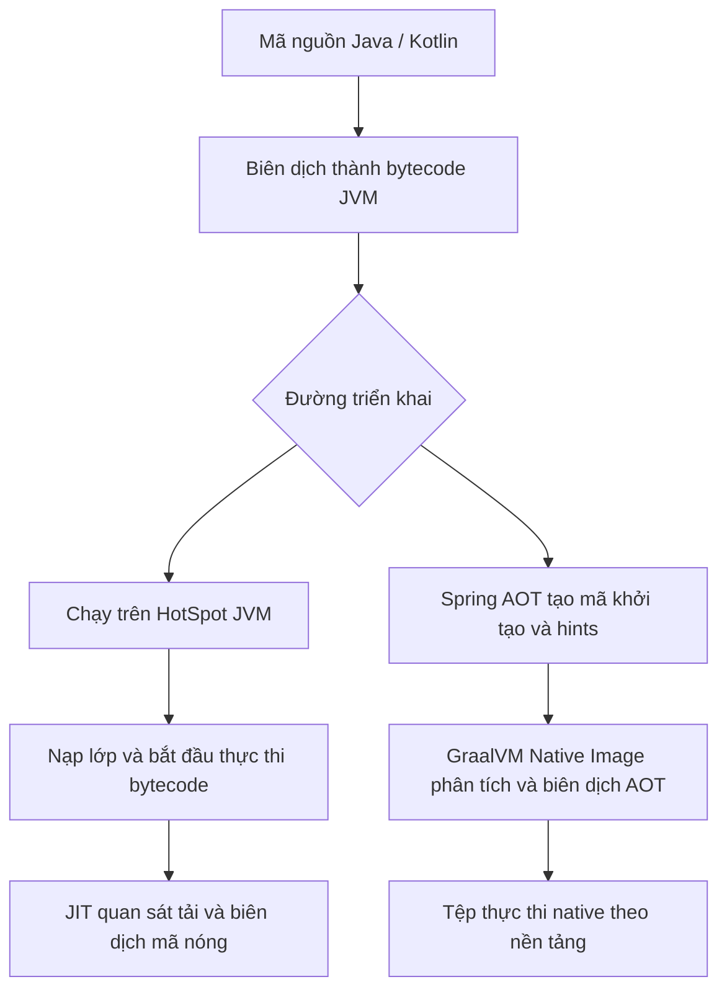

# AOT khác với JIT và không đồng nghĩa với mọi tối ưu cho JVM

Khi tối ưu một ứng dụng Spring Boot, hai thuật ngữ **AOT (Ahead-of-Time compilation)** và **JIT (Just-in-Time compilation)** thường xuất hiện cùng với GraalVM Native Image, Spring AOT, JVM startup, bộ nhớ và hiệu năng xử lý yêu cầu. Chúng có liên quan, nhưng không phải tên gọi thay thế cho nhau, cũng không bao trùm mọi cách làm ứng dụng Java nhanh hơn.

Trong phạm vi **Spring Boot Native Image**, ta cần phân biệt ba lớp công việc:

1. **Spring AOT** phân tích cấu hình ứng dụng và tạo mã/metadata tại thời điểm build để giảm các xử lý động khi khởi tạo.
2. **GraalVM Native Image** phân tích và biên dịch chương trình thành mã máy thực thi trực tiếp trước khi triển khai.
3. **JVM với JIT** chạy bytecode và dần biên dịch, tối ưu những đoạn mã quan trọng dựa trên dữ liệu quan sát được lúc ứng dụng hoạt động.

Hiểu ranh giới của ba lớp này giúp đánh giá đúng lợi ích về thời gian khởi động, bộ nhớ, thông lượng và chi phí bảo trì, thay vì mặc định rằng “AOT luôn nhanh hơn JIT”.

## 1. AOT và JIT khác nhau ở thời điểm nào?

**AOT** là cách biên dịch trước khi chương trình thực sự phục vụ tải ở môi trường chạy. Trong trường hợp GraalVM Native Image, bytecode Java và các phụ thuộc được phân tích tại thời điểm build, sau đó được biên dịch thành tệp thực thi native cho một hệ điều hành/kiến trúc cụ thể.

**JIT** là cách biên dịch trong quá trình chương trình đang chạy. JVM bắt đầu thực thi bytecode; khi xác định một phương thức hoặc vòng lặp được gọi nhiều và đáng tối ưu, JVM có thể biên dịch đoạn đó thành mã máy. Những lựa chọn tối ưu có thể dựa trên kiểu đối tượng, tần suất nhánh rẽ và hành vi thực tế của tải công việc.

Chú ý: `javac` cũng biên dịch mã nguồn `.java` sang bytecode `.class` trước khi chạy. Tuy vậy, trong cuộc thảo luận **JVM JIT so với GraalVM Native Image AOT**, “AOT” chủ yếu nói đến quá trình tạo **mã máy native trước khi chạy**, chứ không chỉ bước tạo bytecode thông thường.



Sơ đồ thể hiện **hai đường triển khai phổ biến**, không phải khẳng định JVM không bao giờ sử dụng kỹ thuật chuẩn bị trước. JVM hiện đại có nhiều cơ chế giảm chi phí khởi động hoặc tái sử dụng dữ liệu đã chuẩn bị; các cơ chế đó cần được gọi đúng tên và đánh giá riêng.

## 2. JIT tối ưu ứng dụng đang chạy như thế nào?

Ở đường triển khai JVM, quá trình thực thi thường gồm các hoạt động sau:

1. JVM nạp lớp, xác minh bytecode và bắt đầu thực thi ứng dụng. Một số mã có thể chạy qua interpreter hoặc đã được biên dịch ở các mức tối ưu khác nhau.
2. JVM thu thập thông tin về số lần gọi, nhánh thường đi qua và kiểu dữ liệu quan sát được. Với HotSpot, cơ chế **tiered compilation** có thể phối hợp các mức biên dịch, thường gồm C1 và C2.
3. Các phương thức/vòng lặp “nóng” được biên dịch, có thể áp dụng *inlining*, loại bỏ kiểm tra dư thừa, tối ưu vòng lặp và nhiều phép biến đổi khác.
4. Nếu một giả định tối ưu không còn đúng, JVM có thể **deoptimization**: quay về dạng thực thi tổng quát hơn rồi tối ưu lại theo dữ liệu mới.

Ví dụ, một phương thức xử lý thanh toán được gọi hàng triệu lần thường có cơ hội được JIT đầu tư tối ưu nhiều hơn một nhánh xử lý lỗi hiếm gặp. Vì thế tốc độ vài yêu cầu đầu tiên có thể khác tốc độ sau khi hệ thống đã chạy ổn định (*warm-up*).

```java
public long sumAmounts(List<Order> orders) {
    long total = 0;
    for (Order order : orders) {
        total += order.amountInCents();
    }
    return total;
}
```

Trên JVM, khi phương thức này được gọi lặp lại, JIT **có thể** sử dụng thống kê khi chạy để tối ưu đoạn mã. Không thể kết luận chính xác JVM sẽ thực hiện phép tối ưu nào chỉ từ ví dụ: kết quả còn phụ thuộc phiên bản JDK, kiểu `List`, dữ liệu, mức nóng và trạng thái tối ưu tại thời điểm đo.

**Lợi ích của JIT** là khả năng thích ứng với tải thực tế và tối ưu hiệu năng ổn định sau warm-up. **Chi phí** gồm CPU và bộ nhớ cho quá trình biên dịch, thông tin profiling, mã máy đã biên dịch; tốc độ xử lý giai đoạn đầu cũng có thể chưa đạt mức ổn định.

## 3. AOT của Native Image giải quyết phần nào?

GraalVM Native Image sử dụng cách tiếp cận phân tích ứng dụng trước khi chạy. Công cụ cố gắng xác định các lớp, phương thức và tài nguyên có thể cần đến từ những điểm vào đã biết, áp dụng các tối ưu như loại bỏ mã không thể truy cập, rồi tạo tệp thực thi native.

Trong ứng dụng Spring Boot, **Spring AOT** hỗ trợ giai đoạn này bằng cách xử lý trước một số cấu hình, khởi tạo bean và tạo *runtime hints* cho những trường hợp cần reflection, proxy, serialization, tài nguyên hoặc cơ chế động khác. GraalVM Native Image tiếp tục dùng kết quả cùng mã và thư viện để tạo binary.

Vì nhiều công việc được dịch sang thời điểm build nên bản native thường có lợi thế khi **khởi động**, đặc biệt trong môi trường tạo tiến trình/container thường xuyên. Tuy nhiên, phần mềm native vẫn có runtime hỗ trợ cấp phát bộ nhớ, quản lý luồng và **garbage collection**; không nên hiểu “native” là “không có runtime” hoặc “không có GC”.

Giới hạn đáng chú ý là giả định **closed-world** ở giai đoạn phân tích: công cụ cần có đủ thông tin về những thành phần có thể được dùng. Những hành vi khó thấy trong phân tích tĩnh, chẳng hạn nạp lớp bằng tên chuỗi, reflection động hoặc đọc resource theo tên được tạo lúc chạy, có thể cần cấu hình/hints phù hợp. Chỉ build thành công chưa đủ đảm bảo mọi đường chức năng lúc chạy đều hoạt động.

### Cùng một ứng dụng, hai mục tiêu tối ưu khác nhau

Giả sử một dịch vụ Spring Boot có API `/orders`:

- Với **JVM + JIT**, ứng dụng có thể tốn thêm thời gian khởi tạo và warm-up, nhưng JIT có cơ hội tối ưu các đoạn xử lý đơn hàng dựa trên yêu cầu thật sau khi chạy đủ lâu.
- Với **Spring AOT + Native Image**, nhiều việc khởi tạo đã được xử lý khi build; tiến trình có thể sẵn sàng nhận yêu cầu sớm hơn, nhưng sẽ không có chính cơ chế JIT của HotSpot tiếp tục biên dịch lại mã nóng khi tải thay đổi.

Không phương án nào mặc nhiên thắng trên mọi thước đo. Một dịch vụ ngắn hạn, được tạo mới liên tục có yêu cầu khác một tiến trình chạy nhiều ngày với tải CPU lớn và ổn định.

## 4. Bảng so sánh AOT Native Image và JVM JIT

| Khía cạnh | JVM với JIT (ví dụ HotSpot) | Spring Boot Native Image với AOT |
| --- | --- | --- |
| Thời điểm tạo mã máy cho mã ứng dụng | Chủ yếu trong khi chạy, dựa trên mức nóng | Chủ yếu tại thời điểm build |
| Dữ liệu giúp tối ưu | Có thể quan sát profile thực tế khi chạy | Phân tích trước; có thể dùng profile thu thập qua quy trình PGO nếu cấu hình |
| Khởi động | Có nạp lớp/khởi tạo JVM và có thể cần warm-up | Thường có lợi thế về thời gian khởi động |
| Hiệu năng ổn định | JIT có cơ hội tối ưu theo tải thật | Phụ thuộc mã máy được tạo trước và cấu hình build |
| Bộ nhớ | Gồm heap, JIT code cache, metadata và các thành phần JVM khác | Có runtime native và heap/GC; thường giảm một số chi phí JVM nhưng không bảo đảm luôn thấp hơn |
| Thời gian build | Thường ngắn hơn nếu chỉ build JAR | Thường dài hơn do phân tích và biên dịch native |
| Tính linh hoạt động | Hỗ trợ rộng các cơ chế class loading/reflection theo hợp đồng JVM | Một số cơ chế động cần hints hoặc điều chỉnh thiết kế |
| Phân phối | JAR/bytecode được chạy với JRE/JDK tương thích | Binary gắn với hệ điều hành/kiến trúc và môi trường build tương thích |
| Gỡ lỗi và vận hành | Hệ sinh thái JVM rất phong phú: JFR, JMX, profiler, GC logs… | Có công cụ riêng cho native; cách thu thập dữ liệu có thể khác |
| Mục tiêu thường phù hợp | Dịch vụ chạy lâu, cần tính linh hoạt và thông lượng cao | Workload nhạy với cold start, mật độ tiến trình/container, footprint |

Các nhận xét “thường” trong bảng là **xu hướng để hình thành giả thuyết**, không phải số liệu bảo đảm. Phải đo trên đúng ứng dụng và phiên bản công cụ đang dùng.

## 5. Vì sao AOT không đại diện cho mọi tối ưu của JVM?

“Tối ưu cho JVM” là nhóm kỹ thuật rất rộng, gồm nhiều tầng độc lập. Có thể hình dung chúng như sau:

| Kỹ thuật | Làm gì? | Có đồng nghĩa với AOT Native Image không? |
| --- | --- | --- |
| Biên dịch JIT và tiered compilation | Tạo, thay đổi mã máy theo profile lúc chạy | Không; đây là tối ưu trong JVM đang chạy |
| Spring AOT | Sinh mã và hints để làm bớt việc động khi ứng dụng khởi tạo | Không; bản thân Spring AOT không phải trình biên dịch native |
| GraalVM Native Image | Phân tích reachability, biên dịch trước thành native executable | Đây là một hình thức AOT biên dịch mã máy |
| Class Data Sharing (CDS/AppCDS) | Chia sẻ/tái sử dụng dữ liệu lớp để giảm một số chi phí nạp lớp, khởi động hoặc bộ nhớ | Không; vẫn chạy ứng dụng trên JVM |
| Tuning garbage collector/heap | Điều chỉnh độ trễ GC, thông lượng và footprint theo workload | Không; thuộc quản lý bộ nhớ lúc chạy |
| Tối ưu SQL, cache, I/O, thread pool | Giảm truy cập cơ sở dữ liệu, chờ mạng, tranh chấp và công việc thừa | Không; thuộc thiết kế/hiệu năng ứng dụng |
| Profile-guided optimization (PGO) | Dùng profile để hướng dẫn lựa chọn tối ưu | Không phải một chế độ chạy duy nhất; profile có thể được dùng theo các cách khác nhau |

**Hai nhầm lẫn thường gặp:**

**Nhầm lẫn 1 — “Dùng GraalVM nghĩa là dùng Native Image.”** GraalVM là một hệ sinh thái công cụ; trình biên dịch Graal cũng có thể xuất hiện trong ngữ cảnh JIT. Phải xác định rõ đang chạy **bytecode trên JVM** hay đang chạy **binary tạo bởi `native-image`**.

**Nhầm lẫn 2 — “AOT thì không cần tối ưu runtime.”** Native Image vẫn phải đối mặt với allocation, GC, khóa, network I/O, pool kết nối và cách ứng dụng dùng CPU. Một truy vấn database tốn 500 ms không trở thành truy vấn 5 ms chỉ vì chuyển JAR sang native executable.

Tương tự, bật CDS, thay garbage collector hay điều chỉnh `-Xmx` không tự động biến ứng dụng JVM thành một bản AOT native. Ngược lại, khả năng hỗ trợ một kỹ thuật chuẩn bị trước của JVM cũng không làm mất đi vai trò của JIT khi chạy.

## 6. Quy trình Spring Boot: Spring AOT và Native Image đứng ở đâu?

Với Spring Boot hỗ trợ AOT và Native Build Tools đã được cấu hình, có thể so sánh hai đường build trên **cùng một phiên bản mã nguồn**.

### 6.1. Đường JVM thông thường

Ví dụ dự án Maven:

```bash
./mvnw clean package
java -jar target/my-service.jar
```

`my-service.jar` là tên minh họa: trong dự án thật hãy thay bằng artifact được sinh ra. Ứng dụng vẫn được JVM thực thi; JIT có thể tối ưu mã nóng trong khi chương trình chạy.

### 6.2. Đường Native Image

Ví dụ Maven khi dự án có profile `native` và plugin tương thích:

```bash
./mvnw -Pnative native:compile
./target/my-service
```

Ví dụ Gradle khi đã áp dụng và cấu hình GraalVM Native Build Tools:

```bash
./gradlew nativeCompile
./build/native/nativeCompile/my-service
```

Tên binary và cú pháp chạy có thể khác tùy artifact, hệ điều hành và cấu hình dự án (trên Windows có thể là `.exe`). Các câu lệnh trên **không tự cài** GraalVM, Native Image toolchain hay plugin; cần chuẩn bị toolchain tương thích trước.

Trong đường Native Image, phần build thường gồm:

1. Biên dịch source thành bytecode và xử lý phụ thuộc.
2. Chạy **Spring AOT** để tạo mã khởi tạo và các hints mà framework xác định được.
3. Chạy trình biên dịch **GraalVM Native Image** để phân tích khả năng truy cập và tạo binary.
4. Chạy binary, kiểm thử hành vi thực tế và đo hiệu năng.

Đây là lý do cần tránh câu nói “Spring AOT chính là JIT chạy sớm”: Spring AOT thực hiện biến đổi và chuẩn bị ở tầng framework; trình biên dịch Native Image thực hiện công việc tạo mã máy. Chúng có thể phối hợp nhưng không cùng một chức năng.

### 6.3. Ví dụ về trường hợp cần runtime hints

Giả sử thư viện tự viết lấy tên lớp từ cấu hình rồi gọi `Class.forName` và reflection để tạo đối tượng. Trên JVM thông thường, lớp có thể được nạp động nếu hiện diện trên classpath. Khi build native, công cụ cần biết trước kiểu sẽ được truy cập theo cách này.

Với trường hợp Spring Framework đã nhận diện được kiểu dùng cho data binding, có thể khai báo một hint như sau:

```java
import org.springframework.aot.hint.annotation.RegisterReflectionForBinding;
import org.springframework.context.annotation.Configuration;

@Configuration(proxyBeanMethods = false)
@RegisterReflectionForBinding(OrderPayload.class)
class NativeBindingConfiguration {
}
```

Annotation này minh họa cách đăng ký thông tin reflection phục vụ **binding** cho `OrderPayload`; nó **không phải giải pháp bao trùm** cho mọi thao tác reflection hay dynamic class loading. Với thư viện tùy biến, có thể cần `RuntimeHintsRegistrar`, tài nguyên được đăng ký riêng, metadata do thư viện cung cấp hoặc thay đổi thiết kế. Chỉ thêm hints khi phát hiện nhu cầu thật và kiểm thử đường code tương ứng trên binary native.

### 6.4. Container native không phải thuật ngữ thay thế cho AOT

Binary native cũng có thể được đóng gói vào OCI image, chẳng hạn thông qua Spring Boot buildpacks khi bật Native Image theo cấu hình build. Nhưng **container image** chỉ là cách đóng gói và chạy; container chứa JAR/JVM vẫn là đường JVM, còn container chứa native executable là đường native.

Vì thế, trong tài liệu triển khai cần ghi rõ **JVM container** hay **Native Image container**, phiên bản JDK/GraalVM, kiến trúc CPU và phương pháp build. Việc sử dụng Docker tự thân không cho biết ứng dụng đang dùng JIT hay AOT.

## 7. Đo hiệu năng đúng để ra quyết định

Để biết có nên chuyển Spring Boot sang Native Image, cần tạo hai artifact từ cùng commit, dùng cùng cấu hình và dữ liệu, rồi chạy trên tài nguyên tương đương.

| Chỉ số | Cách đo/ý nghĩa | Lưu ý khi so sánh |
| --- | --- | --- |
| **Startup tới readiness** | Thời gian từ lúc tạo process đến khi endpoint readiness phản hồi đạt yêu cầu | Đo cột mốc phục vụ request thật, không chỉ đo lúc JVM in log |
| **RSS/working set** | Tổng bộ nhớ cư trú của tiến trình | Không đồng nhất RSS với Java heap; cả JVM và native đều có bộ nhớ ngoài heap |
| **Latency p50/p95/p99** | Độ trễ tại các phân vị trong một kịch bản request | Đo cả lúc cold start và sau warm-up, báo kèm mức tải |
| **Throughput** | Request/giây khi vẫn giữ ngưỡng lỗi và latency chấp nhận được | Không suy từ startup time sang throughput |
| **CPU** | CPU khi khởi động và khi xử lý tải ổn định | Tính chi phí JIT trong JVM nếu có, đồng thời tính tải ứng dụng thực |
| **Build time và artifact size** | Thời gian tạo JAR/binary, kích cỡ artifact/container | Native build có thể dùng nhiều CPU và RAM ở máy build |
| **Tương thích chức năng** | Số luồng chức năng, integration test và đường lỗi chạy đúng | Bao gồm reflection, resource, serialization, JNI, plugin động |

Một quy trình thực hành hợp lý:

1. Build hai phiên bản từ **cùng commit**; ghi nhận JDK, Spring Boot, GraalVM, OS, kiến trúc và các tùy chọn build.
2. Khởi động mỗi phiên bản nhiều lần trong điều kiện tương đương. Đo thời gian đến khi `/actuator/health/readiness` trả trạng thái sẵn sàng nếu dự án có bật và cấu hình endpoint này; nếu không, định nghĩa một tín hiệu readiness phù hợp.
3. Đo RSS và CPU của **toàn tiến trình**. Với container, áp dụng cùng CPU/memory limits, loại trừ khác biệt do trình giám sát hoặc base image khi phân tích.
4. Tạo cùng tập request và dữ liệu. Ghi nhận riêng pha đầu, pha warm-up và tải ổn định; báo p50/p95/p99, throughput và tỷ lệ lỗi.
5. Chạy integration test và các luồng ít gặp trên binary native: JSON binding, TLS, resource, scheduling, serialization, ngoại lệ và các thư viện dùng reflection nếu có.
6. So sánh thêm chi phí build, độ dễ gỡ lỗi, kích thước image và thao tác vận hành trước khi chọn hướng triển khai.

**Ví dụ cách ghi kết quả** (các ô để trống có chủ đích; phải điền số đo thực tế):

| Metric | JVM + JIT | Native Image + AOT |
| --- | --- | --- |
| Startup đến readiness (ms) | *Đo* | *Đo* |
| RSS khi idle (MiB) | *Đo* | *Đo* |
| RSS ở tải định mức (MiB) | *Đo* | *Đo* |
| Latency p95 sau warm-up (ms) | *Đo* | *Đo* |
| Throughput tại cùng SLO (req/s) | *Đo* | *Đo* |
| Thời gian build sạch (s) | *Đo* | *Đo* |
| Kích thước container image (MiB) | *Đo* | *Đo* |
| Số bài integration test đạt/tổng | *Đo* | *Đo* |

Tuyệt đối không điền số liệu “Native nhanh gấp N lần” từ một ứng dụng khác vào bảng này. Kết quả tùy mức sử dụng CPU/I/O, dependencies, số lượng bean, cấu hình khởi tạo, đặc điểm GC, dữ liệu và điều kiện đo.

## 8. Chọn hướng nào theo từng tình huống?

**Tình huống A — Dịch vụ scale từ 0 lên nhiều instance.** Nếu ứng dụng bị giới hạn bởi thời gian sẵn sàng phục vụ request và chi phí bộ nhớ mỗi instance, Native Image là ứng viên đáng thử. Nhưng vẫn cần kiểm chứng độ tương thích và chi phí build trong CI.

**Tình huống B — Service chạy dài hạn, xử lý CPU nặng.** JVM + JIT có thể là lựa chọn tốt vì tối ưu thích ứng theo tải và bộ công cụ profiling mạnh. Chưa có benchmark cho workload này thì không thể kết luận bản native kém hơn hoặc tốt hơn.

**Tình huống C — Service dùng nhiều plugin nạp động hoặc thư viện reflection phức tạp.** Khả năng dự đoán toàn bộ class/resource ở build time trở thành vấn đề chính. Nên thử native build, kiểm thử chức năng khó nhất trước rồi mới cân nhắc hiệu năng.

**Tình huống D — API chủ yếu chờ database/mạng.** Tối ưu query, cache, kết nối và giới hạn concurrency có thể cải thiện độ trễ nhiều hơn thay đổi chiến lược biên dịch. Native vẫn có thể hữu ích cho cold start, nhưng cần phân loại rõ bottleneck.

## 9. Những kết luận cần nhớ

- **JIT** biên dịch và có thể tối ưu mã dựa trên profile khi ứng dụng đang chạy; ưu thế của nó thường thể hiện rõ sau warm-up.
- **AOT Native Image** tạo mã máy trước khi triển khai và có thể giảm chi phí khởi động/runtime, nhưng đánh đổi bằng bước build phức tạp hơn và các yêu cầu về tính tường minh của mã động.
- **Spring AOT** là tầng chuẩn bị mã/metadata của framework, hỗ trợ Native Image; bản thân nó không phải tên gọi khác của JIT hoặc của toàn bộ trình biên dịch GraalVM.
- **Tối ưu JVM** còn gồm CDS, GC/heap tuning, JIT, profiling và các tối ưu ở tầng ứng dụng; không kỹ thuật nào tự động đồng nghĩa với native compilation.
- **Lựa chọn đúng dựa trên workload đã đo**: thời gian đến readiness, RSS, p95/p99, throughput, thời gian build và kiểm thử tính tương thích cùng quyết định.

Sau khi hiểu khác biệt về nguyên lý, bước thực hành tiếp theo là build cả JAR/JVM và Native Image từ cùng dự án Spring Boot, kiểm thử các trường hợp runtime động rồi ghi lại số liệu theo phương pháp ở phần 7.
