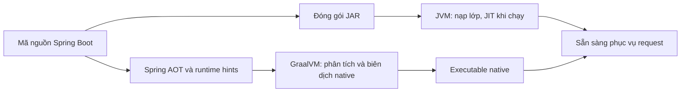

# Đánh đổi giữa chi phí build, mức sử dụng bộ nhớ và hiệu năng lúc chạy

## 1. Vì sao cần đánh giá theo toàn bộ vòng đời ứng dụng?

Với Spring Boot Native Image, **Spring AOT** phân tích và tạo mã hỗ trợ ứng dụng ngay trong quá trình build; **GraalVM Native Image** tiếp tục phân tích những thành phần có thể được sử dụng và biên dịch chúng thành chương trình thực thi cho một nền tảng cụ thể. Ứng dụng có thể khởi động nhanh, sử dụng ít bộ nhớ hơn trong một số tải công việc và giảm thời gian chờ khi tạo phiên bản mới.

Đổi lại, bước tạo native executable thường tốn **thời gian và tài nguyên build** hơn đóng gói JAR chạy trên JVM. Khi ứng dụng đã hoạt động ổn định trong thời gian dài, JVM với JIT (Just-in-Time compiler) có thể tối ưu mã theo hành vi thực tế; vì thế native executable **không mặc nhiên có thông lượng hoặc độ trễ tốt hơn**. Các cơ chế động như reflection, proxy và nạp resource cũng cần được kiểm tra khi chuyển sang mô hình phân tích tại build time.

Quyết định giữa hai cách triển khai phải xét đồng thời:

- **Chi phí build:** thời gian biên dịch, CPU/RAM cao điểm, dung lượng artifact, số lần build trong CI/CD và công sức duy trì cấu hình native.
- **Chi phí vận hành:** mức tiêu thụ bộ nhớ, CPU, mật độ đặt replica trên node, chi phí container và khả năng autoscaling.
- **Hiệu năng ứng dụng:** thời gian đến trạng thái sẵn sàng nhận request, độ trễ request đầu tiên, độ trễ ở tải ổn định, thông lượng và thời gian phục hồi khi có sự cố.
- **Chi phí tương thích:** kiểm thử thư viện sử dụng reflection, resource, serialization, JNI hoặc các tính năng khởi tạo động; cách vận hành binary trên OS/CPU architecture mục tiêu.

> Nguyên tắc: **tối ưu một chỉ số không đồng nghĩa tối ưu tổng chi phí**. Hãy đo trên cùng ứng dụng, cùng dữ liệu, cùng tài nguyên và cùng mức tải trước khi lựa chọn.

## 2. Cơ chế nào tạo nên các đánh đổi?

### 2.1. Chạy Spring Boot bằng JVM

Ở cách triển khai truyền thống, mã Java được biên dịch thành bytecode, đóng gói thành JAR và thực thi trên JVM. JVM chịu trách nhiệm nạp lớp, quản lý heap, thu gom rác và có thể dùng JIT để biên dịch các đoạn mã thường xuyên thực thi thành mã máy đã tối ưu.

Ưu điểm thực tế là vòng phát triển thường nhanh, hỗ trợ tốt những hành vi động và có cơ hội tối ưu theo mẫu tải lúc chạy. Đổi lại, ứng dụng có công việc khởi tạo JVM/framework và có thể trải qua giai đoạn **warm-up** trước khi đạt thông lượng ổn định.

### 2.2. Chạy Spring Boot bằng Native Image

Khi tạo Native Image, Spring AOT chuẩn bị thông tin về cấu hình Spring, bean và các runtime hint có thể xác định trước. GraalVM thực hiện phân tích khả năng truy cập (*reachability analysis*), biên dịch ahead of time (AOT) và liên kết các thành phần cần thiết thành executable. Một phần lớn công việc được chuyển **từ lúc chạy sang lúc build**.

Nhờ vậy, ứng dụng thường có ít công việc khởi tạo hơn và ít phụ thuộc vào cơ chế JIT khi chạy. Tuy nhiên, trình biên dịch phải thực hiện phân tích phức tạp trên toàn bộ ứng dụng và các dependency. Native executable vẫn có runtime, heap và cơ chế thu gom rác; gọi nó là ứng dụng “không có GC” hoặc “không sử dụng heap” là sai.

| Khía cạnh | JAR trên JVM | GraalVM Native Image |
| --- | --- | --- |
| Đóng gói | Bytecode + JVM tương thích tại runtime | Executable được biên dịch cho OS/kiến trúc đích |
| Quá trình build | Thường ngắn hơn, cần ít RAM build hơn | Thường dài hơn, có thể cần nhiều CPU/RAM |
| Khởi động | Có khởi tạo JVM, class loading và framework | Thường nhanh hơn nhờ xử lý trước khi build |
| Bộ nhớ lúc chạy | Có thể cao hơn do runtime và cấu trúc JVM | Thường có lợi ở nhiều workload nhỏ, nhưng tùy tải và cấu hình |
| Hiệu năng tải dài | JIT có thể tối ưu theo hành vi thực tế | Không cần warm-up JIT tương tự; throughput cần benchmark |
| Hành vi động | Thường thuận lợi hơn | Cần kiểm tra metadata/hint cho reflection, resource, proxy, JNI... |
| Vận hành | Cần JVM trên image/máy chạy | Cần binary và native library tương thích môi trường |

Sơ đồ dòng chảy:



## 3. Chi phí build: trả trước để giảm một số công việc lúc chạy

### 3.1. Thời gian, CPU, RAM và năng lực CI

Đối với JAR, quá trình build chủ yếu biên dịch Java, chạy xử lý annotation, test và đóng gói. Native build có thêm Spring AOT và pha phân tích/biên dịch mã máy của GraalVM. Vì vậy, sự khác biệt không chỉ là thời gian build trung bình mà còn gồm:

1. **Thời gian hoàn thành pipeline:** ảnh hưởng tốc độ phản hồi của nhà phát triển và thời gian phát hành.
2. **Peak RAM khi biên dịch:** có thể gây OOM trên CI runner dù ứng dụng native lúc chạy dùng ít RAM.
3. **CPU và số job chạy song song:** một job native chiếm tài nguyên lớn có thể làm giảm throughput của cả cụm runner.
4. **Dung lượng và tính tương thích artifact:** binary gắn với OS/kiến trúc và cách liên kết thư viện; phát hành đa kiến trúc thường cần tạo và kiểm thử artifact phù hợp từng đích.
5. **Chi phí thay đổi ứng dụng:** một thay đổi nhỏ vẫn có thể kích hoạt lại pha native compilation tốn kém, tùy cache và cách bố trí pipeline.

Ví dụ lệnh build thường gặp, **khi dự án đã cấu hình GraalVM Native Build Tools và môi trường build thích hợp**:

```bash
# Maven: JAR/JVM
./mvnw -DskipTests package

# Maven: native executable (với native profile đã được cấu hình)
./mvnw -Pnative native:compile

# Gradle: JAR/JVM
./gradlew bootJar

# Gradle: native executable
./gradlew nativeCompile
```

Các lệnh minh họa hai lựa chọn Maven/Gradle; chỉ dùng hệ thống build thực sự có trong dự án. Khi benchmark build, cần xác định rõ có chạy test hay không, dependency đã có trong cache hay chưa và build chạy trên máy nào. Không nên so một lần native build tải đầy đủ dependency từ mạng với một lần JAR build dùng cache nóng.

Trên môi trường Linux có GNU `/usr/bin/time`, có thể bắt đầu đo thời gian và peak RSS của **tiến trình lệnh build**:

```bash
/usr/bin/time -f 'elapsed=%e sec; max_rss=%M KiB' ./mvnw -DskipTests package
/usr/bin/time -f 'elapsed=%e sec; max_rss=%M KiB' ./mvnw -Pnative native:compile
```

Thực hiện các phép đo độc lập, giữ cùng phiên bản JDK/GraalVM, CPU, giới hạn RAM, bộ nhớ đệm và trạng thái daemon; ghi lại cả CPU sử dụng và OOM nếu có. Số `max_rss` ở lệnh trên là thông tin của tiến trình được công cụ theo dõi, **không nhất thiết phản ánh đầy đủ peak RAM của mọi tiến trình con hoặc toàn bộ container CI**. Với build trong container, nên thu thập thêm bộ nhớ cao điểm ở cấp container/cgroup. Không dùng một kết quả đơn lẻ để kết luận.

### 3.2. Cách giảm chi phí mà không làm sai phép so sánh

- Cache Maven/Gradle dependency và thành phần build có thể tái sử dụng; đo cả trường hợp cache lạnh và cache nóng.
- Tách kiểm thử đơn vị nhanh khỏi bước native compilation trong pipeline phù hợp; vẫn giữ kiểm thử native tương thích trước khi phát hành.
- Chọn runner có CPU/RAM phù hợp, giới hạn số native build chạy đồng thời theo năng lực hạ tầng.
- Chỉ build các kiến trúc cần triển khai, lưu lại thời gian build thực tế để đánh giá hiệu quả khi tăng tần suất release.
- Cân nhắc Profile-Guided Optimization (PGO) nếu toolchain và phiên bản sử dụng hỗ trợ, nhưng phải tính thêm bước thu thập profile và build lại vào chi phí.

## 4. Bộ nhớ: phân biệt heap, RSS và giới hạn container

Trong Java, **heap** chỉ là một phần của bộ nhớ tiến trình. Tổng bộ nhớ thực tế còn liên quan đến stack của thread, mã máy, thư viện native, vùng nhớ ngoài heap, cấu trúc runtime và những trang bộ nhớ được ánh xạ. Vì thế:

**Heap nhỏ hơn không bảo đảm RSS nhỏ hơn theo cùng tỷ lệ.** RSS (*Resident Set Size*) ước lượng số trang của tiến trình đang hiện diện trong RAM; khi đo theo container, bộ nhớ cgroup có thể bao gồm thêm những thành phần như page cache và các tiến trình phụ. Số liệu từ `docker stats` và `ps` vì vậy có thể khác nhau dù cùng thời điểm.

Khi so JVM và native, nên theo dõi ít nhất:

| Chỉ số | Khi nào đo | Ý nghĩa |
| --- | --- | --- |
| RSS ngay sau khi readiness thành công | Sau khởi động, trước tải | Đánh giá footprint ban đầu |
| RSS khi nhàn rỗi ổn định | Sau khoảng chờ cố định | Tránh hiểu nhầm dao động lúc khởi động |
| RSS ở cùng mức RPS/concurrency | Trong kiểm thử tải | Phản ánh bộ nhớ để phục vụ cùng công việc |
| Peak RSS/container memory | Trong tải lớn, GC và burst | Ước lượng rủi ro vượt memory limit |
| Heap, GC pause, allocation rate | Khi tải ổn định và khi stress | Giải thích nguyên nhân tiêu thụ bộ nhớ |
| Số lần OOM kill hoặc restart | Suốt phiên thử | Phát hiện cấu hình thiếu bộ nhớ |

Ví dụ lệnh quan sát trên Linux:

```bash
# RSS của tiến trình tính bằng KiB (PID cần thay bằng PID thực tế).
ps -o pid,rss,%mem,comm -p "$PID"

# Dung lượng bộ nhớ của các container đang chạy.
docker stats --no-stream

# Nếu chạy dưới cgroup v2 và có quyền đọc:
cat /sys/fs/cgroup/memory.current
cat /sys/fs/cgroup/memory.peak
```

Những lệnh này chỉ là điểm bắt đầu. Trong Kubernetes, hãy bổ sung memory working set, memory limit, OOMKill/restart và mức tài nguyên đã **request**, vì scheduler quyết định mật độ đặt Pod dựa trên request chứ không trực tiếp dựa trên RSS trung bình. Nếu JVM cấp quá nhiều heap hoặc native có cấu hình giới hạn heap khác biệt, kết quả sẽ thiếu công bằng; điều chỉnh theo cùng SLO, mức tải và memory limit.

### 4.1. Khi giảm RAM thực sự chuyển thành tiết kiệm

Giả sử một ứng dụng có 30 replica đang chạy, footprint ổn định đo được là 240 MiB trên JVM và 120 MiB với native tại **cùng mức tải**:

```text
RAM tiết kiệm lý thuyết ≈ (240 - 120) MiB × 30 = 3.600 MiB ≈ 3,52 GiB
```

Đây là phép nhân về footprint của tiến trình, **chưa phải mức giảm hóa đơn cloud**. Muốn chuyển thành tiết kiệm thực tế, cần kiểm tra Pod requests/limits, CPU request, tài nguyên node có thể đóng gói lại, autoscaling và cơ chế tính phí của nền tảng. Nếu cả cụm không thể giảm số node hoặc không thể hạ cấu hình cấp phát, lợi ích tài chính trước mắt có thể nhỏ hơn nhiều.

## 5. Hiệu năng lúc chạy: tách khởi động, request đầu tiên và tải ổn định

### 5.1. Khởi động và khả năng mở rộng nhanh

Native Image thường mang lại lợi thế rõ ở thời gian khởi động vì giảm công việc khởi tạo động. Điều này hữu ích với job ngắn, scale-to-zero, container thường xuyên được tạo lại, autoscaling có burst và các tình huống cần phục hồi nhanh.

Tuy nhiên, cần phân biệt ba mốc:

- **Process start:** thời điểm hệ điều hành tạo tiến trình.
- **Application ready:** thời điểm Spring Boot hoàn tất khởi tạo và báo đã sẵn sàng.
- **Service ready:** thời điểm bên ngoài có thể gửi request đến một endpoint thật và nhận phản hồi đúng; có thể trễ hơn vì readiness probe, kết nối DB, DNS, ingress hoặc service discovery.

Nếu thời gian chờ chủ yếu nằm ở kết nối cơ sở dữ liệu, migration, remote configuration hoặc tải cache bên ngoài, việc biên dịch native có thể không thay đổi nhiều thời gian **service ready**. Đo từ phía client hoặc orchestrator để tránh chỉ dựa vào dòng log “Started”.

### 5.2. Độ trễ và thông lượng

Ở thời điểm bắt đầu, JVM có thể chưa hoàn tất warm-up JIT; native executable có thể cho độ trễ request đầu tiên ổn định hơn. Nhưng sau khi ứng dụng JVM hoạt động đủ lâu, JIT có thể sử dụng thông tin thực tế (ví dụ đường đi thường chạy, kiểu dữ liệu và cấu trúc gọi hàm) để tối ưu. Native code đã biên dịch trước không nhất thiết đạt throughput tốt nhất cho workload dài hạn.

Để đánh giá đúng, phải đo riêng:

1. **Cold start:** thời gian từ tạo tiến trình đến readiness và request hợp lệ đầu tiên.
2. **Warm-up:** giai đoạn đầu với tải kiểm soát; ghi nhận độ trễ và throughput thay đổi theo thời gian.
3. **Steady state:** p50, p95, p99, error rate và throughput sau khi hệ thống ổn định.
4. **Peak/burst:** ảnh hưởng của concurrency, GC, CPU saturation và throttling khi tăng tải.
5. **Recovery:** tốc độ khởi động lại, bổ sung replica và trở về trạng thái đáp ứng SLO.

**p99 thấp ở tải nhẹ chưa đủ kết luận phiên bản tốt hơn.** Có thể một bản có p99 tốt ở 100 RPS nhưng đuối CPU ở 1.000 RPS; hoặc một bản có thông lượng cao hơn nhưng vượt memory limit. Cần so ở **cùng offered load**, sau đó xác định tải tối đa mà mỗi bản vẫn đáp ứng SLO.

### 5.3. Tác động của cấu hình và phiên bản

Kết quả phụ thuộc phiên bản Spring Boot, JDK, GraalVM, chế độ GC, CPU architecture, thư viện ứng dụng và lựa chọn tối ưu. PGO có thể cải thiện native performance cho luồng đã được profile, nhưng yêu cầu workload profile đại diện và chi phí build bổ sung. Ngược lại, JVM có thể tận dụng cấu hình heap/GC hoặc cơ chế cải thiện khởi động sẵn có. Do đó không nên dùng các tuyên bố tuyệt đối như “native luôn nhanh hơn JVM”, “native luôn dùng ít RAM hơn” hoặc “native không cần tuning”.

## 6. Thiết kế benchmark công bằng và tái lập được

Hãy thực hiện một thử nghiệm A/B trên **cùng commit** của Spring Boot application, với hai artifact:

- **A — JVM:** JAR của ứng dụng chạy trên phiên bản JDK đã chọn.
- **B — native:** executable được biên dịch với GraalVM Native Image, có Spring AOT và runtime hint cần thiết.

### Bước 1 — Cố định điều kiện

Ghi lại commit, phiên bản Spring Boot/JDK/GraalVM, hệ điều hành, kiến trúc CPU, số core, memory request/limit, cấu hình GC/heap, image nền, dữ liệu thử, số kết nối và cấu hình external service. Cả hai bản phải dùng cùng behavior chức năng, cùng endpoint, cùng dataset, cùng chính sách logging và mức truy cập DB/cache.

Nếu dùng Docker/Kubernetes, tránh để hai phiên thử cạnh tranh CPU/RAM trên cùng host; kiểm soát CPU throttling và tách yếu tố network khỏi thời gian xử lý ứng dụng. Với endpoint có I/O đáng kể, đo riêng độ trễ từ DB/remote API.

### Bước 2 — Đo build độc lập

Thực hiện ít nhất vài lần build cho mỗi phương án, đánh dấu cache lạnh/nóng và thu thập:

```text
build_elapsed_seconds
build_peak_ram_mib
build_cpu_seconds
artifact_or_image_size_mib
build_success_rate
```

Nên báo median và khoảng dao động thay vì chọn lần nhanh nhất. Với container native, kiểm tra thêm kiến trúc, thư viện runtime và chứng chỉ CA trước khi benchmark.

### Bước 3 — Xác nhận tương thích ứng dụng

Trước khi đo tải, chạy smoke/integration test trên **chính native executable**: mở context, gọi endpoint, xác thực, serialization/deserialization, truy vấn DB, scheduled task, load resource, reflection/proxy và các tích hợp sử dụng thư viện native/JNI nếu có. Thiếu runtime hint có thể khiến bản native build thành công nhưng lỗi tại một đường đi hiếm khi được gọi.

Nếu một tính năng khác biệt giữa hai phiên bản thì số liệu hiệu năng không còn so sánh được. Cần sửa cấu hình AOT/runtime hint rồi thử lại, đồng thời ghi nhận chi phí duy trì này.

### Bước 4 — Đo thời gian sẵn sàng từ bên ngoài

Chạy từng artifact từ trạng thái chưa có tiến trình, đo đến khi readiness endpoint trả thành công rồi gửi request nghiệp vụ đầu tiên. Nếu dùng Spring Boot Actuator, có thể cấu hình và đo endpoint readiness tương ứng; **không giả định** ứng dụng nào cũng tự bật đường dẫn này. Mỗi lần thử phải xác định rõ điều kiện cache, kết nối cơ sở dữ liệu và probe delay.

Thực hiện nhiều lần khởi động, báo median/p95 thời gian readiness; đối với công việc chạy theo lịch, bổ sung thời gian hoàn thành **toàn job** thay vì chỉ thời gian app start.

### Bước 5 — Đo tải và chi phí runtime

Chọn kịch bản sát thực tế: endpoint đọc, endpoint ghi, JSON payload nhỏ/lớn, cache hit/miss, các mức RPS và concurrency. Có thể dùng k6, wrk hoặc công cụ load test của dự án. Công cụ phát tải nên chạy trên máy khác hoặc có tài nguyên độc lập; xác nhận nó chưa chạm giới hạn của chính mình.

Với mỗi mức tải, thu thập **p50/p95/p99**, error rate, request/s xử lý thành công, CPU time, RSS, peak memory, GC pause và tỷ lệ CPU throttling. Tách giai đoạn warm-up khỏi giai đoạn báo cáo steady state. Tăng tải đến khi một trong hai bản vi phạm SLO để tìm **sustainable throughput**, không chỉ throughput trong vài giây.

### Bước 6 — Trình bày và diễn giải số liệu

Ví dụ bảng kết quả **hoàn toàn giả định**, chỉ để minh họa cách đọc phép đo:

| Chỉ số | JVM | Native | Cách diễn giải |
| --- | ---: | ---: | --- |
| Build với cache nóng | 1 phút | 6 phút | Native tăng 5 phút mỗi lần build |
| Peak RAM build | 2 GiB | 8 GiB | Runner native cần năng lực lớn hơn |
| Readiness từ bên ngoài | 2,5 giây | 0,3 giây | Native giảm 2,2 giây/start |
| RSS idle | 240 MiB | 120 MiB | Footprint idle giảm một nửa |
| RSS tại 200 RPS | 330 MiB | 180 MiB | Tiếp tục có lợi ở tải đo được |
| p95 tại 200 RPS | 18 ms | 20 ms | JVM nhỉnh hơn ở phép đo steady state này |
| Sustainable throughput theo cùng SLO | 2.800 RPS | 2.600 RPS | JVM nhỉnh hơn ở kịch bản tải dài này |

Đọc bảng theo mục tiêu: nếu hệ thống có nhiều replica nhỏ và thường khởi động mới, native có thể phù hợp dù build lâu hơn. Nếu một số ít replica chạy 24/7 với workload CPU-bound cần throughput tối đa, JVM có thể là lựa chọn kinh tế hơn. Hai kết luận đều **phụ thuộc bài toán**; bảng trên không phải số liệu chuẩn của Spring Boot/GraalVM.

## 7. Quy đổi số đo thành quyết định kiến trúc

Một khung tính toán đơn giản là:

```text
Chi phí vòng đời
  ≈ chi phí CI/build
  + chi phí compute và memory trong vận hành
  + chi phí tài nguyên dư/phục hồi/scale
  + công sức kiểm thử và xử lý tương thích.

Thời gian khởi động tiết kiệm được
  ≈ số lần khởi động × (startup_JVM - startup_native).

RAM footprint tiết kiệm được tại một tải xác định
  ≈ số replica × (RSS_JVM - RSS_native).
```

Các biểu thức trên giúp đặt câu hỏi đúng, nhưng chưa đủ để tính tiền: phải bổ sung giá runner/phút, cấu hình Pod request, chi phí node, CPU sử dụng, số lần replica được tạo trong ngày và khả năng thu nhỏ hạ tầng. Khi dùng hệ thống tính phí theo request/thời gian thực thi, hãy đối chiếu trực tiếp quy tắc tính phí của nền tảng đang chạy.

### Ví dụ: tăng tần suất release hay tiết kiệm bộ nhớ?

Giả sử native build mất thêm 5 phút và đội ngũ tạo 20 build/ngày, số phút runner phát sinh có thể xấp xỉ **100 phút/ngày** nếu mỗi build sử dụng cùng một loại runner. Đổi lại, hệ thống vận hành 30 replica có thể tiết kiệm đáng kể RAM và khởi động nhanh hơn khi autoscaling. Nếu giảm được số node thực tế và không vi phạm SLO, chi phí build thêm có thể hợp lý.

Ngược lại, nếu ứng dụng chỉ có một replica, chạy dài hạn với CPU gần ngưỡng và native làm giảm thông lượng tại cùng SLO, chi phí phải tăng CPU/replica có thể lấn át lợi ích RAM. Đừng chỉ so chi phí theo từng tiến trình; hãy so **chi phí để xử lý cùng lượng công việc với cùng độ tin cậy**.

### Ma trận tình huống

| Tình huống | Xu hướng lựa chọn | Điều phải chứng minh |
| --- | --- | --- |
| Function, job ngắn hoặc scale-to-zero | Native đáng thử trước | Cold start và tổng thời gian job giảm rõ rệt |
| Nhiều microservice có ít request/replica | Native có tiềm năng | RAM request giảm và hạ tầng đóng gói lại được |
| API cần scale-out nhanh khi burst | Native có tiềm năng | Readiness và khả năng hấp thụ burst cải thiện |
| Service CPU-bound chạy liên tục | Benchmark JVM và native cẩn thận | Throughput/CPU, p99 và GC ở tải dài |
| CI hạn chế RAM, release rất thường xuyên | Cân nhắc chi phí native build | Độ trễ pipeline, tần suất OOM và giá runner |
| Dependency dùng nhiều reflection/serialization động | Ưu tiên kiểm chứng tương thích | Native test đủ luồng, runtime hints có thể duy trì |
| Container triển khai đa kiến trúc | Tính chi phí phát hành | Binary đúng OS/architecture và test từng đích |

## 8. Những sai lầm dễ khiến benchmark vô nghĩa

1. **Chỉ đo heap rồi kết luận về bộ nhớ container:** bỏ sót native memory, stack, code và page cache.
2. **So JVM đang warm-up với native đã ổn định**, hoặc chỉ đo steady state mà bỏ qua startup: kết luận sẽ lệch theo hướng đo.
3. **Dùng tải không đại diện:** endpoint trả chuỗi cố định khó phản ánh serialization, truy cập DB, cache và business logic thật.
4. **Không cố định CPU/memory limit:** native và JVM có thể khác nhau hoàn toàn do throttling, OOM hoặc cấu hình heap.
5. **Lấy elapsed time của một lệnh build làm chi phí CI tuyệt đối:** bỏ qua cache, thời gian queue, runner CPU/RAM và số build đồng thời.
6. **Nhìn RSS thấp rồi mặc định hóa đơn sẽ giảm:** nếu memory request và số node không đổi, lợi ích tài chính chưa chắc xuất hiện.
7. **Không chạy test trên executable native:** các nhánh sử dụng reflection hoặc resource có thể lỗi dù quá trình biên dịch thành công.
8. **Giả định binary native chạy ở mọi Linux image:** phải kiểm tra thư viện, libc, kiến trúc CPU, chứng chỉ và các dependency ở runtime.
9. **So hai artifact có tính năng hoặc cấu hình khác nhau:** nếu native tắt logging, cache, monitoring hay validation, kết quả không phản ánh cùng công việc.
10. **Dùng một số trung bình duy nhất:** startup, p95/p99, peak RAM, lỗi và độ dao động mới cho thấy rủi ro vận hành.

## 9. Bộ tiêu chí chốt phương án

Trước khi chọn Native Image cho Spring Boot production, có thể yêu cầu một báo cáo ngắn gồm:

- **Tương thích:** tất cả luồng nghiệp vụ và integration test quan trọng chạy thành công trên native.
- **Build:** thời gian/peak RAM đạt ngân sách CI, quy trình phát hành hỗ trợ đúng nền tảng đích.
- **Khởi động:** readiness và request đầu tiên có lợi đủ lớn với số lần khởi động thực tế.
- **Bộ nhớ:** footprint ở idle và peak giảm được memory request hoặc chi phí compute thật sự.
- **Hiệu năng:** p95/p99, error rate và throughput đáp ứng cùng SLO ở tải mục tiêu và lúc burst.
- **Vận hành:** container, quan sát hệ thống, crash/restart, thư viện runtime và khả năng debug đã được kiểm thử.
- **Tổng chi phí:** lợi ích khi chạy bù được chi phí build, kiểm thử, công sức duy trì metadata và chi phí hỗ trợ nhiều kiến trúc.

**Kết luận:** Native Image là một lựa chọn đổi công việc và chi phí sang giai đoạn build để đổi lấy khả năng khởi động nhanh và có thể giảm footprint runtime. JVM giữ lợi thế về sự linh hoạt động, tốc độ build và tiềm năng JIT tối ưu cho workload hoạt động lâu. Với Spring Boot, phương án tốt nhất được xác định bằng **benchmark có kiểm soát trên tải thật và tổng chi phí vòng đời**, thay vì chỉ dựa vào một con số startup hay RAM.
