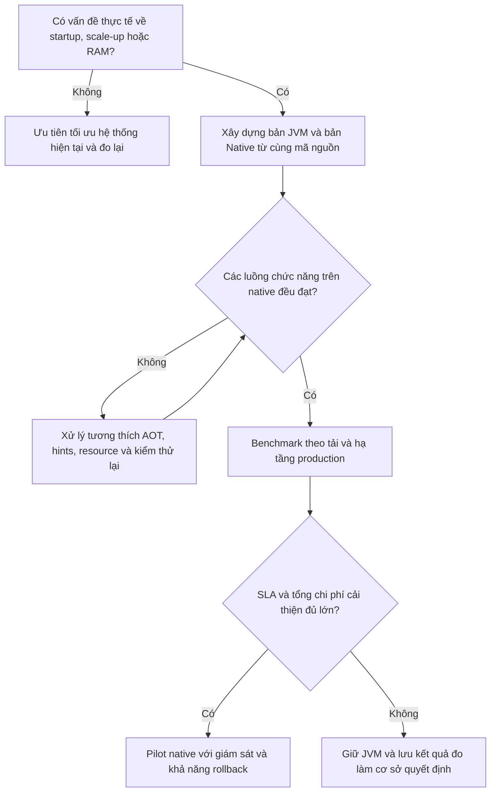

# Những tình huống phù hợp: dịch vụ ngắn hạn, co giãn nhanh và tài nguyên giới hạn

## Mục tiêu bài học

Trong hệ sinh thái **Spring Boot Native Image**, Spring AOT (Ahead-of-Time) phân tích và chuẩn bị một phần cấu hình ứng dụng ở thời điểm build; GraalVM Native Image tiếp tục biên dịch ứng dụng thành tệp thực thi native cho hệ điều hành và kiến trúc đích. Kết quả thường có lợi thế về **thời gian khởi động** và **bộ nhớ sử dụng** so với cách chạy ứng dụng Spring Boot bằng JVM truyền thống. Đổi lại, quá trình build phức tạp hơn và các cơ chế động như reflection, tải resource hoặc tạo proxy cần được kiểm tra kỹ.

Bài học này giúp bạn:

- Nhận diện ba nhóm bài toán có khả năng hưởng lợi rõ rệt: **tác vụ sống ngắn**, **dịch vụ phải tăng/giảm số bản sao nhanh**, và **môi trường giới hạn tài nguyên**.
- Giải thích *vì sao* đặc tính khởi động và bộ nhớ tác động đến độ trễ, khả năng mở rộng và chi phí.
- Phân biệt tình huống Native Image đáng thử với tình huống JVM có thể phù hợp hơn.
- Thiết kế phép đo công bằng và một đợt thử nghiệm (proof of concept, POC) trước khi đưa bản native lên production.

> **Nguyên tắc xuyên suốt:** Native Image là lựa chọn tối ưu theo đặc điểm tải thực tế, không phải bản nâng cấp mặc định cho mọi ứng dụng Spring Boot. Các số liệu trong ví dụ dưới đây chỉ là **giả định để minh họa cách tính**; cần đo trên chính ứng dụng của bạn.

## 1. Đặc tính nào của Native Image tạo ra khác biệt?

Một ứng dụng Spring Boot dạng JVM thường trải qua khởi tạo JVM, nạp lớp, khởi tạo framework và các thành phần ứng dụng. Native Image chuyển một phần công việc phân tích và biên dịch sang **giai đoạn build**. Nhờ đó, ứng dụng native thường sẵn sàng phục vụ sớm hơn và có thể dùng ít bộ nhớ hơn trong cùng điều kiện.

| Tiêu chí | Chạy Spring Boot trên JVM | Chạy Spring Boot Native Image |
|---|---|---|
| Khởi động tiến trình | Cần khởi tạo JVM và nạp mã | Thường nhanh hơn nhờ mã đã biên dịch ahead-of-time |
| Bộ nhớ lúc nhàn rỗi | Có chi phí của JVM, class metadata, JIT và ứng dụng | Thường giảm một phần chi phí runtime; vẫn dùng heap và garbage collector |
| Tối ưu khi chạy lâu | JIT có thể tối ưu các đường mã thường xuyên sử dụng | Hiệu năng phụ thuộc cấu hình biên dịch, profile và đặc điểm tải |
| Thời gian và tài nguyên build | Thường nhanh và ít tốn tài nguyên hơn | Native compilation có thể tốn nhiều CPU, RAM và thời gian |
| Mã động, reflection, resource | JVM có thể tra cứu nhiều thành phần tại runtime | Cần cấu hình/hints khi trình phân tích AOT không thể suy ra cách sử dụng |
| Đóng gói | Cần môi trường chạy Java phù hợp | Tệp thực thi gắn với hệ điều hành và kiến trúc CPU đích |

Điều cần phân biệt:

- **Startup time:** thời gian từ lúc tiến trình bắt đầu đến khi ứng dụng sẵn sàng xử lý yêu cầu.
- **Cold-start latency:** độ trễ của yêu cầu đầu tiên khi phải tạo môi trường chạy mới. Giá trị này có thể bao gồm cả scheduling, kéo image, khởi động tiến trình, kết nối phụ thuộc và khởi tạo ứng dụng.
- **Resident memory (RSS/working set):** lượng bộ nhớ tiến trình thực sự chiếm dụng; không nên đánh đồng với cấu hình giới hạn heap.
- **Steady-state throughput/latency:** năng lực xử lý sau khi ứng dụng đã khởi động và chịu tải ổn định.

Native Image tác động trực tiếp nhất tới phần khởi động tiến trình và một phần mức sử dụng bộ nhớ. Nó **không tự động** làm database nhanh hơn, giảm thời gian tải container image, hay bảo đảm throughput cao hơn JVM.

## 2. Dịch vụ ngắn hạn: khi chi phí khởi động chiếm phần lớn vòng đời

### 2.1. Các ví dụ điển hình

- **Job theo lịch:** tác vụ chạy mỗi vài phút để đối soát đơn hàng, dọn dữ liệu hết hạn, tổng hợp số liệu hoặc đồng bộ dữ liệu.
- **Worker xử lý theo sự kiện:** mỗi lần kích hoạt tạo một tiến trình hoặc một container mới để xử lý một lô công việc nhỏ.
- **Function/serverless có cold start:** dịch vụ chỉ chạy khi có yêu cầu và có thể bị thu hồi môi trường chạy khi không có lưu lượng.
- **Tiện ích CLI nội bộ:** công cụ Spring Boot sử dụng dependency injection để thực hiện một thao tác rồi kết thúc.

Với các tải này, khởi động có thể là một phần đáng kể của tổng thời gian xử lý:

```text
Tổng thời gian một lần chạy ≈ thời gian khởi động + thời gian xử lý nghiệp vụ

Tỷ trọng chi phí khởi động ≈ thời gian khởi động / tổng thời gian chạy
```

**Ví dụ giả định:** một job cần 1 giây để xử lý dữ liệu. Bản JVM khởi động 4 giây, còn bản native khởi động 0,5 giây:

| Đại lượng | JVM | Native |
|---|---:|---:|
| Khởi động | 4 giây | 0,5 giây |
| Xử lý nghiệp vụ | 1 giây | 1 giây |
| Tổng thời gian | 5 giây | 1,5 giây |
| Tỷ trọng khởi động | 80% | Khoảng 33% |

Trong ví dụ này, tổng thời gian giảm từ 5 xuống 1,5 giây. **Đây không phải số benchmark của Spring Boot hoặc GraalVM**: chỉ minh họa vì sao tỷ trọng khởi động càng lớn thì lợi ích tiềm năng càng cao.

### 2.2. Cách tổ chức một job Spring Boot

Với tác vụ thuần batch, có thể tắt mô hình web để tránh khởi động web server không cần thiết:

```java
import org.springframework.boot.CommandLineRunner;
import org.springframework.boot.WebApplicationType;
import org.springframework.boot.SpringApplication;
import org.springframework.boot.autoconfigure.SpringBootApplication;
import org.springframework.context.annotation.Bean;

@SpringBootApplication
public class ReportJobApplication {

    public static void main(String[] args) {
        SpringApplication app = new SpringApplication(ReportJobApplication.class);
        app.setWebApplicationType(WebApplicationType.NONE);
        app.run(args);
    }

    @Bean
    CommandLineRunner exportReport() {
        return args -> System.out.println("Xuat bao cao hoan tat");
    }
}
```

Ví dụ thể hiện một job tự chạy khi ứng dụng khởi động. Trong sản phẩm thực tế, thay lệnh in bằng logic nghiệp vụ, quản lý mã thoát khi thất bại và đóng tài nguyên đúng cách. **Tắt web server có thể có lợi ngay cả khi vẫn dùng JVM**; khi so sánh hai bản build, hãy giữ cùng cấu hình non-web.

### 2.3. Khi nào lợi ích không còn lớn?

Nếu một job xử lý dữ liệu trong 30 phút, việc giảm vài giây khởi động khó tạo khác biệt về thời gian hoàn tất. Tương tự, function serverless được tái sử dụng trong trạng thái **warm** nhiều lần có thể chỉ chịu chi phí khởi động một phần nhỏ số lần gọi. Lúc này phải đo tỷ lệ cold start, số yêu cầu trên mỗi môi trường chạy, thời gian xử lý thật và chi phí vận hành.

**Câu hỏi thực hành:** ứng dụng được tạo mới bao nhiêu lần mỗi ngày? Mỗi tiến trình chạy bao lâu? Người dùng hoặc hệ thống phía trước có thật sự chờ startup hay không?

## 3. Dịch vụ co giãn nhanh: khi tốc độ tạo replica ảnh hưởng khả năng đáp ứng

Một dịch vụ API có lưu lượng tăng đột ngột có thể cần mở rộng từ vài replica lên hàng chục replica. Kịch bản thường gặp gồm:

- Backend của chương trình bán hàng theo giờ, nơi lưu lượng tăng mạnh trong một khoảng ngắn.
- Dịch vụ xử lý sự kiện theo queue, được điều chỉnh số worker theo backlog bằng Kubernetes Event-driven Autoscaling (KEDA) hoặc cơ chế tương tự.
- API chạy trên nền tảng có **scale-to-zero**, nơi hệ thống giảm về 0 replica khi nhàn rỗi rồi phải tạo lại khi có yêu cầu.
- Microservice có chiến lược rolling update nhiều đợt và cần sớm đạt trạng thái sẵn sàng.

### 3.1. Native Image hỗ trợ khâu nào?

Thời gian có thể phục vụ khi mở rộng không chỉ là thời gian startup của Spring Boot:

```text
Phát hiện cần scale
      ↓
Scheduler chọn node và chuẩn bị tài nguyên
      ↓
Kéo container image (nếu chưa có)
      ↓
Khởi động tiến trình Spring Boot
      ↓
Kết nối DB / cache / dịch vụ phụ thuộc
      ↓
Readiness probe thành công
      ↓
Replica nhận traffic
```

Native Image chủ yếu giúp giảm độ trễ ở bước **khởi động tiến trình**, và đôi khi giảm áp lực bộ nhớ để scheduler đặt được nhiều replica hơn. Nếu phần lớn thời gian nằm ở kéo image, chờ node mới, khởi tạo kết nối hay dịch vụ phụ thuộc, lợi ích đến người dùng cuối có thể nhỏ hơn kỳ vọng.

Ví dụ minh họa: một replica mất 15 giây để sẵn sàng, trong đó Spring Boot startup mất 6 giây. Nếu bản native giảm phần startup còn 1 giây nhưng các bước khác giữ nguyên, tổng thời gian còn khoảng 10 giây, **không phải** 1 giây.

### 3.2. Điều cần thiết kế cùng Native Image

1. **Readiness chính xác.** Chỉ đưa lưu lượng tới replica khi ứng dụng thật sự xử lý được yêu cầu; không dùng log “Started” để thay thế kiểm tra phụ thuộc quan trọng.
2. **Autoscaling theo tín hiệu đúng.** Với CPU, queue depth hoặc concurrent requests, chọn ngưỡng phù hợp; Native Image không quyết định thời điểm hệ thống phát hiện tải.
3. **Giới hạn kết nối.** Mở rộng từ 5 lên 50 replica có thể làm tăng đột ngột kết nối tới database. Cấu hình pool phải phù hợp giới hạn của hệ thống phụ thuộc.
4. **Graceful shutdown.** Khi scale down hoặc triển khai phiên bản mới, hoàn tất các yêu cầu đang xử lý và xử lý đúng thời hạn termination.
5. **Khả năng chịu burst.** Kiểm thử từ 0→N hoặc từ ít→nhiều replica, đo cả lỗi 5xx, hàng đợi, p95/p99 latency và thời gian đạt đủ năng lực xử lý.

Với dịch vụ thường trực có lượng replica gần như cố định, phần startup chỉ diễn ra khi deploy hoặc khởi động lại. Nếu mục tiêu chính là throughput tối đa khi chạy liên tục, hãy đánh giá song song bản JVM.

## 4. Tài nguyên giới hạn: khi bộ nhớ là nút thắt triển khai

### 4.1. Những môi trường thường gặp

- **Pod/container nhỏ:** nền tảng cấp ngân sách RAM cố định cho mỗi instance.
- **Nhiều microservice trên một cụm:** phải đặt nhiều replica trên số node hữu hạn.
- **Edge hoặc máy chủ nhỏ:** thiết bị/VM có RAM hạn chế nhưng vẫn cần tính năng của Spring Boot.
- **Môi trường trả phí theo tài nguyên cấp phát:** giảm memory request hợp lý có thể giúp giảm chi phí hoặc tăng mật độ chạy trên node.

Một Native Image thường giảm phần bộ nhớ dành cho hạ tầng runtime, nhưng **không loại bỏ heap, GC, cache ứng dụng, thread stack, buffer mạng, kết nối hay bộ nhớ native của thư viện**. Kết quả phụ thuộc cách phân bổ dữ liệu và mức tải.

### 4.2. Ước lượng mật độ replica

Giả sử node có 4 GiB RAM *có thể phân bổ cho workload*, CPU và các tài nguyên khác đều đủ, không tính các chi phí phụ:

| Memory request mỗi replica | Số replica tối đa theo phép chia RAM đơn giản |
|---|---:|
| 512 MiB | 8 |
| 256 MiB | 16 |

Công thức ước lượng:

```text
Số replica theo RAM ≈ floor(RAM có thể phân bổ / memory request mỗi replica)
```

Đây là **giới hạn lý thuyết chỉ xét RAM**. Thực tế Kubernetes còn chịu ảnh hưởng của CPU request, daemon, system-reserved memory, giới hạn pod trên node và chiến lược scheduling.

Giảm memory request chỉ an toàn khi đã đo **mức sử dụng tại đỉnh tải**, bao gồm các đợt tăng lưu lượng, GC và hoạt động nền. Nếu request giảm nhưng memory limit quá thấp, container có thể bị OOM kill và làm giảm độ sẵn sàng của dịch vụ. Không dùng riêng mức RAM nhàn rỗi để xác định limit.

### 4.3. Các chỉ số cần đo

| Chỉ số | Vì sao quan trọng? |
|---|---|
| RSS/working set khi idle | Cho thấy chi phí giữ replica sẵn sàng |
| RSS/working set ở tải đại diện và đỉnh tải | Cơ sở xác định request/limit |
| CPU sử dụng và CPU throttling | RAM ít hơn không có nghĩa CPU luôn ít hơn |
| Throughput và p95/p99 latency | Đảm bảo tối ưu tài nguyên không làm giảm chất lượng dịch vụ |
| Số OOM kill, restart và lỗi | Phát hiện cấu hình tài nguyên quá sát |
| Chi phí build/CI và thời gian deploy | Tính chi phí vòng đời thay vì chỉ chi phí runtime |

## 5. Những trường hợp chưa nên ưu tiên Native Image

Native Image có thể **không phải điểm khởi đầu tốt nhất** khi:

| Đặc điểm hệ thống | Lý do cần cân nhắc |
|---|---|
| Ứng dụng sống lâu, ít khởi động lại, CPU-bound | Lợi ích startup thấp; JIT của JVM có thể cho throughput tốt hơn ở một số tải |
| Thư viện sử dụng reflection động, proxy hoặc class loading khó phân tích | Có thể cần Runtime Hints, metadata bổ sung và kiểm thử native riêng |
| Phụ thuộc JNI, thư viện native hoặc tài nguyên tải theo tên động | Cần xác minh tương thích theo hệ điều hành/kiến trúc và cách đóng gói |
| Build pipeline có giới hạn CPU/RAM hoặc thời gian | Native compilation thường nặng hơn build JAR |
| Tần suất thay đổi code cao, vòng phản hồi phát triển cần rất ngắn | Việc compile native ở mọi vòng sửa code có thể làm chậm nhóm; nên giữ vòng phát triển JVM |
| Độ trễ do database, network hoặc thuật toán xử lý chi phối | Tối ưu startup không giải quyết nguyên nhân chính |

**Không có quy tắc rằng native luôn nhanh hơn trong mọi phép đo.** Với ứng dụng có thời gian chạy dài, bộ biên dịch JIT của JVM có thể tối ưu rất tốt mã nóng. Hiệu năng Native Image cũng thay đổi theo phiên bản công cụ, tối ưu biên dịch và đặc điểm workload. Hãy để số liệu về latency, throughput và chi phí quyết định.

## 6. POC: đo một ứng dụng dưới cả hai cách triển khai

### 6.1. Chuẩn bị hai bản build từ cùng mã nguồn

Dùng một phiên bản Spring Boot hỗ trợ AOT và GraalVM Native Image, cấu hình Spring Boot plugin cùng **GraalVM Native Build Tools** phù hợp. Máy build native cần GraalVM JDK và công cụ `native-image`, hoặc môi trường buildpack hỗ trợ native compilation.

**Maven** (ví dụ trên shell Unix khi dự án đã cấu hình plugin cần thiết):

```bash
# Bản JVM
./mvnw clean package

# Bản native
./mvnw -Pnative native:compile
```

**Gradle** (khi dự án đã cấu hình GraalVM Native Build Tools):

```bash
# Bản JVM
./gradlew bootJar

# Bản native
./gradlew nativeCompile
```

Ứng dụng JVM có thể chạy bằng `java -jar ...jar`; bản native chạy trực tiếp bằng tệp thực thi sinh ra (ví dụ trong `target/` của Maven hoặc `build/native/nativeCompile/` của Gradle). Tên tệp phụ thuộc project và hệ điều hành. Với container, Spring Boot Buildpacks cũng có thể tạo image native, ví dụ `./mvnw -Pnative spring-boot:build-image` khi buildpack và cấu hình Maven tương thích.

**Chú ý kiến trúc đích:** một tệp thực thi native cho Windows không đồng nghĩa chạy được trên Linux; cần build cho hệ điều hành và kiến trúc CPU sử dụng khi deploy. Cả bản JVM lẫn native phải dùng cùng cấu hình nghiệp vụ, mức tải và loại hạ tầng để so sánh.

### 6.2. Kiểm tra khả năng tương thích AOT

Trước khi benchmark, thực hiện các luồng chức năng liên quan đến JSON, serialization/deserialization, validation, ORM, security, proxy, reflection, file resource, TLS và thư viện bên thứ ba mà ứng dụng thực sự sử dụng.

Spring AOT và các thư viện hỗ trợ tốt có thể tự tạo nhiều cấu hình cần thiết. Với kiểu dữ liệu/resource chỉ được truy cập **động** mà bộ phân tích không nhận diện được, có thể phải đăng ký `RuntimeHints`. Ví dụ cấu trúc đăng ký hints:

```java
import org.springframework.aot.hint.MemberCategory;
import org.springframework.aot.hint.RuntimeHints;
import org.springframework.aot.hint.RuntimeHintsRegistrar;
import org.springframework.context.annotation.Configuration;
import org.springframework.context.annotation.ImportRuntimeHints;

class ExternalPayloadHints implements RuntimeHintsRegistrar {
    @Override
    public void registerHints(RuntimeHints hints, ClassLoader classLoader) {
        hints.reflection().registerType(
                ExternalPayload.class,
                MemberCategory.INVOKE_DECLARED_CONSTRUCTORS,
                MemberCategory.INVOKE_PUBLIC_METHODS
        );
        hints.resources().registerPattern("templates/external-payload.json");
    }
}

@Configuration(proxyBeanMethods = false)
@ImportRuntimeHints(ExternalPayloadHints.class)
class NativeRuntimeHintsConfig {
}
```

Trong ví dụ, `ExternalPayload` là lớp DTO giả định của ứng dụng; thay bằng kiểu thực tế. Chỉ thêm hints khi có nhu cầu truy cập động cụ thể, và kiểm thử tính đúng đắn trên **tệp native đã biên dịch**. Một chức năng chạy được trên JVM chưa đủ chứng minh nó chạy được ở native.

### 6.3. Thiết kế bảng đo

Tạo hai bản triển khai với cùng phiên bản mã, dữ liệu, tài nguyên được cấp và biến môi trường; chạy nhiều lần để loại trừ nhiễu. Đo cả **cold** và **warm** nếu nền tảng thực tế tái sử dụng instance.

| Phép đo | Cách quan sát | Đánh giá cho nhóm tải nào? |
|---|---|---|
| Từ start tới readiness thành công | Mốc bắt đầu container/process tới lần đầu health/readiness hợp lệ | Cả ba; đặc biệt scale-to-zero |
| Độ trễ yêu cầu đầu tiên sau scale-up | Sinh request khi hệ thống có 0 hoặc ít replica | Serverless, co giãn nhanh |
| Thời gian hoàn tất một job | Từ kích hoạt tới exit code/kết quả thành công | Dịch vụ ngắn hạn |
| Memory idle, bình thường, peak | RSS/working set, `docker stats`, metric container/Kubernetes | Tài nguyên giới hạn |
| RPS, p95/p99 latency và error rate | Công cụ load test và metric ứng dụng | Dịch vụ API chạy lâu |
| Thời gian build, bộ nhớ máy build, kích thước image | CI logs và artifact registry | Chi phí vận hành tổng thể |
| Lỗi chức năng và test tích hợp | Test E2E/API/DB/serialization trên bản native | Điều kiện bắt buộc trước production |

Không so sánh bản JVM chưa warm-up với bản native đã được làm nóng theo một cách khác nhau khi đo throughput. Với API, chạy **warm-up tương đương**, sau đó đo tải ổn định và tải tăng đột biến riêng biệt. Nếu thử trên Kubernetes, giữ nhất quán resource request/limit ban đầu, image pull policy, startup/readiness probe và chính sách autoscaling; sau đó mới thử tối ưu request cho từng bản theo số liệu.

### 6.4. Một phép thử theo từng tình huống

**Tác vụ ngắn:** chạy 30–50 lần job với cùng dữ liệu, lưu thời gian khởi động, thời gian xử lý và mã thoát. So sánh trung vị và p95 của tổng thời gian. Nếu job có cold start bất thường, điều tra nguyên nhân trước khi kết luận.

**Co giãn nhanh:** tạo tải đột biến từ 0 hoặc số replica nhỏ, ghi thời điểm hệ thống phát hiện scale, pod được schedule, container start, readiness và thời điểm đáp ứng SLA. Đo backlog hoặc request bị trễ trong toàn quá trình.

**Giới hạn tài nguyên:** giữ tải ở mức bình thường rồi tăng tới ngưỡng thiết kế; đo peak RSS và lỗi OOM. Chọn memory request/limit mới có khoảng đệm dựa trên kết quả, rồi xác nhận số replica thực tế đặt được trên node và chất lượng dịch vụ không giảm.

## 7. Khung ra quyết định

| Câu hỏi | Nghiêng về thử Native Image | Nghiêng về giữ JVM hoặc đánh giá thêm |
|---|---|---|
| Tiến trình có được tạo/hủy liên tục không? | Có; startup ảnh hưởng trực tiếp thời gian xử lý | Không; tiến trình chạy liên tục hàng ngày |
| Có yêu cầu scale-to-zero hoặc tăng replica trong vài giây không? | Có; readiness chậm gây trễ/lỗi | Không; tải ổn định và ít scale |
| Bộ nhớ có là giới hạn về chi phí hoặc khả năng triển khai? | Có; RSS thấp hơn sẽ giúp giảm request hợp lý | Không; CPU hoặc I/O mới là nút thắt |
| Ứng dụng có phụ thuộc nhiều vào cơ chế runtime động không? | Ít, hoặc đã có hỗ trợ/hints và test native | Nhiều thư viện chưa xác nhận tương thích |
| CI có đủ tài nguyên cho native compilation không? | Có và tần suất build phù hợp | Chưa; thời gian build là ràng buộc lớn |
| Bản native có đạt cùng SLA và yêu cầu chức năng không? | Đã kiểm thử thành công dưới tải đại diện | Chưa có số liệu; cần POC trước |

Có thể dùng một quy trình lựa chọn đơn giản:



## 8. Tình huống tổng hợp

**Bài toán:** một hệ thống thương mại điện tử có ba thành phần Spring Boot:

1. **Job cập nhật khuyến mãi:** được gọi liên tục theo lịch, mỗi lần chạy xử lý trong khoảng vài giây. Đây là ứng viên tốt để thử native vì thời gian khởi động có thể chiếm tỷ trọng cao.
2. **API tra cứu khuyến mãi:** trong chiến dịch bán hàng số replica thay đổi nhanh theo lưu lượng. Native có thể giúp replica sẵn sàng sớm hơn và giảm RAM mỗi bản sao. Cần đo thêm thời gian khởi động pod, tải xuống image, kết nối DB và khả năng chịu burst.
3. **Dịch vụ phân tích đơn hàng chạy 24/7:** tiêu thụ CPU lớn, giữ cache dữ liệu lâu và có ít lần restart. Startup khó là nút thắt chính; nên so sánh throughput và latency với JVM trước khi chọn native.

Không nên quyết định chung cho cả ba chỉ vì cùng dùng Spring Boot. Một kiến trúc có thể **kết hợp ứng dụng native và JVM**, tùy đặc điểm từng dịch vụ.

## 9. Tự kiểm tra

1. Vì sao giảm thời gian khởi động từ 5 giây xuống 1 giây có thể rất quan trọng với job chạy 2 giây nhưng ít đáng kể với tiến trình chạy 10 ngày?
2. Khi Kubernetes cần 40 giây để kéo image và 3 giây để khởi động Java, tối ưu startup xuống 0,5 giây có giải quyết được phần lớn thời gian scale-up không? Bạn sẽ đo thêm khâu nào?
3. Nếu RSS idle giảm một nửa nhưng p99 latency tăng rõ rệt dưới tải, bạn có thể kết luận Native Image tối ưu hơn không? Vì sao?
4. Tại sao kiểm thử REST API trên JVM thành công vẫn chưa đủ để xác nhận resource/reflection hoạt động trên tệp native?
5. Khi lựa chọn giữa JVM và Native Image cho một microservice, hãy đề xuất tối thiểu **ba chỉ số kỹ thuật** và **một chỉ số chi phí** cần so sánh.

**Điểm cần ghi nhớ:** Spring Boot Native Image đặc biệt đáng thử khi chi phí khởi động lặp lại nhiều lần, khi thời gian sẵn sàng của replica ảnh hưởng khả năng phục vụ, hoặc khi bộ nhớ là giới hạn rõ ràng. Quyết định cuối cùng phải dựa trên **kiểm thử chức năng native và phép đo cùng điều kiện**, bao gồm cả throughput, độ trễ và chi phí build.
