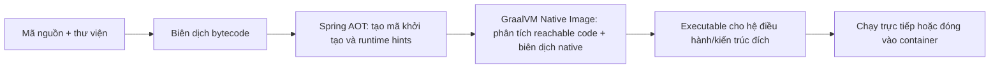
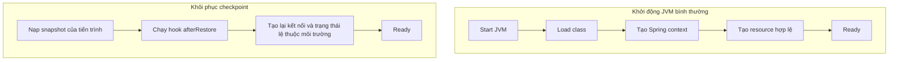

# Ranh giới giữa Spring Boot Native Image, container image, jlink, CDS và checkpoint

> **Chương:** Tổng quan  
> **Trọng tâm:** Phân biệt các cơ chế tối ưu triển khai và khởi động ứng dụng Spring Boot, xác định công nghệ nào thay đổi cách thực thi, công nghệ nào chỉ thay đổi cách đóng gói, và khi nào nên kết hợp chúng.

## 1. Vì sao cần phân biệt các khái niệm này?

Khi tối ưu một dịch vụ Spring Boot, ta thường gặp các phát biểu như “đóng thành Docker image thì khởi động nhanh hơn”, “dùng jlink là đã biên dịch native”, hoặc “CDS giống checkpoint”. Các phát biểu này gộp nhiều lớp kỹ thuật khác nhau. Chúng có thể cùng xuất hiện trong một hệ thống, nhưng giải quyết những vấn đề khác nhau.

Một ứng dụng Spring Boot thường trải qua các lớp sau:

1. **Mã ứng dụng và khởi tạo framework:** Spring đọc cấu hình, khám phá bean, tạo context, ánh xạ endpoint và khởi tạo tài nguyên.
2. **Cách biến mã thành chương trình chạy:** chạy bytecode bằng JVM hoặc biên dịch trước thành mã máy với GraalVM Native Image.
3. **Cơ chế tối ưu quá trình chạy/khởi động:** jlink, CDS/AppCDS, tối ưu khởi tạo của Spring AOT, hoặc checkpoint/restore.
4. **Cách vận chuyển và triển khai:** file JAR, executable native, container image, máy ảo hoặc nền tảng serverless.

**Container image** thuộc lớp đóng gói. **jlink** tạo bộ runtime Java rút gọn. **CDS** giúp JVM dùng lại dữ liệu lớp đã lưu. **Checkpoint/restore** giữ lại trạng thái của một tiến trình để khôi phục sau. **GraalVM Native Image** thay đổi căn bản cách thực thi: biên dịch ứng dụng Java thành executable native ở giai đoạn build.

Trong module **SPRING_BOOT_NATIVE_IMAGE**, mục tiêu là sử dụng **Spring AOT cùng GraalVM Native Image** để biên dịch ứng dụng Spring Boot, đo thời gian khởi động và bộ nhớ, xử lý reflection/resource, build bằng Maven hoặc Gradle, đóng gói container và đánh giá khả năng vận hành. Vì vậy cần xem các cơ chế còn lại như những phương án đối chiếu hoặc các lớp có thể kết hợp, thay vì coi chúng đồng nghĩa với native.

## 2. Bảng đối chiếu: mỗi cơ chế thực sự làm gì?

| Cơ chế | Đối tượng được tạo ra hoặc lưu lại | Khi chạy cần gì? | Tác động thường gặp | Điều **không** được suy ra |
|---|---|---|---|---|
| **GraalVM Native Image** | Executable mã máy được biên dịch ahead-of-time | Runtime native đi kèm binary; có thể vẫn cần thư viện hệ điều hành | Startup ngắn, ít chi phí khởi tạo JVM; thường có lợi về bộ nhớ ở workload nhỏ | Không tự động tạo container; không bảo đảm throughput cao hơn JVM |
| **Container image (OCI/Docker)** | Các lớp filesystem, metadata và lệnh chạy | Container runtime và các phụ thuộc nằm trong image | Tái lập môi trường, triển khai nhất quán | Không tự biến bytecode thành mã máy hoặc giảm thời gian khởi động |
| **jlink** | Java runtime image chỉ chứa những module JDK đã chọn | Vẫn chạy ứng dụng Java bằng JVM trong runtime đó | Giảm dung lượng bộ JDK/JRE phân phối; giảm bề mặt runtime | Không loại bỏ JVM/JIT; không biên dịch bytecode ứng dụng thành native |
| **CDS / AppCDS** | Archive dữ liệu class mà JVM có thể dùng lại | JVM tương thích, ứng dụng và classpath phù hợp | Giảm phần việc nạp/link class; có thể giảm thời gian startup và chia sẻ một phần bộ nhớ | Không lưu toàn bộ Spring context, heap hay kết nối |
| **Checkpoint / restore (ví dụ CRaC)** | Trạng thái đã khởi tạo của tiến trình JVM tại một thời điểm | Môi trường và JVM/cơ chế restore tương thích | Khôi phục nhanh hơn khởi động từ đầu trong kịch bản phù hợp | Không tạo binary native; không thể mặc định tái sử dụng socket, token và kết nối cũ |

Các chỉ tiêu **thời gian khởi động**, **thời điểm sẵn sàng phục vụ**, **RSS/PSS**, **dung lượng image** và **throughput** là những đại lượng khác nhau. Một phương án tốt về dung lượng đóng gói chưa chắc tốt về bộ nhớ hoạt động hoặc độ trễ yêu cầu.

### Hai trục độc lập: cách chạy và cách đóng gói

| Cách thực thi | Không dùng container | Chạy trong container |
|---|---|---|
| **JVM + JAR** | `java -jar app.jar` trên máy chủ | Image chứa JRE/JDK và JAR |
| **JVM + jlink** | Chạy JAR bằng runtime rút gọn | Image chứa runtime jlink và JAR |
| **JVM + CDS** | Chạy JVM với archive phù hợp | Image chứa JAR, JVM và archive CDS tương thích |
| **GraalVM Native Image** | Chạy executable native trực tiếp | Image chứa executable native và thư viện OS cần thiết |
| **JVM + checkpoint/restore** | Khôi phục trạng thái tiến trình trong môi trường hỗ trợ | Khả thi khi runtime/container và tài nguyên restore được thiết kế phù hợp |

Như vậy, câu hỏi “nên chọn Docker hay Native Image?” đặt hai công nghệ ở hai trục khác nhau: **có thể và thường sẽ sử dụng cả hai**.

## 3. Native Image: biên dịch trước, khác bản chất với các tối ưu JVM

Với Spring Boot chạy trên JVM, Java/Kotlin được biên dịch thành bytecode. Khi ứng dụng chạy, JVM nạp class, xác minh, diễn dịch hoặc JIT-compile các đoạn mã nóng. Spring khởi tạo application context, áp dụng cấu hình và quản lý các bean.

Với Native Image, quá trình build thường bao gồm:



**Spring AOT** phân tích cấu hình ứng dụng ở thời điểm build, sinh mã hỗ trợ khởi tạo context và cung cấp các gợi ý cần thiết cho môi trường ít khả năng khám phá động. **GraalVM Native Image** dùng thông tin đó cùng phân tích mã có thể được gọi để tạo binary. Hai bước bổ trợ nhau: Spring AOT không tự nó là một trình biên dịch mã máy, còn GraalVM cần biết những hành vi động của framework để tạo binary đúng.

Ví dụ các thành phần cần kiểm tra khi chuyển sang native:

- **Reflection:** tên lớp, constructor, method hoặc field chỉ được xác định lúc chạy có thể cần `RuntimeHints` hay các cơ chế đăng ký tương ứng.
- **Resource:** template, tệp cấu hình, certificate, thông điệp i18n và tài nguyên đọc theo đường dẫn classpath cần được đưa vào binary phù hợp.
- **Dynamic proxy, serialization, JNI:** cần kiểm tra khả năng reachability và metadata tương ứng.
- **Điều kiện phụ thuộc runtime:** các bean hoặc class được nạp theo plugin, tên lớp cấu hình động hay script có thể không phù hợp với giả định closed-world của quá trình native build.

Chẳng hạn, khi một thư viện tự gọi `Class.forName("com.example.PaymentPlugin")` từ tên cấu hình runtime, Native Image có thể không nhận ra class đó qua phân tích tĩnh. Ứng dụng có thể build thành công nhưng lỗi ở nhánh chạy thực tế nếu thiếu hints hoặc thiết kế phải thay đổi. Vì thế việc chạy test trên JVM chưa thay thế được **kiểm thử binary native**.

Ví dụ lệnh build thường gặp cho dự án đã cấu hình GraalVM Native Build Tools:

```bash
# Maven: profile native và plugin tương ứng phải được cấu hình trong dự án
./mvnw -Pnative native:compile

# Gradle: dự án cần plugin org.graalvm.buildtools.native
./gradlew nativeCompile
```

Đầu ra là executable riêng cho nền tảng build/target phù hợp. Binary Linux cho `amd64` không mặc nhiên chạy được trên Windows hoặc `arm64`; những yêu cầu về `glibc`/`musl` và thư viện động cũng cần được kiểm tra. “Native” không luôn có nghĩa “binary độc lập hoàn toàn với hệ điều hành”.

Đối với một dịch vụ có thời gian sống dài và lưu lượng liên tục, JVM với JIT vẫn có thể đạt throughput tốt hơn ở một số workload; Native Image thường phải đánh đổi thêm thời gian, CPU và RAM ở **bước build**. Không nên chỉ nhìn vào thời gian startup rồi kết luận native tốt hơn trên mọi trục.

## 4. Container image: đơn vị triển khai, không phải chiến lược biên dịch

Container image theo chuẩn OCI mô tả filesystem và cách khởi chạy tiến trình. Nó có thể chứa Java runtime cùng JAR hoặc chỉ chứa executable native và các thư viện OS cần thiết. Container không quyết định ứng dụng dùng JIT hay AOT.

**Trường hợp A — Spring Boot chạy trên JVM trong container:**

```dockerfile
FROM eclipse-temurin:21-jre
WORKDIR /app
COPY target/app.jar app.jar
ENTRYPOINT ["java", "-jar", "app.jar"]
```

**Trường hợp B — executable native Linux chạy trong container:**

```dockerfile
FROM debian:bookworm-slim
WORKDIR /app
COPY target/app /app/app
ENTRYPOINT ["/app/app"]
```

Các Dockerfile trên chỉ minh họa sự khác nhau ở **tiến trình chạy**. Tên artifact, quyền thực thi, kiến trúc CPU, libc, CA certificates, timezone và thư viện hệ thống phải khớp với binary thật. Với native, một base image cực nhỏ chưa chắc chạy được nếu binary thiếu các thư viện động mà nó cần.

Spring Boot cũng có thể dùng Cloud Native Buildpacks để tạo OCI image. Tùy cấu hình, image đó chứa ứng dụng JVM hoặc executable native; tên thao tác **`build-image`** một mình không chứng minh artifact đã được biên dịch native.

Khi đánh giá image, tách ba câu hỏi:

1. **Dung lượng download/push:** tổng kích thước các layer và mức tận dụng layer cache khi triển khai.
2. **Thời điểm ứng dụng sẵn sàng:** cần đo tiến trình bên trong container từ lúc start đến lúc health/readiness thành công.
3. **Bộ nhớ khi phục vụ tải:** đo tiến trình/cgroup ở cùng workload, vì dung lượng image trên registry không phải RAM mà tiến trình sử dụng.

**Kết luận ranh giới:** Docker giải quyết triển khai; Native Image giải quyết cách biên dịch và thực thi. Có thể đóng gói bản native bằng Docker và vẫn hưởng lợi từ orchestration, mạng, health check và các cơ chế triển khai container.

## 5. jlink: cắt giảm Java runtime, vẫn là một JVM

**`jlink`** là công cụ JDK tạo runtime Java tùy biến dựa trên hệ module của JDK (JPMS). Thay vì mang theo toàn bộ bộ runtime, ta đưa vào những module JDK cần dùng. Mục tiêu nổi bật là giảm **dung lượng runtime được phân phối**, có thể hỗ trợ giảm bề mặt bản vá và số thành phần không cần thiết.

Ví dụ minh họa:

```bash
# Danh sách module phải được xác định theo dependency thực của ứng dụng
jlink \
  --add-modules java.base,java.logging,java.sql,java.naming \
  --strip-debug \
  --no-man-pages \
  --no-header-files \
  --output custom-jre

# Ứng dụng vẫn được chạy bởi java trong runtime vừa tạo
./custom-jre/bin/java -jar app.jar
```

Tại đây, `app.jar` **vẫn là bytecode Java** và `custom-jre/bin/java` **vẫn là JVM**. JIT, GC, classloading và vòng đời JVM không biến mất. Câu lệnh trên chưa chắc đủ module cho một ứng dụng Spring Boot thực tế; các thư viện sử dụng service loader, reflection hoặc module tùy chọn có thể cần những module khác.

Có thể dùng `jdeps` để hỗ trợ tìm dependency module, nhưng với Spring Boot executable JAR có thư viện lồng trong `BOOT-INF/lib`, phân tích trực tiếp một JAR có thể **không nhìn thấy đầy đủ** các dependency. Cần phân tích classpath/thư viện đã giải nén phù hợp, thêm các module phát hiện qua test và kiểm thử chức năng trên chính runtime jlink.

**Khi jlink hữu ích:** hệ thống vẫn muốn dùng JVM, đội ngũ muốn tận dụng JIT và ecosystem Java, đồng thời cần image gọn và runtime có thể kiểm soát. Nếu mục tiêu chính là giảm cold start, cần đo thực tế thay vì coi jlink là thay thế cho Native Image.

## 6. CDS và AppCDS: dùng lại dữ liệu class, không lưu toàn bộ tiến trình

**Class Data Sharing (CDS)** giúp HotSpot JVM sử dụng dữ liệu class đã được đưa vào một archive, tránh làm lại một phần công việc nạp và xử lý metadata ở lần chạy tiếp theo. **Application CDS (AppCDS)** mở rộng phạm vi tới các class của ứng dụng và thư viện khi cấu hình cho phép. Một số phần dữ liệu được map dùng chung, mang lại lợi ích khi có nhiều JVM tương thích cùng chạy trên một máy.

Minh họa cơ bản trên JVM hỗ trợ dynamic archive:

```bash
# Chạy ứng dụng với chế độ tạo archive khi tiến trình thoát bình thường
java -XX:ArchiveClassesAtExit=app.jsa -jar app.jar

# Lần chạy sau: yêu cầu JVM dùng archive đã tạo
java -XX:SharedArchiveFile=app.jsa -jar app.jar
```

Đây là ví dụ về cơ chế, không phải công thức bảo đảm mọi class Spring Boot đều có trong archive. Cách đóng gói executable JAR, classloader của Spring Boot, phiên bản JDK, classpath và tùy chọn JVM ảnh hưởng tới việc class nào được chia sẻ. Trong một số cách triển khai cần **giải nén JAR và chạy bằng classpath phù hợp** để AppCDS bao phủ nhiều class hơn.

CDS **không** tương đương:

- **Spring AOT:** CDS tái sử dụng dữ liệu lớp ở phía JVM; Spring AOT sinh mã và hints cho cấu trúc ứng dụng Spring từ bước build.
- **Native Image:** CDS vẫn cần HotSpot JVM và vẫn có JIT/GC như ứng dụng Java thông thường.
- **Checkpoint:** CDS không phục hồi một Spring `ApplicationContext` đã dựng, heap, thread, kết nối database hoặc các tác vụ đã chạy dở.

Archive thường phụ thuộc khá chặt vào JDK, classpath, classloader và các tùy chọn liên quan. Khi thay JAR, dependency, JDK hoặc cách launch, cần tạo và xác minh lại archive. Nếu triển khai trong container, phải đảm bảo archive tạo ở môi trường tương thích với lúc chạy.

**Khi CDS hữu ích:** muốn giữ JVM mà giảm thời gian classloading, đặc biệt khi phải chạy nhiều bản sao dịch vụ. CDS có thể phối hợp với jlink hoặc container, tùy tính tương thích của bản JDK và cách build.

## 7. Checkpoint/restore: khôi phục trạng thái đã khởi tạo

Một cơ chế **checkpoint/restore** chụp trạng thái của tiến trình ở thời điểm phù hợp rồi khôi phục để tiếp tục chạy. Với Java, **Coordinated Restore at Checkpoint (CRaC)** là một cách tiếp cận có API/hook cho phép ứng dụng chuẩn bị tài nguyên trước khi chụp và tái tạo tài nguyên sau khi restore; nó cần bản JVM và hạ tầng hỗ trợ.

Hình dung hai cách đưa ứng dụng tới trạng thái sẵn sàng:



Khác biệt lớn nhất so với CDS là checkpoint có thể chứa **trạng thái tiến trình đã thực thi**, trong khi CDS chủ yếu chứa dữ liệu class. Khác biệt với Native Image là tiến trình được khôi phục **vẫn là tiến trình JVM**.

Một ví dụ khái niệm với JVM hỗ trợ CRaC:

```bash
# Khởi chạy trên bản JVM có CRaC; ứng dụng phải có luồng kích hoạt checkpoint
java -XX:CRaCCheckpointTo=/opt/checkpoint -jar app.jar

# Khôi phục từ checkpoint đã tạo bằng cơ chế tương thích
java -XX:CRaCRestoreFrom=/opt/checkpoint
```

Chỉ bật tùy chọn `-XX:CRaCCheckpointTo` không tự đảm bảo checkpoint được tạo: ứng dụng hoặc tích hợp framework phải **chủ động kích hoạt checkpoint** ở thời điểm thích hợp. Chi tiết lệnh, hệ điều hành, quyền kernel và runtime phụ thuộc triển khai CRaC cụ thể; không nên chép ví dụ rồi mặc định mọi JDK đều hỗ trợ.

Với Spring Boot, thách thức thường nằm ở trạng thái phụ thuộc môi trường:

| Tài nguyên lúc checkpoint | Vì sao phải xử lý khi restore? | Cách tiếp cận |
|---|---|---|
| Connection pool tới database | TCP connection cũ có thể không còn hợp lệ | Đóng/quiesce trước checkpoint, tạo lại sau restore |
| Socket server, client HTTP, message broker | Port và session phụ thuộc host hoặc môi trường | Khởi tạo lại listener/client bằng lifecycle hook |
| Token, credential, certificate ngắn hạn | Có thể đã hết hạn hoặc bị sao chép vào snapshot | Làm mới secret và phiên xác thực |
| Clock, timeout, random state | Thời gian đã trôi qua trong lúc không chạy; trạng thái ngẫu nhiên có thể bị nhân bản | Đọc lại thời gian, lập lịch và làm mới nguồn ngẫu nhiên khi cần |
| Background job, scheduler, thread | Có thể ở trạng thái không an toàn tại điểm chụp | Chọn điểm checkpoint ổn định và khởi động lại công việc theo quy tắc idempotent |
| File descriptor, filesystem path | Môi trường restore có thể không có cùng tệp/mount | Xác minh môi trường, đóng/mở lại tài nguyên |

**Checkpoint không đồng nghĩa với snapshot portable trên mọi máy.** Quy trình restore có thể phụ thuộc kernel, kiến trúc, phiên bản JVM, mount và cấu hình runtime. Snapshot cũng có thể chứa dữ liệu nhạy cảm ở bộ nhớ; phải kiểm soát quyền truy cập và vòng đời lưu trữ.

Những nền tảng sử dụng snapshot ở mức runtime để tăng tốc khởi tạo có thể có quy tắc riêng; không được mặc định cơ chế nào cũng tương thích với CRaC. Lợi ích khởi động phải tính cả công đoạn chuẩn bị snapshot, lưu trữ, restore và xử lý tài nguyên.

## 8. Những công nghệ này có thể phối hợp thế nào?

Một vài tổ hợp thực tế:

- **Spring Boot JVM + OCI image:** lựa chọn triển khai phổ biến và đơn giản để vận hành.
- **Spring Boot JVM + jlink + OCI image:** ưu tiên giảm dung lượng bộ runtime, vẫn tận dụng HotSpot/JIT.
- **Spring Boot JVM + CDS + OCI image:** tối ưu classloading; cần quản lý archive phù hợp với binary/JDK/classpath.
- **Spring Boot JVM + jlink + CDS:** có thể kết hợp nếu JDK tùy biến chứa các module và tính năng hỗ trợ; kiểm thử archive với đúng runtime.
- **Spring Boot JVM + CRaC:** ưu tiên restore ứng dụng đã khởi tạo; đòi hỏi quản trị checkpoint và hook tài nguyên.
- **Spring Boot AOT + GraalVM Native Image + OCI image:** giảm chi phí startup trên đường chạy native, đồng thời có đơn vị triển khai container.

Một số tối ưu có thể hỗ trợ nhau, nhưng **Native Image không chạy trên HotSpot JVM** nên không dùng CDS/CRaC dành cho tiến trình HotSpot theo cách bản JAR sử dụng. Không nên kỳ vọng ghép tất cả công nghệ vào một binary rồi cộng dồn hiệu năng.

### Chọn phương án theo vấn đề thực tế

| Tình huống | Hướng thử nghiệm đầu tiên | Câu hỏi kiểm chứng |
|---|---|---|
| Tốn dung lượng tải image, thời gian khởi động đã ổn | Giảm layer, jlink hoặc đổi base image | Image/layer giảm bao nhiêu, runtime còn đủ module không? |
| Nhiều instance JVM phải khởi động thường xuyên | CDS/AppCDS; so sánh thêm Native Image | Mất bao lâu tới readiness, archive có ổn định không? |
| Scale-to-zero, CLI, job ngắn, serverless có cold start nhạy cảm | Native Image hoặc snapshot/restore nếu nền tảng hỗ trợ | Cold-start p50/p95 và RAM ở workload thật là bao nhiêu? |
| Dịch vụ sống lâu, throughput/JIT là ưu tiên | JVM được tuning, có thể kết hợp jlink/CDS | Throughput, p99 latency và CPU sau warm-up có tốt hơn không? |
| Cần giữ trạng thái Spring đã khởi tạo để nhân bản nhanh | Đánh giá CRaC/checkpoint với lifecycle hook | Connection, token, scheduler có an toàn sau restore không? |
| Muốn triển khai nhất quán trên Kubernetes | OCI image cho bản JVM hoặc native | Health/readiness, tín hiệu tắt và kiến trúc image có đúng không? |

Các ô này là **điểm bắt đầu thí nghiệm**, không phải kết luận thay cho benchmark.

## 9. Bài thực hành đối chứng cho Spring Boot

Giả sử có một dịch vụ REST Spring Boot với cùng mã nghiệp vụ, cấu hình, dữ liệu và endpoint:

- **Biến thể J:** JAR trên JVM JDK phiên bản cố định.
- **Biến thể JL:** cùng JAR trên runtime jlink đủ module.
- **Biến thể JC:** cùng JAR/JVM với CDS/AppCDS archive tương thích.
- **Biến thể N:** executable GraalVM Native Image sinh từ cùng commit; dùng Spring AOT và các runtime hints cần thiết.
- **Biến thể R (nâng cao):** JVM được checkpoint sau giai đoạn init và restore với đầy đủ resource hook.

Đưa từng biến thể vào OCI image nếu môi trường sản xuất dùng container, nhưng nhớ ghi riêng **cách thực thi** và **kích thước image**. Chọn cùng giới hạn CPU/RAM, cùng kiến trúc, cùng dữ liệu và dependency bên ngoài. Đối với checkpoint, mô tả chính xác lúc tạo snapshot và chi phí tạo snapshot có được tính vào quy trình hay không.

### Thước đo và cách diễn giải

| Chỉ số | Cách đo hợp lý | Lỗi diễn giải thường gặp |
|---|---|---|
| **Startup to ready** | Từ lúc bắt đầu tiến trình/container đến khi HTTP readiness thành công | Chỉ đo log “Started …” dù endpoint chưa thực sự sẵn sàng |
| **Cold start p50/p95** | Lặp nhiều lần trên môi trường chuẩn hóa, công bố phân bố và điều kiện cache | Dùng một lần chạy rồi suy rộng |
| **Bộ nhớ hoạt động** | RSS/PSS, chỉ số cgroup và heap/native memory khi idle và lúc có tải | Lấy kích thước file JAR, binary hoặc image thay cho RAM |
| **Thông lượng và độ trễ** | Cùng công cụ load test, concurrency, thời gian warm-up, dữ liệu và SLO | Đo native khi đã warm nhưng JVM còn đang JIT |
| **Chi phí build** | Thời gian, peak CPU/RAM và mức độ ổn định trong CI | Bỏ qua tài nguyên tiêu thụ để tạo Native Image |
| **Độ tương thích** | Smoke test, integration test và hành vi các đường chạy reflection/resource | Chỉ thấy build thành công là kết luận native tương thích |

Ví dụ thủ tục kiểm thử:

1. Xác định commit, phiên bản JDK, GraalVM, Spring Boot, CPU architecture, giới hạn container và cấu hình JVM. Ghi lại cả điều kiện cache và phiên bản hệ điều hành.
2. Chạy cùng bộ integration test trên JVM và binary native; kiểm tra đường dẫn liên quan reflection, serialization, JSON binding, template, resource, TLS, database và message broker.
3. Khởi động từng biến thể nhiều lần, đợi readiness thực sự, ghi thời gian từng lần. Nếu có restart/warm start thì tách khỏi kết quả cold start.
4. Dùng cùng kịch bản tải để ghi p50/p95/p99 latency, throughput, CPU và bộ nhớ khi idle/under load. Với JVM, định nghĩa rõ warm-up để JIT có đủ thời gian.
5. So sánh theo mục tiêu của dịch vụ: ví dụ giảm độ trễ scale-from-zero, giảm số replica vì giới hạn RAM, hay giữ throughput cao với chi phí build thấp.

### Ví dụ báo cáo kết quả (để điền số đo thật)

| Phương án | Ready p50 (ms) | Ready p95 (ms) | Memory idle (MiB) | p99 latency (ms) | Throughput (req/s) | Build time (phút) |
|---|---:|---:|---:|---:|---:|---:|
| JVM | — | — | — | — | — | — |
| JVM + jlink | — | — | — | — | — | — |
| JVM + CDS | — | — | — | — | — | — |
| Native Image | — | — | — | — | — | — |
| JVM + checkpoint/restore | — | — | — | — | — | — |

Không điền số “minh họa” như thể chúng là kết quả thực nghiệm. Khi chọn phương án, đưa ra quyết định theo ngưỡng cụ thể: chẳng hạn cold-start p95 phải dưới SLO quy định, RAM phải phù hợp giới hạn cgroup, và độ trễ khi chịu tải phải đạt yêu cầu.

## 10. Những nhầm lẫn cần tránh

**“Chạy trong Docker là đã native.”** Sai. Container có thể chạy `java -jar` với HotSpot như trên máy vật lý.

**“Image nhỏ hơn nghĩa là RAM thấp hơn.”** Sai. jlink có thể giảm dung lượng JRE được đóng gói; RSS của ứng dụng phụ thuộc heap, metaspace, thread, GC, native allocation và tải.

**“jlink tương đương GraalVM Native Image.”** Sai. jlink chọn module để tạo Java runtime rút gọn; Native Image tạo executable từ phân tích và biên dịch trước mã ứng dụng.

**“CDS đã lưu Spring context nên không cần init nữa.”** Sai. CDS chia sẻ dữ liệu class, ứng dụng vẫn chạy quá trình khởi tạo phù hợp với cách launch.

**“Checkpoint chỉ là loại CDS tốt hơn.”** Sai. Checkpoint lưu trạng thái tiến trình nên có khả năng khôi phục gần điểm ready nhưng đồng thời đối diện những vấn đề về tài nguyên hệ điều hành, kết nối, thời gian và bí mật trong bộ nhớ.

**“Binary native không cần quan tâm reflection.”** Sai. Spring AOT giảm nhiều vấn đề khám phá động, nhưng thư viện hoặc ứng dụng có thể vẫn cần runtime hints, sửa cách nạp resource hoặc đổi thiết kế.

**“Native luôn nhanh hơn.”** Sai nếu không nói rõ *nhanh ở phép đo nào*. Native thường hấp dẫn ở startup và footprint của một số dịch vụ; HotSpot JIT có thể thuận lợi về throughput khi dịch vụ chạy lâu. Phải benchmark với cùng workload.

## 11. Ghi nhớ để vận dụng

Hãy gắn từng lựa chọn với vấn đề mà nó trực tiếp xử lý:

- **Container image:** *đóng gói và triển khai tiến trình nào?*
- **jlink:** *mang theo những module JDK nào để chạy JVM?*
- **CDS/AppCDS:** *JVM có thể dùng lại dữ liệu class nào?*
- **Checkpoint/restore:** *trạng thái tiến trình nào an toàn để chụp và khôi phục?*
- **Spring AOT + GraalVM Native Image:** *có thể đưa bao nhiêu công việc từ runtime sang build time để tạo executable native?*

Với module **SPRING_BOOT_NATIVE_IMAGE**, một đánh giá tốt không chỉ chứng minh rằng Maven/Gradle tạo được binary. Nó còn phải chứng minh binary chạy đúng các nhánh nghiệp vụ cần reflection/resource, đóng gói được trong môi trường đích, xử lý signal và health check đúng, đồng thời có **số đo startup, bộ nhớ và hiệu năng** so sánh công bằng với các phương án JVM. Khi đó mới có cơ sở lựa chọn Native Image, tối ưu JVM hoặc kết hợp các kỹ thuật theo yêu cầu vận hành cụ thể.
