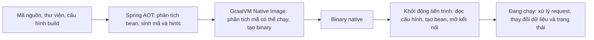

# Những phần ứng dụng có thể thay đổi khi chạy và những phần bị cố định khi build

Khi chuyển một ứng dụng Spring Boot từ JVM sang **GraalVM Native Image**, câu hỏi quan trọng không chỉ là “ứng dụng khởi động nhanh hơn bao nhiêu?”, mà còn là: **quyết định nào phải đưa ra lúc build, và quyết định nào vẫn có thể đưa ra lúc chạy?** Ranh giới này ảnh hưởng trực tiếp đến cách thiết kế cấu hình, bật/tắt tính năng, nạp tài nguyên, dùng reflection và triển khai cùng một bản build lên nhiều môi trường.

Spring AOT (Ahead-of-Time) chuẩn bị trước nhiều thông tin mà Spring thường suy ra khi JVM khởi động. Sau đó GraalVM `native-image` phân tích mã có thể được thực thi và đóng gói thành file thực thi cho một nền tảng cụ thể. Kết quả vẫn là một ứng dụng có trạng thái, kết nối mạng, xử lý request và đọc cấu hình lúc chạy; tuy nhiên, một số **khả năng và cấu trúc** đã phải được quyết định trước khi binary ra đời.

## 1. Phân biệt ba thời điểm



Ba mốc trên tạo ra ba loại quyết định:

1. **Thời điểm build:** quyết định những lớp/phương thức có thể truy cập, metadata cho reflection, tài nguyên nhúng vào binary, cấu trúc bean đã được AOT xử lý, và một phần trạng thái của các lớp được khởi tạo ngay lúc build.
2. **Thời điểm khởi động một tiến trình:** đọc đối số dòng lệnh, biến môi trường, file cấu hình ngoài, tạo các Spring bean và kết nối tới dịch vụ. Các giá trị này có thể khác giữa hai lần chạy **cùng một binary**, miễn là không phải thay đổi quyết định đã cố định ở bước 1.
3. **Trong lúc phục vụ request:** dữ liệu từ HTTP, cơ sở dữ liệu, message queue, cache, bộ đếm hay trạng thái nghiệp vụ tiếp tục thay đổi bình thường. Tuy vậy, thay đổi một biến môi trường bên ngoài **không tự động** cập nhật giá trị đã inject vào bean đang tồn tại; muốn cập nhật nóng phải thiết kế cơ chế đọc lại hoặc refresh riêng.

> **Điểm mấu chốt:** “Được biên dịch trước” không có nghĩa là mọi đối tượng và mọi giá trị đều bị đóng băng. Spring AOT sinh mã để khởi tạo ứng dụng hiệu quả hơn; các bean thông thường vẫn được tạo khi tiến trình khởi động. Ngược lại, “có thể đọc cấu hình lúc chạy” không có nghĩa là cấu hình đó có thể thêm những bean hoặc lớp đã bị loại khỏi binary.

## 2. Bản đồ những gì cố định và những gì linh hoạt

| Thành phần | Được quyết định chủ yếu khi nào? | Có thể đổi giữa hai lần chạy cùng binary? |
| --- | --- | --- |
| Lớp và phương thức mà phân tích *closed-world* coi là có thể được gọi | Build native | Không thể bổ sung mã chưa có trong binary chỉ bằng cấu hình runtime. |
| Cấu trúc bean chịu ảnh hưởng bởi `@Profile`, `@ConditionalOnProperty` và các điều kiện được Spring AOT xử lý | Xử lý AOT | Không thể trông đợi đổi profile/property lúc chạy để khôi phục bean đã bị loại khi AOT. |
| Metadata reflection, kiểu JDK dynamic proxy, JNI, serialization cần khai báo bổ sung | Build native | Phải khai báo trước những khả năng không được công cụ tự suy ra. |
| Nội dung resource nhúng từ classpath vào native image | Build native | Muốn thay nội dung đã nhúng thường phải build lại; có thể thiết kế đọc file ngoài ở runtime. |
| Trạng thái `static` của lớp được cấu hình khởi tạo lúc build | Build native | Giá trị được chụp vào image heap; không tự tính lại cho từng tiến trình. |
| Lớp được cấu hình khởi tạo lúc chạy | Khởi động hoặc lúc sử dụng lần đầu | Static initializer chạy trong tiến trình, theo thời điểm khởi tạo thực tế. |
| Địa chỉ database, cổng HTTP, endpoint tích hợp, timeout hoặc giá trị cấu hình **không làm thay đổi bean graph** | Khởi động tiến trình | Thường có; cung cấp giá trị khác trước khi chạy. |
| Dữ liệu request, bản ghi cơ sở dữ liệu, cache, đối tượng tạo bằng `new`, trạng thái trong heap runtime | Khi ứng dụng đang chạy | Có, theo logic chương trình. |
| Hệ điều hành, kiến trúc CPU và môi trường thư viện mà native executable nhắm tới | Build/phát hành | Binary không có tính di động đa nền tảng như JAR chạy trên JVM tương thích. |

Chữ “cố định” trong bảng nói đến **tập mã, khả năng và các quyết định đã được đưa vào bản build**. Ví dụ, mã tạo `new Order()` có thể nằm cố định trong binary, nhưng hàng nghìn đối tượng `Order` khác nhau vẫn có thể được tạo và sửa trong heap lúc chạy.

## 3. Vì sao Spring AOT cố định một phần cấu trúc ứng dụng?

Trên JVM, Spring có thể dùng quét classpath, reflection và đánh giá điều kiện khi khởi động để xác định bean nào cần tạo. Với Spring AOT, nhiều bước này được xử lý sớm hơn để sinh mã khởi tạo và gợi ý cho GraalVM. Bởi vậy cần phân biệt **giá trị cấu hình** với **cấu hình quyết định bean nào tồn tại**.

### 3.1. Giá trị được inject lúc khởi động vẫn có thể khác nhau

```java
import org.springframework.beans.factory.annotation.Value;
import org.springframework.stereotype.Service;

@Service
public class GreetingService {
    private final String prefix;

    public GreetingService(
            @Value("${app.greeting-prefix:Xin chào}") String prefix) {
        this.prefix = prefix;
    }

    public String greet(String name) {
        return prefix + ", " + name;
    }
}
```

Ví dụ, một binary có thể chạy với `--app.greeting-prefix=Hello` ở môi trường A và `--app.greeting-prefix=Xin-chao` ở môi trường B. Bean vẫn là `GreetingService`; chỉ có giá trị `prefix` được cấp vào khi khởi động khác nhau. Tương tự, Spring Boot thường đọc được `server.port`, thông tin kết nối database và nhiều cấu hình khác ở runtime.

Điều này **không đồng nghĩa hot reload**. Nếu constructor đã nhận `prefix`, thay đối số hoặc biến môi trường sau khi tiến trình chạy sẽ không tự thay đổi field `final` đó. Cần khởi động lại tiến trình hoặc thiết kế một nguồn cấu hình động phù hợp.

### 3.2. Điều kiện làm thay đổi bean graph là trường hợp khác

```java
import org.springframework.boot.autoconfigure.condition.ConditionalOnProperty;
import org.springframework.context.annotation.Bean;
import org.springframework.context.annotation.Configuration;

@Configuration(proxyBeanMethods = false)
class AuditConfiguration {

    @Bean
    @ConditionalOnProperty(name = "feature.audit.enabled", havingValue = "true")
    AuditService auditService() {
        return new AuditService();
    }
}

class AuditService {
    void record(String event) {
        System.out.println("AUDIT: " + event);
    }
}
```

Ở chế độ Spring AOT, những điều kiện ảnh hưởng đến định nghĩa bean như ví dụ trên thường được đánh giá trong quá trình xử lý AOT. Nếu `AuditService` không được đưa vào cấu trúc ứng dụng lúc build, đặt `feature.audit.enabled=true` khi chạy binary **không phải** cách đáng tin cậy để tạo thêm bean đó. Tương tự, cần xác định các profile phù hợp ở thời điểm AOT nếu chúng quyết định bean nào được đăng ký.

Nếu mục tiêu là dùng **cùng một binary** và chọn hành vi theo cấu hình của từng môi trường, một cách thiết kế là giữ sẵn các nhánh mã cần thiết trong bean graph và chọn logic khi chạy:

```java
import org.springframework.beans.factory.annotation.Value;
import org.springframework.stereotype.Service;

@Service
class ShippingService {
    private final boolean expressEnabled;

    ShippingService(
            @Value("${shipping.express-enabled:false}") boolean expressEnabled) {
        this.expressEnabled = expressEnabled;
    }

    String shippingMode() {
        return expressEnabled ? "EXPRESS" : "STANDARD";
    }
}
```

`ShippingService` luôn có mặt; chỉ `expressEnabled` khác nhau giữa các lần khởi động. Với hệ thống cần thay đổi tính năng ngay khi đang chạy, có thể dùng feature flag hoặc dữ liệu từ dịch vụ cấu hình được **đọc tại runtime**, đồng thời bảo đảm mọi nhánh mã cần thiết đã được đưa vào native image. Không nên giả định một annotation `@Conditional...` vốn quyết định bean graph sẽ trở thành feature flag động.

## 4. Quy tắc closed-world: mã nào thực sự có trong binary?

GraalVM Native Image dùng phân tích *closed-world*: tại thời điểm build, công cụ cần xác định tập mã có thể được ứng dụng sử dụng. Lời gọi Java thông thường, ví dụ `new PaymentService()` hoặc gọi trực tiếp một phương thức, thường đủ để phân tích quan hệ gọi. Một số cơ chế động lại cần metadata hoặc mã sinh bổ sung:

- **Reflection:** `Class.forName(name)`, `getDeclaredConstructor()`, `Method.invoke()` hoặc thư viện tìm kiểu bằng tên chuỗi. Nếu chỉ đến lớp/phương thức qua đường động mà công cụ không suy ra được, cần đăng ký quyền truy cập tương ứng.
- **JDK dynamic proxy:** tập interface dùng để tạo proxy có thể cần hint; Spring AOT tự xử lý nhiều proxy mà Spring biết trước.
- **Serialization/JNI:** các kiểu hay thành viên truy cập qua cơ chế động có thể cần metadata riêng.
- **Resource trên classpath:** những file đọc bằng `getResourceAsStream()` phải được đưa vào native image. Sự tồn tại của file trong source tree chưa bảo đảm nó được nhúng đúng cách.

Spring Boot 3+ cung cấp cơ chế **Runtime Hints** để khai báo những truy cập mà phân tích AOT không tự nhận biết. Tên “Runtime Hints” mô tả **quyền truy cập cần có khi chạy**, nhưng chính các hint này được thu thập và xử lý **lúc build**.

Ví dụ dưới đây minh họa đăng ký reflection và một resource classpath:

```java
package com.example.demo;

import org.springframework.aot.hint.MemberCategory;
import org.springframework.aot.hint.RuntimeHints;
import org.springframework.aot.hint.RuntimeHintsRegistrar;
import org.springframework.boot.SpringApplication;
import org.springframework.boot.autoconfigure.SpringBootApplication;
import org.springframework.context.annotation.ImportRuntimeHints;

@SpringBootApplication
@ImportRuntimeHints(DynamicAccessHints.class)
public class DemoApplication {
    public static void main(String[] args) {
        SpringApplication.run(DemoApplication.class, args);
    }
}

class DynamicAccessHints implements RuntimeHintsRegistrar {
    @Override
    public void registerHints(RuntimeHints hints, ClassLoader classLoader) {
        hints.reflection().registerType(
                InvoiceDto.class,
                MemberCategory.INVOKE_DECLARED_CONSTRUCTORS,
                MemberCategory.INVOKE_PUBLIC_METHODS
        );
        hints.resources().registerPattern("templates/invoice.txt");
    }
}

record InvoiceDto(String code, long total) {}
```

Trong ví dụ, file `src/main/resources/templates/invoice.txt` cần có ở bước build. Nếu ứng dụng truy cập record `InvoiceDto` bằng reflection theo đường mà Spring không tự phát hiện, hint giúp native image giữ lại metadata cần thiết. Đây là **khai báo khả năng**, không phải thao tác tạo sẵn `InvoiceDto` lúc build. Nếu framework đã tự cung cấp hint phù hợp, không cần đăng ký trùng.

Giả sử ứng dụng đọc `classpath:templates/invoice.txt`, việc sửa file đó sau khi native image đã build không làm thay đổi bản copy đã nhúng. Nếu mẫu cần thay đổi độc lập với binary, hãy đưa nó ra thư mục ngoài hoặc nguồn lưu trữ, rồi đọc qua đường dẫn/runtime API và quản lý quyền truy cập, mặc định, lỗi thiếu file như với một dữ liệu cấu hình bên ngoài.

## 5. Class initialization: phần tĩnh nào có thể bị “chụp” lúc build?

Cần tách bạch **khởi tạo class của GraalVM** và **khởi tạo Spring bean**:

- Một Java class được cấu hình *build-time initialization* có thể thực thi `static` initializer khi tạo native image; trạng thái tĩnh phù hợp có thể được đưa vào **image heap** và tái sử dụng khi tiến trình chạy.
- Một class được cấu hình *run-time initialization* thực thi phần khởi tạo tĩnh trong tiến trình native khi class được khởi tạo.
- Một Spring singleton thông thường vẫn được tạo khi application context khởi động theo mã do AOT sinh. Không nên hiểu “AOT xử lý bean” là “toàn bộ singleton và kết nối database đã được xây sẵn trong file thực thi”.

Xem một ví dụ Java đơn giản:

```java
import java.time.Instant;

final class InitializationExample {
    static final Instant INITIALIZED_AT = Instant.now();

    static Instant value() {
        return INITIALIZED_AT;
    }
}
```

Nếu `InitializationExample` thực sự được khởi tạo **lúc build**, `INITIALIZED_AT` có thể phản ánh thời điểm build. Nếu lớp được khởi tạo **lúc chạy**, nó phản ánh thời điểm khởi tạo trong tiến trình. Chỉ nhìn thấy `static final` **không đủ** để kết luận lớp được khởi tạo khi nào; kết quả phụ thuộc cấu hình class initialization và phân tích của GraalVM.

Vì thế, phải đặc biệt cẩn thận với static initializer đọc biến môi trường, thời gian hiện tại, thông tin máy chủ, bí mật, tạo số ngẫu nhiên hoặc mở kết nối. Những thao tác đó có thể sai ngữ cảnh hoặc không được GraalVM chấp nhận khi thực thi ở build time. Với lớp cần trạng thái mới cho mỗi tiến trình, hãy thiết kế khởi tạo tại runtime hoặc cấu hình class initialization phù hợp (chẳng hạn tùy chọn Native Image `--initialize-at-run-time=<ten-lop>` khi cần). Với Spring, nên ưu tiên tạo trạng thái phụ thuộc môi trường trong bean ở lúc ứng dụng khởi động thay vì đặt trong khối `static` không kiểm soát được.

## 6. Hai kịch bản triển khai để xác định có cần rebuild

### Kịch bản A: một binary cho staging và production

Giả sử mã và tập bean giống nhau ở cả hai môi trường. Staging dùng database `staging-db`, production dùng `prod-db`; mỗi môi trường dùng username, secret, endpoint và giới hạn timeout riêng. Nếu các giá trị ấy được đọc lúc khởi động từ biến môi trường hoặc nguồn cấu hình bên ngoài, **cùng một native executable** có thể chạy tại cả hai nơi tương thích với nền tảng mà binary được build cho.

Một lệnh minh họa trên Linux (tên binary `demo` tùy theo project):

```bash
SPRING_DATASOURCE_URL='jdbc:postgresql://staging-db:5432/app' \
APP_GREETINGPREFIX='Staging' \
./target/demo --server.port=8081
```

Đây là thay đổi dữ liệu cấu hình runtime, không đòi hỏi bổ sung lớp, tài nguyên hay định nghĩa bean. Không nhúng secret production trong tệp YAML lúc build hoặc trong static state được build-time initialize; cung cấp secret ở môi trường chạy.

### Kịch bản B: bật nhà cung cấp thanh toán mới bằng `@ConditionalOnProperty`

Giả sử bản build chỉ đăng ký bean `MockPaymentClient` vì điều kiện build đang chọn `payment.provider=mock`, sau đó production đặt `payment.provider=real` và mong xuất hiện `RealPaymentClient`. Với AOT, kỳ vọng đó có thể sai: bean thứ hai và những đường mã chỉ tham chiếu từ nó có thể không nằm trong cấu trúc native đã sinh.

Có hai hướng xử lý rõ ràng:

1. **Chọn nhà cung cấp khi build:** phát hành các native binary khác nhau cho những tập bean khác nhau, kiểm thử từng biến thể.
2. **Chọn hành vi khi chạy:** đưa các implementation cần thiết vào bản build bằng những bean không bị điều kiện build loại bỏ, rồi chọn implementation bằng dữ liệu runtime thông qua router/factory phù hợp. Cách này cho phép tái sử dụng binary nhưng phải quản lý các dependency và secret của từng implementation.

Nguyên tắc thiết kế là: **nếu cấu hình chỉ đổi giá trị của một bean đã tồn tại, thường có thể đổi lúc khởi động; nếu cấu hình thay đổi bean nào được đăng ký, phải kiểm tra ranh giới AOT**.

## 7. Build, chạy thử và xác minh ranh giới

Với ứng dụng Spring Boot đã cấu hình GraalVM Native Build Tools và toolchain tương thích, có thể tạo binary bằng một trong hai cách:

```bash
# Maven (dự án có Maven Wrapper và profile native tương ứng)
./mvnw -Pnative native:compile

# Gradle (dự án áp dụng plugin GraalVM Native Build Tools)
./gradlew nativeCompile
```

Trên Windows có thể dùng `mvnw.cmd` hoặc `gradlew.bat`; đường dẫn và phần mở rộng file thực thi phụ thuộc hệ điều hành. Với Maven, binary thường được tạo trong `target/`; với Gradle thường ở `build/native/nativeCompile/`. Các lệnh có thể khác nếu project tùy biến build. Việc tạo container native cũng cần chọn builder và target platform phù hợp; một binary build cho Linux không thể mặc nhiên chạy trực tiếp như file `.exe` trên Windows.

Một bài thực hành ngắn giúp kiểm chứng lý thuyết:

| Phép thử | Thao tác | Kết quả cần quan sát |
| --- | --- | --- |
| Giá trị runtime | Chạy cùng binary hai lần với hai giá trị `--app.greeting-prefix` | Chuỗi chào khác nhau, không cần build lại. |
| Điều kiện bean | Đặt `@ConditionalOnProperty` trên một bean, đổi thuộc tính giữa AOT build và lúc chạy | Kiểm tra cấu trúc bean đã AOT xử lý; không giả định bean bị loại sẽ xuất hiện. |
| Reflection | Dùng tên lớp/phương thức tính động và gọi bằng reflection | Nếu thiếu metadata/hint, chức năng có thể lỗi trên native dù chạy được trên JVM. |
| Resource nhúng | Đọc `classpath:templates/invoice.txt`, sửa file sau khi build | Binary cũ vẫn dùng nội dung đã nhúng; muốn cập nhật có thể build lại hoặc chuyển sang file ngoài. |
| Class initialization | Kiểm tra giá trị `static` phụ thuộc thời điểm khởi tạo với cấu hình build-time/runtime | Xác định lúc giá trị được tính, không suy luận chỉ từ từ khóa `static`. |

Khi đối chiếu bản JVM với native, nên chạy **cùng chức năng, cùng bộ dữ liệu, cùng cấu hình runtime** và kiểm tra các luồng dễ bị bỏ sót: JSON binding, validation, reflection, template, resource, serialization, database driver, TLS và proxy. Đo thời gian từ lúc khởi động đến khi ứng dụng sẵn sàng nhận request; theo dõi mức dùng bộ nhớ thực tế của tiến trình (chẳng hạn RSS) thay vì so sánh riêng giới hạn Java heap với RSS của native. Native thường cải thiện cold start và mức dùng bộ nhớ cho nhiều workload, nhưng chi phí build, hành vi GC, tải xử lý và mức sử dụng bộ nhớ thực tế cần được đo theo ứng dụng; không có một mức cải thiện cố định cho mọi dự án.

## 8. Những hiểu lầm cần tránh

| Hiểu lầm | Cách hiểu đúng |
| --- | --- |
| “Đã native thì không thay được cấu hình.” | Có thể đổi nhiều giá trị tại khởi động; cần xét cấu hình đó có làm thay đổi quyết định AOT hay không. |
| “Spring AOT tạo sẵn tất cả bean trong file binary.” | AOT sinh mã và xử lý metadata/bean definitions; các bean thông thường vẫn được tạo khi tiến trình khởi động. |
| “`static final` luôn là hằng đóng băng ở build.” | Còn tùy class được khởi tạo ở build time hay runtime, và giá trị đó có phải hằng compile-time hay không. |
| “Native Image hoàn toàn không hỗ trợ reflection.” | Reflection dùng được khi metadata cần thiết được phân tích hoặc đăng ký đúng; Spring AOT tự cung cấp nhiều hint phổ biến. |
| “Có file trong `src/main/resources` thì native chắc chắn đọc được.” | Phải bảo đảm resource được đưa vào native image; resource ngoài cần đường dẫn và quyền truy cập lúc chạy. |
| “Chạy lại với profile khác sẽ luôn tạo ra một nhóm bean khác.” | Các điều kiện ảnh hưởng đến bean graph có thể đã cố định khi xử lý AOT. |
| “Đổi environment variable giữa lúc chạy sẽ cập nhật `@Value`.” | Field được inject thường không tự thay đổi; ứng dụng cần cơ chế refresh hoặc khởi động lại. |

## 9. Checklist trước khi phát hành một bản native

- **Tập mã:** có phần nào dùng `Class.forName`, reflection theo chuỗi, proxy động, serializer hoặc JNI mà AOT không thể suy ra không?
- **Tập bean:** có dùng `@Profile`, `@ConditionalOnProperty` hay điều kiện khác để chọn bean theo từng môi trường không? Nếu có, quyết định phải đưa ra ở build hay cần đổi thiết kế để lựa chọn tại runtime?
- **Tài nguyên:** file template/chứng chỉ/schema được nhúng hay đọc bên ngoài? Nếu cần cập nhật nội dung mà không rebuild thì đường dẫn ngoài đã được thiết kế chưa?
- **Trạng thái khởi tạo:** static initializer có sử dụng thời gian, biến môi trường, secret hay tài nguyên của máy build không?
- **Cấu hình vận hành:** port, URL, tài khoản, timeout, logging và feature flag thực sự được đọc ở thời điểm nào?
- **Tương thích:** các chức năng phụ thuộc thư viện động, kết nối, JSON, TLS và resource đã được chạy thử bằng **binary native thực tế** chưa?
- **Đo lường:** đã so sánh thời gian khởi động, bộ nhớ tiến trình và hành vi khi có tải với bản JVM trong điều kiện tương đương chưa?

Ranh giới build time/runtime là chìa khóa để khai thác Spring AOT và GraalVM Native Image: **đóng gói trước mã và khả năng cần thiết**, còn **cấu hình vận hành cùng trạng thái nghiệp vụ** được đặt ở thời điểm phù hợp. Thiết kế đúng ranh giới giúp ứng dụng vừa hưởng lợi từ native binary vừa duy trì khả năng triển khai và điều chỉnh trên nhiều môi trường.
