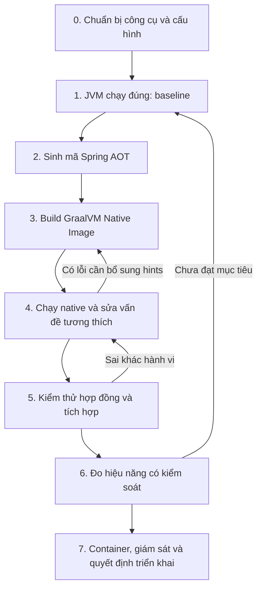

# Kiến thức đầu vào và lộ trình từ ứng dụng JVM đến bản native được kiểm chứng

## 1. Đích đến của hành trình

Trong module **SPRING_BOOT_NATIVE_IMAGE**, chúng ta biên dịch ứng dụng Spring Boot thành **GraalVM Native Image** với sự hỗ trợ của **Spring Ahead-of-Time (AOT)**, sau đó đo lường thời gian khởi động, mức sử dụng bộ nhớ và kiểm thử tính tương thích. Lộ trình bao gồm build bằng Maven hoặc Gradle, xử lý reflection/resource, đóng gói container và vận hành bản native.

Mục tiêu của bài tổng quan này là xác định **cần biết gì trước khi bắt đầu**, **thực hiện theo trình tự nào** và **dùng bằng chứng nào để kết luận bản native đã sẵn sàng**. Một lần build thành công chỉ chứng minh chương trình có thể biên dịch; chưa chứng minh ứng dụng chạy đúng với cấu hình, dữ liệu, lưu lượng và hạ tầng thực tế.

Kết thúc lộ trình, người học cần tạo được những đầu ra sau:

1. Một ứng dụng Spring Boot có hành vi đã được kiểm thử trên JVM, kèm cấu hình và tập dữ liệu kiểm thử có thể tái lập.
2. Một bản native chạy được, với các nhu cầu reflection, resource và proxy động được nhận diện hoặc khai báo thích hợp.
3. Bộ kiểm thử xác nhận API, tích hợp và các tình huống lỗi quan trọng tương đương giữa hai bản.
4. Báo cáo đo thời gian khởi động, bộ nhớ và, khi cần, độ trễ/thông lượng dưới cùng điều kiện.
5. Một container image native đã được chạy thử, có cách quan sát sức khỏe và phương án quay về bản JVM.

> **Nguyên tắc xuyên suốt:** đi từ **JVM chạy đúng** → **AOT được tạo và kiểm tra** → **native build thành công** → **native chạy đúng** → **hiệu năng được đo có kiểm soát** → **container và vận hành được kiểm chứng**.

## 2. Nắm vững ba thành phần trước khi thực hành

### 2.1. JVM, Spring AOT và GraalVM Native Image đảm nhiệm điều gì?

| Thành phần | Vai trò chính | Ý nghĩa trong lộ trình |
| --- | --- | --- |
| **JVM** | Nạp và chạy bytecode Java; có JIT, garbage collector và cơ chế nạp lớp động. | Là bản đối chứng về hành vi và hiệu năng. |
| **Spring AOT** | Phân tích cấu hình Spring tại thời điểm build; tạo mã/metadata để khởi tạo ứng dụng và cung cấp các gợi ý cần thiết cho native. | Giúp những cấu trúc Spring vốn mang tính động có thể được xử lý trước khi chạy. |
| **GraalVM Native Image** | Phân tích các đường thực thi có thể tiếp cận và biên dịch trước thành tệp thực thi cho hệ điều hành/kiến trúc đích. | Tạo chương trình chạy mà không cần cài riêng JVM để khởi động ứng dụng. |

Spring AOT **không phải** trình biên dịch mã máy, và GraalVM **không tự biết** mọi hành vi động của ứng dụng. Hai công cụ bổ trợ cho nhau. Những thư viện được Spring hỗ trợ có thể có runtime hints được sinh tự động; mã ứng dụng hoặc thư viện sử dụng tên lớp/phương thức do người dùng nhập, tài nguyên chỉ tìm ở runtime hay proxy tự tạo vẫn có thể cần cấu hình thêm.

Khái niệm **closed-world assumption** của Native Image nói rằng trình biên dịch cần biết trước tập mã và metadata cần thiết cho chương trình. Ví dụ, lời gọi trực tiếp `new OrderService()` có thể được phân tích tĩnh; việc gọi `Class.forName(nameFromDatabase)` để chọn lớp bất kỳ lúc chạy có thể không được suy ra đầy đủ. Vì vậy, tương thích với native phụ thuộc vào cách ứng dụng sử dụng Java reflection, resource loading, serialization, dynamic proxy, JNI và cơ chế khởi tạo lớp.

### 2.2. Kỳ vọng hiệu năng hợp lý

Native Image thường đáng thử cho dịch vụ yêu cầu khởi động nhanh, container cần scale theo tải, job chạy ngắn hoặc môi trường có ngân sách bộ nhớ chặt. Tuy nhiên, kết quả **phụ thuộc ứng dụng**: Native Image có thể build lâu hơn và tiêu thụ nhiều RAM trong quá trình build; bản JVM sau khi JIT tối ưu có thể đạt thông lượng tốt hơn ở một số tải. Bộ nhớ, thời gian khởi động và độ trễ cũng thay đổi theo GC, cấu hình heap, CPU, hệ điều hành, dữ liệu, thư viện và mức độ khởi tạo kết nối.

Không coi những tuyên bố như “native luôn nhanh hơn” hay “native dùng ít RAM hơn X%” là kết quả của dự án. Chúng phải được kiểm chứng bằng số liệu của **chính dịch vụ đang xét**.

## 3. Kiến thức và môi trường tối thiểu

### 3.1. Kiến thức nền

| Chủ đề | Cần làm được trước khi bắt đầu | Cách tự kiểm tra |
| --- | --- | --- |
| Java | Hiểu class, interface, annotation, record/DTO, exception, classpath và class loader ở mức cơ bản. | Tự viết và chạy một REST API trả JSON. |
| Spring Boot | Hiểu `@SpringBootApplication`, bean, dependency injection, auto-configuration, `@RestController`, profile và cấu hình ngoài. | Giải thích được vì sao bean xuất hiện hoặc không xuất hiện. |
| Maven hoặc Gradle | Biết wrapper, dependency, plugin, lifecycle `test`/`package` và cách đọc lỗi build. | Chạy được test và tạo tệp JAR từ repository. |
| HTTP và kiểm thử | Biết status code, JSON, endpoint health; viết được unit/integration test. | Kiểm tra response hợp lệ và một trường hợp lỗi. |
| Hệ điều hành/container | Biết biến môi trường, quyền thực thi, process, port, Docker/OCI và kiến trúc CPU. | Chạy ứng dụng trong container và gọi API qua port đã publish. |
| Phân tích hiệu năng | Phân biệt thời gian khởi động, lúc sẵn sàng phục vụ, RSS, heap, độ trễ và thông lượng. | Ghi lại cách đo cùng điều kiện cho hai bản. |

Không cần trở thành chuyên gia GraalVM từ đầu. Nhưng nếu chưa có bản JVM chạy đúng và các trường hợp kiểm thử đáng tin, rất khó phân biệt lỗi ứng dụng vốn có với lỗi do biên dịch native.

### 3.2. Công cụ cần chuẩn bị

- **JDK/GraalVM phù hợp** với phiên bản Java và Spring Boot được dự án hỗ trợ; bản GraalVM đã cài `native-image` hoặc bộ công cụ build có cách cung cấp Native Image tương đương.
- **Spring Boot có hỗ trợ AOT/native**, cùng plugin **GraalVM Native Build Tools** được cấu hình bằng Maven/Gradle. Nếu dự án được tạo từ Spring Initializr, có thể chọn tùy chọn hỗ trợ GraalVM Native khi khởi tạo.
- **Toolchain biên dịch native** phù hợp hệ điều hành: trên Linux thường cần C compiler, linker, header và thư viện hệ thống tương ứng. Nếu build qua Cloud Native Buildpacks thì môi trường build nằm trong builder/container.
- **Docker/Podman hoặc runtime OCI tương thích** nếu có bước build/run container. Chỉ cần khi chọn lộ trình container.
- Đủ dung lượng đĩa và RAM cho bước biên dịch; native build thường tốn tài nguyên hơn đóng gói JAR. Ngưỡng cụ thể tùy codebase, dependencies và môi trường.

Kiểm tra những thành phần đang có bằng lệnh phù hợp với môi trường:

```bash
java -version
./mvnw -version       # Dự án Maven
./gradlew --version   # Dự án Gradle
native-image --version
docker version        # Chỉ khi dùng Docker
```

Trên Windows, sử dụng `mvnw.cmd`/`gradlew.bat` hoặc công cụ tương đương; môi trường PowerShell và shell Unix có cách viết đường dẫn khác nhau. `native-image --version` chỉ có thể chạy trực tiếp khi công cụ đã nằm trong `PATH`. Nếu dùng buildpack, Native Image có thể được cung cấp bởi builder thay vì cài trên máy cá nhân.

**Điểm kiểm tra môi trường:** xác định rõ JDK đang dùng, hệ điều hành, kiến trúc đích (`amd64`/`arm64`), phiên bản Spring Boot, phiên bản plugin native và cách build (local hay buildpack). Binary native gắn với nền tảng đích; không tự động mang một tệp thực thi Linux sang chạy trên Windows.

## 4. Lộ trình thực hành với các cổng kiểm chứng



Từng chặng dưới đây có **đầu vào**, **việc làm** và **điều kiện hoàn tất**. Nếu thất bại tại một cổng, quay lại chặng liên quan, ghi nguyên nhân và chạy lại kiểm chứng; không nên bỏ qua chặng lỗi rồi chỉ thử build lần nữa.

### Chặng 0 — Chốt phạm vi và điều kiện thí nghiệm

Chọn một ứng dụng nhỏ nhưng có đủ thành phần để phản ánh dịch vụ thực: ít nhất một REST API, một DTO JSON và một health endpoint. Nếu dự án thật có database, cache, security, message broker hoặc thư viện reflection, lên danh sách các luồng quan trọng cần thử trên native. Chốt phiên bản Java, Spring Boot và dependency trước khi đo, đồng thời lưu commit hash và cấu hình môi trường.

Tạo bảng dự kiến kiểm chứng: API nào cần đồng nhất, chức năng nào có nguy cơ tương thích, metric nào cần đo, tiêu chí chấp nhận là gì. Ví dụ, một API tạo đơn hàng phải xử lý dữ liệu hợp lệ, dữ liệu sai, xác thực, lỗi database và serialization của cả request lẫn response.

**Hoàn tất khi:** môi trường tái lập được và danh sách chức năng/metric quan trọng đã rõ.

### Chặng 1 — Có bản JVM làm mốc so sánh

Ví dụ một ứng dụng REST tối thiểu (đặt trong `src/main/java/com/example/nativeguide/DemoApplication.java`):

```java
package com.example.nativeguide;

import org.springframework.boot.SpringApplication;
import org.springframework.boot.autoconfigure.SpringBootApplication;
import org.springframework.web.bind.annotation.GetMapping;
import org.springframework.web.bind.annotation.RestController;

@SpringBootApplication
public class DemoApplication {
    public static void main(String[] args) {
        SpringApplication.run(DemoApplication.class, args);
    }
}

@RestController
class HelloController {
    @GetMapping("/api/hello")
    HelloResponse hello() {
        return new HelloResponse("Xin chào từ Spring Boot");
    }
}

record HelloResponse(String message) {}
```

Ví dụ giả định dự án đã khai báo Spring Boot Web và plugin Maven hoặc Gradle tương ứng. Chạy test, đóng gói và khởi động trên JVM:

```bash
./mvnw clean verify
./mvnw spring-boot:run

# Với dự án Gradle, dùng các tác vụ tương đương:
# ./gradlew clean test bootJar
# ./gradlew bootRun
```

Mở một terminal khác và gọi API:

```bash
curl --fail-with-body http://localhost:8080/api/hello
# Kỳ vọng: {"message":"Xin chào từ Spring Boot"}
```

`curl --fail-with-body` cần phiên bản curl hỗ trợ tùy chọn này; có thể dùng `curl -i` để xem HTTP status và nội dung. Thêm test kiểm tra status, JSON, validation và các trường hợp lỗi, rồi lưu output mẫu. Đừng dùng chỉ một request “200 OK” làm chứng cứ ứng dụng đúng toàn bộ.

**Hoàn tất khi:** `test`/`verify` thành công, bản JVM đáp ứng các tình huống đã định nghĩa, đã lưu cấu hình và dữ liệu đối chứng.

### Chặng 2 — Sinh mã AOT và hiểu những gì được chốt lúc build

Đảm bảo dự án đã có plugin và cấu hình AOT/native tương thích. Có thể chạy tác vụ sinh AOT riêng để khoanh vùng lỗi trước khi build native:

```bash
./mvnw spring-boot:process-aot    # Maven
# hoặc
./gradlew processAot             # Gradle
```

Tên goal/task trên áp dụng cho dự án có plugin Spring Boot tương ứng. Kiểm tra log sinh mã và thư mục output của build để phát hiện lỗi cấu hình bean, annotation processing hoặc dependency. Đừng chỉnh trực tiếp các tệp generated; thay đổi source hoặc build configuration rồi sinh lại.

AOT phân tích Spring application context trong quá trình build. Vì một số quyết định về bean/điều kiện được tính trước, các profile hoặc property tác động đến cấu trúc bean cần được kiểm thử đúng theo cấu hình thực tế. Cần phân biệt **cấu hình vận hành vẫn đọc lúc runtime** với **các quyết định tạo bean đã được đưa vào kết quả AOT**.

**Hoàn tất khi:** AOT sinh thành công, các bean và điều kiện quan trọng được kiểm tra theo môi trường đích.

### Chặng 3 — Build Native Image

Với **Maven**, cách thường gặp trong dự án đã cấu hình `native` profile cùng GraalVM Native Build Tools:

```bash
./mvnw -Pnative native:compile
```

Nếu Maven báo không có profile/goal `native`, cần cấu hình `org.graalvm.buildtools:native-maven-plugin` tương thích với Spring Boot trước khi chạy. `-Pnative` không tự tạo plugin cho một dự án chưa có cấu hình.

Với **Gradle**, cấu hình plugin `org.graalvm.buildtools.native` cùng plugin Spring Boot theo phiên bản tương thích, rồi chạy:

```bash
./gradlew nativeCompile
```

Trong cấu hình điển hình, Maven đặt executable tại `target/`, Gradle đặt tại `build/native/nativeCompile/`; tên và vị trí chính xác tùy dự án, task và hệ điều hành. Đọc output build để lấy đường dẫn thực tế, kiểm tra quyền thực thi và chạy file trên nền tảng đã build:

```bash
# Ví dụ với Maven trên Linux/macOS, nếu executable tên là native-guide:
./target/native-guide --server.port=8080
```

Đừng nhầm file JAR Spring Boot với executable native. Nếu build lỗi, giữ lại thông báo đầu tiên chỉ ra loại thiếu metadata, resource, compiler hoặc linker; lỗi cuối cùng trong log đôi khi chỉ là hậu quả.

**Hoàn tất khi:** build tạo được executable native, chạy được process và endpoint cơ bản trả kết quả như JVM.

### Chặng 4 — Khắc phục tương thích bằng runtime hints có chủ đích

Những dấu hiệu thường thấy khi chuyển sang native gồm `ClassNotFoundException`, `NoSuchMethodException`, thiếu tài nguyên trong classpath, JSON mất trường, proxy không được tạo hoặc một thư viện JNI không nạp được. Trước hết cần biết cơ chế nào thực sự đang dùng; không khai báo reflection hàng loạt để che giấu nguyên nhân.

Ví dụ, ứng dụng gọi `Class.forName(...)` để tải một kiểu dữ liệu `ExternalEvent` và dùng reflection để tạo instance. Có thể cung cấp `RuntimeHintsRegistrar` và import vào cấu hình Spring (các lớp minh họa dưới đây đặt trong cùng package với ứng dụng):

```java
import org.springframework.aot.hint.MemberCategory;
import org.springframework.aot.hint.RuntimeHints;
import org.springframework.aot.hint.RuntimeHintsRegistrar;
import org.springframework.context.annotation.Configuration;
import org.springframework.context.annotation.ImportRuntimeHints;

@Configuration(proxyBeanMethods = false)
@ImportRuntimeHints(DynamicAccessHints.class)
class NativeConfig {}

final class DynamicAccessHints implements RuntimeHintsRegistrar {
    @Override
    public void registerHints(RuntimeHints hints, ClassLoader classLoader) {
        hints.reflection().registerType(
            ExternalEvent.class,
            MemberCategory.INVOKE_DECLARED_CONSTRUCTORS,
            MemberCategory.INVOKE_PUBLIC_METHODS
        );
        hints.resources().registerPattern("templates/*.txt");
    }
}

class ExternalEvent {
    public ExternalEvent() {}
    public String getMessage() { return "Ví dụ"; }
}
```

Đoạn trên **minh họa các khai báo cần tích hợp** vào source đang có: thay `ExternalEvent` bằng kiểu thực tế của ứng dụng, và `templates/*.txt` phải khớp tài nguyên thực trong `src/main/resources/`. Khi đặt các lớp trong tệp Java riêng, thêm dòng `package` và các `import` tương ứng. Chỉ cấp quyền truy cập reflection cho constructor/method/field thực sự được gọi. Với DTO sử dụng data binding, `@RegisterReflectionForBinding(...)` là một lựa chọn của Spring khi phù hợp; Spring và các thư viện hỗ trợ AOT cũng có thể tự sinh nhiều hints.

Để xác nhận hints, có thể viết test dùng `RuntimeHintsPredicates` của Spring Framework, kiểm tra metadata reflection và resource cần thiết, rồi chạy lại bản native. **Test metadata không thay thế kiểm thử hành vi**: có metadata hợp lệ vẫn có thể sai logic, thiếu locale, cấu hình hay kết nối ngoài.

**Hoàn tất khi:** các đường thực thi động quan trọng hoạt động ở native, nguyên nhân và cách xử lý được ghi lại, không xuất hiện sai khác chưa giải thích.

### Chặng 5 — Kiểm chứng tương đương chức năng và tích hợp

Chạy **cùng một tập test** và cùng dữ liệu trên hai bản, tốt nhất triển khai môi trường thử có cùng version database, schema, secret/config giả lập, timezone và locale. So sánh theo tiêu chí có nghĩa nghiệp vụ, tránh so sánh thô các trường thay đổi tự nhiên như timestamp, UUID hoặc request ID.

| Nhóm kiểm thử | Kiểm tra cụ thể | Dấu hiệu đạt |
| --- | --- | --- |
| REST/JSON | Status, content type, DTO request/response, enum, date/time, null, validation. | Cùng hợp đồng API và hành vi lỗi dự kiến. |
| Dependency injection | Bean có điều kiện, profile, interceptor/filter, transaction. | Luồng bean quan trọng hoạt động trong cấu hình đích. |
| Tích hợp | JDBC/R2DBC, migration, queue, cache, outbound HTTP, timeout/retry. | Kết quả và tính nhất quán dữ liệu tương đương JVM. |
| Tài nguyên và động | ResourceBundle, template, reflection, proxy, serialization, thư viện native/JNI. | Không lỗi thiếu metadata, lớp hay resource. |
| Bảo mật | Authentication, authorization, TLS/certificate, secret, header. | Các trường hợp được phép/từ chối đúng chính sách. |
| Vận hành | Liveness/readiness, log, metrics, cấu hình môi trường, signal dừng process. | Giám sát được và tắt/khởi động có kiểm soát. |

GraalVM Native Build Tools hỗ trợ kiểm thử trong native mode đối với các loại test và cấu hình thích hợp (thường qua `nativeTest` trên Gradle hoặc goal native test của Maven). Ngoài ra vẫn cần kiểm thử hệ thống sau khi khởi chạy executable/container thật; có những lỗi chỉ xuất hiện khi truy cập tài nguyên ngoài hoặc dưới điều kiện triển khai thực.

**Hoàn tất khi:** toàn bộ luồng trọng yếu đạt, các sai khác được xử lý hoặc có quyết định chấp nhận rõ ràng.

### Chặng 6 — Đo thời gian khởi động và bộ nhớ theo cách tái lập

Chạy JVM và native bằng cùng cấu hình chức năng; nếu đo local, nên đo **từng bản riêng** để giảm tranh chấp tài nguyên. Nếu đo trên container, thiết lập cùng giới hạn CPU/RAM và so sánh với bản JVM đã có cấu hình hợp lý, tránh tạo lợi thế nhân tạo cho một phía.

Định nghĩa trước điểm bắt đầu và kết thúc. Có thể đo từ lúc khởi tạo process đến khi endpoint `/actuator/health/readiness` (nếu đã cấu hình) trả trạng thái đủ để phục vụ. Dòng log “Started ... in ... seconds” là chỉ báo nội bộ của Spring, **không đồng nghĩa** mọi dependency ngoài đã sẵn sàng. Không dùng một lần đo duy nhất làm kết luận: chạy lặp lại, ghi median và p95 hoặc phân phối thích hợp, nêu rõ cold/warm conditions.

| Metric | Định nghĩa gợi ý | Điều phải giữ nhất quán |
| --- | --- | --- |
| Startup to ready | Từ khi bắt đầu process đến khi ứng dụng sẵn sàng nhận request theo điều kiện kiểm thử. | Cách khởi chạy, readiness, cấu hình, trạng thái kết nối ngoài. |
| RSS/working set | Bộ nhớ process mà hệ điều hành ghi nhận tại thời điểm hoặc dưới tải xác định. | Cùng thời điểm đo, tải, giới hạn container, OS. |
| Latency p50/p95/p99 | Độ trễ các request theo tập dữ liệu và mức tải. | Công cụ bắn tải, concurrency, tốc độ yêu cầu, warmup. |
| Throughput và CPU | Request/giây và mức CPU trong trạng thái ổn định. | Tài nguyên, dữ liệu, bottleneck và error rate. |
| Build time/binary size | Chi phí tạo executable và kích thước artifact. | Cùng commit, máy build, cache và cách đo. |

Trên Linux, sau khi biết PID của ứng dụng, có thể xem RSS tại một thời điểm:

```bash
ps -o pid=,rss=,etime= -p <PID>
# rss thường tính theo KiB; thay <PID> bằng PID thực tế.
```

Kết quả minh họa cách trình bày, **không phải số đo mặc định của Spring Boot**:

| Bản chạy | Startup → ready (median, ms) | RSS ổn định (MiB) | p95 latency (ms) | Trạng thái chức năng |
| --- | ---: | ---: | ---: | --- |
| JVM | *đo thực tế* | *đo thực tế* | *đo thực tế* | *pass/fail* |
| Native | *đo thực tế* | *đo thực tế* | *đo thực tế* | *pass/fail* |

Đính kèm số lần đo, timestamp, OS/CPU, JDK/GraalVM, commit, flags, memory limit và nguồn metric. Mọi tỷ lệ cải thiện phải tính từ số đo thật; đồng thời ghi nhận các đánh đổi về build time, kích thước artifact, throughput hoặc mức sử dụng CPU.

**Hoàn tất khi:** số liệu có thể tái lập và đủ để quyết định native có phù hợp với mục tiêu của dịch vụ hay không.

### Chặng 7 — Đóng gói container và xác nhận khả năng vận hành

Với Maven và dự án đã cấu hình native profile, Spring Boot hỗ trợ xây dựng image qua Cloud Native Buildpacks, ví dụ:

```bash
./mvnw -Pnative spring-boot:build-image \
  -Dspring-boot.build-image.imageName=example/native-guide:local

docker run --rm -p 8080:8080 example/native-guide:local
```

Với Gradle có thể dùng `bootBuildImage` khi đã cấu hình builder và chế độ Native Image phù hợp (ví dụ builder hỗ trợ `BP_NATIVE_IMAGE=true`):

```bash
./gradlew bootBuildImage --imageName=example/native-guide:local
```

Cần xác minh image output thật sự chứa executable native. Hai hướng build thường dùng là **build native trực tiếp rồi tạo OCI image từ binary** hoặc **để buildpack tạo cả native binary và image**. Mỗi hướng có yêu cầu về công cụ và hệ điều hành/kiến trúc khác nhau.

Sau khi chạy container, kiểm thử lại endpoint, health/readiness, kết nối mạng, DNS/TLS, environment variables, log, tín hiệu `SIGTERM`, port và giới hạn bộ nhớ. Kiểm tra architecture của image, policy cập nhật dependency/base image, khả năng quan sát lỗi và quy trình build lại binary khi có bản vá an ninh. Nếu dùng multi-arch image, phải tạo đúng artifact cho từng architecture; không gắn một binary một kiến trúc vào tag như thể hỗ trợ mọi nền tảng.

**Hoàn tất khi:** container chạy được trên hạ tầng đích, đáp ứng test vận hành, có metric/log cần thiết và có cách rollback về artifact JVM đáng tin cậy.

## 5. Những lỗi thường gặp và hướng chẩn đoán

| Triệu chứng | Giả thuyết cần kiểm tra | Cách xử lý đúng hướng |
| --- | --- | --- |
| JVM chạy đúng, native báo thiếu constructor/method | Reflection không được khai báo hoặc công cụ không nhìn thấy đường gọi động. | Xác định đúng member đang gọi, bổ sung runtime hints tối thiểu, kiểm thử lại. |
| Native không tìm thấy file/template | Resource không được đưa vào image; đường dẫn hoặc chữ hoa/chữ thường khác nhau. | Kiểm tra vị trí `src/main/resources`, đường dẫn classpath và resource hints. |
| JSON thiếu trường hoặc lỗi tạo đối tượng | Serializer/deserializer hay DTO sử dụng reflection/dynamic subtype. | Kiểm tra record/constructor, Jackson mapping, binding hints và test round-trip. |
| Proxy/AOP hoạt động khác | Proxy sinh động không được AOT xử lý theo cách ứng dụng kỳ vọng. | Kiểm tra Spring bean, AOP/interceptor, proxy hints hoặc thay thiết kế động. |
| Thiếu thư viện native/linker khi build | Toolchain C, header, libc hoặc target platform chưa phù hợp. | Kiểm tra toolchain và tài liệu nền tảng đích; phân biệt build local với buildpack. |
| Lỗi khi kết nối DB, TLS hay đọc locale | Driver, certificate, timezone, encoding hoặc resource phụ thuộc môi trường. | Tái hiện trong runtime/container đích, đối chiếu cấu hình JVM/native và thư viện hỗ trợ. |
| Startup nhanh nhưng request chậm hoặc sai | Chỉ đo startup; chưa thử tải, JIT/GC và điểm nghẽn thực tế. | Chạy benchmark dưới tải đại diện, có warmup và error rate. |
| Build native hết bộ nhớ hoặc quá lâu | Native compilation có áp lực RAM/CPU và nhiều dependency. | Đo tài nguyên build, giảm dependency không cần, điều chỉnh máy/CI và cache phù hợp. |

Nếu lỗi chỉ xảy ra trên native, tạo một **ví dụ tái hiện nhỏ nhất**, ghi cách chạy, stack trace và khác biệt với JVM. Đây là bằng chứng có giá trị hơn việc thêm cấu hình reflection theo phỏng đoán.

## 6. Bài thực hành tổng hợp: chuyển một API thành native

**Bài toán:** từ REST API `/api/hello` ở chặng 1, bổ sung một endpoint đọc mẫu văn bản từ `src/main/resources/templates/welcome.txt` và một luồng DTO do reflection tạo động. Sau đó kiểm chứng cả hai bản triển khai.

Thứ tự thực hiện:

1. Viết test cho endpoint trả JSON, endpoint đọc template, dữ liệu hợp lệ và dữ liệu sai. Chạy toàn bộ trên JVM.
2. Build AOT và Native Image lần đầu. Lưu log lỗi, không xóa dấu vết.
3. Nếu native lỗi do động học Java, thêm hints đúng kiểu/tài nguyên; không thêm những thành phần không được sử dụng.
4. Chạy native với cùng test contract. Thử cả tình huống lỗi, encoding tiếng Việt và cấu hình ở runtime.
5. Đo startup-to-ready và RSS nhiều lần, ghi điều kiện thí nghiệm; bổ sung latency nếu có mục tiêu tải.
6. Đóng gói image, chạy dưới giới hạn tài nguyên mục tiêu và kiểm tra health, log, cấu hình và stop signal.

**Hồ sơ nộp bài** gồm: commit/cấu hình build, test report của JVM và native, các hints đã thêm cùng lý do, lệnh tái lập, bảng metric có dữ liệu thật, image tag/digest dùng thử, kết luận ưu nhược điểm và phương án quay về JVM.

### Tiêu chí chấp nhận

| Cổng | Câu hỏi buộc trả lời “có” trước khi tiếp tục |
| --- | --- |
| **Chức năng** | Các hợp đồng và luồng nghiệp vụ quan trọng đều pass ở JVM và native? |
| **Tương thích** | Reflection, resources, serialization, database, security và cấu hình đích đã được thử? |
| **Khả năng quan sát** | Có thể xem health, log, metric và nhận diện lỗi lúc khởi động hoặc lúc phục vụ? |
| **Hiệu năng** | Có đủ số đo thực tế, cùng điều kiện và tiêu chí đánh giá được thống nhất trước? |
| **Triển khai** | Artifact/image đúng OS/architecture, chạy được trong môi trường đích và có cách rollback? |

Nếu một cổng không đạt, kết quả nên là **“chưa đủ bằng chứng”** kèm vấn đề còn tồn tại, không mặc nhiên khẳng định native đã sẵn sàng. Một dịch vụ có thể build native thành công nhưng quyết định cuối cùng vẫn là duy trì JVM nếu chi phí build, rủi ro thư viện hoặc thông lượng không phù hợp.

## 7. Các câu hỏi tự kiểm tra

1. Vì sao ứng dụng chạy tốt trên JVM vẫn có thể lỗi trên GraalVM Native Image, dù source code không đổi?
2. Spring AOT tạo ra giá trị gì và vì sao bản thân AOT chưa tạo executable native?
3. Khi phát hiện lỗi JSON do reflection, cần tìm bằng chứng nào trước khi viết `RuntimeHintsRegistrar`?
4. Vì sao không thể dùng dòng log “Started ...” làm thước đo duy nhất cho readiness?
5. Muốn kết luận native tiết kiệm bộ nhớ hơn JVM, cần cố định và báo cáo những biến số nào?
6. Vì sao phải thử container trên đúng hệ điều hành, kiến trúc và điều kiện runtime đích?
7. Trường hợp nào startup nhanh hơn nhưng vẫn chưa đủ lý do để chuyển một dịch vụ sang native?

## 8. Tài liệu chính thức để đối chiếu theo phiên bản

API plugin, phiên bản JDK được hỗ trợ và lệnh build có thể thay đổi theo release. Khi làm dự án thật, ưu tiên tài liệu tương ứng với **phiên bản đang sử dụng**:

- [Spring Boot Reference — Native Image](https://docs.spring.io/spring-boot/reference/packaging/native-image/index.html): hướng dẫn build, test và đóng gói ứng dụng Spring Boot dạng native.
- [Spring Framework Reference — Ahead-of-Time Processing](https://docs.spring.io/spring-framework/reference/core/aot.html): nguyên lý AOT, giới hạn và runtime hints.
- [GraalVM Native Image Documentation](https://www.graalvm.org/latest/reference-manual/native-image/): closed-world analysis, build và công cụ chẩn đoán.
- [GraalVM Native Build Tools](https://graalvm.github.io/native-build-tools/latest/): Maven/Gradle plugin và các tác vụ native build/test.

**Điều cần ghi nhớ:** kết quả đáng tin cậy là **một ứng dụng native đã được kiểm chứng trên cùng hợp đồng chức năng và điều kiện vận hành** với bản JVM, có số liệu đo và cách tái lập. Đây là nền tảng cho các bài chuyên sâu về Spring AOT, runtime hints, native testing, container và tối ưu vận hành tiếp theo.
