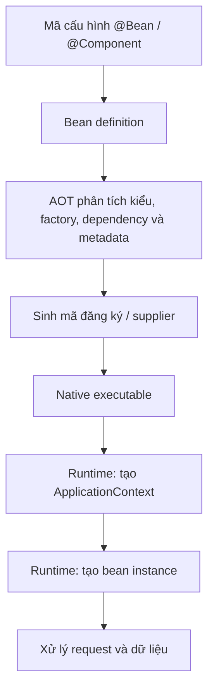
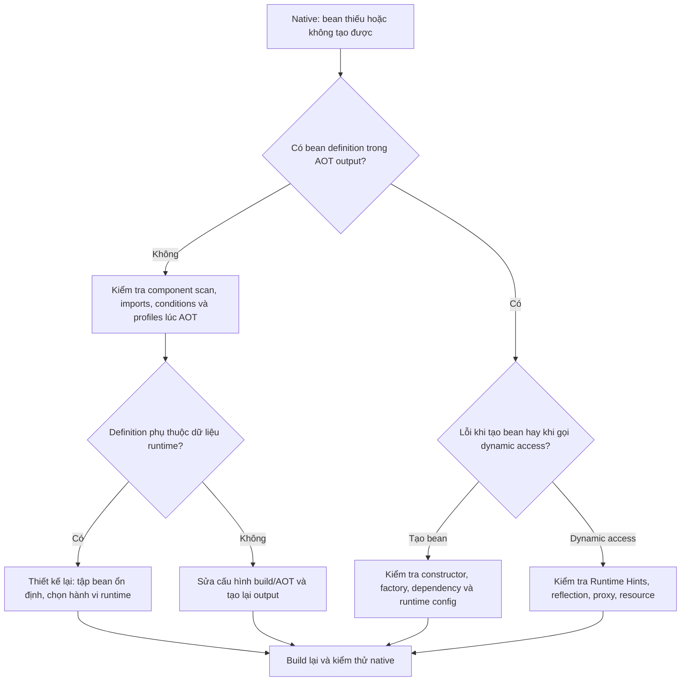

# Định nghĩa bean phải được xác định trong giai đoạn phân tích

Spring Boot trên JVM thường tạo ApplicationContext khi ứng dụng khởi động. Trong quá trình đó, Spring đọc cấu hình, quét component, xử lý điều kiện, đăng ký bean definitions rồi mới tạo các bean cần thiết. Khi dùng **Spring AOT** để chuẩn bị **GraalVM Native Image**, một phần việc xác định cấu trúc ApplicationContext được chuyển lên giai đoạn build. Vì vậy, **tập bean definitions mà ứng dụng cần dùng phải có thể được xác định trong lúc phân tích AOT**.

Điều này không có nghĩa mọi bean instance đều được tạo khi build. AOT cần biết *bean nào tồn tại, kiểu gì, được tạo theo đường nào và phụ thuộc vào đâu* để sinh mã đăng ký/khởi tạo và metadata phù hợp. Các bean thông thường vẫn được tạo khi tiến trình native khởi động; dữ liệu nghiệp vụ, kết nối, request và nhiều giá trị cấu hình vẫn thay đổi trong runtime.

Bài học thuộc chương **Bean và AOT** của mô-đun `SPRING_BOOT_NATIVE_IMAGE`. Ta sẽ phân biệt bean definition với bean instance, tìm hiểu cách điều kiện ảnh hưởng bean graph, nhận diện đăng ký bean động không phù hợp với AOT, và thiết kế ứng dụng có thể thay đổi hành vi theo cấu hình runtime mà vẫn giữ cấu trúc bean ổn định.

## 1. Bean definition là gì?

Một **bean definition** là mô tả để Spring biết cách quản lý và tạo một bean. Tùy cách khai báo, định nghĩa có thể chứa hoặc suy ra:

- Tên bean và kiểu bean.
- Constructor, factory method hoặc instance supplier dùng để tạo đối tượng.
- Dependency cần inject, qualifier và các thông tin autowiring.
- Scope như `singleton`, `prototype`, request/session scope.
- Lazy initialization, primary, role, init/destroy method và metadata liên quan.
- Các điều kiện để định nghĩa được đăng ký, ví dụ `@Profile`, `@ConditionalOnProperty`, `@ConditionalOnClass`.

Ví dụ:

```java
@Configuration(proxyBeanMethods = false)
class ClockConfiguration {

    @Bean
    Clock applicationClock() {
        return Clock.systemUTC();
    }
}
```

Spring có thể đăng ký một bean definition tên `applicationClock`, kiểu `Clock`, có factory method là `applicationClock()`. Bean definition mô tả cách tạo đối tượng; nó **không phải chính đối tượng Clock**.



Trong Spring AOT, cấu trúc bean definitions phải đủ rõ để công cụ có thể tạo mã cho bước đăng ký và khởi tạo. Bean instance thông thường vẫn được tạo khi ApplicationContext của tiến trình chạy được refresh. Ví dụ `Clock.systemUTC()` được gọi để tạo bean khi context runtime khởi động, chứ không phải AOT đã đóng băng một đối tượng Clock dùng chung trong binary.

## 2. Vì sao AOT cần biết bean definitions từ trước?

Native Image sử dụng phân tích *closed-world*: compiler cần xác định mã nào có thể được thực thi, các kiểu nào cần giữ lại và những truy cập động nào cần metadata. Nếu ứng dụng có thể tùy ý thêm một lớp bất kỳ từ một JAR mới sau khi binary đã được tạo, native compiler không thể bảo đảm lớp đó đã được đưa vào executable hoặc có đủ metadata reflection/proxy.

Spring AOT giải quyết phần cấu trúc Spring bằng cách phân tích ApplicationContext trong build và sinh mã tương ứng. Quá trình khái quát:

1. Spring khởi tạo môi trường phân tích với classpath, profiles và properties dùng cho AOT.
2. Cấu hình ứng dụng, component scanning, imports, auto-configuration và các điều kiện được xử lý để xác định bean definitions.
3. Các processor của Spring và thư viện có cơ hội đóng góp mã AOT hoặc runtime hints.
4. Spring sinh mã nguồn, classes và resources cần thiết để tái tạo cấu trúc context.
5. GraalVM phân tích mã ứng dụng, mã được sinh, thư viện và metadata để tạo native executable.
6. Khi tiến trình native chạy, mã khởi tạo đã sinh đăng ký bean definitions và Spring tạo bean instances theo vòng đời runtime.

| Thời điểm | Việc cần xác định | Ví dụ |
| --- | --- | --- |
| Compile/AOT build | Tập kiểu và bean definitions, điều kiện đăng ký, đường tạo bean, metadata cho truy cập động | Component scan, `@Bean`, `@Import`, `@ConditionalOnProperty`, runtime hints |
| Khởi động native process | Giá trị cấu hình runtime, tạo ApplicationContext, tạo singleton, kết nối dịch vụ | URL database, port, timeout, bean instance |
| Khi ứng dụng đang chạy | Trạng thái nghiệp vụ và các giá trị được thiết kế để thay đổi | Request, đơn hàng, cache, feature flag động, message |

Điều cần cố định là **cấu trúc và khả năng mà binary cần có**, không phải toàn bộ dữ liệu hay trạng thái đối tượng.

## 3. Những nguồn tạo bean definitions được AOT phân tích

Trong ứng dụng Spring Boot, bean definitions có thể đến từ nhiều nguồn. Khi điều tra native, hãy xem xét toàn bộ các nguồn này thay vì chỉ tìm annotation `@Component`.

| Nguồn | Ví dụ | Điều cần lưu ý |
| --- | --- | --- |
| Component scanning | `@Component`, `@Service`, `@Repository`, `@Controller` | Package và classpath phải được xác định khi build. |
| Java configuration | `@Configuration`, `@Bean` | Factory method và dependency cần phân tích được. |
| Import | `@Import`, `ImportSelector`, `DeferredImportSelector` | Kết quả import cần xác định được trong AOT context. |
| Spring Boot auto-configuration | Starter và các lớp `@AutoConfiguration` | Điều kiện auto-configuration được đánh giá theo môi trường AOT. |
| Profile và condition | `@Profile`, `@ConditionalOnProperty`, `@ConditionalOnClass` | Điều kiện ảnh hưởng bean graph thường được quyết định khi AOT. |
| Đăng ký bằng code | `BeanDefinitionRegistry`, `BeanDefinitionRegistryPostProcessor` | Việc đăng ký phải xác định được và tương thích với quy trình AOT. |
| Framework/library integration | Các AOT processor do thư viện cung cấp | Thư viện cần cung cấp đóng góp AOT/hints khi có hành vi động. |

Spring AOT không đơn giản chỉ quét annotation rồi sao chép danh sách lớp. Nó khởi tạo và phân tích ApplicationContext theo cơ chế của Spring; do đó, custom infrastructure code có thể tham gia vào quá trình. Tuy nhiên, một processor dựa vào dữ liệu bên ngoài chỉ có ở runtime sẽ làm kết quả phân tích không ổn định hoặc không thể dự đoán.

## 4. Điều kiện quyết định bean phải được đánh giá ở giai đoạn AOT

Xét ví dụ một bean audit:

```java
@Configuration(proxyBeanMethods = false)
class AuditConfiguration {

    @Bean
    @ConditionalOnProperty(
            name = "feature.audit.enabled",
            havingValue = "true"
    )
    AuditService auditService() {
        return new AuditService();
    }
}

class AuditService {
    void record(String message) {
        System.out.println("AUDIT: " + message);
    }
}
```

Điều kiện `feature.audit.enabled` ảnh hưởng trực tiếp đến việc bean definition `auditService` có được đăng ký hay không. Trong AOT, condition được đánh giá với môi trường phân tích. Nếu property không bật khi xử lý AOT, bean có thể không xuất hiện trong cấu trúc đã sinh.

| Property khi chạy AOT | Bean definition được chuẩn bị | Đổi property lúc chạy native |
| --- | --- | --- |
| `feature.audit.enabled=true` | Bean audit được đưa vào context AOT | Có thể sử dụng bean theo cấu trúc đã tạo. |
| `feature.audit.enabled=false` hoặc thiếu (mặc định không match) | Bean audit bị loại | Đặt thành `true` lúc chạy không tự tạo lại definition đã bị loại. |

Đây là lý do một cấu hình hoạt động trên JVM có thể khác khi chuyển sang native: trên JVM, Spring thường đánh giá condition khi mỗi tiến trình khởi động; với AOT, kết quả điều kiện có thể đã được dùng để sinh cấu trúc context trong build.

### 4.1. Profile cũng ảnh hưởng bean graph

Ví dụ:

```java
@Configuration(proxyBeanMethods = false)
class StorageConfiguration {

    @Bean
    @Profile("cloud")
    StorageClient cloudStorageClient() {
        return new CloudStorageClient();
    }

    @Bean
    @Profile("local")
    StorageClient localStorageClient() {
        return new LocalStorageClient();
    }
}
```

Nếu AOT xử lý với profile `cloud`, generated context sẽ được chuẩn bị theo cấu trúc tương ứng. Khi chạy native, cần tuân thủ các ràng buộc profile mà Spring Boot AOT đặt ra: những profile hoạt động khi xử lý AOT phải phù hợp với runtime. Không nên kỳ vọng chuyển từ `cloud` sang `local` sau build sẽ làm xuất hiện một bean đã bị loại khỏi cấu trúc sinh ra.

Nếu cần cùng một binary chạy ở nhiều môi trường, hãy giữ các implementation cần thiết trong bean graph và chọn hành vi theo cấu hình runtime, như phần tiếp theo.

## 5. Phân biệt condition của bean với cấu hình runtime

Không phải mọi property đều cố định lúc AOT. Điểm quyết định là property đó **chỉ thay đổi giá trị của bean đã tồn tại** hay **thay đổi việc bean nào được đăng ký**.

Ví dụ cấu hình runtime:

```java
@Service
class GreetingService {
    private final String prefix;

    GreetingService(
            @Value("${app.greeting-prefix:Hello}") String prefix) {
        this.prefix = prefix;
    }

    String greet(String name) {
        return prefix + ", " + name;
    }
}
```

Bean `GreetingService` vẫn tồn tại trong bean graph. Cùng một binary có thể nhận `--app.greeting-prefix=Hello` ở môi trường A và `--app.greeting-prefix=Xin chào` ở môi trường B. Giá trị được inject khi tiến trình khởi động nên hai lần chạy có thể khác nhau mà không cần thay đổi bean definitions.

Tuy nhiên, thay environment variable sau khi bean đã được tạo **không tự cập nhật** field `prefix`. Nếu cần thay đổi ngay trong lúc tiến trình đang chạy, phải thiết kế cơ chế đọc cấu hình động hoặc refresh rõ ràng.

| Cấu hình | Có thay đổi bean graph? | Thời điểm phù hợp |
| --- | --- | --- |
| `server.port`, URL database, timeout của bean đã tồn tại | Thường không | Runtime startup |
| `@Value` / `@ConfigurationProperties` của bean luôn được đăng ký | Thường không | Runtime startup; refresh nếu cần cập nhật nóng |
| `@ConditionalOnProperty` quyết định một bean có tồn tại | Có | Build/AOT |
| `@Profile` chọn một tập bean khác nhau | Có | Build/AOT |
| Classpath hoặc loại thư viện được thêm/bớt | Có thể thay đổi reachability và auto-configuration | Build |
| Dữ liệu request, cache, trạng thái đơn hàng | Không | Runtime |

## 6. Thiết kế chọn implementation ở runtime mà vẫn AOT-friendly

Giả sử hệ thống hỗ trợ hai cổng thanh toán: thẻ và chuyển khoản. Nếu dùng `@ConditionalOnProperty` để chỉ đăng ký một implementation, một native binary có thể chỉ chứa cấu trúc cho provider được chọn khi build.

Nếu yêu cầu là **cùng một binary chọn provider theo cấu hình lúc khởi động**, hãy đưa cả hai implementation vào bean graph rồi dùng một bean router để chọn.

```java
public interface PaymentGateway {
    String charge(String orderId);
}
```

```java
@Component("card")
class CardPaymentGateway implements PaymentGateway {
    @Override
    public String charge(String orderId) {
        return "CARD:" + orderId;
    }
}

@Component("bank")
class BankPaymentGateway implements PaymentGateway {
    @Override
    public String charge(String orderId) {
        return "BANK:" + orderId;
    }
}
```

```java
@Component
class PaymentRouter {
    private final PaymentGateway selected;

    PaymentRouter(
            Map<String, PaymentGateway> gateways,
            @Value("${payment.provider:card}") String provider) {

        PaymentGateway gateway = gateways.get(provider);
        if (gateway == null) {
            throw new IllegalArgumentException(
                    "Unsupported payment.provider: " + provider);
        }
        this.selected = gateway;
    }

    String charge(String orderId) {
        return selected.charge(orderId);
    }
}
```

Spring biết cả hai bean `card` và `bank` khi phân tích AOT. Property `payment.provider` chỉ chọn bean instance nào được router sử dụng khi tiến trình khởi động. Nhờ vậy, cùng binary có thể chạy với:

```bash
./target/application --payment.provider=card
./target/application --payment.provider=bank
```

Hai lệnh trên minh họa hai tiến trình riêng. Nếu cần đổi provider ngay khi đang chạy, router có thể đọc một cấu hình động hoặc nhận một lựa chọn có thể cập nhật; cần quản lý concurrency, chuyển đổi kết nối và xử lý lỗi theo yêu cầu nghiệp vụ.

**Đánh đổi:** mọi implementation đã đăng ký đều là một phần của ứng dụng cần phân tích và có thể được native compiler giữ lại nếu có đường reachability phù hợp. Binary có thể lớn hơn. Đổi lại, ta có khả năng chọn giữa các implementation đã biết mà không cần thay đổi bean graph lúc runtime.

## 7. Vì sao đăng ký bean dựa trên dữ liệu runtime là rủi ro?

Một số ứng dụng dùng `BeanDefinitionRegistryPostProcessor` để đăng ký bean theo dữ liệu cấu hình, database hoặc plugin catalog. Cơ chế này hữu ích trong Spring trên JVM, nhưng cần xem xét cẩn thận khi dùng AOT.

Ví dụ ý tưởng sau minh họa một cách thiết kế rủi ro:

```java
// MÃ MINH HỌA Ý TƯỞNG — không phải implementation hoàn chỉnh.
class ExternalPluginRegistrar
        implements BeanDefinitionRegistryPostProcessor {

    @Override
    public void postProcessBeanDefinitionRegistry(
            BeanDefinitionRegistry registry) {

        // Lấy danh sách plugin từ dịch vụ bên ngoài.
        List<PluginDescriptor> plugins = pluginCatalog.loadFromDatabase();

        for (PluginDescriptor plugin : plugins) {
            Class<?> implementation = resolvePluginClass(plugin);
            RootBeanDefinition definition =
                    new RootBeanDefinition(implementation);

            registry.registerBeanDefinition(
                    plugin.beanName(), definition);
        }
    }
}
```

Trong ví dụ này, danh sách plugin và implementation được lấy từ database. Khi AOT phân tích, processor có thể được gọi trong quá trình xây dựng context. Nếu database tại build chỉ có plugin A, generated context sẽ phản ánh tập bean tương ứng. Khi production có thêm plugin B, native binary đã build không tự có mã, class và metadata cần thiết cho B.

Những rủi ro chính:

- **Không xác định được trước:** plugin catalog hoặc danh sách bean chỉ có ở runtime.
- **Kết quả không tái lập:** cùng commit nhưng AOT build ở hai thời điểm khác nhau tạo ra hai bean graph khác nhau do dữ liệu ngoài thay đổi.
- **I/O và secret trong build:** AOT vô tình gọi database, API hoặc cần credentials để phân tích.
- **Reflection/class loading:** implementation được chỉ ra bằng tên chuỗi, native compiler không nhận biết đầy đủ.
- **Side effect:** processor gửi message, ghi dữ liệu hoặc thay đổi hệ thống ngoài trong lúc build.
- **Khác biệt môi trường:** máy build và production có classpath/profiles/configuration không tương thích.

Không phải mọi việc đăng ký bean bằng code đều bị cấm. Nếu tập định nghĩa có thể xác định ổn định trong AOT context và thư viện tích hợp cung cấp cách đóng góp AOT phù hợp, Spring có thể đưa kết quả đó vào mã sinh. Vấn đề là **không thể phụ thuộc vào một tập bean chỉ xuất hiện sau khi binary đã được build**.

### 7.1. Khi nào đăng ký bằng code có thể dùng được?

Một registry dựa trên danh sách cố định trong mã nguồn có thể xác định được trong quá trình phân tích:

```java
// Minh họa ý tưởng: danh sách implementation là hằng số của bản build.
List<Class<?>> pluginTypes = List.of(
        CsvExporter.class,
        JsonExporter.class
);

for (Class<?> pluginType : pluginTypes) {
    registerKnownPlugin(pluginType);
}
```

Dù vậy, custom post-processor cần được kiểm tra với cơ chế AOT của Spring Framework/Spring Boot đang sử dụng. Nếu processor cần tạo mã hoặc metadata riêng, hãy triển khai các AOT extension contract phù hợp thay vì giả định hành vi JVM sẽ tự động được tái tạo trong native image.

## 8. AOT contribution và Runtime Hints có vai trò gì?

Spring Framework cung cấp các extension point để framework/thư viện đóng góp mã trong quá trình AOT, chẳng hạn:

- `BeanFactoryInitializationAotProcessor`: đóng góp xử lý/generation ở mức khởi tạo bean factory.
- `BeanRegistrationAotProcessor`: đóng góp xử lý cho từng bean registration.
- Các AOT contribution tương ứng để sinh mã khởi tạo cần thiết.
- `RuntimeHintsRegistrar`: khai báo reflection, resource, proxy, serialization hoặc các khả năng động khác mà native image cần biết.

Hai nhóm cuối cần được phân biệt:

| Cơ chế | Trách nhiệm | Không thay thế |
| --- | --- | --- |
| AOT bean contribution | Đóng góp cách tái tạo cấu trúc/đăng ký bean trong generated context | Việc đảm bảo mọi reflection/resource đều có metadata |
| Runtime Hints | Cung cấp metadata cho truy cập động, resource và proxy | Việc tự thêm một bean definition vào ApplicationContext |
| Bean definition | Mô tả bean và cách tạo bean | Việc bảo đảm mọi lớp động đã được giữ trong native executable |

Ví dụ khai báo hint cho một kiểu được gọi qua reflection:

```java
import org.springframework.aot.hint.MemberCategory;
import org.springframework.aot.hint.RuntimeHints;
import org.springframework.aot.hint.RuntimeHintsRegistrar;
import org.springframework.context.annotation.Configuration;
import org.springframework.context.annotation.ImportRuntimeHints;

@Configuration(proxyBeanMethods = false)
@ImportRuntimeHints(ReportHints.class)
class ReportConfiguration {
}

class ReportHints implements RuntimeHintsRegistrar {
    @Override
    public void registerHints(
            RuntimeHints hints, ClassLoader classLoader) {

        hints.reflection().registerType(
                ReportPayload.class,
                MemberCategory.INVOKE_DECLARED_CONSTRUCTORS
        );
        hints.resources().registerPattern("reports/default-template.txt");
    }
}
```

Hint trên giúp native image giữ metadata cần thiết cho constructor và resource. Nó **không đăng ký** `ReportPayload` thành một Spring bean. Nếu muốn Spring quản lý kiểu đó, cần một bean definition từ `@Component`, `@Bean` hoặc cơ chế đăng ký tương ứng.

Khi xây dựng thư viện/framework có hỗ trợ native, nên thiết kế AOT integration cùng với test để chứng minh generated context và hints phản ánh đúng hành vi cần có. Các extension API có thể thay đổi giữa các thế hệ Spring Framework; tham khảo tài liệu đúng phiên bản trước khi triển khai.

## 9. Kiểm tra bean graph và kết quả AOT được sinh

Không nên chỉ suy luận từ mã nguồn. Hãy chạy AOT và kiểm tra output thực tế.

### 9.1. Maven

Với dự án đã cấu hình Spring Boot Maven Plugin:

```bash
./mvnw spring-boot:process-aot
```

Các generated source/resources thường xuất hiện dưới:

```text
target/
└── spring-aot/
    └── main/
        ├── sources/
        ├── resources/
        └── classes/
```

### 9.2. Gradle

Với dự án đã cấu hình plugin tương ứng:

```bash
./gradlew processAot
```

Vị trí output thường nằm dưới thư mục generated AOT của Gradle, ví dụ:

```text
build/
└── generated/
    ├── aotSources/
    ├── aotResources/
    └── aotClasses/
```

Tên thư mục có thể khác theo phiên bản plugin và cấu hình. Xem log task để biết chính xác output của dự án.

### 9.3. Tìm bean definitions được sinh

Dùng `rg` (ripgrep) để tìm bean name, kiểu và phương thức factory:

```bash
# Maven
rg -n "auditService|applicationClock|PaymentRouter" target/spring-aot

# Gradle
rg -n "auditService|applicationClock|PaymentRouter" build/generated
```

Tên lớp generated có thể chứa các hậu tố như `__BeanDefinitions`, `__BeanFactoryRegistrations` hoặc `__ApplicationContextInitializer`, nhưng không nên giả định tên luôn giống nhau giữa các phiên bản. Hãy tìm theo **bean name** và kiểu ứng dụng trước.

Khi đọc output, trả lời lần lượt:

1. Bean definition có được đăng ký không?
2. Nó được tạo từ constructor hay factory method nào?
3. Dependency được liên kết ra sao?
4. Condition/profile nào ảnh hưởng đến việc đăng ký?
5. Nếu bean dùng reflection/resource/proxy, hints liên quan có được tạo không?

Có tên lớp trong generated file chưa đủ kết luận bean instance đã được tạo khi build. Hãy tìm đoạn đăng ký definition/supplier và nhớ rằng việc tạo singleton thường diễn ra trong runtime startup.

## 10. Thực hành: chứng minh property condition được quyết định khi AOT

Tạo hai biến thể của cùng ví dụ `AuditConfiguration`. Dùng hai thư mục build sạch hoặc `clean` giữa các lượt để tránh đọc nhầm output cũ.

**Lượt A — tắt audit lúc AOT:**

```bash
./mvnw clean spring-boot:process-aot \
  -Dspring-boot.run.arguments=--feature.audit.enabled=false
```

Cách truyền property cho goal AOT phụ thuộc cấu hình Maven plugin và phiên bản; nếu dự án không nhận tham số như trên, cấu hình property/profile trực tiếp cho execution `process-aot` theo tài liệu plugin. Điều quan trọng là xác nhận giá trị thực sự có mặt trong môi trường mà AOT sử dụng.

**Lượt B — bật audit lúc AOT:**

```bash
./mvnw clean spring-boot:process-aot \
  -Dspring-boot.run.arguments=--feature.audit.enabled=true
```

Sau mỗi lượt, tìm `auditService` trong generated sources và đối chiếu. Đừng chỉ nhìn lệnh Maven mà cho rằng property đã được áp dụng; log và output generated là bằng chứng.

Sau đó build native với một biến thể, rồi chạy binary với property ngược lại. Quan sát rằng đổi property runtime không thể khôi phục bean đã bị loại khỏi cấu trúc AOT. Lặp lại với cấu hình bean luôn tồn tại nhưng nhận `@Value`; trường hợp này cho thấy giá trị có thể khác giữa các tiến trình.

### 10.1. Một test kiểm tra sự hiện diện của bean

```java
import org.junit.jupiter.api.Test;
import org.springframework.beans.factory.annotation.Autowired;
import org.springframework.boot.test.context.SpringBootTest;
import org.springframework.context.ApplicationContext;

import static org.assertj.core.api.Assertions.assertThat;

@SpringBootTest
class AuditBeanPresenceTests {

    @Autowired
    ApplicationContext context;

    @Test
    void auditBeanIsPresentWhenConfigured() {
        assertThat(context.containsBean("auditService")).isTrue();
    }
}
```

Test này minh họa assertion cho một build/test context được cấu hình để bật audit. Nếu dùng native test, cần đảm bảo test AOT và profile/property của test được chuẩn bị đúng. Không dùng một test context JVM với cấu hình khác để suy ra kết quả native.

## 11. Các chiến lược khi thật sự cần plugin hoặc bean có thể mở rộng

Trước khi chọn kiến trúc, hãy xác định "mở rộng" nghĩa là gì:

| Nhu cầu | Chiến lược phù hợp với AOT/native |
| --- | --- |
| Bật/tắt tính năng theo môi trường | Giữ bean cần thiết trong bean graph, dùng property/feature flag để điều khiển hành vi runtime. |
| Chọn một trong vài implementation đã biết | Đăng ký tất cả implementation cần thiết, dùng router/strategy chọn lúc khởi động hoặc runtime. |
| Thêm implementation mới từ mã nguồn trước release | Thêm module/dependency, build lại AOT và native executable. |
| Plugin catalog thay đổi nhưng tập class vẫn cố định | Nhúng các implementation đã biết; đọc catalog runtime để chọn giữa tập đó. |
| Tải một JAR/class mới tùy ý sau khi native binary đã phát hành | Native Image thường không phù hợp với mô hình class loading tùy ý này; cân nhắc JVM hoặc kiến trúc process/plugin riêng. |
| Bean definitions sinh từ schema/configuration được biết lúc build | Sinh source/configuration ổn định trước AOT hoặc tích hợp AOT processor phù hợp. |

Một số hệ thống cần cập nhật plugin mà không build lại có thể tách plugin thành tiến trình/service riêng. Native executable chính giao tiếp qua HTTP, gRPC hoặc message broker. Như vậy, khả năng triển khai plugin độc lập nằm ở ranh giới process/service, không đòi hỏi native image tự nạp lớp Java mới.

## 12. Lỗi thường gặp và cách điều tra

| Hiện tượng | Nguyên nhân có thể | Cách xác minh |
| --- | --- | --- |
| Bean có trên JVM nhưng mất trên native | Condition/profile khác khi AOT; bean definition được đăng ký động từ dữ liệu ngoài | Kiểm tra cấu hình AOT và generated bean registrations. |
| Đổi property khi chạy nhưng bean không xuất hiện | Property quyết định `@Conditional...` đã được đánh giá lúc AOT | Đổi cấu hình ở build và tạo lại binary, hoặc chuyển sang runtime strategy. |
| AOT build gọi database/API bên ngoài | Custom registry/processor đọc dữ liệu khi phân tích | Xác định post-processor nào chạy trong AOT; loại side effect và dùng đầu vào ổn định. |
| Bean definition có nhưng native lỗi khi gọi constructor/method qua reflection | Thiếu runtime hints hoặc metadata | Đọc stack trace và khai báo đúng member/type cần truy cập. |
| Bean được tạo nhưng dependency không resolve | Qualifier, kiểu, condition hoặc generated registration không khớp | Xem bean name/type, dependency graph và profile/property của build. |
| Thư viện plugin hoạt động trên JVM nhưng native thiếu class | Plugin được nạp động từ JAR ngoài hoặc reachability không được nhận diện | Đưa class vào build, khai báo khả năng cần thiết hoặc tách plugin ra process riêng. |
| Bean instance có giá trị cấu hình cũ sau khi đổi environment | Giá trị đã inject khi startup | Restart hoặc dùng cơ chế cấu hình động/refresh. |

Quy trình điều tra:



Sau khi sửa condition, registry, AOT contribution hoặc hints, cần build lại native executable và chạy lại các test liên quan. Chỉ restart binary cũ không cập nhật cấu trúc đã được tạo khi build.

## 13. Checklist thiết kế bean tương thích AOT

- [ ] Các bean cần thiết được khai báo bằng component scan, configuration, imports hoặc cơ chế đăng ký mà AOT hỗ trợ.
- [ ] Những condition/profile quyết định bean graph có giá trị xác định tại thời điểm AOT.
- [ ] Không phụ thuộc database, API hoặc plugin catalog thay đổi để quyết định tùy ý lớp nào được đăng ký khi production khởi động.
- [ ] Custom `BeanDefinitionRegistryPostProcessor`/`BeanFactoryPostProcessor` có hành vi xác định và đã được kiểm thử trong AOT.
- [ ] Những giá trị cần thay đổi giữa môi trường được thiết kế thành runtime configuration của bean đã tồn tại.
- [ ] Nếu chọn implementation lúc runtime, mọi implementation cần thiết đã có trong bean graph và native image.
- [ ] Reflection, proxy, serialization và resource có Runtime Hints/metadata phù hợp.
- [ ] Đã đọc generated source để xác nhận bean name, kiểu, factory và dependency.
- [ ] Đã kiểm thử cả JVM lẫn native bằng cùng kịch bản chức năng.
- [ ] Sau khi đổi AOT configuration hoặc hints, đã build lại binary và chạy lại kiểm thử.

### Câu hỏi tự đánh giá

1. Bean definition khác bean instance ở điểm nào? Tại sao Spring AOT cần biết definition trước nhưng không cần tạo mọi singleton khi build?
2. Vì sao `@ConditionalOnProperty` có thể cho kết quả khác khi chuyển từ JVM sang native?
3. Nếu cùng binary cần chạy với hai payment provider, làm thế nào giữ bean graph ổn định mà vẫn chọn provider theo cấu hình?
4. Tại sao một `BeanDefinitionRegistryPostProcessor` đọc plugin catalog từ database trong quá trình AOT là thiết kế rủi ro?
5. `RuntimeHintsRegistrar` giải quyết vấn đề gì và tại sao nó không tự đăng ký một Spring bean?
6. Cần tìm những bằng chứng nào trong generated source để xác nhận một bean thực sự có definition trong context AOT?

**Kết quả cần đạt:** thiết kế được bean graph có thể xác định ở giai đoạn phân tích, tách các quyết định cấu trúc khỏi giá trị runtime và giải thích được vì sao một bean có hoặc không có trong native executable. Đây là nền tảng để Spring Boot AOT và GraalVM Native Image tạo ứng dụng có hành vi dự đoán được, dễ kiểm thử và vận hành trên nhiều môi trường.
