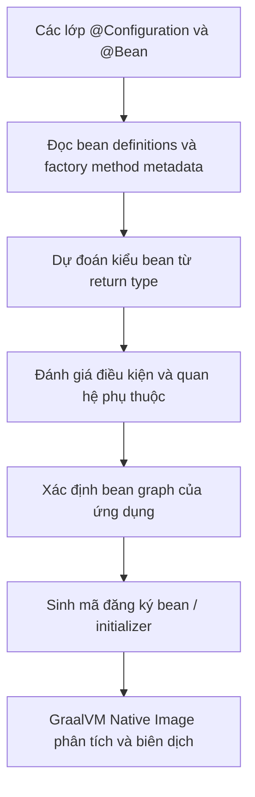

# Khai báo kiểu trả về đủ cụ thể trên phương thức @Bean

## Mục tiêu bài học

Trong Spring Boot, phương thức được đánh dấu **`@Bean`** là một factory method: Spring gọi phương thức để lấy đối tượng và đăng ký đối tượng đó trong `ApplicationContext`. Kiểu trả về được khai báo trên chữ ký phương thức cung cấp cho Spring thông tin về loại bean **ngay cả khi instance chưa được tạo**.

Khi dùng **Spring AOT** để chuẩn bị ứng dụng cho GraalVM Native Image, thông tin kiểu này càng quan trọng. Spring cần phân tích bean definitions, điều kiện cấu hình và các quan hệ phụ thuộc ở giai đoạn build. Nếu phương thức `@Bean` khai báo kiểu quá tổng quát như `Object`, container có thể không dự đoán được kiểu thực tế mà factory method sẽ trả về tại thời điểm cần phân tích.

Sau bài học, bạn có thể:

- Giải thích vì sao kiểu trả về của `@Bean` ảnh hưởng tới khả năng dự đoán kiểu bean.
- Phân biệt kiểu khai báo trên factory method với lớp thực tế của đối tượng được trả về.
- Chọn kiểu trả về đủ cụ thể cho injection và các điều kiện `@ConditionalOnBean` / `@ConditionalOnMissingBean`.
- Nhận diện những vấn đề có thể xuất hiện khi Spring AOT phân tích bean graph.
- Viết kiểm thử để xác nhận bean được đăng ký và tìm thấy đúng theo kiểu mong muốn.

> **Nguyên tắc:** khai báo kiểu trả về cụ thể nhất mà ứng dụng và các điều kiện cấu hình thực sự cần. Tránh dùng `Object` hoặc kiểu raw khi bạn đã biết kiểu bean. Nếu thiết kế chủ động chỉ công khai một abstraction, hãy dùng abstraction đó nhất quán trong injection và conditional.

## 1. Spring biết kiểu bean từ đâu?

### 1.1. @Bean là một factory method

Xét cấu hình đơn giản:

```java
@Configuration(proxyBeanMethods = false)
class ExportConfiguration {

    @Bean
    CsvReportExporter csvReportExporter() {
        return new CsvReportExporter();
    }
}
```

Spring đọc metadata của phương thức `csvReportExporter()` để tạo bean definition. Bean definition chứa thông tin về factory method, tên bean, scope, dependency và các metadata liên quan. Từ kiểu trả về `CsvReportExporter`, Spring có thể dự đoán bean này tương thích với kiểu đó trước khi gọi factory method.

Khi context được refresh, Spring mới thực hiện các bước tạo bean theo lifecycle. Vì thế cần phân biệt:

- **Kiểu khai báo:** kiểu được ghi trong chữ ký phương thức `@Bean`.
- **Kiểu dự đoán:** kiểu Spring có thể suy ra từ bean definition trước khi tạo instance.
- **Kiểu runtime:** lớp thực tế của đối tượng được factory method trả về.

Ba kiểu này có thể giống nhau, nhưng không phải lúc nào cũng giống.

### 1.2. Kiểu runtime không phải lúc nào cũng có sẵn ở build time

Ví dụ:

```java
@Bean
Object reportExporter() {
    return new CsvReportExporter();
}
```

Khi phương thức được gọi, đối tượng thực tế là `CsvReportExporter`. Tuy nhiên, trước khi factory method chạy, metadata của bean chỉ khai báo kiểu `Object`. Các thành phần cần dự đoán kiểu sớm không nên phải thực thi factory method chỉ để tìm ra kiểu cụ thể.

Điều này đặc biệt quan trọng với:

- Kiểm tra bean theo kiểu ở giai đoạn xử lý cấu hình.
- Điều kiện auto-configuration dựa trên sự tồn tại của một bean.
- Phân tích dependency và bean graph khi xử lý AOT.
- Những thao tác cần biết loại bean trước khi khởi tạo instance.

Không nên hiểu rằng khai báo `Object` chắc chắn làm mọi injection thất bại trong mọi trường hợp. Spring có thể biết thêm kiểu sau khi instance được tạo. Vấn đề là **thông tin kiểu sớm bị mất**, khiến việc dự đoán và các điều kiện chạy trước khi khởi tạo bean kém tin cậy hơn.

## 2. Ví dụ: kiểu trả về quá tổng quát

Giả sử ứng dụng có abstraction và implementation:

```java
public interface ReportExporter {
    byte[] export();
}

public class CsvReportExporter implements ReportExporter {
    @Override
    public byte[] export() {
        return "id,total\n1,100".getBytes(java.nio.charset.StandardCharsets.UTF_8);
    }
}
```

### 2.1. Khai báo kiểu trả về là `Object`

```java
@Configuration(proxyBeanMethods = false)
class ReportConfiguration {

    @Bean
    Object reportExporter() {
        return new CsvReportExporter();
    }
}
```

Spring biết bean tên `reportExporter` có kiểu khai báo `Object`. Tại thời điểm kiểm tra bean definitions, container không có đủ thông tin từ chữ ký factory method để khẳng định bean này là `ReportExporter` hay `CsvReportExporter`.

Một cấu hình khác muốn phụ thuộc vào implementation:

```java
@Configuration(proxyBeanMethods = false)
class CsvJobConfiguration {

    @Bean
    @ConditionalOnBean(CsvReportExporter.class)
    CsvExportJob csvExportJob(CsvReportExporter exporter) {
        return new CsvExportJob(exporter);
    }
}
```

Nếu bean exporter chỉ được khai báo với return type `Object`, điều kiện dựa trên `CsvReportExporter.class` có thể không nhận diện được bean ở giai đoạn đánh giá điều kiện. Factory method có thể trả đúng implementation khi chạy, nhưng điều kiện cần metadata kiểu trước thời điểm đó.

### 2.2. Khai báo kiểu trả về cụ thể

Sửa chữ ký phương thức:

```java
@Configuration(proxyBeanMethods = false)
class ReportConfiguration {

    @Bean
    CsvReportExporter reportExporter() {
        return new CsvReportExporter();
    }
}
```

Bây giờ bean definition công khai kiểu `CsvReportExporter`. Spring có thể dự đoán kiểu cụ thể này và cũng biết nó có thể gán cho abstraction `ReportExporter`.

Do đó, cả injection theo abstraction:

```java
@Service
class ReportService {
    private final ReportExporter exporter;

    ReportService(ReportExporter exporter) {
        this.exporter = exporter;
    }
}
```

và điều kiện theo implementation:

```java
@Bean
@ConditionalOnBean(CsvReportExporter.class)
CsvExportJob csvExportJob(CsvReportExporter exporter) {
    return new CsvExportJob(exporter);
}
```

đều có đủ thông tin kiểu để Spring xử lý. Ví dụ điều kiện còn phụ thuộc bean definition exporter đã được đăng ký trước khi điều kiện được đánh giá.

## 3. Chọn kiểu trả về theo hợp đồng mà ứng dụng cần

Không phải lúc nào cũng phải khai báo implementation cụ thể. Điều quan trọng là kiểu trả về phải đủ cụ thể để thể hiện **kiểu mà Spring cần nhận diện**.

Giả sử tất cả consumer chỉ cần `ReportExporter`:

```java
@Bean
ReportExporter reportExporter() {
    return new CsvReportExporter();
}
```

Khai báo này đã đủ để Spring nhận diện bean là `ReportExporter`. Injection theo interface và điều kiện `@ConditionalOnBean(ReportExporter.class)` có thể dựa vào kiểu đó.

Nếu một thành phần thật sự cần `CsvReportExporter` hoặc điều kiện cần kiểm tra chính xác implementation này, return type `ReportExporter` không cung cấp thông tin subtype trước khi instance được tạo. Khi đó, hãy cân nhắc khai báo return type là `CsvReportExporter`.

| Kiểu trả về | Spring có thể dự đoán | Phù hợp khi |
|---|---|---|
| `Object` | Chỉ biết kiểu rất tổng quát | Hiếm khi phù hợp cho bean có kiểu đã biết |
| `ReportExporter` | Biết bean đáp ứng abstraction này | Consumer và conditional đều dùng interface |
| `CsvReportExporter` | Biết implementation cụ thể và các interface nó triển khai | Có consumer/condition cần subtype |
| Kiểu raw như `List` | Mất thông tin generic về phần tử | Nên tránh nếu kiểu phần tử đã biết |
| `List<ReportExporter>` | Biết kiểu generic phần tử | Consumer cần metadata generic chính xác |

**Cân bằng abstraction và type prediction:** Spring khuyến nghị khai báo kiểu trả về cụ thể nhất có thể, đặc biệt khi bean triển khai một interface. Tuy nhiên, nếu mục tiêu kiến trúc là chỉ công khai interface và mọi consumer/condition đều làm việc qua interface, return type interface là lựa chọn rõ ràng. Tránh thu hẹp hoặc mở rộng kiểu tùy tiện; hãy để chữ ký thể hiện chính xác hợp đồng mà container cần biết.

## 4. Tác động tới `@ConditionalOnBean` và `@ConditionalOnMissingBean`

### 4.1. Điều kiện kiểm tra kiểu bean

Spring Boot có các điều kiện thường dùng:

- `@ConditionalOnBean(SomeType.class)`: cấu hình chỉ được áp dụng khi đã có bean phù hợp kiểu được yêu cầu.
- `@ConditionalOnMissingBean(SomeType.class)`: cấu hình chỉ được áp dụng khi chưa có bean phù hợp kiểu được yêu cầu.

Các điều kiện này thường được dùng trong auto-configuration để cho phép người dùng thay thế implementation mặc định.

Ví dụ:

```java
@Configuration(proxyBeanMethods = false)
class DefaultExportConfiguration {

    @Bean
    @ConditionalOnMissingBean(ReportExporter.class)
    ReportExporter reportExporter() {
        return new CsvReportExporter();
    }
}
```

Return type `ReportExporter` phù hợp vì điều kiện cũng kiểm tra `ReportExporter.class`. Khi người dùng cung cấp một bean khác triển khai abstraction đó, auto-configuration có thể lùi lại theo điều kiện.

### 4.2. Điều kiện kiểm tra implementation

Nếu điều kiện yêu cầu subtype:

```java
@Bean
@ConditionalOnBean(CsvReportExporter.class)
CsvExportJob csvExportJob(CsvReportExporter exporter) {
    return new CsvExportJob(exporter);
}
```

thì bean exporter cần có metadata đủ cụ thể để nhận diện `CsvReportExporter`. Nếu factory method chỉ khai báo `Object` hoặc chỉ khai báo một interface không cho biết subtype, condition có thể không khớp.

### 4.3. Thứ tự đăng ký cũng quan trọng

Kiểu trả về cụ thể là điều kiện cần để dự đoán kiểu, nhưng không giải quyết mọi vấn đề thứ tự cấu hình. `@ConditionalOnBean` và `@ConditionalOnMissingBean` thường chỉ xét những bean definitions đã được xử lý tại thời điểm điều kiện được đánh giá.

Trong auto-configuration, hãy dùng các cơ chế sắp xếp như `@AutoConfiguration(after = ...)`, `@AutoConfiguration(before = ...)` hoặc các quan hệ ordering phù hợp để bảo đảm cấu hình phụ thuộc được xử lý đúng thứ tự.

Vì vậy, khi condition không khớp, kiểm tra cả:

1. Return type của factory method tạo bean phụ thuộc.
2. Bean name, type và qualifier thực tế.
3. Thời điểm bean definition được đăng ký.
4. Profile/property ảnh hưởng điều kiện.
5. Auto-configuration ordering và các điều kiện khác trên class/method.

## 5. Vì sao điều này quan trọng với Spring AOT?

### 5.1. AOT cần phân tích bean graph

Khi xử lý AOT, Spring phân tích cấu hình ứng dụng và chuẩn bị các thành phần bootstrap. Ở mức khái quát:



Return type rõ ràng giúp Spring biết bean có thể đáp ứng kiểu nào mà không cần dựa vào instance đã được tạo. Thông tin này hỗ trợ việc phân tích bean graph và tạo các artifact AOT nhất quán.

### 5.2. AOT không thể dựa vào mọi giá trị runtime

Ví dụ, factory method chọn implementation bằng một tên lớp lấy từ property:

```java
@Bean
Object paymentGateway(Environment environment) throws Exception {
    String className = environment.getRequiredProperty("payment.gateway-class");
    Class<?> type = Class.forName(className);
    return type.getDeclaredConstructor().newInstance();
}
```

Chữ ký chỉ cho biết `Object`. Implementation còn phụ thuộc giá trị cấu hình và classpath lúc runtime. Đây là một thiết kế khó phân tích tĩnh và có thể cần tái cấu trúc để phù hợp AOT/native.

Một cách tốt hơn nếu tập implementation đã biết là khai báo rõ ràng theo cấu hình:

```java
@Configuration(proxyBeanMethods = false)
class PaymentConfiguration {

    @Bean
    @ConditionalOnProperty(name = "payment.provider", havingValue = "stripe")
    StripePaymentGateway stripePaymentGateway() {
        return new StripePaymentGateway();
    }

    @Bean
    @ConditionalOnProperty(name = "payment.provider", havingValue = "sandbox")
    SandboxPaymentGateway sandboxPaymentGateway() {
        return new SandboxPaymentGateway();
    }
}
```

Các implementation và điều kiện được khai báo tường minh để Spring có thể phân tích. Với Native Image, cần bảo đảm profile/property quyết định bean graph được thiết lập phù hợp trong quá trình AOT build; không mặc định thay đổi biến môi trường runtime sẽ thêm một bean đã bị loại khỏi mô hình AOT.

### 5.3. Return type cụ thể không thay thế Runtime Hints

Khai báo return type giúp **dự đoán kiểu bean**. Nó không tự động giải quyết mọi vấn đề Native Image như:

- Reflection trên class/member được xác định bằng tên ở runtime.
- Resource được tải theo đường dẫn động.
- Dynamic proxy hoặc JNI mà công cụ không thể suy ra.
- Serialization/deserialization dựa trên metadata chưa được đăng ký.

Những trường hợp đó cần kiểm tra hỗ trợ của Spring/library và bổ sung `RuntimeHints` hoặc metadata Native Image phù hợp. Đừng thêm hints chỉ để xử lý một vấn đề type prediction; trước tiên hãy sửa chữ ký `@Bean` và cấu hình bean.

## 6. Kiểu generic và kiểu trả về trong trường hợp đặc biệt

### 6.1. Tránh kiểu raw

Nếu bean thực sự cung cấp kiểu generic, giữ lại thông tin generic trên phương thức:

```java
@Bean
List<ReportExporter> reportExporters() {
    return List.of(
            new CsvReportExporter(),
            new JsonReportExporter()
    );
}
```

Khai báo `List` raw hoặc `List<?>` làm mất một phần thông tin về kiểu phần tử mà Spring có thể sử dụng khi phân tích generic type và dependency. Nếu kiểu phần tử đã biết, khai báo generic cụ thể.

### 6.2. FactoryBean

Với `FactoryBean<T>`, cần phân biệt kiểu của factory và kiểu sản phẩm mà factory tạo ra. Spring có quy tắc riêng để dự đoán product type từ generic metadata của `FactoryBean`. Nếu generic bị raw hoặc quá tổng quát, việc dự đoán sản phẩm cũng có thể bị hạn chế.

Ví dụ khái quát:

```java
class ReportExporterFactoryBean implements FactoryBean<ReportExporter> {
    @Override
    public ReportExporter getObject() {
        return new CsvReportExporter();
    }

    @Override
    public Class<?> getObjectType() {
        return ReportExporter.class;
    }
}
```

Khi sử dụng factory bean, khai báo generic và `getObjectType()` chính xác theo sản phẩm thực tế. Nếu cần tham chiếu chính factory bean thay vì sản phẩm, Spring sử dụng quy ước tên bean có tiền tố `&`.

### 6.3. Bean có proxy

Nếu bean được áp dụng AOP hoặc transaction, đối tượng nhận được có thể là proxy. Hãy khai báo return type theo abstraction hoặc class mà consumer có thể sử dụng và proxy thực tế có thể đáp ứng. Với JDK dynamic proxy, kiểu proxy thường triển khai interface; không nên kỳ vọng có thể inject implementation class nếu proxy chỉ công khai interface.

Khai báo kiểu cụ thể không biến một class final thành class có thể proxy bằng CGLIB, và cũng không thay thế kiểm tra tương thích của proxy trong native. Khi gặp lỗi proxy, hãy xem loại proxy Spring chọn, interface/class của bean và hints cần thiết.

## 7. Thực hành: sửa return type và kiểm tra bean

### 7.1. Tạo cấu hình thử nghiệm

Tạo interface và implementation:

```java
public interface MessageFormatter {
    String format(String message);
}

public class PlainMessageFormatter implements MessageFormatter {
    @Override
    public String format(String message) {
        return "[message] " + message;
    }
}
```

Ban đầu khai báo bean quá tổng quát:

```java
@Configuration(proxyBeanMethods = false)
class FormatterConfiguration {

    @Bean
    Object messageFormatter() {
        return new PlainMessageFormatter();
    }
}
```

Thử một cấu hình cần biết implementation:

```java
@Configuration(proxyBeanMethods = false)
class FormatterJobConfiguration {

    @Bean
    @ConditionalOnBean(PlainMessageFormatter.class)
    FormatterJob formatterJob(PlainMessageFormatter formatter) {
        return new FormatterJob(formatter);
    }
}
```

Quan sát điều kiện và type prediction. Sau đó sửa return type thành `PlainMessageFormatter`:

```java
@Bean
PlainMessageFormatter messageFormatter() {
    return new PlainMessageFormatter();
}
```

Chạy lại test và AOT processing. So sánh bean graph/điều kiện trước và sau khi sửa. Khi thực hành, đặt các cấu hình có điều kiện trong đúng thứ tự xử lý; nếu dùng auto-configuration, khai báo ordering phù hợp.

### 7.2. Kiểm tra bằng ApplicationContext

Có thể viết kiểm thử để xác nhận bean có thể được tìm thấy theo kiểu:

```java
@SpringBootTest
class FormatterConfigurationTests {

    @Autowired
    ApplicationContext context;

    @Test
    void formatterIsAvailableByContract() {
        assertThat(context.getBean(MessageFormatter.class))
                .isInstanceOf(PlainMessageFormatter.class);
    }

    @Test
    void formatterIsAvailableByImplementation() {
        assertThat(context.getBean(PlainMessageFormatter.class))
                .isNotNull();
    }
}
```

Ví dụ dùng AssertJ và Spring Boot Test. Khi return type là `Object`, kiểm thử lookup theo kiểu implementation có thể cho kết quả khác với lookup sau khi bean đã được khởi tạo; quan trọng hơn là kiểm tra điều kiện và khả năng dự đoán bean trước khi tạo instance. Vì thế hãy kết hợp test context với test conditional/auto-configuration và AOT processing.

### 7.3. Các bước xác minh trong dự án native

1. Chạy test JVM để xác nhận cấu hình và dependency injection.
2. Chạy Spring AOT processing bằng `./gradlew processAot` hoặc `./mvnw spring-boot:process-aot` khi dự án đã cấu hình tương ứng.
3. Đọc generated source/metadata và xác nhận bean mong đợi nằm trong mô hình đã sinh.
4. Build native bằng `./gradlew nativeCompile` hoặc lệnh Maven/profile phù hợp.
5. Chạy executable hoặc container image native; kiểm tra các chức năng phụ thuộc bean đó.

Không cần chạy Gradle và Maven trong cùng một dự án. Dùng đúng build tool mà dự án đang áp dụng; các lệnh trên chỉ minh họa hai lựa chọn.

## 8. Checklist khi khai báo phương thức `@Bean`

Trước khi hoàn tất cấu hình, hãy tự kiểm tra:

- **Có dùng `Object` hoặc kiểu raw không?** Nếu biết kiểu thật, hãy thay bằng kiểu rõ ràng.
- **Consumer cần kiểu nào?** Interface, abstract class hay implementation cụ thể?
- **Condition kiểm tra kiểu nào?** Return type phải đủ cụ thể để điều kiện dự đoán bean đúng.
- **Có dependency generic không?** Giữ lại tham số generic nếu Spring cần dùng để phân giải.
- **Bean có tạo bằng reflection/dynamic class loading không?** Đánh giá khả năng phân tích AOT và hints.
- **Có profile/property làm thay đổi bean graph không?** Đảm bảo cấu hình build AOT phù hợp với bản triển khai.
- **Có proxy hoặc FactoryBean không?** Kiểm tra kiểu proxy/product type thực tế mà Spring công khai.
- **Đã chạy AOT và native test chưa?** Test JVM thành công chưa đủ chứng minh bản native tương thích.

## 9. Những lỗi thường gặp

| Triệu chứng | Nguyên nhân có thể | Hướng xử lý |
|---|---|---|
| `@ConditionalOnBean` không khớp dù factory method trả đúng object | Return type quá tổng quát nên bean type chưa dự đoán được khi condition chạy | Khai báo return type cụ thể phù hợp với kiểu condition cần kiểm tra |
| Injection theo implementation không tìm thấy bean | Chữ ký chỉ công khai interface hoặc kiểu cha | Xác định consumer có thực sự cần implementation; nếu có, công khai subtype cụ thể |
| Auto-configuration mặc định vẫn được kích hoạt | Condition không nhận diện bean tùy chỉnh hoặc cấu hình được xử lý sai thứ tự | Kiểm tra return type, bean registration order và `@ConditionalOnMissingBean` |
| AOT build tạo bean graph khác kỳ vọng | Condition/profile/property tại build time khác cấu hình dự kiến | Kiểm tra build environment và các điều kiện ảnh hưởng topology bean |
| Native runtime thiếu class/resource | Vấn đề reflection/resource metadata, không chỉ là kiểu trả về | Kiểm tra Runtime Hints và metadata của thư viện |
| Bean proxy không inject được implementation | Proxy chỉ công khai interface hoặc không thể proxy class theo cách đang cấu hình | Kiểm tra JDK/CGLIB proxy và inject qua abstraction phù hợp |

**Đừng sửa mọi lỗi native bằng cách đổi return type.** Return type giải quyết vấn đề type prediction. Lỗi reflection, resource, proxy, class initialization và cấu hình runtime có nguyên nhân riêng.

**Ghi nhớ:** chữ ký phương thức `@Bean` là một phần metadata mà Spring dùng trước khi instance được tạo. Khai báo kiểu trả về đủ cụ thể giúp container dự đoán bean, đánh giá điều kiện và phân tích bean graph trong Spring AOT chính xác hơn. Hãy giữ abstraction khi đó là hợp đồng thực sự của ứng dụng, nhưng tránh `Object`/raw type và công khai subtype khi điều kiện hoặc consumer cần biết subtype đó.
