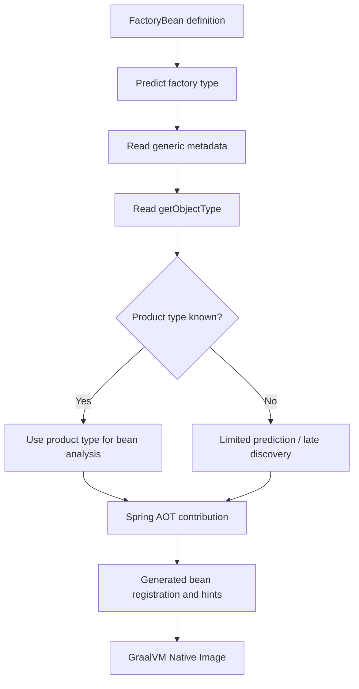

# Generic, FactoryBean và thông tin kiểu mà AOT cần suy ra

## 1. Vì sao thông tin kiểu quan trọng với Spring AOT?

Trong ứng dụng Spring Boot, container quản lý bean dựa trên `BeanDefinition`, kiểu lớp, generic type, qualifier, annotation và các metadata khác. Khi chạy trên JVM, Spring có thể dùng reflection và một số bước suy luận lúc runtime để tìm bean phù hợp, xác định kiểu sản phẩm của factory hoặc phân giải dependency.

Với **Spring AOT và GraalVM Native Image**, nhiều quyết định cần được thực hiện ở build time. Spring AOT phân tích cấu trúc ApplicationContext, sinh mã đăng ký/khởi tạo bean và runtime hints. Nếu thông tin kiểu không đủ rõ, Spring có thể không suy ra được bean nào được inject, generic argument thực tế là gì, hoặc một `FactoryBean` sẽ tạo ra kiểu sản phẩm nào. Hệ quả có thể là bean không được nhận diện đúng trong bước AOT, cấu hình bị bỏ qua hoặc lỗi chỉ xuất hiện khi chạy native.

Bài này tập trung vào ba yếu tố:

- **Generic type:** giữ thông tin tham số kiểu như `Repository<Order, UUID>` hoặc `Handler<Invoice>`.
- **FactoryBean:** một bean factory tạo ra một đối tượng sản phẩm; kiểu factory và kiểu sản phẩm là hai khái niệm khác nhau.
- **Type prediction:** khả năng Spring dự đoán kiểu bean/sản phẩm trước khi tạo instance, phục vụ autowiring, điều kiện cấu hình và xử lý AOT.

Mục tiêu không phải là tránh mọi generic hoặc FactoryBean. Điều quan trọng là cung cấp metadata đủ chính xác và ổn định để Spring có thể phân tích cấu trúc bean trước khi ứng dụng chạy.

## 2. Kiểu bean và generic type trong Spring

Java generic cho phép biểu diễn quan hệ kiểu ở compile time:

```java
interface MessageHandler<T> {
    void handle(T message);
}

final class Invoice {
    private String code;

    public String getCode() {
        return code;
    }

    public void setCode(String code) {
        this.code = code;
    }
}

@Component
class InvoiceHandler implements MessageHandler<Invoice> {
    @Override
    public void handle(Invoice message) {
        System.out.println(message.getCode());
    }
}
```

Từ khai báo `InvoiceHandler implements MessageHandler<Invoice>`, Spring có thể suy ra generic interface được triển khai. Điều này hữu ích khi cần inject theo kiểu:

```java
@Service
class InvoiceDispatcher {
    private final MessageHandler<Invoice> handler;

    InvoiceDispatcher(MessageHandler<Invoice> handler) {
        this.handler = handler;
    }
}
```

Generic type không chỉ là tên raw class `MessageHandler`; nó còn chứa tham số `Invoice`. Khi có nhiều implementation như `MessageHandler<Invoice>` và `MessageHandler<Shipment>`, thông tin generic giúp Spring phân biệt candidate trong những tình huống mà generic-aware dependency resolution được áp dụng.

Tuy nhiên, Java type erasure có nghĩa generic argument thường không tồn tại đầy đủ trên instance ở runtime. Spring có thể đọc generic signature từ class/method/field metadata, nhưng nếu kiểu bị xóa bởi cách khai báo raw type hoặc chỉ được xác định từ dữ liệu runtime, việc suy luận sẽ hạn chế.

## 3. Raw type và wildcard làm mất thông tin nào?

So sánh:

```java
MessageHandler<Invoice> invoiceHandler;
MessageHandler rawHandler;
MessageHandler<?> anyHandler;
MessageHandler<? extends Number> numberHandler;
```

| Khai báo | Thông tin có thể suy ra | Hạn chế |
|---|---|---|
| `MessageHandler<Invoice>` | Generic argument cụ thể là Invoice | Vẫn cần xem kiểu khai báo và candidate thực tế |
| `MessageHandler` | Chỉ biết raw interface | Không phân biệt Invoice với Shipment |
| `MessageHandler<?>` | Biết có generic nhưng không biết argument cụ thể | Không thể dựa vào wildcard để chọn một implementation cụ thể |
| `MessageHandler<? extends Number>` | Biết giới hạn upper bound Number | Không xác định chính xác subtype nếu không có thêm metadata |

Khi khai báo bean factory method trả về raw type, Spring có thể không dự đoán được generic sản phẩm:

```java
@Bean
MessageHandler messageHandler() {
    return new InvoiceHandler();
}
```

Nên khai báo kiểu trả về chính xác nếu đó là hợp đồng thật sự của bean:

```java
@Bean
MessageHandler<Invoice> invoiceMessageHandler() {
    return new InvoiceHandler();
}
```

Một lưu ý: chữ ký method trả về generic interface giúp cung cấp metadata tốt hơn, nhưng Spring vẫn cần xác định implementation, qualifier và điều kiện injection phù hợp. Không nên giả định chỉ sửa chữ ký là giải quyết mọi vấn đề AOT.

## 4. Spring dùng generic metadata để chọn bean như thế nào?

Spring có cơ chế phân giải dependency hiểu generic type, thường thông qua `ResolvableType` và metadata của injection point. Ví dụ:

```java
interface Store<T> {
    T find(String id);
}

@Component
class OrderStore implements Store<Order> {
    @Override
    public Order find(String id) {
        return new Order(id);
    }
}

@Component
class CustomerStore implements Store<Customer> {
    @Override
    public Customer find(String id) {
        return new Customer(id);
    }
}
```

Một service có thể yêu cầu:

```java
@Service
class OrderService {
    private final Store<Order> store;

    OrderService(Store<Order> store) {
        this.store = store;
    }
}
```

Spring có thể dùng generic argument ở injection point để lọc candidate. Đây là hành vi của container, không phải tính năng tự động của GraalVM. Spring AOT cần nhìn thấy metadata của bean definitions và injection points để tạo cấu trúc khởi tạo tương ứng.

Nếu code dùng raw type hoặc tự chọn bean bằng tên class được đọc từ property runtime, việc suy luận trước có thể kém rõ ràng. Với một tập lựa chọn đã biết, ưu tiên kiểu generic cụ thể, qualifier hoặc registry bean tường minh.

## 5. ResolvableType và giữ thông tin generic

Spring cung cấp `ResolvableType` để biểu diễn và phân tích kiểu có generic:

```java
ResolvableType type = ResolvableType.forClass(InvoiceHandler.class);
ResolvableType[] interfaces = type.getInterfaces();

for (ResolvableType candidate : interfaces) {
    System.out.println(candidate);
}
```

Có thể tạo ResolvableType từ field, method parameter, method return type hoặc class. Ví dụ:

```java
class HandlerConfig {
    MessageHandler<Invoice> invoiceHandler;
}

Field field = HandlerConfig.class.getDeclaredField("invoiceHandler");
ResolvableType resolvableType = ResolvableType.forField(field);

Class<?> rawClass = resolvableType.resolve();
ResolvableType generic = resolvableType.getGeneric(0);
Class<?> genericClass = generic.resolve();
```

Kết quả kỳ vọng: raw class là `MessageHandler`, generic argument resolve thành `Invoice` nếu signature được giữ và có thể phân tích. Cần import `org.springframework.core.ResolvableType` và `java.lang.reflect.Field`.

`ResolvableType` là công cụ giúp Spring đọc generic metadata; nó không khôi phục được thông tin đã mất hoàn toàn do raw type hoặc type erasure. Nếu generic argument chỉ được tạo bằng runtime logic và không xuất hiện trong metadata tĩnh, phải thiết kế lại hoặc cung cấp thông tin bổ sung.

## 6. FactoryBean: phân biệt factory và object được tạo

`FactoryBean<T>` là một abstraction của Spring: bean được đăng ký là factory, nhưng khi lấy bean theo tên thông thường, container trả về **sản phẩm do factory tạo ra**. Có thể lấy chính factory bằng cách thêm tiền tố `&` trước bean name.

Ví dụ:

```java
public class InvoiceFormatterFactory
        implements FactoryBean<InvoiceFormatter> {

    @Override
    public InvoiceFormatter getObject() {
        return new InvoiceFormatter();
    }

    @Override
    public Class<?> getObjectType() {
        return InvoiceFormatter.class;
    }

    @Override
    public boolean isSingleton() {
        return true;
    }
}
```

Đăng ký factory:

```java
@Configuration
class FormatterConfiguration {

    @Bean
    FactoryBean<InvoiceFormatter> invoiceFormatter() {
        return new InvoiceFormatterFactory();
    }
}
```

Container phân biệt:

| Truy cập | Đối tượng/kiểu nhận được |
|---|---|
| `getBean("invoiceFormatter")` | Sản phẩm `InvoiceFormatter` |
| `getBean("&invoiceFormatter")` | Factory `InvoiceFormatterFactory` |
| `getObjectType()` | Kiểu sản phẩm mà factory dự đoán |
| Kiểu trả về `@Bean` | Metadata khai báo cho bean registration/factory |

Đây là điểm quan trọng cho type prediction. Nếu Spring chỉ biết class factory nhưng không biết factory tạo ra kiểu gì, nó có thể không dự đoán được sản phẩm khi phân tích autowiring hoặc điều kiện bean.

## 7. Vai trò của getObjectType()

Phương thức `getObjectType()` cho phép FactoryBean công bố kiểu sản phẩm mà không nhất thiết phải gọi `getObject()`. Đây là thông tin quan trọng để container tìm bean theo kiểu trước khi sản phẩm được khởi tạo.

Triển khai tốt:

```java
@Override
public Class<?> getObjectType() {
    return InvoiceFormatter.class;
}
```

Triển khai thiếu thông tin:

```java
@Override
public Class<?> getObjectType() {
    return null;
}
```

Trả về `null` có thể khiến Spring không dự đoán được kiểu sản phẩm khi factory chưa được khởi tạo. Một số thao tác vẫn có thể hoạt động sau khi tạo instance, nhưng khả năng suy luận sớm và autowiring theo type bị hạn chế.

Quy tắc thực hành:

- Trả về class sản phẩm chính xác nếu có thể xác định ổn định.
- Không gọi `getObject()` chỉ để suy luận type nếu việc đó tạo side effect hoặc khởi tạo tài nguyên.
- Không trả về class factory khi container cần kiểu sản phẩm.
- Nếu sản phẩm là proxy hoặc subtype, xác định kiểu contract phù hợp để injection hoạt động đúng.

Nếu kiểu sản phẩm phụ thuộc dữ liệu runtime không biết trước, FactoryBean khó cung cấp một class cố định. Khi đó cân nhắc thiết kế interface chung, qualifier hoặc tách lựa chọn runtime thành một service registry.

## 8. Generic FactoryBean và metadata sản phẩm

FactoryBean có thể khai báo generic type:

```java
class TypedFactoryBean<T> implements FactoryBean<T> {
    private final Class<T> objectType;
    private final Supplier<T> supplier;

    TypedFactoryBean(Class<T> objectType, Supplier<T> supplier) {
        this.objectType = objectType;
        this.supplier = supplier;
    }

    @Override
    public T getObject() {
        return supplier.get();
    }

    @Override
    public Class<?> getObjectType() {
        return objectType;
    }
}
```

Generic `T` cung cấp thông tin kiểu ở chữ ký, còn `objectType` là metadata runtime tường minh cho kiểu sản phẩm. Hai nguồn thông tin bổ sung cho nhau. Nếu factory được tạo bằng raw type, hoặc objectType chỉ được gán sau một bước runtime không thể dự đoán, Spring AOT không thể dựa vào generic declaration để suy ra một kiểu cụ thể đáng tin cậy.

Ví dụ đăng ký rõ kiểu:

```java
@Bean
FactoryBean<InvoiceFormatter> invoiceFormatterFactory() {
    return new TypedFactoryBean<>(
            InvoiceFormatter.class,
            InvoiceFormatter::new
    );
}
```

Ví dụ cần đảm bảo constructor method reference phù hợp class thực tế. Trong thiết kế thực tế, kiểm tra `getObjectType()` trả đúng `InvoiceFormatter.class` trước khi dùng bean theo type.

## 9. FactoryBean và vòng đời AOT

Spring AOT phân tích bean definitions, factory methods và thông tin kiểu mà container có thể biết trước. Với FactoryBean, cần tách biệt:

1. **Factory bean definition:** metadata mô tả bean factory.
2. **Factory implementation type:** class thực thi `FactoryBean`.
3. **Product type:** kiểu đối tượng mà `getObject()` tạo ra.
4. **Product instance:** instance thực tế, có thể chỉ được tạo khi runtime cần.

Việc phân tích AOT cần thông tin đủ để tạo cấu trúc đăng ký phù hợp. Nếu product type rõ ràng, Spring có thể xử lý nhiều quyết định theo kiểu trước khi chạy. Nếu type không rõ, việc inject sản phẩm theo type hoặc đánh giá điều kiện cấu hình có thể phụ thuộc vào quá trình khởi tạo runtime.



Sơ đồ là mô hình khái niệm; chi tiết xử lý phụ thuộc Spring Framework version và loại bean. Không phải mọi FactoryBean đều cần custom AOT processor. Trước tiên hãy cung cấp type metadata chính xác và dùng cơ chế Spring được hỗ trợ.

## 10. Điều kiện cấu hình và type prediction

Một số cấu hình Spring dùng điều kiện theo kiểu bean, chẳng hạn `@ConditionalOnBean`, `@ConditionalOnMissingBean` hoặc `@ConditionalOnSingleCandidate` trong Spring Boot auto-configuration. Các điều kiện này phụ thuộc metadata bean có thể dự đoán ở thời điểm cấu hình được đánh giá.

Ví dụ:

```java
@Configuration
class FormatterAutoConfiguration {

    @Bean
    @ConditionalOnMissingBean(InvoiceFormatter.class)
    InvoiceFormatter invoiceFormatter() {
        return new InvoiceFormatter();
    }
}
```

Nếu một FactoryBean tạo `InvoiceFormatter` nhưng product type không được dự đoán rõ ràng, điều kiện theo kiểu có thể không nhìn thấy sản phẩm như kỳ vọng tại thời điểm đánh giá. Kết quả có thể là tạo thêm bean mặc định hoặc cấu hình auto-configuration khác với ý định.

Khi gặp vấn đề:

- Xác định điều kiện được đánh giá ở pha nào.
- Kiểm tra factory method return type, generic signature và `getObjectType()`.
- Xem bean definition/condition evaluation report trên JVM.
- Kiểm tra kết quả AOT và kiểm thử native với đúng cấu hình.

Không nên dựa vào thứ tự khởi tạo instance để “sửa” type prediction nếu metadata có thể được công bố chính xác ngay từ đầu.

## 11. Thiết kế bean để Spring AOT dễ phân tích

Một số nguyên tắc hữu ích:

### Khai báo kiểu trả về cụ thể

```java
@Bean
InvoiceFormatter invoiceFormatter() {
    return new InvoiceFormatter();
}
```

Nếu hợp đồng cần interface, khai báo interface generic cụ thể thay vì raw type:

```java
@Bean
MessageHandler<Invoice> invoiceHandler() {
    return new InvoiceHandler();
}
```

### Tránh FactoryBean không công bố product type

Nếu class sản phẩm cố định, `getObjectType()` nên trả về class đó. Nếu product type phụ thuộc runtime, cân nhắc một contract chung ổn định hoặc cơ chế registry.

### Giữ generic signature ở API nội bộ

Tránh raw `List`, `Repository`, `Handler` khi có thể khai báo generic argument. Điều này tăng độ an toàn compile time và giúp Spring suy luận tốt hơn.

### Hạn chế type discovery từ chuỗi runtime

Nếu danh sách implementation biết trước lúc build, đăng ký bean cụ thể và lựa chọn qua qualifier/registry. Nếu plugin thực sự được nạp sau deployment, cần xem lại yêu cầu kiến trúc vì closed-world Native Image không tự biên dịch mã mới.

### Không tạo side effect trong type prediction

`getObjectType()` nên nhẹ, ổn định và không mở kết nối, đọc database hoặc tạo object nặng. Spring có thể gọi phương thức này trong quá trình dự đoán type trước khi sản phẩm cần thiết.

## 12. Kiểm thử generic và FactoryBean trước khi build native

Bắt đầu trên JVM bằng các test xác minh contract:

```java
@SpringBootTest
class InvoiceFormatterFactoryTest {

    @Autowired
    ApplicationContext context;

    @Test
    void factoryProductHasExpectedType() {
        Object product = context.getBean("invoiceFormatter");
        assertThat(product).isInstanceOf(InvoiceFormatter.class);
    }

    @Test
    void factoryItselfCanBeRetrieved() {
        Object factory = context.getBean("&invoiceFormatter");
        assertThat(factory).isInstanceOf(FactoryBean.class);
    }
}
```

Test trên cần Spring Boot Test và AssertJ như ví dụ; có thể thay assertion bằng JUnit. Đảm bảo bean name khớp tên thực tế và FactoryBean được đăng ký trong context.

Với generic injection, thêm test khởi tạo service yêu cầu `MessageHandler<Invoice>` và xác nhận implementation đúng. Với condition, test các trường hợp có/không có FactoryBean sản phẩm. Sau đó chạy cùng các test trên native test mode hoặc executable thực tế, vì JVM test không phát hiện mọi hạn chế reachability.

## 13. Chẩn đoán lỗi thường gặp

| Hiện tượng | Nguyên nhân có thể | Cách xử lý |
|---|---|---|
| Không tìm thấy bean generic mong muốn | Raw type, generic signature không rõ hoặc nhiều candidate | Khai báo generic cụ thể, qualifier và kiểm tra injection point |
| FactoryBean product không được inject theo type | `getObjectType()` trả null/sai type | Trả về product class chính xác, không trả factory class |
| Condition tạo bean mặc định dù đã có product | Product type chưa được dự đoán ở thời điểm condition | Kiểm tra FactoryBean metadata và condition evaluation |
| AOT không xử lý như mong đợi | Bean definition được tạo động hoặc type phụ thuộc runtime | Làm rõ registration/type ở build time hoặc cung cấp extension phù hợp |
| Native lỗi khi tạo object reflectively | Thiếu reflection metadata | Thêm RuntimeHints hoặc metadata của thư viện |
| JVM test pass nhưng native thiếu implementation | Runtime lookup dựa trên thông tin động không được đưa vào image | Dùng bean registry tường minh, bổ sung metadata và native test |

Phân biệt lỗi **type prediction** với lỗi **reflection reachability**. Type prediction quyết định Spring có nhận diện bean/sản phẩm theo kiểu trong container hay không; reflection metadata quyết định Native Image có giữ member để truy cập động hay không. Một ứng dụng có thể gặp một hoặc cả hai vấn đề.

## 14. Bài thực hành: tạo FactoryBean generic có product type rõ ràng

**Bối cảnh:** một ứng dụng Spring Boot có hai loại formatter cho `Invoice` và `Receipt`, cần đăng ký thông qua factory.

**Bước 1 — Tạo contract.** Khai báo `Formatter<T>` và hai model có generic type cụ thể.

**Bước 2 — Tạo FactoryBean.** Implement `FactoryBean<Formatter<Invoice>>` (hoặc factory trả về formatter phù hợp), cung cấp `getObjectType()` nhất quán với product thực tế.

**Bước 3 — Đăng ký bean.** Dùng `@Bean` với kiểu trả về cụ thể, không dùng raw `FactoryBean`.

**Bước 4 — Kiểm tra JVM.** Inject sản phẩm theo type, lấy factory bằng tiền tố `&`, xác nhận condition theo bean type hoạt động như mong đợi.

**Bước 5 — Chạy Spring AOT.** Quan sát quá trình phân tích context và generated output; kiểm tra bean/product type được nhận diện đúng.

**Bước 6 — Build native.** Chạy Maven/Gradle Native Image, kiểm thử các luồng formatter và những truy cập reflection/resource liên quan.

**Bước 7 — So sánh.** Ghi kết quả JVM/native về bean wiring, condition, startup và RSS trong cùng môi trường.

Tiêu chí hoàn thành: generic type được giữ rõ trong API, FactoryBean công bố đúng product type, injection/condition hoạt động như mong đợi trên JVM và native, và không có lỗi chỉ xuất hiện ở nhánh runtime ít gặp.

## 15. Kết luận

Spring AOT cần metadata kiểu đủ rõ để phân tích bean definitions và tạo mã khởi tạo phù hợp. **Generic signature** giúp giữ quan hệ kiểu cho dependency resolution; **FactoryBean.getObjectType()** công bố kiểu sản phẩm trước khi tạo instance; **type prediction** cho phép Spring đánh giá injection và điều kiện cấu hình sớm hơn.

Raw type, generic bị xóa hoặc FactoryBean không công bố product type có thể khiến Spring khó suy luận cấu trúc container. Khai báo kiểu cụ thể, factory method rõ ràng, product type ổn định và test cả JVM/native giúp giảm bất ngờ khi build. Khi type thực sự chỉ được biết ở runtime, cần thiết kế contract/registry phù hợp với mô hình closed-world của GraalVM Native Image.
