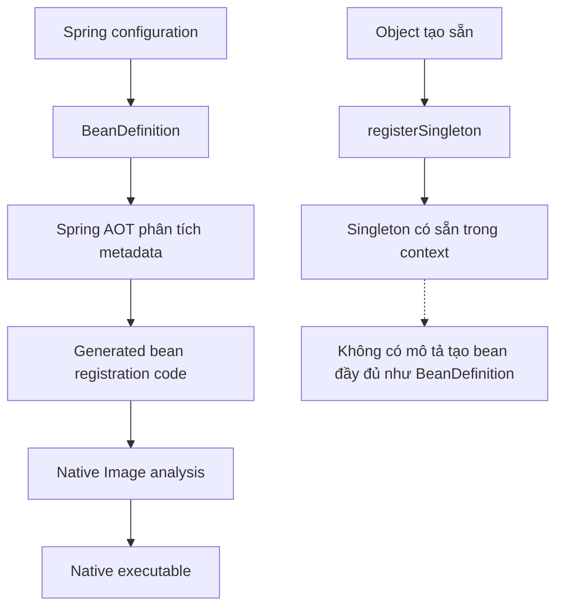

# BeanDefinition có thể phân tích khác với đăng ký singleton trực tiếp

## 1. Vì sao sự khác biệt này quan trọng với Spring AOT?

Trong Spring Framework, container quản lý object thông qua hai khái niệm thường gặp: **BeanDefinition** và **singleton instance**. BeanDefinition mô tả cách container tạo bean: class, scope, constructor arguments, factory method, property values, điều kiện khởi tạo và các metadata liên quan. Singleton instance là một object cụ thể đã được tạo và lưu trong container.

Với ứng dụng Spring Boot chạy JVM thông thường, nhiều bean có thể được đăng ký động trong lúc application context khởi tạo. Nhưng khi dùng **Spring AOT** và **GraalVM Native Image**, một phần mô hình ứng dụng phải được phân tích trước lúc chạy để sinh mã khởi tạo và runtime hints. Vì thế, cách đăng ký bean ảnh hưởng đến khả năng phân tích.

**BeanDefinition thường mô tả được cấu trúc và ý định tạo bean**, nên Spring AOT có cơ sở để xem xét class, constructor, dependency và tạo mã khởi tạo phù hợp. Ngược lại, đăng ký trực tiếp một singleton instance chỉ cung cấp một object đã được tạo; container không nhất thiết có đủ thông tin về cách tái tạo object đó hoặc những dependency bên trong để phân tích sâu.



Điều này **không có nghĩa singleton đăng ký trực tiếp luôn bị cấm trong native**. Một singleton có thể được tạo và đăng ký trong lúc runtime nếu code path và class liên quan vẫn tương thích. Điểm cần lưu ý là AOT khó suy ra cấu trúc, cách khởi tạo và dependency của một object tùy ý được thêm động.

## 2. BeanDefinition mô tả cách tạo bean

Ví dụ đăng ký một bean qua Java configuration:

```java
@Configuration
class PaymentConfiguration {

    @Bean
    PaymentGateway paymentGateway(PaymentClient client) {
        return new PaymentGateway(client);
    }
}
```

Spring có thể tạo metadata cho bean `paymentGateway`: bean được cung cấp bởi factory method, phụ thuộc vào `PaymentClient`, và thuộc cấu hình được framework phát hiện. Spring AOT có thể phân tích configuration class, method và dependency để sinh mã đăng ký/khởi tạo tương ứng.

Một cách nhìn khác là khai báo bean bằng `GenericBeanDefinition`:

```java
var definition = new GenericBeanDefinition();
definition.setBeanClass(PaymentGateway.class);
definition.setAutowireMode(AbstractBeanDefinition.AUTOWIRE_CONSTRUCTOR);

beanFactory.registerBeanDefinition("paymentGateway", definition);
```

Ví dụ minh họa API Spring Framework; để hoạt động đầy đủ, cần đăng ký definition vào đúng `BeanDefinitionRegistry` trước khi bean factory hoàn tất quá trình khởi tạo. Với bean cần dependency phức tạp, factory method hoặc constructor injection tường minh thường giúp mô hình rõ hơn.

Một BeanDefinition có thể chứa:

- Bean class hoặc factory bean/method.
- Scope (`singleton`, `prototype`, request scope...).
- Constructor arguments và property values.
- Autowire mode, qualifiers và dependency metadata.
- Lazy initialization, primary, depends-on và lifecycle method.
- Role và source metadata.

Metadata càng rõ, framework càng có cơ sở để xác định bean graph. Tuy nhiên, không phải mọi BeanDefinition động đều tự động được Spring AOT hỗ trợ; cần xem thời điểm đăng ký và cách định nghĩa.

## 3. Singleton instance đăng ký trực tiếp là gì?

Spring cho phép đăng ký một object đã được tạo vào singleton registry:

```java
PaymentGateway gateway = new PaymentGateway(
    new PaymentClient("https://payments.internal")
);

beanFactory.registerSingleton("paymentGateway", gateway);
```

Ở đây, ứng dụng tự tạo object trước, rồi cung cấp instance cho container. Container biết tên bean và object cụ thể, nhưng không nhất thiết biết:

- Class được chọn dựa trên điều kiện hoặc dữ liệu nào.
- Constructor nào đã được gọi và tham số nào đã được truyền.
- Dependency bên trong object được tạo hoặc inject ra sao.
- Có factory/lifecycle logic nào cần tái thực hiện khi tạo application context khác.
- Những class/member/resource nào được truy cập động khi object hoạt động.

`registerSingleton` đăng ký instance vào singleton registry; nó không tương đương với việc đăng ký một BeanDefinition mô tả quy trình tạo bean. Object được đăng ký trực tiếp cũng không đi qua toàn bộ quy trình tạo bean giống bean do container khởi tạo, vì vậy không nên giả định mọi BeanPostProcessor hoặc cơ chế inject đều đã được áp dụng như nhau.

### So sánh nhanh

| Khía cạnh | BeanDefinition | Singleton đăng ký trực tiếp |
|---|---|---|
| Thông tin chính | Mô tả cách tạo bean | Instance đã tồn tại |
| Constructor/factory metadata | Có thể biểu diễn | Không tự lưu như định nghĩa |
| Dependency graph | Có thể phân tích từ metadata | Dependency đã nằm trong object; khó suy ra tổng quát |
| Thời điểm tạo object | Container tạo khi cần | Ứng dụng đã tạo trước khi đăng ký |
| Lifecycle container | Có thể tham gia quy trình tạo bean đầy đủ | Không mặc định chạy lại toàn bộ quy trình tạo bean |
| Spring AOT | Thường dễ phân tích hơn nếu đăng ký đúng thời điểm | Khó phân tích cách tạo và dependency của object tùy ý |
| Native Image | Có thể sinh code/hints từ cấu hình được hỗ trợ | Cần bảo đảm class và code path vẫn reachability-compatible |

## 4. Thời điểm đăng ký quyết định khả năng phân tích AOT

Spring AOT không đơn giản là chụp toàn bộ trạng thái của một context đã chạy tùy ý. Quá trình AOT chuẩn bị ứng dụng trong một pha build-time có quy tắc về việc tạo context, phân tích cấu hình và sinh mã.

Có thể phân biệt ba tình huống:

1. **Bean được khai báo tĩnh trong configuration/component scan**: Spring AOT thường nhận diện được và sinh mã hỗ trợ.
2. **BeanDefinition được đăng ký động nhưng trong giai đoạn AOT có thể quan sát/được hỗ trợ**: có thể phân tích nếu API và thời điểm đăng ký phù hợp; cần test với phiên bản Spring cụ thể.
3. **Singleton được tạo từ dữ liệu chỉ có khi runtime rồi đăng ký trực tiếp**: AOT không thể biết instance và cách tạo của lần chạy production trong build-time context. Class cần thiết vẫn phải được giữ và runtime code path phải tương thích Native Image.

Ví dụ một registry post-processor có thể thêm BeanDefinition trong quá trình refresh context:

```java
class PluginDefinitions implements BeanDefinitionRegistryPostProcessor {
    @Override
    public void postProcessBeanDefinitionRegistry(
            BeanDefinitionRegistry registry) {
        var definition = new RootBeanDefinition(EmailPlugin.class);
        registry.registerBeanDefinition("emailPlugin", definition);
    }

    @Override
    public void postProcessBeanFactory(
            ConfigurableListableBeanFactory beanFactory) {
        // Không cần xử lý thêm trong ví dụ.
    }
}
```

Đây là ví dụ minh họa về đăng ký definition trong giai đoạn xử lý registry. Việc AOT có phân tích được hay không còn phụ thuộc processor có được phát hiện và thực thi trong context AOT, API được sử dụng và version framework. Không nên kết luận mọi registry post-processor đều được hỗ trợ chỉ vì nó tạo BeanDefinition.

Ngược lại, nếu plugin được tải từ database sau khi service khởi động và code tạo instance rồi gọi `registerSingleton`, quá trình build AOT không có dữ liệu database đó để dự đoán danh sách object.

## 5. Ví dụ thực tế: plugin theo cấu hình

Giả sử ứng dụng Spring Boot hỗ trợ các bộ chuyển đổi dữ liệu. Có hai cách triển khai.

### Cách A — khai báo bean theo cấu hình tĩnh

```java
@Configuration
class ConverterConfiguration {

    @Bean
    @ConditionalOnProperty(
        name = "converter.csv.enabled",
        havingValue = "true"
    )
    CsvConverter csvConverter() {
        return new CsvConverter();
    }
}
```

Cách này làm cho ý định tạo bean thể hiện trong configuration mà Spring AOT có thể phân tích theo profile/property lúc build. Nếu điều kiện quyết định bean, hãy đảm bảo build-time properties phù hợp với ứng dụng sẽ phát hành.

### Cách B — tạo instance từ tên class runtime

```java
String implementation = environment.getProperty("converter.class");
Class<?> type = Class.forName(implementation);
Object plugin = type.getDeclaredConstructor().newInstance();
beanFactory.registerSingleton("runtimeConverter", plugin);
```

Cách này phụ thuộc tên class từ property và reflection. Có hai vấn đề độc lập:

- Spring AOT không thể mặc định biết class nào sẽ được chọn khi chạy.
- GraalVM Native Image có thể cần metadata reflection để giữ class và constructor được truy cập động.

Ngay cả khi thêm reflection hint để class có thể được nạp và khởi tạo, điều đó **không biến instance thành BeanDefinition có dependency graph được Spring AOT phân tích đầy đủ**. Nếu plugin cần injection, lifecycle callback hoặc post-processing, cần thiết kế thêm cơ chế rõ ràng.

### Thiết kế thay thế dễ phân tích hơn

Nếu số plugin biết trước khi build, khai báo chúng bằng bean configuration/conditional bean hoặc factory method. Nếu danh sách plugin thực sự phải thay đổi theo runtime, có thể giữ một registry/service bean tĩnh và để nó quản lý plugin theo một SPI rõ ràng; tránh yêu cầu Spring phải tái dựng toàn bộ bean graph động.

## 6. Singleton trực tiếp có thể hoạt động trong Native Image không?

Có thể. Native Image không cấm API `registerSingleton`. Nếu object được tạo từ class có thể truy cập tĩnh, mọi constructor/member cần thiết được reachability analysis giữ lại, và việc đăng ký xảy ra trong code path runtime hợp lệ, singleton có thể hoạt động.

Ví dụ:

```java
@Component
class RuntimeRegistry {

    private final ConfigurableListableBeanFactory beanFactory;

    RuntimeRegistry(ConfigurableListableBeanFactory beanFactory) {
        this.beanFactory = beanFactory;
    }

    public void registerHealthMarker() {
        beanFactory.registerSingleton(
            "healthMarker",
            new HealthMarker("ready")
        );
    }
}

record HealthMarker(String value) {}
```

Đây là minh họa hành vi runtime, không phải khuyến nghị dùng singleton registry để thay thế bean declaration thông thường. Một object được đăng ký sau khi context refresh có thể không được inject tự động vào các bean đã khởi tạo trước đó. Ngoài ra, `registerSingleton` không tự chạy đầy đủ các callback của quy trình khởi tạo bean.

Nếu class name được chọn động hoặc member được gọi qua reflection, cần kiểm tra metadata. Nếu object cần dependency injection hoặc BeanPostProcessor, nên dùng cơ chế bean creation của Spring phù hợp thay vì tự tạo object rồi đăng ký instance.

## 7. FactoryBean, ObjectProvider và các cơ chế cần phân biệt

Không nên đánh đồng mọi cơ chế tạo object động với singleton registration.

- **`@Bean` factory method**: mô tả rõ bean được tạo bằng method; Spring AOT có thể phân tích configuration phù hợp.
- **`FactoryBean<T>`**: cung cấp object thông qua factory contract của Spring. Cần bảo đảm factory và sản phẩm tương thích AOT/native.
- **`ObjectProvider<T>`**: cho phép truy vấn/lấy bean theo nhu cầu từ container; không tự tạo metadata cho một class tùy ý không có trong bean graph.
- **`BeanDefinitionRegistryPostProcessor`**: can thiệp registry trước khi bean factory hoàn tất; có thể hữu ích cho framework, nhưng phải kiểm tra thời điểm chạy trong AOT.
- **`registerSingleton`**: thêm một instance đã tạo vào registry; không cung cấp mô tả tạo bean tương đương BeanDefinition.

Với thư viện framework, Spring có thể cung cấp AOT contribution riêng. Khi tích hợp thư viện tạo bean động, hãy kiểm tra tài liệu hỗ trợ Native Image và test trên executable thật.

## 8. Cách kiểm thử khác biệt giữa BeanDefinition và singleton

Tạo một test nhỏ để quan sát registry:

```java
@Test
void comparesDefinitionAndSingletonRegistration() {
    var factory = new DefaultListableBeanFactory();

    var definition = new RootBeanDefinition(EmailPlugin.class);
    factory.registerBeanDefinition("emailPlugin", definition);

    factory.registerSingleton(
        "metricsMarker",
        new MetricsMarker("ready")
    );

    assertThat(factory.containsBeanDefinition("emailPlugin")).isTrue();
    assertThat(factory.containsSingleton("metricsMarker")).isTrue();
    assertThat(factory.containsBeanDefinition("metricsMarker")).isFalse();
}
```

Test cho thấy hai loại đăng ký được lưu theo cơ chế khác nhau. Nó không chứng minh AOT đã sinh mã phù hợp, cũng không xác nhận class sẽ hoạt động trên Native Image.

Để kiểm tra AOT/native:

1. Viết test JVM cho bean graph và hành vi plugin.
2. Chạy tác vụ Spring AOT với profile/property mục tiêu.
3. Biên dịch Native Image.
4. Khởi chạy executable native và thực hiện đúng kịch bản đăng ký/tra cứu bean.
5. Nếu có reflection hoặc plugin load động, thêm test cho mọi class/member cần thiết và metadata tương ứng.
6. Kiểm tra lifecycle/injection nếu object được tạo bên ngoài container.

## 9. Những lỗi thường gặp và cách xử lý

| Triệu chứng | Nguyên nhân có thể | Hướng xử lý |
|---|---|---|
| Bean có trên JVM nhưng thiếu trong native | Bean được tạo theo điều kiện/profile khác ở AOT | Kiểm tra build-time profile/property và AOT output |
| Class plugin không được tìm thấy | Tên class được chọn động, thiếu reachability/reflection metadata | Đăng ký class/member cần thiết, test native |
| Singleton có trong registry nhưng không được inject | Đăng ký sau khi bean consumer đã khởi tạo | Thiết kế dependency tĩnh hoặc cơ chế lookup có kiểm soát |
| Bean không chạy BeanPostProcessor như mong đợi | Instance được tạo ngoài container rồi đăng ký trực tiếp | Để container tạo bean từ BeanDefinition/factory |
| AOT build không nhận cấu hình động | Dữ liệu chỉ có khi runtime | Chuyển phần lựa chọn vào registry runtime tĩnh hoặc cung cấp AOT contribution |
| Native build thành công nhưng plugin lỗi khi gọi | Reflection/member/resource hoặc native dependency thiếu | Kiểm tra stack trace và metadata, test đúng code path |

## 10. Nguyên tắc thiết kế bean phù hợp AOT

- Ưu tiên component/configuration và `@Bean` method thể hiện rõ cấu trúc ứng dụng.
- Dùng BeanDefinition khi thật sự cần đăng ký bean động nhưng vẫn có thể mô tả class, factory và dependency trước lúc context hoàn tất.
- Dùng singleton registration cho object đã tạo sẵn khi có lý do cụ thể và đã hiểu rõ lifecycle của nó.
- Tránh lấy danh sách class từ database/network trong lúc AOT để quyết định bean graph của executable.
- Tách plugin runtime linh hoạt khỏi bean graph cốt lõi bằng một registry/service bean tĩnh.
- Bổ sung Runtime Hints cho reflection/resource/proxy chỉ khi có đường truy cập động cần thiết.
- Kiểm thử AOT và executable native trên đúng profile, property và workload triển khai.

## 11. Câu hỏi tự kiểm tra

1. BeanDefinition mô tả điều gì mà singleton instance không tự cung cấp?
2. Vì sao Spring AOT thường có cơ sở phân tích tốt hơn với bean khai báo bằng `@Bean`?
3. Đăng ký singleton trực tiếp có bị cấm trong Native Image không? Giải thích điều kiện để nó hoạt động.
4. Reflection hint có giải quyết việc Spring AOT không biết dependency graph của object được tạo động không?
5. Vì sao một singleton đăng ký sau context refresh có thể không được inject vào bean đã tạo?
6. Khi danh sách plugin phải thay đổi lúc runtime, bạn có thể thiết kế registry như thế nào để giữ bean graph cốt lõi ổn định?

**Ghi nhớ:** BeanDefinition mô tả **cách container tạo bean**, còn singleton registration cung cấp **một instance đã tồn tại**. Với Spring AOT, ưu tiên cấu hình bean có metadata rõ ràng để framework phân tích; nếu cần singleton runtime, hãy kiểm soát class reachability, reflection, dependency và lifecycle bằng kiểm thử trên native executable.
