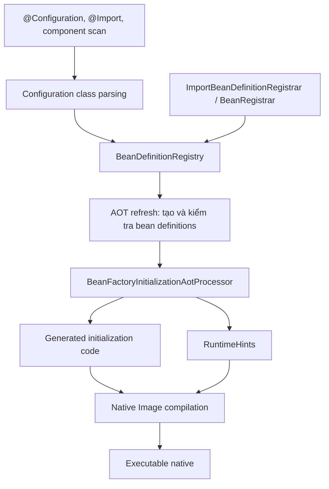

# Đăng ký bean bằng mã và chọn API có hỗ trợ xử lý AOT

## 1. Vì sao cách đăng ký bean ảnh hưởng tới Native Image?

Trong một ứng dụng Spring Boot, bean thường được khai báo bằng `@Component`, `@Service`, `@Repository`, `@Configuration` và các phương thức `@Bean`. Spring đọc cấu hình, tạo `BeanDefinition`, giải quyết dependency và khởi tạo đối tượng trong vòng đời của `ApplicationContext`.

Một số thư viện hoặc module cần **đăng ký bean bằng mã** thay vì khai báo từng class bằng annotation. Ví dụ: thư viện tích hợp cần đăng ký một nhóm adapter theo module đang có; starter cần bổ sung một implementation khi được import; hoặc ứng dụng cần tạo các bean có tên và scope được xác định từ cấu hình.

Trên JVM thông thường, có nhiều callback và API có thể thực hiện việc này. Nhưng với **Spring AOT** và **GraalVM Native Image**, Spring phải nhìn thấy cấu trúc bean ngay trong lúc build để sinh mã khởi tạo và metadata cần thiết. Nếu bean chỉ được thêm sau khi AOT đã phân tích `ApplicationContext`, mã được sinh có thể không chứa bean đó hoặc không có các runtime hints cần thiết.

Bài học này tập trung vào cách chọn API đăng ký bean phù hợp với AOT:

- Spring Framework 7: dùng `BeanRegistrar` và `BeanRegistry` cho nhu cầu đăng ký bean bằng mã mới.
- Spring Framework 6.x: dùng `ImportBeanDefinitionRegistrar` được import bằng `@Import`; trong trường hợp phù hợp có thể dùng `BeanDefinitionRegistryPostProcessor`.
- Khi cần tự đóng góp mã khởi tạo hoặc metadata AOT cho hạ tầng đặc biệt, tìm hiểu `BeanFactoryInitializationAotProcessor` và `BeanRegistrationAotProcessor`.

Ví dụ xuyên suốt là module `orders` cần đăng ký `OrderPolicy` và `OrderService`. Cấu hình được chọn lúc build phải tạo ra cùng một tập bean khi ứng dụng chạy native.

## 2. AOT xử lý cấu trúc bean như thế nào?

### 2.1. Từ cấu hình đến mã khởi tạo được sinh

Trong giai đoạn AOT, Spring tạo một `ApplicationContext` phục vụ phân tích. Quy trình này xử lý cấu hình và tạo các bean definition cần thiết, nhưng không khởi tạo toàn bộ bean như một lần `refresh()` runtime thông thường. Sau đó AOT engine phân tích `BeanFactory`, sinh mã Java/bytecode để tái tạo trạng thái cần thiết và thu thập `RuntimeHints` cho reflection, resource, serialization hoặc proxy.



**Điểm mấu chốt:** AOT cần biết *bean nào sẽ tồn tại* và *kiểu bean là gì* trước khi native compiler chạy. Việc tạo một đối tượng đơn lẻ trong một callback runtime không tương đương với việc đăng ký một `BeanDefinition` có thể được AOT phân tích.

### 2.2. Các giới hạn cần nhớ

AOT chuyển một phần quyết định từ runtime sang build time, vì vậy có một số điều kiện:

1. **Classpath được cố định tại build time.** Không thể trông chờ native image quét classpath và phát hiện plugin mới được thêm vào sau khi executable đã build.
2. **Tập bean được xác định tại build time.** Các điều kiện `@Profile` và thuộc tính môi trường ảnh hưởng tới `@Conditional` được đánh giá khi AOT chạy. Thay đổi profile hoặc thuộc tính đó lúc runtime không làm cấu trúc bean được tạo lại.
3. **Bean đăng ký như singleton instance** bằng `registerSingleton(...)` không được chuyển thành mã khởi tạo AOT theo cách thông thường.
4. **Bean definition có instance supplier tùy ý** (lambda hoặc method reference tự gán trực tiếp vào definition) không được tự động chuyển đổi như bean definition chuẩn. Riêng `BeanRegistrar` của Spring Framework 7 có tích hợp AOT và hỗ trợ cả supplier được khai báo qua API này.
5. **Khai báo kiểu bean phải đủ cụ thể.** Nếu chỉ cung cấp interface trong khi implementation có callback, annotation hoặc thông tin kiểu quan trọng, AOT có thể không phát hiện được đầy đủ hành vi cần thiết.

Do đó, khi cần đăng ký bean, hãy ưu tiên API thêm **bean definition vào registry trong lúc cấu hình đang được phân tích**.

## 3. Chọn API theo phiên bản Spring Framework

Phiên bản Spring Boot quyết định phiên bản Spring Framework mà dự án sử dụng. Vì vậy, hãy kiểm tra dependency thực tế trước khi chọn API.

| Dòng Spring Boot thường gặp | Spring Framework đi kèm | API đăng ký bean bằng mã nên ưu tiên |
|---|---|---|
| Spring Boot 3.x | Spring Framework 6.x | `ImportBeanDefinitionRegistrar` và `BeanDefinitionRegistry` |
| Spring Boot 4.x | Spring Framework 7.x | `BeanRegistrar` và `BeanRegistry` |

Đây là quan hệ phiên bản điển hình; dự án có thể quản lý dependency hoặc BOM riêng. Không suy ra API chỉ từ tên module hay JDK đang cài.

### 3.1. Cách kiểm tra phiên bản Framework

Với Gradle:

```bash
./gradlew dependencyInsight \
  --dependency spring-context \
  --configuration runtimeClasspath
```

Với Maven:

```bash
./mvnw dependency:tree -Dincludes=org.springframework:spring-context
```

Nếu dependency tree cho thấy Spring Framework 6.x, không import `BeanRegistrar` vì API này được giới thiệu trong Framework 7.0. Nếu dự án đã dùng Framework 7.x, `BeanRegistrar` là lựa chọn đầu tiên cho đăng ký bean bằng mã.

## 4. Spring Framework 7: dùng `BeanRegistrar`

Spring Framework 7 bổ sung `BeanRegistrar` như API chính thức dành riêng cho việc đăng ký bean bằng mã. Registrar thường được đưa vào cấu hình thông qua `@Import` trên một lớp `@Configuration`.

### 4.1. Đăng ký bean cơ bản

Ví dụ dưới đây dùng Java và Spring Framework 7:

```java
package com.example.orders.config;

import org.springframework.beans.factory.BeanRegistrar;
import org.springframework.beans.factory.BeanRegistry;
import org.springframework.core.env.Environment;

public final class OrderBeanRegistrar implements BeanRegistrar {

    @Override
    public void register(BeanRegistry registry, Environment environment) {
        if (environment.matchesProfiles("orders")) {
            registry.registerBean(OrderPolicy.class);
            registry.registerBean(OrderService.class);
        }
    }
}
```

`OrderPolicy` và `OrderService` là các class ứng dụng. Ví dụ `OrderPolicy` có constructor mặc định để registry có thể đăng ký trực tiếp:

```java
package com.example.orders;

public final class OrderPolicy {

    public String name() {
        return "standard";
    }
}
```

`OrderService` dùng constructor injection để nhận `OrderPolicy`:

```java
package com.example.orders;

public final class OrderService {

    private final OrderPolicy policy;

    public OrderService(OrderPolicy policy) {
        this.policy = policy;
    }

    public String policyName() {
        return this.policy.name();
    }
}
```

Registrar được import như sau:

```java
package com.example.orders.config;

import org.springframework.context.annotation.Configuration;
import org.springframework.context.annotation.Import;

@Configuration(proxyBeanMethods = false)
@Import(OrderBeanRegistrar.class)
public class OrderConfiguration {
}
```

Trong ví dụ này, `Environment` được sử dụng ngay khi Spring phân tích cấu hình để quyết định có đăng ký bean hay không. Điều kiện profile vì thế được chốt trong kết quả AOT. Khi chạy native, không thể đổi profile runtime để làm `OrderPolicy` và `OrderService` xuất hiện nếu chúng đã không được đăng ký trong lần build đó.

### 4.2. Đăng ký với tên và tùy chỉnh bean

`BeanRegistry` cho phép chỉ định tên bean và tùy chỉnh scope, lazy initialization, mô tả hoặc instance supplier:

```java
public final class OrderBeanRegistrar implements BeanRegistrar {

    @Override
    public void register(BeanRegistry registry, Environment environment) {
        registry.registerBean("orderPolicy", OrderPolicy.class);

        registry.registerBean("orderService", OrderService.class, spec -> spec
                .description("Service xử lý đơn hàng")
                .supplier(context -> new OrderService(
                        context.bean(OrderPolicy.class))));
    }
}
```

API `BeanRegistrar` được Spring Framework 7 hỗ trợ trong quy trình AOT, kể cả khi dùng supplier qua `BeanRegistry.Spec`. Đây là điểm khác biệt quan trọng so với việc tự tạo một `BeanDefinition` tùy ý rồi gắn lambda supplier vào đó.

Không nên dùng supplier chỉ để né dependency injection. Nếu bean có constructor rõ ràng và Spring có thể tự giải quyết dependency, đăng ký trực tiếp `registry.registerBean(OrderService.class)` thường đơn giản và dễ phân tích hơn.

### 4.3. Đăng ký theo danh sách cấu hình

Một use case thường gặp là tạo adapter cho từng endpoint hoặc từng loại connector được khai báo trong cấu hình. Danh sách này phải có thể xác định khi AOT xử lý:

```java
public final class ConnectorRegistrar implements BeanRegistrar {

    @Override
    public void register(BeanRegistry registry, Environment environment) {
        if (environment.matchesProfiles("connectors")) {
            registry.registerBean(HttpConnector.class);
            registry.registerBean(MessageConnector.class);
        }
    }
}
```

Nếu danh sách connector phụ thuộc cấu hình ngoài, hãy cung cấp cấu hình đó trong môi trường build AOT. Không dựa vào việc truy vấn một server cấu hình ở runtime để thay đổi số lượng bean sau khi executable đã được tạo.

### 4.4. Kotlin DSL của `BeanRegistrar`

Spring Framework 7 khuyến nghị Kotlin dùng `BeanRegistrarDsl` để đăng ký bean theo cú pháp DSL:

```kotlin
import org.springframework.beans.factory.BeanRegistrarDsl

class OrderBeanRegistrar : BeanRegistrarDsl({
    registerBean<OrderPolicy>()

    registerBean<OrderService>()

    profile("orders") {
        registerBean<ExpeditedOrderService>()
    }
})
```

Đây là API của Spring Framework 7.0 trở lên. Với dự án Kotlin chạy Spring Framework 6.x, sử dụng `ImportBeanDefinitionRegistrar` hoặc các cấu hình `@Bean` phù hợp phiên bản.

## 5. Spring Framework 6.x: dùng `ImportBeanDefinitionRegistrar`

Spring Framework 6.x chưa có `BeanRegistrar`. Cách phù hợp là implement `ImportBeanDefinitionRegistrar`, đăng ký `BeanDefinition` vào `BeanDefinitionRegistry`, rồi import registrar bằng `@Import`.

### 5.1. Ví dụ đăng ký bean bằng `RootBeanDefinition`

```java
package com.example.orders.config;

import org.springframework.beans.factory.config.BeanDefinition;
import org.springframework.beans.factory.support.BeanDefinitionRegistry;
import org.springframework.beans.factory.support.RootBeanDefinition;
import org.springframework.context.annotation.ImportBeanDefinitionRegistrar;
import org.springframework.core.type.AnnotationMetadata;

public final class OrderBeanRegistrar implements ImportBeanDefinitionRegistrar {

    @Override
    public void registerBeanDefinitions(
            AnnotationMetadata importingClassMetadata,
            BeanDefinitionRegistry registry) {

        if (!registry.containsBeanDefinition("orderPolicy")) {
            RootBeanDefinition definition =
                    new RootBeanDefinition(OrderPolicy.class);
            definition.setRole(BeanDefinition.ROLE_APPLICATION);
            registry.registerBeanDefinition("orderPolicy", definition);
        }

        if (!registry.containsBeanDefinition("orderService")) {
            RootBeanDefinition definition =
                    new RootBeanDefinition(OrderService.class);
            registry.registerBeanDefinition("orderService", definition);
        }
    }
}
```

Import registrar trong cấu hình:

```java
@Configuration(proxyBeanMethods = false)
@Import(OrderBeanRegistrar.class)
public class OrderConfiguration {
}
```

Spring gọi `registerBeanDefinitions(...)` trong quá trình phân tích cấu hình. Vì registrar thêm bean definition vào registry trước khi AOT phân tích bean factory, AOT engine có thể nhìn thấy `OrderPolicy` và `OrderService`.

`RootBeanDefinition` cung cấp kiểu bean cụ thể, để Spring phân tích constructor, injection point và lifecycle callback. Nếu bean cần constructor injection, hãy khai báo constructor rõ ràng và để container quản lý việc tạo instance.

### 5.2. Vì sao `ImportBeanDefinitionRegistrar` phù hợp với AOT?

`@Import` khiến registrar trở thành một phần của configuration class parsing. Đây là thời điểm Spring AOT cũng xử lý cấu hình, `@Import`, import selector và component scan. Các bean được đăng ký ở đây có thể tham gia vào tập bean definitions mà AOT engine quan sát.

Nên dùng registrar khi:

- Một thư viện hoặc starter cần đăng ký nhiều bean theo một cấu hình được import.
- Bean definitions được xác định bằng metadata hoặc điều kiện build-time.
- Cần kiểm soát tên bean, scope, primary hoặc các thuộc tính của definition.
- Muốn tránh đăng ký đối tượng trực tiếp vào singleton registry sau khi AOT đã phân tích.

## 6. `BeanDefinitionRegistryPostProcessor`: dùng khi nào?

`BeanDefinitionRegistryPostProcessor` là một extension point lâu đời của Spring. Nó mở rộng `BeanFactoryPostProcessor` và được gọi trước các bean factory post-processor thông thường, cho phép đăng ký thêm bean definitions.

Ví dụ:

```java
import org.springframework.beans.BeansException;
import org.springframework.beans.factory.config.ConfigurableListableBeanFactory;
import org.springframework.beans.factory.support.BeanDefinitionRegistry;
import org.springframework.beans.factory.support.BeanDefinitionRegistryPostProcessor;
import org.springframework.beans.factory.support.RootBeanDefinition;

public final class OrderRegistryPostProcessor
        implements BeanDefinitionRegistryPostProcessor {

    @Override
    public void postProcessBeanDefinitionRegistry(
            BeanDefinitionRegistry registry) {

        RootBeanDefinition definition =
                new RootBeanDefinition(OrderPolicy.class);
        registry.registerBeanDefinition("orderPolicy", definition);
    }

    @Override
    public void postProcessBeanFactory(
            ConfigurableListableBeanFactory beanFactory) {
        // Không cần thao tác thêm trong ví dụ này.
    }
}
```

Nếu dùng registrar này trong ứng dụng AOT, cần lưu ý vòng đời của chính processor. Khi processor được đăng ký như một bean, nó có thể được gọi trong quá trình AOT và **được gọi lại lúc runtime**. Nếu nó chỉ có tác dụng tạo bean definitions tại build time mà không có cách tái hiện phù hợp ở runtime, trạng thái bean factory giữa hai giai đoạn có thể khác nhau.

Spring Framework khuyến nghị dùng `ImportBeanDefinitionRegistrar` trong use case đăng ký bean thông thường. Nếu thật sự cần `BeanDefinitionRegistryPostProcessor` làm infrastructure, cần bảo đảm hành vi được tái hiện đúng trong AOT, ví dụ triển khai `BeanFactoryInitializationAotProcessor` để đóng góp mã AOT phù hợp.

Không nên chọn `BeanDefinitionRegistryPostProcessor` chỉ vì đã quen với callback này trên ứng dụng JVM. Hãy chọn điểm mở rộng chạy đúng giai đoạn cấu hình và có khả năng tham gia AOT.

## 7. Hai SPI dành cho việc mở rộng chính AOT engine

`BeanRegistrar` và `ImportBeanDefinitionRegistrar` phục vụ **đăng ký bean definitions**. Trong khi đó, một số thư viện hạ tầng cần đóng góp mã để tái tạo hành vi đặc biệt khi context được khởi tạo từ AOT-generated code. Spring cung cấp hai SPI chuyên biệt.

### 7.1. `BeanFactoryInitializationAotProcessor`

`BeanFactoryInitializationAotProcessor` nhận `ConfigurableListableBeanFactory` đã được chuẩn bị ở build time và tạo `BeanFactoryInitializationAotContribution`. Contribution có thể:

- Sinh mã khởi tạo bean factory để tái hiện hành vi đặc biệt.
- Đăng ký runtime hints cho reflection, resource, serialization hoặc proxy.
- Bổ sung tài nguyên hoặc lớp cần thiết cho bước native compilation.

Một implementation có thể được đăng ký trong `META-INF/spring/aot.factories` với key là tên đầy đủ của interface `BeanFactoryInitializationAotProcessor`, hoặc được đăng ký như bean. Nếu bản thân một bean implement SPI này, bean và các dependency của nó sẽ được khởi tạo trong quá trình AOT và bean đó được loại khỏi context AOT-optimized; vì vậy chỉ nên dùng cho infrastructure bean có dependency nhỏ. Nếu khai báo qua factory method, Spring khuyến nghị method đó là `static`.

### 7.2. `BeanRegistrationAotProcessor`

`BeanRegistrationAotProcessor` xử lý từng `RegisteredBean` để tạo `BeanRegistrationAotContribution`. Đây là API cấp thấp dành cho trường hợp cần tùy chỉnh cách Spring sinh mã đăng ký một bean cụ thể.

Framework đã có default implementation cho phần lớn bean definitions. Vì vậy, application code thông thường không cần tự implement SPI này. Nó phù hợp hơn với thư viện hoặc hạ tầng cần thay thế/cải thiện cách AOT xử lý một loại bean đặc biệt.

### 7.3. So sánh các API

| API | Thời điểm/đối tượng xử lý | Mục đích chính | Mức ưu tiên trong ứng dụng thông thường |
|---|---|---|---|
| `@Bean` | Phân tích configuration | Khai báo bean theo kiểu Java/Kotlin | Cao nhất nếu không cần đăng ký động bằng mã |
| `BeanRegistrar` (Framework 7+) | Configuration parsing qua `@Import` | Đăng ký bean bằng API hiện đại có hỗ trợ AOT | Ưu tiên trên Framework 7+ |
| `ImportBeanDefinitionRegistrar` | Configuration parsing qua `@Import` | Đăng ký `BeanDefinition` bằng mã | Ưu tiên trên Framework 6.x |
| `BeanDefinitionRegistryPostProcessor` | Bean definition registry post-processing | Thay đổi registry ở giai đoạn infrastructure | Dùng khi thực sự cần; xử lý vòng đời AOT cẩn thận |
| `BeanFactoryInitializationAotProcessor` | Build-time AOT | Đóng góp mã khởi tạo và hints cho bean factory | Dành cho infrastructure/custom integration |
| `BeanRegistrationAotProcessor` | Build-time, từng registered bean | Tùy biến mã đăng ký bean | Dành cho framework/library integration |
| `registerSingleton` | Đăng ký instance trực tiếp | Thêm đối tượng đã tạo vào singleton registry | Tránh cho bean cần được AOT tái tạo |

## 8. Khai báo kiểu bean chính xác

AOT phân tích kiểu bean để phát hiện constructor, injection point, lifecycle callback, annotation và nhu cầu proxy. Nếu registrar chỉ công bố interface trong khi implementation có metadata cần thiết, AOT có thể bỏ sót hành vi đó.

Ví dụ chưa tốt:

```java
@Configuration(proxyBeanMethods = false)
class PaymentConfiguration {

    @Bean
    PaymentGateway paymentGateway() {
        return new DefaultPaymentGateway();
    }
}
```

Nếu `DefaultPaymentGateway` có các method hoặc annotation mà AOT cần xử lý, kiểu trả về `PaymentGateway` quá tổng quát có thể khiến AOT không nhìn thấy chúng.

Nên khai báo kiểu implementation cụ thể:

```java
@Configuration(proxyBeanMethods = false)
class PaymentConfiguration {

    @Bean
    DefaultPaymentGateway paymentGateway() {
        return new DefaultPaymentGateway();
    }
}
```

Consumer vẫn có thể inject qua interface `PaymentGateway`; điều cần chính xác là kiểu khai báo của bean definition để AOT có đủ thông tin.

Với bean definition đăng ký bằng mã, dùng `RootBeanDefinition` và khai báo target type rõ ràng khi cần generic type:

```java
RootBeanDefinition definition = new RootBeanDefinition(OrderRepository.class);
definition.setTargetType(
        ResolvableType.forClassWithGenerics(OrderRepository.class, Order.class));
registry.registerBeanDefinition("orderRepository", definition);
```

Ví dụ này giả định `OrderRepository<T>` là một class generic. Việc đặt `ResolvableType` giúp Spring hiểu kiểu tham số thực tế thay vì chỉ thấy raw type.

## 9. Những kiểu đăng ký cần tránh trong AOT

### 9.1. Đăng ký singleton instance trực tiếp

Ví dụ:

```java
context.getBeanFactory().registerSingleton(
        "orderPolicy", new OrderPolicy("strict"));
```

Đối tượng đã được tạo sẵn và đăng ký như singleton instance không phải bean definition mà AOT có thể tái tạo theo quy trình thông thường. Những xử lý cần thiết để khởi tạo, inject hoặc sinh runtime hints có thể không được áp dụng.

Nếu đối tượng cần được quản lý như Spring bean, hãy đăng ký một `BeanDefinition` thông qua registrar phù hợp. Nếu đối tượng thực sự là singleton do ứng dụng tự quản lý và không cần Spring lifecycle, đừng kỳ vọng AOT sẽ biến nó thành bean được quản lý đầy đủ.

### 9.2. Đăng ký bean quá muộn trong runtime callback

Một listener hoặc callback chỉ được gọi sau khi context đã refresh có thể thêm đối tượng hoặc bean definition khi ứng dụng chạy JVM. Tuy nhiên, AOT đã hoàn tất việc phân tích trước đó; generated initializer không biết trước bean được thêm sau này.

Ví dụ kiến trúc cần tránh:

```java
@Component
class LateBeanRegistrar implements ApplicationListener<ContextRefreshedEvent> {

    @Override
    public void onApplicationEvent(ContextRefreshedEvent event) {
        // Không dùng callback runtime muộn làm nơi đăng ký bean cần AOT.
    }
}
```

Hãy đưa quyết định đăng ký vào `@Bean`, `BeanRegistrar` hoặc `ImportBeanDefinitionRegistrar` để AOT xử lý ở build time.

### 9.3. Dựa vào classpath scanning sau khi executable đã chạy

Native Image không vận hành như một JVM có classpath mở để ứng dụng tùy ý quét và phát hiện plugin được thêm vào sau build. Những package và thành phần cần quét phải được xác định trong quá trình AOT. Nếu ứng dụng cần plugin do người dùng cung cấp sau khi phát hành, cần thiết kế lại ranh giới plugin và cân nhắc cơ chế triển khai khác; không thể giả định classpath scanning runtime sẽ hoạt động như JVM thông thường.

### 9.4. Điều kiện phụ thuộc cấu hình runtime

Ví dụ một bean chỉ được tạo khi `feature.enabled=true`. Nếu AOT build với giá trị `false`, bean có thể không có trong generated context. Đặt biến môi trường `FEATURE_ENABLED=true` khi chạy container không làm bean xuất hiện trở lại.

Với những feature có thể thay đổi theo môi trường triển khai, hãy chọn cấu hình build riêng cho từng biến thể cần thiết, hoặc giữ bean tồn tại và điều khiển hành vi bằng runtime state thay vì thay đổi bean graph sau build.

## 10. Bean registration và Runtime Hints là hai việc liên quan nhưng khác nhau

Đăng ký một bean definition đúng cách giúp AOT biết bean tồn tại và cách khởi tạo. Tuy nhiên, nếu bean hoặc dependency của nó dùng reflection, resource, serialization, proxy hoặc JNI theo cách không thể suy ra tự động, ứng dụng vẫn cần runtime hints.

Spring cung cấp `RuntimeHintsRegistrar` và `@ImportRuntimeHints` để đăng ký thông tin cần thiết trong lúc AOT xử lý.

Ví dụ một service tải template từ classpath theo tên động:

```java
public class OrderTemplateHints implements RuntimeHintsRegistrar {

    @Override
    public void registerHints(RuntimeHints hints, ClassLoader classLoader) {
        hints.resources().registerPattern("templates/orders/*.html");
    }
}
```

Gắn hints gần thành phần sử dụng:

```java
@Component
@ImportRuntimeHints(OrderTemplateHints.class)
public class OrderTemplateService {
    // Tải template trong lúc xử lý request.
}
```

Runtime hints không thay thế bean registration. Ngược lại, registrar tạo bean definition không tự động bảo đảm mọi reflection/resource của bean đều được hỗ trợ. Hãy kiểm tra cả hai mặt khi build native.

## 11. Kiểm thử cấu hình AOT trước khi build Native Image

Không nên đợi tới khi native compiler chạy xong mới biết bean không xuất hiện. Có thể kiểm tra kết quả AOT sớm trên JVM bằng các bước sau.

### 11.1. Chạy Spring AOT qua build tool

Với Gradle, khi Spring Boot plugin và native build plugin đã được cấu hình:

```bash
./gradlew processAot
```

Với Maven:

```bash
./mvnw -Pnative spring-boot:process-aot
```

Tên task/goal và cách kích hoạt phụ thuộc phiên bản plugin. Trong Maven, native profile của Spring Boot parent có thể đã cấu hình execution `process-aot` trong lifecycle `package`; nếu vậy, dùng lệnh build theo profile thay vì chạy trùng execution thủ công.

Kiểm tra log và thư mục generated sources/resources của build để xác nhận registrar được gọi, bean definitions được đưa vào AOT và runtime hints được tạo.

### 11.2. Kiểm tra bean definition bằng test

Ví dụ kiểm tra `OrderService` được đăng ký trong context:

```java
@SpringBootTest
@ActiveProfiles("orders")
class OrderBeanRegistrationTests {

    @Autowired
    ApplicationContext applicationContext;

    @Test
    void registersOrderService() {
        assertThat(applicationContext.getBean(OrderService.class)).isNotNull();
    }
}
```

Test trên xác nhận behavior khi context chạy với profile `orders`. Để xác nhận AOT, cần chạy thêm quy trình AOT hoặc test context ở chế độ AOT phù hợp; một lần `@SpringBootTest` JVM thông thường không chứng minh bean đã được sinh trong AOT output.

### 11.3. Kiểm thử runtime hints riêng

Nếu registrar cũng đi kèm `RuntimeHintsRegistrar`, có thể kiểm tra hints bằng `RuntimeHintsPredicates`:

```java
@Test
void registersOrderTemplateResources() {
    RuntimeHints hints = new RuntimeHints();
    new OrderTemplateHints().registerHints(hints, getClass().getClassLoader());

    assertThat(RuntimeHintsPredicates.resource()
            .forResource("templates/orders/confirmation.html"))
            .accepts(hints);
}
```

Đây là unit test cho metadata. Nó không thay thế integration test trên native executable, nhưng giúp phát hiện thiếu resource hint sớm và dễ chẩn đoán.

### 11.4. Chạy native integration test

Sau khi AOT output đúng, build native executable/container image và chạy các luồng quan trọng:

- Bean được đăng ký có thể inject đúng dependency.
- Profile/condition tương ứng với môi trường build được áp dụng như dự kiến.
- Các callback lifecycle và proxy hoạt động.
- Resource, reflection, serialization và JNI được kiểm thử nếu có sử dụng.
- Endpoint nghiệp vụ, health/readiness và kết nối ngoài hoạt động trên nền tảng đích.

## 12. Bảng quyết định nhanh

| Nhu cầu | API nên chọn | Vì sao |
|---|---|---|
| Một bean hoặc vài bean cố định | `@Bean` | Rõ ràng, AOT hiểu trực tiếp |
| Đăng ký bean bằng mã trên Framework 7+ | `BeanRegistrar` + `BeanRegistry` | API chuyên biệt, hỗ trợ AOT cả với supplier |
| Đăng ký bean bằng mã trên Framework 6.x | `ImportBeanDefinitionRegistrar` + `BeanDefinitionRegistry` | Chạy trong configuration parsing, AOT nhìn thấy definitions |
| Infrastructure cần thay đổi registry ở giai đoạn post-processing | `BeanDefinitionRegistryPostProcessor` | Có thể dùng, nhưng cần xử lý việc callback chạy lại runtime trong AOT |
| Tự sinh mã khởi tạo cho bean factory | `BeanFactoryInitializationAotProcessor` | Đóng góp hành vi ở cấp bean factory |
| Tùy chỉnh mã khởi tạo một bean cụ thể | `BeanRegistrationAotProcessor` | Đóng góp ở cấp registered bean |
| Đăng ký một đối tượng đã tạo sẵn bằng `registerSingleton` | Tránh nếu bean cần AOT | AOT không thể tái tạo instance theo cách thông thường |

## 13. Bài thực hành: đăng ký `OrderService` tương thích AOT

**Bối cảnh:** dịch vụ Spring Boot có `OrderPolicy` và `OrderService`. Bạn cần đăng ký hai bean bằng mã và build thành GraalVM Native Image.

### Phương án A — Spring Framework 7

1. Tạo `OrderBeanRegistrar implements BeanRegistrar`.
2. Trong `register(...)`, dùng `registry.registerBean(OrderPolicy.class)` và `registry.registerBean(OrderService.class)`.
3. Import registrar bằng `@Import(OrderBeanRegistrar.class)` trên `@Configuration`.
4. Chọn profile `orders` ở build time nếu registrar dùng `environment.matchesProfiles("orders")`.
5. Chạy AOT task và kiểm tra generated output.

### Phương án B — Spring Framework 6.x

1. Tạo `OrderBeanRegistrar implements ImportBeanDefinitionRegistrar`.
2. Trong `registerBeanDefinitions(...)`, tạo `RootBeanDefinition` cho `OrderPolicy` và `OrderService`.
3. Đăng ký definition qua `BeanDefinitionRegistry.registerBeanDefinition(...)`.
4. Import registrar bằng `@Import` trên `@Configuration`.
5. Chạy AOT task và kiểm tra generated output.

### Kết quả cần xác minh

| Kiểm tra | Kết quả mong đợi |
|---|---|
| Version Framework | Chọn đúng API cho 6.x hoặc 7.x |
| Registrar được gọi khi AOT | Có log/điểm dừng hoặc generated definition xác nhận |
| Bean definitions | `OrderPolicy` và `OrderService` có trong AOT context |
| Constructor injection | `OrderService` nhận được `OrderPolicy` |
| Runtime profile | Khớp profile đã chọn khi build AOT |
| Native build | GraalVM Native Image biên dịch thành công |
| Native integration test | Endpoint sử dụng `OrderService` trả kết quả đúng |

## 14. Những lỗi thường gặp

| Triệu chứng | Nguyên nhân có thể | Cách xử lý |
|---|---|---|
| Không tìm thấy `BeanRegistrar` | Dự án dùng Spring Framework 6.x | Chuyển sang `ImportBeanDefinitionRegistrar` hoặc nâng Framework/Boot tương thích |
| Bean xuất hiện khi chạy JVM nhưng mất trong native | Đăng ký bằng callback không được AOT xử lý hoặc đăng ký quá muộn | Chuyển sang registrar ở configuration parsing và kiểm tra AOT output |
| `BeanDefinitionRegistryPostProcessor` chạy hai lần | Processor được đăng ký như bean, được gọi trong AOT và runtime | Dùng `ImportBeanDefinitionRegistrar` hoặc triển khai AOT contribution phù hợp |
| Bean có nhưng thiếu injection/lifecycle metadata | Khai báo kiểu quá tổng quát hoặc definition thiếu type | Dùng implementation type cụ thể và `RootBeanDefinition`/`ResolvableType` khi cần |
| Runtime đổi profile nhưng bean không thay đổi | Profile/condition đã được đánh giá ở build time | Build artifact theo profile cần triển khai hoặc giữ bean cố định và điều khiển behavior lúc runtime |
| Reflection/resource lỗi trong native | Bean đã được đăng ký nhưng thiếu `RuntimeHints` | Dùng `@ImportRuntimeHints`/`RuntimeHintsRegistrar` và test hints |
| `registerSingleton` hoạt động JVM nhưng không được AOT tối ưu | Đăng ký instance thay vì definition | Đăng ký `BeanDefinition` bằng registrar phù hợp |
| Native build lỗi khi tạo bean với custom argument | AOT không suy ra constructor/factory method động | Dùng constructor injection hoặc factory bean có kiểu rõ ràng; bổ sung hints khi cần |

## 15. Kết luận

Để đăng ký bean bằng mã mà vẫn tương thích Spring AOT, điều quan trọng nhất là **đăng ký bean definition trong giai đoạn Spring đang phân tích cấu hình**. Trên Spring Framework 7, `BeanRegistrar` là API chuyên biệt và được AOT hỗ trợ, kể cả khi dùng supplier được khai báo qua `BeanRegistry`. Trên Framework 6.x, `ImportBeanDefinitionRegistrar` kết hợp `BeanDefinitionRegistry` là lựa chọn phù hợp và phổ biến.

`BeanDefinitionRegistryPostProcessor` và các SPI `BeanFactoryInitializationAotProcessor`, `BeanRegistrationAotProcessor` vẫn có vai trò trong hạ tầng nâng cao, nhưng không nên dùng thay thế registrar đơn giản. Hãy giữ bean graph ổn định tại build time, khai báo kiểu bean đủ cụ thể, kiểm tra runtime hints riêng và chạy integration test trên native executable.

### Tài liệu tham khảo chính thức

- [Spring Framework — Ahead of Time Optimizations](https://docs.spring.io/spring-framework/reference/core/aot.html)
- [Spring Framework — Programmatic Bean Registration](https://docs.spring.io/spring-framework/reference/core/beans/java/programmatic-bean-registration.html)
- [Spring Framework — BeanFactoryInitializationAotProcessor API](https://docs.spring.io/spring-framework/docs/current/javadoc-api/org/springframework/beans/factory/aot/BeanFactoryInitializationAotProcessor.html)
- [Spring Framework — BeanRegistrationAotProcessor API](https://docs.spring.io/spring-framework/docs/current/javadoc-api/org/springframework/beans/factory/aot/BeanRegistrationAotProcessor.html)
- [Spring Boot — Advanced Native Images Topics](https://docs.spring.io/spring-boot/reference/packaging/native-image/advanced-topics.html)
- [Spring Boot — Ahead-of-Time Processing](https://docs.spring.io/spring-boot/maven-plugin/aot.html)
