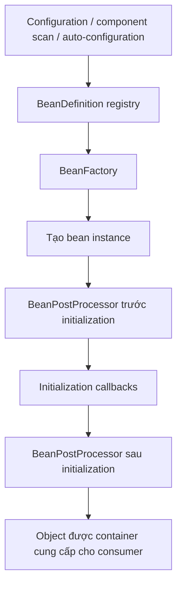

# BeanPostProcessor và giới hạn khi thay đổi cấu trúc bean ngoài thông tin đã biết

Spring Framework cung cấp nhiều extension point để can thiệp vào quá trình tạo và quản lý bean. Trong đó, **`BeanPostProcessor`** cho phép xử lý một bean instance trước hoặc sau initialization; nó thường được dùng để inject thêm hành vi, kiểm tra bean hoặc bọc bean bằng proxy. Tuy nhiên, khi ứng dụng dùng **Spring AOT** để tạo GraalVM Native Image, cần phân biệt rõ việc **thay đổi instance** với việc **thay đổi cấu trúc BeanFactory**.

Spring AOT phân tích cấu hình và bean definitions trong môi trường build để sinh mã chuẩn bị container. Những bean, kiểu dữ liệu và đường truy cập động không thể biết tại thời điểm này có thể không xuất hiện trong kết quả AOT hoặc native executable. Một `BeanPostProcessor` chạy ở runtime vẫn có thể xử lý instance, nhưng không thể mặc nhiên bổ sung một bean definition hoàn toàn mới vào cấu trúc đã được chuẩn bị trước rồi kỳ vọng Native Image nhận diện được mọi lớp, proxy và dependency phát sinh.

## 1. Mục tiêu học tập

Sau bài học, bạn có thể:

- Mô tả thời điểm Spring gọi `BeanPostProcessor` và phân biệt nó với `BeanFactoryPostProcessor`, `BeanDefinitionRegistryPostProcessor`.
- Giải thích bean instance, bean definition, bean graph và vì sao chúng quan trọng với Spring AOT.
- Nhận diện các thao tác post-processing có thể làm thay đổi kiểu đối tượng được nhìn thấy, proxy, dependency resolution hoặc cấu trúc bean.
- Hiểu giới hạn khi cấu trúc bean phụ thuộc vào dữ liệu chỉ xuất hiện ở runtime hoặc không được biết trong quá trình AOT.
- Thiết kế `BeanPostProcessor` có hành vi xác định, dùng kiểu/interface rõ ràng và tương thích với Native Image.
- Chọn đúng extension point AOT và runtime hints khi cần đóng góp mã khởi tạo hoặc mô tả truy cập động.

## 2. Phân biệt BeanDefinition, bean instance và BeanFactory

Trước khi tìm hiểu post-processor, cần tách ba khái niệm:

| Khái niệm | Ý nghĩa | Ví dụ |
| --- | --- | --- |
| **BeanDefinition** | Metadata mô tả cách container tạo và quản lý bean | Bean tên `reportService`, kiểu `ReportService`, constructor nhận `ReportRepository` |
| **Bean instance** | Đối tượng thực tế được tạo từ định nghĩa bean | Một object `ReportService` đang giữ reference tới repository |
| **BeanFactory** | Container quản lý bean definitions và việc tạo/tra cứu bean | `DefaultListableBeanFactory` lưu definitions và quản lý singleton |

Có thể hình dung:



`BeanDefinition` là mô tả; `BeanPostProcessor` chủ yếu can thiệp vào **instance** được tạo từ mô tả đó. Nếu cần thêm, xóa hoặc thay đổi metadata của definitions, phải xem xét extension point ở cấp factory/registry.

Ví dụ một bean service:

```java
public interface ReportOperations {
    String generate();
}

@Service
public class ReportService implements ReportOperations {
    @Override
    public String generate() {
        return "report-ready";
    }
}
```

Spring có thể đăng ký một `BeanDefinition` cho `ReportService`. Khi container tạo bean, constructor được gọi và một instance được tạo. Sau đó các post-processors có thể áp dụng những hành vi phù hợp trước khi object cuối cùng được cung cấp cho các bean khác.

## 3. BeanPostProcessor hoạt động ở giai đoạn nào?

`BeanPostProcessor` là SPI của Spring cho phép xử lý các bean instance. Hai method phổ biến là:

- `postProcessBeforeInitialization(bean, beanName)`: được gọi trước các initialization callbacks của bean.
- `postProcessAfterInitialization(bean, beanName)`: được gọi sau các initialization callbacks; đây là nơi thường được dùng để bọc bean bằng proxy.

Ví dụ đơn giản:

```java
import org.springframework.beans.BeansException;
import org.springframework.beans.factory.config.BeanPostProcessor;
import org.springframework.stereotype.Component;

@Component
public class ReportBeanInspector implements BeanPostProcessor {
    @Override
    public Object postProcessAfterInitialization(Object bean, String beanName)
            throws BeansException {
        if ("reportService".equals(beanName)) {
            // Có thể ghi log hoặc kiểm tra instance.
        }
        return bean;
    }
}
```

Processor trên nhận instance đã được khởi tạo và trả lại chính instance đó. Nó không tạo một `BeanDefinition` mới, không thay đổi danh sách definitions của registry và không yêu cầu Spring quét lại cấu hình.

### 3.1. BeanPostProcessor có thể làm gì?

Các tình huống thường gặp:

- Bọc một service bằng proxy để đo thời gian hoặc thêm logging.
- Tạo wrapper thực thi interface đã biết để thêm retry, metrics hoặc kiểm tra quyền.
- Kiểm tra annotation/metadata của bean và áp dụng hành vi lên instance.
- Tham gia các cơ chế infrastructure như dependency injection, validation hoặc Spring AOP.

Spring sử dụng các `BeanPostProcessor` nội bộ cho nhiều tính năng. Ví dụ, `AutowiredAnnotationBeanPostProcessor` xử lý các annotation injection; các auto-proxy creator tham gia tạo proxy cho AOP. Những processor này là một phần của cơ chế container, không có nghĩa mỗi processor được phép tùy ý thêm bean definitions trong lúc xử lý instance.

### 3.2. BeanPostProcessor không phải công cụ đăng ký bean

`BeanPostProcessor` được gọi khi container đang tạo bean instance. Nếu mục tiêu là đăng ký thêm definitions, cần dùng API phù hợp hơn:

- `BeanDefinitionRegistryPostProcessor` có thể thao tác với registry và đăng ký thêm `BeanDefinition`.
- `BeanFactoryPostProcessor` có thể đọc hoặc sửa metadata definitions trước khi các bean thông thường được khởi tạo.
- `BeanFactoryInitializationAotProcessor` có thể đóng góp mã khởi tạo BeanFactory trong giai đoạn AOT.
- `BeanRegistrationAotProcessor` có thể đóng góp cách đăng ký/khởi tạo cho một bean cụ thể trong giai đoạn AOT.

Không nên dùng `BeanPostProcessor` như một đường vòng để thay đổi cấu trúc container. Nếu một processor tạo object phụ rồi trả về nó, đó là thay đổi **object mà consumer nhận được**; nó vẫn khác với đăng ký một bean definition mới trong registry.

## 4. So sánh các loại post-processor

| Extension point | Thời điểm/chức năng chính | Thao tác phù hợp | Lưu ý AOT |
| --- | --- | --- | --- |
| **BeanDefinitionRegistryPostProcessor** | Trước khi bean thông thường được tạo; làm việc với registry | Đăng ký hoặc thay đổi bean definitions | Kết quả phải xác định được trong AOT; tránh phụ thuộc dữ liệu chỉ có lúc chạy |
| **BeanFactoryPostProcessor** | Sau khi definitions được nạp, trước khi khởi tạo bean thông thường | Điều chỉnh metadata của BeanFactory/definitions | Những thay đổi cần được phản ánh trong graph mà AOT phân tích |
| **BeanPostProcessor** | Trong quá trình tạo từng bean instance | Inject hành vi, kiểm tra, bọc instance/proxy | Kiểu và đường truy cập động phải tương thích với kết quả AOT/native |
| **BeanFactoryInitializationAotProcessor** | Khi Spring tạo đóng góp AOT cho toàn BeanFactory | Sinh mã khởi tạo bổ sung cho container | Dành cho extension cần đóng góp code ở cấp factory |
| **BeanRegistrationAotProcessor** | Khi xử lý từng RegisteredBean trong AOT | Sinh mã đăng ký/tạo bean cụ thể | Phải mô tả được hành vi tạo bean trong AOT |
| **RuntimeHintsRegistrar** | Đăng ký metadata truy cập runtime phục vụ native build | Reflection, resource, proxy, serialization, JNI | Hints mô tả khả năng truy cập; không tự tạo bean definitions |

Hai nhóm API cuối là các extension point dành cho AOT, không phải tên gọi khác của `BeanPostProcessor`. Chọn đúng tầng giúp mô hình container rõ ràng và tránh trông đợi một thay đổi runtime có thể được suy ra tự động trong quá trình build.

## 5. Vì sao Spring AOT giới hạn thay đổi cấu trúc bean động?

### 5.1. AOT cần biết trước bean graph

Ở giai đoạn build, Spring AOT phân tích cấu hình ứng dụng và chuẩn bị cách khởi tạo BeanFactory. Những đầu vào quan trọng có thể gồm:

- Các lớp cấu hình, component scan, `@Import` và auto-configuration.
- Classpath và các điều kiện `@Conditional`.
- Profile và properties ảnh hưởng đến bean definitions.
- Các registry/factory post-processors có thể chạy trong quá trình phân tích.
- Các extension AOT và runtime hints được ứng dụng/thư viện cung cấp.

Kết quả là một mô hình bean đã biết để Spring sinh mã và GraalVM phân tích reachability. Native Image sử dụng giả định **closed-world**: các lớp và đường truy cập cần thiết phải được biết hoặc được mô tả đủ tại build time.

Nếu bean graph phụ thuộc vào một file được tạo sau khi deploy, danh sách plugin tải từ network, tenant mới được thêm vào database hoặc tên lớp lấy từ một chuỗi không thể dự đoán, AOT không thể mặc nhiên biết toàn bộ cấu trúc sẽ xuất hiện.

### 5.2. Cấu trúc được quyết định ở build time

Ví dụ cấu hình một audit bean theo property:

```java
import org.springframework.boot.autoconfigure.condition.ConditionalOnProperty;
import org.springframework.context.annotation.Bean;
import org.springframework.context.annotation.Configuration;

@Configuration(proxyBeanMethods = false)
class AuditConfiguration {
    @Bean
    @ConditionalOnProperty(
        prefix = "feature",
        name = "audit-enabled",
        havingValue = "true"
    )
    AuditSink auditSink() {
        return new AuditSink();
    }
}

class AuditSink {
}
```

Nếu `feature.audit-enabled=true` trong môi trường AOT, bean có thể được đưa vào graph đã chuẩn bị. Nếu AOT xử lý với giá trị `false` và vì thế không đăng ký bean, chỉ đổi property thành `true` khi chạy native executable không tự làm Spring phân tích lại toàn bộ cấu hình để sinh thêm definition.

Điều này không có nghĩa mọi property đều bị cố định. Một property dùng làm timeout, URL hoặc tham số nghiệp vụ có thể vẫn được đọc từ environment khi runtime, miễn là nó không cần làm thay đổi cấu trúc bean đã được chuẩn bị. Cần xác định rõ property nào là **cấu hình cấu trúc** và property nào là **dữ liệu vận hành**.

### 5.3. Post-processor phụ thuộc thông tin chỉ có lúc runtime

Ví dụ một `BeanDefinitionRegistryPostProcessor` tải danh sách plugin từ remote service rồi tạo một definition cho mỗi plugin. Khi AOT chạy ở CI, remote service có thể chưa sẵn sàng hoặc trả về danh sách khác với production. Kết quả build khi đó không đại diện cho bean graph lúc chạy.

Các nguồn dữ liệu có rủi ro:

- Network/database chỉ truy cập được sau khi deploy.
- Thời gian hiện tại, số ngẫu nhiên hoặc trạng thái hệ thống biến động.
- File cấu hình/secret được mount riêng ở production.
- Danh sách tenant, plugin hoặc module được cập nhật độc lập với artifact.
- Tên lớp được tạo từ dữ liệu bên ngoài rồi nạp bằng reflection.

Với dữ liệu loại này, không nên dùng nó để quyết định một tập bean definitions phải được biết trước. Hãy cân nhắc giữ cấu trúc container cố định và biểu diễn dữ liệu thay đổi trong một registry/service runtime.

## 6. BeanPostProcessor bọc bean bằng wrapper đã biết

Một trường hợp phù hợp với `BeanPostProcessor` là bọc một bean instance bằng một lớp wrapper cụ thể, có kiểu đã biết từ source code.

### 6.1. Định nghĩa interface và implementation

```java
import org.springframework.stereotype.Service;

interface ReportOperations {
    String generate();
}

@Service("reportService")
class DefaultReportService implements ReportOperations {
    @Override
    public String generate() {
        return "report-ready";
    }
}
```

### 6.2. Tạo wrapper có kiểu xác định

```java
final class TimedReportOperations implements ReportOperations {
    private final ReportOperations delegate;

    TimedReportOperations(ReportOperations delegate) {
        this.delegate = delegate;
    }

    @Override
    public String generate() {
        long started = System.nanoTime();
        try {
            return delegate.generate();
        }
        finally {
            long elapsedNanos = System.nanoTime() - started;
            System.out.println("reportService took " + elapsedNanos + " ns");
        }
    }
}
```

### 6.3. Dùng BeanPostProcessor để trả wrapper

```java
import org.springframework.beans.BeansException;
import org.springframework.beans.factory.config.BeanPostProcessor;
import org.springframework.stereotype.Component;

@Component
public class ReportTimingPostProcessor implements BeanPostProcessor {
    @Override
    public Object postProcessAfterInitialization(Object bean, String beanName)
            throws BeansException {
        if ("reportService".equals(beanName)
                && bean instanceof ReportOperations operations) {
            return new TimedReportOperations(operations);
        }
        return bean;
    }
}
```

Consumer nên phụ thuộc vào interface:

```java
import org.springframework.stereotype.Component;

@Component
class ReportController {
    private final ReportOperations reports;

    ReportController(ReportOperations reports) {
        this.reports = reports;
    }

    String getReport() {
        return reports.generate();
    }
}
```

Trong ví dụ này:

1. Bean definition của `reportService` vẫn được đăng ký từ cấu hình/component scan.
2. Spring tạo `DefaultReportService`.
3. `ReportTimingPostProcessor` nhận instance sau initialization và trả về `TimedReportOperations`.
4. Consumer nhận object qua contract `ReportOperations` và không phụ thuộc vào implementation cụ thể.

Wrapper là một lớp tĩnh đã được tham chiếu trong source nên dễ được compiler và AOT phân tích hơn một lớp được tạo từ tên runtime. Tuy nhiên, ví dụ này vẫn cần kiểm tra hành vi thực tế với các tính năng container mà bean sử dụng.

### 6.4. Hệ quả của việc thay đổi kiểu instance

Khi `BeanPostProcessor` trả về wrapper, object cuối cùng có thể không còn là instance của implementation ban đầu. Vì vậy:

- Inject theo interface chung thường rõ ràng hơn inject theo concrete class.
- Tra cứu bằng `getBean(DefaultReportService.class)` có thể không cho kết quả như mong đợi nếu object được expose cuối cùng là wrapper không kế thừa class đó.
- Các điều kiện, kiểm tra kiểu và công cụ quan sát bean cần hiểu rằng instance được trả về đã được bọc.
- Nếu wrapper tạo proxy động, cần xem xét metadata proxy/reflection mà Native Image yêu cầu.

Không nên bọc mọi bean một cách tổng quát nếu không kiểm soát được kiểu trả về, thứ tự post-processors, circular dependencies và lifecycle. Với các nhu cầu AOP phổ biến, ưu tiên cơ chế Spring AOP đã được tích hợp và hỗ trợ AOT khi phù hợp.

## 7. Khi nào cần đăng ký BeanDefinition mới?

Nếu yêu cầu thực sự là thêm một bean definition, `BeanPostProcessor` không phải extension point phù hợp. Có thể xem xét `BeanDefinitionRegistryPostProcessor` khi số lượng và loại bean xác định được trong giai đoạn phân tích.

Ví dụ sau minh họa việc đăng ký một definition cố định. Nó là mẫu để hiểu API; nếu đưa vào ứng dụng AOT, cần bảo đảm processor được phát hiện trong quá trình AOT và logic không phụ thuộc dữ liệu runtime thay đổi:

```java
import org.springframework.beans.BeansException;
import org.springframework.beans.factory.support.BeanDefinitionBuilder;
import org.springframework.beans.factory.support.BeanDefinitionRegistry;
import org.springframework.beans.factory.support.BeanDefinitionRegistryPostProcessor;
import org.springframework.context.annotation.Configuration;

@Configuration(proxyBeanMethods = false)
class FixedAuditRegistration implements BeanDefinitionRegistryPostProcessor {
    @Override
    public void postProcessBeanDefinitionRegistry(
            BeanDefinitionRegistry registry) throws BeansException {
        if (!registry.containsBeanDefinition("fixedAuditSink")) {
            registry.registerBeanDefinition(
                "fixedAuditSink",
                BeanDefinitionBuilder
                    .genericBeanDefinition(AuditSink.class)
                    .getBeanDefinition()
            );
        }
    }

    @Override
    public void postProcessBeanFactory(
            org.springframework.beans.factory.config.ConfigurableListableBeanFactory beanFactory)
            throws BeansException {
        // Không cần chỉnh sửa thêm BeanFactory trong ví dụ này.
    }
}
```

Định nghĩa này có tên và kiểu cố định. Spring có thể nhìn thấy nó trong quá trình phân tích nếu processor được đăng ký và thực thi trong context AOT. Nhưng nếu logic được đổi thành “đọc tên lớp từ database rồi đăng ký mỗi lớp thành một bean”, tập definitions không còn xác định được từ build input.

**Đừng nhầm việc registry post-processor có thể đăng ký definition với việc mọi cách đăng ký động đều tương thích AOT.** Khả năng tương thích phụ thuộc thời điểm processor chạy, thông tin nó cần, generated code có thể tái tạo thay đổi đó hay không và các lớp phát sinh có được native compiler biết hay không.

## 8. Các extension point dành cho AOT

Khi một thư viện hoặc ứng dụng có hành vi đặc biệt mà Spring AOT mặc định chưa mô tả được, hãy chọn extension point đúng với mục đích.

### 8.1. BeanFactoryInitializationAotProcessor

`BeanFactoryInitializationAotProcessor` làm việc ở cấp toàn BeanFactory trong quá trình AOT. Nó có thể trả về một contribution để Spring sinh mã khởi tạo bổ sung. Dùng khi phần mở rộng cần xem xét cấu trúc factory tổng thể hoặc thêm bước chuẩn bị có thể tái tạo trong generated initialization code.

### 8.2. BeanRegistrationAotProcessor

`BeanRegistrationAotProcessor` xử lý một `RegisteredBean` cụ thể và có thể cung cấp contribution cho việc đăng ký/khởi tạo bean đó. Dùng khi cách tạo một bean cần thêm mã AOT hoặc thông tin chuyên biệt.

### 8.3. RuntimeHintsRegistrar

`RuntimeHintsRegistrar` đăng ký metadata để Native Image biết một số kiểu/member/resource/proxy được truy cập theo cách không dễ suy ra từ static analysis. Ví dụ:

```java
import org.springframework.aot.hint.MemberCategory;
import org.springframework.aot.hint.RuntimeHints;
import org.springframework.aot.hint.RuntimeHintsRegistrar;

class ReportRuntimeHints implements RuntimeHintsRegistrar {
    @Override
    public void registerHints(RuntimeHints hints, ClassLoader classLoader) {
        hints.reflection().registerType(
            ReportPayload.class,
            MemberCategory.INVOKE_PUBLIC_CONSTRUCTORS
        );
    }
}
```

Ví dụ chỉ đăng ký constructor public cho `ReportPayload`. Nếu ứng dụng cần truy cập field, method, resource, serialization hay JDK proxy, phải đăng ký đúng loại truy cập tương ứng. Hints **không đăng ký `ReportPayload` thành Spring bean** và cũng không tạo definition mới.

Có thể gắn registrar với cấu hình:

```java
import org.springframework.context.annotation.Configuration;
import org.springframework.context.annotation.ImportRuntimeHints;

@Configuration(proxyBeanMethods = false)
@ImportRuntimeHints(ReportRuntimeHints.class)
class ReportNativeConfiguration {
}
```

### 8.4. Chọn extension point theo yêu cầu

| Nhu cầu | Hướng phù hợp |
| --- | --- |
| Thêm logging hoặc wrapper cho instance đã có | `BeanPostProcessor` |
| Thay metadata của definitions | `BeanFactoryPostProcessor` |
| Đăng ký definitions đã biết trong registry | `BeanDefinitionRegistryPostProcessor` |
| Bổ sung mã khởi tạo cho toàn factory trong AOT | `BeanFactoryInitializationAotProcessor` |
| Bổ sung cách tạo/đăng ký một bean trong AOT | `BeanRegistrationAotProcessor` |
| Mô tả reflection/resource/proxy cần cho Native Image | `RuntimeHintsRegistrar` |
| Thêm plugin/tenant thay đổi liên tục khi chạy | Runtime registry/service, không biến mỗi mục thành Spring bean definition mới nếu không cần |

## 9. Thiết kế khi số lượng bean phụ thuộc dữ liệu runtime

Giả sử ứng dụng đa tenant nhận danh sách tenant từ database. Mỗi tenant có một cấu hình xử lý báo cáo khác nhau.

Một thiết kế dễ gây khó khăn cho AOT là tạo một `BeanDefinition` cho từng tenant trong lúc ứng dụng chạy. Số tenant có thể thay đổi sau build, mỗi tenant có thể trỏ tới implementation khác nhau và tên lớp có thể chỉ xuất hiện trong dữ liệu.

Thay vào đó, có thể giữ một service cố định và lưu cấu hình tenant dưới dạng dữ liệu:

```java
import java.util.Map;
import java.util.concurrent.ConcurrentHashMap;
import org.springframework.stereotype.Component;

record TenantReportConfig(String templateName, boolean enabled) {
}

@Component
class TenantReportRegistry {
    private final Map<String, TenantReportConfig> configurations =
            new ConcurrentHashMap<>();

    void update(String tenantId, TenantReportConfig config) {
        configurations.put(tenantId, config);
    }

    TenantReportConfig find(String tenantId) {
        return configurations.get(tenantId);
    }
}
```

Bean `TenantReportRegistry` là một bean có kiểu xác định, được đăng ký trong cấu hình Spring. Số lượng tenant và giá trị cấu hình có thể thay đổi trong map khi runtime mà không cần tạo thêm Spring bean definitions. Nếu mỗi tenant thực sự cần một thuật toán khác nhau, có thể dùng một tập strategy class đã biết trước và chọn strategy theo dữ liệu tenant.

### Ba câu hỏi trước khi tạo bean động

1. **Có thật sự cần một Spring bean riêng?** Nếu chỉ là dữ liệu, cấu hình hoặc trạng thái, dùng object/record trong một registry thường đơn giản hơn.
2. **Kiểu và số lượng có biết tại build time không?** Nếu không, tránh dựa vào AOT để tự suy ra definitions phát sinh.
3. **Hành vi có thể biểu diễn bằng interface/strategy đã biết trước không?** Nếu có, giữ tập implementation rõ ràng và chọn tại runtime bằng dữ liệu.

## 10. Kiểm thử BeanPostProcessor và AOT

Không nên chỉ kiểm tra rằng context khởi động thành công. Một processor có thể làm thay đổi object mà consumer nhận được, khiến lỗi chỉ xuất hiện khi inject theo concrete class hoặc khi chạy native.

### 10.1. Unit/integration test trên JVM

Kiểm tra:

- Processor có chỉ xử lý đúng bean name/type dự kiến.
- Bean không thuộc phạm vi được trả nguyên vẹn.
- Wrapper giữ đúng interface và delegate hành vi.
- Consumer inject theo contract dự kiến.
- Thứ tự processor và initialization callbacks không gây side effect ngoài mong muốn.

Ví dụ kiểm tra contract:

```java
import static org.assertj.core.api.Assertions.assertThat;
import org.junit.jupiter.api.Test;
import org.springframework.context.annotation.AnnotationConfigApplicationContext;

class ReportPostProcessorTests {
    @Test
    void exposesReportOperationsContract() {
        try (var context =
                new AnnotationConfigApplicationContext(ReportTestConfiguration.class)) {
            Object bean = context.getBean("reportService");

            assertThat(bean).isInstanceOf(ReportOperations.class);
            assertThat(context.getBean(ReportOperations.class).generate())
                .isEqualTo("report-ready");
        }
    }
}
```

`ReportTestConfiguration` trong test cần đăng ký service và processor của ví dụ. Assertion minh họa việc kiểm tra interface contract; không khẳng định object cuối cùng phải có class bằng `DefaultReportService`.

### 10.2. Kiểm thử đường AOT

Chạy AOT processing bằng Maven/Gradle đã cấu hình, quan sát generated output và xác nhận:

1. Processor/configuration cần thiết được phát hiện.
2. Bean definitions mong đợi có trong graph ở điều kiện build.
3. Các đóng góp AOT và runtime hints được tạo/đăng ký.
4. Các kiểu wrapper/proxy cần thiết có thể được compiler reachability analysis nhận biết.
5. Cấu hình runtime không giả định sẽ bổ sung bean definitions không có trong graph build.

### 10.3. Integration test trên Native Image

Cuối cùng chạy native executable/container và kiểm thử:

- Bean được expose theo interface đúng.
- Proxy/wrapper gọi được delegate.
- Reflection, dynamic proxy, serialization và resource nếu có.
- Các nhánh profile/condition đã chọn khi build.
- Các service bên ngoài, lifecycle, shutdown và health/readiness.

JVM test thành công chưa chứng minh native build thành công. Native Image có thể phát hiện thiếu metadata hoặc reachability mà JVM không yêu cầu.

## 11. Những lỗi thiết kế thường gặp

| Cách làm | Vấn đề | Cách điều chỉnh |
| --- | --- | --- |
| Dùng `BeanPostProcessor` để đăng ký bean mới | Sai tầng API; processor xử lý instance | Dùng registry post-processor hoặc AOT contribution phù hợp |
| Đọc danh sách plugin từ network trong lúc AOT | Kết quả build phụ thuộc môi trường ngoài và không tái tạo được | Dùng cấu hình build cố định hoặc runtime plugin registry |
| Tạo class bằng tên lấy từ database | Native Image khó xác định reachability/reflection | Dùng tập strategy class đã biết, hoặc cung cấp metadata chính xác |
| Wrapper thay đổi kiểu bean nhưng consumer inject concrete class | Type lookup/autowiring có thể thất bại | Expose và inject theo interface contract |
| Tạo JDK proxy mà không mô tả proxy cần thiết | Native Image có thể thiếu proxy metadata | Dùng Spring AOP được hỗ trợ hoặc đăng ký proxy hints |
| Bổ sung reflection hints để chữa bean chưa được đăng ký | Hints không thay thế BeanDefinition | Sửa cấu hình/registry/AOT contribution |
| Thay profile ở runtime và mong graph tự thay đổi | Graph đã được chuẩn bị theo build input | Build artifact với điều kiện cấu trúc phù hợp |
| Dựa vào side effect lúc khởi tạo processor | Build và runtime có thể chạy ở môi trường khác | Giữ xử lý AOT thuần, xác định và có thể tái tạo |

## 12. Ghi nhớ

- `BeanPostProcessor` xử lý **bean instance** trước/sau initialization; nó có thể trả về wrapper hoặc proxy, nhưng không phải công cụ đăng ký bean definitions.
- `BeanDefinitionRegistryPostProcessor` và `BeanFactoryPostProcessor` làm việc ở tầng cấu trúc/metadata của container; những thay đổi cần phù hợp với những gì Spring AOT có thể quan sát và tái tạo.
- Spring AOT cần bean graph xác định từ cấu hình, classpath và điều kiện build. Cấu trúc phụ thuộc vào dữ liệu runtime không thể biết trước là một giới hạn quan trọng.
- Khi bọc bean, dùng interface/kiểu rõ ràng và kiểm tra ảnh hưởng tới autowiring, lookup, lifecycle và proxy.
- Dùng `BeanFactoryInitializationAotProcessor`, `BeanRegistrationAotProcessor` và `RuntimeHintsRegistrar` cho các đóng góp AOT/metadata đúng tầng; hints không tạo bean definitions.
- Với plugin, tenant hoặc dữ liệu thay đổi thường xuyên, ưu tiên runtime registry/service và strategy class đã biết trước khi cần.
- Kiểm thử cả JVM AOT và native executable/container để phát hiện khác biệt về bean graph, proxy, reflection, resource và reachability.

Khi thiết kế post-processing theo đúng ranh giới, ứng dụng có thể giữ được tính linh hoạt cần thiết mà vẫn cung cấp cho Spring AOT và GraalVM một mô hình bean đủ rõ ràng để phân tích, sinh mã và biên dịch native.
